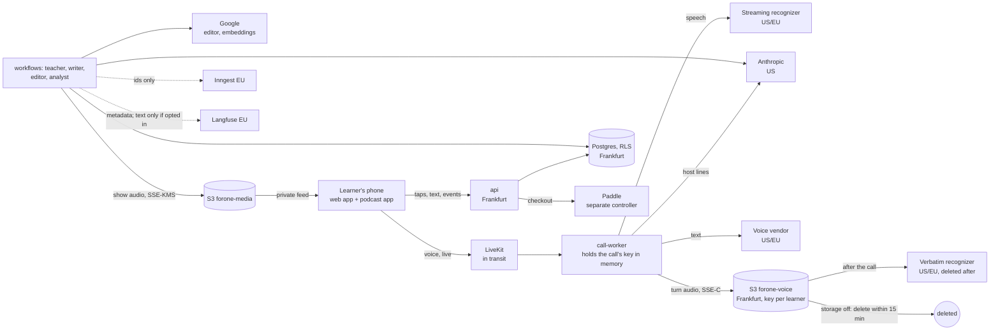

# Data protection impact assessment

> **Self-reviewed against legal/00; not reviewed by a lawyer; see the triggers** ([00-self-review-checklist.md](00-self-review-checklist.md) §25). The DPIA required by GDPR Art. 35, completed by Muath as the assessor from the official templates (the ICO DPIA template and the CNIL PIA method; legal/00 §17), from 07 §3.1 (threat model) and §4.9 (register), 04 §4.12 and §4.14, PRD-v3 Parts 1.3 and 11.4, and ADR-25.3.

| | |
|---|---|
| Controller | `[Company legal name]`, `[Address]` |
| Processing | For one: a personal AI podcast and live voice calls for adult language learners, with a long-term learner model |
| Assessor | Muath (owner) |
| Status | Written; signed off by Muath in §8 before public launch (register A4) |
| Scope | Every learner, wherever they live, under GDPR-grade controls (ADR-25.3); UK GDPR Art. 35 and the Saudi PDPL impact-assessment rule are met by the same document |
| Review | Before public launch; 4 and 8 weeks after launch, with the launch health measures; on any trigger in §9 |

---

## 1. Summary

For one processes adult learners' voices, the things they say about their lives, and a continuous model of their language ability, using US and EU AI vendors, for a paid service open to anyone in any country. That combination meets several of the criteria that make a DPIA mandatory. The design carries strong controls: voice encrypted under a key per learner and deleted within 15 minutes unless the learner chooses to keep it; no voiceprints; facts stored only from the learner's own quoted words; sensitive facts kept only after a one-tap card; explicit consent at account creation for the private content transcripts keep; row-level isolation; only the founder can read content, and every read is logged and shown to the learner; the AI agent that builds the product never touches learner data; deletion windows checked by an independent job; a fixed crisis protocol. **The residual risk is medium-low overall, with three risks still medium** (R3 special-category content in transcripts, R6 crisis response, R8 transfers), each with an action in §7. No risk remains high, so no prior consultation is needed.

## 2. Why a DPIA is needed

| Criterion (WP248 rev.01; GDPR Art. 35(3)) | Applies? | Why |
|---|---|---|
| Evaluation or scoring, including profiling | Yes | The learner model estimates listening, reading, speaking and writing ability, scores pronunciation internally, and profiles interests and errors to plan every episode |
| Systematic monitoring | Partly | Every call, chat and in-app action is logged to the learner's event log for the life of the account |
| Sensitive data or data of a highly personal nature | Yes | Voice; life facts; special-category content learners volunteer in conversation; crisis disclosures |
| Large scale | Not at launch | Open signup; the design target is 10,000 learners. Re-assess at 1,000 (legal/00 §5) |
| Innovative technology | Yes | Generative AI hosts in live voice conversation; AI-produced personal audio |
| Data transfers outside the EU | Yes | Model, voice and recognition vendors in the US |
| Vulnerable people | Possibly | Adults only, but a learner may be in distress (the crisis protocol exists for that) |

## 3. Systematic description of the processing

### 3.1 Nature

A learner hears a short personal episode each day (1, 2 or 3 new episodes by plan), calls an AI host for 5 to 7 minutes, may read an article and chat. AI roles plan, write, voice and analyse; code decides what is stored. The learner model is nine stores computed from an append-only event log (PRD Part 7). The learner can open everything in a notebook, edit or delete any fact, and export or delete all of it.

### 3.2 Scope

| Data | Subjects | Volume | Retention |
|---|---|---|---|
| Identity: name used by hosts, email, birth date, residence country, languages, time zone | Learners | Open signup | Life of account |
| Voice: call turns, full call recording, voice notes, "say it once", shadowing, then-and-now recordings, the name clip | Learners | About 7 minutes of learner speech per session | 15 minutes unless the learner keeps recordings; then until deleted |
| Transcripts and chat, including whatever the learner chooses to say | Learners; people they mention (first names or roles) | About 300 events per session | Life of account |
| Life facts and quotes; sensitive facts after the card | Learners; people they mention | At most two facts used per episode | Life of account; sensitive facts per ADR-24.10 |
| Derived model: word bank, structures, errors, skills, interests, goals, taste | Learners | | Life of account |
| Prompts and completions (`model_io`) | Learners | Every model call | 90 days |
| Billing state (no card data) | Learners | | Life of account; Paddle keeps its own |
| Security and audit records | Learners, the owner | | 24 months |
| Crisis log (no content: date, residence country, resource shown, whether the call ended, `host_confirmed`, `learner_declined`; ADR-24.B15, B20) | Learners | Rare | Life of account; de-identified on deletion and kept 3 years, then deleted |
| Pseudonymized, de-identified transcripts (opt-in) | Learners who opt in | | Until revoked or deleted |
| Volunteer clips for the vendor tests (ADR-25.6) | About 30 volunteers | About 30 clips | Until the tests no longer need them, at most 12 months |

Full retention schedule: [05-ropa.md](05-ropa.md) §4.

### 3.3 Context

Learners are adults from any country who already understand some of the target language. They sign up after hearing a free sample and pay after a free week. They expect the show to remember them; that expectation is the product. They do not expect their words to be read by people, used for anything but their show, or kept after they leave; the trust contract (PRD 1.3) promises exactly that. The hosts sustain a relationship across episodes, so a learner may disclose more than they would to a form. Some learners will be in difficult moments; the crisis protocol (07 §4.8) exists for them. The product is built and operated by an AI coding agent under Muath (ADR-25.2); the agent works only with synthetic learners.

### 3.4 Purposes

1. Make and deliver the learner's show (episodes, calls, articles, chat) and plan it from their own words.
2. Show the learner honest evidence of their progress (the claim gate, LAW-12).
3. Keep the learner safe in a crisis and count how often the protocol is used (SB 243-style duties for everyone, ADR-24.9).
4. Bill the subscription (through Paddle).
5. Secure the service, prevent abuse, and prove the privacy promises are kept.
6. With opt-in consent only: check and improve the teacher with pseudonymized transcripts.

### 3.5 Data flow

## 4. Necessity and proportionality

### 4.1 Lawful basis

As fixed in legal/00 §7: contract for making the show, including transient voice processing and transcripts; explicit consent at account creation for the special-category content transcripts keep and for the safety protocol; consent for keeping recordings and for research use; explicit consent by the one-tap card for keeping a sensitive fact; legitimate interests for security, audit and the trial limit; vital interests when a learner in crisis cannot act. Transfers to US vendors rest on SCCs with a transfer impact assessment, and the Data Privacy Framework where a vendor is certified, never on consent (ADR-24.B13).

### 4.2 Minimization

- **Told, not inferred** (TC-6): a life fact is stored only if its quote appears word for word in the verbatim transcript (FR-620); nothing is looked up outside the app; sensitive classes are never inferred.
- At most two life facts per episode; unconfirmed facts are never spoken (FR-312, FR-621).
- Voice is not kept by default; recordings are opt-in; no voiceprints or speaker embeddings (legal/00 §10).
- Each AI role gets a compiled brief, never the whole learner file (FR-602, FR-640).
- Tracing holds metadata only unless the learner opted in (ADR-09); event payloads in Inngest carry ids only (07 §4.9).
- No analytics vendor, no third-party scripts, no ads (06). Email one-time code is the only sign-in, so no sign-in provider receives data (ADR-25.4).
- Payment data stays with Paddle; we keep ids, amounts and an invoice link, never raw webhook bodies (07 §4.14 rule 10).

**Where we keep more than strictly needed, and why.** Transcripts are kept for the life of the account, not just the session, because the learner model is rebuilt from the log when the analyst improves (FR-601, FR-630) and because the learner's own past sentences are the evidence for every progress claim. Prompts and completions are kept 90 days in the home region for debugging.

### 4.3 Accuracy

The confidence ladder (FR-621), learner edits as ground truth at once, a wrong memory treated as a bug and counted (TC-7), and the claim gate's five rules for any statement about progress (FR-840).

### 4.4 Transparency and rights

The privacy notice ([01](01-privacy-notice.md)) in the learner's own language, linked at A1, announced at A2 with the notice line before any voice is processed (ADR-24.B14) and acknowledged at account creation; plain consent strings ([03](03-consent-texts.md)); the notebook shows every fact with its source; Controls give export within 72 hours (within 1 hour once automated, ADR-24.B7), correction at once, deletion with a typed "delete" and no grace period (ADR-24.B1); the export carries the consent history, the access log, the privacy job runs and the processor list (07 §4.5). Every learner gets GDPR rights wherever they live.

### 4.5 Processors and transfers

Every vendor is in the register with what it sees, where and for how long, under its standard DPA; no vendor is called from code until its DPA is recorded (07 §4.9, handbook 09 §9). Training is switched off everywhere it can be; zero data retention is requested from Anthropic (register A1). The home region is the EU.

## 5. Consultation

| Who | How | When | Outcome |
|---|---|---|---|
| Learners | No learner exists before launch. After launch, the weekly "was this week worth your time?" answer, support email and complaints are read for privacy concerns | 4 and 8 weeks after launch | `[Muath records what learners raised]` |
| Volunteers | The volunteers who record vendor-test clips read the one-line consent and can ask questions (ADR-25.6) | Before the vendor choice | `[Muath records any concerns]` |
| Processors | Standard DPAs and retention settings per vendor; zero retention requested from Anthropic | Before public launch | Recorded in [05-ropa.md](05-ropa.md) §3 |
| Self-review | An independent AI review pass reads this DPIA against legal/00; Muath ticks the checklist | Before public launch | Recorded in legal/00's revision log |
| Security | Tabletop of the incident runbook before launch; CI scans, a ZAP baseline and the AI security review instead of a paid penetration test, which becomes a trigger at 1,000 paying learners, a B2B contract or any incident (ADR-25.11) | Before launch; after launch | Pending |

## 6. Risks to the people involved

Likelihood: remote, possible, probable. Severity: minimal, significant, severe. "Inherent" is before the measures; "residual" after. References are to architecture 07 unless marked.

| # | Risk to the person | Inherent | Measures | Residual |
|---|---|---|---|---|
| R1 | **Recordings of their voice are exposed** in a breach or by a mistake | Possible, severe | Learner-voice kinds are SSE-C under a per-learner key that only three task roles can unwrap, with a purpose logged (D1, D2, §4.1); storage off by default with 15-minute deletion verified hourly (D5); no public buckets; key destruction on deletion makes missed copies unreadable | Remote, severe: **low** |
| R2 | **Their voice is used to identify them, cloned, or kept by a vendor** longer than said | Possible, severe | No voiceprints, speaker identification, diarization or cloning (legal/00 §10); vendor retention set to the minimum, training switched off (§4.9); the verbatim recognizer, which sees the most voice, set to delete after transcription; monthly check of vendor settings (§5) | Remote, significant: **low** |
| R3 | **Private things they said (health, beliefs, sexuality) are kept and could be exposed or misused** | Probable, severe | Explicit consent at account creation for what transcripts keep (legal/00 §7); sensitive classes never inferred; a sensitive fact kept only after a one-tap card and never brought up first; never in a brief for the teacher, writer or host (04 §4.7.3); dropped from the research set (04 §4.12.4); RLS; any fact deletable. The transcript itself still keeps everything said, for the life of the account | Possible, severe: **medium**. Action 1 |
| R4 | **The show "knows" something wrong or invented about them** and says it | Possible, significant | Quote check, confidence ladder, edits as ground truth, wrong memory counted as a bug (FR-620 to FR-626) | Remote, significant: **low** |
| R5 | **The AI relationship manipulates them** (guilt, dependency, engagement tricks) | Possible, significant | The twelve laws and trust contract; the output guard blocks guilt lines, humanity claims and progress claims (§4.10); a finite daily portion, no autoplay; exactly three message kinds; honest AI disclosure | Remote, significant: **low** |
| R6 | **A learner in crisis is not helped, or is harmed by the response**; a false alarm stops the show | Possible, severe | Five triggers including the host and the after-session analyst; a two-stage keyword trigger that fails safe after 2 seconds; fixed clips; resources from a maintained international helpline directory for the learner's country; the turn is quarantined from memory and claims (§4.8, [06](06-crisis-protocol.md)). Detection is imperfect | Possible, severe: **medium**. Action 2 |
| R7 | **A minor uses the product** and their data is processed | Possible, significant | 18+ attestation at A1 before anything else, birth date at account creation, refusal deletes everything (D8). About 8 minutes of pre-account processing happen before the birth date, under the 15-minute voice rule | Possible, minimal: **low** |
| R8 | **Data transferred to US vendors** is accessed by authorities or held under weaker protection | Possible, significant | EU home region; minimum data per vendor; metadata-only tracing; SCCs with a transfer impact assessment, DPF where certified, never consent (ADR-24.B13); zero retention requested from Anthropic | Possible, significant: **medium**. Action 3 |
| R9 | **The founder reads their content** without good reason | Possible, significant | Only the owner role exists; every content read logged in `audit_log` and listed in the learner's export; pgaudit on human SQL; break-glass with a reason and MFA (§4.12, §4.13) | Remote, significant: **low** |
| R10 | **The AI agent that builds the product sees their data**, or copies it into code, logs or prompts | Possible, significant | The agent works only with synthetic learners and has no production credentials or database role (legal/00 §15); Muath approves every production deploy and migration (ADR-25.2) | Remote, significant: **low** |
| R11 | **Their words leak into logs** (error trackers, cloud logs) | Possible, significant | Vendor error bodies never logged; scrubber with a PII corpus test; no learner ids in Sentry (§4.12; 09) | Remote, significant: **low** |
| R12 | **Another learner sees their data**, or a prompt injection extracts it | Remote, severe | RLS on every learner table with a CI walk; hosts have no tools; the shared-store invariant (§4.2, §4.10) | Remote, severe: **low** |
| R13 | **Deletion promises are broken** (audio not deleted, account not purged) | Possible, significant | Every deletion job writes evidence; an independent hourly checker re-verifies from the data; manual snapshots forbidden; backups expire at 30 days (D5, §4.4) | Remote, significant: **low** |
| R14 | **Their private feed or episodes spread**, including via podcast apps' servers | Possible, significant | 32-byte unguessable token, excluded from directories, one-tap reset, many-IP warning (06, §4.11); disclosed in the notice. Third-party podcast apps may store episodes under their own terms | Possible, significant: **medium-low**. Disclosure only |
| R15 | **They are processed before they understand what happens** (order A) | Probable, minimal | Age attested at A1; the notice line and link at A2 before any voice (ADR-24.B14); all pre-account voice deleted within 15 minutes; abandoned pre-accounts deleted after 24 hours | Remote, minimal: **low** |
| R16 | **Consent is not free** (bundled, pre-ticked, nudged) | Possible, significant | Every consent separate and unticked; voice storage and data use off by default and refusable with the product still working; data use asked only in Controls; no dark patterns (FR-1231) | Remote, significant: **low** |
| R17 | **The research set re-identifies them** | Remote, significant | Opt-in only; names, places, employers and dates replaced; turns quoting sensitive facts dropped; no bulk export; deleted on revoke or deletion (04 §4.12.4) | Remote, significant: **low** |
| R18 | **Volunteers' clips are used beyond what they agreed** | Possible, minimal | A one-line recording consent naming the use and the deletion (ADR-25.6); clips deleted on request or within 12 months; open corpora only under a commercial licence (speechocean762, Apache-2.0); no clip in a public repository | Remote, minimal: **low** |
| R19 | **Identity data outlives deletion** through payment records | Possible, minimal | No raw webhook bodies; the processor's customer deleted through the adapter; Paddle keeps tax records as seller under its own notice (§4.14) | Remote, minimal: **low** |
| R20 | **Inaccurate claims about their progress** mislead them about what they paid for | Possible, significant | The claim gate in code; only gated claims reach the proof; only event claims until the calibration set exists (ADR-25.6); a monthly audit of claims by Muath and an AI review pass (FR-840, NFR-502) | Remote, significant: **low** |

## 7. Measures still to take (actions)

Each must be done before public launch unless marked otherwise. Owner "agent" means the AI coding agent, with Muath approving the merge.

| # | Action | Owner | Needed before | Closes |
|---|---|---|---|---|
| 1 | Ship `special_category` as a required checkbox at account creation; keep the sensitive-fact card; re-read whether transcript retention can be shortened after the first months of real use | Agent, Muath | Public launch; the retention review 8 weeks after launch | R3 |
| 2 | Render the crisis clips from [06](06-crisis-protocol.md) §3; wire the helpline directory by country; run the keyword lists over the synthetic and scripted calls and the volunteer clips to measure false starts | Agent, Muath | Public launch | R6 |
| 3 | Accept every vendor's standard DPA, record its SCC module and DPF status, file the transfer impact assessments, and request zero retention from Anthropic (register A1) | Muath | The agent's first deploy to staging | R2, R8 |
| 4 | Confirm the agent has no production credential or database role, and that fixtures are synthetic | Muath | The first production deploy | R10 |
| 5 | The 07 §7 deliverables, in the order of `backlog/00-release-plan.md`: keys and audit, guard and research pseudonyms, consent flow and age gate, output guard and crisis, `privacy/verify` and the incident tabletop | Agent | Public launch | R1, R9, R11 to R13 |

## 8. Conclusion and sign-off

With the actions in §7 done, the residual risk is medium-low and no risk remains high, so prior consultation with a supervisory authority under Art. 36 is not needed.

| Role | Name | Decision | Date |
|---|---|---|---|
| Assessor and owner | Muath | `[approve / approve with changes]` | |

## 9. When this DPIA is reviewed

4 and 8 weeks after launch, and whenever any of these happens: a new processor or a changed vendor role; a new target or native language opens; voice is used for anything new (a cloned voice, FR-1045; speaker recognition; a phone dial-in, FR-346); the research set starts writing; the learner count passes 1,000; a regime-specific law becomes relevant (legal/00 §25); a security incident; a change to any final position in legal/00.
