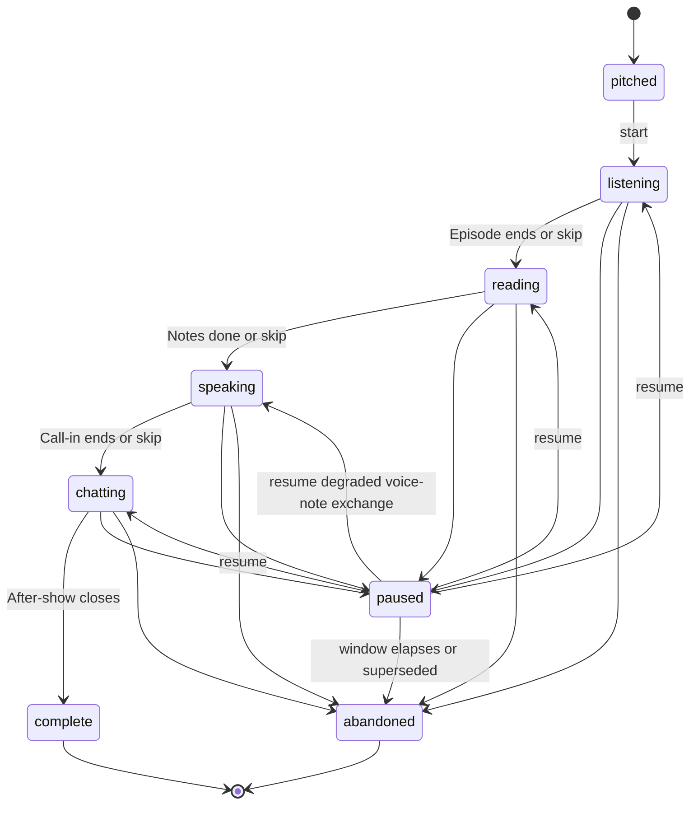

# 01 — Product Requirements

**Status: normative for features, user stories, personas, success metrics, and scope boundaries.**
**Conforms to `00-decisions.md`. Where this document and `00-decisions.md` disagree, `00-decisions.md` wins and this document has a defect.**

**What this document owns (per 00-decisions §12):** features `F-##`, user stories `US-<epic>.<n>`, personas, success metrics, scope boundaries.

**What this document deliberately does not own:** exact numeric limits, validation rules, state-machine transition tables, and failure behavior (04-srs); screens, states, and user-facing copy (02-ux-spec); components and tokens (03-design-system); schema and endpoints (06-data-api-spec); prompts and model routing (07-ai-spec); test cases (08-eval-testing-plan). Where a feature below names a duration, a count, or a threshold, that number is descriptive context for the reader — **04-srs is the normative owner** and its value governs implementation, except memory-lifecycle values (salience, fade, dormancy, confidence gating), whose normative owner is 07-ai-spec §7 per 00-decisions §9.

Normative language follows RFC 2119: MUST, MUST NOT, MAY.

---

## 1. Product thesis and core promise

Entertainment was how humans learned for most of history — stories, songs, argument, apprenticeship. Industrial education split learning from pleasure about two hundred years ago, and the familiar failures of learning today (boredom, anxiety, dropout) are symptoms of that split. Broadcast media kept disproving the split by accident: people acquired English from sitcoms and anime, not from courses. Mass media was never able to do it on purpose, because it was made for millions and aimed at no one.

AI removes that constraint. Media can now be authored for an audience of one — by an author that knows one specific person deeply and creates only for them. **For one** is a product of that shift: personal media that leaves its audience of one changed. The promise sentence is owned and stated in 00-decisions §1; every feature in this document exists to make that sentence literally true for one person at a time.

Language learning is the beachhead for two reasons. Attending to the entertainment **is** the learning, so there is no gap between the thing the user wants and the thing that works. And the change is measurable in the user's own recorded voice, so the product can prove its value with evidence the user already trusts.

**The competitive position.** Lesson apps sell obligation and are abandoned around week three. AI tutor apps built better classrooms and stayed in the classroom. General AI chat waits, improvises, remembers nothing durable, and gives no reason to return. For one shows up carrying something *made* — planned against a persistent learner file, produced ahead of time, cast with characters the user named. A conversation can be prompted; a production studio that knows you cannot.

**What the user experiences.** A recurring personal podcast in the target language: hosts they chose, running jokes, topics drawn from their week. Each day the show pitches a few episode ideas. The user picks one, changes any part of it, or invents their own. The episode plays and ends in an unresolved argument thrown to the user. Notes arm the user with something the hosts did not have. The user calls in and argues live. The host texts afterward, needles once more, and the conversation ends the way conversations end.

**What the system runs underneath.** A persistent learner file holds interests, life, history with the show, and a language profile. An event-hooked planner threads one or two invisible linguistic targets through the episode, the notes, the call-in, and the after-show. Correction never happens as correction; recasting always does. Difficulty moves with the user and is never displayed. Once a week the mask deliberately slips for two minutes and the show proves, with real deltas, what changed.

**The feature test.** Every feature MUST improve at least one of four things: the desire to start, the desire to respond, the feeling of being known, or the evidence of improvement. A feature that improves none of them MUST be cut regardless of its cleverness.

**The quality test.** Nothing ships that fails this question: would this specific user choose this episode over a real podcast at eight in the morning?

---

## 2. Personas and the moments that matter

Three personas. Each is an adult with a concrete real-life register situation, because the register situation is what makes generated content feel aimed rather than generic.

### P-1 — Rami, 29, relocating for work

Software engineer in Amman, offered a role in Berlin starting in five months. Learning German. His situation is professional and social at once: technical standups he will survive, and the after-work conversation he is afraid of. He tried a lesson app for six weeks and quit when the streak broke. He listens to two football podcasts daily on his commute and has never once forced himself to.

What he needs from the product: something that occupies the commute slot he already gives away willingly, and evidence that the after-work conversation is getting closer.

### P-2 — Sofía, 41, in-laws and a life abroad

Moved to Lyon three years ago with a French partner. Conversational in survival French, stuck at the point where family dinners move faster than she does. Her register situation is intimate and unforgiving: she is not trying to pass a test, she is trying to be funny in front of people who already love her. She has a demanding job and two children, and her available window is fifteen to twenty minutes, unpredictably placed.

What she needs from the product: sessions that survive interruption without penalty, and a way to say the awkward thing to a host before she says it at the table.

### P-3 — Kenji, 34, the exam and the interview

Preparing for an English-language job interview cycle while working full time in Osaka. Highly self-critical, historically an over-studier, prone to freezing when speaking. His register situation is high-stakes and dated: interviews begin in roughly two months. He has used general AI chat for practice and found it agreeable to the point of uselessness.

What he needs from the product: a host that pushes back honestly, and correction that does not turn every sentence into an evaluation.

### The moments that matter

These three moments carry disproportionate product risk. Every feature that touches them is called out in the catalog.

**The first session.** The user arrives skeptical, having been processed by education products before. Between landing and hearing an episode made from their own words, the product has one chance to prove that the promise is literal. This moment is served by F-01 through F-09, and the shape of the intake conversation is the whole argument: no form, no placement test, no visible assessment, and a first episode that quotes them back.

**Returning after an absence.** The user vanishes for four days or three weeks. Nothing was sent to them while they were gone, by design and by law (00-decisions §1 law 4). On return there is no broken streak, no catch-up queue, no guilt, and no reference to the gap beyond one warm line. Fresh pitches are waiting. If the energy signals suggest rust, the next session quietly runs easier without saying so. This moment is served by F-14, F-39, and F-52, and is the single clearest place where the product's refusal of dark patterns is either felt or exposed as talk.

**The moment of doubt.** Somewhere between week two and week five, the user asks the only question that matters: is this actually working, or am I just being entertained? The Weekly Proof exists for that moment and MUST answer it with real deltas, including the answer "nothing moved this week." A product that admits a flat week is believed about the good ones. This moment is served by F-42, and its failure mode — a fabricated win — is prohibited outright.

---

## 3. Product laws

The nine product laws in **00-decisions §1** bind every feature in this document. They are not restated here; the automated law scan enforces them at generation time, and each feature entry in §4 names the law numbers that constrain it most sharply by the shorthand below.

| Law | Shorthand used in the catalog |
|---|---|
| 1 | No lesson furniture |
| 2 | User owns topic/format/cast; system owns pedagogy |
| 3 | Sessions self-contained; only memory persists |
| 4 | Transparently AI; no guilt, no dark patterns |
| 5 | In-flow correction is recast-only |
| 6 | CEFR anchoring never surfaced |
| 7 | Recasts socially natural; hosts never grade |
| 8 | Conversations end like conversations |
| 9 | Trust contract |

Two clarifications that apply document-wide:

- **Law 1 is a wording law, not a screen law.** It binds every surface in every language: interface text, host speech, notes, after-show messages, and email. A feature that avoids showing a level but has a host say "you have moved up a level" violates law 1 and law 6 together.
- **Law 2 is a division of ownership, not a division of labor.** The user MUST be able to override topic, format, and cast completely. The user MUST NOT be asked to choose, confirm, or even perceive difficulty, targets, correction, or sequencing.

---

## 4. Feature catalog

Fifty-five features across eight areas. Each entry states what the feature is, why it exists in behavioral terms, what happens in what order including rejection and failure paths, what is explicitly outside its edges, and which laws constrain it.

**Stage vocabulary.** User-facing stage labels are Episode / Notes / Call-in / After-show; destinations are Today / Archive / Your show (00-decisions §1). The internal names Listen / Read / Speak / Chat appear in this document only where engineering readers need the mapping.

### Index

| ID | Title | Area |
|---|---|---|
| F-01 | Account creation and age gate | Account and onboarding |
| F-02 | Language pair selection | Account and onboarding |
| F-03 | Producer intake conversation | Account and onboarding |
| F-04 | Hidden level estimate and calibration | Account and onboarding |
| F-05 | Dialect choice | Account and onboarding |
| F-06 | Voice-storage consent | Account and onboarding |
| F-07 | First-show handoff | Account and onboarding |
| F-08 | First pitch and first episode | Account and onboarding |
| F-09 | Day-two callback guarantee | Account and onboarding |
| F-10 | Daily pitch set | Daily pitches |
| F-11 | Accept a pitch | Daily pitches |
| F-12 | Remix a pitch | Daily pitches |
| F-13 | Build from scratch | Daily pitches |
| F-14 | Pitch lifecycle and staleness refresh | Daily pitches |
| F-15 | Session state machine | The session |
| F-16 | Episode | The session |
| F-17 | Notes | The session |
| F-18 | Call-in | The session |
| F-19 | Call-in degradation to voice notes | The session |
| F-20 | After-show | The session |
| F-21 | Tap-to-define | The session |
| F-22 | Daily session cap | The session |
| F-23 | Default duo | Cast |
| F-24 | Character creation | Cast |
| F-25 | Chassis mapping | Cast |
| F-26 | Roster management | Cast |
| F-27 | Per-character relationship memory | Cast |
| F-28 | Per-session casting | Cast |
| F-29 | Learner file | The hidden layer |
| F-30 | Fact salience, dormancy, and confidence | The hidden layer |
| F-31 | Planner | The hidden layer |
| F-32 | Prediction and pre-generation | The hidden layer |
| F-33 | Generation pipeline | The hidden layer |
| F-34 | Quality gate and fallback episode | The hidden layer |
| F-35 | Evidence capture | The hidden layer |
| F-36 | Error taxonomy and error-versus-slip | The hidden layer |
| F-37 | Avoidance detection | The hidden layer |
| F-38 | Content uptake rating | The hidden layer |
| F-39 | The edge — difficulty and energy | The hidden layer |
| F-40 | Target lifecycle | The hidden layer |
| F-41 | Three correction layers | The hidden layer |
| F-42 | Weekly Proof | Proof, archive, memory |
| F-43 | Archive | Proof, archive, memory |
| F-44 | Host-spoken milestones | Proof, archive, memory |
| F-45 | What the show knows | Proof, archive, memory |
| F-46 | Conversational fact correction | Proof, archive, memory |
| F-47 | Conversational preference changes | Trust, control, data rights |
| F-48 | Voice consent revocation | Trust, control, data rights |
| F-49 | Data export | Trust, control, data rights |
| F-50 | Account deletion | Trust, control, data rights |
| F-51 | Transparent AI disclosure | Trust, control, data rights |
| F-52 | Return without penalty | Trust, control, data rights |
| F-53 | Transactional email only | Trust, control, data rights |
| F-54 | Language packages | Platform |
| F-55 | Cost telemetry | Platform |

---

### Area A — Account and onboarding

#### F-01 — Account creation and age gate

**Definition.** The minimal account step that captures identity, the name the show will use, and a self-declared birth date that gates the product to adults.

**User value.** The user reaches a real conversation in seconds rather than completing a profile. The name they give becomes the anchor of every later personalization: hosts speak it, pitches use it, the Weekly Proof addresses it.

**Behavioral contract.** The user starts from a single action. The account step collects an authentication credential through the auth provider pinned in 00-decisions §3 (email and password, Google, or Apple), a birth date, and one free-text name field. A birth date below the adult threshold MUST be rejected immediately with a plain, non-punitive message owned by 02-ux-spec, and the system MUST NOT create a usable account for that attempt. Email verification MUST be required before the second session and MUST NOT block the first session — nothing stands between a new user and their first episode. The name is stored as given; pronunciation is confirmed conversationally during intake when the user replies by voice (F-03), and the stored spelling is never altered by that confirmation.

**Out of scope.** No profile photo, no display handle, no username, no social identity, no age verification beyond self-declaration, and no re-collection of the birth date after signup.

**Governing laws.** Law 4 (transparently AI, no dark patterns), law 9 (trust contract). Normative limits and validation: 04-srs. Copy: 02-ux-spec. Auth mechanics: 05-tdd.

---

#### F-02 — Language pair selection

**Definition.** Two searchable list selections — the user's native language and the language they are learning — made in the interface rather than in conversation.

**User value.** The producer must already speak the user's native language before the intake conversation can begin, so this one pair of choices buys a fully native-language onboarding.

**Behavioral contract.** The user selects a native language from a single searchable list, then a target language from a single searchable list. Both selections are interface selections, not conversational ones, and both MUST happen before the producer speaks. The available target languages are the intersection defined in 00-decisions §1 (ADR-0002); the catalog itself is seed data owned by 06-data-api-spec. If a selected pair has no available package, the interface MUST say so plainly and MUST NOT create a show in a language the system cannot produce.

**Out of scope.** Multiple simultaneous target languages, changing the target language after the show exists, and per-session language switching. One account is one show in one language.

**Governing laws.** Law 1 (no lesson furniture — these lists carry no proficiency question). Language catalog: 06-data-api-spec. Package mechanism: F-54.

---

#### F-03 — Producer intake conversation

**Definition.** A roughly ten-minute voice-and-text conversation with an authored producer persona in the user's native language that seeds the learner file without ever presenting as an assessment.

**User value.** The user's first experience is being met, not processed. Everything the show later knows about their life enters here, in their own words, which is what makes the day-two callback land.

**Behavioral contract.** The producer speaks in audio; the user replies by text or by voice, choosing per message. The conversation runs to a turn budget (roughly a dozen to eighteen producer turns; normative limit: 04-srs) and MUST collect, in natural conversational order rather than fixed sequence: the goal behind the language; the **register situation**, meaning the concrete real-life setting that determines the register bias of all later generated content; interests, with a minimum floor and a target range, each stored with an initial salience score; current life situations the user volunteers; past learning attempts and what ended them; and two to three dated follow-up seeds with a due state. When a user gives short or closed answers and a field cannot be filled after two attempts, the producer MUST move on, the field MUST be marked sparse, and the planner MUST compensate in the first week by weighting interests more heavily. The intake MUST NOT stall on any field, MUST NOT repeat a question a third time, and MUST NOT tell the user that a field is missing. Woven into this conversation are the target-language moments described in F-04, which the user MUST NOT perceive as a test.

**Out of scope.** Forms, questionnaires, sliders, self-rated proficiency questions, and any visible progress indicator through the intake. The producer never returns after handoff (F-07) and is not a castable character.

**Governing laws.** Law 1 (no lesson furniture), law 2 (system owns pedagogy invisibly), law 4 (transparently AI — the producer discloses on its first turn), law 6 (no CEFR surfacing). Persona and prompts: 07-ai-spec. Normative field rules: 04-srs. Copy and screens: 02-ux-spec.

---

#### F-04 — Hidden level estimate and calibration

**Definition.** An internal proficiency estimate produced from a small number of target-language moments inside the intake, stored conservatively, and calibrated over the first several sessions.

**User value.** The very first episode lands at a difficulty the user can enjoy, without the user ever taking a placement test or seeing a label attached to themselves.

**Behavioral contract.** Three to four target-language moments are woven into the intake, each a single comprehension probe or a single production invitation, introduced by a natural language switch from the producer. The output is an internal band with a step and a confidence flag, stored per 00-decisions §5 as `level_band` / `level_step` / `level_confidence`. FR-016 owns the confidence-conditional initial write: an estimate below the deterministic confidence threshold owned by 07-ai-spec §4.2 is stored exactly one band more conservatively, while an estimate at or above that threshold is stored at the evidence-supported band and step unchanged; the insufficient-evidence default is also owned there. During sessions 1 through 5 every session's production evidence updates the estimate under FR-017. Only an offset that FR-016 actually applied receives FR-017's bounded removal movement; a high-confidence unchanged estimate MUST NOT receive a later offset-removal promotion. The estimate MUST NOT appear in any API response schema, any interface surface, any host line, any email, or any export artifact, in any language and in any paraphrase.

**Out of scope.** Any user-visible score, band, percentage, label, or comparison to other users. Any explicit test item. Any user request to see or set their own level — a user who asks is answered honestly in-character that the show handles difficulty and does not keep a score for them.

**Governing laws.** Law 1, law 2, law 6 (absolute), law 9. Storage: 06-data-api-spec. Extraction: 07-ai-spec. Normative calibration rules: 04-srs.

---

#### F-05 — Dialect choice

**Definition.** The user's single explicit language-related choice: which regional variant of the target language the show speaks, chosen from short audio samples.

**User value.** The user picks the version of the language they actually need to understand, hearing it before deciding, which is the only reliable way to choose.

**Behavioral contract.** The producer presents one short audio sample per available variant in the target language's package and the user selects one. The choice determines the default duo (F-23), the available voice inventory (F-24), and the language of all generated content. Where a language package defines exactly one variant, this step MUST be skipped silently rather than shown with a single option. The choice is stored on the show and changed only through conversational request (F-47), which regenerates cast voicing from the next session onward.

**Out of scope.** Accent grading, pronunciation scoring against the chosen variant, mixed-variant shows, and per-character variant assignment.

**Governing laws.** Law 2 (the user owns this; it is a preference, not a proficiency judgment). Variant catalog: 06-data-api-spec. Samples and screens: 02-ux-spec.

---

#### F-06 — Voice-storage consent

**Definition.** An explicit, plain-language consent decision about whether call-in audio is stored, framed in-story and then stated literally, with a fully functional product on either answer.

**User value.** The user decides what happens to their voice before their voice is ever recorded, in words they can act on, and pays nothing for saying no.

**Behavioral contract.** The producer introduces the subject in-story, then a plain-language statement names exactly what is stored (call-in audio), why it is stored (side-by-side progress comparisons), and that it is deletable at any time. Two explicit actions follow: consent or decline. Declining MUST set the consent flag false and MUST NOT disable, degrade, or gate any feature — every downstream surface that would use audio (principally the Weekly Proof side-by-side moment, F-42) automatically substitutes verbatim text quotes. Call-in **transcripts are stored on both answers**, because transcripts are core functionality; this MUST be disclosed in the same plain-language statement rather than inferred. Consent state is recorded as an append-only history, is visible in Your show, and is revocable at any time (F-48). Audio MUST be written only when consent is true at the moment of recording.

**Out of scope.** Consent bundling with terms acceptance, pre-checked consent, dark-pattern asymmetry between the two actions, and any re-ask of a declined consent outside a user-initiated visit to Your show.

**Governing laws.** Law 4, law 9 (never manipulate; the data is theirs). Consent schema: 06-data-api-spec. Exact copy: 02-ux-spec. Retention mechanics: 05-tdd.

---

#### F-07 — First-show handoff

**Definition.** The moment the producer hands the user to the default duo, who play a short pre-authored introduction in easy target-language speech.

**User value.** The user meets the hosts as characters rather than as a feature, hears the target language at a comfortable difficulty before any pressure, and understands without being told that the show has now started.

**Behavioral contract.** The producer introduces the duo by name and steps out. The duo plays a pre-authored recorded introduction of roughly a minute (normative limit: 04-srs) — the same piece for every user of that language and dialect, which is why it can be authored rather than generated. The introduction MUST be in the target language at a deliberately easy difficulty. Character creation (F-24) MUST be mentioned in exactly one sentence by the producer and MUST NOT be offered as a flow, presented as a next step, or repeated. The duo's first appearance carries the AI disclosure required by F-51.

**Out of scope.** A tutorial, a feature tour, a product walkthrough, an interface overlay, or any onboarding checklist. The handoff is a scene, not an explanation.

**Governing laws.** Law 1, law 4 (disclosure at first host appearance), law 6. Authored assets: F-54 language packages. Screens: 02-ux-spec.

---

#### F-08 — First pitch and first episode

**Definition.** One live-generated pitch built from intake data, a single rejection path, and a first episode that is playing within minutes of acceptance.

**User value.** The promise stops being a claim. The user hears an episode about their own life, in their language, made from a conversation they had ten minutes ago.

**Behavioral contract.** The duo delivers exactly one pitch through the dedicated one-time onboarding initialization governed by FR-026 and ADR-0009, generated live from the intake data, written as a hook and drawn from something the user actually said. This initialization is separate from the steady-state planner in F-31 and never enters its three-trigger register. The user accepts it or rejects it once. A rejection generates exactly one alternative pitch through the same initialization workflow. If the alternative is also rejected, the first episode MUST be built from the user's highest-salience interest with no callback to intake and no further pitching, and the show MUST NOT comment on the rejections. The first episode is shorter than a standard episode (roughly four to five minutes) and MUST be playable within the first-episode ceiling in 00-decisions §8, with playback beginning when the first audio chunk is ready rather than when synthesis completes. After the Episode stage the remainder of the cycle continues immediately if the user proceeds, or persists paused indefinitely per F-15.

**Out of scope.** More than one alternative pitch, a pitch list during onboarding, remix during onboarding (F-12 begins on day two), and any progress-through-onboarding indicator.

**Governing laws.** Law 2, law 8 (the show hands off, it does not assign). Latency budget: 00-decisions §8, restated normatively in 04-srs. Pipeline: F-33. Prompts: 07-ai-spec.

---

#### F-09 — Day-two callback guarantee

**Definition.** A generation constraint requiring the second-day episode to contain at least one callback sourced verbatim from something the user said during intake.

**User value.** The user learns on day two — the day most products lose them — that the conversation was not a formality. Something they said came back.

**Behavioral contract.** The planner MUST attach a verbatim-sourced callback constraint to every day-two pitch, and the quality gate (F-34) MUST verify callback presence on day two before the episode ships. The callback MUST be traceable to a stored intake utterance rather than to an inference, and MUST obey the personal-reference rules in F-16 (high-confidence facts only, told directly by the user). If the constraint cannot be satisfied after regeneration, the fallback episode path in F-34 applies and the callback requirement is dropped rather than faked.

**Out of scope.** Announcing the callback, drawing attention to the show's memory, or applying a callback quota to any day other than day two.

**Governing laws.** Law 9 (never state a memory unless certain), law 4. Gate check: F-34. Normative rule: 04-srs.

---

### Area B — Daily pitches

#### F-10 — Daily pitch set

**Definition.** The set of three to five one-line episode pitches waiting when the user opens the app, each carrying topic, format, and cast, written as a hook rather than a description.

**User value.** The user's daily decision is "which episode?" and never "should I study?" The choice is between things they want, not between an obligation and avoidance.

**Behavioral contract.** The planner (F-31) writes a complete pitch set as an atomic replacement of the previous set. The count varies with how much the show knows: fewer when the file is sparse in the first week, more once several interests have engagement history (normative count rule: 04-srs). Each pitch is a single line of text under a hard character cap (normative limit: 04-srs), hook-written, carrying topic, format, and cast either explicitly or by clear implication. Composition constraints, all enforced by the planner: at least one pitch MUST come from the user's own life whenever a follow-up is due or a life situation is active; exactly one pitch MUST be a wildcard outside the user's usual lanes; current events MUST appear only where they intersect a stored interest; and every pitch MUST pass the pitch test in F-34. Pitches appear on app open. No push notification, no email, and no badge announces them.

**Out of scope.** Infinite scroll of pitches, a pitch archive, re-ranking by the user, favoriting a pitch for later, and any indication of which pitch the system predicted.

**Governing laws.** Law 1 (a pitch list is a programme, not a curriculum), law 2, law 4 (no notification pressure). Planner: F-31. Prediction: F-32. Copy: 02-ux-spec.

---

#### F-11 — Accept a pitch

**Definition.** Taking a pitch as written and entering the session immediately.

**User value.** From opening the app to being inside an episode in seconds, with no configuration between the desire and the thing.

**Behavioral contract.** One action accepts a pitch and creates the session. When the accepted pitch is the planner's predicted pick, the episode is already fully generated and playback MUST begin within the pre-generated start budget in 00-decisions §8. When it is any other pitch, generation starts on selection and playback MUST begin within the on-selection budget by streaming the host opening first. While generation runs, the interface MUST show a determinate in-character waiting state rather than an unbounded spinner, and Archive and Your show MUST remain reachable. If generation fails after its retries, the fallback episode path in F-34 applies and the user still gets a show.

**Out of scope.** Queuing multiple accepted pitches, scheduling a pitch for later, and downloading an episode for offline playback.

**Governing laws.** Law 2, law 8. Latency budgets: 00-decisions §8 and 04-srs. Failure behavior: 04-srs. Waiting-state copy: 02-ux-spec.

---

#### F-12 — Remix a pitch

**Definition.** Editing a pitch's topic, format, or cast independently before starting, with the edited version regenerating.

**User value.** A pitch that is nearly right does not have to be abandoned. The user keeps the idea and changes the part they disagree with, which is what ownership of topic, format, and cast means in practice.

**Behavioral contract.** Each of the three elements MUST be independently editable without disturbing the other two. Any edit invalidates any pre-generation for that pitch and triggers regeneration; the episode MUST be playable within the on-selection budget. The user's edit is final and MUST NOT be argued with, softened, corrected, or partially applied — the system MUST NOT substitute a nearby topic it considers better. The pedagogical targets attached to the original pitch are re-threaded onto the edited pitch by the planner rather than dropped, because pedagogy adapts to topic and never the reverse (F-31).

**Out of scope.** Editing the episode after generation begins, editing difficulty, editing episode length, and editing anything the system owns under law 2.

**Governing laws.** Law 2 (this feature is law 2 made concrete). FR-416 owns one primary quality-gate regeneration; FR-417 owns the generated fallback's one regeneration and reviewed terminal folio. No separate daily regeneration counter exists. Screens: 02-ux-spec.

---

#### F-13 — Build from scratch

**Definition.** Creating a session from nothing: the user's own topic, any format from a starter library or described freely, and any cast.

**User value.** The show is genuinely the user's. When they arrive with an idea, the product does not make them find the nearest supported option.

**Behavioral contract.** The user supplies a topic by typing or speaking, selects a format, and selects a cast. The format starter library covers debate, story time, news rundown, interview, explain-it-to-me, and roast. Free-text format descriptions MUST be honored: the generator maps the description to the closest structural pattern, and **where the description and the pattern conflict, the user's description wins**. Cast selection follows F-28. The resulting session is generated on demand within the on-selection budget and is threaded with pedagogical targets exactly as a pitched session is. Topics the system cannot produce safely are refused plainly and in-character, and the refusal MUST name the reason rather than silently substituting different content.

**Out of scope.** Multi-episode arcs, series planning, saved templates, and user-specified episode duration or difficulty.

**Governing laws.** Law 2, law 6 (a user-authored topic never unlocks a difficulty control). Format catalog seed data: 06-data-api-spec. Mapping prompt: 07-ai-spec.

---

#### F-14 — Pitch lifecycle and staleness refresh

**Definition.** The rules governing when a pitch set expires, when it refreshes, and what happens to work already in progress.

**User value.** The pitches waiting on any given open are current — they know about last night's result and the interview that is now tomorrow — and a session already started is never taken away.

**Behavioral contract.** A pitch set is replaced atomically by the next planner run; individual pitches never expire independently and a set is never partially patched. An accepted-but-unfinished session MUST NOT expire when its originating pitch set is replaced, and remains resumable under F-15. When a user opens the app and the current pitch set is older than the staleness threshold, a refresh MUST run before pitches render, within the staleness budget in 00-decisions §8, with pre-generation of the newly predicted pick continuing in the background after render. A follow-up coming due MUST trigger a refresh regardless of set age. Concurrent triggers coalesce into a single run.

**Out of scope.** User-initiated manual refresh, pull-to-refresh regeneration, and any display of pitch age or freshness.

**Governing laws.** Law 3 (nothing is missed by being away), law 4. Triggers: F-31. Budgets: 00-decisions §8 and 04-srs.

---

### Area C — The session

#### F-15 — Session state machine

**Definition.** The single lifecycle every session follows through its four stages, including pause, resume, skip, abandonment, and the one-session-at-a-time rule.

**User value.** One session fits inside a real day. The user can stop at any moment, come back hours later, and continue with one action — without ever being told they fell behind.

*Overview only. The normative transition table, guards, and timers live in 04-srs; persisted fields live in 06-data-api-spec.*

**Behavioral contract.** Progression is forward-only: the user MUST NOT re-enter Call-in after the After-show begins. Replay of the Episode and re-reading of the Notes MUST remain available read-only at any time, including after completion. Pause persists audio position, notes scroll position, and the after-show transcript. A transient departure from a live Call-in keeps the same room available for the normative 30-second grace owned by 04-srs; returning within that grace rejoins the same call, while grace expiry advances to the After-show and cannot reopen live audio. A paused `speaking` session exists only for a failed degraded voice-note exchange and resumes that same exchange, never a reconstructed live moment. A session MAY span up to the abandonment window (roughly two days; normative limit: 04-srs); past it the session is marked abandoned, remains fully browsable in the Archive, and its partial production evidence still feeds assessment. Skipping forward from any stage is permitted and is logged as an energy signal rather than treated as failure; skipping Notes is permitted and the call-in host will not punish it, though the host naturally references the article, which is the built-in cost. Starting a new session while one is active prompts exactly one confirmation, and confirming marks the previous session abandoned.

**Out of scope.** Backward navigation into a completed stage as an active stage, resuming a call mid-utterance, more than one active session per user, and any completion percentage, progress ring, or stage counter shown to the user.

**Governing laws.** Law 1 (progress furniture is forbidden), law 3, law 8. Transitions and timers: 04-srs. Persistence: 06-data-api-spec. Screens: 02-ux-spec.

---

#### F-16 — Episode

**Definition.** The produced audio show — internally the Listen stage — with the user's chosen cast, a word-synced transcript, and a mandatory unresolved throw to the user.

**User value.** The user listens because they want to know what happens. The learning is the attention, and the argument they are about to join is set up here.

**Behavioral contract.** Duration is sized by material within a floor and ceiling (normative limits: 04-srs); the show MUST be compact rather than padded to fill time. Structure is a cold open, a conflict build, an escalation, and an unresolved throw. The **throw is mandatory in every episode**: the hosts name the article and demand the user get in. The cast is exactly the cast the user selected — one host or a pair — with no unrequested guest appearances. Language is the target language throughout, pitched at the stored edge (F-39). A word-level synced transcript MUST be visible below the player at all times, with every word tap-to-define (F-21). Player controls are play and pause, scrub, a short rewind, and a speed control limited to a slower setting and normal speed; speeds above normal MUST NOT exist, because they would let a user bypass the pitched difficulty. Personal references are capped per episode (normative limit: 04-srs), MUST be drawn only from facts the user told the show directly, and MUST be high-confidence facts only.

**Out of scope.** Video, background-music-only variants, downloadable audio, sharing an episode, playback speeds above normal, and any in-episode comprehension question.

**Governing laws.** Law 1, law 2, law 6, law 7 (hosts never grade in the episode), law 9 (no memory stated unless certain). Script generation: F-33 and 07-ai-spec. Player component: 03-design-system.

---

#### F-17 — Notes

**Definition.** The written piece — internally the Read stage — that gives the user something the hosts did not have.

**User value.** The user reads to win an argument, not to demonstrate comprehension. The article is ammunition, which is why it gets read.

**Behavioral contract.** Length is banded by the user's current level (normative bands: 04-srs). The content contract is strict: the article MUST add at least one of a counterargument, a fact the hosts missed, or a reason to change sides. It MUST NOT be a recap of the episode. The generator receives the episode script and an explicit instruction to arm the reader against it. Every word is tap-to-define (F-21). Reading time and scroll completion are logged as evidence (F-35) and are never shown to the user as a metric. Notes remain re-readable at any time, including during the call-in and after completion.

**Out of scope.** Comprehension questions, highlighting exercises, vocabulary lists, reading-speed feedback, and any required scroll-to-continue gate.

**Governing laws.** Law 1, law 2, law 8. Generation: F-33. Banded lengths: 04-srs. Layout: 02-ux-spec.

---

#### F-18 — Call-in

**Definition.** The live voice conversation with a host — internally the Speak stage — where the unresolved argument gets settled.

**User value.** The user speaks with real stakes, to someone who has a position and will push back, and is never interrupted, graded, or corrected in the moment.

**Behavioral contract.** Entry is a single action. The call targets a few minutes; the host initiates a natural close past the soft ceiling and the call hard-cuts past the hard ceiling with an in-character sign-off (normative limits: 04-srs). End-to-end voice response MUST stay within the latency budget in 00-decisions §8. Silence tolerance is explicit: the host MUST wait through a substantial pause before offering one gentle in-character prompt, and after two consecutive long silences MUST offer to wrap up rather than continuing to prompt. The host behavior contract is mandatory in full: the host takes a genuine position; pushes back at least once; never interrupts mid-formulation; absorbs side-switching, premise rejection, personal examples, plain "what does this word mean" questions answered plainly and in-character, and early endings; and never grades, never praises per turn, and never steers the user back to a script. Corrections in the call are recast-only per F-41. The transcript is always stored; audio is stored only where consent is true at record time (F-06). Failure of the live path degrades per F-19 with no session loss.

**Out of scope.** Pronunciation scoring, fluency scores shown to the user, per-turn feedback of any kind, repeat-after-me drills, multi-host calls in v1, and text-only participation in the Call-in stage (the fallback in F-19 is voice notes, not typing).

**Governing laws.** Law 5 (recast-only), law 7 (socially natural recasts; hosts never grade), law 8, law 2. Realtime architecture: 05-tdd. Host brief and prompts: 07-ai-spec. Normative timings: 04-srs.

---

#### F-19 — Call-in degradation to voice notes

**Definition.** The guaranteed fallback path that converts a failing live call into an asynchronous voice-note exchange inside the same argument.

**User value.** A bad connection or a provider outage costs the user nothing. The argument they were in the middle of survives.

**Behavioral contract.** When the live voice path fails — connection loss, transport failure, or synthesis failure — the interface MUST switch to asynchronous voice-note exchange within the same argument, carrying the host's position, the pushback material, and the recast list forward unchanged. The session MUST NOT be lost, restarted, or marked abandoned by the failure. The switch MUST be announced in-character rather than as a technical error, and the user MUST be able to continue with the exchange they were already having. Evidence captured in the fallback path counts identically toward assessment (F-35). Consent rules for audio storage apply unchanged.

**Out of scope.** A user-selectable voice-note mode as a preference, permanent downgrade of an account to voice notes, and text substitution for the speaking stage.

**Governing laws.** Law 9 (never hide what it is — the switch is explained), law 8. Reliability requirement: 00-decisions §8 and 04-srs. Degradation mechanics: 05-tdd.

---

#### F-20 — After-show

**Definition.** The written exchange — internally the Chat stage — where the host needles once more and the conversation ends the way conversations end.

**User value.** The user writes without ever being handed a writing task, and the session closes socially rather than administratively.

**Behavioral contract.** The host sends the first message shortly after the call ends (normative timing: 04-srs). The exchange runs to a small number of host messages and the host MUST end it at the cap with a natural closer — a laugh, a concession, a "we'll see Saturday". The content contract requires each host message to add something new: a comeback, a joke, a clarification, or a next angle. The host MUST NOT re-litigate the call and MUST NOT assign anything. **Leave-for-next-show behavior:** if the user keeps writing after the closer, the host sends exactly one final short reply and then goes quiet; further user messages are neither dropped nor answered in place — they are carried forward and answered in the next session as a single callback line. Modality is text only in v1.

**Out of scope.** Voice messages in the After-show, unlimited back-and-forth, host-initiated messages outside an active session, and any message that arrives when the user is not in the product.

**Governing laws.** Law 8 (this feature is law 8 made concrete), law 4 (no re-engagement messaging), law 7. Message caps and timings: 04-srs. Prompts: 07-ai-spec.

---

#### F-21 — Tap-to-define

**Definition.** A pre-computed, word-in-context definition available on any word of any transcript or article.

**User value.** The user resolves an unknown word instantly, in the flow, without leaving the show or opening a dictionary — which is what keeps difficulty pitched at the edge tolerable.

**Behavioral contract.** Every word in the episode transcript and in the notes is tappable. The popover contains exactly three things: the meaning in the user's native language, the part of speech, and one example sentence in the target language. It contains nothing else. Definitions are generated per word-in-context at content-generation time for the entire transcript and article rather than fetched on demand, which is what makes the popover latency budget in 00-decisions §8 achievable. Every tap is logged with the word, its lemma, the timestamp, the surface it occurred on, and the repeat count across sessions; this is assessment evidence (F-35) and MUST NOT be displayed back to the user as a count, a list, or a study set.

**Out of scope.** Conjugation tables, audio pronunciation in the popover, etymology, synonym lists, saving a word, flashcard export, and any review queue built from taps.

**Governing laws.** Law 1 (a tapped word never becomes homework), law 6. Pre-computation: F-33, ADR-0010. Lexicon model: 07-ai-spec. Popover component: 03-design-system.

---

#### F-22 — Daily session cap

**Definition.** A hard limit on sessions per calendar day, never advertised, communicated only in character when reached.

**User value.** The show stays a show. The cap protects the production quality the user came for and protects the user from turning a pleasure into a grind.

**Behavioral contract.** The cap value, the counting rule, and the timezone basis are owned by 00-decisions §1 and MUST NOT be restated or re-derived elsewhere. The interface MUST NOT advertise, display, or count down the cap anywhere. When a user attempts to start beyond it, the show responds with an in-character line explaining that tomorrow's episode needs time to be made, with copy owned by 02-ux-spec. A session already started before the cap is reached remains fully resumable and does not consume an additional slot on the day it is finished.

**Out of scope.** A visible quota, a cap-raising purchase, an appeal path, and any messaging that frames the cap as a reward or a restriction earned by behavior.

**Governing laws.** Law 1, law 4 (no scarcity manipulation). Cap value: 00-decisions §1. Enforcement: 04-srs. Rate limiting: 05-tdd.

---

### Area D — Cast

#### F-23 — Default duo

**Definition.** One fully authored pair of hosts per target language and dialect, present from the first session, designed to disagree productively.

**User value.** The show is alive before the user has customized anything. Two personalities with real positions make a genuine argument possible on day one.

**Behavioral contract.** Each host in the duo has a name, a fixed voice, and a personality document covering values, biases, humor style, relationship stance toward the learner, and speech patterns. The duo is authored content shipped inside the language package (F-54), not generated per user. The two hosts MUST be designed to disagree productively, because the unresolved throw in F-16 requires a real conflict. The duo does not count against the created-character roster cap (F-26). The duo reads the same learner file as every created character (F-27).

**Out of scope.** User editing of duo personalities, deleting a duo host, more than one duo per language and dialect, and duo hosts appearing in a language package that has not shipped them.

**Governing laws.** Law 4 (transparently AI), law 9. Authored assets: F-54. Personality documents: 07-ai-spec.

---

#### F-24 — Character creation

**Definition.** Creating a new host by telling the show who is needed, in conversation, never through a form.

**User value.** The cast becomes the user's. A host built to argue like someone they know changes what the show feels like in a way no setting can.

**Behavioral contract.** Creation is available from day one and MUST NOT be promoted, prompted, or surfaced as a next step; it is mentioned once during the first-show handoff (F-07) and otherwise reached from Your show. The flow is a short conversation in which the show asks who is needed and collects a name, a voice picked from samples, two to four personality traits, and optional quirks and backstory lines. The system maps the description to a chassis per F-25 without telling the user. The new character MUST introduce itself immediately in a short in-character audio piece (normative duration: 04-srs) and is castable from the next pitch onward. Voice inventory is per language package and targets a set size mixed across gender, age, energy, and dialect (normative target count: 04-srs); where fewer voices exist at launch, creation MUST offer what exists and MUST NOT block. Creation is subject to the roster cap in F-26.

**Out of scope.** A character creation form, sliders, trait pickers presented as a configuration screen, uploading a voice, cloning a real person's voice, and importing or sharing characters between accounts.

**Governing laws.** Law 2, law 4 (created characters are transparently AI and transparently the user's creations), law 1. Flow and copy: 02-ux-spec. Chassis catalog: 06-data-api-spec.

---

#### F-25 — Chassis mapping

**Definition.** The invisible assignment of every created character to exactly one of six authored behavioral chassis, skinned by the user's description.

**User value.** A character the user described in two sentences behaves consistently across hundreds of turns, because underneath the costume there is an authored personality engine rather than a prompt fragment.

**Behavioral contract.** The six chassis are debater, storyteller, gentle skeptic, comedian, professional, and hype-man. Every created character MUST map to exactly one, chosen by the system from the user's description at creation time and stored. The mapping MUST be invisible: it MUST NOT be shown, named, hinted at, or exposed in any API response or export artifact. The user's supplied traits, quirks, and backstory skin the chassis and MUST take precedence over chassis defaults wherever they conflict in surface behavior, while the chassis governs conversational structure. All chassis read the same learner file and apply identical pedagogy (F-27) — they differ in costume, never in teaching.

**Out of scope.** User-visible chassis selection, chassis switching after creation, blending two chassis, and adding chassis without an ADR.

**Governing laws.** Law 2 (the system owns behavioral machinery invisibly), law 4. Chassis documents: 07-ai-spec. Seed catalog: 06-data-api-spec.

---

#### F-26 — Roster management

**Definition.** Editing, retiring, and un-retiring characters conversationally, under an active-roster cap.

**User value.** The cast changes the way a real cast changes — by the user saying so — without a management screen and without losing history when someone leaves.

**Behavioral contract.** A user MAY hold up to a fixed number of active created characters (normative cap: 04-srs); the default duo does not count against it. Editing happens conversationally: the user tells the show what to change and the change applies from the next session. Retiring happens conversationally and MUST be non-destructive — a retired character keeps its per-character memory in full, disappears from casting options, and MUST NOT be deleted. Un-retiring happens the same way and restores the character with its memory intact, subject to the active cap at the moment of un-retirement. A user at the cap who creates another character MUST be asked, in character, who is retiring; the system MUST NOT auto-retire anyone. The roster is viewable from Your show with the duo first, active created characters next, and retired characters collapsed.

**Out of scope.** Permanent character deletion as a distinct action (account deletion in F-50 removes everything), transferring a character to another account, and a roster management screen with per-character controls beyond what Your show holds.

**Governing laws.** Law 2, law 9 (nothing the user made is silently destroyed). Cap and rules: 04-srs. Roster surface: 02-ux-spec.

---

#### F-27 — Per-character relationship memory

**Definition.** A memory partition per character holding the relational history between that character and the user, alongside the globally shared facts.

**User value.** The user's relationship with one host is genuinely different from their relationship with another. Karim remembers the joke he made; Layla does not, because she was not there.

**Behavioral contract.** Facts about the user's life stay **global** and are readable by every character. Jokes, positions taken in past arguments, running bits, and relational stance are stored **per character** and MUST NOT leak between characters. Every character reads the same language profile and applies the same pedagogy — identical targets, identical recast policy, identical difficulty — so that switching cast changes the costume and never the teaching. Retired characters retain their partition (F-26). Callbacks from per-character memory obey the same certainty rule as global facts: only high-confidence memories may be spoken (F-30).

**Out of scope.** Characters referencing each other's private history, a user-visible per-character memory viewer, and characters that develop pedagogical opinions of their own.

**Governing laws.** Law 9 (never state a memory unless certain), law 2, law 4. Partitioning schema: 06-data-api-spec. Context assembly: 07-ai-spec.

---

#### F-28 — Per-session casting

**Definition.** Choosing which host or pair of hosts runs a given session.

**User value.** The user picks who they want to spend the next twenty minutes with, which is the most direct expression of the show being theirs.

**Behavioral contract.** For any session the user MAY cast any single active host or any pair of active hosts, including a pair of two user-created characters. Cast is one of the three elements carried by every pitch (F-10) and one of the three independently editable in remix (F-12). The cast selected MUST be the cast that appears; the system MUST NOT add, substitute, or drop a host for pedagogical or production reasons. Retired characters MUST NOT appear as casting options until un-retired.

**Out of scope.** Casts larger than two in v1, guest characters, cross-account characters, and system-suggested cast changes framed as recommendations.

**Governing laws.** Law 2 (cast is the user's, absolutely). Casting rules: 04-srs. Selection surface: 02-ux-spec.

---

### Area E — The hidden layer

#### F-29 — Learner file

**Definition.** The persistent per-user record in four sections that every other system reads and the user never sees in raw form.

**User value.** The show accumulates knowledge of one person over months, which is the thing that cannot be copied and the reason episode fifty-one is worth more than episode one.

**Behavioral contract.** Four sections: **their life** (interests with salience, people mentioned, ongoing situations, dated follow-ups with due and used states, register situation, goal); **show history** (per session — topic, format, cast, positions the user took, jokes that landed, completion state); **what works on them** (format completion rates, talk-inducing topics measured by call-in output, engagement per character, abandonment patterns, preferred session times); and **language profile** (level band with confidence, per-category error rates, the target queue with lifecycle states, vocabulary rings across confident, emerging, and unseen crossed with receptive and productive, avoidance flags, fluency baselines, energy state). One post-session pass updates all four sections and runs assessment extraction within the post-session budget in 00-decisions §8, and MUST run identically for abandoned sessions using whatever partial evidence exists. Evidence and interpretation are stored separately and interpretations are regenerable (00-decisions §5).

**Out of scope.** Any raw display of the file to the user (the honest summary in F-45 is a different artifact), the language profile ever appearing in a user-facing surface, and cross-user aggregation of any section.

**Governing laws.** Law 6 (the language profile is invisible), law 9. Schema: 06-data-api-spec. Post-session job: 05-tdd. Extraction prompts: 07-ai-spec.

---

#### F-30 — Fact salience, dormancy, and confidence

**Definition.** The lifecycle rules that decide which remembered facts stay live, which fade, and which may be spoken aloud.

**User value.** The show remembers what still matters and quietly stops bringing up what does not, without ever losing something the user might want back — and never claims to remember something it is unsure of.

**Behavioral contract.** Every interest and life fact carries a salience score, set when the fact enters the file, and a provenance record naming where it came from. Facts the user raises again or engages with when a host brings them up stay live; facts nothing touches fade, and a faded fact becomes **dormant** — never referenced by any host, and never deleted. The salience scale, the fade mechanism, and the dormancy threshold are owned by 07-ai-spec §7.3–7.4. Confidence is three-valued — high, medium, low — stored per 06-data-api-spec §5.7 and gated per 07-ai-spec §7.2; **only high-confidence facts MAY be spoken by a host**, in any surface, in any stage. A user correction (F-46) overwrites immediately at high confidence and MUST take precedence over any inference. Dormancy is a pedagogical state, not a deletion, and the honesty wording for it is owned by 02-ux-spec, which also distinguishes it from account deletion.

**Out of scope.** Automatic deletion of stale facts, user-visible salience scores, and any inference written to the file without passing the deterministic gate in 00-decisions §7.

**Governing laws.** Law 9 (never lie; never state a memory unless certain), law 4. Salience, fade, and dormancy thresholds: 07-ai-spec §7.3–7.4. Confidence levels and the speakability gate: 06-data-api-spec §5.7 and 07-ai-spec §7.2. Storage: 06-data-api-spec §5.7.

---

#### F-31 — Planner

**Definition.** The event-hooked job that reads the learner file and produces the next complete pitch set with pedagogy already threaded through it.

**User value.** The user opens the app and something has already been made for them — planned against their file, not improvised on request.

**Behavioral contract.** The steady-state planner is **event-hooked and never scheduled as a nightly cron** (00-decisions §1, ADR-0009). It has exactly three triggers in priority order: the post-session hook, which runs immediately after post-session analysis completes and produces the next pitches while the file is freshest; the staleness hook, which fires at app open when the current set exceeds the staleness threshold and MUST complete pitch text within the staleness budget; and the follow-up hook, which fires when a dated follow-up comes due regardless of set age. The one-pitch onboarding initialization in F-08 is a separate one-time workflow and MUST NOT enter this trigger register. No user-initiated manual refresh exists. Concurrent steady-state triggers coalesce into one run. Output is always a complete fresh set, never a partial patch. Steps in order: world check (fetch updates for stored interests, check follow-up due dates); pitch writing under the composition constraints in F-10; pedagogy threading, attaching one to two targets from the queue to each pitch, planting frontier vocabulary, and setting difficulty from the current edge and energy state — **pedagogy adapts to topic, never the reverse**; then prediction and pre-generation per F-32. If the world check fails or returns nothing, pitches MUST fall back to interests, follow-ups, and the wildcard; **the planner never fails to deliver pitches**.

**Out of scope.** Nightly batch runs, user-initiated manual refresh, planning more than one day ahead, planning multi-episode arcs, and any user-visible planning state.

**Governing laws.** Law 2 (pedagogy is invisible and system-owned), law 3, law 1. Job definition: 05-tdd. World-check provider: 00-decisions §3. Trigger thresholds: 04-srs.

---

#### F-32 — Prediction and pre-generation

**Definition.** Ranking the pitch set by predicted acceptance and fully producing the top-ranked episode before the user asks for it.

**User value.** In the common case the user taps a pitch and the episode starts immediately, because it already exists. This is the difference between a show and a chatbot.

**Behavioral contract.** Pitches are ranked by predicted acceptance combining interest salience, format history, and recency. The top-ranked pitch MUST be generated through the entire pipeline (F-33) including audio synthesis and the quality gate, so that acceptance meets the pre-generated start budget in 00-decisions §8. All other pitches store briefs only and generate on selection. Pre-generation MUST be idempotent and MUST NOT be re-run for an unchanged pitch. Pre-generated content is invalidated when its pitch is remixed (F-12) or when the pitch set is replaced (F-14). The prediction MUST NOT be visible: no pitch is marked as recommended, ordered by rank in a way that signals it, or made to start faster in a way the interface advertises.

**Out of scope.** Pre-generating more than the predicted pick in v1, pre-generating for inactive users, and exposing prediction confidence anywhere.

**Governing laws.** Law 1, law 2, law 4 (no nudging toward the cheaper path). Cost envelope: 00-decisions §8. Ranking inputs: 07-ai-spec. Job orchestration: 05-tdd.

---

#### F-33 — Generation pipeline

**Definition.** The ordered production pipeline that turns a planner brief into a complete, shippable session.

**User value.** Every part of a session is built to be consistent with every other part — the article knows the script, the host knows the article, the definitions know the words that were actually used.

**Behavioral contract.** Stages run in this order: planner brief (topic, format, cast, targets, frontier vocabulary, difficulty setting, permitted personal references); episode script generation; article generation, which receives the script; call-in host brief generation, producing the host's position, pushback material, and recast list; after-show opener generation, which receives the call transcript at runtime; tap-to-define pre-computation across the full transcript and article; audio synthesis; and the quality gate (F-34). Generation MUST NOT run inside request handlers; every stage runs as a retryable background task with an idempotency key and inspectable per-stage state (00-decisions §4). Partial failure MUST be recoverable at stage granularity rather than by regenerating the whole session. Streaming synthesis begins playback at the first ready chunk to meet the on-selection budget.

**Out of scope.** Synchronous generation on the request path, regenerating a completed session's audio for cosmetic reasons, and user-triggered regeneration of a session already in progress.

**Governing laws.** Law 2. Pipeline architecture and jobs: 05-tdd. Prompts, schemas, and budgets: 07-ai-spec. Stage state: 06-data-api-spec.

---

#### F-34 — Quality gate and fallback episode

**Definition.** The automated pre-ship check every episode passes, and the automatic generated/reviewed fallback sequence when it does not.

**User value.** The user never receives an episode that is off-level, contradicts what the show knows about them, breaks the laws, or is simply not something they would tap.

**Behavioral contract.** Five pass-or-fail checks run before any primary episode ships. **Level fit:** script difficulty sits within the user's edge band. **Target presence:** the assigned targets appear in the planned surfaces. **Canon consistency:** no statement contradicts a high-confidence learner-file fact and no low-confidence memory is stated. **Pitch test:** a rater answers, against this user's interest profile, whether this specific user would tap this if it were a real podcast; a negative answer fails. **Law scan:** no lesson-furniture wording, no grading language, no unsolicited correction, and the personal-reference cap respected. A primary failure triggers exactly one primary regeneration. A second primary failure enters the **generated fallback episode**: an interest-based, callback-free episode built from the user's highest-salience interest, which MUST itself pass level fit, canon consistency, and the law scan before shipping. That generated fallback regenerates once after its first three-check failure; its second failure ships the reviewed package-authored terminal folio. The gate MUST NOT produce an empty Today. Every content/gate failure MUST resolve to a show; the sole exception is infrastructure exhaustion while publishing the already-reviewed terminal folio, which preserves Today and completed work and enters ADR-0022's closed support-required state without exposing partial content.

**Out of scope.** Human review in the shipping path, a user-visible quality indicator, and shipping any episode that fails the law scan under any circumstance.

**Governing laws.** All nine laws — this feature is where they are mechanically enforced. Banned-lexicon catalog: 02-ux-spec. Rater prompts and thresholds: 07-ai-spec. Gate test cases: 08-eval-testing-plan.

---

#### F-35 — Evidence capture

**Definition.** The logging of every natural behavior that assessment later reads, with no test artifact anywhere in the product.

**User value.** The user is never tested. Everything the system learns about their language comes from things they did because they wanted to.

**Behavioral contract.** Captured evidence: call-in transcripts, after-show messages, tap-to-define events with lemma and repeat count, replay and scrub clusters, article reading time and scroll completion, skip events, session completion state, and content uptake. **No analysis runs in the live path** — capture is write-only during a session and all interpretation happens in the post-session pass. Happened-things are append-only (00-decisions §5). Evidence from abandoned sessions is captured and used identically to evidence from completed ones. Captured evidence MUST NOT be displayed back to the user in aggregate form anywhere, including the Archive.

**Out of scope.** Quizzes, drills, placement checks, recall prompts, spaced-repetition scheduling, and any statistic rendered to the user.

**Governing laws.** Law 1 (no test artifacts), law 6. Event schema: 06-data-api-spec. Capture paths: 05-tdd.

---

#### F-36 — Error taxonomy and error-versus-slip

**Definition.** The fixed twelve-category error classification and the evidence threshold that separates a real pattern from a one-off mistake.

**User value.** The show pursues the things the user actually gets wrong repeatedly, and ignores the stumbles everyone makes, so targeting never feels arbitrary or petty.

**Behavioral contract.** The taxonomy has exactly twelve categories, fixed in structure and localized in content per target language. The English reference set is verb tense and aspect, subject-verb agreement, articles, prepositions, word order, word choice, plurals, pronouns, comparatives, conditionals, question formation, and register. Raters receive the closed taxonomy, band descriptors, and anchor examples, and MUST output structured tags only, never free text. A pattern MUST accumulate a minimum number of observations across a minimum number of distinct sessions before entering the target queue (normative thresholds: 04-srs) — below that it is a slip and is recorded as evidence without becoming a target. Raw evidence and the structured tag are stored as separate rows, and the interpretation is regenerable (00-decisions §5).

**Out of scope.** Adding or removing categories without an ADR, surfacing category names to the user, error counts shown anywhere, and free-text rater commentary.

**Governing laws.** Law 1, law 5, law 6. Taxonomy seed data: 06-data-api-spec. Rater prompts: 07-ai-spec. Thresholds: 04-srs.

---

#### F-37 — Avoidance detection

**Definition.** A weekly comparison between the structures expected at the user's band and the structures they have ever attempted, flagging what is being dodged.

**User value.** The show notices the sentences the user is quietly steering around — the hardest thing for a learner to notice themselves — and starts making those structures familiar before ever asking for them.

**Behavioral contract.** A weekly job compares expected structures at the user's stored band against structures ever attempted in production evidence. Structures never attempted are flagged for **receptive introduction**: hosts use them naturally in banter, and they MUST NOT be productively targeted until the readiness rule in F-40 is satisfied. Avoidance flags are stored on the language profile and MUST NOT be surfaced to the user in any form.

**Out of scope.** Prompting the user to use an avoided structure, naming avoidance to the user, and treating avoidance as an error observation.

**Governing laws.** Law 1, law 2, law 6. Job: 05-tdd. Band descriptors: 07-ai-spec. Rules: 04-srs.

---

#### F-38 — Content uptake rating

**Definition.** A per-session rating of whether the user's call-in argument actually reflects the content of the article.

**User value.** The show learns whether the notes are doing their job for this specific user, and adjusts what it arms them with, without ever quizzing them on the reading.

**Behavioral contract.** After each session with a call-in, a rater scores uptake on a small ordinal scale by comparing the call-in transcript against the article content. The score is stored as evidence and feeds both the article generation brief and the "what works on them" section of the learner file. Uptake MUST NOT be shown to the user, referenced by a host, or used to gate any part of the product. A skipped Notes stage yields no uptake score rather than a zero.

**Out of scope.** Comprehension questions, reading quizzes, and any host line that evaluates whether the user read the article.

**Governing laws.** Law 1, law 7 (no grading), law 8. Rater and scale: 07-ai-spec. Storage: 06-data-api-spec.

---

#### F-39 — The edge — difficulty and energy

**Definition.** The invisible difficulty setting for each session, computed from the stored band plus an energy modifier read from recent behavior.

**User value.** The show always speaks just past what the user can comfortably handle, and quietly backs off on a bad day instead of turning it into a confrontation.

**Behavioral contract.** Difficulty for a session equals the current band plus an energy modifier. Energy detection reads reply lengths, skipped call-ins, and error spikes to ease the next session by one step, and sustained fluent streaks to raise it by one step. **At most one step of movement per session** (normative cap: 04-srs). The adjustment MUST be invisible: no host mentions it, no interface reflects it, no message explains it, and the user MUST NOT be able to set it. A user who asks to be pushed harder or taken easier is handled as a conversational preference (F-47) and the request is honored as an input to the same invisible mechanism, without exposing a control.

**Out of scope.** A difficulty control, a level display, an "easy mode", and any explanation of why an episode felt easier than the last one beyond an honest in-character answer if the user asks directly.

**Governing laws.** Law 2, law 6, law 1, law 4. Computation: 04-srs. Signals: F-35. Difficulty parameters: 07-ai-spec.

---

#### F-40 — Target lifecycle

**Definition.** The queue of active linguistic targets and the state machine each target moves through from activation to retirement and re-check.

**User value.** A mistake the user keeps making comes back — inside episodes and arguments, never as a drill — until it stops, and then it is checked again later to make sure it really stopped.

**Behavioral contract.** The **readiness rule** governs entry: only structures the user has attempted imperfectly MAY be productively targeted; structures never attempted receive receptive exposure first, with hosts using them in banter for a period before productive targeting begins. The queue holds a small maximum of active targets, of which one to two are threaded into any single session; selection combines frequency, recency, and readiness (normative values: 04-srs). Lifecycle: **Active** → **Taking** when produced correctly unprompted once → **Retired** when produced correctly several times across multiple sessions → **Re-check** at widening intervals; a failed re-check returns the target to Active. Lifecycle state MUST NOT be visible to the user in any form, and target names MUST NOT appear in any user-facing surface outside the Weekly Proof's plain-language named wins (F-42).

**Out of scope.** A visible target list, user-selected targets, target counts, and any host line that announces what is being worked on.

**Governing laws.** Law 1, law 2, law 5, law 6. State machine: 04-srs. Storage: 06-data-api-spec.

---

#### F-41 — Three correction layers

**Definition.** The complete, closed set of ways a user's error is ever addressed: embedded recast in flow, honest explanation on explicit request, and weekly pattern surfacing.

**User value.** The user keeps talking. Errors get fixed without the conversation ever becoming a lesson, and when the user genuinely wants to know why, they get a straight answer instead of a maintained illusion.

**Behavioral contract.** **Layer one — in flow:** correction is recast-only. The correct form is embedded in a reply that has its own conversational point, and the reply MUST work as conversation even if the recast were removed. Recasts MUST be socially natural and MUST NOT be flagged, repeated for emphasis, or followed by a check. **Layer two — on explicit request:** when the user asks why a form is right, the host answers plainly and honestly, in character, without protecting the illusion. **Layer three — weekly:** patterns are surfaced in the Weekly Proof (F-42). **Unsolicited explicit correction MUST NOT occur, ever, in any stage, in any surface.** The system tracks whether each recast takes hold and returns the target under F-40 until it does.

**Out of scope.** Correction counts, error highlighting in transcripts, a corrections log, post-session correction summaries, and any per-turn evaluation.

**Governing laws.** Law 5 (this feature is law 5 made concrete), law 7, law 1, law 8. Enforcement: F-34 law scan and ADR-0015. Prompts: 07-ai-spec.

---

### Area F — Proof, archive, memory

#### F-42 — Weekly Proof

**Definition.** A roughly two-minute mini-episode, once a week, in which the show deliberately drops the fiction and proves with real evidence what changed.

**User value.** This is the answer to the moment of doubt. The user hears their own voice from weeks ago against today and gets named, concrete wins — or an honest report that this week was flat.

**Behavioral contract.** A Proof is generated for any user who completed at least a minimum number of sessions that week; otherwise it is **silently skipped** and arrives the next qualifying week, with no "you missed your proof" messaging of any kind. It is an audio mini-episode performed by the user's most-used cast that week. Mandatory contents: one side-by-side moment (audio clips where voice consent is true, verbatim text quotes otherwise), one to three named concrete wins phrased in plain language, and one teaser of the next focus. **Flat-week rule:** where the weekly assessment shows no improvement, the Proof MUST say so plainly and MUST name one concrete change the planner is making. **Fabricated wins are prohibited**; the generator receives only real deltas from the learner file and MUST NOT be able to invent one. Delivery is at the top of the pitch list on the user's highest-completion weekday. All numbers live inside sentences the hosts speak; no chart, graph, dashboard, or statistic renders anywhere.

**Out of scope.** Sharing a Proof, exporting a Proof clip to social platforms, a proof archive with trend lines, comparison against other users, and any visual data rendering.

**Governing laws.** Law 9 (prove progress honestly, flat weeks included), law 1, law 6, law 4. Assessment inputs: F-36 through F-40. Generation: 07-ai-spec. Qualification rule: 04-srs. Delivery surface: 02-ux-spec.

---

#### F-43 — Archive

**Definition.** The browsable record of everything the show has ever made with this user, organized by date.

**User value.** The user can go back and hear how far they have come — the actual episodes, their actual voice — which is a form of proof that needs no interpretation.

**Behavioral contract.** The Archive holds every episode (re-playable in full), every transcript, every article, every call-in recording where consent was true at record time or the transcript otherwise, and every after-show exchange, browsable by date. Abandoned sessions appear in the Archive with whatever was produced. **No statistics, charts, aggregates, counts, streak indicators, or completion rates appear anywhere in the Archive**, in v1 or in any wording. Archived content is read-only.

**Out of scope.** Search over the archive in v1, filtering by cast or format, favorites, playlists, per-episode ratings, and any derived metric.

**Governing laws.** Law 1 (absolute here), law 3, law 9. Archive surface: 02-ux-spec. Retention: 06-data-api-spec.

---

#### F-44 — Host-spoken milestones

**Definition.** Rare acknowledgements of long-run milestones, delivered only as a spoken host line inside a show.

**User value.** A hundred episodes with the same hosts is worth noticing, and it is noticed the way a friend would notice — in passing, in conversation.

**Behavioral contract.** Milestones are rare and tied to substantial episode counts (normative list: 04-srs). They are **host-spoken only**. There MUST be no visual celebration of any kind: no badge, no confetti, no card, no banner, no notification, no email, and no interface element. A milestone line MUST read as conversation, not as an award, and MUST NOT invoke streaks, points, or progress.

**Out of scope.** Achievements, badges, trophies, shareable milestone cards, and milestone-triggered messaging outside a session.

**Governing laws.** Law 1, law 4, law 8. Milestone list: 04-srs. Line style: 02-ux-spec.

---

#### F-45 — What the show knows

**Definition.** A plain-language summary of the life facts and interests the show holds, available on request from Your show or by asking a host.

**User value.** The intimacy the product asks for is answerable. The user can look at what it knows, in sentences, and find nothing hidden.

**Behavioral contract.** On request the show renders a plain-language summary of stored life facts and interests. **The language profile MUST NOT be included** — no level, no error categories, no targets, no vocabulary rings, no energy state, in any wording. Dormant facts (F-30) are shown as dormant with honest wording owned by 02-ux-spec, which also states in one sentence how dormancy differs from account deletion. Every listed fact MUST offer a direct correction action (F-46). The summary is reachable both from Your show and by asking a host conversationally.

**Out of scope.** A raw data viewer, confidence scores, provenance display, salience values, and any pedagogical content.

**Governing laws.** Law 6 (the language profile is never surfaced), law 9 (never hide what it is), law 1. Surface and copy: 02-ux-spec. Export equivalent: F-49.

---

#### F-46 — Conversational fact correction

**Definition.** Correcting anything the show believes by simply saying so, with the correction applied immediately.

**User value.** When the show is wrong about the user's life, fixing it costs one sentence and takes effect at once, rather than requiring a hunt through a profile editor.

**Behavioral contract.** A user correction stated in conversation, or made through the direct action attached to any fact in F-45, MUST overwrite the stored fact immediately at high confidence and MUST take precedence over any inference. The correction applies from the next generated content onward, including pitches already generated but not yet accepted where regeneration is cheap. The show acknowledges the correction in character, once, and MUST NOT argue, request confirmation of a plainly stated fact, or ask why. Superseded facts follow the provenance rules in 06-data-api-spec rather than vanishing silently.

**Out of scope.** A profile edit form, bulk fact editing, correcting the language profile (which the user never sees), and undoing a correction through a version history.

**Governing laws.** Law 9 (never lie), law 2, law 4. Write path: 06-data-api-spec. Confidence rules: F-30.

---

### Area G — Trust, control, and data rights

#### F-47 — Conversational preference changes

**Definition.** Changing how the show behaves by telling it, with no settings screens anywhere in the product.

**User value.** The user never hunts through menus. "Talk slower", "less politics", "more stories and fewer debates" are the interface.

**Behavioral contract.** Behavioral preferences are expressed conversationally to a host or the producer surface and MUST be acknowledged in character and applied from the next session. Per 00-decisions §1 (ADR-0003) **no settings or preferences screens exist**; the Your show sheet is a trust surface holding Cast, What the show knows, Voice tape, About this AI show, and Account essentials, and MUST NOT accumulate behavioral toggles. Preference requests that touch system-owned pedagogy (difficulty, targets, correction, sequencing) are accepted as signals and routed into the invisible mechanisms (F-39, F-40) without exposing a control and without pretending the request was refused.

**Out of scope.** A settings screen, a preferences panel, notification settings, appearance settings, difficulty settings, and any toggle beyond the consent choice in Voice tape and the account actions in Account essentials.

**Governing laws.** Law 1, law 2, law 4. Your show composition: 00-decisions §1 and 02-ux-spec. Preference persistence: 06-data-api-spec.

---

#### F-48 — Voice consent revocation

**Definition.** Withdrawing voice-storage consent at any time, with all stored audio clips deleted on a hard deadline.

**User value.** The consent given at onboarding is genuinely reversible, and reversing it deletes what was kept rather than merely stopping future recording.

**Behavioral contract.** Revocation is available from Voice tape in Your show at any time. On revocation the consent flag flips immediately, no further audio is written, and **all stored voice clips MUST be deleted within the purge deadline in 00-decisions §8**. Consent history is append-only and records both the grant and the revocation. Downstream features that used audio automatically fall back to verbatim text quotes with no feature loss (F-42). The interface MUST state plainly that revocation deletes stored audio clips and MUST NOT imply that it deletes transcripts or the account — the distinction is stated explicitly in copy owned by 02-ux-spec. Consent MAY be granted again later, and re-granting MUST NOT restore deleted clips.

**Out of scope.** Selective per-clip deletion, pausing consent temporarily, and restoring deleted audio.

**Governing laws.** Law 9 (the data is theirs; never hide what it is), law 4. Purge deadline: 00-decisions §8. Deletion mechanics: 05-tdd. Copy: 02-ux-spec.

---

#### F-49 — Data export

**Definition.** A complete export of the user's data, produced asynchronously and delivered as a signed, expiring download.

**User value.** The trust contract's promise that the data is theirs is executable. They can take everything and go.

**Behavioral contract.** Export is initiated from **Your show → Account essentials** (00-decisions §9.3, ADR-0001). The request creates an asynchronous job; the user is not held on a loading screen. When the export is ready the user is notified by an in-app banner and by a transactional email, and the download is a signed link with a short expiry (value owned by 00-decisions §9.3). The export MUST contain the user's episodes, transcripts, articles, call-in recordings where they exist, call-in transcripts, after-show messages, cast and character definitions, life facts and interests, and consent history. **The internal language profile MUST NOT be included in any form**, consistent with law 6 and F-45. A failed export job MUST surface a plain failure state with a retry path and MUST NOT leave the user waiting indefinitely. Repeat requests are rate-limited server-side.

**Out of scope.** Real-time export, partial or filtered exports, scheduled recurring exports, and direct transfer to a third-party service.

**Governing laws.** Law 9 (the data is theirs — see it, export it, delete it), law 6 (the language profile stays internal). Job and storage: 05-tdd and 06-data-api-spec. Copy and flow: 02-ux-spec. Email: F-53.

---

#### F-50 — Account deletion

**Definition.** Complete, self-service deletion of the account and everything in it, confirmed deliberately and executed on a hard deadline.

**User value.** Leaving is possible, complete, and does not require asking anyone. The product that asked for a voice and a life gives both back and keeps nothing.

**Behavioral contract.** Deletion is initiated from **Your show → Account essentials** (00-decisions §9.3, ADR-0001). The flow states the consequences plainly before anything happens and requires a **type-to-confirm** action rather than a single tap. On confirmation the user is signed out immediately, the account becomes unusable at once, and primary stores are purged within the deletion deadline in 00-decisions §1. Backups age out within the backup window under a **deletion-on-restore policy**, so a restored backup MUST re-apply pending deletions rather than resurrect the account. A confirmation email is sent when the purge completes. The flow MUST NOT offer a retention incentive, a discount, a pause-instead option, or any friction beyond the confirmation itself, and MUST NOT be reachable by accident.

**Out of scope.** Account suspension, soft delete with a recovery window presented as a retention mechanism, deletion of a single character or session as a distinct product action, and any win-back messaging after deletion.

**Governing laws.** Law 9, law 4 (no dark patterns in the exit path). Deadlines and backup policy: 00-decisions §1. Purge mechanics: 05-tdd. Copy: 02-ux-spec. Email: F-53.

---

#### F-51 — Transparent AI disclosure

**Definition.** The explicit, repeated-where-it-matters statement that the producer and hosts are AI characters.

**User value.** The user is never confused about what they are talking to, which is the precondition for the warmth being craft rather than deception.

**Behavioral contract.** Disclosure MUST appear at the producer's first turn, at the first host introduction, inside Voice tape and About this AI show, and at any point where a user might reasonably mistake an interaction for a human live service. It MUST NOT prefix every host line, because constant disclosure destroys the show without adding honesty. About this AI show states that the producer and hosts are AI characters, that their voices and replies are generated, that they use the stored show memory, and that they may be wrong; it also states that a host will not claim a memory unless the system is confident and that corrections are available (F-46). A host asked directly whether it is real MUST answer honestly and in character. The show MUST NOT claim a human life, a physical location, or an existence outside the product.

**Out of scope.** Persistent disclosure banners, per-message AI labels, and any fictional biography that implies a real person.

**Governing laws.** Law 4 (this feature is law 4 made concrete), law 9. Disclosure placement: 02-ux-spec. Host honesty behavior: 07-ai-spec.

---

#### F-52 — Return without penalty

**Definition.** The complete behavior of the product when a user comes back after days or weeks away.

**User value.** Coming back costs nothing. There is no streak to have broken, no queue to clear, no guilt to absorb, and no explanation to give.

**Behavioral contract.** While a user is away the product MUST send nothing: no re-engagement email, no push notification, no digest, and no in-app message waiting to be cleared. On return the user is greeted with one warm line and a fresh pitch set generated by the staleness hook (F-14). The greeting MUST NOT reference the length of the absence as a reproach, MUST NOT ask where they were, and MUST NOT mention anything missed — sessions are self-contained and nothing was missed. Any unfinished session past the abandonment window is in the Archive rather than pending. Where energy signals suggest rust, the next session runs easier invisibly under F-39. Unanswered after-show messages from the prior session are answered as one callback line per F-20.

**Out of scope.** Re-engagement campaigns, "we miss you" messaging, streak recovery offers, catch-up queues, and any counter of days away.

**Governing laws.** Law 4 (no guilt mechanics, no re-engagement), law 3, law 1, law 9. Greeting copy: 02-ux-spec. Staleness trigger: F-31.

---

#### F-53 — Transactional email only

**Definition.** The complete, closed set of messages the product is permitted to send.

**User value.** Installing this product does not create an inbox obligation. The only email that arrives is email the user's own action asked for.

**Behavioral contract.** Per 00-decisions §1 the permitted set is exactly four: account verification, password reset, export-ready notice (F-49), and deletion confirmation (F-50). **No other email MAY be sent, ever** — no re-engagement, no digest, no weekly summary, no product announcement, and no Proof notification. There are no push notifications and no in-app notification center in v1. The export-ready and deletion-confirmation messages are the only emails triggered by product state rather than by authentication, and both are consequences of an action the user just took.

**Out of scope.** Marketing email, newsletters, notification preferences (there is nothing to configure), and any message triggered by inactivity.

**Governing laws.** Law 4, law 1, law 9. Permitted set: 00-decisions §1. Provider: 00-decisions §3. Templates: 02-ux-spec.

---

### Area H — Platform

#### F-54 — Language packages

**Definition.** The per-language content and configuration unit that makes adding a language an act of content production rather than engineering.

**User value.** The user gets the language they need rather than the language the product happened to launch with, and every language behaves identically because they all run the same machinery.

**Behavioral contract.** All prompts, error taxonomies, band descriptors, and chassis documents are **per-language configuration, not code**. The twelve-category taxonomy structure is fixed and only its contents localize (F-36). Voice inventory, dialect lists, and the default duo are per-language content shipped in the package (F-05, F-23, F-24). Adding a language MUST require only a content package and configuration with zero re-architecture, and this MUST be enforced by building the first language through the same package mechanism rather than special-casing it. Per 00-decisions §1 (ADR-0002) one generation pipeline produces packages for every language supported by both the pinned speech-synthesis and speech-recognition providers, all available at launch; the enumerated catalog is seed data owned by 06-data-api-spec. Right-to-left scripts and per-script typography are handled by the design system rather than by per-language interface code.

**Out of scope.** Per-language interface forks, language-specific business logic in application code, and shipping a language whose package lacks a default duo or a voice inventory.

**Governing laws.** Law 1 (banned lexicon applies in every language), law 6 (CEFR invisibility applies in every language). Package generation: 07-ai-spec. Seed data: 06-data-api-spec. Script and RTL rules: 03-design-system.

---

#### F-55 — Cost telemetry

**Definition.** Per-session recording of fully-loaded variable cost, mandatory from the first day of beta.

**User value.** Indirect but decisive: it is what keeps the show economically able to exist at this quality, and it is what makes a business model decision possible later on evidence rather than guesswork.

**Behavioral contract.** Every session MUST write a cost record covering all model calls, speech synthesis, speech recognition, and realtime transport attributable to it. Costs are reviewed weekly against the two-sessions-per-day worst case and against the envelope in 00-decisions §8. Every model call logs its prompt version, model identifier, token counts, latency, cost, validation outcome, and disposition, so that a single user's single session can be reconstructed end to end. This is an internal feature: cost data MUST NOT appear in any user-facing surface, in any export artifact, or in any host line.

**Out of scope.** User-visible usage meters, per-user billing surfaces, cost-based degradation of a session already in progress, and any pricing surface in v1.

**Governing laws.** Law 1, law 9 (no hidden user-facing consequence). Envelope: 00-decisions §8. Per-stage breakdown: 07-ai-spec. Instrumentation: 05-tdd.

---

## 5. User stories

Seven epics. Every acceptance criterion cites feature IDs defined in §4. `US-<epic>.<n>` identifiers are narrative aids inside this document and are not traceability anchors: the binding chain is F → FR → TC, and no downstream document is required to cite a US ID (00-decisions §2). These stories supersede the epics in `docs/User_Flows&User_Stories.md`, whose FR references pointed at a retired PRD version and are dead.

### Epic 1 — Onboarding

**US-1.1** — As a new user, I want to start by having a real conversation about my life and goals instead of filling forms and taking a placement test, so that the product feels like meeting someone rather than enrolling in a course.
*AC:* the intake is fully conversational in my native language (F-03) after two list selections (F-02); no visible test exists anywhere in it (F-04); the only language-related choice I make explicitly is my dialect (F-05).

**US-1.2** — As a new user, I want to hear my first personalized episode within minutes of finishing the conversation, so that the promise is proven before I leave.
*AC:* exactly one live pitch is built from my intake with a single alternative on rejection (F-08); the first episode plays within the first-episode budget (F-08); the account step never blocks it (F-01).

**US-1.3** — As a privacy-conscious user, I want to understand and control whether my voice is stored, so that I can use the product on my terms.
*AC:* consent is requested in plain language with both outcomes equally available (F-06); declining keeps every feature working with text quotes substituted (F-06, F-42); consent is revocable later with clip deletion on a deadline (F-48).

**US-1.4** — As a day-two user, I want the show to reference something I said yesterday, so that I know it actually listened.
*AC:* the day-two episode contains at least one verbatim-sourced intake callback enforced as a generation constraint and verified at the gate (F-09, F-34).

**US-1.5** — As an adult user, I want to know the product is for adults and that I am not being profiled beyond what I said, so that the intimacy it asks for feels proportionate.
*AC:* a self-declared birth date gates entry with a plain rejection message (F-01); the producer discloses that it is an AI character on its first turn (F-51).

### Epic 2 — Daily pitches

**US-2.1** — As a returning user, I want to choose between episode ideas made for me each day, so that my daily decision is which episode rather than whether to study.
*AC:* three to five one-line hook-written pitches wait on open (F-10); accepting one starts the episode within the applicable start budget (F-11); nothing notifies me that they exist (F-53).

**US-2.2** — As a user with my own idea, I want to override everything — topic, format, cast — or build a session from scratch, so that the show is mine.
*AC:* each pitch element is independently editable and my edit is final (F-12); free-form format descriptions are honored and win over the mapped pattern on conflict (F-13); any active host or pair is castable (F-28).

**US-2.3** — As a user whose life the show knows, I want pitches drawn from what is actually happening to me, so that episodes feel like they are about my week.
*AC:* at least one pitch comes from my life whenever a follow-up is due or a situation is active, exactly one is a wildcard, and current events appear only where they intersect a stored interest (F-10); a follow-up coming due triggers a fresh set (F-31, F-14).

**US-2.4** — As a user who opens the app after two weeks away, I want the pitches to be current rather than stale, so that the show feels like it has been paying attention to the world even though it left me alone.
*AC:* a stale set refreshes before pitches render within the staleness budget (F-14, F-31); nothing was sent to me while I was away (F-52, F-53).

### Epic 3 — The session

**US-3.1** — As a learner, I want the episode to be genuinely entertaining at my exact level with the transcript there when I need it, so that I listen because I want to know what happens.
*AC:* edge-pitched banter with an always-visible word-synced transcript (F-16, F-39); every word tap-to-define within the popover budget (F-21); duration sized by material rather than padded (F-16).

**US-3.2** — As a listener pulled into the argument, I want the article to arm me with something the hosts do not know, so that reading it gives me an advantage in the call-in.
*AC:* the article adds a counterargument, a missed fact, or a reason to change sides and is never a recap (F-17); the episode ends with a mandatory throw naming it (F-16).

**US-3.3** — As a nervous speaker, I want the host to wait while I form sentences and never cut me off or grade me, so that speaking feels like arguing with a friend rather than performing for a teacher.
*AC:* substantial silence tolerance before one gentle prompt and an offer to wrap after two long silences (F-18); no mid-formulation interruption (F-18); no per-turn praise, grading, or unsolicited explicit correction anywhere (F-41).

**US-3.4** — As an opinionated user, I want to change sides, reject the premise, or take the debate somewhere personal, so that the conversation is genuinely mine.
*AC:* the host absorbs side-switching, premise rejection, personal examples, plain word questions, and early endings, responding genuinely to each (F-18).

**US-3.5** — As a busy person, I want to pause anywhere and resume hours later with one action, so that one session fits inside my real day.
*AC:* pause persists audio position, notes position, and the after-show transcript, and resume is one action (F-15); a transient live-call departure rejoins the same room only within the normative 30-second grace, while a paused degraded voice-note exchange resumes in that same mode (F-15); a cycle may span the abandonment window without penalty (F-15).

**US-3.6** — As a user texting after the call, I want the after-show to feel like a friend needling me — short, funny, ending naturally — so that I write without ever receiving a writing task.
*AC:* a small number of host messages, each adding something new and never re-litigating the call (F-20); it ends with a natural closer and never with an assignment (F-20, law 8).

**US-3.7** — As a user on a bad connection, I want the call to survive a failure, so that I do not lose the argument I was in the middle of.
*AC:* live-voice failure switches to asynchronous voice notes inside the same argument with zero session loss (F-19); the switch is explained in character rather than as an error (F-19).

**US-3.8** — As a user who tried to start a third session today, I want the show to tell me why not in a way that does not feel like a punishment, so that a limit I did not know about does not feel like a trick.
*AC:* the cap is never advertised or displayed and the response is a single in-character line (F-22); an already-started session remains resumable (F-22, F-15).

### Epic 4 — Cast and characters

**US-4.1** — As a new user, I want two hosts with real, distinct personalities from day one, so that the show is alive before I have customized anything.
*AC:* an authored duo per language and dialect with stable values, biases, and distinct humor, designed to disagree productively (F-23).

**US-4.2** — As an invested user, I want to create and name my own host by describing them in conversation and picking a voice, so that my cast feels like mine.
*AC:* creation is conversational and never a form (F-24); the character introduces itself immediately in character (F-24); it is castable from the next pitch onward (F-24, F-28); the chassis underneath is never shown (F-25).

**US-4.3** — As a returning user, I want each character to remember their own history with me, so that my relationship with one host differs from my relationship with another.
*AC:* relational history is partitioned per character while life facts stay global (F-27); every callback obeys the certainty rule (F-30).

**US-4.4** — As a user whose cast has changed, I want to retire a host without losing what we built, so that changing my mind is not destructive.
*AC:* retiring and un-retiring happen conversationally and are non-destructive, preserving per-character memory (F-26, F-27); nobody is auto-retired to make room (F-26).

### Epic 5 — Learning, invisible

**US-5.1** — As a learner, I want my mistakes corrected the way a friend does it — inside the reply, never as a correction — so that I keep talking instead of feeling graded.
*AC:* in-flow correction is recast-only and socially natural (F-41); recurring patterns are targeted across sessions until they take (F-40); one-off slips never become targets (F-36).

**US-5.2** — As a curious learner, I want an honest, clear explanation when I ask why a form is right, so that the show respects my question instead of protecting its illusion.
*AC:* on explicit request the host explains plainly and in character (F-41, layer two); the same honesty applies when I ask whether the host is real (F-51).

**US-5.3** — As a learner, I want the difficulty to always sit exactly at my edge without ever seeing a level, so that I am stretched but never labeled.
*AC:* difficulty adapts invisibly in both directions with a per-session movement cap (F-39); no level appears in any surface, wording, or export (F-04, F-45, F-49).

**US-5.4** — As a tired user, I want the show to notice my energy and ease up without telling me, so that a bad day never becomes a confrontation.
*AC:* energy signals from reply lengths, skips, and error spikes ease the next session invisibly (F-39, F-35).

**US-5.5** — As a learner who avoids what I find hard, I want the show to make those structures familiar before it ever expects me to produce them, so that I am never asked for something I have no basis for.
*AC:* never-attempted expected structures get receptive exposure first and are productively targeted only once the readiness rule is met (F-37, F-40).

### Epic 6 — Progress and memory

**US-6.1** — As a long-term user, I want weekly, concrete, audible evidence that I am improving, so that I believe the show is working.
*AC:* a roughly two-minute mini-episode by my most-used cast with one side-by-side moment, one to three named wins, and one teaser (F-42); audio clips where I consented, verbatim text quotes otherwise (F-42, F-06).

**US-6.2** — As a user having a bad stretch, I want flat weeks reported honestly with what changes next, so that I can trust the good weeks too.
*AC:* a flat week is stated plainly and names one concrete planner change (F-42); fabricated wins are impossible because the generator receives only real deltas (F-42).

**US-6.3** — As a nostalgic user, I want to browse everything we have ever made, so that I can hear how far I have come.
*AC:* full archive by date covering episodes, transcripts, articles, recordings or transcripts, and after-show exchanges (F-43); no statistics or charts layered on it (F-43).

**US-6.4** — As a person with a life, I want the show to remember what matters and ask about the interview on Friday without constantly announcing that it remembers, so that it feels like a friend rather than a database.
*AC:* dated follow-ups drive pitches (F-10, F-31); personal references are capped per episode and drawn only from things I told it directly (F-16); nothing is stated unless the show is confident (F-30).

**US-6.5** — As a user whose life moved on, I want the show to stop bringing up things that no longer matter without me having to delete anything, so that the memory ages the way a friendship does.
*AC:* unused facts fade and become dormant rather than deleted, and dormant facts are never referenced (F-30); the honesty wording distinguishes dormancy from deletion (F-45).

### Epic 7 — Trust, control, and data rights

**US-7.1** — As any user, I want to change how the show behaves by simply telling it, so that I never hunt through settings.
*AC:* conversational preference changes are acknowledged in character and take effect from the next session (F-47); no settings or preferences screens exist and Your show remains a trust surface (F-47).

**US-7.2** — As a data-conscious user, I want to see what the show knows about me and correct it, so that this intimacy stays on my terms.
*AC:* a plain-language summary of life facts and interests, reachable from Your show and by asking a host (F-45); every fact carries a direct correction action applied immediately at high confidence (F-46); the language profile is never included (F-45).

**US-7.3** — As a user who disappeared for two weeks, I want zero guilt, so that coming back costs nothing.
*AC:* nothing is sent while I am away (F-52, F-53); the return greeting is one warm line with no reference to the gap and no catch-up (F-52); fresh pitches are waiting (F-14).

**US-7.4** — As a user who wants my data, I want to export everything I have made here, so that leaving with my own material is possible.
*AC:* export starts from Your show → Account essentials as an async job with no blocking wait (F-49); an in-app banner and a transactional email announce readiness, and the download is a signed expiring link (F-49, F-53); the internal language profile is excluded (F-49).

**US-7.5** — As a user who is done, I want to delete my account completely and know what that means before I do it, so that leaving is real.
*AC:* consequences are stated plainly and confirmation is type-to-confirm (F-50); immediate sign-out, primary purge within the deadline, and backups aged out under a deletion-on-restore policy (F-50); a confirmation email closes it and no win-back message ever follows (F-50, F-53).

**US-7.6** — As a user who recorded my voice, I want to withdraw that permission and have the recordings actually deleted, so that consent means something.
*AC:* revocation from Voice tape flips the flag immediately and deletes stored clips within the purge deadline (F-48); the copy states plainly that this does not delete transcripts or the account (F-48).

**US-7.7** — As any user, I want to always know I am talking to an AI, so that the warmth is craft rather than a trick.
*AC:* disclosure appears at the producer's first turn, at first host introduction, and in Voice tape and About this AI show, without prefixing every line (F-51); a host asked directly answers honestly (F-51).

---

## 6. Success metrics

Beta targets for the first ninety days, carried unchanged from the source PRD Part 15.

| Metric | Target | Measurement |
|---|---|---|
| Sessions per user per week (zero reminders sent) | ≥ 4 | session start events |
| Target retirement within 3 weeks of activation | ≥ 50% | target lifecycle log |
| Week-4 retention among users with ≥ 1 Proof | ≥ 40% | cohort analysis |
| Full-cycle completion | ≥ 60% | state machine `complete` rate, pauses allowed |
| Call-in participation | ≥ 70% | completed-or-abandoned sessions where `speaking` is absent from `skipped_stages` (every completed session passes through `speaking` under the adjacent-only state machine, so state arrival would always read 100%) |

Two constraints on how these are read. The sessions-per-week target MUST be achieved with zero reminders sent, because a retention number bought with notifications measures the notifications and violates law 4. And no metric in this table MAY be surfaced to a user in any form, which follows from law 1.

### Milestone-0 gate

Before any of the above is built, one complete cycle MUST be hand-produced for one real user: a script written with model assistance, generated audio, and a faked backend. **Pass condition: the user, unprompted, wants the next episode.** A failure at this gate revises the thesis, not the backlog. This gate exists because the riskiest assumption in the entire product is that AI-generated personal content can be genuinely entertaining rather than impressive for AI, and that assumption is testable in weeks without building anything.

---

## 7. Scope

### 7.1 Excluded from v1

The following are decided exclusions, not deferrals awaiting a decision.

Character sharing between accounts · Weekly Proof clip sharing to social platforms · human guests · duo shows with friends · community features of any kind · native mobile applications · pronunciation scoring · non-language learning domains · notifications beyond the four transactional emails in F-53 · audio playback inside the tap-to-define popover · playback speeds above normal · **settings and preferences screens of any kind** · statistics, charts, or aggregates in the Archive or anywhere else.

Two clarifications on this list:

- **The settings exclusion still holds**, and the Your show sheet does not violate it (00-decisions §1, ADR-0003). Your show is a trust surface holding Cast, What the show knows, Voice tape, About this AI show, and Account essentials. It contains no behavioral toggles, no appearance controls, and no learning controls. Behavioral preferences remain conversational (F-47).
- **Data export and account deletion are no longer excluded.** The source PRD removed them; ADR-0001 restored them. They are shipping features F-49 and F-50, and the design document's paragraph asserting they are unsupported is superseded per 00-decisions §9.3.

### 7.2 Assumptions

These are the beliefs the v1 product is built on. Each is falsifiable, and falsifying one changes the product rather than the roadmap.

1. **Entertainment quality is the binding constraint.** If the Tuesday episode is good, everything downstream works; if it is not, no feature compensates. This is what Milestone 0 tests.
2. **A conversational intake produces a richer learner file than a form would**, and users tolerate ten minutes of it because it does not feel like setup.
3. **Invisible difficulty is preferable to user-controlled difficulty** for this audience, because the anxiety of self-assessment is one of the two enemies the product exists to remove.
4. **A daily cap protects the product rather than limiting it**, because production quality per session matters more than session volume.
5. **Users will accept a show they cannot direct pedagogically** as long as they control topic, format, and cast completely.
6. **Self-declared age is sufficient** for an 18-plus product at this stage, given that no payment surface exists in v1.
7. **The variable cost envelope in 00-decisions §8 is achievable** at the quality bar this product requires. F-55 exists to detect the moment this stops being true.

### 7.3 Future considerations

Named here so that v1 does not accidentally foreclose them, and explicitly not designed.

- **Business model.** Deferred by user decision (00-decisions §1). No pricing surface and no payment integration exists in v1. Cost telemetry (F-55) is mandatory from day one precisely so that this decision is made on evidence.
- **Native applications.** The v1 platform is a responsive web application (00-decisions §1). Nothing in the feature set assumes a browser-only capability that a native shell would have to unlearn.
- **Sharing.** Character sharing and Proof-clip sharing are the two most-requested-shaped features that v1 excludes. Both would introduce a second user into a product whose entire architecture assumes an audience of one, and both would need a privacy model that does not currently exist.
- **Multi-region operation.** Single region in v1 (00-decisions §3). The path to multi-region is written in 05-tdd and not built.

---

## 8. Handoff

**To 04-srs:** every feature above requires at least one FR. Features carrying a phrase of the form "normative limit: 04-srs" are the ones where this document deliberately withheld a number; 04-srs MUST supply it exactly once, and no other document may restate it.

**To 02-ux-spec:** every user-facing feature above requires screens and copy. The features with the highest copy risk are F-01 (age rejection), F-06 (consent), F-22 (cap line), F-42 (flat week), F-45 (dormancy wording), F-48 (revocation scope), F-49 and F-50 (export and deletion consequence text), and F-52 (return greeting).

**To 08-eval-testing-plan:** F-34 is the enforcement point for all nine product laws and is where the law scan, the pitch test, and the canon check become testable. The prohibitions most worth failure-injection testing are the recast-only rule (F-41), the CEFR invisibility rule (F-04), the fabricated-win prohibition (F-42), and the no-email-beyond-four rule (F-53).
