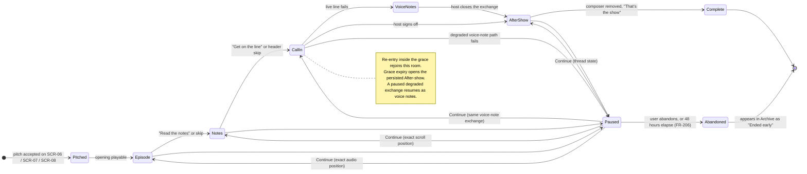
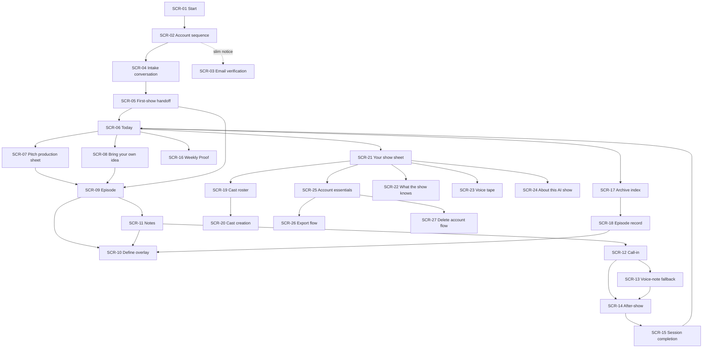

# 02 — UX Specification

**Status: NORMATIVE.** This document is the sole owner of the experience model, information architecture, navigation, screens (`SCR-##`), screen states (`SCR-##/S<n>`), exact user-facing copy (Appendix A), and the banned lexicon (Appendix B).

**Derivation.** This document is the normative split of `docs/For_one_Design_System_and_UI_Specification.md` (adopted as canonical design authority by `00-decisions.md` §9.1, ADR-0016), together with the four deltas authorised in `00-decisions.md` §9.3. Copy strings from the source document are adopted verbatim. Behaviour is cross-checked against `docs/PRD.md` v2.0.

**Companion document.** `03-design-system.md` owns tokens, components (`DS-*`), motion, the audio system's behavioural contracts, the responsive system, internationalisation foundations, accessibility standards, the state system, and the design QA gates. This document cites `DS-*` identifiers and never restates component anatomy.

**Precedence.** `00-decisions.md` → this document → `docs/For_one_Design_System_and_UI_Specification.md`.

**Normative language.** MUST / MUST NOT / MAY per RFC 2119. The words forbidden in normative sections by `00-decisions.md` §7 ("TBD", "for example", "such as", "could", "or similar", "etc.") are absent from the normative prose of this document. They MAY appear inside quoted user-facing copy, where the string is the specification: the failure-voice construction "could not" is used in COPY-027, COPY-108, COPY-261, COPY-275, COPY-277, COPY-278, COPY-282, and COPY-339, and COPY-108 is transcribed verbatim from the adopted design document. A word-level scan of this file MUST exclude quoted copy strings and Appendix A.

**Feature identifiers.** `01-prd.md` owns `F-##` identifiers. This document does not duplicate feature traceability; `04-srs.md` maps user-facing functional requirements onto the `SCR-##` identifiers defined here.

---

# 1. Experience model

## 1.1 What the user believes they are entering

The primary mental model is **opening today's programme from a private recurring show**.

This is stronger than "entering a studio," because the user should not feel responsible for production. It is stronger than "receiving an episode," because the user first chooses among authored pitches. It is stronger than "opening a publication" alone, because audio, recurring hosts, and the live call are central.

The programme model communicates five things immediately:

- the show has a cadence without imposing a streak;
- the material is finite and prepared, not an infinite feed;
- the hosts recur and accumulate history;
- the user chooses what goes on air;
- every edition ends cleanly.

## 1.2 Experience hierarchy

| Priority | What dominates | Design consequence |
|---|---|---|
| 1 | Today's programme | The first viewport is dated, finite, and centred on pitches. |
| 2 | The lead prepared pitch | It receives the strongest typography and the only "Ready now" state. |
| 3 | The selected episode | Once chosen, all navigation recedes and the episode becomes the environment. |
| 4 | The user's role | The unresolved throw, call-in invitation, and host pushback make participation the climax. |
| 5 | Recurring hosts | Names, voices, marks, and relationship history remain visible but never overpower the episode. |
| 6 | Previous episodes | Archive is one persistent destination, deliberately quieter than Today. |
| 7 | Cast and trust controls | Reachable from Your show, and never promoted as primary work. |

## 1.3 What remains nearly invisible

| Hidden system | User-facing substitute |
|---|---|
| Pedagogical targets | Natural repetition across episode, notes, call, and after-show |
| Internal proficiency and difficulty | Language that simply feels demanding but followable |
| Assessment | Weekly Proof as an authored media event |
| Prediction ranking | One item marked "Ready now" |
| Planner and quality gate | A complete programme that arrives without technical explanation |
| Generation pipeline | "Making the opening" and honest readiness states |
| Learner-file structure | "What the show knows" in plain language on request |
| Telemetry and cost | No user-facing surface |
| AI configuration | Transparent identity, with no model or provider terminology |

## 1.4 Emotional arc translated into interface behaviour

| Moment | Intended feeling | Interface behaviour |
|---|---|---|
| Arrival | Something is here | The dated programme renders immediately; no blank prompt or setup request. |
| Recognition | This is mine | One pitch MAY contain a restrained, high-confidence callback inside its title; familiar host names are visible. |
| Anticipation | I want to hear this | The lead title and "Ready now" control dominate; supporting pitches remain legible but quieter. |
| Selection | I am choosing the show | The production sheet lets the user accept or change topic, format, and cast without prompt engineering. |
| Immersion | The software disappears | Navigation contracts; the Booth surface, player, and transcript become the page. |
| Participation | They need my position | The episode ends unresolved; the notes and call-in use direct, social language. |
| Resolution | The argument has landed | The host closes the call and the short after-show thread ends visibly. |
| Return to life | Nothing is hanging over me | "That’s the show" offers a quiet exit; no next action is promoted. |

## 1.5 The continuous episode folio

A selected session is one object with four media surfaces, not four tasks in a workflow. The browser URL MAY change by stage for restoration, but the visual identity, episode title, cast, and position remain continuous.

- **Episode (SCR-09):** produced audio, transport, synced transcript.
- **Notes (SCR-11):** editorial article that complicates the hosts' position.
- **Call-in (SCR-12, fallback SCR-13):** live or asynchronous voice argument.
- **After-show (SCR-14):** short text exchange with a hard social ending.

The user MAY pause from any surface under the stage-specific rules in 04. Episode audio and notes remain replayable after completion. A transient live departure starts the 30-second reconnect grace in FR-204: returning inside it rejoins the same room without a new opening, while expiry advances to the persisted After-show. A paused degraded voice-note exchange resumes in voice-note mode and never switches back to live.



# 2. Information architecture

## 2.1 Sitemap

```text
For one
├── Today                                      SCR-06
│   ├── Resume active session (conditional)     SCR-06/S6
│   ├── Weekly Proof (conditional)              SCR-16
│   ├── Daily programme: 3–5 pitches            SCR-06/S1
│   ├── Pitch production sheet                  SCR-07
│   └── Bring your own idea                     SCR-08
├── Session folio
│   ├── Episode                                 SCR-09
│   │   └── Define (overlay)                    SCR-10
│   ├── Notes                                   SCR-11
│   ├── Call-in                                 SCR-12
│   │   └── Voice-note fallback                 SCR-13
│   └── After-show                              SCR-14
│       └── Session completion                  SCR-15
├── Archive                                     SCR-17
│   ├── Episode record                          SCR-18
│   └── Weekly Proof record                     SCR-18
└── Your show (sheet, not a settings dashboard) SCR-21
    ├── Cast                                    SCR-19
    │   ├── Default duo
    │   ├── Created hosts
    │   ├── Create through conversation         SCR-20
    │   └── Retired hosts
    ├── What the show knows                     SCR-22
    ├── Voice tape                              SCR-23
    ├── About this AI show                      SCR-24
    └── Account essentials                      SCR-25
        ├── Export my data                      SCR-26
        └── Delete my account                   SCR-27
```



## 2.2 Persistent navigation

### Desktop

`DS-Masthead` persists on Paper surfaces and contains:

- **For one** wordmark, returning to Today;
- **Today**, the primary destination;
- **Archive**, the chronological record;
- **Your show**, which opens the right-side sheet holding cast, memory, voice consent, disclosure, verification, account essentials, and sign-out.

The masthead MUST NOT persist inside an active Call-in. In Episode and Notes it collapses to `DS-ContextHeader` with Back, episode title, and an overflow menu.

### Mobile

There is no bottom navigation bar. The product has only two primary destinations, so a compact top masthead is clearer and less app-like: a wordmark or back control at the inline start, an Archive control whose label lives in its accessible name, and Your show at the inline end. Hiding and reveal behaviour is owned by `DS-Masthead`.

## 2.3 User-facing labels

This table is the single authority for destination and stage naming. Internal names MUST NOT appear in any user-facing surface.

| Internal concept | Interface label |
|---|---|
| Home | Today |
| Listen stage | Episode |
| Read stage | Notes |
| Speak stage | Call-in |
| Chat stage | After-show |
| History | Archive |
| Settings or profile | Your show |
| Learner-file summary | What the show knows |
| Voice-storage consent | Voice tape |
| Character management | Cast |
| Custom creation | Bring your own idea |
| Data export | Export my data |
| Account deletion | Delete my account |

## 2.4 What receives no destination

The following MUST NOT receive a navigation destination, a tab, a card, or a link:

- pedagogy, language profile, targets, and assessment;
- generation status history;
- notifications;
- usage analytics or progress;
- a separate search destination;
- a separate learning or practice area;
- general settings.

## 2.5 Active and unfinished sessions

An active session appears above everything else on Today as a single resume band (`DS-ActiveSessionBand`). Stage is described in natural language; no percentage or four-step progress indicator appears.

Starting another session opens one confirmation (SCR-06/S9). Continuing is the primary action. Abandoning the current session is explicit and destructive. After 48 hours (FR-206) the session moves to Archive labelled "Ended early" and no longer blocks a new session.

## 2.6 Weekly Proof placement

When available, Weekly Proof appears below the active-session band and above the daily programme. It is visually a **special broadcast**, not a metric panel. It has its own Proof surface, a two-minute player, and one title. It MUST NOT show charts, counts, or a progress summary before playback.

## 2.7 First viewport blueprint

### Desktop, no active session

```text
┌────────────────────────────────────────────────────────────────────────────┐
│ For one                         Today   Archive                 Your show   │
├────────────────────────────────────────────────────────────────────────────┤
│ SATURDAY, 8 AUGUST                                                      01 │
│                                                                            │
│ [Lead programme item — 7 columns]     [Supporting programme — 5 columns]   │
│ Large title                           02 Supporting pitch title             │
│ Cast · format · Ready now             Cast · format                         │
│ Play this episode                     ─────────────────────────────          │
│                                       03 Supporting pitch title             │
│                                       Cast · format                         │
│                                                                            │
│ Bring your own idea                                                        │
└────────────────────────────────────────────────────────────────────────────┘
```

### Mobile

```text
For one                                      Archive   Your show
SATURDAY, 8 AUGUST

01  READY NOW
Large lead pitch title wrapping naturally over several lines
Cast · format
[Play this episode]

────────────────────────────────
02  Supporting pitch title
Cast · format
────────────────────────────────
03  Supporting pitch title
Cast · format

Bring your own idea
```

# 3. Journeys

## 3.1 First run

`SCR-01` Start → `SCR-02` Account sequence (email or OAuth → name → birth date → native language → target language) → `SCR-04` Intake conversation (about ten minutes, producer-led, reply by text or voice per turn, dialect samples, voice-storage consent) → `SCR-05` First-show handoff (duo introduction audio, one live-generated pitch, generation wait) → `SCR-09` Episode, entering the ordinary cycle.

`SCR-03` Email verification never blocks the first session. A slim notice appears on Paper surfaces after account creation; before session two, selecting a pitch opens a calm blocking panel.

## 3.2 Daily loop

`SCR-06` Today renders a dated programme carrying one prepared lead pitch and two to four supporting pitches. The user plays the lead directly, opens `SCR-07` to change topic, format, or cast, or opens `SCR-08` to bring their own idea. Accepting opens the folio: `SCR-09` → `SCR-11` → `SCR-12` (or `SCR-13`) → `SCR-14` → `SCR-15`. `SCR-10` is available as an overlay wherever text appears.

## 3.3 Trust and data rights

`SCR-21` Your show is the single entry to `SCR-19` Cast, `SCR-22` What the show knows, `SCR-23` Voice tape, `SCR-24` About this AI show, and `SCR-25` Account essentials, which holds `SCR-26` Export my data and `SCR-27` Delete my account.

# 4. Voice architecture

Every string in this document belongs to exactly one voice. Mixing voices inside one block is a defect.

| Voice | Character | Used in |
|---|---|---|
| **Product interface** | Clear, authored, adult, concrete. Describes what is happening and what the user can do. It MUST NOT perform a character, praise, tease, or pretend intimacy. | Navigation, states, buttons, errors |
| **Producer** | Warm, observant, economical, conversational, in the user's native language. Asks one thing at a time, acknowledges without flattery, moves on from sparse answers, and is explicit about AI and consent. | SCR-04, SCR-20 |
| **Host** | Character-specific, primarily in the target language. Hosts MAY disagree, joke, push back, recast naturally, and close socially. They MUST NOT act as product support, deliver consent, claim human experiences as fact, or manipulate return behaviour. | SCR-09, SCR-12, SCR-13, SCR-14, SCR-16 |
| **Legal and consent** | Plain, literal, free of jokes. States what is stored, why, what changes after a choice, and how long deletion takes. Button hierarchy is neutral. | SCR-02 age gate, SCR-04 consent, SCR-23, SCR-25, SCR-26, SCR-27, transactional email |
| **Failure state** | Calm and specific: what failed, what was preserved, and the next action. It MUST NOT blame the user or anthropomorphise the system's failure. | Every error state |

# 5. Screen specifications

Each screen carries an `SCR-##` identifier; each state carries `SCR-##/S<n>`. State identifiers are stable and MUST NOT be renumbered; a retired state keeps its number and is marked retired.

Every screen specification uses the same structure: environment, purpose and user question, entry and exit, composition, state table, exact copy, components, responsive behaviour, accessibility behaviour, and a "must never appear" list. Copy identifiers reference Appendix A.

## SCR-01 — Start

**Environment.** Paper.

**Purpose and user question.** Establish the category in one glance and ask for nothing before the show can begin. The user asks: **"What is this, and can I begin without administering a course?"**

**Entry.** Unauthenticated root URL. **Exit.** SCR-02 through the primary action; the sign-in path for a returning user; SCR-06 when a valid session already exists.

**Composition.** Warm Paper canvas. A small For one wordmark. One large editorial statement in Programme display type. One concrete supporting line in reading body. One `DS-PrimaryButton`. A short `DS-DisclosureLine` below the action. One quiet `DS-TextAction` for sign-in. No feature grid, testimonials, product screenshots, or animated motif appears.

**States.**

| ID | State | Trigger | Behaviour | Copy |
|---|---|---|---|---|
| SCR-01/S1 | Default | Unauthenticated arrival | Statement, supporting line, action, disclosure, and sign-in render immediately. Nothing is fetched before the first paint. | COPY-001 … COPY-005 |
| SCR-01/S2 | Session present | A valid session exists | The user is sent to SCR-06 without rendering the statement. | — |
| SCR-01/S3 | Action pending | Primary action pressed | The button enters a busy state and blocks duplicate submission. The statement does not move. | COPY-003 |
| SCR-01/S4 | Offline | No connection | `DS-SystemBanner` offline variant; the primary action is disabled with an inline explanation. | COPY-006, COPY-327 |
| SCR-01/S5 | Error | The application shell fails to load its data | `DS-ErrorState` inline, with one retry. The statement remains. | COPY-007 |

**Exact copy.**

> **A show made around you, in the language you want to live in.** *(COPY-001)*
> Recurring AI hosts. New episodes shaped by your interests and your week. You decide what goes on air. *(COPY-002)*
>
> **Make my show** *(COPY-003)*
>
> The hosts are AI characters you create and control. *(COPY-004)*
>
> Already have a show? **Sign in** *(COPY-005)*

- Offline action explanation: "Making a show needs a connection." *(COPY-006)*
- Shell failure: "This page did not load completely. Try again." *(COPY-007)*

**Derived decision.** The source document specifies a sign-in path only inside the existing-account conflict on SCR-02. A signed-out returning user requires a reachable entry, so COPY-005 is added as one quiet text action. It carries no promotional weight and MUST NOT be given equal visual weight to COPY-003.

**Components.** `DS-PrimaryButton`, `DS-TextAction`, `DS-DisclosureLine`, `DS-SystemBanner`, `DS-ErrorState`.

**Responsive.** At 200% text the statement and action stack naturally. There is no viewport-locked hero. On mobile the action sits above the safe-area bottom.

**Accessibility.** The statement is the page `h1`. The disclosure is adjacent text, not a tooltip. The primary action is the first tab stop after the wordmark.

**Must never appear.** A level selector, placement test, learning-goal checklist, streak promise, "AI-powered" headline, prompt box, or testimonial carousel.

---

## SCR-02 — Account sequence

**Environment.** Paper.

**Purpose and user question.** Collect only what is required before the producer can speak. The user asks: **"How little can I give before this starts?"**

**Entry.** SCR-01. **Exit.** SCR-04 on completion; the sign-in path on an existing-account conflict.

**Composition.** Five steps in order:

1. Email and password, or Google, or Apple.
2. Name.
3. Birth date.
4. Native language.
5. Target language.

Mobile uses one question per viewport. Desktop uses a two-column editorial and form composition, 5/7. Back is always available until account creation completes. OAuth buttons are equal in hierarchy to email and MUST NOT be oversized promotional blocks.

**States.**

| ID | State | Trigger | Behaviour | Copy |
|---|---|---|---|---|
| SCR-02/S1 | Credentials | Entry | Email and password fields plus the two OAuth actions. | COPY-008 … COPY-010 |
| SCR-02/S2 | OAuth pending | Provider action pressed | The provider button stays in place, enters a busy state, and blocks duplicate submission. | COPY-010 |
| SCR-02/S3 | Name | Credentials accepted | One `DS-TextField`. | COPY-011 |
| SCR-02/S4 | Birth date | Name accepted | Locale-appropriate segmented or native date input. A calendar picker MUST NOT be forced. | COPY-012, COPY-013 |
| SCR-02/S5 | Native language | Birth date accepted | `DS-LanguageSelector`, single selection. | COPY-014 |
| SCR-02/S6 | Target language | Native language accepted | `DS-LanguageSelector`, single selection. | COPY-015 |
| SCR-02/S7 | Field error | Validation failure | Inline error below the field, linked with `aria-describedby`. Entered values are preserved. | COPY-016, COPY-017 |
| SCR-02/S8 | Under-18 rejection | Birth date below 18 years | The sequence stops with one plain statement. No workaround, moralising, or retry-with-different-date affordance appears. Animation is forbidden. | COPY-018 |
| SCR-02/S9 | Existing account | The email or provider identity already has an account | The user is offered sign-in. Selections already made MUST be retained and reapplied after sign-in. | COPY-019, COPY-020 |
| SCR-02/S10 | Provider failure | OAuth popup or provider error | Inline recovery offering retry, email, or sign-in. | COPY-021 |
| SCR-02/S11 | Language inventory failure | The language list cannot be fetched | The cached launch list is used. Unsupported languages MUST NOT be guessed or offered. | COPY-022 |
| SCR-02/S12 | Creating | Final step submitted | Busy state on the submit action; the form remains visible. | COPY-023 |
| SCR-02/S13 | Offline | No connection | The form remains and submission is blocked with a clear explanation. Draft values are retained. | COPY-327 |
| SCR-02/S14 | Created | Account created | The user is handed to SCR-04. SCR-03/S1 becomes active on Paper surfaces. | — |

**Exact copy.**

- Email label: "Your email" *(COPY-008)*
- Password label: "Choose a password" *(COPY-009)*
- Provider actions: "Continue with Google" / "Continue with Apple" *(COPY-010)*
- Name: **"What should the show call you?"** *(COPY-011)*
- Birth date label: **"Your birth date"** *(COPY-012)*
- Birth date requirement: "For one is currently for adults aged 18 and over." *(COPY-013)*
- Native language: **"Which language should we use with you?"** *(COPY-014)*
- Target language: **"Which language should the show be in?"** *(COPY-015)*
- Required field: "This one is needed before we can start." *(COPY-016)*
- Email in use, inline: "That email already has a show." *(COPY-017)*
- Under-18 rejection: **"For one is currently for adults aged 18 and over."** *(COPY-018)*
- Existing-account panel: "You already have a show. Sign in and it will be waiting." *(COPY-019)* · action "Sign in" *(COPY-020)*
- Provider failure: "That sign-in did not complete. Try again, or use your email." *(COPY-021)*
- Language inventory failure: "We are showing the languages saved on this device. The full list will return shortly." *(COPY-022)*
- Creating: "Setting up your show." *(COPY-023)*

**Components.** `DS-TextField`, `DS-LanguageSelector`, `DS-PrimaryButton`, `DS-SecondaryButton`, `DS-TextAction`, `DS-ErrorState`, `DS-SystemBanner`.

**Responsive.** Mobile places one question per viewport with the action above the safe-area bottom. Tablet places the statement above the form or uses a 3/5 split. Desktop uses a 5/7 editorial and form composition without a tall hero lock. At 200% text everything stacks.

**Accessibility.** Labels are persistent. Errors are linked with `aria-describedby`. Password managers MUST work. Birth date accepts locale-appropriate input. Each step is a real page with a title so browser Back behaves correctly.

**Must never appear.** A level selector, placement test, learning-goal checklist, progress meter across the steps, or a prompt box.

---

## SCR-03 — Email verification

**Environment.** Paper.

**Purpose and user question.** Verify the address without blocking the first show. The user asks: **"Do I have to deal with this now?"**

**Entry.** Account creation (notice); pitch selection at session two (panel); the emailed link. **Exit.** Return to the surface the user was on, or directly to the selected pitch.

**Composition.** Two forms. The **notice** is a slim `DS-SystemBanner` in the verification variant, rendered below `DS-Masthead` on Paper surfaces only. The **panel** is a calm blocking dialog shown when a pitch is selected for session two; the current programme remains visible behind it.

**States.**

| ID | State | Trigger | Behaviour | Copy |
|---|---|---|---|---|
| SCR-03/S1 | Notice | Account created and unverified | Slim banner with a resend action. It never blocks. | COPY-024, COPY-025 |
| SCR-03/S2 | Resend pending | Resend pressed | The action enters a busy state and blocks duplicate submission. | COPY-025 |
| SCR-03/S3 | Resend sent | Send succeeded | The banner states that the link was sent again. | COPY-026 |
| SCR-03/S4 | Delivery failure | Send failed | Session one remains fully available. One retry is offered. | COPY-027 |
| SCR-03/S5 | Blocking panel | A pitch is selected for session two while unverified | Dialog over the visible programme. Verification is the only way forward; the user MAY close the dialog and remain on Today. | COPY-028, COPY-025, COPY-029 |
| SCR-03/S6 | Verified | A fresh link succeeds, or a single-use link is opened again after the same address is already verified | The notice is removed. If verification began from the panel and the 24-hour device return record still resolves to the current active pitch revision, the user returns directly to that pitch; otherwise Today opens normally. | COPY-030 |
| SCR-03/S7 | Link unavailable | The provider reports that the link's exact 24-hour validity elapsed, or rejects it for the current subject | One non-disclosing expired-link statement plus a new-link action. | COPY-031 |
| SCR-03/S8 | Offline | No connection | The resend action is disabled with an inline explanation. | COPY-327 |

**Exact copy.**

> **Check your email before the next show.** We sent a verification link to {email}. · **Send again** *(COPY-024, COPY-025)*

- Resent confirmation: "Sent again to {email}." *(COPY-026)*
- Delivery failure: "We could not send that email just now. Your first show is still open. Try again in a moment." *(COPY-027)*
- Blocking panel title: **"Verify your email to keep the show going."** Body: "We sent a link to {email}. Open it, and this pitch will be waiting." *(COPY-028)*
- Panel dismissal: "Back to today’s programme" *(COPY-029)*
- Verified: "Your email is verified." *(COPY-030)*
- Expired link: "That link has expired. We can send you a new one." · **"Send a new link"** *(COPY-031)*

**Components.** `DS-SystemBanner`, `DS-ConfirmationDialog` (standard variant, non-destructive), `DS-PrimaryButton`, `DS-TextAction`, `DS-ErrorState`.

**Responsive.** The banner is one line on desktop and wraps on mobile without truncating the address. The panel is a bottom sheet on mobile and a centred dialog on desktop.

**Accessibility.** The banner is a landmark region, announced once on load, not a live region that repeats. The panel traps focus while open, restores focus to the pitch on close, and closes on Escape.

**Must never appear.** A countdown to verification, a locked-account warning, a re-engagement message, or any suggestion that the first show is at risk.

---

## SCR-04 — Intake conversation

**Environment.** Paper.

**Purpose and user question.** Build enough personal and linguistic context to produce the first real show while keeping the interaction human-scale and transparent. The user asks: **"Can this producer understand me without turning me into a form?"**

**Entry.** SCR-02/S14, or the resume state on Today. **Exit.** SCR-05.

**Composition — the producer desk.** A continuous interview script in a centred 760 px column, not a chat app:

- the current producer turn appears as a large authored paragraph with a compact Play/Pause control;
- earlier producer turns remain as transcript paragraphs;
- user responses appear as inset quotations with a small "You" label;
- `DS-ReplyDock` sits at the bottom with Type and Record modes;
- a narrow rail on desktop carries the duration expectation and the AI and recording disclosure, and MUST NOT carry a checklist of fields.

Only the current exchange has high contrast; older turns soften slightly and remain readable. There are no speech bubbles, avatars, typing dots, or assistant tool labels.

**Turn-taking rules.** Producer audio MUST NOT autoplay over user recording. When producer audio ends, focus moves to the reply dock without opening the microphone. The user chooses text or voice for every reply. Record mode shows elapsed time and Stop and MUST NOT show pronunciation quality. The user MAY replay a producer turn and edit a text reply before sending. A sent voice reply MAY be replayed and replaced before the producer responds.

**Progress without a progress bar.** No percentage, step count, or checklist appears. Progress is communicated three ways: an opening duration statement, concrete producer transition lines, and a near-the-end statement of what remains.

**Short answers and sparse fields.** After two attempts on a topic the producer moves on without exposing missing data. The interface MUST NOT mark an answer incomplete. Silence and one-word replies are accepted and the script continues. The producer MAY use one quick choice where it fits the conversation, always followed by an open reply opportunity.

**Target-language moments.** Three or four brief target-language moments are embedded in producer audio. The interface MUST NOT label them as tests. When the producer switches language the transcript preserves the target script and offers a small native-language replay or meaning action only on request or apparent difficulty. No score follows.

**Dialect samples.** A flat list of `DS-VoiceSample` rows appears inside the script at the relevant turn, each 10–15 seconds, with variant name, Play, and Select. Only one sample plays at a time. The selection is reversible until the handoff begins.

**States.**

| ID | State | Trigger | Behaviour | Copy |
|---|---|---|---|---|
| SCR-04/S1 | Default turn | Producer turn ready | Current turn at high contrast, previous turns softened, reply dock active. | COPY-032 … COPY-036 |
| SCR-04/S2 | Producer speaking | Audio plays | Play control shows playing. The microphone is not opened. | — |
| SCR-04/S3 | Producer response loading | Reply sent | The sent reply is visible; the producer turn slot shows an honest waiting line. No typing dots. | COPY-037 |
| SCR-04/S4 | Recording | Record pressed | Elapsed time and Stop. No quality indication. | COPY-038 |
| SCR-04/S5 | Reviewing a voice reply | Recording stopped | Play, Replace, Send. | COPY-039 |
| SCR-04/S6 | Quick choice | The script offers one | `DS-SegmentedChoice` with at most three options, followed by an open reply opportunity. | COPY-040 |
| SCR-04/S7 | Dialect selection | The script reaches the variant turn | Sample rows with Play and Select. Reversible until handoff. | COPY-041 |
| SCR-04/S8 | Voice-storage consent | The script reaches the consent turn | `DS-ConsentChoice`. Neither option is preselected. Animation is forbidden. | COPY-042 … COPY-045 |
| SCR-04/S9 | Producer audio failure | Synthesis or delivery fails | Text remains and the conversation continues by text. One retry for audio. | COPY-046 |
| SCR-04/S10 | Upload failure | A voice reply fails to upload | The local recording is retained until Retry or Replace. The reply is never lost. | COPY-047 |
| SCR-04/S11 | Response failure | The initial or reply-bound producer job reaches its terminal failure state | One neutral recovery line and Retry. Retry calls EP-59 with only `target.kind='initial'` or the durable `parentProducerEventId`; it MUST NOT require the original profile fields, reply body, upload key, or audio. The owner mutation requeues the same durable parent batch and MUST NOT append the retained reply, acknowledgement, or producer turn again. EP-06 returns to the matching wait state; every later terminal failure remains retryable under the owner rate and cost controls. Provider and model details MUST NOT be revealed. | COPY-048, COPY-325 |
| SCR-04/S12 | Offline | Connection lost | All completed turns are locally cached. The reply dock becomes read-only. | COPY-049 |
| SCR-04/S13 | Paused | The user leaves | Today is replaced by a single resume state. | COPY-050 |
| SCR-04/S14 | Microphone denied | Permission refused | Voice replies are unavailable; text replies continue without interruption. `DS-MicPermissionPanel` offers one retry. | COPY-146 |
| SCR-04/S15 | Closing | The script completes | The final producer paragraph closes with a horizontal rule and the handoff line. The page transitions into SCR-05 and MUST NOT return to a dashboard. | COPY-051 |
| SCR-04/S16 | New work unavailable today | The 06-owned daily cost guard blocks the initial producer turn or the next producer response | Every committed turn and the latest reply remain visible and resumable. The reply dock becomes read-only and the page states that new work is unavailable until tomorrow; no retry action, number, cost, or daily-cap claim appears. | COPY-331 |

**Exact copy.**

- Opening duration: "This takes about ten minutes." *(COPY-032)*
- Desktop rail duration: "About 10 minutes" *(COPY-033)*
- Producer introduction: "I’m the producer—an AI voice helping build your show. I’ll ask about what you care about, then introduce the hosts." *(COPY-034)*
- Mid-script transition: "I know why you’re here. Now I need to know what would make the show worth hearing." *(COPY-035)*
- Near the end: "Two things left: how you want the language to sound, and what we keep on tape." *(COPY-036)*
- Waiting for the producer: "The producer is thinking." *(COPY-037)*
- Recording: "Recording. Stop when you’re done." *(COPY-038)*
- Voice reply review: "Send this reply" / "Record it again" *(COPY-039)*
- Quick choice: "Mostly work, travel, or family?" *(COPY-040)*
- Dialect turn: "Pick the one that sounds like the people you want to understand." *(COPY-041)*
- Consent panel:

> **Keep call-in audio for future comparisons?** *(COPY-042)*
> We always keep the written transcript because it is part of your show. Keeping audio is optional. If you allow it, future Weekly Proof episodes can compare your voice over time. You can stop and remove stored clips later. *(COPY-043)*
>
> **Keep call-in audio** *(COPY-044)*
> **Use transcripts only** *(COPY-045)*

- Producer audio failure: "The producer’s audio did not play. The words are here, and you can keep going." · "Try the audio again" *(COPY-046)*
- Upload failure: "That reply did not upload. It is still here on your device." · "Try again" / "Record it again" *(COPY-047)*
- Response failure: "Something interrupted the conversation. Nothing you said was lost." · "Try again" *(COPY-048)*
- Offline: "You’re offline. Everything you have said is saved on this device." *(COPY-049)*
- Resume state on Today: **"Continue setting up your show."** *(COPY-050)*
- Handoff line: "I have enough to make the first show." *(COPY-051)*

**Components.** `DS-IntakeTurn`, `DS-ReplyDock`, `DS-VoiceSample`, `DS-SegmentedChoice`, `DS-ConsentChoice`, `DS-DisclosureLine`, `DS-MicPermissionPanel`, `DS-ErrorState`, `DS-SystemBanner`.

**Responsive.** Mobile uses a continuous script with the reply dock and an inline audio control. Tablet adds a narrow disclosure rail. Desktop uses a 760 px script with a 240 px contextual rail.

**Accessibility.** Producer audio is mirrored in text and the user MAY respond by text on every turn. Focus moves to the reply dock when audio ends. The consent panel is reachable by keyboard with both options in the tab order and neither preselected. Target-language runs carry correct `lang` and direction.

**Must never appear.** A profile-completion percentage, question count, personality radar, CEFR result, "analysing you" animation, assistant bubbles, or a list of stored learner-file fields.

---

## SCR-05 — First-show handoff

**Environment.** Paper, transitioning to Booth on playback.

**Purpose and user question.** Turn setup into a real piece of media as quickly as possible. The user asks: **"Did all of that actually become a show?"**

**Entry.** SCR-04/S15. **Exit.** SCR-09.

**Composition.** The Paper surface becomes a `DS-EpisodePlate` carrying the duo's names and non-human marks. A concise introduction line sits above a compact `DS-FullPlayer` holding the 60–90 second recorded introduction, with an optional transcript. The duo's relationship is demonstrated through the audio, not a trait list. Character creation is mentioned once after playback as a text link to Cast, never as a branching flow. Below the introduction, one live-generated pitch appears as a printed cue-sheet block using a real intake interest and no exaggerated callback.

**States.**

| ID | State | Trigger | Behaviour | Copy |
|---|---|---|---|---|
| SCR-05/S1 | Introduction | Entry | Plate, introduction line, player, optional transcript. While `firstPitchStatus` is `queued` or `running`, the exact first-idea wait line appears below the player; no empty pitch shell renders. | COPY-052, COPY-053, COPY-054, COPY-058 |
| SCR-05/S2 | Introduction played | Playback completes | The cast mention appears once. The introduction remains replayable throughout. If the first pitch is still queued or running, the same exact first-idea wait line remains. | COPY-055, COPY-058 |
| SCR-05/S3 | First pitch | `firstPitchStatus = 'ready'` for variant 1 | One cue-sheet pitch with accept and the one permitted alternative action. | COPY-056, COPY-057 |
| SCR-05/S4 | Alternative pitch | Variant 2 becomes ready after "Another idea" | The sole generated alternative replaces variant 1, with accept and one terminal rejection action. No further generated alternative is offered. | COPY-056, COPY-057 |
| SCR-05/S5 | Interest fallback | The user rejects variant 2, or prompt/gate retries exhaust | The rejection authorizes the deterministic variant-3 highest-salience-interest fallback; an empty interest file uses the package starter. No topic field or further pitch renders. The existing opening-generation plate remains until the server-created first session becomes readable, then advances to S6. | COPY-059, COPY-060 |
| SCR-05/S6 | Generating | A displayed pitch is accepted, or the variant-3 automatic session writer commits | The pitch becomes the episode plate inside `DS-GenerationState`. The introduction remains replayable. No spinner in empty space and no percentage appear. | COPY-059, COPY-060 |
| SCR-05/S7 | Partially ready | The first audio chunk is ready | Play becomes active and the line changes to the partial-readiness statement. | COPY-061 |
| SCR-05/S8 | Automatic fallback | EP-52 reports `executionMode='generated_fallback'`, or reports `executionMode='authored_fallback'` after any gate, provider, orchestrator, or first-episode-deadline terminal claim | The system enters FR-417's fallback automatically and states that transition without exposing the quality gate or offering a generation mutation. COPY-062 precedes COPY-063 only when the first-episode deadline caused the authored claim. COPY-334 appears only when the readable terminal folio sets ADR-0022's delivered-cast override. Direct provider/orchestrator exhaustion reaches this same state and never invents a separate error string. | COPY-063; deadline COPY-062; conditional COPY-334 |
| SCR-05/S9 | First-pitch infrastructure failure | Infrastructure reaches its terminal failed state before any pitch exists | The first-idea failure line and EP-11 retry action render. Model or gate failure MUST NOT enter this branch because it resolves to variant 3; episode generation remains on the automatic FR-416/FR-417 path and never offers a client regeneration action. | COPY-283, COPY-325 |
| SCR-05/S10 | Offline | Connection lost during the wait | The introduction remains playable if buffered. Generation resumes on reconnection. | COPY-327 |
| SCR-05/S11 | Paused | The user leaves the page | Work continues. Today shows the generation state in place of readiness. | COPY-089 |
| SCR-05/S12 | Introduction skipped | The user chooses the skip action before playback completes | Playback stops, focus moves to the first pitch, and the introduction remains replayable. The visible AI-host disclosure remains on the page. | COPY-269 |
| SCR-05/S13 | Taking longer | No generation progress is observed for the delay threshold owned by FR-110 | `DS-GenerationState` replaces the determinate wait with the honest delayed state. The user MAY choose the in-app readiness action, which keeps generation alive, returns to Today, and uses SCR-06/S8 when the opening becomes ready. | COPY-270 |
| SCR-05/S14 | New work unavailable today | The 06-owned daily cost guard refuses onboarding pitch, pre-generation, or first-session work | The authored introduction remains visible and replayable. A pitch already published remains visible; when no pitch exists, the statement sits below the introduction and no empty pitch shell renders. No new session or partial generation is created; the page shows no number, cost, or daily-cap claim. | COPY-331 |
| SCR-05/S15 | Episode support required | EP-52 returns `episode.failure='support_required'` after terminal authored-folio publication exhausts | The introduction and all earlier completed work remain available. The generation plate becomes a persistent error panel with the exact support statement and one `mailto:` link whose address is 05's `NEXT_PUBLIC_SUPPORT_EMAIL`; no Retry, simpler-version, Play, or stage-detail action renders. | COPY-341 |

**Exact copy.**

> **Meet {primaryHostName} and {secondaryHostName}—your AI hosts.** They have one job: make a show worth joining. *(COPY-052, COPY-053)*

- Adopted alternative subtitle, used when the duo's introduction establishes disagreement as the relationship: "They disagree professionally." *(COPY-054)* — exactly one of COPY-053 and COPY-054 is used per authored duo.
- Cast mention: "You can add other voices to the cast later." *(COPY-055)*
- Introduction skip: "Skip the introduction" *(COPY-269)*
- Accept the pitch: **"Put this on"** *(COPY-056)*
- Reject the pitch: **"Another idea"** *(COPY-057)*
- First-pitch wait: "Making your first idea. You can leave; it will be here when it is ready." *(COPY-058)*
- Generation wait:

> **Making the opening.** *(COPY-059)*
> The episode can start as soon as the first part is ready. You can leave this page; nothing will be lost. *(COPY-060)*

- Partial readiness: "The opening is ready; the rest is arriving." *(COPY-061)*
- Over the ceiling: "This one is taking longer than it should." *(COPY-062)* · "We’re switching to a simpler episode that can start on time." *(COPY-063)*
- Delayed generation: "This show is taking longer than usual. You can leave; nothing will be lost." · action "Let me know here when it’s ready" *(COPY-270)*
- First-pitch infrastructure failure: "The first idea did not arrive. Nothing from your conversation was lost." · action "Try again" *(COPY-283, COPY-325)*
- Terminal episode support: "This episode did not finish. Nothing else in your show changed. Write to {supportEmail} and we’ll help." *(COPY-341)*

**Components.** `DS-EpisodePlate`, `DS-HostMark`, `DS-CastPairing`, `DS-FullPlayer`, `DS-ProgrammePitch` (first-show variant), `DS-GenerationState`, `DS-PrimaryButton`, `DS-TextAction`.

**Responsive.** Mobile stacks host marks and the introduction player with the pitch below. Tablet MAY place the title plate and pitch side by side. Desktop uses a 7-column title plate and a 5-column pitch cue.

**Accessibility.** The introduction has a transcript. The plate's title is the page heading. Pressing the accept action moves focus to the generation state so the change is announced once.

**Must never appear.** A setup summary, a profile recap, a "your show is ready" celebration, a progress percentage, or more than one regeneration action at a time.

---

## SCR-06 — Today

**Environment.** Paper. Proof field when a Weekly Proof is present.

**Purpose and user question.** Present a finite set of genuinely tempting ideas while proving that one has already been made. The user asks: **"What did my show bring me today?"**

**Entry.** Application root when authenticated; every Back to Today action. **Exit.** SCR-07, SCR-08, SCR-09, SCR-16, SCR-17, SCR-21, and resumption of an active session.

**Composition and information hierarchy.**

1. Active-session band, when present.
2. Weekly Proof, when present.
3. Date and issue line.
4. Lead prepared pitch.
5. Supporting pitches.
6. Bring your own idea.
7. A quiet footer carrying Archive and Your show on very small screens.

Pitches are an **editorial programme**, not cards, covers, tiles, or a schedule with times. The lead pitch occupies seven columns on desktop and full width on mobile. Supporting pitches form a ruled list in five columns on desktop. Issue numbers 01–05 create order without implying ranking quality. Topic, format, and cast are communicated through the title and one compact metadata line. Only the prepared pitch receives "Ready now"; other pitches show no wait estimate until selected. The wildcard is not labelled and MUST feel like an editorial surprise rather than a system category.

**Personal references.** Personal callbacks appear only inside naturally written pitch language. There is no "from your life" marker, memory icon, or explanation of why a detail is known. A callback that risks feeling sensitive or uncertain is omitted. Hover and tap MUST NOT reveal a source memory.

**Host presence.** Host marks and names appear in pitch metadata. There is no large duo hero, mascot greeting, or simulated presence.

**Persistent playback.** No player appears until audio has actually started. Produced audio MAY persist as `DS-CompactPlayer` across Paper surfaces. Live call audio MUST NOT become a compact player.

**States.**

| ID | State | Trigger | Behaviour | Copy |
|---|---|---|---|---|
| SCR-06/S1 | Default programme | A complete current pitch set exists | Dated frame, one editorial lead and two to four supporting pitches, plus Bring your own idea. A prepared lead renders COPY-065 and COPY-066. If no pitch is prepared because pre-generation failed, the same complete set renders with no readiness label; the lead uses COPY-056 and selection follows the ordinary on-selection path. This is not the fallback-set state S5. | COPY-064, COPY-067; COPY-065, COPY-066 when ready; otherwise COPY-056 |
| SCR-06/S2 | Refreshing under 800 ms | Staleness refresh at app open | The existing programme frame is retained and no message appears. The set replaces atomically. | — |
| SCR-06/S3 | Refreshing 0.8–5 s | Staleness refresh exceeds 800 ms | Three short typographic skeleton lines for no more than five seconds, with the dated frame retained. Old and new pitches MUST NOT interleave. Archive and Your show remain available. | COPY-068 |
| SCR-06/S4 | Setup pending | Intake incomplete | The programme is replaced by the single intake resume state. | COPY-050 |
| SCR-06/S5 | Retired — one-pitch fallback | No trigger | This state MUST NOT render. FR-127 publishes a complete package-authored starter set after terminal planner failure, and a world-check failure renders an ordinary interest-based programme without a warning. | — |
| SCR-06/S6 | Active session | An unfinished session exists | `DS-ActiveSessionBand` above everything else, with one Continue and an overflow holding the end-early action. | COPY-070 … COPY-075 |
| SCR-06/S7 | Being made | A selected pitch is generating | The affected pitch shows the generation label in place of readiness. | COPY-089 |
| SCR-06/S8 | Opening ready | The first chunk of a generating episode is ready | A compact in-page notice states readiness. No push notification is sent. | COPY-076 |
| SCR-06/S9 | Active-session conflict | A new pitch is selected while a session is active | One confirmation naming the open episode and its position. The safe action is first and visually primary. | COPY-077 … COPY-079 |
| SCR-06/S10 | End early confirmation | The end-early action is chosen from the band overflow | One confirmation naming the consequence. | COPY-080 … COPY-082 |
| SCR-06/S11 | New work refused | A session-admission control refuses the attempt | The reason selects one exact branch: a third session uses the in-character daily-cap line; the daily cost guard uses the separate honest no-number explanation. The programme and everything already produced remain usable. | COPY-083 or COPY-331 |
| SCR-06/S12 | Weekly Proof present | A Proof is available | `DS-WeeklyProofItem` sits below the band and above the programme. | COPY-113 |
| SCR-06/S13 | Offline | No connection | `DS-SystemBanner` offline variant; the cached programme and archive remain openable; new generation is disabled with an inline explanation. | COPY-327 |
| SCR-06/S14 | Error | The programme cannot be loaded at all | `DS-ErrorState` with one retry. Archive and Your show remain reachable. | COPY-084 |
| SCR-06/S15 | Verification required | Session two is attempted while unverified | SCR-03/S5 opens over the visible programme. | COPY-028 |
| SCR-06/S16 | Export ready | An export finished | `DS-SystemBanner` export-ready variant linking to Account essentials. | COPY-268 |
| SCR-06/S17 | First programme pending | Onboarding is complete but no steady-state pitch set has been published yet | The Today heading, any active-session band, and the ordinary Archive and Your show navigation remain available. No pitch shell, stale label, determinate progress, or Retry action renders. The page states that the first steady-state programme is being prepared and that completed work remains available. EP-12 polling follows the 06-owned convergence contract and replaces this state atomically with S1; offline keeps the state and retries only after reconnection. | COPY-332 |

**Exact copy.**

- Date and issue line: "{Weekday}, {day} {Month}" with the issue number set separately in tabular numerals. *(COPY-064)*
- Readiness: **"Ready now"** *(COPY-065)*
- Lead action: **"Play this episode"** *(COPY-066)*
- Custom entry: **"Bring your own idea"** *(COPY-067)*
- Refresh: "Preparing today’s programme" *(COPY-068)*
- Resume band title: **"Continue “{title}”"** *(COPY-070)*
- Resume position, Episode: "{m:ss} into the episode" *(COPY-071)*
- Resume position, Notes: "You left midway through the notes" · used only when the stored scroll position is beyond 35%; otherwise "You left near the beginning of the notes" *(COPY-072)*
- Resume position, paused Call-in fallback: "The voice-note exchange will continue where it stopped" *(COPY-073)*
- Resume position, After-show: "The after-show thread is still open" *(COPY-074)*
- Overflow expiry note: "Available until tomorrow evening" *(COPY-075)*
- Opening ready notice: "The opening is ready" *(COPY-076)*
- Conflict dialog:

> **You still have “{title}” open. {position}.** *(COPY-077)*
> Starting this episode will end “{title}” early. *(COPY-078)*
>
> **Continue the open episode** *(COPY-079)*
> End it and start this one *(COPY-080)*

- The typed `{position}` value in COPY-077 MUST be exactly the applicable COPY-071 value, one of COPY-072's two values selected by the stored scroll threshold, COPY-073, or COPY-074. The template contributes the final full stop; the inserted value contributes none.
- End-early confirmation: **"End “{title}” early?"** *(COPY-081)* · "It moves to your archive as Ended early. The episode and notes stay there to replay." *(COPY-082)* · actions "Keep it open" *(COPY-085)* and "End it early" *(COPY-086)*
- Daily cap, host voice: "Two shows is enough for one day. We need tomorrow to make the next one worth hearing." *(COPY-083)*
- Daily cost guard: "The show can’t make anything new until tomorrow. Everything already made still works." *(COPY-331)*
- First programme pending: "Today’s programme is being put together. Everything already made still works." *(COPY-332)*
- Programme load failure: "Today’s programme did not arrive. Your archive and your show are still here." · "Try again" *(COPY-084)*
- Generating label: "Being made" *(COPY-089)*

**Components.** `DS-Masthead`, `DS-ActiveSessionBand`, `DS-WeeklyProofItem`, `DS-ProgrammePitch`, `DS-EpisodePlate`, `DS-CastPairing`, `DS-CompactPlayer`, `DS-ConfirmationDialog`, `DS-Skeleton`, `DS-SystemBanner`, `DS-ErrorState`, `DS-OverflowMenu`, `DS-TextAction`.

**Responsive.** Desktop's first viewport MUST show the complete lead item and at least the titles of supporting items 02 and 03 at 768 px height. Mobile places the primary Play action immediately after the lead metadata, within the first 600–700 px for ordinary title lengths. Supporting rows use 20 px titles and 24 px vertical padding and MUST NOT become swipeable carousels. At 200% text the two-column layout collapses before overlap and metadata wraps rather than truncating names.

**Accessibility.** The active-session band announces once when Today opens. The date line is a real heading. Every pitch exposes its full title as the accessible name. The conflict dialog traps focus, places the safe action first in the tab order, and restores focus to the selected pitch on cancel.

**Must never appear.** Search, filter chips, recommendation explanations, "official" tags, content thumbnails, time-to-learn, streak status, a prompt field, infinite scroll, a countdown to expiry, or a greeting that claims emotional need.

---

## SCR-07 — Pitch production sheet

**Environment.** Paper.

**Purpose and user question.** Give the user ownership over topic, format, and cast without making them write a production prompt. The user asks: **"Can I make this mine without becoming the producer?"**

**Entry.** Selecting a supporting pitch on SCR-06, or the remix action on the lead pitch. **Exit.** SCR-09 on acceptance; SCR-06 on close; SCR-08 through the custom-idea action.

**Composition.** Desktop opens a five-column right sheet while the programme remains visible. Mobile opens a full-screen sheet with a sticky bottom action. The pitch title remains the heading. Three editable rows follow:

1. **Topic** — the current hook; Edit opens a single `DS-TextField`.
2. **Format** — the current format; Change opens `DS-FormatSelector` with the starter list and the free-text row.
3. **Cast** — one host or a pair; Change opens `DS-CastSelector`.

Secondary actions are Close, Start over, and Bring your own idea.

**Topic editing.** The field asks for the subject or question, not a multi-part prompt. It MAY accept voice input where browser speech capture exists; text is always available.

**Format editing.** Starter formats are editorial rows with one-line descriptions: Debate, Story time, News rundown, Interview, Explain it to me, Roast. A final row opens a short free-text field. The system mapping remains invisible.

**Cast editing.** The selector shows active host marks, names, and one short voice or character phrase. The user MAY select one or two. Selecting a third replaces only after a clear choice and MUST NOT silently deselect. Retired characters are absent and reachable only through SCR-19.

**States.**

| ID | State | Trigger | Behaviour | Copy |
|---|---|---|---|---|
| SCR-07/S1 | Prepared, unchanged | Opened on the prepared lead pitch | Primary action plays the existing episode. | COPY-066 |
| SCR-07/S2 | Supporting or changed | Opened on a supporting pitch, or any edit made | Primary action makes the episode. | COPY-090 |
| SCR-07/S3 | Topic editing | Edit pressed on Topic | One text field with helper copy. | COPY-091 |
| SCR-07/S4 | Format editing | Change pressed on Format | Editorial list plus the free-text row. | COPY-092 … COPY-094 |
| SCR-07/S5 | Cast editing | Change pressed on Cast | One or two selectable hosts; a third selection requires an explicit replace. | COPY-095, COPY-096 |
| SCR-07/S6 | Generating | Make pressed and EP-14 returns `outcome='pitch_created'` | The same user action immediately submits the returned pitch ID to EP-16 with its own retained idempotency key. Only EP-16 success replaces the sheet with the stable generation state containing the final title plate; an EP-16 refusal remains in the sheet's owned error/conflict state. The user MAY close the successful generation state and return later. | COPY-097 |
| SCR-07/S7 | Partially ready | The first chunk is ready | Play activates; the readiness line replaces the generation line. | COPY-061 |
| SCR-07/S8 | Automatic recovery | The first generation attempt fails | The statement replaces the ordinary line while the one automatic FR-416 regeneration runs. No action starts, repeats, or changes generation. | COPY-098 |
| SCR-07/S9 | Fallback produced | A generated fallback or terminal authored folio becomes readable after any gate, provider, orchestrator, or deadline claim | The simpler-version statement and Play action render. Editing requires leaving this already-created session through the ordinary active-session flow; this state has no regeneration action. COPY-334 appears only when the terminal reviewed folio sets ADR-0022's delivered-cast override. A direct provider/orchestrator exhaustion reaches this state when its authored folio becomes readable. | COPY-099, COPY-100; conditional COPY-334 |
| SCR-07/S10 | Unsupported request | A voice or format request cannot be honoured | The user's wording is preserved and the closest available behaviour is explained only where necessary. | COPY-101 |
| SCR-07/S11 | Cancelled | Cancel before production begins | The programme is restored safely. | COPY-102 |
| SCR-07/S12 | Offline | No connection | The prepared episode remains playable; edits and generation are disabled with an inline explanation. | COPY-327 |
| SCR-07/S13 | Blocked by conflict | An active session exists | SCR-06/S9 opens before the sheet commits. | COPY-077 |
| SCR-07/S14 | Taking longer | No generation progress is observed for the delay threshold owned by FR-110 | `DS-GenerationState` replaces the determinate wait with the honest delayed state. The in-app readiness action keeps generation alive, returns to Today, and uses SCR-06/S8 when the opening becomes ready. | COPY-270 |
| SCR-07/S15 | Topic refused | EP-14 returns `outcome='refused'` | The sheet remains open with every edit intact. No session, pitch replacement, cap use, or generation state appears. The reason key maps through the closed phrase table below; focus moves to the inline statement, then returns to Topic when the user chooses a different topic. | COPY-330 |
| SCR-07/S16 | New work unavailable today | EP-14 or the chained EP-16 returns the 06-owned daily cost-guard refusal | The sheet remains open with every edit intact and offers no generation retry. An EP-14 refusal leaves the programme unchanged. When EP-14 already committed and EP-16 then loses a concurrent cost-admission race, the returned replacement pitch remains the one active saved revision; no session or generation exists, reopening that pitch after the next local-day boundary reuses its `pitchId` in a new EP-16 attempt. | COPY-331 |
| SCR-07/S17 | Session admission blocked | Chained EP-16 returns a product error other than the daily cost guard | `ACTIVE_SESSION_CONFLICT` opens SCR-06/S9 over the sheet; confirmation uses a new EP-16 idempotency key because `replaceActive` changes the request. `SESSION_CAP_REACHED` opens SCR-06/S11 with COPY-083. `EMAIL_VERIFICATION_REQUIRED` opens SCR-06/S15 and returns to the unchanged sheet after verification. `PITCH_EXPIRED` or `VOICE_UNAVAILABLE` preserves all editable values locally, refreshes EP-12, returns focus to Cast, and requires a new EP-14 plus EP-16 key pair after an active cast is chosen. No rejected branch creates a session or starts generation. | COPY-077…COPY-079, COPY-083, COPY-028, or COPY-342 |
| SCR-07/S18 | Episode support required | EP-52 returns `episode.failure='support_required'` | The successful sheet has already become the stable generation plate. That plate uses SCR-05/S15's persistent support panel and link; the saved replacement pitch and completed work are not rolled back. | COPY-341 |

**Exact copy.**

- Remix entry from the lead pitch: **"Change this episode"** *(COPY-088)*
- Primary action when changed or supporting: **"Make this episode"** *(COPY-090)*
- Topic helper: **"A subject, argument, story, or thing that happened is enough."** *(COPY-091)*
- Format rows: "Debate" · "Story time" · "News rundown" · "Interview" · "Explain it to me" · "Roast" *(COPY-092)*
- Free-format row: "Describe another format" *(COPY-093)*
- Free-format helper: "Say how you want it to sound and we will follow that." *(COPY-094)*
- Cast row label: "Who’s on this one?" *(COPY-095)*
- Third-host replacement: "You can have one host or two. Choose who steps out." *(COPY-096)*
- Generation: **"Making the opening. You can leave; it will be here when it is ready."** *(COPY-097)*
- First failure: **"That version did not come together."** *(COPY-098)*
- Fallback: **"A simpler episode is ready to play."** *(COPY-099)* · action "Play it" *(COPY-100)*
- Retired-cast admission race: **"That cast changed before this episode started. Choose who’s on it now."** *(COPY-342)*
- Unsupported request: "We kept your wording. The closest we can make is {behaviour}." *(COPY-101)*
- Secondary actions: "Close" · "Start over" · "Bring your own idea" *(COPY-102)*
- Unsafe-topic refusal: **"The hosts can’t take that one on because it asks for {reason}. Try a different topic."** *(COPY-330)*. `{reason}` is exactly one of: `medical or mental-health advice`; `legal advice`; `financial advice`; `sexual content involving minors`; `instructions for weapons or serious physical harm`; `targeted harassment of a named person`; `claims about a living person’s private life`. The phrases map in order to the seven `TopicRefusalReason` values owned by 06; no server-authored message renders.

**Components.** `DS-ProductionSheet`, `DS-Sheet`, `DS-TextField`, `DS-FormatSelector`, `DS-CastSelector`, `DS-HostMark`, `DS-EpisodePlate`, `DS-GenerationState`, `DS-PrimaryButton`, `DS-SecondaryButton`, `DS-TextAction`, `DS-ErrorState`.

**Responsive.** Mobile uses a full-screen sheet with a sticky bottom action. Tablet uses an 80% width sheet. Desktop uses a right-side five-column sheet while the programme remains visible.

**Accessibility.** The sheet traps focus, opens focus on its title, closes on Escape, and restores focus to the originating pitch. Each editable row is a labelled control whose accessible name includes the current value. Format and cast selectors support arrow navigation with explicit selection announcements.

**Must never appear.** A JSON-like prompt, advanced settings, tone sliders, target vocabulary, difficulty, temperature, model choice, episode-length control, or more than one regeneration action at a time.

---

## SCR-08 — Bring your own idea

**Environment.** Paper.

**Purpose and user question.** Let the user start from nothing without writing a production prompt. The user asks: **"Can I just tell it what I want?"**

**Entry.** The custom-idea action on SCR-06 or SCR-07. **Exit.** SCR-09 on acceptance; SCR-06 on close.

**Composition.** The same sheet composition as SCR-07 with an empty topic, a default format, and the current cast. The topic field is focused on open. There is no example prompt, no template gallery, and no character counter beyond the enforced limit.

**States.**

| ID | State | Trigger | Behaviour | Copy |
|---|---|---|---|---|
| SCR-08/S1 | Empty | Entry | Empty topic field with helper copy, default format, current cast, disabled primary action. | COPY-103, COPY-091 |
| SCR-08/S2 | Topic entered | Text or speech input accepted | The primary action becomes available. | COPY-090 |
| SCR-08/S3 | Format chosen | A format row or free text selected | Same behaviour as SCR-07/S4. | COPY-092 … COPY-094 |
| SCR-08/S4 | Cast chosen | One or two hosts selected | Same behaviour as SCR-07/S5. | COPY-095 |
| SCR-08/S5 | Generating | Make pressed and EP-15 returns `outcome='pitch_created'` | The same action immediately invokes EP-16 with the returned scratch-pitch ID and a retained idempotency key, then follows SCR-07/S6. EP-15 by itself never starts generation or consumes a session. | COPY-097 |
| SCR-08/S6 | Partially ready | The first chunk is ready | Same behaviour as SCR-07/S7. | COPY-061 |
| SCR-08/S7 | Automatic recovery or fallback | A primary or generated-fallback gate attempt fails | The first primary failure uses SCR-07/S8's automatic no-action recovery. A second primary failure enters the generated fallback; its first failure regenerates automatically in the same no-action state. A passing generated fallback or the reviewed terminal folio after its second failure uses SCR-07/S9's Play-only state. | COPY-098, COPY-099, COPY-100 |
| SCR-08/S8 | Speech capture unavailable | The browser exposes no speech capture | The voice affordance is absent; text remains fully available with no warning. | — |
| SCR-08/S9 | Offline | No connection | The sheet is disabled with an inline explanation. | COPY-327 |
| SCR-08/S10 | Blocked by conflict | An active session exists | SCR-06/S9 opens before the sheet commits. | COPY-077 |
| SCR-08/S11 | Taking longer | No generation progress is observed for the delay threshold owned by FR-110 | Same behaviour as SCR-07/S14. | COPY-270 |
| SCR-08/S12 | Topic refused | EP-15 returns `outcome='refused'` | The sheet remains open with every entry intact and uses SCR-07/S15's exact reason mapping and focus behavior. No session slot or generation work is consumed. | COPY-330 |
| SCR-08/S13 | New work unavailable today | EP-15 or the chained EP-16 returns the 06-owned daily cost-guard refusal | The full draft remains visible and editable and uses SCR-07/S16's exact branch behavior. An EP-15 refusal creates no scratch; when EP-15 committed before EP-16 lost a concurrent cost-admission race, that scratch remains the active saved pitch for a new EP-16 attempt after the next local-day boundary. No session or generation exists. | COPY-331 |
| SCR-08/S14 | Session admission blocked | Chained EP-16 returns a product error other than the daily cost guard | Use SCR-07/S17's exact error-to-surface, persistence, focus, refresh, and idempotency mapping. The local topic/format/cast draft remains intact through every rejected branch. | COPY-077…COPY-079, COPY-083, COPY-028, or COPY-342 |
| SCR-08/S15 | Episode support required | EP-52 returns `episode.failure='support_required'` | Use SCR-05/S15's persistent support panel after the stable generation plate exists; the active scratch pitch and completed work remain intact. | COPY-341 |

**Exact copy.**

- Sheet heading: **"Bring your own idea"** *(COPY-103)*
- Topic helper: **"A subject, argument, story, or thing that happened is enough."** *(COPY-091)*

**Components.** Identical to SCR-07.

**Responsive.** Identical to SCR-07.

**Accessibility.** Focus lands on the topic field on open. The primary action's disabled reason is exposed in its accessible description rather than in a tooltip.

**Must never appear.** Example prompts presented as required structure, a template gallery, a tone control, a length control, or a difficulty control.

---

## SCR-09 — Episode

**Environment.** Booth.

**Purpose and user question.** Deliver a premium produced episode while keeping language support inside the media experience. The user asks: **"Can I forget that I am using software and follow the show?"**

**Entry.** SCR-05, SCR-06, SCR-07, SCR-08, or resumption. **Exit.** SCR-11 through the transition panel or a skip; SCR-06 through Back.

**Composition.** Three vertical zones:

1. `DS-ContextHeader` with Back, compact title, cast, and overflow.
2. `DS-EpisodePlate` and `DS-FullPlayer`, centred to 840 px.
3. Word-synced transcript, centred to 760 px, with generous space between speakers.

The primary player remains above the fold on mobile. The transcript begins close enough that its first lines are visible without a full screen of ornament.

**Player behaviour.** Controls are Play/Pause, 10 seconds back, scrub, 0.8×/1.0×, and elapsed and total time. Speed lives in `DS-OverflowMenu`. There is no forward-skip control. The episode MAY start from partial audio, and the available range is shown truthfully; seeking beyond it shows local buffering. Full transport and buffering rules are owned by `03-design-system.md` §6.5 and §8.

**Transcript.** Always visible below the player. Auto-scroll keeps the active utterance in the middle third of the viewport and pauses immediately on manual scroll, after which the follow action reappears. Active word treatment is a quiet selection field and underline. Speaker labels use host accent while body text remains neutral. Once the Episode is definition-ready, every word opens SCR-10 from the complete definition set already delivered with the surface. Until that complete set passes client validation, `DS-DefineTrigger` is unavailable and a tap performs no action.

**Transition to Notes.** The unresolved throw is part of the audio and transcript. At the episode end, the final transcript line is followed by a Paper-coloured transition panel. The Notes action becomes available only after EP-52 or EP-53 returns `contentTerminal: true`; before that owner projection no downstream surface may observe a folio that can still be replaced. Once terminal, choosing Notes before playback itself ends is treated as a skip: playback pauses at the stored position, `DS-CompactPlayer` persists, and SCR-11 opens. The system MUST NOT continue speaking over the article by default; the user resumes explicitly from the compact player. Terminal generation does not require listening to the end.

**States.**

| ID | State | Trigger | Behaviour | Copy |
|---|---|---|---|---|
| SCR-09/S1 | Default playback | Audio and transcript are complete | Plate, player, transcript, auto-follow on. `DS-DefineTrigger` becomes available only after the complete definition set for the transcript has been delivered and validated locally. When ADR-0022's terminal delivered-cast override exists, the plate and transcript use that authored duo and name the override once; selected-cast names MUST NOT be presented as speakers. | COPY-119; conditional COPY-334 |
| SCR-09/S2 | Loading metadata | Entry before duration is known | Player shell with the real title. A fake duration MUST NOT be shown. The Notes transition panel and action do not render while `contentTerminal` is false. | — |
| SCR-09/S3 | Partial stream | Only the opening is produced | Play is active; the available range is distinguished from total duration. The Notes transition panel and action do not render while `contentTerminal` is false. A terminal authored-folio opening uses and names ADR-0022's delivered duo exactly as S1. | COPY-061; conditional COPY-334 |
| SCR-09/S4 | Buffering | Playback outruns the buffer | Under 500 ms, control state only. From 500 ms to 5 s, a buffering line beside the time. Above 5 s, an explanatory state and a connection retry, with the transcript still usable. | COPY-107, COPY-117 |
| SCR-09/S5 | Paused | User pause, navigation, or an interruption event | The exact position is stored. Today reports the position in natural language. | COPY-071 |
| SCR-09/S6 | Autoplay blocked | The browser refuses playback | A manual Play is offered. Autoplay MUST NOT be retried automatically. | COPY-120 |
| SCR-09/S7 | Interrupted | The platform emits a pause or interruption event | Position stored; playback does not resume automatically. | COPY-114 |
| SCR-09/S8 | Output changed | The output device changes or is lost | A valid switch continues with a short non-modal status; a loss pauses with an explanatory status. | COPY-115 |
| SCR-09/S9 | Other tab | Another tab acquires audio focus | This tab pauses and states where playback moved. | COPY-112 |
| SCR-09/S10 | Timing unavailable | Word-sync drift exceeds the threshold, or timing fails | The transcript remains complete and falls back to line-level highlighting. Audio continues. | COPY-110 |
| SCR-09/S11 | Audio failure | Synthesis or delivery fails | The transcript and the notes remain available. One audio retry is offered. | COPY-108, COPY-109 |
| SCR-09/S12 | Recovered | A failed stream recovers | Playback resumes from the stored time and MUST NOT restart unless the source changed materially. | COPY-121 |
| SCR-09/S13 | Offline | No connection | An Episode loaded with its complete, locally validated definition set remains usable, including every Define trigger and buffered audio. An Episode not loaded before disconnection is unavailable as a whole and MUST NOT render as partly definition-ready. | COPY-327, COPY-116 |
| SCR-09/S14 | Ended | Playback reaches the end | The transition panel follows the final transcript line. | COPY-104 … COPY-106 |
| SCR-09/S15 | Completed session replay | Opened from Archive | Read-only replay. The forward cycle MUST NOT reopen. | COPY-118 |
| SCR-09/S16 | Auto-follow off | Manual scroll, or the user turns following off | Playback continues; the follow action reappears as a text action. | COPY-111 |
| SCR-09/S17 | Episode epoch replaced | EP-53 advances `manifestEpoch` from 1 to 2 after an under-band post-publication duration failure | The current buffered epoch-1 segment may finish only to its clean authored boundary; then playback stops. All epoch-1 URLs, transcript timing, available range, and stored position are discarded, the player resets to 0:00, and the complete epoch-2 authored folio renders with Play inactive only until its manifest validates. COPY-063 states the replacement; COPY-334 follows when the delivered authored duo differs from the selected cast. Playback never auto-restarts and epoch 1 cannot resume. Notes remains unavailable until the same response returns `contentTerminal: true`, so no epoch change can occur after the session enters reading or speaking. | COPY-063; conditional COPY-334 |

**Exact copy.**

> **The notes are ready.** *(COPY-104)*
> They left out one part of the argument. *(COPY-105)*
>
> **Read the notes** *(COPY-106)*

- Buffering: "Buffering" *(COPY-107)*
- Audio failure: **"Audio could not start. The transcript and notes are still here."** *(COPY-108)* · action "Retry audio" *(COPY-109)*
- Timing failure: **"Word timing is unavailable. The transcript is still complete."** *(COPY-110)*
- Follow action: "Follow audio" *(COPY-111)*
- Other tab: "Playing in another tab." *(COPY-112)*
- Interrupted: "Paused by another audio app." *(COPY-114)*
- Output change: "Audio output changed. Resume when ready." *(COPY-115)*
- Offline playback: "Playing from this device." *(COPY-116)*
- Connection retry: "Retry connection" *(COPY-117)*
- Archive replay action: "Listen again" *(COPY-118)*
- Speed options: "0.8×" and "1.0×" *(COPY-119)*
- Autoplay blocked: "Your browser paused the audio. Press play to start." *(COPY-120)*
- Resume after recovery: "Resume" *(COPY-121)*

**Components.** `DS-ContextHeader`, `DS-EpisodePlate`, `DS-FullPlayer`, `DS-Scrubber`, `DS-AudioStatus`, `DS-TranscriptLine`, `DS-DefineTrigger`, `DS-CompactPlayer`, `DS-OverflowMenu`, `DS-HostMark`, `DS-ErrorState`, `DS-TextAction`.

**Responsive.** Mobile wraps player controls and uses 17/28 transcript type. Tablet centres seven columns. Desktop uses an 840 px player region and a 760 px transcript.

**Accessibility.** Transport carries visible labels or tooltips. Keyboard shortcuts MUST NOT override text input. The transcript supports roving word focus. The active line uses `aria-current` rather than a constantly changing live region. Captions are the transcript itself. At 200% text, player controls wrap into two rows without covering the timeline.

**Must never appear.** Waveform grading, comprehension questions, a vocabulary sidebar, a pronunciation score, a learning target, a "complete listening" button, or animated host faces.

---

## SCR-10 — Define (overlay)

**Environment.** Inherits the host surface: Booth over SCR-09, Paper over SCR-11 and SCR-18.

**Purpose and user question.** Remove a momentary comprehension obstacle without turning the session into dictionary work. The user asks: **"What does this mean here?"**

**Entry.** Activating any word on a definition-ready transcript or article. A surface becomes definition-ready only after its complete definition set is present and passes the client payload validation owned by `06-data-api-spec.md`; until then its `DS-DefineTrigger` instances are unavailable and SCR-10 cannot open. **Exit.** Escape, outside click, Close, browser Back, swipe down on mobile, or Reload this page from the local-integrity state.

**Composition.** Desktop opens an anchored popover next to the word. Mobile opens a bottom sheet that repeats the selected word at the top. Contents appear in fixed order: the selected surface form with its short surrounding phrase, the native-language meaning, the part of speech, and one target-language example. Nothing else appears. The activation performs one local lookup against the already-delivered set; it MUST NOT start `EP-50`, another network request, or a model call.

**States.**

| ID | State | Trigger | Behaviour | Copy |
|---|---|---|---|---|
| SCR-10/S1 | Open | A word is activated on a definition-ready surface | The three definition elements render beneath the selected context from the complete local definition set. Underlying audio continues. The tap starts no request. | — |
| SCR-10/S2 | Updated in place | A second word is activated while open | The same surface updates from the complete local definition set. Popovers MUST NOT stack, and the tap starts no request. | — |
| SCR-10/S3 | Retired | — | The former tap-time pending state is retired. This identifier MUST NOT be reused. | — |
| SCR-10/S4 | Long content | The meaning exceeds the body height | Content scrolls inside a 50vh body on desktop and at most 70% of the visual viewport on mobile. The surface remains dismissible. | — |
| SCR-10/S5 | Local payload invalid | A locally selected sense is missing, corrupt, or lacks any required field after the surface was marked definition-ready | Fail closed locally: no partial or mismatched meaning renders. The user can Close the overlay or reload the whole page. The tap and the error state MUST NOT start a network request, `EP-50`, or a model call; the client records the integrity defect as required by FR-238. | COPY-124, COPY-123 |
| SCR-10/S6 | Offline | A definition-ready surface is used without a connection | Every meaning opens from the complete local set exactly as in S1 and S2. A surface that was not loaded before disconnection is unavailable as a whole, so SCR-10 cannot be entered from it. | — |
| SCR-10/S7 | Keyboard exploration | Enter pressed on a line | Word-exploration mode; arrow keys move between tokens, Enter opens, Escape returns to line navigation. | — |
| SCR-10/S8 | Closed | Any dismissal | Focus returns to the selected word. | — |

**Exact copy.**

- Close: "Close" *(COPY-123)*
- Local-integrity error: "This page did not load completely, so this meaning is unavailable." · "Reload this page" *(COPY-124)*

**Components.** `DS-DefineTrigger`, `DS-DefinePopover`, `DS-ErrorState`.

**Responsive.** Bottom sheet on mobile; bottom sheet or anchored popover on tablet by pointer mode; anchored popover on desktop.

**Accessibility.** The selected word, meaning, part of speech, and example are announced as a dialog. Focus MUST NOT enter decorative punctuation tokens. The mobile sheet MUST NOT trap the user below the keyboard.

**Must never appear.** Conjugation tables, audio pronunciation, save-to-list, a quiz, mastery status, similar words, etymology, or a vocabulary count.

---

## SCR-11 — Notes

**Environment.** Paper.

**Purpose and user question.** Give the user material that changes or sharpens their position before the call. The user asks: **"What did the hosts miss, and what do I now think?"**

**Entry.** The transition panel on SCR-09, a skip from the episode, or resumption. **Exit.** SCR-12 through the invitation or the header skip; SCR-09 through the episode link; SCR-06 through Back.

**Composition.** A genuine editorial object: a kicker; a title, which may differ from the episode title; a one-sentence deck only when useful; a reading-time estimate; 19/31 px serif body on a 680 px measure; optional subheads after 350 words. There are no questions, answer fields, or highlighted target language. `DS-CompactPlayer` persists at the bottom when episode audio exists and is paused on entry unless the user explicitly resumes.

**Relationship to the episode.** The opening sentence MUST immediately add a counterargument, a fact the hosts missed, or a reason to change sides. A small link returns to the episode at its stored position. Host references appear as editorial context, never as instructions.

**Reading position.** There is no progress bar or completion percentage. Scroll position is stored continuously. On return the page restores position and briefly shows a non-blocking status. Estimated read time is permitted because it describes the media object.

**Moving to the Call-in.** At the end, a host-coloured rule introduces the invitation. A quiet skip action is available in the context header from the beginning, without making skipping the dominant path.

**States.**

| ID | State | Trigger | Behaviour | Copy |
|---|---|---|---|---|
| SCR-11/S1 | Default | The article and its complete definition set are present and locally valid | Header, body, invitation at the end, header skip available, and every `DS-DefineTrigger` active from the delivered set. | COPY-125, COPY-133, COPY-127 |
| SCR-11/S2 | Loading | The article is fetched | `DS-Skeleton` on the known title and body-line geometry. | — |
| SCR-11/S3 | Restored | Return to a stored scroll position | Position is restored and a brief non-blocking status appears. | COPY-126 |
| SCR-11/S4 | Definition gate incomplete | The article exists but its complete definition set is not yet present or fails pre-publication validation | The article MUST NOT become definition-ready or expose an active Define trigger. The page remains on the known-geometry loading treatment from S2 while generation-stage recovery runs independently of user taps. No tap opens SCR-10 or starts a request. | — |
| SCR-11/S5 | Short article | The article is below one viewport | The invitation stays below the content and MUST NOT vertically centre to look empty. | COPY-128 … COPY-130 |
| SCR-11/S6 | Long article | The article exceeds three screens | Two or three subheads are permitted. A sticky table of contents is prohibited. | — |
| SCR-11/S7 | Invitation | The reader reaches the end | Host-coloured rule, host stance line, and the primary call action. | COPY-128 … COPY-130 |
| SCR-11/S8 | Header skip | The skip action is used at any time | The call opens directly. The host does not punish the skip. | COPY-131 |
| SCR-11/S9 | Error | The article is unavailable while audio is complete | One statement plus retry and a path straight to the call. | COPY-132, COPY-131 |
| SCR-11/S10 | Offline | No connection | Notes loaded with their complete, locally validated definition set remain fully readable and definable. Notes not loaded before disconnection are unavailable as a whole; the live call is disabled with the global explanation. | COPY-327 |
| SCR-11/S11 | Paused | The user leaves | The exact scroll position is stored; Today reports the position in natural language. | COPY-072 |
| SCR-11/S12 | Completed | Opened from Archive | Read-only. The forward cycle MUST NOT reopen. | — |

**Exact copy.**

- Kicker: "Notes for the argument" *(COPY-125)* — a content-specific equivalent MAY replace it.
- Restored position: "Back where you left off" *(COPY-126)*
- Link to the episode: "From today’s episode" *(COPY-127)*
- Invitation:

> **{Host} is still on the other side of this.** *(COPY-128)*
> Get on the line and settle it. *(COPY-129)*
>
> **Get on the line** *(COPY-130)*

- Header skip: **"Go straight to the call"** *(COPY-131)*
- Article unavailable: "The notes did not arrive. The episode and the call are still here." · "Try again" *(COPY-132)*
- Reading time: "About {n} minutes" *(COPY-133)*

**Components.** `DS-ContextHeader`, `DS-ArticleHeader`, `DS-DefineTrigger`, `DS-CompactPlayer`, `DS-PrimaryButton`, `DS-TextAction`, `DS-Skeleton`, `DS-ErrorState`, `DS-SystemBanner`.

**Responsive.** Mobile uses 18/29 text with 20 px margins. Tablet uses a 640 px measure. Desktop uses a 680 px measure with an optional metadata rail. RTL pages mirror text alignment and editorial offsets while the audio timeline and Play icon remain directionally conventional. Mixed-language quotations use explicit directional isolation.

**Accessibility.** The article is a real document structure with heading levels. The restored-position status is polite and non-blocking. The invitation's host colour is accompanied by the host name in text.

**Must never appear.** Reading-comprehension prompts, word counters, completion rings, "key vocabulary," answer submission, source badges implying an academic exercise, or a floating AI assistant.

---

## SCR-12 — Call-in

**Environment.** Paper for the entry moment, Booth for the live stage.

**Purpose and user question.** Make the user feel the show genuinely needs their position while keeping live voice safe and low-anxiety. The user asks: **"Can I join this argument without being judged?"**

**Entry.** SCR-11 invitation or header skip; the resume band. **Exit.** SCR-14 after live finalization or the 7:00 hard boundary; SCR-13 on live failure; SCR-06 on leaving.

**Requirements and contracts.** This surface realizes FR-220 through FR-230. `04-srs.md` owns live-path eligibility and recovery; `06-data-api-spec.md` owns the session and transport endpoints. The UI presents only states reported by those contracts and MUST NOT infer terminal failure from measured quality or elapsed latency.

**Entry moment.** Before requesting microphone permission the page shows the host name and mark, a one-line stance from the host, the expected shape, the recording status under the current consent choice, and the primary action. Permission is requested only after that action. Online, a granted stream remains unpublished until EP-24 returns its live authorization; a denied prompt calls no EP-24. Offline, S19 owns the separate temporary local-note sequence.

**Live composition.** The call is full-height on mobile and centred to 760 px on desktop. The host mark is large but abstract. The dominant information is a textual state. Controls sit in a safe bottom dock: Mute, End, Captions. There is no visible countdown; a small elapsed time MAY appear in the overflow for accessibility and support.

**Speaking and listening.** Real audio energy MAY modulate a simple 3 px line within a narrow range. Where real energy data is unavailable the line remains static and no waveform is fabricated. User speaking is shown by the mic state and the on-air status line, never by correctness or fluency feedback.

**Voice-note offer boundary.** FR-230 owns the closed trigger set. Microphone denial routes through S3. Failure to issue a live room routes through S15. After live entry, S15 is reached only when connection or transport recovery is exhausted or declared unrecoverable, agent-worker reassignment or recovery is exhausted, or STT, realtime-LLM, or TTS recovery is exhausted or its live path is declared unrecoverable. S17 is the connection-specific presentation after connection or transport recovery is declared unrecoverable or exhausted. Offline entry routes through S19. A single recoverable worker or provider failure, recoverable instability, a connection-quality change by itself, and latency alone MUST NOT offer or enter voice notes.

**Silence.** The interface does nothing at five seconds; the host handles it conversationally. After the host offers to wrap following repeated silence, End becomes slightly more prominent. No warning or timer appears.

**Ending.** The host initiates a natural close after the target duration. During sign-off Mute remains and the primary control becomes the immediate-end action. At exactly 7:00, the client enters the After-show waiting state and any remaining local playout stops whether the authored sign-off completed, failed, was missing, or was unusable. The interface MUST NOT say that time is up. The user MAY end early at any time; one confirmation is used only when the user ends during their own active recording. The first End activation always stops local microphone publication and remote playout immediately. That cutoff precedes the conditional confirmation and does not wait for EP-60.

**States.**

| ID | State | Trigger | Behaviour | Copy |
|---|---|---|---|---|
| SCR-12/S1 | Entry | Arrival from Notes or resume | Host stance, expected shape, recording status, primary action. Permission is not yet requested. | COPY-128, COPY-134 … COPY-136, COPY-130 |
| SCR-12/S2 | Permission education | The primary action is pressed | `DS-MicPermissionPanel` explains purpose and storage before the browser prompt. | COPY-147 |
| SCR-12/S3 | Permission denied | The browser refuses | Browser-specific guidance only when the browser is known, plus two actions. Automatic re-prompting is prohibited. Try again repeats only the browser prompt. Continue with voice notes calls EP-26's `microphone_denied` branch with a new client nonce; EP-24 is never called, and SCR-13 becomes reachable only after EP-26 durably authorizes the one-way mode. | COPY-146, COPY-147 |
| SCR-12/S4 | Connecting | Permission granted | The granted `MediaStream` remains local and unpublished while EP-24 allocates and authorizes the room. Static status and a cancel action render; no fake waveform. Only a live response permits publication. A voice-note response stops the tracks and advances to SCR-13; lost connectivity before the response stops the tracks and enters S19 without changing the session. | COPY-137 |
| SCR-12/S5 | Host speaking | The host has the floor | The host mark gains a 3 px accent edge; the status names the speaking host. | COPY-138 |
| SCR-12/S6 | Listening | The host yields | Status shows the listening state; the microphone control becomes primary. | COPY-139, COPY-142 |
| SCR-12/S7 | User speaking | User audio is detected | The on-air status and mic fill change. No judgement appears. | COPY-140 |
| SCR-12/S8 | Silence | The user does not speak | Nothing changes at five seconds. After the host's prompt the status returns to listening. No countdown appears. | COPY-139 |
| SCR-12/S9 | Muted | Mute pressed | Mute state is explicit in text and icon. | COPY-152 |
| SCR-12/S10 | Captions on | Captions pressed | Live captions appear without implying correction. | COPY-152 |
| SCR-12/S11 | Ending | The host begins the sign-off | Controls simplify; the primary control becomes the immediate-end action. | COPY-141, COPY-143 |
| SCR-12/S12 | End while recording | End pressed during the user's own active recording | The first activation immediately stops microphone publication and remote playout, then opens one confirmation without calling EP-60. The dialog never resumes audio by opening. **End the call** submits EP-60 and keeps both directions cut off. **Keep talking** submits nothing and restores both directions only if the same session is still live and eligible; otherwise it closes the dialog, keeps audio cut off, and refreshes the owner state. | COPY-151 |
| SCR-12/S13 | Leaving | Navigation away from an active call | One confirmation states the 30-second same-room grace and that expiry advances to the After-show. | COPY-144 |
| SCR-12/S14 | Returning | EP-24 re-entry before the durable grace expires | The same room and transcript resume with no new host opening or acknowledgement. After expiry this state is unreachable; the persisted destination is SCR-14. | COPY-142 |
| SCR-12/S15 | Live path unavailable | A live room cannot be issued at entry; or, after entry, connection or transport recovery is exhausted or declared unrecoverable, agent-worker reassignment or recovery is exhausted, or STT, realtime-LLM, or TTS recovery is exhausted or its live path is declared unrecoverable | The failure statement and voice-note action appear with the partial transcript preserved. Once any terminal cause is durable, no live-retry action exists and the mode is one-way. A single recoverable worker or provider failure, a quality score, and latency MUST NOT enter this state. | COPY-145, COPY-147 |
| SCR-12/S16 | Echo detected | The host's audio returns through the microphone | An actionable, non-judgemental warning. | COPY-148 |
| SCR-12/S17 | Connection recovery exhausted | Connection or transport recovery is declared unrecoverable or exhausts its live-path attempts | The preserved authority warning offers the voice-note path without a network-quality score. Connection quality alone, recoverable instability, and latency alone MUST NOT enter this state. | COPY-149 |
| SCR-12/S18 | Backgrounding | The user is about to background or navigate away | A warning that the line may close. The episode stays open. | COPY-150 |
| SCR-12/S19 | Offline | No connection | The live call cannot begin. Continue with voice notes first shows S2 and requests permission locally. Before recording begins, the exact COPY-154 loss warning is visible. On grant, one note of at most 120 seconds and 20 MB is held only as an in-memory browser `Blob` under a generated `offlineAttemptId`; every track then stops. It is not written to localStorage, IndexedDB, Cache Storage, or a service-worker queue. While that Blob exists, **Discard recording** explicitly destroys it and leaves the session in `reading`; navigating away, reloading, or closing the tab also destroys it without changing server state. On reconnection in the same document, EP-26's `offline_at_entry` branch MUST durably authorize the attempt before its signed upload and EP-27 submission. EP-27 acceptance makes the note durable and removes the warning and Discard action. Denial records nothing. | COPY-327, COPY-154 |
| SCR-12/S20 | Completed | The call clock reaches exactly 7:00, or an earlier finalization completes | The client stops any remaining local playout and transitions to SCR-14. At 7:00 this transition occurs even when the authored sign-off is missing, failed, unusable, or incomplete; recording and transcript are archived per consent and the abrupt-ending context is acknowledged in the After-show under FR-221. | — |

**Exact copy.**

- Expected shape: **"A few minutes. Leave whenever you want."** *(COPY-134)*
- Recording status, audio stored: "Transcript kept · Audio kept for Weekly Proof" *(COPY-135)*
- Recording status, transcript only: "Transcript kept · Audio not stored" *(COPY-136)*
- Live states: "Connecting…" *(COPY-137)* · "{Host} is speaking" *(COPY-138)* · "Listening" *(COPY-139)* · "You’re on" *(COPY-140)* · "Bringing it home" *(COPY-141)* · "On the line" *(COPY-142)*
- Immediate end: "End now" *(COPY-143)*
- Leave dialog:

> **Leave the line?** *(COPY-144)*
> The episode stays open. Return within 30 seconds to rejoin this line. After that, the After-show opens.
>
> **Stay on the line**
> Leave the line

- Live failure:

> **The live line dropped. Nothing was lost.** *(COPY-145)*
> Keep the argument going by voice note.
>
> **Continue with voice notes** *(COPY-147)*

- Microphone denied: **"Your browser has not allowed the microphone. Allow it in browser settings, or continue by voice note."** *(COPY-146)*
- Permission actions: "Try again" / "Continue with voice notes" *(COPY-147)*
- Echo warning: "We’re hearing the host come back through your microphone. Headphones may help." *(COPY-148)*
- Unstable line: "The line is unstable. We can keep going by voice note without losing the argument." *(COPY-149)*
- Backgrounding warning: "If you leave this page the line may close. The episode stays open." *(COPY-150)*
- End while recording: **"End the call while you’re speaking?"** · "The host will not hear this last part." · "Keep talking" / "End the call" *(COPY-151)*
- Control labels: "Mute" · "Captions" · "End" *(COPY-152)*
- Unsent-note warning and action: "Until this note is sent, navigating away, reloading, or closing this tab will discard it." · "Discard recording" *(COPY-154)*

**Components.** `DS-CallInStage`, `DS-HostMark`, `DS-DisclosureLine`, `DS-MicPermissionPanel`, `DS-ConfirmationDialog`, `DS-PrimaryButton`, `DS-OverflowMenu`, `DS-ErrorState`.

**Responsive.** Mobile is full-height with a bottom dock and a captions overlay. Tablet centres the stage with a larger host mark. Desktop uses a 760 px stage with room for status and disclosure. Landscape mobile uses a two-column arrangement while preserving an obvious End control.

**Accessibility.** Status changes use a polite live region only on state change, never on audio energy. Microphone denial and connection loss use assertive announcement only where immediate action is required. Captions are available without implying correction. End is always visible and its first activation is one reachable action that performs the immediate safety cutoff; the one confirmation required only during the user's active recording does not add a locating or cutoff action. Escape MUST NOT end the call without confirmation.

**Must never appear.** Pronunciation meters, confidence bars, "great job," per-turn praise, a tutor face, script suggestions, answer choices, a countdown, or a pulsing red recording theatre unrelated to actual state.

---

## SCR-13 — Voice-note fallback

**Environment.** Booth.

**Purpose and user question.** Keep the argument alive when the live line is impossible. The user asks: **"Did I just lose the show?"**

**Entry.** SCR-12/S3, SCR-12/S15, or SCR-12/S17 after the user chooses the voice-note continuation and the durable mode writer commits. **Exit.** SCR-14 when the host returns a terminal reply, immediately after the fifth host reply, or when the user activates the persistent End control (FR-231). Once this screen is entered, the live mode cannot reopen.

**Composition.** A turn-based audio exchange inside the Call-in stage, not a chat substitute. Each note shows duration, Play, a transcript reveal, and its state. Exactly one user note MAY await a host reply, and every accepted note receives exactly one generated host voice note and transcript before another note can be accepted. Before every recording, COPY-154 states the same-document loss boundary. An unaccepted recording exposes **Discard recording**; EP-27 acceptance removes that action because the note is then durable. The persistent End control uses the same visible control as the live line (COPY-143). The argument and the stage remain Call-in until the terminal result is durably stored (FR-231).

**States.**

| ID | State | Trigger | Behaviour | Copy |
|---|---|---|---|---|
| SCR-13/S1 | Offered | Live failure or permission denial | The fallback is offered inside the same session. The only continuation is voice notes; no live retry or re-entry control renders. | COPY-153 |
| SCR-13/S2 | Recording | Record pressed after the pre-record warning is visible | Tap-to-start and tap-to-stop with elapsed time. No quality indication. The warning remains visible and **Discard recording** stops every track, destroys the Blob, and returns to the no-draft offered state without calling EP-26 or EP-27. | COPY-154 |
| SCR-13/S3 | Reviewing | Recording stopped | Play, re-record, send, and **Discard recording**. The Blob remains only in this open document and the warning remains visible. | COPY-039, COPY-154 |
| SCR-13/S4 | Sending | Send pressed | Upload and EP-27 acceptance state are explicit, along with whether the audio will be stored under the current consent. The client MUST NOT call the note sent or remove the warning until EP-27 accepts it. | COPY-154, COPY-135, COPY-136 |
| SCR-13/S5 | Sent | EP-27 accepts the note | The durable note appears with its transcript; the local-loss warning and Discard action disappear. Recording another note remains unavailable until the matching host reply is durably stored. | COPY-154, COPY-155 |
| SCR-13/S6 | Host replying | The host response is generating | An honest waiting state. No typing animation. | COPY-154 |
| SCR-13/S7 | Send failure | Upload or EP-27 acceptance fails | The recording remains only in the same open document with one retry, the exact loss warning, and **Discard recording**. It MUST NOT be discarded automatically, and the surface MUST NOT imply durable retention. | COPY-154 |
| SCR-13/S8 | Offline | No connection | Existing durable notes and transcripts remain readable. A new or failed unsent note is never placed in durable browser storage or a service-worker queue; at most one Blob remains in the same document with the exact loss warning and **Discard recording**. Reconnection may resume its owner upload flow. | COPY-327, COPY-154 |
| SCR-13/S9 | Completed | The host returns a terminal result, the fifth host reply lands, or End is activated | The terminal reply, when one is pending, is stored before the stage transitions once to SCR-14. End with no pending reply transitions immediately. Duplicate terminal results do nothing after the transition (FR-231). | COPY-143 |
| SCR-13/S10 | Fallback unavailable | Recording, upload, or host-reply recovery exhausts its retries | The Call-in pauses with every durable turn intact. An unaccepted recording remains only while this document stays open, with COPY-154 and **Discard recording**; **Back to Today** is navigation and therefore loses that Blob after the disclosed warning. The durable exchange remains resumable after connectivity or service recovers, and the session MUST NOT be ended early by this failure. | COPY-271, COPY-087, COPY-154 |

**Exact copy.**

- Offer: **"Keep the argument going by voice note."** *(COPY-153)*
- Note states and unsent-note boundary: "Recording" · "Sending" · "Sent" · "{Host} is replying" · "That note did not send. It is still here in this tab." · "Until this note is sent, navigating away, reloading, or closing this tab will discard it." · "Discard recording" *(COPY-154)*
- Transcript reveal: "Show transcript" *(COPY-155)*
- End: "End now" *(COPY-143)*
- Fallback unavailable: "The call-in is paused. Your argument is safe, and you can continue when the line is available." · "Back to Today" *(COPY-271, COPY-087)*

**Components.** `DS-VoiceNote`, `DS-CallInStage`, `DS-DisclosureLine`, `DS-ErrorState`, `DS-TextAction`.

**Responsive.** Identical to SCR-12.

**Accessibility.** Transcripts are exposed for both sides. Recording uses tap-to-start and tap-to-stop. Each note's state is text, not colour alone.

**Must never appear.** A chat thread presentation, attachments, read receipts, an online indicator, or any implication that the session was lost.

---

## SCR-14 — After-show

**Environment.** Paper.

**Purpose and user question.** Let the social energy decay naturally after the call, add one new angle, and then close. The user asks: **"Does this feel like the last few messages after a real argument?"**

**Entry.** SCR-12/S20 or SCR-13/S9; the resume band. **Exit.** SCR-15, which is the closed footer of this same surface.

**Composition.** Paper returns with the episode title and a narrow thread, maximum 640 px. Host turns are short lines with host name and mark and no enclosing bubble. User turns use a subtle inset. Timestamps appear only when the session spans a long pause. The thread supports target-language text and native-language system messages without mixing voices.

**Ending behaviour.** The host sends three to five messages and closes naturally under FR-235. If the user has not replied, host turns continue autonomously 15 seconds after the preceding durable turn and message 3 is the closer; scheduling continues while the user is away. In an interactive thread, message 4 closes unless a reply after message 3 makes message 5 the closer. After the closer, the composer remains for one optional final reply for 60 seconds while this surface is open; if used, the host sends exactly one final short reply. Navigating away or expiry closes without that reply. The composer then disappears and a horizontal rule closes the thread; a collapsed note field accepts later text without promising a response.

**States.**

| ID | State | Trigger | Behaviour | Copy |
|---|---|---|---|---|
| SCR-14/S1 | Waiting | The call ended and the first host message is not ready | An honest waiting line for up to 30 seconds. The user MAY leave; Today reports the pending reply. There is no indefinite typing animation. | COPY-157 |
| SCR-14/S2 | Open | The host thread is running | Ordinary composer; host turns serialize by ordinal. With no user reply, the next host turn is scheduled after 15 seconds and continues even if the user leaves. | — |
| SCR-14/S3 | Closing | The host sends the natural closer at the FR-235 ordinal | The placeholder changes and supporting text states that the thread is ending. The optional final-reply window lasts 60 seconds only while this surface remains open. | COPY-158, COPY-159 |
| SCR-14/S4 | Final reply | The user uses the last reply | The host sends exactly one final short reply. | — |
| SCR-14/S5 | Closed | The final reply is answered, the 60-second window expires, or the user leaves after the closer | The server closes exactly once even while the user is away. The composer is removed and the closing rule draws once. The completion footer appears (SCR-15). | COPY-165 |
| SCR-14/S6 | Note for next time | The collapsed note field is used | The note is saved as a future callback seed with no waiting indicator and no promised response time. | COPY-160, COPY-161 |
| SCR-14/S7 | Send failure | An outgoing message fails | The message remains editable with one retry. | COPY-163 |
| SCR-14/S8 | Reply delayed | The host response is delayed beyond the window | The user's message is safely stored and the thread states that the reply will appear. No notification is promised. | COPY-162 |
| SCR-14/S9 | Offline | No connection | The existing thread remains readable. Text is stored locally and queued. | COPY-164, COPY-327 |
| SCR-14/S10 | Paused | The user leaves mid-thread | Thread state and composer lifecycle are retained. | COPY-074 |
| SCR-14/S11 | Completed replay | Opened from Archive | Read-only transcript of the thread. The composer MUST NOT return. | — |

**Exact copy.**

- Waiting: **"They’re writing back. You can leave; the reply will stay here."** *(COPY-157)*
- Closing placeholder: **"One last thing…"** *(COPY-158)*
- Closing supporting text: "This is where the thread ends." *(COPY-159)*
- Note field: **"Leave this for the next show"** *(COPY-160)*
- Note saved: **"Saved for next time."** *(COPY-161)*
- Reply delayed: "Reply will appear here when it is ready." *(COPY-162)*
- Send failure: "That message did not send." · "Try again" *(COPY-163)*
- Offline: "Saved on this device" *(COPY-164)*

**Components.** `DS-AfterShowThread`, `DS-Composer`, `DS-HostMark`, `DS-ContextHeader`, `DS-CompactPlayer`, `DS-ErrorState`, `DS-SystemBanner`.

**Responsive.** Mobile uses a full-width thread within margins with the composer above the keyboard. Tablet uses a 600 px thread. Desktop uses a 640 px thread with episode context in a narrow rail.

**Accessibility.** New messages announce sender and text once. Typing indicators are never announced. Enter sends only where the locale and platform convention support it; Shift+Enter always creates a new line.

**Must never appear.** Open-ended "Ask anything," attachment tools, voice input, online status, read receipts, typing games, infinite message history, a next pitch inside the thread, or companion-style availability copy.

---

## SCR-15 — Session completion

**Environment.** Paper.

**Purpose and user question.** End the edition cleanly and return the user to ordinary life. The user asks: **"Is it finished?"**

**Entry.** SCR-14/S5. **Exit.** SCR-06.

**Composition.** Completion is handled **inside the After-show surface**, not on a separate celebration screen. A dedicated page would turn completion into an achievement state and interrupt the social ending. The footer contains only the closing line, date and cast in small metadata, the return action, and an optional close-player action when archived audio is still active.

**States.**

| ID | State | Trigger | Behaviour | Copy |
|---|---|---|---|---|
| SCR-15/S1 | Closed footer | The thread closes | Closing line, metadata, return action. Animation is forbidden. | COPY-165, COPY-087 |
| SCR-15/S2 | Player still active | Archived audio is playing | An optional close-player action appears beside the return action. | COPY-166 |
| SCR-15/S3 | After-show skipped | The user left after the call | The same quiet footer appears after the 30-second message window, with a secondary link to the after-show message when it arrives. | COPY-165, COPY-167 |
| SCR-15/S4 | Abandoned | 48 hours (FR-206) elapse, or the user ends the session early | The session moves to Archive labelled "Ended early." It MUST NOT appear as a task or a warning. | COPY-173 |

**Exact copy.**

> **That’s the show.** *(COPY-165)*
> Back to Today *(COPY-087)*

- Close player: "Close player" *(COPY-166)*
- Late after-show link: "Read the after-show message" *(COPY-167)*

**Components.** `DS-AfterShowThread`, `DS-TextAction`, `DS-CompactPlayer`.

**Responsive.** The footer follows the thread width at every breakpoint.

**Accessibility.** The closing line is a real heading so screen-reader users can locate the end of the thread. The return action is the last focusable element on the page.

**Must never appear.** A summary, score, vocabulary list, time spent, call duration, next episode, confetti, applause, a rating request, or a host asking the user to return.

---

## SCR-16 — Weekly Proof

**Environment.** Proof.

**Purpose and user question.** Reveal concrete change without converting the product into analytics. The user asks: **"Is this actually changing how I speak?"**

**Entry.** The Proof field on SCR-06; the Proof record in SCR-17. **Exit.** SCR-06.

**Composition.** When available, the Proof occupies a full-width Proof field above the programme. It carries the Weekly Proof label, a title, the week date, cast, and a two-minute Play control. It differs from an ordinary episode through colour, compact duration, and a typographic splice rule — never through a chart, badge, trophy, or percentage.

**Playback and comparison.** The Proof is a produced audio mini-episode. After playback begins, an "On tape" section becomes available below it: two short dated clip players when voice consent is on, or two dated verbatim text excerpts when it is off. Concrete wins are written as editorial annotations, at most three. There is no aggregate score. The next focus appears as one host-spoken line and one transcript line, never as a goal card.

**States.**

| ID | State | Trigger | Behaviour | Copy |
|---|---|---|---|---|
| SCR-16/S1 | Available | A Proof exists for this week | Label, title, date, cast, and the two-minute play control. No metrics precede playback. | COPY-113, COPY-168 |
| SCR-16/S2 | Playing | Play pressed | Produced audio with a transcript available. | — |
| SCR-16/S3 | Comparison revealed | Playback has begun | The "On tape" section becomes available in the consent-appropriate form. | COPY-169 |
| SCR-16/S4 | Flat week | The weekly rating shows no improvement | The same calm treatment states it plainly and names one concrete change. Animation is forbidden. The surface MUST NOT turn warning-red or apologise. | COPY-170, COPY-171 |
| SCR-16/S5 | Clip removed | Voice consent was revoked after the Proof was made | The affected clip is replaced by the audio-removed state; the text comparison remains. | COPY-174 |
| SCR-16/S6 | Paused | The user pauses or leaves mid-playback | The client checkpoints EP-41 with the current `positionMs` and `expectedVersion` at pause/background and at most once per 15 seconds while playing. It resumes from the server-returned monotonic maximum; a stale device cannot rewind the Proof, and a failed checkpoint preserves the local position for one online retry without claiming server success. | — |
| SCR-16/S7 | Completed | The two-minute piece ends | A single return action. The Proof remains in Archive in chronological order and MUST NOT pin to a progress area. | COPY-087 |
| SCR-16/S8 | Unavailable | The user did not qualify, or generation failed | The Proof simply does not appear. There is no placeholder, missed-proof message, or retry pressure on Today. A transient generation failure MAY be retried silently before omission. | — |
| SCR-16/S9 | Offline | No connection | A cached Proof plays; the comparison clips are limited to cached audio. | COPY-327 |

**Exact copy.**

- Label: **"Weekly Proof"** *(COPY-113)*
- Title: **"This week, on tape"** *(COPY-168)* — a content-specific authored title MAY replace it; the title MUST describe the change rather than quantify it.
- Comparison section: "On tape" *(COPY-169)*
- Flat week, short form: **"Flat week. No invented win. Here’s what the show is changing."** *(COPY-170)*
- Flat week, full form: **"Flat week. No invented win.** The show is easing the next call-in and bringing the same structure back from a different angle." *(COPY-171)* — delivered by the hosts in their established voice, followed by a plain product transcript.

**Components.** `DS-WeeklyProofItem`, `DS-ProofComparison`, `DS-FullPlayer`, `DS-TranscriptLine`, `DS-EpisodePlate`, `DS-TextAction`.

**Responsive.** The Proof field spans the programme width at every breakpoint and reduces to a single column on mobile with the play control immediately after the title and cast.

**Accessibility.** Comparison clips and quotes carry date and context labels. The Proof has a transcript. The label is text, not colour alone.

**Must never appear.** A chart, count, percentage, badge, trophy, streak, aggregate score, red downward arrow, missed-proof message, or any progress summary before playback.

---

## SCR-17 — Archive index

**Environment.** Paper.

**Purpose and user question.** Preserve the show's history as media, not as a performance record. The user asks: **"What have we made together, and can I revisit it?"**

**Entry.** `DS-Masthead`. **Exit.** SCR-18; SCR-16 for a Proof record; SCR-06.

**Composition.** A chronological editorial index grouped by month. Each flat row carries date, episode title, cast, format, state, and duration when audio exists. Weekly Proof entries use the Proof accent and the Weekly Proof label. Rows are separated by rules; there are no cover tiles.

**Search decision.** V1 has **no archive search**. The index remains usable through month headings, a sticky year selector on large archives, and browser Find. Search MAY be added later as an explicit product decision and MUST NOT be silently invented.

**States.**

| ID | State | Trigger | Behaviour | Copy |
|---|---|---|---|---|
| SCR-17/S1 | Default | One or more records exist | Month-grouped rows in reverse chronological order. | COPY-172, COPY-173, COPY-175 |
| SCR-17/S2 | Loading | The index is fetched | Month-row skeletons on known geometry. | — |
| SCR-17/S3 | Empty | No completed or abandoned session yet | One plain statement and one action returning to the current setup or Today. No sample episodes or fake history are inserted. | COPY-176, COPY-087 |
| SCR-17/S4 | Partial | Some archived audio has been removed | Affected rows state that the audio is gone and the transcript remains. | COPY-174 |
| SCR-17/S5 | Removal in progress | Voice-storage revocation is still processing | Affected rows carry the removal status beside them. The rows remain openable for their text. | COPY-219 |
| SCR-17/S6 | Error | A record fails to load | Inline retry on the affected row. The rest of the index remains usable. | COPY-177 |
| SCR-17/S7 | Offline | No connection | Cached records open. Uncached records are disabled with an inline explanation. | COPY-327 |
| SCR-17/S8 | Large archive | The index exceeds one year | A sticky year selector appears. Infinite scroll MUST NOT be used in place of month headings. | — |

**Exact copy.**

- Page title: "Archive" *(COPY-175)*
- Row states: "Complete" *(COPY-172)* · "Ended early" *(COPY-173)*
- Audio removed: **"Audio removed; transcript remains"** *(COPY-174)*
- Empty: **"Your archive starts after the first show."** *(COPY-176)*
- Row failure: "That record did not load." · "Try again" *(COPY-177)*

**Components.** `DS-Masthead`, `DS-ArchiveRow`, `DS-WeeklyProofItem`, `DS-Skeleton`, `DS-EmptyState`, `DS-ErrorState`, `DS-CompactPlayer`, `DS-RequestStatus`.

**Responsive.** Desktop uses date, title, cast, format, and state columns. Tablet uses a two-column date and title row. Mobile stacks date and state above the title with cast and format below. Rows remain 56 px minimum.

**Accessibility.** Month headings are real headings for screen-reader navigation. State is text, not only an icon. Rows MAY clamp the title visually while the full text stays in the accessible name.

**Must never appear.** Charts, totals, streaks, hours listened, words learned, heat maps, completion percentages, leaderboards, milestones, or social sharing.

---

## SCR-18 — Episode record

**Environment.** Paper, with Booth for the episode section.

**Purpose and user question.** Let a past edition be revisited as media. The user asks: **"Can I hear that one again?"**

**Entry.** SCR-17. **Exit.** SCR-17; SCR-06.

**Composition.** A read-only record with in-page sections: Episode and transcript; Notes; Call-in recording when consented and still stored, otherwise the transcript; After-show. A compact in-page index uses these media labels. Replay is allowed. Call-in MUST NOT be reactivated. The Episode transcript and Notes expose `DS-DefineTrigger` only after each readable surface's complete definition set is present and locally valid; no archived-text tap starts a request.

**States.**

| ID | State | Trigger | Behaviour | Copy |
|---|---|---|---|---|
| SCR-18/S1 | Complete record | A completed session is opened | All four sections present and read-only. Define triggers are active only on readable surfaces whose complete definition sets passed local validation. | COPY-178, COPY-118 |
| SCR-18/S2 | Abandoned record | An "Ended early" session is opened | Only the surfaces that exist are shown, with one neutral note. No shame colour or copy appears. Any readable surface follows the same complete-set Definition gate as S1. | COPY-173, COPY-179 |
| SCR-18/S3 | Audio removed | Stored call-in audio was deleted after revocation | The player is replaced by the audio-removed state; the transcript remains. | COPY-174 |
| SCR-18/S4 | Removal in progress | Revocation is still processing | The removal status appears beside the affected section and the clip cannot be replayed. | COPY-219 |
| SCR-18/S5 | Loading | Sections are fetched | Skeletons on known geometry, with the real title already shown. | — |
| SCR-18/S6 | Error | A section fails to load | Inline retry on that section only. | COPY-177 |
| SCR-18/S7 | Offline | No connection | A record loaded with the complete definition set for each readable surface keeps transcripts, articles, definitions, and buffered audio usable. A record not loaded before disconnection is unavailable as a whole. | COPY-327 |
| SCR-18/S8 | Replaying | Episode audio is played | Replay MUST NOT reopen the forward cycle. The compact player MAY carry playback to other Paper surfaces. | COPY-118 |

**Exact copy.**

- Section labels: "Episode" · "Notes" · "Call-in" · "After-show" *(COPY-178)*
- Replay action: "Listen again" *(COPY-118)*
- Abandoned note: "This one ended early. Everything that was made is here." *(COPY-179)*

**Components.** `DS-ContextHeader`, `DS-EpisodePlate`, `DS-FullPlayer`, `DS-TranscriptLine`, `DS-DefineTrigger`, `DS-ArticleHeader`, `DS-AfterShowThread`, `DS-ArchiveRow`, `DS-RequestStatus`, `DS-ErrorState`.

**Responsive.** Section widths follow the same measures as their live counterparts: 840 px player, 760 px transcript, 680 px article, 640 px thread.

**Accessibility.** The in-page index uses real anchor navigation to headings. Define remains available on all definition-ready archived text.

**Must never appear.** A reactivated call control, a re-do action, a rating, a completion badge, or statistics of any kind.

---

## SCR-19 — Cast roster

**Environment.** Paper.

**Purpose and user question.** Let the show's cast grow as a relationship and an editorial choice, not as a game or a companion marketplace. The user asks: **"Who belongs in my show, and how do I shape them?"**

**Entry.** SCR-21; the cast row in SCR-07 or SCR-08. **Exit.** SCR-20; SCR-21.

**Discoverability.** Cast is mentioned once during the first-show handoff and MUST NOT be promoted on Today. The roster lists the default duo first, then active created hosts, then a collapsed Retired section.

**Composition.** Each host row uses mark, name, one-line character description, voice sample, and status. The default duo is labelled as such. Created hosts carry conversational editing and retiring. Capacity is shown only at the maximum, and stated as capacity.

**States.**

| ID | State | Trigger | Behaviour | Copy |
|---|---|---|---|---|
| SCR-19/S1 | Default | Entry | Duo, active created hosts, collapsed Retired section, and the add action. | COPY-180 … COPY-184 |
| SCR-19/S2 | Empty of created hosts | No host has been created | The duo remains, with one plain statement. No prompt to create appears. | COPY-191 |
| SCR-19/S3 | Sample playing | A voice sample is played | Only one sample plays at a time. | — |
| SCR-19/S4 | Retire confirmation | Retire is chosen | One confirmation stating that past episodes and memory remain. | COPY-188 |
| SCR-19/S5 | Retired | Retire confirmed | The host moves to the collapsed Retired section and cannot be cast until restored. | COPY-184, COPY-185 |
| SCR-19/S6 | Roster full | Six active created hosts exist | The add action is disabled with clear capacity copy. No upgrade or scarcity message appears. | COPY-189, COPY-190 |
| SCR-19/S7 | Voice unavailable | A host's voice is no longer available | The row states it plainly and offers a voice change. The host remains castable once a voice is chosen. | COPY-193 |
| SCR-19/S8 | Error | The roster fails to load | Inline retry. Any creation draft is preserved. | COPY-177, COPY-195 |
| SCR-19/S9 | Offline | No connection | The roster is viewable. Creation, editing, and retiring are disabled with an explanation. | COPY-327 |

**Exact copy.**

- Page title: "Cast" *(COPY-180)*
- Description: "The voices in your show." *(COPY-181)*
- Duo label: "Default duo" *(COPY-182)*
- Add action: "Add a voice to the show" *(COPY-183)*
- Retired section: "Retired" *(COPY-184)* · restore action "Bring back" *(COPY-185)*
- Row actions: "Retire" *(COPY-186)* · "Edit through conversation" *(COPY-187)*
- Retire confirmation: **"Retire {name}?"** · "Past episodes and everything {name} remembers stay exactly as they are. You can bring them back later." · "Keep in the cast" / "Retire this voice" *(COPY-188)*
- Roster full: **"The active cast is full."** "Retire one voice before adding another. Past episodes and relationships stay intact." *(COPY-189)*
- Capacity line: "6 of 6 created hosts" *(COPY-190)*
- No created hosts: "Your duo is the whole cast so far." *(COPY-191)*

**Components.** `DS-CastRow`, `DS-HostMark`, `DS-VoiceSample`, `DS-ConfirmationDialog`, `DS-PrimaryButton`, `DS-TextAction`, `DS-EmptyState`, `DS-ErrorState`.

**Responsive.** Mobile uses one host per row with the sample opening inline. Tablet uses a two-column roster only where text stays readable. Desktop places the default duo two-up and created hosts as editorial rows, not cards.

**Accessibility.** Status is text. The Retired section is a real disclosure with its state announced. Voice samples have accessible names carrying the host name and the neutral voice description.

**Must never appear.** Human portraits, avatar body builders, age or gender sliders, romance framing, rarity, marketplace cards, likes, public sharing, or a bond level.

---

## SCR-20 — Cast creation

**Environment.** Paper.

**Purpose and user question.** Let the user add a voice by describing who is missing, not by filling a character sheet. The user asks: **"Who else should be in the room?"**

**Entry.** SCR-19/S1 add action. **Exit.** SCR-19 on completion or cancellation.

**Composition.** A producer-led interview using the same script composition as SCR-04, but much shorter. It gathers name, voice, two to four traits, an optional quirk, and an optional backstory. The internal mapping remains invisible. Voice samples appear as a flat selectable list with neutral descriptions.

**Introduction audio.** After confirmation, the new host's deterministic title plate appears and a 30–60 second introduction plays. The user MAY keep the host, change the voice, or edit the description. Deletion is not offered at any point; retiring preserves history.

**States.**

| ID | State | Trigger | Behaviour | Copy |
|---|---|---|---|---|
| SCR-20/S1 | Interview | Entry | Producer turns and reply dock, exactly as SCR-04 but shorter. | COPY-192 |
| SCR-20/S2 | Voice selection | The script reaches the voice turn | A flat list of samples with neutral descriptions. Only one plays at a time. | COPY-194 |
| SCR-20/S3 | Confirming | The description is complete | A summary in the producer's words, with one confirm action. | COPY-193 |
| SCR-20/S4 | Introduction playing | The host is created | The title plate and a 30–60 second introduction. | — |
| SCR-20/S5 | Post-introduction | Playback completes | Three actions: keep, change the voice, edit the description. | COPY-193 |
| SCR-20/S6 | Draft retained | The user leaves mid-interview | The draft is preserved and resumable from SCR-19. | COPY-195 |
| SCR-20/S7 | Failure | Creation or introduction generation fails | The draft is preserved and one retry is offered. Provider details MUST NOT be revealed. | COPY-196 |
| SCR-20/S8 | Microphone denied | Permission refused | The text interview continues without interruption. | COPY-146 |
| SCR-20/S9 | Roster full | The maximum is reached before confirmation | Creation stops with the capacity statement; the draft is preserved. | COPY-189, COPY-195 |
| SCR-20/S10 | Offline | No connection | Creation is disabled with an explanation and the draft is retained locally. | COPY-327 |
| SCR-20/S11 | New work unavailable today | The 06-owned daily cost guard refuses character creation before any character row or introduction job is committed | The full draft remains visible and editable. The page states that new work is unavailable until tomorrow without showing a number, cost, or daily-cap claim; the user may leave without losing the local draft. | COPY-331 |

**Exact copy.**

- Producer opener: "Who’s missing from your show?" *(COPY-192)*
- Post-introduction actions: "Keep this host" / "Change the voice" / "Edit the description" *(COPY-193)*
- Voice turn: "Pick a voice." *(COPY-194)*
- Draft retained: "Your draft is still here." *(COPY-195)*
- Creation failure: "That voice did not come together. Nothing you said was lost." · "Try again" *(COPY-196)*

**Components.** `DS-IntakeTurn`, `DS-ReplyDock`, `DS-VoiceSample`, `DS-HostMark`, `DS-EpisodePlate`, `DS-FullPlayer`, `DS-PrimaryButton`, `DS-TextAction`, `DS-ErrorState`.

**Responsive.** Identical to SCR-04.

**Accessibility.** Every producer turn is mirrored in text and the user MAY reply by text throughout. Voice samples carry neutral accessible names.

**Must never appear.** A trait grid, a personality chart, sliders, a rarity or tier label, a delete action, or any demographic attribute the user did not choose.

---

## SCR-21 — Your show sheet

**Environment.** Paper.

**Purpose and user question.** Make the show's memory, recording behaviour, identity, and account reachable without creating a settings dashboard. The user asks: **"Where do I go to check on this?"**

**Entry.** `DS-Masthead`. **Exit.** SCR-19, SCR-22, SCR-23, SCR-24, SCR-25; the originating surface on close.

**Composition.** A table of contents, not a dashboard. Exactly five top-level editorial rows: Cast; What the show knows; Voice tape; About this AI show; Account essentials. No notification, appearance, difficulty, or learning controls appear anywhere in this sheet. Account essentials is a separate fifth section, not content nested under About this AI show.

**States.**

| ID | State | Trigger | Behaviour | Copy |
|---|---|---|---|---|
| SCR-21/S1 | Index | The sheet opens | Exactly five top-level rows. Initial focus is on the sheet title. | COPY-197 … COPY-203 |
| SCR-21/S2 | Section open | A row is selected | Desktop replaces the sheet body; mobile shows one section at a time with a back path to the index. | — |
| SCR-21/S3 | Section loading | A section fetches its data | A skeleton on known geometry within the section only. | — |
| SCR-21/S4 | Section error | A section fails | Inline retry inside that section; the index remains usable. | COPY-177 |
| SCR-21/S5 | Verification pending | The email is unverified | The account footer states it and offers a resend. | COPY-226 |
| SCR-21/S6 | Removal in progress | Voice-clip removal is running | The Voice tape row carries the removal status. | COPY-219 |
| SCR-21/S7 | Export ready | An export is downloadable | The Account essentials row states that an export is ready. | COPY-237 |
| SCR-21/S8 | Offline | No connection | Cached facts and the roster are viewable. Consent changes, export, deletion, and creation are disabled with an explanation. | COPY-327 |
| SCR-21/S9 | Closing | Escape, outside click, or the close control | Focus returns to the exact trigger. | — |

**Exact copy.**

- Sheet title: "Your show" *(COPY-197)*
- Row 1: **"Cast"** — "The voices in your show." *(COPY-198)*
- Row 2: **"What the show knows"** — "Life facts and interests you have shared." *(COPY-199)*
- Row 3: **"Voice tape"** — "Whether call-in audio is kept." *(COPY-200)*
- Row 4: **"About this AI show"** — "Who the hosts are, what they remember, and what they get wrong." *(COPY-201)*
- Row 5: "Account essentials" *(COPY-202)*
- Sign out: "Sign out" *(COPY-203)*

**Components.** `DS-YourShowSheet`, `DS-Sheet`, `DS-TextAction`, `DS-RequestStatus`, `DS-SystemBanner`, `DS-ErrorState`, `DS-Skeleton`.

**Responsive.** Mobile uses a full-screen sheet showing one section at a time. Tablet uses a wide sheet. Desktop uses a 480–560 px right-side sheet.

**Accessibility.** Focus trap while modal, Escape closes, initial focus on the title, focus restored to the trigger. Each row is one link with a complete accessible name combining its label and description.

**Must never appear.** A "Settings" heading, dozens of toggles, hidden consent, prechecked storage, a dark-pattern button hierarchy, the full internal learner file, error analytics, or a statement implying the hosts are human.

---

## SCR-22 — What the show knows

**Environment.** Paper.

**Purpose and user question.** Make the show's memory inspectable and correctable in plain language. The user asks: **"What does this show know, and how do I correct it?"**

**Entry.** SCR-21; a host conversation where the user asks what the show remembers. **Exit.** SCR-21.

**Requirements and contracts.** This surface realizes FR-406 and FR-515 through FR-520. It reads the active and explicitly pinned-dormant projections through EP-42, writes corrections through EP-43, and writes dormancy changes through EP-44. The `dormant` field returned by EP-42 determines whether an explicitly pinned statement is in the active groups or the dormant group; the client MUST NOT infer that state from wording.

**Composition.** The summary is grouped in plain language under four headings: why you want the language; things you care about; what is happening in your life; things to follow up on. It excludes the language profile, errors, proficiency, targets, engagement scoring, and inferred energy. Confidence values are never shown.

Each active statement carries a correction action and a dormancy action. **The dormancy action MUST use honest wording:** it stops the show using the fact and does not delete it. Explicitly pinned dormant statements remain reachable in a final dormant group, and each carries its correction action plus the undo action in COPY-272. Automatically dormant, unpinned facts MUST NOT appear in that group. Correcting a pinned dormant statement MUST leave it pinned dormant. Dormancy and undo both use EP-44: `dormant: true` stops use and `dormant: false` resumes use.

**States.**

| ID | State | Trigger | Behaviour | Copy |
|---|---|---|---|---|
| SCR-22/S1 | Default | Entry with stored facts | Four active groups of plain statements, each with its two actions; an explicitly pinned dormant group when present; and the deletion pointer below the list. | COPY-204 … COPY-209, COPY-272 |
| SCR-22/S2 | Loading | Facts are fetched | A skeleton on known line geometry. | — |
| SCR-22/S3 | Empty | EP-42 returns no active items and no pinned-dormant items | One plain statement explaining when facts appear. No demo entries are inserted. | COPY-212 |
| SCR-22/S4 | Partial | One group has no facts | That group is omitted rather than shown empty. | — |
| SCR-22/S5 | Correcting | "That changed" is chosen | An inline field accepting text or voice, with Save and Cancel. No confirmation dialog appears. | COPY-211 |
| SCR-22/S6 | Corrected | Save succeeds | The fact is overwritten immediately and the new wording is echoed in plain language. | COPY-210 |
| SCR-22/S7 | Dormancy pending | The dormancy action is chosen | The row remains in its active group while EP-44 saves `dormant: true`; its actions are unavailable and the saving state is stated. | COPY-207, COPY-208, COPY-273 |
| SCR-22/S8 | Correction failed | A correction fails | An inline persistent error with one retry. The original statement and its dormancy state remain unchanged. | COPY-213 |
| SCR-22/S9 | Offline | No connection | Cached active and pinned-dormant facts are viewable. Correction, dormancy, and undo actions are unavailable with an explanation; success MUST NOT be shown optimistically. | COPY-327 |
| SCR-22/S10 | Pinned dormant | EP-42 returns one or more pinned facts with `dormant: true` | A final dormant group renders those rows with correction and undo actions. Automatically dormant, unpinned facts are excluded. | COPY-272 |
| SCR-22/S11 | Dormancy saved | EP-44 confirms `dormant: true` | The row moves from its active group to the pinned dormant group and the saved state is announced once. | COPY-274 |
| SCR-22/S12 | Dormancy failed | EP-44 rejects or cannot complete `dormant: true` | The row remains active and usable. A persistent inline error states that the show can still use it and offers one retry. | COPY-275 |
| SCR-22/S13 | Undo pending | The pinned-dormant undo action is chosen | The row remains in the dormant group while EP-44 saves `dormant: false`; its actions are unavailable and the saving state is stated. | COPY-273 |
| SCR-22/S14 | Undo saved | EP-44 confirms `dormant: false` | The row returns to its active group and the saved state is announced once. | COPY-276 |
| SCR-22/S15 | Undo failed | EP-44 rejects or cannot complete `dormant: false` | The row remains in the dormant group. A persistent inline error states that the show is still not using it and offers one retry. | COPY-277 |
| SCR-22/S16 | Summary assembly failed | EP-42 fails, or its complete response cannot be assembled or validated | No knowledge rows render. A persistent page error distinguishes this read failure from a failed change, states that nothing changed, and offers one retry of EP-42. | COPY-278 |
| SCR-22/S17 | Voice permission education | The voice option is chosen from S5 | Before the browser prompt, the panel states that the recording is temporary transcription transport and is deleted within one hour whether the correction succeeds or fails. Start recording requests permission once; Cancel returns to the text field. No audio-storage consent toggle appears because voice correction is not call-audio storage. | COPY-335, COPY-340, COPY-326 |
| SCR-22/S18 | Voice recording | Permission is granted | Recording starts only after permission. The temporary recording indicator and Stop/Cancel controls render; text Save is unavailable. Stop creates one `operationId`, then calls EP-43 `voice_upload`, uploads directly to its signed create-only key, and calls `voice_finalize`. Cancel stops tracks, discards local bytes, and returns to S5 without an operation. The browser stops before the 10 MB owner limit can be exceeded. | COPY-038, COPY-336, COPY-326 |
| SCR-22/S19 | Voice processing | EP-43 `voice_finalize` returns `processing` | The original fact remains visible and unchanged while the client polls the exact EP-43 status body at its returned cadence. The status states that transcription is in progress; navigation MAY leave the operation durable, and returning resumes it by `operationId`. No transcript candidate or optimistic correction renders. | COPY-337 |
| SCR-22/S20 | Voice permission denied | The browser refuses the S17 prompt | The text field remains available with a persistent explanation. Try again repeats only the browser prompt; typing requires no permission. No upload target, operation, or success state is created. | COPY-338, COPY-325 |
| SCR-22/S21 | Voice correction failed | EP-43 status returns `failed` | The original statement and dormancy state remain unchanged. The exact failure line renders. When `retryAllowed=true`, Try again calls `voice_upload` with the same `operationId` and a new upload ID; otherwise only the text path remains. Provider details and transcript candidates are never shown. | COPY-339, COPY-325 |

**Exact copy.**

- Entry phrasing used by hosts: **"Show me what you remember"** *(COPY-204)*
- Group headings: "Why you want the language" · "Things you care about" · "What is happening in your life" · "Things to follow up on" *(COPY-205)*
- Correction action: **"That changed"** *(COPY-206)*
- Dormancy action: **"Stop using this in the show"** *(COPY-207)*
- Dormancy explanation: "It stays in your record, and the show stops bringing it up." *(COPY-208)*
- **Deletion pointer (§9.3 delta 4):** "To remove everything permanently, delete your account from Account essentials." *(COPY-209)*
- Correction confirmation: **"Updated:** You support Al Ahli now, not Al Ittihad." *(COPY-210)* — the pattern is "Updated: {the new fact in the user's own terms}".
- Correction field label: "What should it say instead?" *(COPY-211)*
- Empty: "The show has not stored anything yet. It starts filling in after your first conversation." *(COPY-212)*
- Change failure: "That change did not save. The show is still using the old version." · "Try again" *(COPY-213)*
- Pinned-dormant undo action: **"Use this in the show again"** *(COPY-272)*
- Dormancy or undo pending: "Saving this change…" *(COPY-273)*
- Dormancy saved: "The show has stopped using this in new shows." *(COPY-274)*
- Dormancy failure: "We could not stop using this. The show can still use it." · "Try again" *(COPY-275)*
- Undo saved: "The show can use this again in new shows." *(COPY-276)*
- Undo failure: "We could not bring this back. The show is still not using it." · "Try again" *(COPY-277)*
- Summary assembly failure: "The show could not load what it knows. Nothing has been changed." · "Try again" *(COPY-278)*

**Delta note (§9.3 delta 4).** The honest dormancy wording is unchanged from the source design document. COPY-209 is the one added sentence distinguishing dormancy from account deletion, which now exists. COPY-209 MUST appear once, below the grouped statements, as quiet body text with a link to SCR-25. It MUST NOT be attached to individual statements, and it MUST NOT be styled as a destructive action.

**Components.** `DS-KnowledgeStatement`, `DS-InlineCorrection`, `DS-TextField`, `DS-TextAction`, `DS-EmptyState`, `DS-ErrorState`, `DS-Skeleton`.

**Responsive.** Mobile shows one group at a time within the full-screen sheet. Desktop shows all groups in the 480–560 px sheet with scrolling.

**Accessibility.** Group headings are real headings. Each statement action carries an accessible name that includes the statement, so correction, dormancy, and undo controls are distinguishable out of context. Pending controls expose their unavailable reason. Correction, dormancy, and undo confirmations are announced politely once.

**Must never appear.** Confidence values, provenance, salience, the language profile, error analytics, proficiency, targets, engagement scoring, inferred energy, a "delete forever" label on dormancy, or any claim that dormancy erases data.

---

## SCR-23 — Voice tape

**Environment.** Paper.

**Purpose and user question.** State exactly what is recorded and let the user change it. The user asks: **"What is being kept, and can I stop it?"**

**Entry.** SCR-21. **Exit.** SCR-21.

**Requirements and contracts.** This surface realizes FR-603 through FR-607. Consent writes use EP-45. Consent history uses EP-55 over the append-only `consent_events` projection and the Q-CONSENT-HISTORY ordering contract defined by `06-data-api-spec.md` §5.26 and §14.

**Composition.** The surface states four things: whether future call-in audio is stored; that transcripts are always stored as core show records; how Weekly Proof behaves under the current choice; and the supported change. Consent changes are immediate in the interface and require a confirmed server connection. Below the current choice, `DS-ConsentHistory` renders every voice-storage grant and revocation returned by the consent-history read contract, in the server-provided order. Each row states whether audio storage was turned on or off and displays the event's localised full date and time. The client MUST NOT merge, edit, omit, or reorder returned events.

**State composition.** Exactly one current-choice state, S1 or S2, remains present while the history region is loading, empty, populated, or failed. S9 through S11 replace only the history region. A populated response uses the ordered-row presentation above and needs no additional exceptional-state identifier. S8 applies across both regions and preserves any rows already loaded.

**States.**

| ID | State | Trigger | Behaviour | Copy |
|---|---|---|---|---|
| SCR-23/S1 | Audio kept | Current consent stores audio | The four statements, the action to stop keeping audio, and the populated or empty consent history. | COPY-214 … COPY-217, COPY-279 … COPY-281 |
| SCR-23/S2 | Transcripts only | Current consent does not store audio | The four statements, the action to start keeping audio, and the populated or empty consent history. Declining MUST NOT be shown as a disabled-feature list. | COPY-214 … COPY-217, COPY-220, COPY-279 … COPY-281 |
| SCR-23/S3 | Stop confirmation | The stop action is chosen | One confirmation naming the consequence and the 24-hour window. Animation is forbidden. | COPY-218 |
| SCR-23/S4 | Start confirmation | The start action is chosen | One confirmation naming what begins to be stored and from when. | COPY-220 |
| SCR-23/S5 | Removal in progress | Revocation is confirmed | The removal status appears here and beside affected archive items. Archived players are replaced as deletion completes. | COPY-219 |
| SCR-23/S6 | Removal complete | Deletion finishes | Affected players are replaced by the audio-removed state; transcripts remain. | COPY-174 |
| SCR-23/S7 | Removal failed | Deletion fails | The system retries automatically and shows a persistent trust-surface error with retry and a support path. A transient toast MUST NOT be used. | COPY-221 |
| SCR-23/S8 | Offline | No connection | The current choice and any previously loaded history remain visible. Changes and history retry are unavailable with an explanation; success MUST NOT be shown optimistically. History not loaded before disconnection MUST NOT be represented as empty. | COPY-327 |
| SCR-23/S9 | History loading | The current choice has loaded and consent history is being fetched | A skeleton preserves the known row geometry below the history heading. The current choice remains usable. | COPY-279 |
| SCR-23/S10 | History empty | The read contract returns no voice-storage consent events | The exact empty statement appears below the history heading. It MUST NOT imply that the current choice is unknown. | COPY-279, COPY-281 |
| SCR-23/S11 | History failed | Consent history cannot be fetched or its response cannot be validated | The current consent choice remains visible and unchanged. A persistent history-local error offers one retry of the history read; it MUST NOT reuse a consent-mutation failure. | COPY-279, COPY-282 |

**Exact copy.**

- Page title: "Voice tape" *(COPY-214)*
- Current state: "Call-in audio is kept." / "Call-in audio is not kept." *(COPY-215)*
- Transcript statement: "The written transcript is always kept. It is part of your show." *(COPY-216)*
- Weekly Proof statement: "Weekly Proof compares your recordings." / "Weekly Proof compares written quotes instead." *(COPY-217)*
- Stop confirmation:

> **Stop keeping call-in audio?** *(COPY-218)*
> Future calls will keep transcripts only. Stored call-in clips will be removed within 24 hours. Weekly Proof will use text comparisons instead.
>
> **Stop keeping audio**
> Keep current choice

- Removal status: **"Removal in progress. Stored clips will be gone within 24 hours."** *(COPY-219)*
- Start confirmation: **"Start keeping call-in audio?"** · "Calls from now on will be kept as audio as well as transcripts. Past calls stay as transcripts only. You can stop at any time." · "Start keeping audio" / "Keep current choice" *(COPY-220)*
- Removal failure: "We have not finished removing your clips. We are still trying, and nothing new is being stored. Write to {supportEmail} if this is still here tomorrow." · "Try again" *(COPY-221)*
- History heading: **"Consent history"** *(COPY-279)*
- History event labels: "Audio storage turned on" / "Audio storage turned off" *(COPY-280)*
- History empty: "No audio-storage choices have been recorded yet." *(COPY-281)*
- History failure: "We could not load your consent history. Your current choice has not changed." · "Try again" *(COPY-282)*

**Scope note.** Stopping the tape removes stored call-in audio. It does not remove transcripts, and it is not account deletion. Account deletion lives at SCR-27 and removes everything.

**Components.** `DS-ConsentChoice`, `DS-ConsentHistory`, `DS-ConfirmationDialog`, `DS-RequestStatus`, `DS-ErrorState`, `DS-TextAction`, `DS-Skeleton`, `DS-EmptyState`.

**Responsive.** One column at every breakpoint within the sheet width.

**Accessibility.** Both consent options are in the tab order with equal visual weight and neither preselected. The removal status is a polite live region announced once on change, not repeatedly. Consent history is a labelled list; each row's accessible text includes the event label and full localised date and time. Loading is announced once, and a history-read failure moves no focus.

**Must never appear.** Prechecked storage, a preselected consent option, a guilt colour, a disabled-feature list after declining, an ambiguous recording dot, or any claim that revocation removes transcripts or the account.

---

## SCR-24 — About this AI show

**Environment.** Paper.

**Purpose and user question.** State plainly what the hosts are and what they get wrong. The user asks: **"What am I actually talking to?"**

**Entry.** SCR-21; the "How this works" disclosure in the consent panel on SCR-04. **Exit.** SCR-21.

**Composition.** Plain body text in the legal and consent voice. It states that the producer and hosts are AI characters, that their voices and replies are generated, that they use the stored show memory, and that they can be wrong. It also states that a host will not claim a memory unless the system is confident, and that corrections are available.

**States.**

| ID | State | Trigger | Behaviour | Copy |
|---|---|---|---|---|
| SCR-24/S1 | Default | Entry | The full statement plus links to SCR-22 and SCR-23. | COPY-222, COPY-223 |
| SCR-24/S2 | Offline | No connection | The text is cached and remains fully readable. | — |

**Exact copy.**

> **About this AI show** *(COPY-222)*
>
> The producer and the hosts are AI characters. Their voices and their replies are generated. They are not people, and they have no life outside your show.
>
> They use what your show has stored about you. You can read all of it in What the show knows, and correct anything that is wrong.
>
> A host will not claim to remember something unless the show is sure of it. Hosts can still be wrong about the world, and about you. Correcting them takes one action.
>
> The written transcript of every episode, call, and message is kept as part of your show. Whether your call-in audio is kept is your choice, and you can change it in Voice tape. *(COPY-223)*

**Components.** `DS-DisclosureLine`, `DS-TextAction`.

**Responsive.** One column at every breakpoint within the sheet width.

**Accessibility.** Real heading structure. Links carry destination names rather than a generic read-more label.

**Must never appear.** A model name, provider name, version number, capability claim, safety-theatre badge, or any statement implying the hosts are human.

---

## SCR-25 — Account essentials

**Environment.** Paper.

**Purpose and user question.** Hold the small number of real account controls, including the two data rights. The user asks: **"How do I check my email, get my data out, or leave?"**

**Entry.** The Your show footer. **Exit.** SCR-26, SCR-27, SCR-21; the start page on sign-out.

**Supersession note (§9.3 delta 1).** The source design document's "Unsupported data actions" paragraph and "Unsupported deletion copy" note are superseded. Per `00-decisions.md` §1 (ADR-0001), full data export and full account deletion are in v1 and are specified at SCR-26 and SCR-27. The interface MUST NOT state that export or deletion is unavailable.

**Composition.** A quiet footer section within Your show holding, in order: the email address with its verification state; Export my data; Delete my account; Sign out. Export and deletion each open their own surface. This section carries no toggles and no preferences.

**States.**

| ID | State | Trigger | Behaviour | Copy |
|---|---|---|---|---|
| SCR-25/S1 | Default, verified | Entry with a verified address | Address, the two data rights, and sign-out. | COPY-224 … COPY-229, COPY-203 |
| SCR-25/S2 | Unverified | The address is not verified | The verification state is stated with a resend action. Export is unavailable until the address is verified, and the reason is stated. | COPY-225, COPY-226, COPY-232 |
| SCR-25/S3 | Export preparing | An export job is running | The export row carries the preparing status; the request action is unavailable. | COPY-236 |
| SCR-25/S4 | Export ready | An export is downloadable | The export row states readiness and its expiry date. | COPY-237, COPY-238 |
| SCR-25/S5 | Signing out | Sign out is chosen | The session ends and the user returns to SCR-01. Produced-audio state MUST NOT persist across sign-out. | COPY-203 |
| SCR-25/S6 | Deletion in flight | Deletion has been confirmed | The user is signed out immediately and taken to the deletion confirmation surface (SCR-27/S6). | — |
| SCR-25/S7 | Error | The account state fails to load | Inline retry. Sign-out remains available. | COPY-177 |
| SCR-25/S8 | Offline | No connection | The address is shown from cache. Resend, export, and deletion are disabled with an explanation. | COPY-327 |

**Exact copy.**

- Section heading: "Account essentials" *(COPY-224)*
- Email row: "Your email" · "{email}" · "Verified" / "Not verified yet" *(COPY-225)*
- Resend action: "Send the verification link again" *(COPY-226)*
- Export row: **"Export my data"** — "Take a copy of everything the show has." *(COPY-228)*
- Deletion row: **"Delete my account"** — "Remove your account and everything in it." *(COPY-229)*
- Sign out: "Sign out" *(COPY-203)*

**Components.** `DS-YourShowSheet`, `DS-TextAction`, `DS-PrimaryButton`, `DS-RequestStatus`, `DS-ErrorState`.

**Responsive.** One column at every breakpoint within the sheet width. The deletion row is never given more visual weight than the export row.

**Accessibility.** The verification state is text, not colour alone. The deletion row is an ordinary link, not a red block; the destructive treatment appears only in the confirmation.

**Must never appear.** A "Settings" heading, a preferences list, notification controls, appearance controls, a plan or billing surface, a retention offer, or a downgrade alternative presented in place of deletion.

---

## SCR-26 — Export my data

**Environment.** Paper.

**Purpose and user question.** Give the user everything the show holds, in one file, without negotiation. The user asks: **"Can I take my show with me?"**

**Entry.** SCR-25/S1 export row. **Exit.** SCR-25.

**Origin.** This screen exists per `00-decisions.md` §1 and §9.3 delta 1 (ADR-0001). All copy on this screen is written in the legal and consent voice.

**Requirements and contracts.** This surface realizes FR-608 through FR-612. EP-46 owns the exact `new`, `retry`, and `replace` mutations; EP-47 owns the preparing/ready/expired/failed status projection. The archive's mandatory content classes are owned by FR-609 and named for the user in COPY-231.

**Composition.** A panel inside Your show containing, in order: the title; one sentence stating what the export is; a plain-language list of exactly what is included; the timing statement; the delivery statement; the request action. Once a job exists, the panel body is replaced by `DS-RequestStatus` in the matching state.

**Rules.**

- Exactly one export request MAY be outstanding at a time. While a job is preparing, the request action MUST be unavailable and the reason MUST be stated.
- The download link is signed and expires **7 days** after the export becomes ready. The exact expiry date MUST be shown wherever the link is offered.
- Preparing a new export while a ready one exists invalidates the previous link. This consequence MUST be stated before the new request is made.
- Readiness is surfaced in exactly three places: this panel, the `export-ready` variant of `DS-SystemBanner` on Paper surfaces, and one transactional email. No push notification exists.
- A verified email address is REQUIRED before an export MAY be requested, because the link is delivered by email. The blocked state states this reason and offers the resend action.
- The export MUST include everything named in COPY-231. An export that omits a listed category is a defect.
- No animation, celebration, or progress percentage is used on this screen.

**States.**

| ID | State | Trigger | Behaviour | Copy |
|---|---|---|---|---|
| SCR-26/S1 | Ready to request | Entry with a verified address and no outstanding job | Title, contents list, timing, delivery, request action. The action calls EP-46 `{action:'new'}` with the required idempotency key. | COPY-230 … COPY-235 |
| SCR-26/S2 | Blocked, unverified | The address is not verified | The request action is unavailable with the reason stated and the resend action offered. | COPY-232, COPY-226 |
| SCR-26/S3 | Requesting | The request action is pressed | The action enters a busy state and blocks duplicate submission. | COPY-235 |
| SCR-26/S4 | Preparing | EP-47 returns `queued`, `collecting`, or `packaging` | An honest preparing status. The user MAY leave the page. The request action is unavailable and the reason is stated. | COPY-233, COPY-236 |
| SCR-26/S5 | Ready | EP-47 returns `ready` | Readiness statement, expiry date, and the download action. `DS-SystemBanner` appears on Paper surfaces and one email is sent through the durable owner outbox. | COPY-234, COPY-237, COPY-238, COPY-268 |
| SCR-26/S6 | Downloading | The download action is pressed | The signed link opens. The panel states that the download started and keeps the link available until expiry. | COPY-239 |
| SCR-26/S7 | Replacing | A new request is made while a ready export exists | The consequence for the existing link is stated before the request is accepted. Confirmation calls EP-46 `{action:'replace',exportJobId}`; the replacement transaction invalidates the old link before S4 can render. | COPY-240 |
| SCR-26/S8 | Expired | EP-47 returns `expired` | The expiry is stated plainly. The offered replacement calls EP-46 `{action:'replace',exportJobId}` and uses the owner recovery allowance rather than the new-export counter. | COPY-241 |
| SCR-26/S9 | Failed | EP-47 returns the first user-retryable `failed` result | One statement confirms that nothing in the show changed. Retry calls EP-46 `{action:'retry',failedExportJobId}` once and is exempt from the new-export counter. | COPY-242 |
| SCR-26/S10 | Failed persistently | EP-47 returns `support_required` after the successor fails | A persistent trust-surface error with a support path. No further retry mutation renders, and a transient toast MUST NOT be used. | COPY-243 |
| SCR-26/S11 | Offline | No connection | The request and download actions are disabled with an explanation. | COPY-244 |

**Exact copy.**

> **Export my data** *(COPY-230)*
>
> We will put everything your show holds into one file for you to download.
>
> Your export includes:
>
> - every episode: its transcript, its title, its cast, and its date;
> - every notes article;
> - every call-in transcript;
> - the call-in recordings the show has stored, if you chose to keep audio;
> - every after-show message, yours and the hosts’;
> - every note you left for the next show;
> - everything the show knows about you, in the same plain words you see in What the show knows;
> - your cast: the hosts you created and how you described them;
> - your consent history: each choice to keep or not keep call-in audio, and when it was made;
> - your account: your name, your email address, the languages you chose, and the date you joined. *(COPY-231)*
>
> It takes a few minutes to prepare. You can close this and keep using the show. *(COPY-233)*
>
> When it is ready we will show it here and send one email to {email}. *(COPY-234)*
>
> **Prepare my export** *(COPY-235)*

- Blocked, unverified: "Verify your email before exporting. The download link is sent to your email address." *(COPY-232)*
- Preparing: **"Preparing your export."** "This usually takes a few minutes. You can close this page; we will email you when it is ready." *(COPY-236)*
- Ready: **"Your export is ready."** *(COPY-237)*
- Expiry statement: "The link works until {expiryDate}. After that you can prepare a new one." *(COPY-238)*
- Download action: **"Download my export"** *(COPY-239)*
- Download started: "Your download has started." *(COPY-266)*
- Replacement warning: "Preparing a new export will stop the current link from working." *(COPY-240)*
- Expired: "That export link has expired." · **"Prepare a new export"** *(COPY-241)*
- Failed: "The export did not finish. Nothing in your show was changed." · "Try again" *(COPY-242)*
- Failed persistently: "The export has failed twice. Your show is intact. Write to {supportEmail} and we will prepare it for you." *(COPY-243)*
- Offline: "Preparing an export needs a connection." *(COPY-244)*
- In-app banner on Paper surfaces: "Your export is ready to download." · "Open Account essentials" *(COPY-268)*

**Transactional email — export ready.**

- Subject: "Your For one export is ready" *(COPY-245)*
- Body:

> Hello {name},
>
> The copy of your show data is ready to download:
>
> {signedLink}
>
> The link works until {expiryDate}. After that, you can prepare a new export from Your show, under Account essentials.
>
> You are receiving this because you asked for an export. For one only emails you about your account.
>
> — For one *(COPY-246)*

**Components.** `DS-PrimaryButton`, `DS-TextAction`, `DS-RequestStatus`, `DS-SystemBanner`, `DS-ErrorState`.

**Responsive.** One column at every breakpoint within the sheet width. The contents list MUST NOT be collapsed behind a disclosure; it is the substance of the promise.

**Accessibility.** The contents list is a real list. The preparing and ready statuses are polite live regions announced once on change. The expiry date is written out, never encoded as a relative countdown alone.

**Must never appear.** A progress percentage, a countdown timer, a celebration, an upsell, a survey asking why the user wants their data, a partial-export option presented as the default, or any wording implying the export is a favour.

---

## SCR-27 — Delete my account

**Environment.** Paper.

**Purpose and user question.** Let the user leave completely, and say exactly what that means. The user asks: **"If I leave, is it really gone?"**

**Entry.** SCR-25/S1 deletion row. **Exit.** The signed-out confirmation surface, then SCR-01.

**Origin.** This screen exists per `00-decisions.md` §1 and §9.3 delta 1 (ADR-0001). All copy on this screen is written in the legal and consent voice.

**Requirements and contracts.** This surface realizes FR-613 through FR-619. The deletion request, immediate sign-out, purge, provider-propagation, and completion lifecycle is owned by `06-data-api-spec.md`; this screen renders that lifecycle without advancing it locally.

**Composition.** A panel inside Your show containing, in order: the title; the consequence list; the irreversibility statement; the timing statement; the export pointer; the destructive action. Confirmation uses the `type-to-confirm` variant of `DS-ConfirmationDialog`.

**Rules.**

- Every consequence MUST be stated before the destructive action, never behind a link.
- The confirmation field requires an exact, case-insensitive match of a single localised confirmation word shown in the field label. The destructive action stays disabled until it matches.
- Exactly one confirmation is used. A second confirmation, a cooling-off screen, and an email-link re-confirmation are prohibited.
- On success the user is signed out immediately and shown the confirmation surface. Produced-audio state is cleared.
- Exactly one transactional email confirms deletion, and it MUST be sent only after live-store purge and required provider propagation have completed. The immediate signed-out confirmation surface MUST NOT claim that an email has already been sent.
- Primary stores are purged within **24 hours**. Backups age out within **30 days** and are never restored to a live account. Both windows MUST be stated.
- No retention offer, pause alternative, discount, survey, or "are you sure you would not rather…" appears at any point.
- No animation is used anywhere in this flow.

**States.**

| ID | State | Trigger | Behaviour | Copy |
|---|---|---|---|---|
| SCR-27/S1 | Default | Entry | Title, consequences, irreversibility, timing, export pointer, destructive action. | COPY-247 … COPY-252 |
| SCR-27/S2 | Confirmation open | The destructive action is pressed | The type-to-confirm dialog opens with the safe action first and the destructive action disabled. | COPY-253 … COPY-256 |
| SCR-27/S3 | Field mismatched | The typed text does not match | An inline field message; the destructive action stays disabled. | COPY-257, COPY-267 |
| SCR-27/S4 | Field matched | The typed text matches | The destructive action becomes available. | COPY-256 |
| SCR-27/S5 | Submitting | The destructive action is pressed | A busy state that blocks duplicate submission. | COPY-258 |
| SCR-27/S6 | Confirmed | Deletion starts | Immediate sign-out and a plain confirmation surface with no masthead and no navigation into the product. The completion email is withheld until live-store purge and required provider propagation have completed. | COPY-259, COPY-260 |
| SCR-27/S7 | Failed | Deletion cannot start | Nothing is deleted and the session continues. One retry is offered. | COPY-261 |
| SCR-27/S8 | Failed persistently | Deletion fails again after a retry | A persistent trust-surface error with a support path. | COPY-262 |
| SCR-27/S9 | Offline | No connection | The action is disabled with an explanation. Success MUST NOT be shown optimistically. | COPY-263 |
| SCR-27/S10 | Cancelled | The safe action, Escape, or outside click | The dialog closes and focus returns to the deletion row. Nothing changes. | COPY-255 |

**Exact copy.**

> **Delete my account** *(COPY-247)*
>
> Deleting your account removes your show. That means:
>
> - every episode, transcript, and notes article;
> - every call-in transcript and every recording the show has stored;
> - every after-show message and every note you left for the next show;
> - your cast, including the hosts you created;
> - everything the show knows about you;
> - your account, your email address, and your way of signing in. *(COPY-248)*
>
> Your hosts will not remember you. Nothing is kept for you to come back to. *(COPY-249)*
>
> **This cannot be undone.** *(COPY-250)*
>
> Everything is removed within 24 hours. Backup copies age out within 30 days and are never restored to a live account. *(COPY-251)*
>
> If you want a copy first, prepare an export before you delete. *(COPY-252)*
>
> **Delete my account** *(COPY-247)*

**Confirmation dialog.**

> **Delete your account?** *(COPY-253)*
> Everything in your show is removed within 24 hours. This cannot be undone. *(COPY-254)*
>
> Type DELETE to confirm *(COPY-267 — the confirmation word is localised per interface language and the field accepts a case-insensitive exact match)*
>
> **Keep my account** *(COPY-255)*
> Delete everything *(COPY-256)*

- Field mismatch: "That does not match. Type {word} exactly." *(COPY-257)*
- Submitting: "Deleting your account." *(COPY-258)*
- Confirmation surface: **"Your account is being deleted."** *(COPY-259)* · "You have been signed out. Everything is being removed and will be gone within 24 hours. We will send one final email when deletion is complete." *(COPY-260)*
- Failure: "We could not start the deletion. Nothing was deleted and you are still signed in." · "Try again" *(COPY-261)*
- Persistent failure: "The deletion did not start after two attempts. Nothing was deleted. Write to {supportEmail} and we will remove your account for you." *(COPY-262)*
- Offline: "Deleting your account needs a connection." *(COPY-263)*

**Transactional email — deletion confirmation.**

- Subject: "Your For one account has been deleted" *(COPY-264)*
- Body:

> Hello {name},
>
> Your For one account has been deleted. Everything in your show has been removed from live systems. Deletion at the services we use for sign-in and analytics has also completed.
>
> Backup copies age out within 30 days and are never restored to a live account.
>
> This cannot be undone, and it cannot be reversed by asking us.
>
> This is the last email you will receive from us.
>
> — For one *(COPY-265)*

**Components.** `DS-ConfirmationDialog` (type-to-confirm variant), `DS-TextField`, `DS-PrimaryButton`, `DS-TextAction`, `DS-ErrorState`, `DS-RequestStatus`.

**Responsive.** One column at every breakpoint. On mobile the dialog is a bottom sheet whose safe action stays visible above the keyboard while the confirmation field is focused. The confirmation surface is a standalone page at every breakpoint.

**Accessibility.** The dialog traps focus, opens focus on its title, and places the safe action before the destructive action in the tab order. Escape cancels. The field's requirement and mismatch message are linked with `aria-describedby`. The destructive action's disabled reason is exposed in its accessible description.

**Must never appear.** A retention offer, a pause-instead alternative, a discount, an exit survey, a second confirmation, a cooling-off period presented as reversibility, a countdown to permanence, guilt copy, a red full-bleed block, or any wording that makes deletion sound like a mistake.

---

# 6. Cross-screen scenario matrix

This matrix maps each system scenario to the owning screen state. It is a routing table, not a second specification: the behaviour lives in the screen state named in the last column.

| Scenario | What the user sees | Available actions | Owning state |
|---|---|---|---|
| Pitch refresh under 800 ms | The existing programme frame, no message | None | SCR-06/S2 |
| Pitch refresh 0.8–5 s | "Preparing today’s programme" with typographic skeleton lines | Archive and Your show remain available | SCR-06/S3 |
| Predicted episode prepared | Lead pitch marked "Ready now" | Play; Change | SCR-06/S1 |
| Supporting pitch selected | Stable title plate, "Making the opening" | Leave; Change idea | SCR-07/S6 |
| Remix generation | The final edited title and cast, with no old-version flicker | Leave; Cancel before production begins | SCR-07/S6, SCR-07/S11 |
| First episode generation | The host introduction remains playable beside the selected pitch | Leave; replay the introduction | SCR-05/S6 |
| Partial audio ready | "The opening is ready; the rest is arriving" with a truthful buffer | Play; wait | SCR-09/S3 |
| Notes ready before audio | No unsolicited stage jump | Continue waiting; explicit skip | SCR-09/S1, SCR-11/S1 |
| Definition set incomplete | The Episode or Notes surface does not become definition-ready; its Define triggers remain unavailable and cannot open SCR-10 | Continue on the existing generation/loading surface; leave | SCR-09/S1, SCR-11/S4 |
| Quality retry | The same stable production state, with no pipeline wording | Leave | SCR-07/S6 |
| Generation delay threshold reached | "This show is taking longer than usual" and the authored object remains visible | Leave and receive the readiness notice in-app | SCR-05/S13, SCR-07/S14, SCR-08/S11 |
| Fallback episode | "A simpler episode is ready to play." | Play | SCR-07/S9 |
| World-check failure | A normal interest and follow-up programme | Normal actions | SCR-06/S1 |
| Slow network | Inline status in the affected media; loaded content stays | Retry connection; continue with loaded content | SCR-09/S4 |
| Offline on Today | Slim offline banner; the cached programme if it is valid | Open loaded and archived items | SCR-06/S13 |
| Offline during Episode | Cached and buffered playback and the transcript remain | Play available media; retry | SCR-09/S13 |
| Audio synthesis failure | "Audio could not start. The transcript and notes are still here." | Retry audio; read the notes | SCR-09/S11 |
| Terminal episode failure | "This episode did not finish. Nothing else in your show changed. Write to {supportEmail} and we’ll help." | Email the configured support address; no generation retry | SCR-05/S15, SCR-07/S18, SCR-08/S15 |
| Live-call terminal failure | "The live line dropped. Nothing was lost." | Continue with voice notes | SCR-12/S15, SCR-13/S1 |
| Voice-note fallback also fails | The Call-in is paused with every turn and local recording retained | Back to Today; resume the same exchange later | SCR-13/S10 |
| Microphone denied | Plain browser guidance | Try again; voice notes | SCR-12/S3 |
| Transcript sync failure | A complete transcript without word highlighting | Retry timing; continue | SCR-09/S10 |
| Session restoration | Resume band and the exact stage context | Continue; end early | SCR-06/S6 |
| Post-call reply delayed | "They’re writing back. You can leave." | Leave; stay | SCR-14/S1, SCR-14/S8 |
| Weekly Proof unavailable | Nothing appears | None | SCR-16/S8 |
| Audio clips deleted | "Audio removed; transcript remains" | Open the transcript | SCR-17/S4, SCR-18/S3 |
| Voice-clip removal running | "Removal in progress" beside affected items | Open the transcript | SCR-23/S5, SCR-17/S5 |
| Export preparing | "Preparing your export." | Leave the page | SCR-26/S4 |
| Export ready | Readiness in the panel, one banner, and one email | Download; prepare a new export | SCR-26/S5 |
| Export link expired | "That export link has expired." | Prepare a new export | SCR-26/S8 |
| Export failed | "The export did not finish. Nothing in your show was changed." | Try again; support path on the second failure | SCR-26/S9, SCR-26/S10 |
| Deletion confirmed | Immediate sign-out and a plain confirmation surface | Return to the start page | SCR-27/S6 |
| Deletion failed | "We could not start the deletion. Nothing was deleted." | Try again; support path on the second failure | SCR-27/S7, SCR-27/S8 |
| Daily cap reached | The host line in character | Return to Today | SCR-06/S11 |
| Verification required at session two | A calm blocking panel over the visible programme | Verify; resend; return to the programme | SCR-03/S5 |

# 7. Trust behaviour across screens

## 7.1 Memory presentation

Personal details are not decorated with memory icons and are never labelled as personalised. They appear only where context makes them socially natural. The interface MUST NOT show why a pitch was generated or which data points drove it.

High-confidence memories MAY be stated. Uncertain memories are either omitted or phrased as a genuine question by the host. The interface MUST NOT display confidence values anywhere.

## 7.2 Callback rules

**Permitted.** Using facts the user directly volunteered; limiting an episode to two personal references (cap owned by FR-216); keeping references relevant to the topic; asking when a dated event may have changed; allowing correction in one direct action.

**Prohibited.** Mentioning inferred sensitive attributes; combining several details to demonstrate memory; using a private detail as a hook; explaining recommendation logic; turning dormant facts into surprise callbacks; implying surveillance of external activity beyond explicit world checks tied to stated interests.

## 7.3 AI identity disclosure points

Disclosure appears at the producer introduction (SCR-04), the first host introduction (SCR-05), Voice tape (SCR-23), About this AI show (SCR-24), and wherever a user would reasonably mistake an interaction for a human live service, including the Call-in entry (SCR-12/S1). It MUST NOT prefix every host line.

## 7.4 Recording and consent

- Explain before asking for browser permission.
- State transcript storage separately from optional audio storage.
- No preselected consent.
- Equal visual weight for consent and decline.
- The current state is visible before every Call-in and inside Voice tape.
- Revocation flips immediately in the interface and is honest about the 24-hour deletion window.
- Archived players disappear only when deletion is confirmed. During processing they show the removal status and MUST NOT be replayable where policy requires immediate access removal.

## 7.5 Correcting memory

A correction begins from the current plain-language statement. The user MAY type or speak the replacement. The confirmation echoes the new fact. No confirmation dialog is required for an ordinary correction. Removing a fact from active use states that it will no longer appear in new shows and MUST NOT claim physical deletion — that claim belongs only to SCR-27, where it is true.

## 7.6 Flat weeks

Weekly Proof uses the same calm treatment for improvement and for flat weeks. It names no fabricated win and one concrete adaptation. It MUST NOT blame attendance, display a downward arrow, or pressure the user toward more sessions.

## 7.7 Parasocial safeguards

| Allowed authored warmth | Prohibited manipulation |
|---|---|
| Running jokes based on show history | "I missed you" after an absence |
| A host remembering a position the user took | Guilt for ending early |
| A host disagreeing and following up next time | Claiming loneliness or need |
| A rare spoken milestone in context | Visual celebration or scarcity |
| "We’ll settle this next time" as ordinary dialogue | A countdown, notification, or promise designed to compel return |
| Transparent fictional character traits | A fabricated real-world personal life presented as truth |

## 7.8 Host copy boundaries

**Hosts may say:** "You dodged the real question." · "I still think your lineup is a disaster." · "You went on Friday? Then why did you say Saturday earlier?" · "We’ll see after the match."

**Hosts may not say:** "I missed you." · "Don’t leave me." · "You’re doing amazing." · "Come back tomorrow to keep your momentum." · "As a person who grew up in…" unless that fictional framing is explicitly, transparently authored and never presented as a real life.

# 8. Localisation of copy

Copy is transcreated, not literally translated. Every launch language requires review of:

- adult warmth against childishness;
- natural radio and podcast terminology;
- how direct disagreement reads in that culture;
- consent clarity;
- whether "programme," "notes," "line," and "after-show" have natural equivalents;
- culturally appropriate closing phrases that are not manipulative;
- the localised confirmation word used by SCR-27 (COPY-267);
- localised equivalents of every banned term in Appendix B — the ban applies to meaning, not spelling.

Structural rules for localised copy are owned by `03-design-system.md` §10.

---

# Appendix A — Copy catalogue

**How to read this table.** Identifiers are stable and MUST NOT be reused. Numbering is grouped by surface and is not contiguous; unused numbers within a band are reserved. Braces mark runtime values. Strings marked **[source]** are transcribed verbatim from the adopted design document; strings marked **[new]** were written for this specification, and every **[new]** string on SCR-25, SCR-26, and SCR-27 exists under `00-decisions.md` §9.3 delta 1. **Origin tags record provenance only, never typography.** Every string in this table, whichever tag it carries, uses the adopted design document's typographic punctuation: curly apostrophes and quotation marks, em dashes, and true ellipses. ASCII normalisation of any of these is a fidelity defect under `00-decisions.md` §9.3, not a formatting preference. Straight quotation marks in the surrounding prose of this document are its own citation delimiters and are not part of any string.

| ID | Surface | String | Voice | Origin |
|---|---|---|---|---|
| COPY-001 | SCR-01 | A show made around you, in the language you want to live in. | Product | [source] |
| COPY-002 | SCR-01 | Recurring AI hosts. New episodes shaped by your interests and your week. You decide what goes on air. | Product | [source] |
| COPY-003 | SCR-01 | Make my show | Product | [source] |
| COPY-004 | SCR-01 | The hosts are AI characters you create and control. | Legal | [source] |
| COPY-005 | SCR-01 | Already have a show? Sign in | Product | [new] |
| COPY-006 | SCR-01 | Making a show needs a connection. | Failure | [new] |
| COPY-007 | SCR-01 | This page did not load completely. Try again. | Failure | [new] |
| COPY-008 | SCR-02 | Your email | Product | [new] |
| COPY-009 | SCR-02 | Choose a password | Product | [new] |
| COPY-010 | SCR-02 | Continue with Google · Continue with Apple | Product | [new] |
| COPY-011 | SCR-02 | What should the show call you? | Product | [source] |
| COPY-012 | SCR-02 | Your birth date | Product | [source] |
| COPY-013 | SCR-02 | For one is currently for adults aged 18 and over. | Legal | [source] |
| COPY-014 | SCR-02 | Which language should we use with you? | Product | [source] |
| COPY-015 | SCR-02 | Which language should the show be in? | Product | [source] |
| COPY-016 | SCR-02 | This one is needed before we can start. | Product | [new] |
| COPY-017 | SCR-02 | That email already has a show. | Product | [new] |
| COPY-018 | SCR-02 | For one is currently for adults aged 18 and over. | Legal | [source] |
| COPY-019 | SCR-02 | You already have a show. Sign in and it will be waiting. | Product | [new] |
| COPY-020 | SCR-02 | Sign in | Product | [source] |
| COPY-021 | SCR-02 | That sign-in did not complete. Try again, or use your email. | Failure | [new] |
| COPY-022 | SCR-02 | We are showing the languages saved on this device. The full list will return shortly. | Failure | [new] |
| COPY-023 | SCR-02 | Setting up your show. | Product | [new] |
| COPY-024 | SCR-03 | Check your email before the next show. We sent a verification link to {email}. | Product | [new] |
| COPY-025 | SCR-03 | Send again | Product | [source] |
| COPY-026 | SCR-03 | Sent again to {email}. | Product | [new] |
| COPY-027 | SCR-03 | We could not send that email just now. Your first show is still open. Try again in a moment. | Failure | [new] |
| COPY-028 | SCR-03 | Verify your email to keep the show going. We sent a link to {email}. Open it, and this pitch will be waiting. | Product | [new] |
| COPY-029 | SCR-03 | Back to today’s programme | Product | [new] |
| COPY-030 | SCR-03 | Your email is verified. | Product | [new] |
| COPY-031 | SCR-03 | That link has expired. We can send you a new one. · Send a new link | Product | [new] |
| COPY-032 | SCR-04 | This takes about ten minutes. | Producer | [source] |
| COPY-033 | SCR-04 | About 10 minutes | Product | [source] |
| COPY-034 | SCR-04 | I’m the producer—an AI voice helping build your show. I’ll ask about what you care about, then introduce the hosts. | Producer | [source] |
| COPY-035 | SCR-04 | I know why you’re here. Now I need to know what would make the show worth hearing. | Producer | [source] |
| COPY-036 | SCR-04 | Two things left: how you want the language to sound, and what we keep on tape. | Producer | [source] |
| COPY-037 | SCR-04 | The producer is thinking. | Product | [new] |
| COPY-038 | SCR-04 | Recording. Stop when you’re done. | Product | [new] |
| COPY-039 | SCR-04, SCR-13 | Send this reply · Record it again | Product | [new] |
| COPY-040 | SCR-04 | Mostly work, travel, or family? | Producer | [source] |
| COPY-041 | SCR-04 | Pick the one that sounds like the people you want to understand. | Producer | [new] |
| COPY-042 | SCR-04 | Keep call-in audio for future comparisons? | Legal | [source] |
| COPY-043 | SCR-04 | We always keep the written transcript because it is part of your show. Keeping audio is optional. If you allow it, future Weekly Proof episodes can compare your voice over time. You can stop and remove stored clips later. | Legal | [source] |
| COPY-044 | SCR-04 | Keep call-in audio | Legal | [source] |
| COPY-045 | SCR-04 | Use transcripts only | Legal | [source] |
| COPY-046 | SCR-04 | The producer’s audio did not play. The words are here, and you can keep going. · Try the audio again | Failure | [new] |
| COPY-047 | SCR-04 | That reply did not upload. It is still here on your device. · Try again · Record it again | Failure | [new] |
| COPY-048 | SCR-04 | Something interrupted the conversation. Nothing you said was lost. · Try again | Failure | [new] |
| COPY-049 | SCR-04 | You’re offline. Everything you have said is saved on this device. | Failure | [new] |
| COPY-050 | SCR-04, SCR-06 | Continue setting up your show. | Product | [source] |
| COPY-051 | SCR-04 | I have enough to make the first show. | Producer | [source] |
| COPY-052 | SCR-05 | Meet {primaryHostName} and {secondaryHostName}—your AI hosts. | Product | [new] |
| COPY-053 | SCR-05 | They have one job: make a show worth joining. | Product | [source] |
| COPY-054 | SCR-05 | They disagree professionally. | Product | [source] |
| COPY-055 | SCR-05 | You can add other voices to the cast later. | Product | [source] |
| COPY-056 | SCR-05 | Put this on | Product | [source] |
| COPY-057 | SCR-05 | Another idea | Product | [source] |
| COPY-058 | SCR-05 | Making your first idea. You can leave; it will be here when it is ready. | Product | [new] |
| COPY-059 | SCR-05 | Making the opening. | Product | [source] |
| COPY-060 | SCR-05 | The episode can start as soon as the first part is ready. You can leave this page; nothing will be lost. | Product | [source] |
| COPY-061 | SCR-05, SCR-07, SCR-08, SCR-09 | The opening is ready; the rest is arriving. | Product | [source] |
| COPY-062 | SCR-05 | This one is taking longer than it should. | Failure | [new] |
| COPY-063 | SCR-05 | We’re switching to a simpler episode that can start on time. | Product | [new] |
| COPY-064 | SCR-06 | {Weekday}, {day} {Month} | Product | [new] |
| COPY-065 | SCR-06 | Ready now | Product | [source] |
| COPY-066 | SCR-06, SCR-07 | Play this episode | Product | [source] |
| COPY-067 | SCR-06 | Bring your own idea | Product | [source] |
| COPY-068 | SCR-06 | Preparing today’s programme | Product | [source] |
| COPY-070 | SCR-06 | Continue “{title}” | Product | [new] |
| COPY-071 | SCR-06 | {m:ss} into the episode | Product | [new] |
| COPY-072 | SCR-06 | You left midway through the notes · You left near the beginning of the notes | Product | [new] |
| COPY-073 | SCR-06 | The voice-note exchange will continue where it stopped | Product | [new] |
| COPY-074 | SCR-06 | The after-show thread is still open | Product | [source] |
| COPY-075 | SCR-06 | Available until tomorrow evening | Product | [source] |
| COPY-076 | SCR-06 | The opening is ready | Product | [source] |
| COPY-077 | SCR-06 | You still have “{title}” open. {position}. | Product | [new] |
| COPY-078 | SCR-06 | Starting this episode will end “{title}” early. | Product | [source] |
| COPY-079 | SCR-06 | Continue the open episode | Product | [source] |
| COPY-080 | SCR-06 | End it and start this one | Product | [source] |
| COPY-081 | SCR-06 | End “{title}” early? | Product | [new] |
| COPY-082 | SCR-06 | It moves to your archive as Ended early. The episode and notes stay there to replay. | Product | [new] |
| COPY-083 | SCR-06 | Two shows is enough for one day. We need tomorrow to make the next one worth hearing. | Host | [source] |
| COPY-084 | SCR-06 | Today’s programme did not arrive. Your archive and your show are still here. · Try again | Failure | [new] |
| COPY-085 | SCR-06 | Keep it open | Product | [new] |
| COPY-086 | SCR-06 | End it early | Product | [new] |
| COPY-087 | SCR-15, SCR-16, SCR-17 | Back to Today | Product | [source] |
| COPY-088 | SCR-06, SCR-07 | Change this episode | Product | [source] |
| COPY-089 | SCR-06 | Being made | Product | [source] |
| COPY-090 | SCR-07, SCR-08 | Make this episode | Product | [source] |
| COPY-091 | SCR-07, SCR-08 | A subject, argument, story, or thing that happened is enough. | Product | [source] |
| COPY-092 | SCR-07, SCR-08 | Debate · Story time · News rundown · Interview · Explain it to me · Roast | Product | [new] |
| COPY-093 | SCR-07, SCR-08 | Describe another format | Product | [source] |
| COPY-094 | SCR-07, SCR-08 | Say how you want it to sound and we will follow that. | Product | [new] |
| COPY-095 | SCR-07, SCR-08 | Who’s on this one? | Product | [new] |
| COPY-096 | SCR-07 | You can have one host or two. Choose who steps out. | Product | [new] |
| COPY-097 | SCR-07, SCR-08 | Making the opening. You can leave; it will be here when it is ready. | Product | [source] |
| COPY-098 | SCR-07, SCR-08 | That version did not come together. | Failure | [source] |
| COPY-099 | SCR-07 | A simpler episode is ready to play. | Product | [new] |
| COPY-100 | SCR-07, SCR-08 | Play it | Product | [new] |
| COPY-101 | SCR-07 | We kept your wording. The closest we can make is {behaviour}. | Product | [new] |
| COPY-102 | SCR-07 | Close · Start over · Bring your own idea | Product | [new] |
| COPY-103 | SCR-08 | Bring your own idea | Product | [source] |
| COPY-104 | SCR-09 | The notes are ready. | Product | [source] |
| COPY-105 | SCR-09 | They left out one part of the argument. | Product | [source] |
| COPY-106 | SCR-09 | Read the notes | Product | [source] |
| COPY-107 | SCR-09 | Buffering | Product | [source] |
| COPY-108 | SCR-09 | Audio could not start. The transcript and notes are still here. | Failure | [source] |
| COPY-109 | SCR-09 | Retry audio | Product | [source] |
| COPY-110 | SCR-09 | Word timing is unavailable. The transcript is still complete. | Failure | [source] |
| COPY-111 | SCR-09 | Follow audio | Product | [source] |
| COPY-112 | SCR-09 | Playing in another tab. | Product | [source] |
| COPY-113 | SCR-06, SCR-16, SCR-17 | Weekly Proof | Product | [source] |
| COPY-114 | SCR-09 | Paused by another audio app. | Product | [source] |
| COPY-115 | SCR-09 | Audio output changed. Resume when ready. | Product | [source] |
| COPY-116 | SCR-09 | Playing from this device. | Product | [source] |
| COPY-117 | SCR-09 | Retry connection | Product | [source] |
| COPY-118 | SCR-09, SCR-18 | Listen again | Product | [source] |
| COPY-119 | SCR-09 | 0.8× · 1.0× | Product | [new] |
| COPY-120 | SCR-09 | Your browser paused the audio. Press play to start. | Failure | [new] |
| COPY-121 | SCR-09 | Resume | Product | [source] |
| COPY-123 | SCR-10 | Close | Product | [source] |
| COPY-124 | SCR-10 | This page did not load completely, so this meaning is unavailable. · Reload this page | Failure | [new] |
| COPY-125 | SCR-11 | Notes for the argument | Product | [source] |
| COPY-126 | SCR-11 | Back where you left off | Product | [source] |
| COPY-127 | SCR-11 | From today’s episode | Product | [source] |
| COPY-128 | SCR-11, SCR-12 | {Host} is still on the other side of this. | Product | [new] |
| COPY-129 | SCR-11 | Get on the line and settle it. | Product | [source] |
| COPY-130 | SCR-11, SCR-12 | Get on the line | Product | [source] |
| COPY-131 | SCR-11 | Go straight to the call | Product | [source] |
| COPY-132 | SCR-11 | The notes did not arrive. The episode and the call are still here. · Try again | Failure | [new] |
| COPY-133 | SCR-11 | About {n} minutes | Product | [new] |
| COPY-134 | SCR-12 | A few minutes. Leave whenever you want. | Product | [source] |
| COPY-135 | SCR-12, SCR-13 | Transcript kept · Audio kept for Weekly Proof | Legal | [source] |
| COPY-136 | SCR-12, SCR-13 | Transcript kept · Audio not stored | Legal | [source] |
| COPY-137 | SCR-12 | Connecting… | Product | [source] |
| COPY-138 | SCR-12 | {Host} is speaking | Product | [new] |
| COPY-139 | SCR-12 | Listening | Product | [source] |
| COPY-140 | SCR-12 | You’re on | Product | [source] |
| COPY-141 | SCR-12 | Bringing it home | Product | [source] |
| COPY-142 | SCR-12 | On the line | Product | [source] |
| COPY-143 | SCR-12 | End now | Product | [source] |
| COPY-144 | SCR-12 | Leave the line? The episode stays open. Return within 30 seconds to rejoin this line. After that, the After-show opens. · Stay on the line · Leave the line | Product | [new] |
| COPY-145 | SCR-12 | The live line dropped. Nothing was lost. Keep the argument going by voice note. | Failure | [new] |
| COPY-146 | SCR-04, SCR-12, SCR-20 | Your browser has not allowed the microphone. Allow it in browser settings, or continue by voice note. | Product | [source] |
| COPY-147 | SCR-12 | Try again · Continue with voice notes | Product | [new] |
| COPY-148 | SCR-12 | We’re hearing the host come back through your microphone. Headphones may help. | Product | [source] |
| COPY-149 | SCR-12 | The line is unstable. We can keep going by voice note without losing the argument. | Product | [source] |
| COPY-150 | SCR-12 | If you leave this page the line may close. The episode stays open. | Product | [new] |
| COPY-151 | SCR-12 | End the call while you’re speaking? The host will not hear this last part. · Keep talking · End the call | Product | [new] |
| COPY-152 | SCR-12 | Mute · Captions · End | Product | [new] |
| COPY-153 | SCR-13 | Keep the argument going by voice note. | Product | [source] |
| COPY-154 | SCR-12, SCR-13 | Recording · Sending · Sent · {Host} is replying · That note did not send. It is still here in this tab. · Until this note is sent, navigating away, reloading, or closing this tab will discard it. · Discard recording | Product | [new] |
| COPY-155 | SCR-13 | Show transcript | Product | [new] |
| COPY-157 | SCR-14 | They’re writing back. You can leave; the reply will stay here. | Product | [source] |
| COPY-158 | SCR-14 | One last thing… | Product | [source] |
| COPY-159 | SCR-14 | This is where the thread ends. | Product | [new] |
| COPY-160 | SCR-14 | Leave this for the next show | Product | [source] |
| COPY-161 | SCR-14 | Saved for next time. | Product | [source] |
| COPY-162 | SCR-14 | Reply will appear here when it is ready. | Product | [source] |
| COPY-163 | SCR-14 | That message did not send. · Try again | Failure | [new] |
| COPY-164 | SCR-14 | Saved on this device | Product | [source] |
| COPY-165 | SCR-14, SCR-15 | That’s the show. | Product | [source] |
| COPY-166 | SCR-15 | Close player | Product | [source] |
| COPY-167 | SCR-15 | Read the after-show message | Product | [source] |
| COPY-168 | SCR-16 | This week, on tape | Product | [source] |
| COPY-169 | SCR-16 | On tape | Product | [source] |
| COPY-170 | SCR-16 | Flat week. No invented win. Here’s what the show is changing. | Host | [source] |
| COPY-171 | SCR-16 | Flat week. No invented win. The show is easing the next call-in and bringing the same structure back from a different angle. | Host | [source] |
| COPY-172 | SCR-17 | Complete | Product | [source] |
| COPY-173 | SCR-15, SCR-17, SCR-18 | Ended early | Product | [source] |
| COPY-174 | SCR-16, SCR-17, SCR-18, SCR-23 | Audio removed; transcript remains | Product | [source] |
| COPY-175 | SCR-17 | Archive | Product | [source] |
| COPY-176 | SCR-17 | Your archive starts after the first show. | Product | [source] |
| COPY-177 | SCR-17, SCR-18, SCR-19, SCR-21, SCR-25 | That record did not load. · Try again | Failure | [new] |
| COPY-178 | SCR-18 | Episode · Notes · Call-in · After-show | Product | [new] |
| COPY-179 | SCR-18 | This one ended early. Everything that was made is here. | Product | [new] |
| COPY-180 | SCR-19 | Cast | Product | [source] |
| COPY-181 | SCR-19, SCR-21 | The voices in your show. | Product | [source] |
| COPY-182 | SCR-19 | Default duo | Product | [source] |
| COPY-183 | SCR-19 | Add a voice to the show | Product | [source] |
| COPY-184 | SCR-19 | Retired | Product | [source] |
| COPY-185 | SCR-19 | Bring back | Product | [source] |
| COPY-186 | SCR-19 | Retire | Product | [source] |
| COPY-187 | SCR-19 | Edit through conversation | Product | [source] |
| COPY-188 | SCR-19 | Retire {name}? Past episodes and everything {name} remembers stay exactly as they are. You can bring them back later. · Keep in the cast · Retire this voice | Product | [new] |
| COPY-189 | SCR-19, SCR-20 | The active cast is full. Retire one voice before adding another. Past episodes and relationships stay intact. | Product | [source] |
| COPY-190 | SCR-19 | 6 of 6 created hosts | Product | [source] |
| COPY-191 | SCR-19 | Your duo is the whole cast so far. | Product | [new] |
| COPY-192 | SCR-20 | Who’s missing from your show? | Producer | [new] |
| COPY-193 | SCR-20 | Keep this host · Change the voice · Edit the description | Product | [new] |
| COPY-194 | SCR-20 | Pick a voice. | Producer | [new] |
| COPY-195 | SCR-19, SCR-20 | Your draft is still here. | Product | [new] |
| COPY-196 | SCR-20 | That voice did not come together. Nothing you said was lost. · Try again | Failure | [new] |
| COPY-197 | SCR-21 | Your show | Product | [source] |
| COPY-198 | SCR-21 | Cast — The voices in your show. | Product | [new] |
| COPY-199 | SCR-21 | What the show knows — Life facts and interests you have shared. | Product | [new] |
| COPY-200 | SCR-21 | Voice tape — Whether call-in audio is kept. | Product | [new] |
| COPY-201 | SCR-21 | About this AI show — Who the hosts are, what they remember, and what they get wrong. | Product | [new] |
| COPY-202 | SCR-21, SCR-25 | Account essentials | Product | [source] |
| COPY-203 | SCR-21, SCR-25 | Sign out | Product | [source] |
| COPY-204 | SCR-22 | Show me what you remember | Product | [source] |
| COPY-205 | SCR-22 | Why you want the language · Things you care about · What is happening in your life · Things to follow up on | Product | [new] |
| COPY-206 | SCR-22 | That changed | Product | [source] |
| COPY-207 | SCR-22 | Stop using this in the show | Product | [source] |
| COPY-208 | SCR-22 | It stays in your record, and the show stops bringing it up. | Legal | [new] |
| COPY-209 | SCR-22 | To remove everything permanently, delete your account from Account essentials. | Legal | [new — §9.3 delta 4] |
| COPY-210 | SCR-22 | Updated: You support Al Ahli now, not Al Ittihad. | Product | [source] |
| COPY-211 | SCR-22 | What should it say instead? | Product | [new] |
| COPY-212 | SCR-22 | The show has not stored anything yet. It starts filling in after your first conversation. | Product | [new] |
| COPY-213 | SCR-22 | That change did not save. The show is still using the old version. · Try again | Failure | [new] |
| COPY-214 | SCR-21, SCR-23 | Voice tape | Product | [source] |
| COPY-215 | SCR-23 | Call-in audio is kept. · Call-in audio is not kept. | Legal | [new] |
| COPY-216 | SCR-23 | The written transcript is always kept. It is part of your show. | Legal | [new] |
| COPY-217 | SCR-23 | Weekly Proof compares your recordings. · Weekly Proof compares written quotes instead. | Legal | [new] |
| COPY-218 | SCR-23 | Stop keeping call-in audio? Future calls will keep transcripts only. Stored call-in clips will be removed within 24 hours. Weekly Proof will use text comparisons instead. · Stop keeping audio · Keep current choice | Legal | [new] |
| COPY-219 | SCR-17, SCR-18, SCR-21, SCR-23 | Removal in progress. Stored clips will be gone within 24 hours. | Legal | [source] |
| COPY-220 | SCR-23 | Start keeping call-in audio? Calls from now on will be kept as audio as well as transcripts. Past calls stay as transcripts only. You can stop at any time. · Start keeping audio · Keep current choice | Legal | [new] |
| COPY-221 | SCR-23 | We have not finished removing your clips. We are still trying, and nothing new is being stored. Write to {supportEmail} if this is still here tomorrow. · Try again | Failure | [new] |
| COPY-222 | SCR-21, SCR-24 | About this AI show | Product | [source] |
| COPY-223 | SCR-24 | Full disclosure body — see SCR-24 | Legal | [new] |
| COPY-224 | SCR-25 | Account essentials | Product | [source] |
| COPY-225 | SCR-25 | Your email · {email} · Verified · Not verified yet | Product | [new] |
| COPY-226 | SCR-25, SCR-26 | Send the verification link again | Product | [new] |
| COPY-228 | SCR-25 | Export my data — Take a copy of everything the show has. | Legal | [new — §9.3 delta 1] |
| COPY-229 | SCR-25 | Delete my account — Remove your account and everything in it. | Legal | [new — §9.3 delta 1] |
| COPY-230 | SCR-26 | Export my data | Legal | [new — §9.3 delta 1] |
| COPY-231 | SCR-26 | Export contents list — see SCR-26 | Legal | [new — §9.3 delta 1] |
| COPY-232 | SCR-26 | Verify your email before exporting. The download link is sent to your email address. | Legal | [new] |
| COPY-233 | SCR-26 | It takes a few minutes to prepare. You can close this and keep using the show. | Legal | [new] |
| COPY-234 | SCR-26 | When it is ready we will show it here and send one email to {email}. | Legal | [new] |
| COPY-235 | SCR-26 | Prepare my export | Legal | [new] |
| COPY-236 | SCR-25, SCR-26 | Preparing your export. This usually takes a few minutes. You can close this page; we will email you when it is ready. | Legal | [new] |
| COPY-237 | SCR-21, SCR-25, SCR-26 | Your export is ready. | Legal | [new] |
| COPY-238 | SCR-25, SCR-26 | The link works until {expiryDate}. After that you can prepare a new one. | Legal | [new] |
| COPY-239 | SCR-26 | Download my export | Legal | [new] |
| COPY-240 | SCR-26 | Preparing a new export will stop the current link from working. | Legal | [new] |
| COPY-241 | SCR-26 | That export link has expired. · Prepare a new export | Legal | [new] |
| COPY-242 | SCR-26 | The export did not finish. Nothing in your show was changed. · Try again | Failure | [new] |
| COPY-243 | SCR-26 | The export has failed twice. Your show is intact. Write to {supportEmail} and we will prepare it for you. | Failure | [new] |
| COPY-244 | SCR-26 | Preparing an export needs a connection. | Failure | [new] |
| COPY-245 | Email | Your For one export is ready | Legal | [new] |
| COPY-246 | Email | Export-ready email body — see SCR-26 | Legal | [new] |
| COPY-247 | SCR-25, SCR-27 | Delete my account | Legal | [new — §9.3 delta 1] |
| COPY-248 | SCR-27 | Deletion consequence list — see SCR-27 | Legal | [new] |
| COPY-249 | SCR-27 | Your hosts will not remember you. Nothing is kept for you to come back to. | Legal | [new] |
| COPY-250 | SCR-27 | This cannot be undone. | Legal | [new] |
| COPY-251 | SCR-27 | Everything is removed within 24 hours. Backup copies age out within 30 days and are never restored to a live account. | Legal | [new] |
| COPY-252 | SCR-27 | If you want a copy first, prepare an export before you delete. | Legal | [new] |
| COPY-253 | SCR-27 | Delete your account? | Legal | [new] |
| COPY-254 | SCR-27 | Everything in your show is removed within 24 hours. This cannot be undone. | Legal | [new] |
| COPY-255 | SCR-27 | Keep my account | Legal | [new] |
| COPY-256 | SCR-27 | Delete everything | Legal | [new] |
| COPY-257 | SCR-27 | That does not match. Type {word} exactly. | Legal | [new] |
| COPY-258 | SCR-27 | Deleting your account. | Legal | [new] |
| COPY-259 | SCR-27 | Your account is being deleted. | Legal | [new] |
| COPY-260 | SCR-27 | You have been signed out. Everything is being removed and will be gone within 24 hours. We will send one final email when deletion is complete. | Legal | [new — §9.3 delta 1] |
| COPY-261 | SCR-27 | We could not start the deletion. Nothing was deleted and you are still signed in. · Try again | Failure | [new] |
| COPY-262 | SCR-27 | The deletion did not start after two attempts. Nothing was deleted. Write to {supportEmail} and we will remove your account for you. | Failure | [new] |
| COPY-263 | SCR-27 | Deleting your account needs a connection. | Failure | [new] |
| COPY-264 | Email | Your For one account has been deleted | Legal | [new — §9.3 delta 1] |
| COPY-265 | Email | Deletion-completed email body — see SCR-27 | Legal | [new — §9.3 delta 1] |
| COPY-266 | SCR-26 | Your download has started. | Legal | [new] |
| COPY-267 | SCR-27 | Type DELETE to confirm — the confirmation word is localised per interface language | Legal | [new] |
| COPY-268 | SCR-06, SCR-26 | Your export is ready to download. · Open Account essentials | Legal | [new] |
| COPY-269 | SCR-05 | Skip the introduction | Product | [new] |
| COPY-270 | SCR-05, SCR-07, SCR-08 | This show is taking longer than usual. You can leave; nothing will be lost. · Let me know here when it’s ready | Product | [new] |
| COPY-271 | SCR-13 | The call-in is paused. Your argument is safe, and you can continue when the line is available. | Failure | [new] |
| COPY-272 | SCR-22 | Use this in the show again | Product | [new] |
| COPY-273 | SCR-22 | Saving this change… | Product | [new] |
| COPY-274 | SCR-22 | The show has stopped using this in new shows. | Product | [new] |
| COPY-275 | SCR-22 | We could not stop using this. The show can still use it. · Try again | Failure | [new] |
| COPY-276 | SCR-22 | The show can use this again in new shows. | Product | [new] |
| COPY-277 | SCR-22 | We could not bring this back. The show is still not using it. · Try again | Failure | [new] |
| COPY-278 | SCR-22 | The show could not load what it knows. Nothing has been changed. · Try again | Failure | [new] |
| COPY-279 | SCR-23 | Consent history | Legal | [new] |
| COPY-280 | SCR-23 | Audio storage turned on · Audio storage turned off | Legal | [new] |
| COPY-281 | SCR-23 | No audio-storage choices have been recorded yet. | Legal | [new] |
| COPY-282 | SCR-23 | We could not load your consent history. Your current choice has not changed. · Try again | Failure | [new] |
| COPY-283 | SCR-05 | The first idea did not arrive. Nothing from your conversation was lost. | Failure | [new] |
| COPY-320 | Global | Today | Product | [source] |
| COPY-321 | Global | Archive | Product | [source] |
| COPY-322 | Global | Your show | Product | [source] |
| COPY-323 | Global | For one | Product | [source] |
| COPY-324 | Global | Back | Product | [source] |
| COPY-325 | Global | Try again | Product | [source] |
| COPY-326 | Global | Cancel | Product | [new] |
| COPY-327 | Global | You’re offline. Anything already loaded still works; live calls and new episodes need a connection. | Product | [source] |
| COPY-328 | Global | Saved on this device | Product | [source] |
| COPY-329 | Global | This did not go through. We have kept everything as it was. · Try again | Failure | [new] |
| COPY-330 | SCR-07, SCR-08 | The hosts can’t take that one on because it asks for {reason}. Try a different topic. | Failure | [new] |
| COPY-331 | SCR-04, SCR-05, SCR-06, SCR-07, SCR-08, SCR-20 | The show can’t make anything new until tomorrow. Everything already made still works. | Failure | [new] |
| COPY-332 | SCR-06 | Today’s programme is being put together. Everything already made still works. | Product | [new] |
| COPY-334 | SCR-05, SCR-07, SCR-08, SCR-09 | {primaryHostName} and {secondaryHostName} stepped in for this show. | Host | [new] |
| COPY-335 | SCR-22 | Record this correction | Product | [new] |
| COPY-336 | SCR-22 | Stop recording | Product | [new] |
| COPY-337 | SCR-22 | Transcribing your correction… | Product | [new] |
| COPY-338 | SCR-22 | Microphone access is needed to record this correction. You can type it instead. | Failure | [new] |
| COPY-339 | SCR-22 | We could not transcribe that correction. Type it instead or try recording again. | Failure | [new] |
| COPY-340 | SCR-22 | This recording is used only to transcribe your correction and is deleted within one hour. | Legal | [new] |
| COPY-341 | SCR-05, SCR-07, SCR-08 | This episode did not finish. Nothing else in your show changed. Write to {supportEmail} and we’ll help. | Failure | [new] |
| COPY-342 | SCR-07, SCR-08 | That cast changed before this episode started. Choose who’s on it now. | Failure | [new] |

**Email inventory.** Transactional email is limited to four messages: verification (COPY-024 pattern), password reset, export ready (COPY-245, COPY-246), and deletion confirmation (COPY-264, COPY-265). No other email exists. Re-engagement email, digest email, and marketing email are prohibited.

## A.1 Source reconciliation notes

The adopted design document states a small number of strings in two places, and the two statements differ. Each conflict below is resolved once, here, and the resolved form is the one carried in the table above. Where the adopted document offers copy as illustration rather than as a shipped string, that is recorded here so the string is not treated as normative.

**Rendered source comparison.** Per `00-decisions.md` §9.3, `[source]` comparison removes only Markdown emphasis delimiters around otherwise identical words. COPY-171, COPY-189, and COPY-210 therefore retain `[source]`: their rendered Unicode text is byte-exact with the authority, and the only raw-file difference is the authority's emphasis markup. This convention does not normalize whitespace, punctuation, tokens, or wording.

**COPY-078 — active-session conflict.** The adopted design document is self-inconsistent: line 1380 states "Starting this episode will end the other one early." and line 1862 states "Starting this episode will end “{title}” early." The line 1862 form is adopted, because a destructive label MUST name the result it destroys; the anonymous "the other one" makes the user confirm a consequence the confirmation does not identify. COPY-077 names the same title immediately above it, so the pair reads as one statement.

**COPY-024 — verification notice.** The adopted design document is self-inconsistent: line 824 states "We sent a verification link to name@example.com." and line 1833 states "We sent a link to {email}." The "verification link" form is adopted, because it names what the link does at the moment the user must act on it; "a link" is ambiguous in an inbox holding other mail from the product. The runtime value is written as {email} per the brace convention. The reconciliation and runtime abstraction mean this string is derived rather than byte-exact, so it carries **[new]**.

**COPY-122 — retired tap-time copy.** The adopted design document supplied a pending-meaning string for a tap-time retrieval path. Amended ADR-0010 removes that path: a surface is not definition-ready until its complete definition set is present, and a tap never starts a request. The identifier remains reserved and MUST NOT ship or be reused; its former wording has been removed from the catalogue.

**COPY-156 — retired live-retry copy.** FR-230 and `00-decisions.md` §9.3 make terminal live degradation one-way. “Try the live line again” MUST NOT ship after voice-note mode is authorized. The identifier remains reserved and MUST NOT be reused.

**COPY-069 — retired one-pitch-fallback copy.** FR-127 and `00-decisions.md` §9.3 replace the adopted design's partial fallback-and-retry state with a complete package-authored starter set. The identifier remains reserved and MUST NOT be reused.

**COPY-331 — daily cost-guard composition.** The money guard is distinct from the two-session cap and may block generation work that is not a third session. This exact no-number statement is added under `00-decisions.md` §9.3 delta 10 so the interface never reuses COPY-083 in a context where its “Two shows” claim would be false.

**COPY-332 — first-programme convergence.** The adopted design begins Today with an existing programme and supplies no byte-exact first-set waiting line. This neutral state closes the bounded interval after onboarding authorization and before the first steady-state set is published; it exposes no freshness, estimate, error, or manual generation control and therefore preserves FR-122.

**COPY-334 — terminal delivered-cast attribution.** The adopted design has no terminal immutable-folio cast exception. ADR-0022 requires the interface to distinguish the selected cast from the authored duo that actually delivers this one terminal cycle. The two runtime names resolve from the same delivered-cast override used by the transcript, Notes, call brief, and After-show opener; the template MUST NOT render on ordinary or generated-fallback paths.

**COPY-063 and COPY-099 — fallback truthfulness.** FR-417's generated fallback may select the user's highest-salience interest, and terminal exhaustion may publish the package-authored folio. The adopted source's “this idea” / “same idea” claim is therefore not universally true. These **[new]** strings describe only the automatic transition and playable result; they do not claim topic continuity or expose the quality gate.

**COPY-077 — typed active-position composition.** The adopted design provides a Notes-specific sentence, while SCR-06/S9 applies to Episode, Notes, degraded voice-note Call-in, and After-show. The **[new]** template inserts exactly one owner-catalogued COPY-071–COPY-074 position phrase and therefore names the actual durable stage without inventing client prose.

**COPY-335 through COPY-340 — spoken-correction transport.** The adopted design requires a correction to accept speech but supplies no byte-exact permission, temporary-retention, recording, transcription, or failure copy. These strings close the implementation states without changing the correction interaction: speech is temporary transport into the same EP-43 operation, the current fact remains visible, and only a durable committed correction receives COPY-210.

**COPY-341 — terminal episode support.** The adopted design has no state for the only terminal generation failure left after automatic primary recovery, generated fallback, and the reviewed authored folio all exhaust. This persistent exact string names the unchanged work and one configured human support path without exposing providers, stages, attempts, or a dead Retry action. `{supportEmail}` is the validated 05-owned `NEXT_PUBLIC_SUPPORT_EMAIL`, and the rendered address is the sole `mailto:` target.

**COPY-342 — retired-cast admission race.** The adopted design defines cast choice but no byte-exact result when a selected host retires between pitch creation and EP-16 admission. This string returns focus to Cast and asks for a current choice without exposing revision mechanics or claiming a session was created.

**COPY-149 — live fallback reconciliation.** The adopted wording is preserved byte for byte. Its trigger is narrower than the adopted document's general connection-quality condition: under FR-230 it appears only after the live path is unavailable, unrecoverable, or has exhausted its owned recovery sequence. Recoverable instability, connection quality alone, and latency alone MUST NOT show it.

**COPY-231 — export-content composition.** The catalogue cell is a pointer to the exact list at SCR-26. That list composes the content classes required by FR-609, including consent history, into user-facing legal copy. The adopted design document has no byte-exact export list; the addition is authorized by §9.3 delta 1.

**COPY-260, COPY-264, and COPY-265 — deletion lifecycle composition.** The adopted design document has no deletion flow. These strings implement §9.3 delta 1 and reconcile the user-visible sequence to FR-614, FR-617, and FR-618: immediate sign-out says deletion is underway and promises one later email; the email is sent exactly once only after live-store purge and required provider propagation have completed, and therefore uses completed tense.

**COPY-272 through COPY-278 — knowledge-state composition.** The adopted design document defines correction and honest dormancy but supplies no byte-exact undo, pending, success, mutation-failure, or summary-read-failure strings. These strings make the FR-406, FR-515, and FR-517 state boundaries explicit without changing the source interaction model.

**COPY-279 through COPY-282 — consent-history composition.** The adopted design document defines the Voice tape choice but supplies no consent-history surface or byte-exact history strings. These strings implement FR-605's append-only visible history and keep a read failure distinct from a failed consent mutation.

**COPY-058, COPY-073, COPY-144, and COPY-283 — onboarding and call-recovery reconciliation.** The deterministic terminal onboarding fallback in FR-026 removes the former user-topic prompt and requires an explicit wait and infrastructure-recovery path. The durable Call-in grace in FR-204 replaces the source document's fresh-line restart with same-room re-entry before expiry and After-show after expiry. These strings are therefore **[new]** owner copy for ratified cross-document behavior rather than byte-exact source transcriptions.

**COPY-052 — authored-duo name reconciliation.** The adopted design document names the default example duo, Inés and Rafa. `00-decisions.md` §9.3 requires the shipped sentence to substitute the two package-authored host names selected by the user's dialect; the punctuation and remaining words stay exact. The runtime template is therefore **[new]**, and `{primaryHostName}` / `{secondaryHostName}` resolve from the same authored duo record as the introduction audio.

**COPY-330 — unsafe-topic refusal composition.** FR-117 requires a plain in-character refusal that names the reason, while the adopted design document supplies no unsafe-topic state or byte-exact refusal. The one template and its seven closed reason phrases map only from 06's `TopicRefusalReason`; they preserve the user's edit and never substitute a server error message.

**Authority line 1838 — example pitch.** The adopted design document gives "Karim watched the derby and has one terrible idea about Saturday’s lineup." under the label "Example pitch." It is illustrative of pitch voice and length and is not a shipped string. It carries no COPY identifier and MUST NOT appear in the interface.

**Section mapping — paused and resumed sessions.** The adopted design document's section "Paused and resumed sessions" (line 1353) has no single counterpart section in this document. Its behaviour is stated by SCR-06/S6 (active session) and SCR-06/S9 (active-session conflict), and its copy is catalogued as COPY-070 through COPY-082.

**Composed strings carrying [new].** The identifiers below are composed or derived from the adopted design document rather than transcribed from it, and therefore carry **[new]** under `00-decisions.md` §9.3, which permits **[source]** only on a string with a byte-exact counterpart in that document. Line numbers refer to the adopted design document. The **[new]** tag records provenance only: the wording of each is faithful to the adopted document and MUST NOT be rewritten without an ADR, and the typographic punctuation rules stated above apply to every one of them.

- **COPY-063** — turns the simpler-version recovery described on line 958 into an honest automatic-transition statement, because FR-416/FR-417 own automatic recovery and no client regeneration endpoint exists.
- **COPY-064** — turns the locale-date rule at line 1953 and the dated-programme examples into a runtime date pattern; the adopted document contains no byte-exact `{Weekday}, {day} {Month}` string.
- **COPY-070** — abstracts the concrete resume title on line 220 into the `{title}` runtime pattern and separates the position into COPY-071 through COPY-074.
- **COPY-071** — abstracts the concrete `4:12` position in the resume examples on lines 220 and 1845 into `{m:ss}`.
- **COPY-072** — pairs the transcribed "You left midway through the notes" (line 221) with the "near the beginning" alternative, which line 223 states as behaviour rather than as copy.
- **COPY-073** — replaces the authority's fresh-line resume wording with the one-way degraded voice-note resume owned by FR-204.
- **COPY-077** — abstracts the concrete active-session title on line 1379 into the `{title}` runtime pattern.
- **COPY-092** — joins the six starter-format labels listed in prose on line 1049 into one catalogue entry.
- **COPY-100** — supplies the Play action for the already-published fallback; the adopted document does not provide a byte-exact play label for that state.
- **COPY-102** — joins the three secondary actions listed in prose on line 1041 into one catalogue entry.
- **COPY-119** — joins the two speed tokens stated separately on lines 660 and 1960 into one catalogue entry.
- **COPY-124** — replaces the adopted design document's tap-time retrieval failure with the amended ADR-0010 local-integrity failure and whole-page recovery. It is new copy because the authority has no byte-exact string for this approved architectural delta.
- **COPY-128** — abstracts the concrete host name in the invitation on line 1200 into `{Host}`.
- **COPY-138** — abstracts the `[Host] is speaking` state on line 1245 into the runtime `{Host}` form.
- **COPY-144** — joins the confirmation title and body set on lines 1270 and 1271, and adds the stay-on-the-line action the adopted document does not word.
- **COPY-145** — joins the headline on line 1279 with the voice-note path in the body on line 1280, while omitting the unconditional live-retry clause so the result obeys FR-230's closed, one-way fallback contract.
- **COPY-147** — joins the two permission-recovery actions described on line 738 into one catalogue entry.
- **COPY-152** — joins the three call-control labels described on line 1250 into one catalogue entry.
- **COPY-154** — states the voice-note lifecycle labels plus the exact same-document loss warning and Discard action. Line 1790 requires a recording status and the adopted document describes the exchange, but it words none of these strings; the warning/action reconcile that surface with the memory-only unsent-Blob contract.
- **COPY-178** — joins the four archived media section labels listed on lines 1455–1458 into one catalogue entry.
- **COPY-193** — pairs a keep action the adopted document does not word with the transcribed "Change the voice" and "Edit the description" (line 1498).
- **COPY-198** — resolves the label-and-gloss row at line 1526 into a single string.
- **COPY-199** — resolves the label-and-gloss row at line 1527 into a single string.
- **COPY-200** — states the Voice tape row at line 1528, whose gloss the adopted document gives as a description of the setting rather than as copy.
- **COPY-201** — states the About this AI show row at line 1529, whose gloss the adopted document gives as a description of the section rather than as copy.
- **COPY-205** — joins the four knowledge-summary headings listed on lines 1537–1540 into one catalogue entry.
- **COPY-216** — restates for SCR-23 the consent sentence the adopted document words in the producer's first person at line 898.
- **COPY-218** — joins the confirmation title and body set on lines 1557 and 1558.
- **COPY-223** — the catalogue cell is a pointer, not a string; the disclosure body it points to is written at SCR-24, and the tag records that body's provenance. The adopted design document's "AI disclosure" section (line 1567) states the required content as a summary rather than as copy: that the producer and hosts are AI characters, that their voices and replies are generated, that they use the stored show memory, that they may be wrong, that a host will not claim a memory unless the system is confident, and that corrections are available. SCR-24 writes that content as four paragraphs in the legal and consent voice. The fourth paragraph, on transcript retention and the Voice tape choice, is the one expansion beyond line 1567; it restates the consent rule the adopted document words at line 898 and adds no new commitment. The body carries no export or deletion content, so no §9.3 delta applies to it. The pointer form follows COPY-231, COPY-246, COPY-248, and COPY-265.

---

# Appendix B — Banned lexicon

**This appendix is the single normative list cited by the design QA gates in `03-design-system.md` §14.5 and by every copy review.** It consolidates the source design document's vocabulary rules, the product laws in `00-decisions.md` §1, and `docs/PRD.md` Part 10.12 (§9.3 delta 3).

**Scope.** The ban applies to every user-facing surface in every language: interface text, accessible names, placeholders, tooltips, page titles, host and producer dialogue, generated episode and article content, transcripts of generated speech, and transactional email. It applies to **meaning, not spelling**: a localised equivalent, a synonym, a plural, an inflection, and an abbreviation are equally banned. Internal engineering documents, code identifiers, and database columns are out of scope.

**Enforcement.** The automated law scan runs at generation time on every produced script, article, pitch, and Proof. A hit fails the quality gate. Copy review applies the same list to authored interface strings.

## B.1 Learning furniture

| Banned | Why | Use instead |
|---|---|---|
| level, levelled, level up | Implies a stepped curriculum the product does not have | Say nothing; difficulty is invisible |
| CEFR, A1–C2, band | Internal anchoring that is never surfaced | Say nothing |
| beginner, intermediate, advanced | Synonyms for level | Say nothing |
| lesson | Educational software framing | episode, notes |
| course, curriculum, syllabus, module, unit | Educational software framing | show, programme |
| exercise, drill, activity | Task framing | conversation, call-in |
| practice, practise | Task framing | get on the line, talk it out |
| test, quiz, assessment, exam, placement | The product runs no tests in the user's view | Say nothing |
| score, scoring, rating, grade, marks | The product never grades the user | Say nothing |
| streak, daily goal, consecutive days | Engagement mechanic | Say nothing |
| points, XP, coins, gems | Gamification | Say nothing |
| badge, trophy, achievement, milestone (as a visual award) | Gamification | A rare spoken milestone in host dialogue only |
| training | Instructional framing | the show |
| assignment, homework, task | Obligation framing | Say nothing |
| objective, learning goal, target (as a user-facing noun) | Exposes hidden pedagogy | Say nothing |
| unlock, unlocked, locked | Gamification and scarcity | Say nothing |
| master, mastery, proficiency, fluency level | Progress claim the product does not make | Say nothing |
| journey, path, roadmap, progress | Progress framing | archive, this week |
| dashboard, chart, graph, statistics, analytics, leaderboard | Metric surfaces the product does not have | Weekly Proof as authored media |
| congratulations, well done, great job, nice work, amazing | Per-turn praise | Say nothing |
| vocabulary list, word bank, flashcard, key vocabulary | Vocabulary system framing | Define, and nothing more |
| comprehension, reading comprehension | Exercise framing | notes |
| tutor, teacher, coach, instructor, student, learner (as address) | Wrong relationship | host, producer, you |

## B.2 System and technical terms

Banned in every user-facing surface: model, LLM, AI model, agent, prompt, prompt engineering, token, temperature, generation pipeline, pipeline, quality gate, assessment engine, planner, target queue, salience, confidence score, energy state, embedding, vector, TTS, STT, text-to-speech, speech-to-text, transcription engine, synthesis, provider names, and version numbers.

The term **"AI host"** is required where disclosure is relevant and is never banned. **"AI characters"** is permitted in disclosure copy. "AI-powered," "powered by AI," "magic," "magical," "smart," and "intelligent" as product adjectives are banned. "Personalised experience," and "personalised" applied to the show, an episode, or a pitch, are banned: the interface never labels its own output as personalised or exposes personalisation logic.

## B.3 Interface constructs

The following MUST NOT exist as an interface construct, whatever it is called: a progress bar or percentage for learning; a completion ring; a level or band indicator; a streak counter; a points or badge display; a chart or graph of the user's performance; a leaderboard; a placement test; a difficulty control; a target or goal list; a notification centre; a re-engagement message; a "come back" prompt; a large prompt box on arrival; a general settings dashboard; a typing indicator that persists after a thread closes; an online-presence dot; a photorealistic host portrait.

## B.4 Preferred vocabulary

Prefer: show, programme, episode, notes, line, call-in, after-show, cast, voice, tape, archive, ready, make, continue, end early, stored, transcript.

## B.5 Permitted words that are commonly mistaken for banned ones

- **"Ready now"** is permitted; it is a factual production state, not a recommendation.
- **"About {n} minutes"** on Notes is permitted; it describes the media object, not an achievement.
- **"Complete" / "Ended early"** in Archive are permitted; they are neutral record states.
- **"Weekly Proof"** is permitted; it is the name of an authored media object.
- **"6 of 6 created hosts"** is permitted; it is capacity, not a reward.
- A **rare spoken milestone** in host dialogue is permitted. Any visual celebration of it is not.

---

# Appendix C — Screen to component matrix

| Screen | Components |
|---|---|
| SCR-01 | `DS-PrimaryButton`, `DS-TextAction`, `DS-DisclosureLine`, `DS-SystemBanner`, `DS-ErrorState` |
| SCR-02 | `DS-TextField`, `DS-LanguageSelector`, `DS-PrimaryButton`, `DS-SecondaryButton`, `DS-TextAction`, `DS-ErrorState`, `DS-SystemBanner` |
| SCR-03 | `DS-SystemBanner`, `DS-ConfirmationDialog`, `DS-PrimaryButton`, `DS-TextAction`, `DS-ErrorState` |
| SCR-04 | `DS-IntakeTurn`, `DS-ReplyDock`, `DS-VoiceSample`, `DS-SegmentedChoice`, `DS-ConsentChoice`, `DS-DisclosureLine`, `DS-MicPermissionPanel`, `DS-ErrorState`, `DS-SystemBanner` |
| SCR-05 | `DS-EpisodePlate`, `DS-HostMark`, `DS-CastPairing`, `DS-FullPlayer`, `DS-ProgrammePitch`, `DS-GenerationState`, `DS-PrimaryButton`, `DS-TextAction` |
| SCR-06 | `DS-Masthead`, `DS-ActiveSessionBand`, `DS-WeeklyProofItem`, `DS-ProgrammePitch`, `DS-EpisodePlate`, `DS-CastPairing`, `DS-CompactPlayer`, `DS-ConfirmationDialog`, `DS-Skeleton`, `DS-SystemBanner`, `DS-ErrorState`, `DS-OverflowMenu`, `DS-TextAction` |
| SCR-07 | `DS-ProductionSheet`, `DS-Sheet`, `DS-TextField`, `DS-FormatSelector`, `DS-CastSelector`, `DS-HostMark`, `DS-EpisodePlate`, `DS-GenerationState`, `DS-PrimaryButton`, `DS-SecondaryButton`, `DS-TextAction`, `DS-ErrorState` |
| SCR-08 | Identical to SCR-07 |
| SCR-09 | `DS-ContextHeader`, `DS-EpisodePlate`, `DS-FullPlayer`, `DS-Scrubber`, `DS-AudioStatus`, `DS-TranscriptLine`, `DS-DefineTrigger`, `DS-CompactPlayer`, `DS-OverflowMenu`, `DS-HostMark`, `DS-ErrorState`, `DS-TextAction` |
| SCR-10 | `DS-DefineTrigger`, `DS-DefinePopover`, `DS-ErrorState` |
| SCR-11 | `DS-ContextHeader`, `DS-ArticleHeader`, `DS-DefineTrigger`, `DS-CompactPlayer`, `DS-PrimaryButton`, `DS-TextAction`, `DS-Skeleton`, `DS-ErrorState`, `DS-SystemBanner` |
| SCR-12 | `DS-CallInStage`, `DS-HostMark`, `DS-DisclosureLine`, `DS-MicPermissionPanel`, `DS-ConfirmationDialog`, `DS-PrimaryButton`, `DS-OverflowMenu`, `DS-ErrorState` |
| SCR-13 | `DS-VoiceNote`, `DS-CallInStage`, `DS-DisclosureLine`, `DS-ErrorState`, `DS-TextAction` |
| SCR-14 | `DS-AfterShowThread`, `DS-Composer`, `DS-HostMark`, `DS-ContextHeader`, `DS-CompactPlayer`, `DS-ErrorState`, `DS-SystemBanner` |
| SCR-15 | `DS-AfterShowThread`, `DS-TextAction`, `DS-CompactPlayer` |
| SCR-16 | `DS-WeeklyProofItem`, `DS-ProofComparison`, `DS-FullPlayer`, `DS-TranscriptLine`, `DS-EpisodePlate`, `DS-TextAction` |
| SCR-17 | `DS-Masthead`, `DS-ArchiveRow`, `DS-WeeklyProofItem`, `DS-Skeleton`, `DS-EmptyState`, `DS-ErrorState`, `DS-CompactPlayer`, `DS-RequestStatus` |
| SCR-18 | `DS-ContextHeader`, `DS-EpisodePlate`, `DS-FullPlayer`, `DS-TranscriptLine`, `DS-DefineTrigger`, `DS-ArticleHeader`, `DS-AfterShowThread`, `DS-ArchiveRow`, `DS-RequestStatus`, `DS-ErrorState` |
| SCR-19 | `DS-CastRow`, `DS-HostMark`, `DS-VoiceSample`, `DS-ConfirmationDialog`, `DS-PrimaryButton`, `DS-TextAction`, `DS-EmptyState`, `DS-ErrorState` |
| SCR-20 | `DS-IntakeTurn`, `DS-ReplyDock`, `DS-VoiceSample`, `DS-HostMark`, `DS-EpisodePlate`, `DS-FullPlayer`, `DS-PrimaryButton`, `DS-TextAction`, `DS-ErrorState` |
| SCR-21 | `DS-YourShowSheet`, `DS-Sheet`, `DS-TextAction`, `DS-RequestStatus`, `DS-SystemBanner`, `DS-ErrorState`, `DS-Skeleton` |
| SCR-22 | `DS-KnowledgeStatement`, `DS-InlineCorrection`, `DS-TextField`, `DS-TextAction`, `DS-EmptyState`, `DS-ErrorState`, `DS-Skeleton` |
| SCR-23 | `DS-ConsentChoice`, `DS-ConsentHistory`, `DS-ConfirmationDialog`, `DS-RequestStatus`, `DS-ErrorState`, `DS-TextAction`, `DS-Skeleton`, `DS-EmptyState` |
| SCR-24 | `DS-DisclosureLine`, `DS-TextAction` |
| SCR-25 | `DS-YourShowSheet`, `DS-TextAction`, `DS-PrimaryButton`, `DS-RequestStatus`, `DS-ErrorState` |
| SCR-26 | `DS-PrimaryButton`, `DS-TextAction`, `DS-RequestStatus`, `DS-SystemBanner`, `DS-ErrorState` |
| SCR-27 | `DS-ConfirmationDialog`, `DS-TextField`, `DS-PrimaryButton`, `DS-TextAction`, `DS-ErrorState`, `DS-RequestStatus` |

Every component defined in `03-design-system.md` §6.2 appears in at least one row above. `DS-Toast` is deliberately unassigned: no screen in v1 requires it, and it remains defined only so that a future transient notice inherits its constraints.

---

# Appendix D — Screen and state index

| Screen | Name | Environment | States |
|---|---|---|---|
| SCR-01 | Start | Paper | 5 (S1–S5) |
| SCR-02 | Account sequence | Paper | 14 (S1–S14) |
| SCR-03 | Email verification | Paper | 8 (S1–S8) |
| SCR-04 | Intake conversation | Paper | 16 (S1–S16) |
| SCR-05 | First-show handoff | Paper → Booth | 15 (S1–S15) |
| SCR-06 | Today | Paper, Proof field | 17 (S1–S17) |
| SCR-07 | Pitch production sheet | Paper | 18 (S1–S18) |
| SCR-08 | Bring your own idea | Paper | 15 (S1–S15) |
| SCR-09 | Episode | Booth | 16 (S1–S16) |
| SCR-10 | Define (overlay) | Inherited | 8 (S1–S8) |
| SCR-11 | Notes | Paper | 12 (S1–S12) |
| SCR-12 | Call-in | Paper → Booth | 20 (S1–S20) |
| SCR-13 | Voice-note fallback | Booth | 10 (S1–S10) |
| SCR-14 | After-show | Paper | 11 (S1–S11) |
| SCR-15 | Session completion | Paper | 4 (S1–S4) |
| SCR-16 | Weekly Proof | Proof | 9 (S1–S9) |
| SCR-17 | Archive index | Paper | 8 (S1–S8) |
| SCR-18 | Episode record | Paper, Booth section | 8 (S1–S8) |
| SCR-19 | Cast roster | Paper | 9 (S1–S9) |
| SCR-20 | Cast creation | Paper | 11 (S1–S11) |
| SCR-21 | Your show sheet | Paper | 9 (S1–S9) |
| SCR-22 | What the show knows | Paper | 21 (S1–S21) |
| SCR-23 | Voice tape | Paper | 11 (S1–S11) |
| SCR-24 | About this AI show | Paper | 2 (S1–S2) |
| SCR-25 | Account essentials | Paper | 8 (S1–S8) |
| SCR-26 | Export my data | Paper | 11 (S1–S11) |
| SCR-27 | Delete my account | Paper | 10 (S1–S10) |

**Total: 27 screens, 307 states.**

State identifiers are stable. A retired state keeps its number and is marked retired rather than being reused. `04-srs.md` maps every user-facing functional requirement onto one or more of these identifiers.
