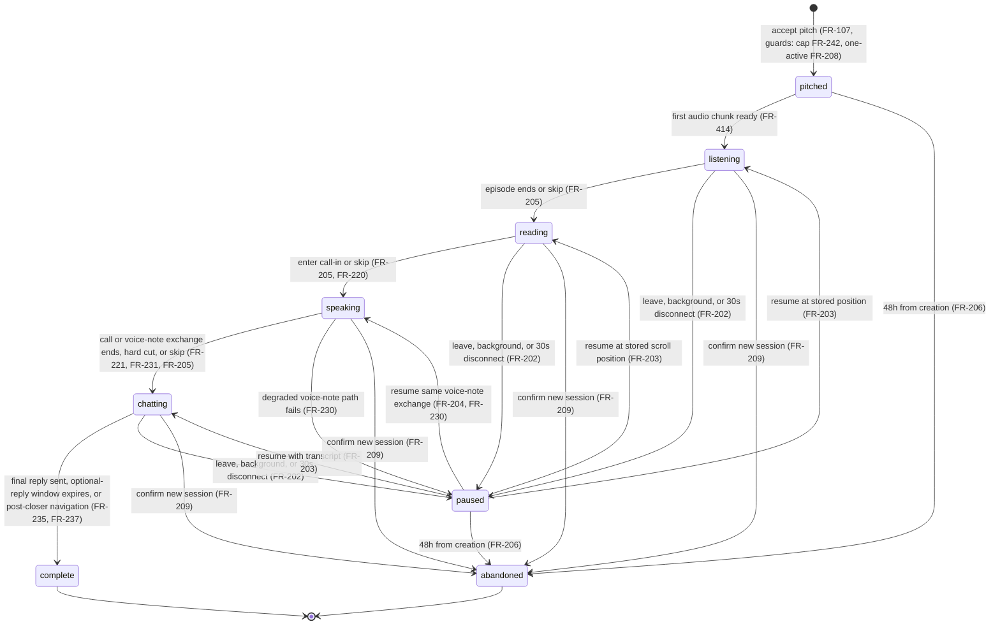
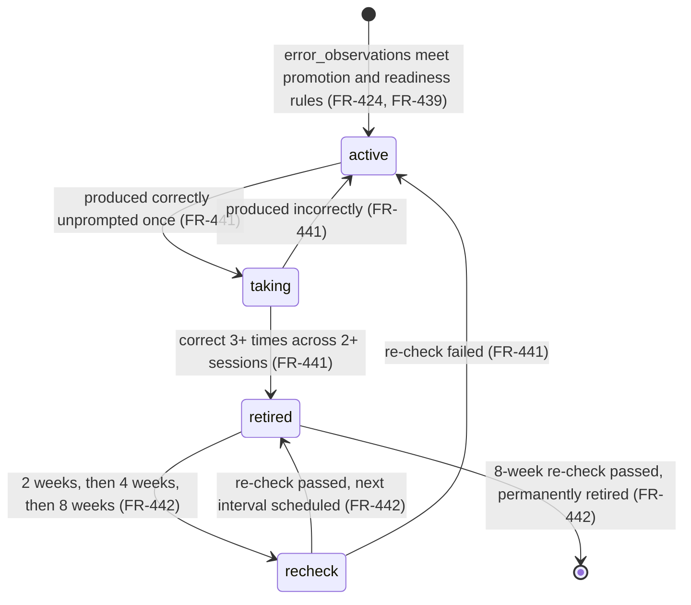
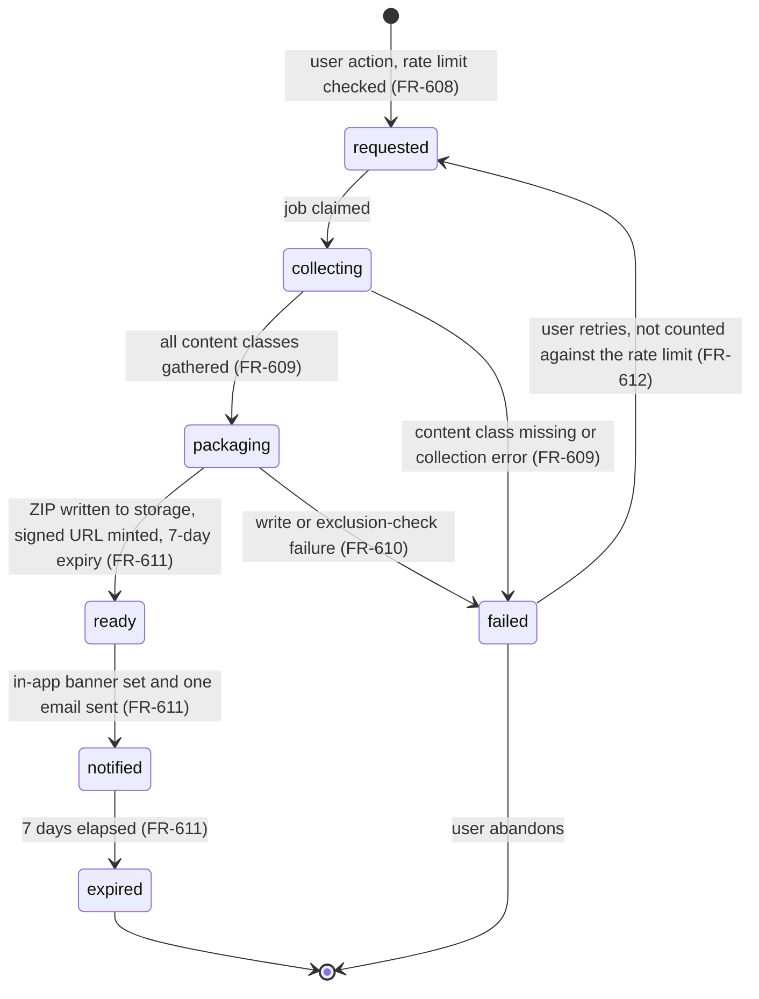

# 04 — Software Requirements Specification

**Status: normative. This document is the single home of every exact limit, validation rule, state machine, lifecycle rule, concurrency rule, permission rule, and failure behavior in For one.**
**Conforms to `00-decisions.md`. Where this document and `00-decisions.md` disagree, `00-decisions.md` wins and this document has a defect.**

**What this document owns (per 00-decisions §12):** functional requirements `FR-###` and non-functional requirements `NFR-##`, with exact limits, validation rules, state machines, and failure behavior.

**What this document deliberately does not own:** features and user stories (01-prd); screens, states, and user-facing copy (02-ux-spec); components and tokens (03-design-system); architecture, module contracts, and background-job definitions (05-tdd); schema, constraints, endpoints, and the error-code catalog (06-data-api-spec); prompt texts, model routing, and per-stage AI budgets (07-ai-spec); test cases (08-eval-testing-plan). Where a requirement below needs a value owned elsewhere, it cites the owner instead of restating the value.

---

## 1. Conventions

### 1.1 Normative language

RFC 2119 exclusively: **MUST**, **MUST NOT**, **MAY**. A sentence in a normative block that contains none of these three words is context, not a requirement, and MUST NOT be implemented as one. The words "TBD", "for example", "such as", "could", "or similar", and "etc." MUST NOT appear in any normative statement in this document (00-decisions §Normative language).

### 1.2 Numbering

Requirements are numbered by area in a single non-reused sequence. A number is never recycled; a withdrawn requirement keeps its number and is marked withdrawn.

| Range | Area |
|---|---|
| FR-001 – FR-099 | Account, onboarding, intake, hidden level estimate, consent, first show |
| FR-100 – FR-199 | Pitches, pitch lifecycle, planner, prediction and pre-generation |
| FR-200 – FR-299 | The session: state machine, Episode, Notes, Call-in, After-show, define, cap |
| FR-300 – FR-399 | Cast: duo, creation, chassis, roster, memory, casting |
| FR-400 – FR-499 | Hidden layer: learner file, generation pipeline, quality gate, assessment |
| FR-500 – FR-599 | Proof, Archive, milestones, knowledge summary, fact correction |
| FR-600 – FR-699 | Platform and data rights: preferences, consent revocation, export, deletion, disclosure, email, packages, cost |
| FR-700 – FR-799 | Concurrency and integrity |
| NFR-01 – NFR-33 | Non-functional requirements |
| NFR-34 – NFR-40 | Reserved. Not allocated in v1. A new non-functional requirement MUST take the next unused number in this range. |

### 1.3 Requirement block format

Every FR block carries the same six elements. A reader MUST be able to derive a test from the block alone.

- **Heading** — `FR-### — Title`.
- **Trace line** — the `F-##` features it implements, the `SCR-##` screen and screen state it appears on, and the background job it constrains. Screen and state identifiers are owned by 02-ux-spec and are cited here, never coined here. Job names are the `JOB-*` names catalogued in 05-tdd §7 and are cited here, never coined here.
- **Normative statements** — numbered MUST / MUST NOT / MAY sentences.
- **Limits** — the exact bounds, counts, durations, and enumerations the statements depend on.
- **On failure** — what the system does when the requirement cannot be satisfied.
- **Edges** — the five edge classes where they apply to this requirement: *empty* (no data yet), *invalid* (malformed or out-of-bounds input), *concurrent* (two actors or two triggers at once), *offline* (no network or a lost connection), *denied* (unauthenticated, unauthorized, or another user's resource).

### 1.4 Cross-document citation rules

A requirement that touches a stored field cites the entity name from 00-decisions §5 and defers field-level detail to 06-data-api-spec. A requirement that constrains model behavior names the constraint and defers the prompt text to 07-ai-spec. A requirement that constrains what a user reads describes the semantic and defers the string to 02-ux-spec. Memory tuning parameters — salience range, initialization values, per-event deltas, decay, dormancy thresholds, re-entry salience, and confidence classes — are owned by 07-ai-spec §7.1–7.4 and are cited here, never restated. This document MUST NOT restate a value owned by another document.

### 1.5 Terms used with a fixed meaning

| Term | Meaning in this document |
|---|---|
| **Session** | One instance of the four-stage cycle Episode → Notes → Call-in → After-show, persisted as a `sessions` row. |
| **Full cycle** | A session that reached `complete`. |
| **Local calendar date** | The calendar date in the user's stored IANA timezone at the instant of evaluation (00-decisions §1). |
| **High-confidence fact** | A `learner_facts` row at the highest confidence class defined in 07-ai-spec §7.1–7.2; speakability is governed by FR-408. |
| **Speakable** | Permitted to appear in host audio, article text, pitch text, after-show text, or Proof audio. |
| **Edge** | The per-session difficulty setting defined in FR-434. |
| **Assessment week** | Monday 00:00:00 through Sunday 23:59:59 in the user's local timezone. |
| **Producer** | The authored intake persona, one per native language. Not a castable character. |
| **Duo** | The authored pair of hosts shipped in a language package for one language and dialect. |

### 1.6 Requirement status of numbers

Every number in this document is normative. Numbers transcribed from PRD v2.0 carry no marker. Numbers this document decided, because neither PRD v2.0 nor 00-decisions supplies them, are marked **[decided here]** at first use and are listed in Appendix A for ratification.

---

## 2. Functional requirements

### 2.1 Area A — Account, onboarding, and the first show

#### FR-001 — Account credential

*Traces:* F-01 · *Screen:* SCR-02/S1, SCR-02/S2 · *Job:* —

1. The system MUST create an account from exactly one of three credential methods: email with password, Google, or Apple, through the auth provider pinned in 00-decisions §3.
2. The system MUST NOT collect a profile photo, a display handle, a username, or any social identity at account creation or afterwards.
3. The system MUST create exactly one show per account, bound to one language pair (FR-007).

*Limits:* three credential methods, closed set. One account, one show.

*On failure:* a provider error during sign-up MUST leave no partially created account and MUST return the user to the start action with a plain retry path.

*Edges:* **invalid** — a malformed email address or a password below the provider's policy is rejected at the field with no account row written. **concurrent** — two sign-ups from the same email resolve to one account; the second attempt MUST be treated as a sign-in attempt rather than an error page. **offline** — the start action MUST NOT appear to succeed; no local state claims an account exists. **denied** — not applicable before an account exists.

#### FR-002 — Age gate

*Traces:* F-01 · *Screen:* SCR-02/S4, SCR-02/S8 · *Job:* —

1. The system MUST collect a self-declared birth date at account creation.
2. The system MUST compute age as completed years between the declared birth date and the local calendar date at the moment of submission **[decided here]**, and MUST reject any submission yielding an age below 18.
3. On rejection the system MUST NOT create a usable account for that attempt: no `users` row that can start a session, no language pair, no learner file.
4. The system MUST NOT re-collect the birth date after signup and MUST NOT offer a correction path in the same attempt that would let a rejected date be retried without a new attempt.
5. The system MUST NOT perform any age verification beyond this self-declaration.

*Limits:* threshold 18 completed years. Birth date MUST be a valid calendar date not in the future and not more than 120 years before the current date **[decided here]**.

*On failure:* a rejected attempt ends in the plain non-punitive message owned by 02-ux-spec and no further product surface.

*Edges:* **empty** — a missing birth date blocks submission at the field. **invalid** — an impossible date (31 February) or an out-of-range year is rejected as a field validation error distinct from the age rejection. **concurrent** — not applicable. **offline** — submission MUST NOT be optimistically accepted. **denied** — not applicable.

#### FR-003 — Show name

*Traces:* F-01 · *Screen:* SCR-02/S3 · *Job:* —

1. The system MUST collect one free-text name as the name the show uses for the user.
2. The system MUST store the name exactly as given, preserving case, diacritics, and script.
3. The system MUST NOT alter the stored spelling as a result of the conversational pronunciation confirmation in FR-008.
4. Hosts, pitch text, the After-show, and the Weekly Proof MAY use this name; no surface is required to use it.

*Limits:* 1 to 60 Unicode grapheme clusters after trimming leading and trailing whitespace **[decided here]**; control characters MUST be rejected. A grapheme cluster is counted by the same Unicode extended-grapheme algorithm FR-101 applies to pitch-card text.

*On failure:* an empty or over-length name blocks submission at the field.

*Edges:* **empty** — blocked. **invalid** — control characters or a whitespace-only value rejected. **concurrent** — not applicable. **offline** — blocked with the rest of the form. **denied** — not applicable.

#### FR-004 — Email verification gate

*Traces:* F-01, F-53 · *Screen:* SCR-03, SCR-06/S15 · *Job:* —

1. The system MUST NOT require email verification before the first session.
2. The system MUST require a verified email address before a **second** session may be created. An attempt is a second session when **at least one session row has ever been created for that user**, in any state, including `abandoned` and `complete` (06-data-api-spec §11.1, `EP-16` semantics). The check MUST read the lifetime session count, never the active-session count.
3. When verification is required and absent, the system MUST block session creation, MUST state plainly what is needed, and MUST offer a resend action backed only by EP-58's provider-owned verification flow.
4. Accounts created through Google or Apple whose provider asserts a verified email MUST be treated as verified without a second verification email.

*Limits:* the gate engages when the lifetime count of session rows for the user is at least 1. Abandoning or completing a session MUST NOT reset it.

*On failure:* a verification email that fails to send MUST surface a retry path and MUST NOT silently leave the user blocked.

*Edges:* **empty** — a user with zero sessions is never blocked. **invalid** — an expired verification link offers a resend rather than an error dead end. **concurrent** — two resend requests within the rate window collapse to one send. **offline** — the block message renders from cached state; the resend action reports the network failure plainly. **denied** — a verification token belonging to another account MUST be rejected as not-found.

#### FR-005 — Native language selection

*Traces:* F-02 · *Screen:* SCR-02/S5 · *Job:* —

1. The system MUST collect the user's native language as an interface selection from a single searchable list before the producer speaks.
2. The system MUST NOT collect the native language conversationally.
3. The producer persona used in intake MUST be the persona authored for the selected native language (FR-008).

*Limits:* selection is exactly one language from the catalog seed data owned by 06-data-api-spec.

*On failure:* if no producer persona exists for the selected native language, the system MUST state plainly that the pair is unavailable and MUST NOT proceed to intake.

*Edges:* **empty** — no default is pre-selected; submission is blocked until a choice is made. **invalid** — a language code absent from the catalog is rejected. **concurrent** — not applicable. **offline** — the list MUST render from the package catalog already delivered with the app shell; a selection made offline is not committed until the network returns. **denied** — not applicable.

#### FR-006 — Target language selection and pair availability

*Traces:* F-02, F-54 · *Screen:* SCR-02/S6, SCR-02/S11 · *Job:* —

1. The system MUST collect the target language as an interface selection from a single searchable list, after the native language and before the producer speaks.
2. The system MUST offer only target languages whose language package is available per ADR-0002.
3. If the selected pair has no available package, the system MUST say so plainly and MUST NOT create a show in that pair.
4. Neither selection MUST ask, imply, or record a proficiency self-rating.

*Limits:* exactly one target language. The catalog is seed data owned by 06-data-api-spec.

*On failure:* an unavailable pair ends in a plain statement and returns the user to the target-language list with the native language retained.

*Edges:* **empty** — blocked until chosen. **invalid** — an unknown or unavailable code rejected. **concurrent** — not applicable. **offline** — as FR-005. **denied** — not applicable.

#### FR-007 — Language pair immutability

*Traces:* F-02 · *Screen:* SCR-21, SCR-12, SCR-14 · *Job:* —

1. The system MUST bind the language pair to the show at creation.
2. The system MUST NOT provide any path to change the target language after the show exists, MUST NOT support more than one simultaneous target language per account, and MUST NOT support per-session language switching.
3. A conversational request to change the target language MUST be answered honestly in character stating that the show runs in one language, and MUST NOT silently create a second show.

*Limits:* one pair per account, permanent.

*On failure:* not applicable; the operation does not exist.

*Edges:* **denied** — an API call attempting to mutate the pair MUST be refused as a domain-rule violation (422 per 00-decisions §6).

#### FR-008 — Intake conversation: modality and turn budget

*Traces:* F-03 · *Screen:* SCR-04 · *Prompt:* PRM-intake-producer (07)

1. The producer MUST speak in audio; the user MUST be able to reply by text or by voice, choosing per message.
2. The conversation MUST run to a budget of 12 to 18 producer turns and MUST target approximately 10 minutes.
3. The producer MUST NOT exceed 18 turns; on reaching 18 turns the producer MUST move to the consent step (FR-023) with whatever fields are filled.
4. The producer MUST disclose that it is an AI character on its first turn (FR-620).
5. Where the user replies by voice, the producer MAY confirm the pronunciation of the stored name once, conversationally.
6. A terminal initial-turn or reply-bound producer-job failure MUST leave the same durable parent batch retryable through the 06-owned mutation. Retry MUST reuse the retained batch, MUST NOT append a second user reply or acknowledgement, and MUST produce at most one successor turn.

*Limits:* 12 minimum, 18 maximum producer turns; approximately 10 minutes target duration; reply modality chosen per message.

*On failure:* if speech synthesis for a producer turn fails after the retries owned by 07, the turn MUST be delivered as text in the same voice and the conversation MUST continue; the intake MUST NOT end because of a synthesis failure.

*Edges:* **empty** — a user who sends no reply for a full turn receives one gentle re-invitation and then a move-on (FR-012). **invalid** — an unintelligible voice reply is transcribed as best available and treated as a short answer, never as an error to the user. **concurrent** — two replies sent to the same producer turn are appended in arrival order and answered once. **offline** — the intake MUST persist turn-by-turn so a dropped connection resumes at the last completed turn with no repeated question. **denied** — the intake is reachable only by its owning user.

#### FR-009 — Intake field set

*Traces:* F-03 · *Screen:* SCR-04 · *Entities:* `learner_facts`, `interests`, `follow_ups`

1. The intake MUST collect, in natural conversational order and not in a fixed sequence, all of: the goal behind the language; the register situation; interests (FR-010); current life situations the user volunteers; past learning attempts and what ended them; and follow-up seeds (FR-011).
2. The register situation MUST be stored as a first-class fact because it sets the register bias of all later generated content.
3. Each collected fact MUST be written with a confidence value and a provenance record identifying the intake turn it came from (FR-407).
4. The intake MUST NOT present a form, a questionnaire, a slider, a self-rated proficiency question, or a progress indicator.

*Limits:* six field groups, closed set.

*On failure:* a fact that fails the deterministic write gate in 00-decisions §7 MUST be discarded rather than written at low quality; the field is then treated as sparse (FR-012).

*Edges:* **empty** — a field the user never addresses is marked sparse. **invalid** — an extraction whose structured output fails schema validation is retried once, then the field is marked sparse. **concurrent** — not applicable. **offline** — as FR-008. **denied** — not applicable.

#### FR-010 — Interests capture

*Traces:* F-03, F-30 · *Screen:* SCR-04 · *Entity:* `interests`

1. The intake MUST collect a minimum of 3 interests and MUST target 5 to 8.
2. Each interest MUST be stored with a salience score initialized to the intake value in 07-ai-spec §7.3.
3. If fewer than 3 interests are collected by the end of the turn budget, the system MUST mark the interests field sparse and the planner MUST apply the sparse-file pitch count in FR-100.
4. The system MUST NOT block the end of intake on reaching the minimum.

*Limits:* minimum 3, target range 5–8. Initial salience and the salience range are owned by 07-ai-spec §7.3.

*On failure:* an interest that duplicates an existing one at the same normalized form MUST be merged rather than stored twice, keeping the higher salience.

*Edges:* **empty** — zero interests is permitted at the end of intake and forces sparse handling everywhere downstream. **invalid** — an interest string over 80 characters **[decided here]** is truncated at a word boundary before storage. **concurrent** — not applicable. **offline** — as FR-008. **denied** — not applicable.

#### FR-011 — Follow-up seeds

*Traces:* F-03, F-10, F-31 · *Screen:* SCR-04 · *Entity:* `follow_ups`

1. The intake MUST attempt to collect 2 to 3 future-dated follow-up seeds, each stored with a resolved date and a due state.
2. The system MUST resolve relative expressions to an absolute date in the user's local timezone at the moment of extraction.
3. A follow-up whose date cannot be resolved to a specific calendar date MUST be stored with the date it can resolve to at day granularity, and if no day can be resolved it MUST NOT be stored as a follow-up and MUST instead be stored as a life fact.
4. A follow-up MUST have exactly one of the due states `pending`, `due`, `used`, `expired`.

*Limits:* target 2–3 seeds. Due state set is closed at four values **[decided here]**. A follow-up becomes `due` when its date is within 48 hours of the current instant **[decided here]**, and `expired` when its date is more than 7 days in the past without having been used **[decided here]**.

*On failure:* zero follow-ups collected is permitted and MUST NOT block intake; the life-pitch requirement in FR-103 then depends on an active life situation instead.

*Edges:* **empty** — zero seeds permitted. **invalid** — a past-dated seed is stored as a life fact rather than a follow-up. **concurrent** — a follow-up transitioning to `due` while a planner run is in flight is handled by FR-702. **offline** — as FR-008. **denied** — not applicable.

#### FR-012 — Sparse-field rule

*Traces:* F-03 · *Screen:* SCR-04 · *Prompt:* PRM-intake-producer (07)

1. When a field cannot be filled after 2 attempts, the producer MUST move on.
2. The field MUST be marked sparse on the learner file.
3. The producer MUST NOT ask about the same field a third time in the same intake.
4. The producer MUST NOT tell the user that a field is missing, incomplete, or sparse, in any wording.
5. The planner MUST compensate for a sparse file during the first week by weighting interests more heavily than the standard ranking in FR-129.

*Limits:* exactly 2 attempts per field. The first-week compensation window is 7 local calendar days from account creation **[decided here]**.

*On failure:* not applicable; moving on is the failure path.

*Edges:* **empty** — a field with zero attempts because the conversation never reached it is also marked sparse. **invalid** — an answer that is on-topic but unusable counts as an attempt. **concurrent** — not applicable. **offline** — as FR-008. **denied** — not applicable.

#### FR-013 — Intake prohibitions

*Traces:* F-03, F-04 · *Screen:* SCR-04 · *Gate:* law scan (FR-415)

1. The intake MUST NOT stall on any field.
2. The intake MUST NOT present any visible assessment, score, label, band, or progress-through-onboarding indicator.
3. The producer MUST NOT return after the handoff in FR-028 and MUST NOT be castable in any session.
4. The producer MUST NOT describe the target-language moments in FR-015 as a test, a check, a probe, or an assessment, in any language.

*Limits:* absolute prohibitions.

*On failure:* a generated producer turn that violates statement 4 MUST fail the law scan and MUST be regenerated once before delivery; a second failure MUST deliver the authored fallback turn shipped in the language package.

*Edges:* all classes — the prohibitions hold in every class without exception.

#### FR-014 — Intake completion and learner file initialization

*Traces:* F-03, F-29 · *Screen:* SCR-04/S15 · *Route handler:* intake completion (05-tdd §5.0–§5.0.1) · *Prompt:* PRM-level-estimate (07)

1. On intake completion the system MUST create the learner file with all four sections present, including empty sections.
2. The system MUST write the initial `level_band`, `level_step`, and `level_confidence` per FR-016 before the first pitch is generated.
3. The system MUST record intake utterances in a form that supports the verbatim callback requirement in FR-028.
4. The intake-completion route handler MUST commit the learner-file sections, the retained intake evidence, and the completed-intake marker in one transaction. It MUST NOT create a session or trigger episode generation.
5. `PRM-level-estimate` MUST execute outside the request handler under FR-411. The one-time onboarding-pitch job in 05 §5.0.1 MUST NOT begin until the estimate's deterministic post-step has written the three fields in statement 2; this initialization MUST NOT create a steady-state planner run.
6. The handoff MUST generate the first live pitch before any session exists. A `sessions` row MUST be created only when the user accepts variant 1 or 2 through the ordinary session-creation writer in FR-107, or when the second rejection or terminal prompt/gate failure authorizes FR-026's deterministic variant-3 episode through that same writer.
7. After explicit acceptance or automatic variant-3 authorization, the first episode MUST use the pre-generated path when the selected pitch has a published pre-generation artifact and MUST otherwise use the ordinary on-selection path. FR-410 through FR-417 apply unchanged.

*Limits:* four sections, always present; one intake-completion transaction; zero sessions before explicit acceptance of variant 1 or 2 or durable terminal authorization of variant 3 under FR-026.

*On failure:* **Before the transaction commits** — an initialization failure MUST roll the transaction back, MUST leave intake resumable at its last completed turn, and MUST return the synchronous retry on `SCR-04/S15`. **After the transaction commits** — an invalid or unavailable level estimate MUST take the deterministic `insufficient` path in FR-016; onboarding-pitch prompt or gate exhaustion MUST durably authorize FR-026's deterministic variant-3 path; episode-generation failure after explicit acceptance or automatic variant-3 session creation MUST take FR-417. An asynchronous path MUST NOT create a session before one of the two authorizations named in *Limits*.

*Edges:* **empty** — an intake abandoned before completion leaves whatever facts passed the write gate and MUST allow the user to resume intake at the last completed turn. **concurrent** — completion is idempotent on the intake identifier; a duplicate completion request MUST resolve to the same completed-intake record and MUST NOT start a second estimate or planner run. **offline** — completion is refused with a plain statement and intake remains resumable; no partial learner file is written from the client. **denied** — not applicable.

#### FR-015 — Target-language probes

*Traces:* F-04 · *Screen:* SCR-04 · *Prompt:* PRM-intake-producer (07), PRM-level-estimate (07)

1. The intake MUST weave exactly 3 to 4 target-language moments into the conversation.
2. Each moment MUST be either one comprehension probe or one production invitation, and MUST be introduced by a natural language switch from the producer.
3. The moments MUST NOT be numbered, scored aloud, grouped consecutively, or announced.

*Limits:* 3 minimum, 4 maximum moments.

*On failure:* if fewer than 3 moments were delivered when the turn budget ends, the estimate MUST still be produced from available evidence and `level_confidence` MUST be `calibrating`.

*Edges:* **empty** — a user who produces no usable target-language evidence MUST take the `insufficient` path in FR-016; native-language fluency MUST NOT be treated as target-language evidence. **invalid** — an off-target reply is evidence of comprehension difficulty and is used as such. **concurrent** — not applicable. **offline** — as FR-008. **denied** — not applicable.

#### FR-016 — Initial level estimate and conservative offset

*Traces:* F-04 · *Prompt:* PRM-level-estimate (07) · *Entity:* `users` (`level_band`, `level_step`, `level_confidence`)

1. The system MUST store the initial estimate as `level_band` in `A1..C2`, `level_step` in 1–3, and `level_confidence` = `calibrating`.
2. For a sufficient validated estimate whose confidence is below the deterministic threshold owned by 07-ai-spec §4.2, the stored initial estimate MUST be exactly one band below the evidence-supported band at the same step, and the system MUST retain both that an offset was applied and the unshifted coordinate.
3. For a sufficient validated estimate whose confidence is at or above that threshold, the system MUST store the evidence-supported band and step unchanged and MUST retain that no offset was applied.
4. When the low-confidence offset would cross below `A1`, the system MUST store `A1` step 1.

*Limits:* band set `A1, A2, B1, B2, C1, C2`; step set 1, 2, 3; confidence set `calibrating`, `normal`.

*On failure:* if the extraction returns `insufficient` or produces no valid band, the system MUST store the default written by the deterministic post-step in 07-ai-spec §4.2, because an episode that is too easy is pleasant and one that is too hard is abandoned.

*Edges:* **empty** — covered by the failure rule. **invalid** — a band outside the enumeration is rejected by the write gate and the failure rule applies. **concurrent** — the first successful write wins; the background execution is idempotent on user identifier. **offline** — server-side. **denied** — not applicable.

#### FR-017 — Calibration window

*Traces:* F-04, F-39 · *Job:* JOB-post-session (05-tdd §7)

1. During sessions 1 through 5 the post-session pass MUST update the estimate from that session's production evidence.
2. After the post-session pass for session 5 completes, the system MUST set `level_confidence` to `normal`.
3. When FR-016 retained that an offset was applied and the current estimate remains below the retained unshifted coordinate, the successful pass for session 5 MUST move the estimate one ordered step toward that coordinate. Each later successful post-session pass MUST continue that one-step movement until the coordinate is reached, unless production evidence has already moved the estimate to or above it. An intake with no applied offset MUST NOT receive this movement.
4. Abandoned sessions MUST count toward the calibration window and MUST contribute whatever partial production evidence exists.
5. The system MUST NOT move the estimate by more than one ordered step per successful post-session pass; FR-436 applies during and after calibration.

*Limits:* calibration window is sessions 1–5 inclusive, counted as sessions created for the user.

*On failure:* if the post-session pass for session 5 fails permanently, the confidence change and the first bounded offset-removal step MUST occur on the next successful post-session pass. The same pass MUST NOT apply either movement twice.

*Edges:* **empty** — a session with no production evidence advances the counter without an evidence-driven movement; statement 3's bounded offset-removal step still applies at and after the calibration transition. **invalid** — an extraction failing schema validation leaves the evidence-driven estimate unchanged; statement 3 still applies. **concurrent** — FR-704 governs exactly-once execution. **offline** — server-side. **denied** — not applicable.

#### FR-018 — CEFR invisibility

*Traces:* F-04, F-45, F-49 · *Gate:* law scan (FR-415)

1. `level_band`, `level_step`, and `level_confidence` MUST NOT appear in any API response schema, any interface surface, any host line, any article, any After-show message, any Proof line, any email, or any export artifact.
2. No paraphrase of a level, band, score, percentage, stage, or comparison to other users MAY appear in any of those surfaces, in any language.
3. A user who asks about their level MUST receive an honest in-character answer stating that the show handles difficulty and keeps no score for them.
4. The law scan MUST fail any generated content that violates statements 1 or 2.

*Limits:* absolute prohibition, all languages, all surfaces.

*On failure:* content violating this requirement MUST NOT ship; the regeneration and fallback path in FR-416 and FR-417 applies.

*Edges:* all classes — the prohibition is unconditional.

#### FR-019 — Dialect samples and selection

*Traces:* F-05 · *Screen:* SCR-04/S7 · *Entity:* `dialects`

1. The system MUST present one audio sample per available variant of the target language, each 10 to 15 seconds long.
2. The user MUST select exactly one variant.
3. The selected variant MUST determine the default duo, the available voice inventory, and the language variant of all generated content.
4. Where the language package defines exactly one variant, the system MUST skip this step silently and MUST NOT render a list with a single option.

*Limits:* sample duration 10–15 seconds; exactly one selection.

*On failure:* if a sample fails to load, the interface MUST still allow selection by name and MUST offer a retry on the sample; a failed sample MUST NOT block the step.

*Edges:* **empty** — a package with zero variants is a package defect and MUST make the pair unavailable at FR-006 rather than reaching this step. **invalid** — a variant code outside the package is rejected. **concurrent** — not applicable. **offline** — samples are unavailable and the step MUST surface a plain retry rather than an empty list. **denied** — not applicable.

#### FR-020 — Dialect change

*Traces:* F-05, F-47 · *Screen:* SCR-12, SCR-14, SCR-20

1. The dialect MUST be changeable only through a conversational request (FR-600).
2. A dialect change MUST apply from the next session onward and MUST re-voice cast from that point; it MUST NOT alter already-produced audio.
3. If the newly requested dialect has no duo or no voice inventory in the package, the system MUST answer honestly in character that the show does not have that version and MUST NOT change the stored variant.

*Limits:* one stored variant at a time.

*On failure:* a change that cannot be applied leaves the stored variant unchanged and is acknowledged honestly.

*Edges:* **concurrent** — a change requested while a session is active applies from the next session, never mid-session. **denied** — not applicable.

#### FR-021 — Voice-storage consent statement

*Traces:* F-06, F-51 · *Screen:* SCR-04/S8 · *Entity:* `consent_events`

1. The producer MUST introduce voice storage in story, and the system MUST then present a plain-language statement naming exactly three things: that call-in **audio** is what is stored, that it is stored to make side-by-side progress comparisons, and that it is deletable at any time.
2. The same statement MUST disclose that call-in **transcripts are stored on both answers**, because transcripts are core functionality.
3. The statement MUST NOT bundle voice consent with terms acceptance and MUST NOT be pre-checked.

*Limits:* the statement's four disclosed facts are a closed set: audio, purpose, deletability, transcript-always. Exact copy is owned by 02-ux-spec.

*On failure:* if the consent step cannot render, the system MUST default to `voice_consent = false` and MUST NOT record audio.

*Edges:* **empty** — no consent record means consent is false. **invalid** — not applicable. **concurrent** — FR-707 governs a flip during recording. **offline** — the step MUST NOT be skipped; it retries when the network returns. **denied** — not applicable.

#### FR-022 — Consent decision and equal actions

*Traces:* F-06 · *Screen:* SCR-04/S8 · *Entity:* `consent_events`

1. The system MUST present exactly two explicit actions of equal visual and interaction weight: consent and decline.
2. Declining MUST set the consent flag false and MUST NOT disable, degrade, gate, delay, or reduce the quality of any feature.
3. Every surface that would use stored audio MUST substitute verbatim text quotes automatically when consent is false (FR-504).
4. The system MUST NOT re-ask a declined consent anywhere outside a user-initiated visit to Voice tape in Your show.
5. Consent state MUST be recorded as an append-only history and MUST be visible in Your show.

*Limits:* two actions, closed set. No third action, no dismissal that leaves consent undetermined.

*On failure:* an unrecorded decision MUST be treated as decline.

*Edges:* **empty** — undetermined equals declined. **invalid** — not applicable. **concurrent** — two decisions submitted at once resolve to the later-timestamped event; both are retained in the append-only history. **offline** — the decision is not committed until acknowledged by the server; the interface MUST NOT report success optimistically. **denied** — consent events are readable and writable only by their owning user.

#### FR-023 — Audio write gate

*Traces:* F-06, F-18, F-48 · *Entity:* `call_turns`

1. The system MUST write call-in audio only where `voice_consent` is true **at the moment of recording**.
2. The system MUST write the call-in transcript on every call regardless of consent.
3. The consent value MUST be evaluated at the start of each recorded turn, not once per session.

*Limits:* per-turn evaluation.

*On failure:* if the consent value cannot be read, the system MUST NOT write audio.

*Edges:* **concurrent** — FR-707. **offline** — audio buffered locally during a connection loss MUST be discarded rather than uploaded if consent is false when the connection returns. **denied** — not applicable.

#### FR-024 — Duo introduction

*Traces:* F-07, F-23, F-54 · *Screen:* SCR-05/S1, SCR-05/S2 · *Entity:* `characters`

1. The producer MUST introduce the duo by name and MUST then leave the conversation permanently.
2. The duo MUST play a pre-authored recorded introduction of 60 to 90 seconds, identical for every user of that language and dialect.
3. The introduction MUST be in the target language at a deliberately easy difficulty and MUST be shipped inside the language package rather than generated per user.
4. The duo's first appearance MUST carry the AI disclosure required by FR-620.

*Limits:* 60–90 seconds; one authored piece per language and dialect.

*On failure:* if the authored introduction asset is missing from the package, the pair MUST be unavailable at FR-006; the system MUST NOT generate a substitute introduction.

*Edges:* **empty** — covered by the failure rule. **offline** — playback MUST offer a plain retry; the handoff does not advance until the introduction has been delivered or explicitly skipped by the user.

#### FR-025 — Character creation mention

*Traces:* F-07, F-24 · *Screen:* SCR-05/S2

1. The producer MUST mention character creation in exactly one sentence during the handoff.
2. The system MUST NOT present character creation as a flow, a next step, a card, a prompt, or a repeated suggestion anywhere in the product.
3. The handoff MUST NOT contain a tutorial, a feature tour, a walkthrough, an interface overlay, or an onboarding checklist.

*Limits:* exactly one mention, once, ever, at handoff.

*On failure:* not applicable.

*Edges:* all classes — the prohibition is unconditional.

#### FR-026 — First pitch and its single alternative

*Traces:* F-08 · *Screen:* SCR-05/S3, SCR-05/S4, SCR-05/S5 · *Prompt:* PRM-onboarding-pitch@v1 (07) · *Entity:* `pitches` · *ADR:* ADR-0009

1. After the complete hidden level tuple is durably stored, the dedicated one-time onboarding initialization MUST deliver exactly one pitch, generated live from intake data and written as a hook drawn from something the user actually said.
2. The user MUST be able to accept it or reject it once.
3. A rejection MUST generate exactly one alternative through the same initialization workflow. The system MUST NOT generate a second alternative.
4. If the alternative is also rejected, the first episode MUST be built from the user's highest-salience interest, with no intake callback and no further pitching.
5. The show MUST NOT comment on the rejections in any surface.
6. The system MUST NOT show a pitch list and MUST NOT offer remix during onboarding.
7. This initialization MUST remain separate from the steady-state planner: it MUST NOT create a `planner_runs.trigger`, MUST NOT enter FR-123's trigger register, and MUST NOT expose a manual refresh action (ADR-0009). Before variant 3, no session may exist without explicit pitch acceptance. Rejecting variant 2 is itself the user's terminal authorization to create the deterministic variant-3 episode with no further pitch or accept action; terminal prompt/gate failure takes the same no-error fallback path.

*Limits:* 1 pitch, maximum 1 alternative, then the interest fallback.

*On failure:* if live pitch generation fails after its retries, the system MUST proceed directly to the highest-salience-interest episode; the user MUST NOT see a generation error.

*Edges:* **empty** — a user with zero stored interests receives the language package's authored starter topic for their dialect **[decided here]**. **invalid** — a pitch failing the pitch test (FR-415) is regenerated once and then replaced by the interest fallback. **concurrent** — a double-tapped accept is idempotent per FR-701. **offline** — the accept action reports the network failure plainly and retries; no session is created twice. **denied** — not applicable.

#### FR-027 — First episode

*Traces:* F-08 · *Screen:* SCR-05/S6, SCR-05/S7, SCR-09 · *Job:* JOB-generate-episode

1. The first episode MUST be 4 to 5 minutes long, shorter than the standard episode band in FR-210.
2. Playback MUST begin within 3 minutes of explicit variant-1/2 pitch acceptance or, for FR-026's automatic variant-3 path, the durable terminal-authorization commit (NFR-03), except for FR-417 statement 7's sole terminal-publication infrastructure failure.
3. Playback MUST begin when the first audio chunk is ready rather than when synthesis completes.
4. After the Episode content becomes terminal under 00 §9.3 decision 12, the remainder of the cycle MUST continue immediately if the user proceeds, even when playback has not ended, and MUST otherwise persist paused indefinitely under FR-202. A replaceable manifest MUST NOT advance the session into Notes.

*Limits:* 4:00–5:00 duration; 3-minute time-to-playback ceiling.

*On failure:* if the first episode fails the primary quality gate twice, the generated fallback path in FR-417 applies and MUST still meet the 3-minute ceiling. FR-110's determinate waiting state applies only while work remains nonterminal. If publication of the reviewed terminal folio itself exhausts, FR-417 statement 7 replaces the waiting state with the persistent support-required state and is the sole no-first-frame exception.

*Edges:* **offline** — a connection lost during streaming resumes from the last buffered position; the session is not abandoned. **concurrent** — FR-700 and FR-701 apply.

#### FR-028 — Day-two callback constraint

*Traces:* F-09 · *Job:* JOB-planner-run · *Gate:* FR-415

1. The planner MUST attach a verbatim-sourced intake callback constraint to every pitch generated for the user's **day two**, defined as the first local calendar date strictly after the local calendar date on which intake completed **[decided here]**.
2. The callback MUST be traceable to a stored intake utterance rather than to an inference.
3. The callback MUST obey FR-216: high-confidence facts only, told directly by the user.
4. The quality gate MUST verify callback presence on day two before the episode ships.

*Limits:* at least 1 verbatim callback; day-two scope only. No callback quota applies to any other day.

*On failure:* if the constraint cannot be satisfied after one regeneration, the fallback episode path in FR-417 applies and the callback requirement MUST be dropped rather than faked.

*Edges:* **empty** — a user whose intake produced no storable utterance has the constraint dropped at planning time rather than failing the gate. **concurrent** — a day boundary crossed mid-planner-run uses the date at run start. **denied** — not applicable.

#### FR-029 — Callback disclosure prohibition

*Traces:* F-09, F-30 · *Gate:* FR-415

1. The system MUST NOT announce a callback, MUST NOT draw attention to the show's memory, and MUST NOT use any wording that frames remembering as a feature.
2. A host MUST NOT state a memory that is not high-confidence (FR-408).

*Limits:* absolute prohibitions.

*On failure:* violating content fails the law scan and canon-consistency check (FR-415).

*Edges:* all classes — unconditional.

### 2.2 Area B — Pitches, pitch lifecycle, planner, and pre-generation

#### FR-100 — Pitch set size

*Traces:* F-10, F-31 · *Screen:* SCR-06/S1 · *Job:* JOB-planner-run · *Entity:* `pitches`

1. Every planner run MUST produce a set of 3, 4, or 5 pitches according to exactly this rule: **3** when the learner file is sparse, **5** when at least 3 interests have engagement history, otherwise **4**.
2. A file is sparse when any of the intake field groups in FR-009 is marked sparse or fewer than 3 interests exist, and the account is within its first 7 local calendar days **[decided here]**.
3. An interest has engagement history when at least one completed or abandoned session has been produced from a pitch carrying that interest **[decided here]**.
4. The planner MUST NOT produce a set outside 3–5 under any condition.

*Limits:* set size ∈ {3, 4, 5}; sparse window 7 days; engagement-history threshold 3 interests.

*On failure:* if pitch writing yields fewer than the required count after one retry, the planner MUST fill the remainder from stored interests and the wildcard rule (FR-127); a set below 3 MUST NOT be published.

*Edges:* **empty** — a user with zero interests receives a set built from the language package's authored starter topics **[decided here]**. **invalid** — a pitch failing validation is dropped and replaced before publication, never published. **concurrent** — FR-702. **offline** — the last published set renders from cache; no partial set is shown. **denied** — pitches are readable only by their owning user.

#### FR-101 — Pitch text form and cap

*Traces:* F-10 · *Screen:* SCR-06/S1 · *Entity:* `pitches`

1. Each pitch MUST be a single line of text.
2. Each pitch MUST NOT exceed **140 characters**, counted in Unicode grapheme clusters after trimming **[decided here: counting unit]**.
3. Each pitch MUST be hook-written rather than descriptive.
4. Each pitch MUST NOT contain a line break, a bullet, a numbered list, or markup.
5. The pitch's format label MUST NOT exceed **28 characters**, counted in Unicode grapheme clusters after trimming under the same counting rule as statement 2. This requirement owns both pitch-card text caps; no other document sets either value.
6. The format label is the short display form of the pitch's format and is distinct from the free-text format description capped at 200 characters by FR-116. A free-text description at or above the label cap MUST be reduced to a label within 28 characters at pitch-set assembly; the stored description MUST NOT be altered, and FR-116 statement 3 MUST continue to govern generation.

*Limits:* hard cap 140 characters for the pitch line, 28 characters for the format label, both in grapheme clusters after trimming; exactly one line.

*On failure:* a generated pitch over the 140-character cap MUST be regenerated once; a second over-cap result MUST be discarded and replaced from the interest fallback rather than truncated, because a truncated hook is not a hook. A format label over 28 characters MUST fall back to the starter-library label of the mapped pattern (FR-116 statement 2), which is always within the cap, rather than being truncated or rendered over-length.

*Edges:* **invalid** — markup or line breaks cause the same discard-and-replace path. **empty** — an empty pitch string is invalid and discarded; an empty format label falls back to the mapped pattern's starter-library label.

#### FR-102 — Pitch payload

*Traces:* F-10, F-12, F-28 · *Entity:* `pitches`

1. Each pitch MUST carry a topic, a format, and a cast, either explicitly in the text or by clear implication, and MUST store all three as structured fields.
2. The stored cast MUST reference only active characters at the time of writing (FR-317).
3. The stored format MUST be one of the six starter formats (FR-116) or a stored free-text description.

*Limits:* exactly three payload elements per pitch.

*On failure:* a pitch whose structured payload fails schema validation MUST be discarded and replaced before publication.

*Edges:* **concurrent** — a character retired between pitch writing and pitch acceptance is handled by FR-706.

#### FR-103 — Life pitch requirement

*Traces:* F-10, F-31 · *Job:* JOB-planner-run

1. The planner MUST include at least 1 pitch drawn from the user's own life whenever any follow-up is in the `due` state or any life situation is active.
2. A life pitch MUST be sourced from a high-confidence fact (FR-408).
3. When no follow-up is due and no life situation is active, this requirement MUST NOT apply and the planner MUST NOT invent a life pitch.

*Limits:* minimum 1 life pitch when the condition holds.

*On failure:* if no high-confidence life fact is available, the requirement is dropped for that run rather than satisfied from a low-confidence fact.

*Edges:* **empty** — a file with no life facts skips the requirement. **concurrent** — a follow-up becoming due during a run is picked up by the next run, not retro-fitted into the current one.

#### FR-104 — Wildcard pitch

*Traces:* F-10 · *Job:* JOB-planner-run

1. Every published pitch set MUST contain **exactly one** wildcard pitch, outside the user's usual lanes.
2. A wildcard MUST NOT be sourced from an interest whose salience is at or above the median salience of the user's active interests **[decided here]**.
3. The set MUST NOT contain two wildcards and MUST NOT contain zero.
4. The wildcard MUST NOT be labeled, marked, badged, or otherwise identifiable to the user.

*Limits:* exactly 1 per set.

*On failure:* if a wildcard cannot be written, the planner MUST source it from the language package's authored wildcard topic list for the target language **[decided here]**; the set MUST NOT publish without one.

*Edges:* **empty** — a file with no interests makes every pitch effectively novel; the planner MUST still designate exactly one pitch as the wildcard.

#### FR-105 — Current events constraint

*Traces:* F-10, F-31 · *Job:* JOB-planner-run

1. A pitch MAY reference a current event only where that event intersects a stored, non-dormant interest.
2. The planner MUST NOT write a general news pitch unconnected to a stored interest.
3. External world-check content MUST be treated as data and never as instructions (NFR-29).

*Limits:* intersection with a stored non-dormant interest is a precondition.

*On failure:* the world-check fallback in FR-127 applies.

*Edges:* **empty** — with no interests, no current-events pitch may be written. **offline** — a failed world check falls back per FR-127.

#### FR-106 — Pitch delivery surface

*Traces:* F-10, F-52, F-53 · *Screen:* SCR-06

1. Pitches MUST appear when the user opens the app.
2. The system MUST NOT announce pitches by push notification, email, badge, or any other outbound channel.
3. The interface MUST NOT provide infinite scroll of pitches, a pitch archive, user re-ranking, favoriting, or any indication of which pitch was predicted.

*Limits:* one visible set at a time; no outbound announcement.

*On failure:* a programme read/load failure MUST render SCR-06/S14 with COPY-084 and its Retry action. When onboarding is complete but the first steady-state set has not published, SCR-06/S17 with COPY-332 MUST render until the `pending_first_set` projection changes. FR-110 applies only after a session has been selected and EP-52 is polling that session's generation.

*Edges:* **empty** — an empty Today MUST NOT be reachable (FR-418). **offline** — the last set renders from cache and accepting is blocked with a plain statement.

#### FR-107 — Accept a pitch

*Traces:* F-11 · *Screen:* SCR-06, SCR-07, SCR-08 · *Entity:* `sessions`

1. One action MUST accept a pitch and create the session.
2. Session creation MUST be idempotent on the `Idempotency-Key` required by 00-decisions §6 (FR-701).
3. Acceptance MUST be refused when the daily cap is reached (FR-242) or when an active session exists and the user has not confirmed abandonment (FR-209).
4. An accepted pitch MUST NOT expire (FR-119).

*Limits:* one action; one session per acceptance.

*On failure:* a refused acceptance MUST state the reason in the semantics owned by 02-ux-spec and MUST leave the pitch set untouched.

*Edges:* **concurrent** — FR-701 and FR-703. **offline** — acceptance is blocked with a plain statement and no local session is created. **denied** — accepting another user's pitch MUST return not-found (00-decisions §6).

#### FR-108 — Pre-generated start

*Traces:* F-11, F-32 · *Screen:* SCR-06/S1, SCR-09

1. When the accepted pitch is the planner's predicted pick and its pre-generation completed, playback MUST begin within **2 seconds** of acceptance (NFR-01).
2. The system MUST NOT advertise, mark, or otherwise signal that this pitch starts faster.

*Limits:* 2 seconds, measured per NFR-01.

*On failure:* if pre-generated assets are unavailable at acceptance, the on-selection path in FR-109 applies and the user MUST NOT be shown an error.

*Edges:* **concurrent** — pre-generation still running at acceptance MUST be joined rather than restarted. **offline** — playback of a cached pre-generated episode MAY continue; new acceptance is blocked.

#### FR-109 — On-selection generation

*Traces:* F-11, F-12, F-13, F-33 · *Screen:* SCR-07/S6, SCR-08/S5, SCR-09 · *Job:* JOB-generate-episode

1. When the accepted pitch is not the pre-generated pick, generation MUST start on selection and playback MUST begin within **30 seconds** (NFR-02).
2. The system MUST meet this budget by generating and synthesizing the host opening first and streaming from the first ready chunk.
3. Generation MUST NOT run inside a request handler (FR-411).

*Limits:* 30 seconds, measured per NFR-02.

*On failure:* if generation fails after its owner retries, FR-417 applies and the user receives the complete authored show unless publication of the reviewed terminal folio itself exhausts. That sole infrastructure exception MUST render the closed `support_required` state under FR-417 statement 7 and MUST expose no partial show.

*Edges:* **offline** — generation continues server-side; the client resumes when the network returns. **concurrent** — duplicate generation for the same session is prevented by the idempotency key in FR-412.

#### FR-110 — Waiting state

*Traces:* F-11 · *Screen:* SCR-05/S6, SCR-05/S13, SCR-06/S7, SCR-07/S6, SCR-07/S14, SCR-08/S5, SCR-08/S11 · *ADR:* ADR-0020 · *State source:* `EP-52` (06-data-api-spec)

1. While generation runs the interface MUST show a determinate in-character waiting state and MUST NOT show an unbounded spinner or an indefinite loading state.
2. Archive and Your show MUST remain reachable while generation runs.
3. The waiting state MUST reflect a session or generation state change within **5 seconds** of that change (ADR-0020), and the progress it shows MUST come from real pipeline stage completion rather than from a simulated timer.
4. The client MUST obtain that state from the session-state endpoint `EP-52` catalogued in 06-data-api-spec. This document MUST NOT constrain the transport or the observation cadence; ADR-0020 owns the transport decision and 06-data-api-spec owns the endpoint contract and its cadence guidance.
5. The no-progress clock MUST begin at the server-recorded instant the current queued or running generation last advanced and MUST reset only when a monotonic readiness or pipeline-progress value in `EP-52` advances. A `304`, a page reload, a visibility change, and reconnection MUST NOT reset it.
6. At **90 seconds** with no progress, `DS-GenerationState` MUST replace the determinate wait with `SCR-05/S13`, `SCR-07/S14`, or `SCR-08/S11` and the exact `COPY-270` owned by 02-ux-spec.
7. If progress resumes while the delayed surface remains foregrounded, the interface MUST return to the determinate wait and start a new no-progress interval. If the user has taken COPY-270's readiness action, generation MUST remain alive, the interface MUST return to Today, and `SCR-06/S8` MUST replace that state when the opening becomes ready.
8. An `opening_ready` result MUST enable playback. A terminal session state MUST stop observation. A terminal generation failure MUST remain on its owned recovery or fallback path and MUST NOT leave either waiting surface active.

*Limits:* 5-second freshness bound on every observed state change (ADR-0020); 90 seconds without progress before the delayed surface; two destinations always reachable.

*On failure:* the delayed surface MUST use only the in-app readiness behavior and exact copy in statement 6. It MUST NOT promise email, push, or an unread notification.

*Edges:* **offline** — the waiting state MUST state that the connection is lost and MUST resume observing `EP-52` on reconnection. The first response after reconnection MUST apply the server-originated no-progress instant, including entering the delayed surface immediately when the 90-second threshold elapsed while offline. **denied** — not applicable.

#### FR-111 — Remix: independent elements

*Traces:* F-12 · *Screen:* SCR-06, SCR-07

1. Topic, format, and cast MUST each be independently editable before the session starts, without disturbing the other two.
2. Editing MUST be available on any pitch in the current set.
3. Remix MUST NOT be offered during onboarding (FR-026).

*Limits:* three independently editable elements.

*On failure:* an edit that cannot be saved MUST leave the original pitch intact and MUST report the failure plainly.

*Edges:* **empty** — clearing the topic to empty is invalid and blocked. **invalid** — a topic over 200 characters **[decided here]** is rejected at the field. **concurrent** — an edit submitted after the set was replaced applies to the edited pitch and creates the session from it (FR-703). **offline** — editing is blocked with a plain statement.

#### FR-112 — Remix invalidates pre-generation

*Traces:* F-12, F-32 · *Job:* JOB-pregenerate-predicted, JOB-generate-episode

1. Submitting a remix through the Make action MUST invalidate every pre-generated artifact for the edited pitch. EP-14 itself MUST create only the replacement pitch; after that succeeds, the same user action MUST pass the returned pitch to EP-16, whose canonical session transaction alone starts the on-selection generation. A topic refusal MUST stop before both writes and MUST leave the original pitch intact (FR-117).
2. The regenerated episode MUST be playable within the on-selection budget (NFR-02).
3. Invalidated pre-generated assets MUST NOT be served for the edited pitch under any condition.

*Limits:* invalidation is total for that pitch; other pitches are unaffected.

*On failure:* FR-417 applies.

*Edges:* **concurrent** — an in-flight pre-generation for the edited pitch MUST be cancelled or its output discarded on completion.

#### FR-113 — The user's edit is final

*Traces:* F-12, F-13 · *Gate:* FR-415

1. The system MUST apply the user's edit exactly as given.
2. The system MUST NOT argue with, soften, correct, partially apply, or substitute a nearby alternative for a user-supplied topic, format, or cast.
3. The system MUST NOT comment on the edit in any surface.

*Limits:* absolute.

*On failure:* a topic the system cannot produce safely follows FR-117; every other topic is produced as given.

*Edges:* all classes — unconditional.

#### FR-114 — Targets re-threaded on remix

*Traces:* F-12, F-31, F-40 · *Job:* JOB-planner-run

1. Pedagogical targets attached to the original pitch MUST be re-threaded onto the edited pitch rather than dropped.
2. Where a target cannot be threaded naturally into the edited topic, the planner MUST substitute the next eligible target from the queue rather than distorting the topic.
3. Pedagogy MUST adapt to topic; topic MUST NOT adapt to pedagogy.

*Limits:* 1 to 2 targets per session (FR-440).

*On failure:* a session that can carry no target MUST still be produced; target presence at the gate (FR-415) MUST be evaluated as pass when zero targets were assignable.

*Edges:* **empty** — an empty target queue produces a session with no targets and no gate failure.

#### FR-115 — Build from scratch

*Traces:* F-13 · *Screen:* SCR-08

1. The user MUST be able to create a session by supplying a topic through typing or speech, selecting a format, and selecting a cast.
2. The resulting session MUST be generated on demand within the on-selection budget (NFR-02) and MUST be threaded with targets exactly as a pitched session is.
3. The system MUST NOT ask the user for duration, difficulty, or any pedagogical parameter.

*Limits:* topic 1–200 characters **[decided here]**; one format; one or two cast members (FR-316).

*On failure:* as FR-109.

*Edges:* **empty** — an empty topic blocks the action. **invalid** — an over-length topic is rejected at the field. **offline** — the action is blocked with a plain statement.

#### FR-116 — Format library and free-text formats

*Traces:* F-13 · *Entity:* format seed data (06)

1. The starter format library MUST contain exactly six formats: debate, story time, news rundown, interview, explain-it-to-me, roast.
2. Free-text format descriptions MUST be honored; the generator MUST map the description to the closest structural pattern.
3. Where the description and the mapped pattern conflict, **the user's description MUST win**.
4. The mapped pattern MUST NOT be shown to the user.

*Limits:* six starter formats; free-text description 1–200 characters **[decided here]**.

*On failure:* a description that maps to no pattern MUST be produced against the debate pattern **[decided here]** with the description governing every conflicting element.

*Edges:* **invalid** — an over-length description is rejected at the field. **empty** — a format must be chosen or described; neither empty is accepted.

#### FR-117 — Unsafe topic refusal

*Traces:* F-13 · *Screen:* SCR-07/S15, SCR-08/S12 · *Policy:* 07-ai-spec §12.1

1. A topic the system cannot produce safely MUST be refused plainly and in character.
2. The refusal MUST name the reason.
3. The system MUST NOT silently substitute different content for a refused topic.
4. A refusal MUST NOT consume a session slot against the daily cap (FR-242).

*Limits:* the safety policy is owned by 07-ai-spec; this requirement fixes the behavior, not the policy.

*On failure:* not applicable; refusal is the terminal behavior.

*Edges:* **concurrent** — a refusal leaves any existing active session untouched.

#### FR-118 — Atomic pitch-set replacement

*Traces:* F-14, F-31 · *Entity:* `pitches`

1. A pitch set MUST be replaced atomically by the next planner run: readers MUST observe either the whole previous set or the whole new set.
2. Individual pitches MUST NOT expire independently and a set MUST NOT be partially patched.
3. Replaced pitches MUST become unacceptable at the moment of replacement, except as governed by FR-703.

*Limits:* whole-set semantics; no partial visibility.

*On failure:* a run that cannot publish a complete valid set MUST leave the previous set in place rather than publishing a partial one.

*Edges:* **concurrent** — FR-703 resolves acceptance racing replacement. **offline** — a client holding a stale cached set MUST have its acceptance rejected as a state conflict (409 per 00-decisions §6) and MUST then render the current set.

#### FR-119 — Accepted sessions never expire

*Traces:* F-14, F-15 · *Entity:* `sessions`

1. An accepted-but-unfinished session MUST NOT expire when its originating pitch set is replaced.
2. Such a session MUST remain resumable under FR-203 until the abandonment window in FR-206 elapses.
3. Replacement of the pitch set MUST NOT alter any field of an existing session.

*Limits:* only the 48-hour abandonment window ends a session (FR-206).

*On failure:* not applicable.

*Edges:* **concurrent** — FR-703.

#### FR-120 — Staleness refresh

*Traces:* F-14, F-31, F-52 · *Job:* JOB-planner-run

1. When the user opens the app and the current pitch set is older than **20 hours**, a refresh MUST run before pitches render.
2. Pitch text MUST be available within **5 seconds** of app open (NFR-08).
3. Pre-generation of the newly predicted pick MUST continue in the background after pitches render and MUST NOT extend the 5-second budget.
4. Set age MUST be measured from the publication timestamp of the current set.
5. After onboarding completes and before the first steady-state set is published, bootstrap MUST return an explicit no-set-yet projection rather than nulling or fabricating a programme. Today MUST render `SCR-06/S17`; the projection MUST converge atomically to the first complete set and MUST expose no freshness, estimate, or manual planner control.

*Limits:* staleness threshold 20 hours; refresh budget 5 seconds for text only.

*On failure:* if the refresh cannot complete within the budget, the system MUST render the existing set rather than an empty Today, and MUST publish the new set when it completes.

*Edges:* **empty** — incomplete onboarding uses `SCR-06/S4`; completed onboarding before first publication uses statement 5 and MUST NOT invent a staleness trigger. A published set is never empty. **concurrent** — FR-702. **offline** — the cached set or pending-first-set projection renders and no refresh runs. **denied** — not applicable.

#### FR-121 — Follow-up trigger

*Traces:* F-14, F-31 · *Job:* JOB-planner-run

1. A follow-up entering the `due` state MUST trigger a pitch refresh regardless of set age.
2. The refreshed set MUST satisfy FR-103.
3. A follow-up used in a shipped pitch MUST transition to `used`.

*Limits:* due window per FR-011.

*On failure:* a trigger that fails MUST be retried per the job's retry policy in 05; the previous set remains valid meanwhile.

*Edges:* **concurrent** — FR-702 coalesces this with other triggers.

#### FR-122 — Pitch freshness opacity

*Traces:* F-14, F-10 · *Screen:* SCR-06

1. The interface MUST NOT display pitch age, set age, freshness, or last-refresh time.
2. The interface MUST NOT provide a manual refresh action or pull-to-refresh regeneration.

*Limits:* absolute.

*On failure:* not applicable.

*Edges:* all classes — unconditional.

#### FR-123 — Planner triggers

*Traces:* F-31 · *Job:* JOB-planner-run · *ADR:* ADR-0009

1. The planner MUST be event-hooked and MUST NOT run on a nightly or any other schedule (ADR-0009).
2. The planner MUST have exactly three triggers, in this priority order: **post-session** (fires immediately after the post-session pass completes), **staleness** (fires at app open per FR-120), **follow-up due** (fires per FR-121).
3. The post-session trigger MUST complete within the same 10-minute post-session window (NFR-07).
4. These are the complete steady-state replacement triggers. FR-026's one-pitch onboarding initialization MUST NOT enter this register or write a planner trigger, and no user-initiated manual refresh MUST exist (ADR-0009, FR-122).

*Limits:* exactly three steady-state triggers; priority order fixed; onboarding initialization and manual refresh excluded.

*On failure:* a failed run MUST leave the previous set published and MUST retry per the job's policy in 05.

*Edges:* **concurrent** — FR-702. **denied** — the planner reads and writes only the target user's rows (NFR-15).

#### FR-124 — Planner step order

*Traces:* F-31, F-32 · *Job:* JOB-planner-run

1. A planner run MUST execute these steps in this order: (1) world check, (2) pitch writing under FR-100 through FR-105, (3) pedagogy threading under FR-114 and FR-440, (4) deterministic prediction and ranking under FR-129 followed by pre-generation under FR-130 through FR-133.
2. Prediction and ranking MUST complete in the same serializable transaction that publishes the whole pitch set, so every required prediction tuple and the unique rank-1 invariant are valid at commit. Publication MUST occur before any pre-generation provider work, and pre-generation MUST NOT block publication.

*Limits:* four steps, fixed order.

*On failure:* prediction integrity failure MUST use the deterministic owner fallback before publication or fail the run without publishing; pre-generation failure MUST NOT invalidate the published set.

*Edges:* **offline** — server-side.

#### FR-125 — Full-set output

*Traces:* F-31, F-14 · *Job:* JOB-planner-run

1. Planner output MUST always be a complete fresh set and MUST NOT be a partial patch of the previous set.
2. A pitch MUST NOT be carried over from the previous set unmodified unless it is re-derived by the current run.

*Limits:* whole-set output only.

*On failure:* FR-118.

*Edges:* **concurrent** — FR-702.

#### FR-126 — World check

*Traces:* F-31 · *Job:* JOB-planner-run · *Provider:* Exa (00-decisions §3)

1. The world check MUST fetch updates only for stored, non-dormant interests and MUST check follow-up due dates.
2. The world check MUST use the pinned provider only and MUST NOT fetch arbitrary URLs (NFR-29).
3. Content returned by the world check MUST be treated as data, never as instructions, and every artifact it touches MUST pass the quality gate.

*Limits:* provider-restricted; interest-scoped.

*On failure:* FR-127.

*Edges:* **offline** — treated as world-check failure. **denied** — not applicable.

#### FR-127 — Planner never fails to deliver

*Traces:* F-31 · *Job:* JOB-planner-run

1. If the world check fails or returns nothing, pitches MUST fall back to stored interests, follow-ups, and the wildcard.
2. The planner MUST NOT fail to deliver a pitch set.
3. If every generative step fails, the planner MUST publish a set built from the language package's authored starter topics **[decided here]**, satisfying FR-100 and FR-104.
4. The terminal starter set MUST be assembled by the deterministic package-to-set algorithm owned by 05. The result MUST contain every field and invariant of an ordinary complete set, MUST be replay-stable, and MUST be indistinguishable from an ordinary set at every user-facing boundary.

*Limits:* the authored starter set is the terminal fallback.

*On failure:* not applicable; this requirement is the failure path.

*Edges:* **empty** — the authored starter set covers the zero-knowledge case. **offline** — server-side.

#### FR-128 — Pedagogy threading

*Traces:* F-31, F-40 · *Job:* JOB-planner-run

1. The planner MUST attach 1 to 2 targets from the active queue to each pitch, plant frontier vocabulary, and set difficulty from the current edge and energy state (FR-434).
2. Threading MUST adapt pedagogy to the topic and MUST NOT alter the topic to suit pedagogy.
3. No threading artifact MUST be visible in pitch text or in any user-facing surface.

*Limits:* 1–2 targets per pitch.

*On failure:* FR-114 statement 3.

*Edges:* **empty** — an empty queue threads zero targets without failure.

#### FR-129 — Acceptance prediction

*Traces:* F-32 · *Job:* JOB-planner-run

1. The planner MUST rank the pitch set by predicted acceptance combining interest salience, format completion history, and recency.
2. During the sparse window (FR-012) the ranking MUST weight interest salience above the other two inputs.
3. Prediction confidence MUST NOT be exposed in any API response or interface surface.
4. The planner owner in 05 MUST define one deterministic scoring formula covering input normalization, the recency window and function, sparse-window weights, missing-history defaults, evaluation instant, score direction, and a total tie-break. The formula MUST use only the three inputs in statement 1 and MUST be replay-stable for a frozen input snapshot.

*Limits:* three ranking inputs, closed set.

*On failure:* if ranking cannot be computed, the planner MUST select the pitch carrying the highest-salience interest as the predicted pick.

*Edges:* **empty** — with no history the highest-salience interest governs.

#### FR-130 — Pre-generation of the predicted pick

*Traces:* F-32, F-33 · *Job:* JOB-pregenerate-predicted · *Scope owned by:* 07-ai-spec §9.3

1. The top-ranked pitch MUST be pre-generated ahead of the user's action, to the scope defined in 07-ai-spec §9.3: episode script, article, call-in host brief, lexical index, definitions, the **full five-check gate** on the complete script (FR-415), and **cold-open audio only**.
2. Full-episode audio MUST NOT be synthesised ahead of acceptance. The pre-generated start budget in NFR-01 MUST be met by playing the cold open while the remainder of the episode streams behind it.
3. All other pitches MUST store briefs only and MUST generate on selection.
4. The system MUST NOT pre-generate more than one pitch per set in v1.
5. A pitch-owned pre-generation with `session_id = NULL` MUST NOT claim or publish the reviewed authored folio. Exhausting any child-stage, provider, gate, duration, or publication bound MUST make that pre-generation terminally failed and remove its factual readiness eligibility; a later EP-16 acceptance MUST create the ordinary session-owned on-selection job and MUST NOT attach or expose the failed artifacts.

*Limits:* exactly 1 pre-generated pitch per set; pre-generated audio is the cold open only.

*On failure:* a failed pre-generation MUST leave the pitch acceptable through the on-selection path (FR-109) and MUST NOT remove the pitch from the set.

*Edges:* **concurrent** — FR-131. **offline** — cold-open audio already delivered MAY play; the streaming remainder follows FR-414.


#### FR-131 — Pre-generation idempotency

*Traces:* F-32, F-33 · *Job:* JOB-pregenerate-predicted

1. Pre-generation MUST be idempotent: duplicate triggers MUST NOT produce a duplicate pre-generation, and an unchanged pitch MUST NOT be pre-generated twice. The idempotency key that delivers this is owned by 05-tdd §7 and MUST NOT be restated here.
2. A duplicate trigger MUST join the existing run rather than starting a second one.
3. Exactly one pre-generated pick MUST exist per planner run, because the pitch set is replaced atomically per run (FR-118) and only the top-ranked pitch is pre-generated (FR-130 statement 4).

*Limits:* one pre-generation per planner run; zero duplicate runs under any trigger pattern.

*On failure:* a run that crashes mid-pipeline MUST resume at the last completed stage (FR-413) rather than restarting.

*Edges:* **concurrent** — duplicate triggers coalesce.

#### FR-132 — Pre-generation invalidation

*Traces:* F-32, F-12, F-14 · *Job:* JOB-pregenerate-predicted

1. Pre-generated content MUST be invalidated when its pitch is remixed (FR-112) or when the pitch set is replaced (FR-118).
2. Invalidated content MUST NOT be served and MUST become eligible for storage cleanup per the retention rules in 06-data-api-spec.
3. Invalidation MUST NOT affect a session already created from that pitch.

*Limits:* two invalidation triggers, closed set.

*On failure:* content that cannot be invalidated MUST be marked unusable so that it can never be served.

*Edges:* **concurrent** — FR-703.

#### FR-133 — Prediction invisibility

*Traces:* F-32, F-10 · *Screen:* SCR-06/S1

1. The interface MAY render `COPY-065` (the exact “Ready now” label owned by 02-ux-spec) only on a pitch whose playable opening is already prepared. That label is a factual production state and MUST NOT be treated as a recommendation or prediction.
2. The interface MUST NOT mark any pitch as recommended, predicted, instant, or featured, and MUST NOT make any claim about which pitch the user is likely to choose.
3. The interface MUST NOT order pitches in a way that signals the prediction; ordering MUST be stable and independent of rank **[decided here: ordering is by creation order within the set]**.
4. The interface MUST NOT advertise, state, or imply that one pitch starts faster than another; the factual `COPY-065` state MUST NOT be phrased or positioned as a comparative-speed claim.

*Limits:* absolute.

*On failure:* not applicable.

*Edges:* all classes — unconditional.

### 2.3 Area C — The session

#### FR-200 — Session states and legal transitions

*Traces:* F-15 · *Entity:* `sessions` · *State machine:* §3.1

1. A session MUST be in exactly one of these states: `pitched`, `listening`, `reading`, `speaking`, `chatting`, `complete`, `abandoned`, and MUST additionally carry a boolean paused sub-state with a stored stage and position (FR-202).
2. The system MUST permit only the transitions in the table below and MUST reject every other transition as a state conflict.
3. Progression through the four stages MUST be forward-only.

*Limits — legal transitions:*

| From | To | Guard |
|---|---|---|
| `pitched` | `listening` | user starts the session; generation has produced at least the first audio chunk |
| `listening` | `reading` | active episode content is terminal under the 06-owned projection, then the Episode ends or the user skips forward; before that guard EP-18 returns `MEDIA_NOT_READY` |
| `reading` | `speaking` | user enters Call-in, or the user skips forward |
| `speaking` | `chatting` | Call-in ends by any path in FR-221, the durable participant-departure grace in FR-204 expires, or the user skips forward |
| `chatting` | `complete` | After-show closes per FR-235 or FR-237 |
| `listening`, `reading`, `chatting` | paused sub-state set | user leaves, backgrounds the app, or loses connection for more than 30 seconds **[decided here]** |
| `speaking` | paused sub-state set | the already-degraded voice-note path fails under FR-230 |
| paused sub-state set | same stage, paused cleared | user resumes (FR-203); `speaking` resumes its voice-note exchange per FR-204 |
| `pitched`, `listening`, `reading`, `speaking`, `chatting` (paused or active) | `abandoned` | 48-hour window elapses (FR-206), or an active-stage user confirms starting a new session (FR-209) |
| `complete`, `abandoned` | — | terminal |

*Limits — illegal transitions (MUST be rejected):* any backward stage transition; `chatting` → `speaking`; `complete` → any state; `abandoned` → any state; `pitched` → any state other than `listening` or `abandoned`; skipping more than one stage in a single action.

*On failure:* an illegal transition MUST be refused as a state conflict (409 per 00-decisions §6) and MUST leave the stored state unchanged.

*Edges:* **empty** — a session with no generated content MUST remain `pitched` until the first chunk exists. **invalid** — an unknown target state is a validation error (400). **concurrent** — two transition requests for the same session resolve to the first; the second returns the current state without erroring the user (FR-701). **offline** — transitions are queued client-side and applied on reconnection; a queued transition that is illegal against the server state MUST be discarded silently and the client MUST re-render server state. **denied** — a transition on another user's session MUST return not-found.

#### FR-201 — Re-play and re-read

*Traces:* F-15, F-16, F-17 · *Screen:* SCR-09, SCR-11, SCR-18

1. Replay of the Episode and re-reading of the Notes MUST remain available read-only at any time, including while the session is in a later stage and after `complete` or `abandoned`.
2. Re-entering a completed stage read-only MUST NOT change the session state.
3. Re-entering Call-in after the After-show has begun MUST NOT be possible.

*Limits:* read-only re-entry for Episode and Notes only.

*On failure:* if archived media cannot be loaded, the interface MUST state the failure plainly and MUST offer retry; the session state MUST NOT change.

*Edges:* **offline** — previously buffered audio MAY play; unbuffered media reports the network failure. **denied** — another user's media MUST return not-found.

#### FR-202 — Pause capture

*Traces:* F-15 · *Entity:* `sessions`

1. Pause MUST persist the stage and the position within it: audio position in seconds for `listening`, article scroll position for `reading`, and the After-show transcript for `chatting`.
2. A call in `speaking` MUST NOT persist a mid-call position; the paused sub-state MUST record only that the stage was `speaking`.
3. Pause MUST be reachable automatically under the state-specific guards in FR-200 and MUST NOT require an explicit user action. A live `participant_left` event follows FR-204's reconnect grace and MUST NOT be interpreted as a pause.

*Limits:* three persisted position types; `speaking` has none.

*On failure:* if the position cannot be persisted, the session MUST still pause and MUST resume at the start of the stage; a paused `speaking` voice-note exchange follows FR-204 rather than reopening live.

*Edges:* **offline** — the position is buffered client-side and reconciled on reconnection, taking the furthest position **[decided here]**. **concurrent** — two devices reporting different positions resolve to the furthest position.

#### FR-203 — Resume

*Traces:* F-15 · *Screen:* SCR-06/S6

1. Resuming a paused session MUST require exactly one user action.
2. Resume MUST restore the stage and the persisted position.
3. The system MUST NOT display a completion percentage, a progress ring, a stage counter, or any indication that the user fell behind.

*Limits:* one action; no progress furniture.

*On failure:* a resume that cannot restore position MUST resume at the start of the stage rather than failing.

*Edges:* **empty** — a session paused before any position existed resumes at stage start. **offline** — resume is blocked for stages requiring the network and states this plainly. **denied** — not applicable.

#### FR-204 — Call-in departure, grace, and fallback resume

*Traces:* F-15, F-18 · *Prompt:* PRM-callin-brief (07), PRM-realtime-host (07)

1. A verified user `participant_left` event during live mode MUST begin the durable **30-second** reconnect grace owned by 05 §5.4.4 and 06 §13.2; it MUST NOT immediately pause the session or advance its stage.
2. Re-entry through EP-24 before the grace expires MUST rejoin the same room, clear the durable departure marker, and preserve the transcript without a new host opening or acknowledgement.
3. An uncleared grace that expires MUST finalize the durable transcript and advance `speaking → chatting`; returning afterward MUST open the After-show and MUST NOT reopen Call-in.
4. The only paused `speaking` case is FR-230's failure of the already-degraded voice-note path. Resuming that case MUST continue the same voice-note exchange and MUST NOT switch back to live mode.
5. The host brief, position, pushback material, recast list, and prior transcript MUST carry forward unchanged through either recovery path, and the transcript MUST count as evidence (FR-419).

*Limits:* 30-second live reconnect grace; no acknowledgement on same-room re-entry; voice-note degradation remains one-way for the stage.

*On failure:* a persist-to-enqueue gap at grace expiry MUST be recovered by the 06-owned reconciliation query and `JOB-live-call-finalize`; a voice-note resume that cannot load its brief MUST remain paused rather than reopen live without context.

*Edges:* **concurrent** — re-entry, grace expiry, and `room_finished` serialize through the same finalization receipt and state compare-and-set. **offline** — the grace may expire while the client is offline; the next read renders the persisted After-show state.

#### FR-205 — Skip

*Traces:* F-15, F-35, F-39 · *Screen:* SCR-09, SCR-11, SCR-12, SCR-13, SCR-14

1. The user MUST be able to skip forward from any stage to the next stage once that adjacent transition's FR-200 guard is satisfied. In particular, an Episode whose folio remains replaceable MUST NOT expose a skip into Notes; EP-18 returns `MEDIA_NOT_READY` until the 06-owned content-terminal projection is true.
2. Every skip MUST be logged as an energy signal and MUST NOT be treated as failure in any surface.
3. The system MUST NOT warn, discourage, confirm, or comment on a skip.
4. Skipping Notes MUST be permitted; the Call-in host MUST NOT punish it and MUST reference the article naturally, which is the built-in cost.

*Limits:* one stage per skip action.

*On failure:* not applicable.

*Edges:* **concurrent** — a double-tapped skip advances exactly one stage (FR-701).

#### FR-206 — Abandonment window

*Traces:* F-15 · *Job:* JOB-abandon-stale-sessions (05-tdd §7)

1. A session that has not reached `complete` within **48 hours** of its creation MUST be marked `abandoned`.
2. The 48 hours MUST be measured from session creation, not from last activity **[decided here]**.
3. An abandoned session MUST remain fully browsable in the Archive with whatever was produced.
4. The transition to `abandoned` MUST NOT be announced to the user by any outbound channel.

*Limits:* 48 hours from creation.

*On failure:* if the sweep is delayed, the session MUST be marked abandoned on the next sweep or at the next read, whichever is first; a session past the window MUST NOT be resumable.

*Edges:* **concurrent** — a resume attempt racing the sweep is resolved by evaluating the window at request time; a session past 48 hours MUST NOT resume. **offline** — a client holding a stale session MUST discover the abandonment on reconnection and re-render.

#### FR-207 — Abandoned sessions feed assessment

*Traces:* F-15, F-29, F-35 · *Job:* JOB-post-session

1. The post-session pass MUST run for abandoned sessions using whatever partial evidence exists.
2. Evidence from abandoned sessions MUST be weighted identically to evidence from completed sessions.
3. An abandoned session MUST count toward the calibration window (FR-017).

*Limits:* identical treatment; no discount factor.

*On failure:* a pass with no usable evidence MUST complete successfully and write nothing.

*Edges:* **empty** — zero evidence yields a no-op pass. **concurrent** — FR-704.

#### FR-208 — One active session

*Traces:* F-15 · *Entity:* `sessions`

1. A user MUST have at most one session in a non-terminal state at any time.
2. The system MUST enforce this at the persistence layer with a constraint whose semantics are "at most one row per user in a non-terminal state", specified in 06-data-api-spec.
3. Application code MUST NOT be the only enforcement point.

*Limits:* exactly one non-terminal session per user.

*On failure:* a create attempt that would violate the constraint MUST return a state conflict rather than creating an orphan row.

*Edges:* **concurrent** — FR-700.

#### FR-209 — Confirm-to-abandon

*Traces:* F-15 · *Screen:* SCR-06/S10

1. Starting a new session while one is active MUST prompt exactly one confirmation.
2. Confirming MUST mark the previous session `abandoned` and MUST create the new session in the same atomic operation.
3. Declining MUST leave both the active session and the pitch set unchanged.
4. The confirmation MUST NOT use guilt, urgency, or loss framing.

*Limits:* exactly one confirmation; atomic abandon-and-create.

*On failure:* if the atomic operation fails, neither the abandonment nor the creation MUST persist.

*Edges:* **concurrent** — FR-700 and FR-701. **offline** — the action is blocked with a plain statement.

#### FR-210 — Episode duration

*Traces:* F-16 · *Entity:* `episodes`

1. A standard episode MUST be at least **3:00** and at most **8:00** in synthesized audio duration.
2. Duration MUST be sized by material and MUST NOT be padded to fill time.
3. The first episode is governed by FR-027 instead.

*Limits:* floor 3:00, ceiling 8:00.

*On failure:* synthesized duration MUST be validated deterministically at the `audio` stage against the applicable band; it is not a sixth FR-415 quality-gate check. Before readability, an out-of-band projection MUST follow the exact 06-owned recovery transition and counter: one primary-mode duration regeneration, then the FR-417 generated-fallback mode; one generated-fallback duration regeneration, then the reviewed terminal folio. After readability, a clean prefix that can close inside the band MUST do so with the authored throw. An under-band interruption MUST use ADR-0022's single epoch-2 authored-folio replacement, ending the current segment cleanly and announcing/resetting the new complete episode rather than splicing or silently replacing it. Every completed generated or authored epoch MUST satisfy the applicable band.

*Edges:* **invalid** — a script that cannot be brought inside the band is discarded rather than truncated mid-sentence.

#### FR-211 — Episode structure

*Traces:* F-16 · *Prompt:* PRM-episode-script (07)

1. Every episode MUST follow this structure in order: cold open, conflict build, escalation, unresolved throw.
2. The cold open MUST NOT exceed **30 seconds**.
3. The episode MUST NOT contain any in-episode comprehension question.

*Limits:* four structural parts, fixed order; cold open ≤ 30 seconds.

*On failure:* a structural violation MUST fail the quality gate and follow FR-416.

*Edges:* all classes — structure is unconditional.

#### FR-212 — Mandatory throw

*Traces:* F-16, F-17 · *Gate:* FR-415

1. Every episode MUST end with an unresolved throw in which the hosts name the article and demand that the user get in.
2. The throw MUST NOT resolve the argument.
3. An episode without a throw MUST NOT ship.

*Limits:* exactly one throw, at the end, in every episode.

*On failure:* gate failure and FR-416.

*Edges:* all classes — unconditional.

#### FR-213 — Cast fidelity

*Traces:* F-16, F-28 · *Gate:* FR-415

1. The episode MUST feature exactly the cast the user selected: one host or a pair.
2. The system MUST NOT add a guest, substitute a host, or drop a host for pedagogical, production, or cost reasons.
3. The sole exception is ADR-0022's terminal reviewed-folio claim after FR-417 exhaustion, an eligible stage's `orchestrator_exhausted` claim, or the first-episode deadline. The selected cast MUST remain recorded, the delivered cast MUST be the package-authored duo across the complete folio, and every user-facing attribution MUST name that delivered duo. No other path MAY set the override.

*Limits:* exactly the selected cast on every ordinary/generated path; exactly the delivered authored duo only under ADR-0022's terminal claim; no third voice.

*On failure:* an episode containing an unrequested voice without a valid ADR-0022 terminal claim MUST fail the gate and follow FR-416.

*Edges:* **concurrent** — a host retired between generation and playback MUST still appear in the already-generated episode (FR-706).

#### FR-214 — Word-synced transcript

*Traces:* F-16, F-21 · *Screen:* SCR-09 · *Entity:* `episodes`

1. A word-level synced transcript MUST be visible below the player at all times during the Episode stage.
2. Every word in the transcript MUST be tap-to-define (FR-238).
3. The transcript MUST NOT be collapsible to a state where it is unavailable, and MUST NOT be gated behind an action.

*Limits:* word-level synchronization; always visible.

*On failure:* if a word's timing is unavailable, the complete transcript and tap-to-define MUST still render, but that word MUST NOT highlight, seek, derive a position, or fabricate sentence timing. Sentence-level highlighting is permitted only for otherwise-ready timing when media-clock drift crosses the component threshold owned by 03-design-system `DS-TranscriptLine`. The episode MUST NOT ship without a transcript.

*Edges:* **offline** — a cached transcript renders; definitions already pre-computed and cached MUST remain available.

#### FR-215 — Player controls

*Traces:* F-16 · *Screen:* SCR-09

1. The player MUST offer exactly these controls: play and pause, scrub, a 10-second rewind, and a speed control.
2. The speed control MUST offer exactly two values: **0.8×** and **1.0×**.
3. Speeds above 1.0× MUST NOT exist anywhere in the product, because they would let a user bypass the pitched difficulty.
4. Speed changes MUST be logged as evidence (FR-419).

*Limits:* four controls; two speeds; rewind 10 seconds.

*On failure:* if the speed control cannot be applied, playback MUST continue at 1.0×.

*Edges:* **invalid** — an API or client attempting a speed outside the two values MUST be rejected.

#### FR-216 — Personal references

*Traces:* F-16, F-30 · *Gate:* FR-415

1. An episode MUST contain at most **2** personal references.
2. A personal reference MUST be drawn only from a fact the user told the show directly, and MUST be a high-confidence fact (FR-408).
3. A personal reference MUST NOT be drawn from an inference, from a dormant fact, or from another character's private memory (FR-314).

*Limits:* maximum 2 per episode.

*On failure:* an episode exceeding the cap or citing a non-qualifying fact MUST fail the law scan and canon check and follow FR-416.

*Edges:* **empty** — an episode with zero personal references is valid.

#### FR-217 — Article length bands

*Traces:* F-17 · *Entity:* `articles`

1. The article MUST fall within the word band for the user's stored `level_band`: **150–300** words at A-bands, **250–450** at B-bands, **350–600** at C-bands.
2. Word count MUST be measured using the lexical-index token boundaries defined in 07-ai-spec §4.11, so that two implementations cannot both claim conformance while counting differently.
3. The band MUST be selected from the stored band at generation time and MUST NOT be shown to the user.

*Limits:* three bands as stated.

*On failure:* an out-of-band article MUST fail the deterministic `article`-stage schema gate and retry under 07-ai-spec §1.5 and the 05-owned `article` job bound. Bound exhaustion MUST claim the complete reviewed terminal folio directly with `fallback_reason='orchestrator_exhausted'` under FR-417. It MUST NOT consume either FR-416 quality-gate regeneration counter, enter generated-fallback mode, or publish a standalone article-only fallback.

*Edges:* **invalid** — a band value outside `A1..C2` cannot occur; FR-016 guarantees a valid band.

#### FR-218 — Article content contract

*Traces:* F-17 · *Prompt:* PRM-article (07) · *Gate:* FR-415

1. The article MUST add at least one of: a counterargument, a fact the hosts missed, or a reason to change sides.
2. The article MUST NOT be a recap of the episode.
3. The generator MUST receive the episode script and an explicit instruction to arm the reader against it.
4. The article MUST NOT contain comprehension questions, highlighting exercises, vocabulary lists, or reading-speed feedback.

*Limits:* at least one of three qualifying additions; recap prohibited.

*On failure:* gate failure and FR-416.

*Edges:* all classes — unconditional.

#### FR-219 — Notes availability and evidence

*Traces:* F-17, F-35 · *Screen:* SCR-11

1. Notes MUST remain re-readable at any time, including during the Call-in and after completion.
2. Reading time and scroll completion MUST be logged as evidence.
3. Reading metrics MUST NOT be displayed to the user in any form, and no scroll-to-continue gate MUST exist.

*Limits:* two logged metrics; zero displayed.

*On failure:* if evidence logging fails, reading MUST continue unaffected.

*Edges:* **offline** — evidence is buffered client-side and flushed on reconnection; duplicate flushes MUST be de-duplicated by event identifier.

#### FR-220 — Call-in entry

*Traces:* F-18 · *Screen:* SCR-11, SCR-12

1. Entering the Call-in MUST require exactly one action.
2. Online live entry MUST show permission education, obtain browser microphone permission, and only then obtain a room token from EP-24. A granted stream MUST remain unpublished until EP-24 authorizes the live room; audio MUST NOT transit the application API.
3. Entry MUST be refused when the session is not in `reading` or `speaking`.
4. A permission denial MUST call no EP-24 and MUST leave the session in `reading` until the user explicitly chooses EP-26's `microphone_denied` voice-note authorization. Offline entry MUST call no EP-24; EP-26's `offline_at_entry` branch is the only server writer that may authorize its locally recorded note after reconnection.

*Limits:* one action.

*On failure:* if a token cannot be issued, the system MUST offer the voice-note path (FR-230) rather than blocking the stage.

*Edges:* **offline** — live entry is blocked and the voice-note path is offered. Before recording, the surface MUST display COPY-154's exact loss warning. Before reconnection, one note MAY exist only as a same-document in-memory `Blob`; navigating away, reloading, closing the tab, or activating **Discard recording** destroys it, and no durable browser store or server state is written. **denied** — a token request for another user's session MUST be refused; browser permission denial is handled by statement 4.

#### FR-221 — Call duration and close

*Traces:* F-18 · *Prompt:* PRM-realtime-host (07)

1. The call MUST target **4 to 5 minutes**.
2. The host MUST initiate a natural close after **5:30** of call time.
3. If the natural close is incomplete, the system MUST start the active host's authored sign-off early enough for it to finish by **7:00**. The system MUST stop starting generated host turns before that sign-off begins.
4. At exactly **7:00**, the system MUST cancel any remaining playout and disconnect the room; synthesis, provider delay, and asset duration MUST NOT extend the boundary.
5. The hard cut MUST transition the session to `chatting` (FR-200) and MUST NOT be presented as an error.
6. The first activation of End during a live call MUST immediately stop local microphone publication and remote-audio rendering and disable further call input; the cutoff MUST NOT wait for a dialog, HTTP, RPC, room close, or EP-18 state-transition success. When the user is not actively recording, that activation MUST submit 06 EP-60 with one stable `endRequestId` used as both request identity and `Idempotency-Key`. During the user's active recording it MUST instead open SCR-12/S12 without submitting EP-60: opening the dialog MUST NOT resume audio, **End the call** MUST submit EP-60 and retain the cutoff, and **Keep talking** MUST submit nothing and MAY restore both audio directions only if the same session is still live and eligible. An ineligible or terminal state MUST remain cut off and refresh from the owner state. Neither branch may use the voice-note End route.
7. An EP-60 End intent that commits before live finalization MUST fix `call_end_context='user_ended'` and MUST win over a later natural close, 7:00 hard cut, provider close/failure, `participant_left`, or `room_finished`. A live finalization receipt that commits first MUST make a later End an idempotent terminal result with no RPC, while a voice-note degradation that commits first MUST return 06's live-End conflict and MUST require a new explicit EP-54 action.
8. Endpoint, notification, agent, or room failure after the durable End intent MUST NOT restore either audio direction or erase the intent. The 05 §5.4.4 and 06 EP-60/Q-LIVE-END recovery contracts MUST converge from durable turns to exactly one `speaking → chatting` transition and exactly one first After-show claim.

*Limits:* target 4:00–5:00; soft close at 5:30; hard cut at 7:00.

*On failure:* if the authored sign-off is missing or cannot play, the call MUST still end at 7:00 and the After-show MUST open with an in-character acknowledgement of the abrupt end **[decided here]**. A live-End transport or RPC failure MUST retain the immediate local cutoff and retry/reconcile the same durable request under 05 §5.4.4 and 06 EP-60; it MUST NOT resume the line or fabricate a partial turn.

*Edges:* **concurrent** — a user ending the call during the natural close is honored immediately.

#### FR-222 — Call-in response latency

*Traces:* F-18 · *NFR:* NFR-04

1. End-to-end voice response MUST stay within **1.5 seconds**, measured from end of user speech to first audible host audio.
2. Repeated breach of the turn budget MUST first degrade the realtime model within the call, per the realtime-degradation row in 07-ai-spec §11; the breach count that triggers it is owned there.
3. Voice-note degradation under FR-230 MUST be reserved for failure of the live path itself and MUST NOT be triggered by latency alone.

*Limits:* 1.5 seconds per turn; the repeated-breach threshold and the model-degradation ladder per 07-ai-spec §11.

*On failure:* model degradation first, then FR-230 only on live-path failure.

*Edges:* **offline** — connection loss triggers FR-230.

#### FR-223 — Silence handling

*Traces:* F-18 · *Prompt:* PRM-realtime-host (07)

1. The host MUST tolerate at least **5 seconds** of user silence before offering one gentle in-character prompt.
2. After **two consecutive 15-second silences** the host MUST offer to wrap up rather than continuing to prompt.
3. The host MUST NOT interrupt the user mid-formulation (FR-225).
4. The host MUST NOT issue more than one prompt per silence.

*Limits:* 5-second tolerance; 15-second long silence; two consecutive long silences trigger the wrap offer.

*On failure:* if silence detection fails, the host MUST default to waiting rather than to prompting.

*Edges:* **offline** — a silence caused by connection loss MUST be treated as a connection failure (FR-230), not as user silence, once transport reports loss.

#### FR-224 — Host takes a position and pushes back

*Traces:* F-18 · *Gate:* FR-415

1. The host MUST take a genuine position on the episode's argument.
2. The host MUST push back against the user at least once in every call.
3. The host MUST NOT adopt the user's position merely to agree.

*Limits:* at least one pushback per call.

*On failure:* a `call_brief` without a position MUST fail its deterministic schema/stage validation and retry under 07-ai-spec §1.5 and the 05-owned `call_brief` job bound. Bound exhaustion MUST claim the reviewed terminal folio directly with `fallback_reason='orchestrator_exhausted'` under FR-417 and MUST NOT consume either FR-416 quality-gate regeneration counter.

*Edges:* **empty** — a call where the user says nothing still requires the host to have taken a position in its opening.

#### FR-225 — No interruption

*Traces:* F-18 · *Prompt:* PRM-realtime-host (07)

1. The host MUST NOT interrupt the user mid-formulation.
2. A response turn MUST begin only after the endpointing mechanism owned by 05-tdd §5.4.1 determines end of speech. FR-223's 5-second value MUST govern only the host-initiated silence prompt after a completed host turn and MUST NOT be used as the endpointing delay.

*Limits:* end-of-speech gated; endpointing values owned by 05-tdd §5.4.1; minimum 5-second silence before a host-initiated prompt under FR-223.

*On failure:* a false end-of-speech that causes an interruption MUST be followed by the host yielding immediately when the user continues **[decided here]**.

*Edges:* all classes — unconditional.

#### FR-226 — Host absorbs the user's moves

*Traces:* F-18 · *Prompt:* PRM-realtime-host (07)

1. The host MUST absorb and respond genuinely to each of: side-switching, premise rejection, personal examples, plain word-meaning questions, and an early ending.
2. A plain word-meaning question MUST be answered plainly and in character, and MUST NOT be turned into a lesson.
3. The host MUST NOT steer the user back to a script.

*Limits:* five absorbed moves, closed set.

*On failure:* a host turn that steers back to a script MUST fail the law scan when detected in post-session review and MUST feed prompt revision per 07; the call itself is never interrupted for this.

*Edges:* all classes — unconditional.

#### FR-227 — Host never grades

*Traces:* F-18, F-41 · *Gate:* FR-415

1. The host MUST NOT grade, score, rate, or evaluate the user's language in any turn.
2. The host MUST NOT praise per turn.
3. The host MUST NOT announce, flag, repeat for emphasis, or check a recast (FR-444).

*Limits:* absolute.

*On failure:* violating content is caught by the law scan on generated surfaces and by post-session review on live surfaces.

*Edges:* all classes — unconditional.

#### FR-228 — Call-in storage

*Traces:* F-18, F-06 · *Entity:* `call_turns`

1. The call transcript MUST be stored on every call.
2. Call audio MUST be stored only where consent is true at record time (FR-023).
3. Stored audio MUST be reachable only through signed URLs (NFR-16).

*Limits:* transcript always; audio conditionally.

*On failure:* if transcription fails for a turn, the turn MUST be stored with its audio reference where consent permits and MUST be marked untranscribed; the session MUST NOT fail.

*Edges:* **denied** — another user's call media MUST return not-found.

#### FR-229 — Call-in exclusions

*Traces:* F-18 · *Screen:* SCR-12

1. The Call-in MUST NOT include pronunciation scoring, fluency scores shown to the user, per-turn feedback, or repeat-after-me drills.
2. Multi-host calls MUST NOT exist in v1; exactly one host is on the line.
3. Text participation MUST NOT be offered as a substitute for the Call-in stage; the only fallback is voice notes (FR-230).

*Limits:* one host per call.

*On failure:* not applicable.

*Edges:* all classes — unconditional.

#### FR-230 — Degradation trigger

*Traces:* F-19 · *Screen:* SCR-12/S3, SCR-12/S15, SCR-12/S17, SCR-13

1. The system MUST offer or enter asynchronous voice-note exchange, as the owning UX state specifies, only when the live path is unavailable at entry because microphone permission is denied or a live room cannot be issued, or when an entered live path reaches one of these terminal conditions: connection or transport recovery is exhausted or declared unrecoverable; agent-worker reassignment or recovery is exhausted; STT or TTS recovery is exhausted or its live path is declared unrecoverable; or the configured realtime LLM chain is exhausted or declared unrecoverable.
2. Latency, low-confidence transcription, degraded connection quality, a recoverable provider fault, or a recovered transport fault MUST NOT trigger the switch. Latency breaches degrade the realtime model first (FR-222), and soft STT dropout follows its in-character recovery without leaving live mode.
3. The switch MUST be announced in character and MUST NOT be presented as a technical error.

*Limits:* five terminal trigger classes, closed set: live entry unavailable; exhausted or unrecoverable connection or transport; exhausted agent-worker recovery; exhausted or unrecoverable STT or TTS recovery; exhausted or unrecoverable realtime LLM recovery. The exact durable cause identifiers are owned by 06-data-api-spec §5.11.

*On failure:* if the voice-note path also fails, the session MUST pause with its state intact and MUST resume later; the session MUST NOT be marked abandoned by any failure (FR-232).

*Edges:* **offline** — voice notes are recorded locally and uploaded on reconnection.

#### FR-231 — Degradation carries context

*Traces:* F-19 · *Prompt:* PRM-callin-brief (07), PRM-realtime-host (07)

1. The voice-note exchange MUST carry forward the host's position, the pushback material, and the recast list unchanged.
2. The user MUST be able to continue the exchange they were already having, in the same argument.
3. Evidence captured in the voice-note path MUST count identically toward assessment.
4. Consent rules for audio storage MUST apply unchanged (FR-023).
5. The exchange MUST permit at most one accepted user note awaiting a host reply. Each accepted note MUST produce exactly one host reply before another note can be accepted.
6. The exchange MUST close when the user explicitly ends it, when 07-ai-spec §4.8 returns its terminal voice-note result, or immediately after the fifth host voice-note reply **[decided here]**. The fifth reply MUST be terminal.
7. If the user ends while no reply is pending, the system MUST transition `speaking → chatting` immediately. If the user ends while a reply is pending, the system MUST mark that reply terminal and MUST transition only after it is durably stored.
8. Every terminal host reply MUST be durably stored before one compare-and-set transition from `speaking` to `chatting`. A duplicate terminal result MUST be a no-op after that transition.
9. Before any voice-note recording begins, the surface MUST display COPY-154's exact warning that navigating away, reloading, or closing the tab discards an unsent note. Until EP-27 accepts it, the Blob MUST remain same-document memory only and MUST expose **Discard recording**, which destroys it without an EP-27 acceptance. Upload or send failure MUST retain it only in that same open document and MUST NOT claim durable retention. EP-27 acceptance alone makes the note durable and removes the warning and Discard action; previously accepted turns remain durable while offline or paused.

*Limits:* identical evidence weighting; one pending host reply; five host voice-note replies maximum.

*On failure:* if the host brief cannot be loaded, FR-204 statement 4 applies. If a terminal reply cannot be produced after its owned retries, FR-230's paused failure path applies with the close request retained; the session MUST NOT transition until that terminal result is durably resolved or the user explicitly ends with no reply pending.

*Edges:* **concurrent** — a live path that recovers while voice notes are active MUST NOT switch back mid-exchange **[decided here]**; the session continues in voice notes until the stage ends.

#### FR-232 — No session loss on voice failure

*Traces:* F-19 · *Entity:* `sessions`

1. A live-voice failure MUST NOT lose, restart, or abandon the session.
2. Turns already exchanged MUST be retained.
3. The session MUST remain within its 48-hour window (FR-206) unaffected by the failure.

*Limits:* zero session loss (NFR-10).

*On failure:* not applicable; this is the guarantee.

*Edges:* all classes — unconditional.

#### FR-233 — Voice notes are not a preference

*Traces:* F-19 · *Screen:* SCR-12, SCR-13

1. The system MUST NOT offer voice notes as a user-selectable mode.
2. The system MUST NOT permanently downgrade an account to voice notes; every new session MUST attempt the live path first.

*Limits:* fallback only, per stage.

*On failure:* not applicable.

*Edges:* all classes — unconditional.

#### FR-234 — After-show opening

*Traces:* F-20 · *Screen:* SCR-14 · *Entity:* `chat_messages`

1. The host MUST send the first After-show message within **30 seconds** of the Call-in ending, at **p95** (NFR-33).
2. Delivery MUST be mandatory: exceeding the budget MUST delay the message and MUST NOT cancel it, and the thread MUST NOT resolve without a first host message.
3. Beyond the budget the interface MUST show the determinate waiting state defined by 02-ux-spec SCR-14, never an empty thread and never an unbounded spinner.
4. The first message MUST be generated from the call transcript at runtime.
5. The After-show MUST be text only in v1.

*Limits:* 30 seconds at p95, measured per NFR-33; delivery is unconditional; text only.

*On failure:* a generation failure MUST retry and MUST then fall back to the language package's authored opener rather than leaving the thread empty.

*Edges:* **empty** — a call with no user speech still receives a first message referencing the silence in character **[decided here]**. **offline** — the thread renders from cache and sending is blocked with a plain statement.


#### FR-235 — After-show length and closer

*Traces:* F-20 · *Prompt:* PRM-chat-opener (07), PRM-chat-turns (07)

1. The After-show MUST run to between **3 and 5 host messages before the optional post-closer reply** in statement 6. That one terminal acknowledgement is outside the ordinary host-message count and MUST NOT reopen the exchange.
2. The host MUST end the exchange at message 5 at the latest with a natural closer.
3. The closer MUST NOT assign anything, MUST NOT summarize the session, and MUST NOT invite further messages.
4. A user reply MAY supply the input for the next host message. If no reply arrives within **15 seconds** after a non-closing host message is durably stored, the system MUST enqueue the next host message from the existing thread context **[decided here]**.
5. If the user has sent no message before host message 3, message 3 MUST be the closer. Otherwise message 4 MUST be the closer unless the user replies after host message 3, in which case message 5 MUST be the closer **[decided here]**.
6. After the closer, the composer MUST remain available for one optional final user reply for **60 seconds** while the surface is open **[decided here]**. A final reply received in that window MUST receive exactly one final short host reply under FR-237 and then close. Navigating away after the closer or allowing the window to expire MUST close without a final reply.
7. Host-message scheduling and the terminal close MUST continue while the user is away, without an outbound alert or unread indicator. On return the persisted thread MUST render at its current lifecycle state.

*Limits:* 3 minimum and 5 maximum ordinary host messages; at most 1 additional terminal host acknowledgement after the optional final user reply; 15-second autonomous-continuation delay; closer ordinal determined by statement 5; 60-second optional-final-reply window.

*On failure:* if a host message before ordinal 3 fails after its owned retries, the system MUST store the package's authored neutral continuation for that ordinal. At ordinal 3 or later it MUST store the package's authored closer. The thread MUST NOT close below the three-host-message minimum **[decided here]**.

*Edges:* **empty** — a user who never replies receives three host messages, the third is the closer, and the session reaches `complete` after the optional-final-reply window or immediately when the user navigates away after that closer. **concurrent** — a user reply racing an autonomous continuation is serialized against the next host-message ordinal; exactly one host message is created for that ordinal.

#### FR-236 — After-show content contract

*Traces:* F-20 · *Gate:* FR-415

1. Each host message MUST add at least one of: a comeback, a joke, a clarification, or a next angle.
2. The host MUST NOT re-litigate the call.
3. The host MUST NOT assign anything, in any wording.

*Limits:* four qualifying additions, closed set.

*On failure:* a message failing the contract MUST be regenerated once. An exhausted failure before host ordinal 3 MUST use the authored neutral continuation; an exhausted failure at ordinal 3 or later MUST use the authored closer.

*Edges:* all classes — unconditional.

#### FR-237 — Leave-for-next-show behavior

*Traces:* F-20, F-52 · *Entity:* `chat_messages`

1. If the user keeps writing after the closer, the host MUST send exactly **one** final short reply and MUST then go quiet.
2. Further user messages MUST NOT be dropped and MUST NOT be answered in place.
3. Those messages MUST be carried forward and answered in the next session as a **single** callback line.
4. Completing the bounded After-show thread while the user is away MUST NOT be treated as outbound messaging. The system MUST NOT create an email, push, unread indicator, or new out-of-session host message (FR-625).

*Limits:* exactly one post-closer reply; exactly one callback line next session.

*On failure:* if the carried-forward messages cannot be summarized into one line, the callback MUST be dropped rather than expanded into several lines.

*Edges:* **empty** — no post-closer messages means no callback. **concurrent** — multiple post-closer messages still yield exactly one final reply.

#### FR-238 — Tap-to-define coverage

*Traces:* F-21 · *Screen:* SCR-09, SCR-11, SCR-18, overlay SCR-10

1. Every word in the episode transcript and in the article MUST be tappable.
2. A tap MUST open the popover within **300 milliseconds** (NFR-05).
3. Coverage MUST NOT depend on word frequency, difficulty, or any selection heuristic.
4. Every tap MUST resolve from the definition set already delivered with the surface. A tap MUST NOT invoke `EP-50`, another network request, or a model call.

*Limits:* every word, no exceptions.

*On failure:* a missing local definition after a surface became definition-ready MUST fail closed as a client-integrity defect, MUST be recorded for observability, and MUST NOT start an on-demand path.

*Edges:* **offline** — a previously loaded surface and its complete definition set MUST remain available. A surface not loaded before disconnection MUST be unavailable as a whole and MUST NOT render as partly definition-ready.

#### FR-239 — Popover contents

*Traces:* F-21 · *Screen:* SCR-10 · *Entity:* `definitions`

1. The popover MUST contain exactly three things: the meaning in the user's native language, the part of speech, and one example sentence in the target language.
2. The popover MUST NOT contain conjugation tables, audio, etymology, synonym lists, a save action, a flashcard action, or a review queue.

*Limits:* exactly three elements; closed prohibition list.

*On failure:* a definition missing any of the three fields or failing schema validation MUST prevent its surface from becoming definition-ready and MUST take the generation-stage retry and fallback behavior in FR-240.

*Edges:* **invalid** — an invalid definition is never included in a definition-ready surface and is never repaired at tap time.

#### FR-240 — Definition pre-computation

*Traces:* F-21, F-33 · *Job:* JOB-episode-definitions · *ADR:* ADR-0010

1. Definitions MUST be generated per word-in-context at content-generation time for the entire transcript and the entire article.
2. The lexical-index stage MUST first apply its byte-exact reassembly check. A chunk that exhausts that check's retries MUST use the deterministic tokenisation fallback owned by the language package under ADR-0010.
3. Every sense produced by either tokenisation path MUST resolve to a valid definition before the episode or article becomes definition-ready.
4. Pre-computation MUST complete before the quality gate runs. No partial episode, transcript, or article MAY ship with a referenced sense unresolved.
5. No tap-time fallback exists: taps MUST NOT invoke `EP-50`, another network request, or a model call.

*Limits:* full coverage of both surfaces before ship.

*On failure:* any unresolved sense MUST fail the definitions stage and take FR-413. If its bounded recovery exhausts, the generation job MUST take FR-417; it MUST NOT publish a partial definition set.

*Edges:* **concurrent** — duplicate pre-computation MUST be idempotent on the generation-stage key and the shared definition cache's sense key from ADR-0010.

#### FR-241 — Define-event logging

*Traces:* F-21, F-35 · *Entity:* `define_events`

1. Every tap MUST be logged with the word, its lemma, the timestamp, the surface it occurred on, and the repeat count across sessions.
2. Logged define events MUST NOT be displayed back to the user as a count, a list, a study set, or a review queue.

*Limits:* five logged fields, closed set.

*On failure:* a failed log write MUST NOT block the popover.

*Edges:* **offline** — events buffer client-side and flush on reconnection, de-duplicated by event identifier.

#### FR-242 — Daily session cap enforcement

*Traces:* F-22 · *Entity:* `sessions`

1. The system MUST enforce the cap defined in 00-decisions §1 server-side at session creation.
2. The cap MUST be evaluated against the user's **local calendar date at the moment of the attempt** (FR-705).
3. A session already started before the cap was reached MUST remain fully resumable and MUST NOT consume an additional slot on the day it is finished.
4. A refused unsafe topic (FR-117) MUST NOT consume a slot.

*Limits:* value and counting rule owned by 00-decisions §1; this requirement owns the evaluation point and the resumption rule.

*On failure:* a create attempt beyond the cap MUST be refused as a domain-rule violation with the closed error code owned by 06-data-api-spec.

*Edges:* **concurrent** — FR-700 and FR-705. **offline** — the attempt is blocked with a plain statement; no local session is created. **denied** — not applicable.

#### FR-243 — Cap opacity

*Traces:* F-22 · *Screen:* SCR-06/S11

1. The interface MUST NOT advertise, display, count down, or hint at the cap anywhere before it is reached.
2. On reaching the cap the system MUST respond with a single in-character line explaining that tomorrow's episode needs time to be made.
3. The system MUST NOT frame the cap as a reward, a restriction earned by behavior, or a purchasable limit, and MUST NOT offer an appeal path.

*Limits:* one in-character line; zero pre-emptive display.

*On failure:* not applicable.

*Edges:* all classes — unconditional.

### 2.4 Area D — Cast

#### FR-300 — Default duo

*Traces:* F-23, F-54 · *Entity:* `characters`

1. Every language package MUST ship exactly one authored duo per language **and dialect** combination.
2. Each duo host MUST carry a name, a fixed voice, and a personality document covering values, biases, humor style, relationship stance toward the learner, and speech patterns.
3. The two hosts MUST be authored to disagree productively, because the unresolved throw in FR-212 requires a real conflict.
4. Duo hosts MUST NOT be generated per user and MUST NOT be editable by the user.
5. A duo host MUST NOT be deletable, and there MUST NOT be more than one duo per language and dialect.

*Limits:* exactly one duo (two hosts) per language and dialect; five personality-document sections.

*On failure:* a package without a complete duo MUST make its pairs unavailable at FR-006.

*Edges:* **empty** — covered by the failure rule. **denied** — an API call attempting to mutate a duo host MUST be refused (422).

#### FR-301 — Duo excluded from the roster cap

*Traces:* F-23, F-26

1. The default duo MUST NOT count against the created-character cap in FR-309.

*Limits:* cap applies to created characters only.

*On failure:* not applicable.

*Edges:* **concurrent** — not applicable.

#### FR-302 — Identical pedagogy across all characters

*Traces:* F-23, F-25, F-27

1. Every character, authored or created, MUST read the same learner file and MUST apply identical pedagogy: identical targets, identical recast policy, identical difficulty.
2. Characters MUST differ only in costume — voice, personality, humor, relational stance — and MUST NOT differ in teaching.
3. A character MUST NOT develop or express a pedagogical opinion.

*Limits:* absolute.

*On failure:* content in which a character expresses a pedagogical position MUST fail the law scan.

*Edges:* all classes — unconditional.

#### FR-303 — Character creation is a conversation

*Traces:* F-24 · *Screen:* SCR-19/S1, SCR-20

1. Character creation MUST be conducted as a short conversation in which the show asks who is needed.
2. The system MUST NOT present a creation form, sliders, or trait pickers as a configuration screen.
3. Creation MUST be available from day one and MUST NOT be promoted, prompted, or surfaced as a next step anywhere beyond the single mention in FR-025.
4. Creation MUST be reachable from Your show.

*Limits:* one conversational flow; one mention ever.

*On failure:* a creation conversation that fails mid-way MUST discard the partial character rather than persisting an incomplete one.

*Edges:* **offline** — creation is blocked with a plain statement. **denied** — creation writes only to the requesting user's roster.

#### FR-304 — Character attributes

*Traces:* F-24 · *Entity:* `characters`

1. Creation MUST collect a name, a voice picked from samples, and 2 to 4 personality traits, and MAY collect quirks and backstory lines.
2. The system MUST NOT accept an uploaded voice and MUST NOT clone a real person's voice.
3. Characters MUST NOT be importable, exportable to another account, or shareable.

*Limits:* name 1–40 characters **[decided here]**; traits 2 minimum, 4 maximum; quirks at most 3 **[decided here]**; backstory lines at most 3 **[decided here]**; voice selected from the package inventory.

*On failure:* a submission with fewer than 2 traits MUST prompt once more conversationally and MUST then complete using the traits given, provided at least 1 exists **[decided here]**; with zero traits creation MUST NOT complete.

*Edges:* **empty** — zero traits blocks completion. **invalid** — an over-length name or a voice outside the inventory is rejected conversationally, not as a form error. **concurrent** — FR-706. **offline** — blocked. **denied** — not applicable.

#### FR-305 — Immediate self-introduction

*Traces:* F-24 · *Screen:* SCR-20/S4, SCR-20/S5

1. A newly created character MUST introduce itself immediately in a short in-character audio piece of **30 to 60 seconds**.
2. The introduction MUST be generated in the target language at the user's current edge.
3. The character MUST be castable from the next pitch onward.

*Limits:* 30–60 seconds.

*On failure:* if introduction synthesis fails after retries, the character MUST still be created and castable, and the introduction MUST be delivered as text with an honest in-character note **[decided here]**.

*Edges:* **offline** — the introduction plays when the connection returns; creation is not rolled back.

#### FR-306 — Voice inventory

*Traces:* F-24, F-54 · *Entity:* `voices`

1. Character creation MUST be offered whenever **at least 1** voice exists for the user's dialect. This is the only hard bound in this requirement.
2. Where fewer voices exist than the package-completeness figure, creation MUST offer what exists and MUST NOT block.
3. A package with zero voices for the selected dialect MUST make character creation unavailable for that dialect and MUST state this plainly if the user attempts it.
4. A dialect carrying fewer than 12 voices MUST raise a **non-blocking package-completeness warning**. It MUST NOT fail a release gate, MUST NOT block creation, and MUST NOT degrade any surface.

*Limits:* hard minimum 1 voice per dialect for creation to be offered; 12 is a completeness-warning threshold, not a pass condition.

*On failure:* covered by statements 2 and 3.

*Edges:* **empty** — zero voices disables creation only, never the show.


#### FR-307 — Chassis mapping

*Traces:* F-25 · *Entity:* `characters` · *Seed:* chassis catalog (06)

1. Every created character MUST map to exactly one of six chassis: debater, storyteller, gentle skeptic, comedian, professional, hype-man.
2. The system MUST choose the chassis from the user's description at creation time and MUST store it.
3. The mapping MUST NOT be shown, named, hinted at, or exposed in any API response or export artifact.
4. Chassis MUST NOT be switched after creation, blended, or selected by the user.
5. Adding a chassis MUST require an ADR.

*Limits:* exactly six chassis; exactly one per character; immutable.

*On failure:* if mapping cannot be determined, the system MUST assign `debater` **[decided here]** and MUST NOT ask the user.

*Edges:* **invalid** — a stored chassis outside the six is a data defect and MUST be rejected by the write gate. **denied** — chassis MUST NOT appear in any response body.

#### FR-308 — Traits override chassis surface behavior

*Traces:* F-25

1. The user's traits, quirks, and backstory MUST take precedence over chassis defaults wherever they conflict in surface behavior.
2. The chassis MUST govern conversational structure.
3. A conflict MUST NOT be resolved by asking the user.

*Limits:* traits win on surface; chassis wins on structure.

*On failure:* not applicable.

*Edges:* all classes — unconditional.

#### FR-309 — Roster cap

*Traces:* F-26 · *Entity:* `characters`

1. A user MUST hold at most **6** active created characters.
2. The default duo MUST NOT count against this cap (FR-301).
3. Retired characters MUST NOT count against this cap.

*Limits:* 6 active created characters.

*On failure:* a creation attempt at the cap follows FR-312.

*Edges:* **concurrent** — FR-706.

#### FR-310 — Conversational editing

*Traces:* F-26, F-47

1. Character edits MUST be made conversationally and MUST apply from the next session.
2. An edit MUST NOT alter already-generated content.
3. The system MUST NOT provide per-character configuration controls beyond what Your show holds.

*Limits:* next-session application.

*On failure:* an edit that cannot be persisted MUST be reported honestly in character and MUST leave the character unchanged.

*Edges:* **concurrent** — an edit during an active session applies from the next session, never mid-session.

#### FR-311 — Retire and un-retire

*Traces:* F-26, F-27 · *Entity:* `characters`

1. Retiring MUST happen conversationally and MUST be non-destructive: the character keeps its per-character memory in full and MUST NOT be deleted.
2. A retired character MUST disappear from casting options (FR-317).
3. Un-retiring MUST happen conversationally and MUST restore the character with its memory intact, subject to the active cap at the moment of un-retirement.
4. There MUST NOT be a permanent character-deletion action; account deletion (FR-613 onward) removes everything.

*Limits:* two states, active and retired; memory retained in both.

*On failure:* an un-retire attempt at the cap MUST be answered in character asking who is retiring, and MUST NOT auto-retire anyone.

*Edges:* **concurrent** — FR-706. **denied** — retiring another user's character MUST return not-found.

#### FR-312 — Creation at the cap

*Traces:* F-26

1. A user at the cap who creates another character MUST be asked, in character, who is retiring.
2. The system MUST NOT auto-retire any character.
3. If the user names no one, creation MUST NOT complete and MUST NOT leave a partial character.

*Limits:* explicit user choice required.

*On failure:* creation aborts cleanly.

*Edges:* **concurrent** — FR-706.

#### FR-313 — Roster surface

*Traces:* F-26 · *Screen:* SCR-19

1. The roster MUST be viewable from Your show with the duo first, active created characters next, and retired characters collapsed.
2. The roster MUST NOT display per-character statistics, engagement counts, or usage history.

*Limits:* three ordered groups.

*On failure:* not applicable.

*Edges:* **empty** — a user with no created characters sees the duo only.

#### FR-314 — Memory partitioning

*Traces:* F-27 · *Entity:* `character_memories`, `learner_facts`

1. Facts about the user's life MUST be stored globally and MUST be readable by every character.
2. Jokes, positions taken in past arguments, running bits, and relational stance MUST be stored per character.
3. Per-character memory MUST NOT leak between characters: a character MUST NOT reference another character's private history in any surface.
4. Retired characters MUST retain their partition.

*Limits:* two partitions, global and per-character.

*On failure:* a context assembly that would include another character's partition MUST be rejected before the model call rather than filtered afterwards.

*Edges:* **denied** — context builders accept a user identifier and a character identifier and MUST be unable to read outside both (NFR-15).

#### FR-315 — Per-character callback certainty

*Traces:* F-27, F-30 · *Gate:* FR-415

1. A per-character memory MUST be speakable only when it is high-confidence (FR-408).
2. There MUST NOT be a user-visible per-character memory viewer.

*Limits:* same certainty threshold as global facts.

*On failure:* canon-consistency failure at the gate (FR-415) and FR-416.

*Edges:* all classes — unconditional.

#### FR-316 — Casting

*Traces:* F-28 · *Entity:* `sessions`

1. For any session the user MAY cast any single active host or any pair of active hosts, including a pair of two user-created characters.
2. Casts larger than two MUST NOT exist in v1.
3. The cast selected MUST be the cast that appears (FR-213).
4. The system MUST NOT suggest a cast change as a recommendation.

*Limits:* one or two characters per session.

*On failure:* a cast referencing a character that has since been retired follows FR-706.

*Edges:* **empty** — a user with no created characters casts from the duo. **invalid** — a cast of three or more is a validation error. **denied** — casting another user's character MUST return not-found.

#### FR-317 — Retired characters are not castable

*Traces:* F-26, F-28

1. Retired characters MUST NOT appear as casting options and MUST NOT be selectable in remix or build-from-scratch until un-retired.

*Limits:* absolute while retired.

*On failure:* a stored pitch referencing a now-retired character follows FR-706.

*Edges:* **concurrent** — FR-706.

---


### 2.5 Area E — The hidden layer

#### FR-400 — Learner file sections

*Traces:* F-29 · *Entities:* `learner_facts`, `interests`, `follow_ups`, `sessions`, `targets`, `vocab_items`

1. The learner file MUST contain exactly four sections: **their life**, **show history**, **what works on them**, and **language profile**.
2. **Their life** MUST hold interests with salience, people mentioned, ongoing situations, dated follow-ups with due and used states, the register situation, and the goal.
3. **Show history** MUST hold, per session, the topic, format, cast, positions the user took, jokes that landed, and the completion state.
4. **What works on them** MUST hold format completion rates, talk-inducing topics measured by call-in output, engagement per character, abandonment patterns, and preferred session times.
5. **Language profile** MUST hold the level band with confidence, per-category error rates, the target queue with lifecycle states, vocabulary rings across confident, emerging, and unseen crossed with receptive and productive, avoidance flags, fluency baselines, and the energy state.
6. The raw file MUST NOT be displayed to the user in any surface; the summary in FR-515 is a different artifact.
7. No section MUST be aggregated across users.

*Limits:* exactly four sections; the language profile is never user-facing.

*On failure:* a section that cannot be computed MUST remain present and empty rather than absent.

*Edges:* **empty** — a new user has all four sections present and empty. **denied** — the file is readable only by its owning user's context builders (NFR-15).

#### FR-401 — Post-session pass

*Traces:* F-29, F-35 · *Job:* JOB-post-session

1. Exactly one post-session pass MUST run per session and MUST update all four sections and run assessment extraction.
2. The pass MUST complete within **10 minutes** of session end or abandonment (NFR-06).
3. The pass MUST be exactly-once per session (FR-704).
4. The planner post-session trigger MUST fire immediately after the pass completes (FR-123).
5. The pass MUST run identically for abandoned sessions using whatever partial evidence exists (FR-207).

*Limits:* one pass per session; 10-minute budget.

*On failure:* a failed pass MUST retry per its policy in 05; after exhausting retries it MUST record the failure and MUST NOT block the planner, which MUST run from the last good file state.

*Edges:* **empty** — a session with no evidence yields a no-op pass that still fires the planner. **concurrent** — FR-704. **offline** — server-side. **denied** — not applicable.

#### FR-402 — Evidence and interpretation are separate

*Traces:* F-29, F-36 · *Entities:* `error_observations`, `assessments`

1. Raw evidence and its structured interpretation MUST be stored as separate rows.
2. Interpretations MUST be regenerable from retained evidence without re-running the session.
3. Happened-things MUST be append-only; is-things MUST mutate in place.

*Limits:* separation is structural.

*On failure:* an interpretation that cannot be written MUST NOT cause evidence loss.

*Edges:* all classes — unconditional.

#### FR-403 — Salience initialization and gain

*Traces:* F-30 · *Entities:* `interests`, `learner_facts` · *Values owned by:* 07-ai-spec §7.3

1. Every interest and life fact MUST carry a salience score, initialized at capture time.
2. Salience MUST increase when the user raises a fact unprompted and when a host reference is engaged with, MUST increase by a smaller amount on an unengaged reference, and MUST decrease when a referenced session is abandoned immediately afterwards.
3. The numeric range, the initialization value per capture kind, and the per-event deltas MUST be exactly those in 07-ai-spec §7.3; this document MUST NOT restate them.
4. Any decay owed at the moment of a write MUST be folded into the stored value in the same write (FR-404), so that the stored value and the effective value agree immediately after every event.

*Limits:* range, initialization values, and per-event deltas per 07-ai-spec §7.3.

*On failure:* a failed salience write MUST NOT block the post-session pass.

*Edges:* **empty** — a fact with no events keeps its stored value and decays lazily under FR-404. **concurrent** — two events touching the same fact in one pass MUST be applied in transcript order, folding decay in exactly once.


#### FR-404 — Salience decay

*Traces:* F-30 · *Values owned by:* 07-ai-spec §7.3 · *Storage owned by:* 06-data-api-spec §5.7

1. **Effective** salience MUST reflect elapsed time since the fact was last touched, at every read, using the decay formula and period owned by 07-ai-spec §7.3.
2. Decay MUST be computed **lazily at read time** and MUST NOT be applied by any scheduled job. No decay job exists, consistent with the event-hooked rule in 00-decisions §1.
3. The stored value MUST be rewritten only when an event changes it, at which point the decay owed MUST be folded in (FR-403).
4. No index over effective salience MUST be relied on, because the formula reads the current time and is not immutable (06 §5.7).

*Limits:* decay factor and period per 07-ai-spec §7.3.

*On failure:* an unreadable last-touched timestamp MUST cause the stored value to be used undecayed rather than the fact to be dropped.

*Edges:* **empty** — a file with no facts is a no-op. **concurrent** — lazy computation is idempotent by construction: two readers compute the same effective value from the same stored value.


#### FR-405 — Dormancy

*Traces:* F-30, F-45 · *Values owned by:* 07-ai-spec §7.4

1. A fact whose **effective** salience falls below the dormancy threshold in 07-ai-spec §7.4 MUST be treated as automatically dormant at read time. Automatic dormancy is a derived predicate and MUST NOT write `status`, `dormant_at`, or any other persistence field; only the user's explicit EP-44 action writes pinned dormancy.
2. A dormant fact MUST NOT be referenced by any host in any surface in any stage, MUST NOT enter any retrieval, and MUST NOT be used by the planner as a pitch source.
3. Dormancy MUST be a pedagogical state and MUST NOT be a deletion.

*Limits:* threshold per 07-ai-spec §7.4, evaluated against effective rather than stored salience.

*On failure:* not applicable.

*Edges:* **concurrent** — a reactivation racing a read-time dormancy evaluation resolves under FR-406.


#### FR-406 — Dormant facts are never deleted; reactivation and pinned dormancy

*Traces:* F-30, F-45, F-46 · *Values owned by:* 07-ai-spec §7.4

1. A dormant fact MUST NOT be deleted automatically under any condition.
2. A dormant fact the user raises again MUST return to non-dormant at the re-entry salience in 07-ai-spec §7.4, and MUST NOT be restored to its previous value.
3. The user's "Stop using this in the show" action MUST mark the fact **pinned-dormant**. A pinned-dormant fact MUST NOT reawaken through statement 2 and MUST be undone only by the user.
4. Dormancy MUST be presented in the knowledge summary with the honest wording owned by 02-ux-spec, which distinguishes it from account deletion in one sentence.
5. When the user undoes pinned dormancy, the system MUST set the fact active, set its salience to the re-entry value owned by 07-ai-spec §7.4, update its last-touched instant, and make it eligible for retrieval from the next generated content. Speakability MUST still follow FR-408; unpinning MUST NOT raise confidence.
6. Correcting a pinned-dormant fact MUST update its value under FR-520 and MUST leave it pinned-dormant until the user separately undoes the pin.

*Limits:* re-entry salience per 07-ai-spec §7.4; pinned dormancy is reversible only by the user.

*On failure:* an unpin that cannot be persisted MUST leave the fact pinned-dormant and MUST report the existing failure state owned by 02-ux-spec; the interface MUST NOT show the action as complete.

*Edges:* **empty** — not applicable. **concurrent** — a reactivation event committed before the unpin MUST be discarded; an event committed after a successful unpin MUST apply to the active fact in event order.


#### FR-407 — Confidence and provenance

*Traces:* F-30, F-03 · *Entity:* `learner_facts` · *Storage owned by:* 06-data-api-spec §5.7 · *Behavior owned by:* 07-ai-spec §7.1–7.2

1. Every fact MUST carry a confidence level and a provenance record naming the source turn or event.
2. Confidence MUST be the three-valued `confidence_level` defined in 06-data-api-spec §5.7. This document MUST NOT state a numeric confidence, a numeric threshold, or a tunable constant, because a rater cannot meaningfully distinguish adjacent numeric values and a continuous value invites threshold-tuning against false precision.
3. A user correction MUST land at the highest level; the database MUST enforce this rather than relying on application code (06 §5.7).
4. A model inference MUST NOT land at the highest level; the evidence class that earns each level is owned by 07-ai-spec §7.1.
5. Provenance MUST identify whether the fact was told directly by the user or inferred, because FR-216 depends on that distinction.
6. A fact without provenance MUST NOT be written.

*Limits:* the level set, its default, and the correction constraint per 06-data-api-spec §5.7; the evidence class earning each level per 07-ai-spec §7.1.

*On failure:* a fact failing the write gate MUST be discarded (FR-409).

*Edges:* **invalid** — a level inconsistent with its evidence class MUST be downgraded and MUST NOT be upgraded. **denied** — a proposed write naming another user's row MUST be dropped and logged as a security event.


#### FR-408 — Speakable facts

*Traces:* F-30, F-16, F-27 · *Gate:* FR-415 · *Storage owned by:* 06-data-api-spec §5.7 · *Behavior owned by:* 07-ai-spec §7.2

1. Only **speakable** facts MUST appear in host audio, article text, pitch text, after-show text, or Proof audio.
2. Speakability MUST be the stored generated column defined in 06-data-api-spec §5.7, which is true only when the fact is at the highest confidence level and its status is active. Application code MUST NOT re-derive speakability from a separate comparison.
3. A fact that is not speakable MAY drive a host question and MUST NOT drive a host assertion (07-ai-spec §7.2).
4. An auto-dormant fact MUST NOT enter generation context regardless of its speakability column, because auto-dormancy is a derived predicate on effective salience rather than a status (06 §5.7, FR-405).
5. The canon-consistency check MUST fail any content stating a non-speakable fact or contradicting a speakable one.

*Limits:* the speakability definition per 06-data-api-spec §5.7; the question-versus-assertion rule per 07-ai-spec §7.2.

*On failure:* gate failure and FR-416.

*Edges:* all classes — unconditional.


#### FR-409 — Deterministic write gate

*Traces:* F-30, F-36, F-40 · *Convention:* 00-decisions §7 · *Checks owned by:* 07-ai-spec §7.6

1. Every write to `learner_facts`, `targets`, and `error_observations` MUST pass a deterministic gate that runs in code and MUST NOT run in a prompt.
2. The gate's checks and their rejection behaviors MUST be exactly those in 07-ai-spec §7.6.
3. Model output MUST be treated as evidence and MUST NOT be treated as truth.
4. A rejected write MUST be logged with its rejection reason for observability (NFR-24).

*Limits:* check list per 07-ai-spec §7.6.

*On failure:* the write is discarded; the pass completes.

*Edges:* **invalid** — schema failure is a rejection, retried once per 00-decisions §7 and then discarded. **denied** — a proposed write referencing another user's row MUST be dropped and logged as a security event.


#### FR-410 — Generation pipeline order

*Traces:* F-33 · *Job:* JOB-generate-episode · *Entity:* `generation_jobs`

1. Generation MUST run these stages in this order: (1) planner brief, (2) episode script, (3) article (receives the script), (4) call-in host brief producing position, pushback material, and recast list, (5) after-show opener definition, (6) tap-to-define pre-computation across the full transcript and article, (7) audio synthesis, (8) quality gate.
2. The after-show opener MUST receive the call transcript at runtime rather than at generation time.
3. A stage MUST NOT start before its predecessor has produced a valid output.

*Limits:* eight stages, fixed order.

*On failure:* FR-413.

*Edges:* **concurrent** — FR-412.

#### FR-411 — Generation never runs in a request handler

*Traces:* F-33 · *Architecture:* 05-tdd

1. Generation and assessment MUST NOT run inside request handlers.
2. Every generation stage MUST run as a background task.
3. The only latency-critical server path MUST be the real-time voice loop.
4. The system MUST NOT regenerate a completed session's audio for cosmetic reasons and MUST NOT offer user-triggered regeneration of a session already in progress.

*Limits:* absolute.

*On failure:* not applicable.

*Edges:* all classes — unconditional.

#### FR-412 — Idempotency and per-stage state

*Traces:* F-33, F-32 · *Entity:* `generation_jobs`

1. Every generation stage MUST carry an idempotency key derived from the session or pitch identifier and the stage name.
2. A duplicate trigger MUST join the existing run and MUST NOT start a second one.
3. Per-stage state MUST be persisted and inspectable.

*Limits:* one in-flight run per key.

*On failure:* a duplicate that cannot join MUST abort rather than duplicate work.

*Edges:* **concurrent** — this requirement is the concurrency control for generation.

#### FR-413 — Stage-granular recovery

*Traces:* F-33 · *Entity:* `generation_jobs` · *Retry counts owned by:* 05-tdd §7

1. A failed stage MUST be retried a bounded number of times with backoff, using the **per-job retry counts and backoff schedule in the job table in 05-tdd §7**. This document MUST NOT state a retry count, because the counts differ per job.
2. Retries inside a single model call — the schema-validation retry and the model fallback escalation — are governed by 07-ai-spec §1.5 and are separate from the stage-level retries in statement 1.
3. Recovery MUST resume at the failed stage and MUST NOT regenerate completed stages.
4. A stage exhausting its retries MUST fail the job and MUST route to FR-417.
5. No stage MUST retry indefinitely, and no retry loop MUST be unbounded.

*Limits:* per-job retry counts and backoff per 05-tdd §7; per-call retry ladder per 07-ai-spec §1.5.

*On failure:* FR-417.

*Edges:* **offline** — server-side; the client observes only the waiting state of FR-110. **concurrent** — a retry MUST reuse the stage idempotency key in FR-412.


#### FR-414 — Streaming start

*Traces:* F-33, F-08, F-11

1. Audio synthesis MUST stream, and playback MUST begin at the first ready chunk rather than at synthesis completion.
2. The host opening MUST be generated and synthesized first so that the on-selection budget in NFR-02 is met.
3. A streaming interruption MUST resume from the last delivered chunk and MUST NOT restart the episode.

*Limits:* first-chunk start; opening-first ordering.

*On failure:* if streaming is unavailable, playback MUST wait for completion and the waiting state of FR-110 MUST remain determinate.

*Edges:* **offline** — buffered chunks MAY continue playing; unbuffered playback reports the failure plainly.

#### FR-415 — Quality gate checks

*Traces:* F-34 · *Prompt:* PRM-qa-gate (07) · *Path table owned by:* 07-ai-spec §4.13

1. Five pass-or-fail checks MUST be evaluated for every episode: **level fit** (script difficulty within the user's edge band); **target presence** (assigned targets appear in the planned surfaces); **canon consistency** (no statement contradicts a speakable fact and no non-speakable fact is stated); **pitch test** (a rater answers, against this user's interest profile, whether this specific user would tap this if it were a real podcast — a negative answer fails); **law scan** (no lesson-furniture wording, no grading language, no unsolicited correction, personal-reference cap respected).
2. **Which checks block depends on the path**, per the table in 07-ai-spec §4.13:
   - On the **pre-generated** path all five MUST block, evaluated on the complete script before any audio reaches the user.
   - On the **on-selection streaming** path the **law scan** and **canon consistency** MUST block, evaluated per segment before that segment is synthesised; **level fit**, **target presence**, and the **pitch test** MUST be evaluated on the complete script, logged, and fed to the planner as a correction signal for the next session.
   - On the **fallback** path the law scan, canon consistency, and level fit MUST block (FR-417).
3. A safety-critical check MUST NOT be advisory on any path: the law scan and canon consistency MUST block everywhere.
4. The gate MUST run over the pitch text, the episode script, the article, and the call-in host brief.
5. A failing check MUST record which check failed and why, and an advisory failure MUST be logged and routed to the planner rather than discarded.
6. Human review MUST NOT be in the shipping path, and a user-visible quality indicator MUST NOT exist.
7. On day two the gate MUST additionally verify the verbatim callback required by FR-028.

*Limits:* five checks; blocking membership per path per 07-ai-spec §4.13; law scan and canon consistency block on every path.

*On failure:* a blocking failure follows FR-416. An advisory failure MUST NOT stop the episode and MUST reach the planner.

*Edges:* **empty** — a session with zero assignable targets passes target presence (FR-114). **concurrent** — the gate is idempotent per generation job.


#### FR-416 — One primary regeneration

*Traces:* F-34

1. A primary gate failure MUST trigger exactly **one** primary regeneration.
2. A second primary failure MUST enter the generated fallback episode (FR-417).
3. The system MUST NOT regenerate the primary more than once per session for gate reasons. FR-417 separately owns the generated fallback's one permitted regeneration before the reviewed terminal folio.

*Limits:* exactly one primary regeneration; FR-417 owns the fallback-mode bound.

*On failure:* FR-417.

*Edges:* **concurrent** — regeneration is idempotent on the generation job identifier.

#### FR-417 — Fallback episode

*Traces:* F-34, F-08, F-09

1. The fallback episode MUST be interest-based and callback-free, built from the user's highest-salience non-dormant interest.
2. The fallback MUST itself pass **level fit**, **canon consistency**, and the **law scan** before shipping.
3. The fallback MUST NOT be required to pass target presence or the pitch test.
4. Where no interest exists, the fallback MUST be built from the language package's authored starter topic **[decided here]**.
5. If the fallback fails its three checks twice, the system MUST ship the language package's fully authored fallback episode for that dialect **[decided here]**, which is gated at authoring time.
6. The terminal authored fallback MUST publish a complete continuation folio: episode transcript/audio, Notes article, complete local definition set, call-in host brief, and chat opener. Every artifact MUST be schema-valid and ready through its ordinary read contract before its stage is entered; a fallback claim at any generation stage MUST NOT strand Notes, Call-in, or After-show or require runtime invention. ADR-0022 owns the terminal folio's narrow, honestly attributed authored-duo cast exception.
7. If publication of the reviewed terminal folio itself exhausts its infrastructure retry bound, no partial folio MUST become readable. EP-52 MUST expose its closed support-required result, and SCR-05/S15, SCR-07/S18, or SCR-08/S15 MUST render the persistent COPY-341 support path with no generation Retry.

*Limits:* three mandatory checks on the fallback; one authored terminal fallback per dialect.

*On failure:* statement 5 is the terminal content path; statement 7 is the terminal infrastructure path.

*Edges:* **empty** — covered by statement 4.

#### FR-418 — Today is never empty

*Traces:* F-34, F-10

1. The quality gate MUST NOT be able to produce an empty Today.
2. Every content, model, gate, and ordinary stage failure MUST resolve to a show through FR-417. If publication of the already-reviewed terminal folio itself exhausts its infrastructure bound, the session MUST instead enter FR-417 statement 7's closed support-required state while Today and previously completed work remain available.
3. An episode failing the law scan MUST NOT ship under any circumstance.

*Limits:* absolute except for FR-417 statement 7's sole no-new-show terminal-infrastructure result.

*On failure:* FR-417 statements 5 and 7.

*Edges:* all classes — the content/gate guarantee is unconditional; terminal reviewed-folio publication exhaustion has only the statement-2 support result.

#### FR-419 — Evidence capture set

*Traces:* F-35 · *Entities:* `call_turns`, `chat_messages`, `define_events`, `sessions`

1. The system MUST capture exactly this evidence: call-in transcripts, after-show messages, define events with lemma and repeat count, replay and scrub clusters, article reading time and scroll completion, skip events, session completion state, and content uptake.
2. Evidence from abandoned sessions MUST be captured and used identically to evidence from completed sessions.
3. Playback speed changes MUST be logged (FR-215).

*Limits:* eight evidence classes, closed set.

*On failure:* a failed evidence write MUST NOT interrupt the session.

*Edges:* **offline** — evidence buffers client-side and flushes on reconnection, de-duplicated by event identifier. **denied** — evidence is written only under the owning user's identifier.

#### FR-420 — No analysis in the live path

*Traces:* F-35

1. Capture MUST be write-only during a session.
2. No analysis, rating, or inference MUST run in the live path.
3. All interpretation MUST happen in the post-session pass.

*Limits:* absolute.

*On failure:* not applicable.

*Edges:* all classes — unconditional.

#### FR-421 — Evidence is never displayed

*Traces:* F-35, F-43

1. Captured evidence MUST NOT be displayed back to the user in aggregate form anywhere, including the Archive.
2. The product MUST NOT contain quizzes, drills, placement checks, recall prompts, spaced-repetition scheduling, or any statistic rendered to the user.

*Limits:* absolute.

*On failure:* not applicable.

*Edges:* all classes — unconditional.

#### FR-422 — Error taxonomy

*Traces:* F-36, F-54 · *Seed:* taxonomy (06)

1. The error taxonomy MUST have exactly **12** categories, fixed in structure and localized in content per target language.
2. The English reference set MUST be: verb tense and aspect, subject-verb agreement, articles, prepositions, word order, word choice, plurals, pronouns, comparatives, conditionals, question formation, register.
3. Adding or removing a category MUST require an ADR.
4. Category names MUST NOT be surfaced to the user, and error counts MUST NOT appear in any user-facing surface.

*Limits:* exactly 12 categories.

*On failure:* a tag outside the taxonomy MUST be rejected by the write gate (FR-409).

*Edges:* **invalid** — covered by the failure rule.

#### FR-423 — Rater output discipline

*Traces:* F-36 · *Prompt:* PRM-error-extraction (07)

1. Raters MUST receive the closed taxonomy, band descriptors, and anchor examples.
2. Raters MUST output structured tags only and MUST NOT output free text.
3. A rater output failing schema validation MUST be retried once and then discarded; a discarded rating MUST NOT write an observation.

*Limits:* structured output only; one retry.

*On failure:* the observation is not written.

*Edges:* **invalid** — covered above.

#### FR-424 — Error versus slip

*Traces:* F-36, F-40 · *Entity:* `error_observations`

1. A pattern MUST accumulate at least **3 observations across at least 2 distinct sessions** before it MAY enter the target queue.
2. Below that threshold the observation MUST be recorded as evidence and MUST NOT become a target.
3. Observations from abandoned sessions MUST count identically.

*Limits:* ≥3 observations, ≥2 distinct sessions.

*On failure:* not applicable.

*Edges:* **empty** — a user with one session cannot yet produce a target.

#### FR-425 — Avoidance detection

*Traces:* F-37 · *Job:* JOB-weekly-assessment

1. A weekly job MUST compare structures expected at the user's stored band against structures ever attempted in production evidence.
2. Structures never attempted MUST be flagged for receptive introduction and stored as avoidance flags on the language profile.
3. Avoidance MUST NOT be treated as an error observation.

*Limits:* weekly cadence, per assessment week.

*On failure:* a missed run MUST execute at the next scheduled run without duplicating flags.

*Edges:* **empty** — no production evidence produces no flags.

#### FR-426 — Receptive introduction

*Traces:* F-37, F-40

1. A flagged structure MUST receive receptive exposure: hosts use it naturally in banter.
2. A flagged structure MUST NOT be productively targeted until the readiness rule in FR-439 is satisfied.
3. The system MUST NOT prompt the user to use an avoided structure.

*Limits:* receptive first, always.

*On failure:* not applicable.

*Edges:* all classes — unconditional.

#### FR-427 — Avoidance invisibility

*Traces:* F-37

1. Avoidance flags MUST NOT be surfaced to the user in any form or wording.

*Limits:* absolute.

*On failure:* not applicable.

*Edges:* all classes — unconditional.

#### FR-428 — Content uptake rating

*Traces:* F-38 · *Prompt:* PRM-uptake (07)

1. After each session containing a call-in, a rater MUST score uptake on the ordinal scale **0, 1, 2** by comparing the call-in transcript against the article content.
2. The score MUST be stored as evidence and MUST feed both the article generation brief and the "what works on them" section.

*Limits:* scale 0–2 inclusive.

*On failure:* a rating failing validation MUST be discarded; the session then has no uptake score.

*Edges:* **empty** — a call with no user speech yields no score **[decided here]**.

#### FR-429 — Uptake exclusions

*Traces:* F-38

1. A skipped Notes stage MUST yield **no uptake score** rather than a zero.
2. Uptake MUST NOT be shown to the user, referenced by a host, or used to gate any part of the product.

*Limits:* absence, not zero.

*On failure:* not applicable.

*Edges:* all classes — unconditional.

#### FR-430 — Assessment dimensions

*Traces:* F-36, F-42 · *Entity:* `assessments`

1. The weekly assessment MUST rate exactly four dimensions: **Accuracy** (errors per 100 words by category), **Complexity** (clause depth, tense variety, connectors), **Fluency** (speech: words per minute, pause ratio, fillers; text: reply latency, length trend), **Vocabulary** (rings crossed with depth).
2. Ratings MUST be produced from pooled production evidence only.

*Limits:* exactly four dimensions.

*On failure:* a dimension that cannot be rated MUST be recorded as unrated rather than defaulted.

*Edges:* **empty** — a week with no production evidence produces no assessment.

#### FR-431 — Assessment cadence

*Traces:* F-36, F-42 · *Job:* JOB-post-session, JOB-weekly-assessment

1. Per-session light extraction MUST run in the post-session pass and MUST cover errors, new vocabulary, and whether each assigned target was produced.
2. A weekly deep rating MUST run once per assessment week over pooled production, computed on both a **1-week** and a **2-week** window.

*Limits:* two cadences; two windows.

*On failure:* a missed weekly run MUST execute at the next opportunity and MUST cover the missed week's evidence.

*Edges:* **concurrent** — the weekly job MUST be idempotent on user and assessment week.

#### FR-432 — Window disagreement rule

*Traces:* F-36, F-42

1. On sharp disagreement between the 1-week and 2-week windows, the **2-week window MUST win**.
2. Sharp disagreement MUST be signalled by the rater's window-conflict output defined in 07-ai-spec §4.15.
3. Where the rater signals no conflict, a deterministic backstop MUST apply: a difference of at least one full rating step on the same dimension MUST be treated as sharp disagreement **[decided here: backstop only]**.

*Limits:* rater signal is primary; the one-full-step backstop is secondary.

*On failure:* if either window cannot be assembled, the paired assessment MUST NOT be written and the weekly job MUST retry under FR-431; post-calibration level movement MUST remain unchanged until a complete paired assessment commits.

*Edges:* **empty** — an assessment with one missing window is incomplete and MUST NOT substitute the available window or apply a movement.

#### FR-433 — Weekly job schedule

*Traces:* F-36, F-37, F-42 · *Job:* JOB-weekly-assessment

1. The weekly job MUST run at **03:00 local time on Monday** for each user **[decided here]**.
2. The assessment week MUST be Monday 00:00:00 through Sunday 23:59:59 in the user's local timezone.
3. A timezone change MUST NOT cause a week to be assessed twice or skipped (FR-705).

*Limits:* Monday 03:00 local; one run per user per week.

*On failure:* a missed run executes at the next opportunity covering the missed week.

*Edges:* **concurrent** — idempotent on user and assessment week.

#### FR-434 — The edge

*Traces:* F-39 · *Entities:* `users`, `sessions`

1. Difficulty for a session MUST equal the current band plus the energy modifier.
2. The energy modifier MUST be an integer in the range **−1 to +1 steps** **[decided here]**.
3. Difficulty MUST be computed at generation time and stored on the session for reproducibility.
4. Level coordinates MUST use this ascending order: `A1/1`, `A1/2`, `A1/3`, `A2/1`, continuing by the same three-step pattern through `C2/3`. Adding one step at a `/3` coordinate MUST wrap to the next band's `/1`; subtracting one step at a `/1` coordinate MUST wrap to the preceding band's `/3`.
5. Applying the energy modifier below `A1/1` or above `C2/3` MUST clamp to that boundary.

*Limits:* modifier range −1..+1 ordered step; 18 ordered coordinates; clamp at `A1/1` and `C2/3`.

*On failure:* if the energy state cannot be read, the modifier MUST be 0.

*Edges:* **empty** — a new user has modifier 0.

#### FR-435 — Energy detection signals

*Traces:* F-39, F-35

1. Energy detection MUST read reply lengths, skipped call-ins, and error spikes to ease the next session by one step.
2. Sustained fluent streaks MUST raise the next session by one step.

*Limits:* three easing signals; one raising signal.

*On failure:* an unreadable signal set leaves the modifier unchanged.

*Edges:* **empty** — no signals means no movement.

#### FR-436 — One step per session

*Traces:* F-39, F-04

1. An evidence-driven estimate update or an energy modifier MUST NOT move difficulty by more than **one coordinate in the ordered sequence in FR-434** per session, in either direction.
2. This cap MUST hold during the calibration window (FR-017) unchanged.
3. A requested or computed movement crossing a band boundary MUST wrap as FR-434 defines and MUST still count as one step.

*Limits:* exactly one step maximum per session.

*On failure:* a computed movement larger than one ordered coordinate MUST be clamped to one coordinate toward the proposed result.

*Edges:* **concurrent** — two sessions in one day each move at most one step, evaluated in post-session pass order.

#### FR-437 — Difficulty invisibility

*Traces:* F-39, F-04

1. The difficulty adjustment MUST be invisible: no host mentions it, no interface reflects it, no message explains it.
2. The user MUST NOT be able to set difficulty, and no difficulty control, level display, or easy mode MUST exist.
3. A user who asks directly why an episode felt easier MUST receive an honest in-character answer that does not name a level, a band, or a score.

*Limits:* absolute.

*On failure:* violating content fails the law scan.

*Edges:* all classes — unconditional.

#### FR-438 — User difficulty requests

*Traces:* F-39, F-47

1. A user request to be pushed harder or taken easier MUST be accepted as a signal into the invisible mechanism.
2. The system MUST NOT expose a control in response and MUST NOT pretend the request was refused.
3. The request MUST be honored within the one-step-per-session cap (FR-436).

*Limits:* one step per session, unchanged.

*On failure:* not applicable.

*Edges:* **concurrent** — a request during an active session applies from the next session.

#### FR-439 — Readiness rule

*Traces:* F-40, F-37

1. Only structures the user has attempted imperfectly MAY be productively targeted.
2. Structures never attempted MUST receive receptive exposure for **1 to 2 weeks** before productive targeting begins.
3. Productive targeting MUST NOT begin before the receptive window elapses.

*Limits:* receptive window 1–2 weeks.

*On failure:* not applicable.

*Edges:* **empty** — a user with no attempts has no productively targetable structures.

#### FR-440 — Target queue

*Traces:* F-40 · *Entity:* `targets`

1. The queue MUST hold at most **4 active** targets.
2. **1 to 2** targets MUST be threaded into any single session.
3. Selection MUST first include an overdue `recheck` target, ordered by `recheck_due_on` ascending, then by target identifier ascending. At most one overdue re-check MAY be assigned to one session.
4. Remaining slots MUST be selected from `active` and `taking` targets by the score `0.50 × frequency + 0.30 × recency + 0.20 × readiness` **[decided here]**. Frequency MUST be `min(observation_count, 10) / 10`. Recency MUST be `1` when never threaded and otherwise `min(full local days since last threaded, 28) / 28`. Readiness MUST be `1` for `taking`, `0.75` for `active` plus `ready`, and `0.50` for `active` plus `attempted_imperfect` **[decided here]**.
5. An eligible set of one target MUST yield one assignment. An eligible set of two or more targets MUST yield two assignments, except that the one-recheck limit in statement 3 MAY leave one slot empty when no ordinary target is eligible.
6. Equal scores MUST break by never-threaded first, then oldest last-threaded instant, then oldest activation instant, then target identifier ascending.
7. A user MUST NOT be able to select, add, or remove a target.

*Limits:* max 4 active; 1–2 per session; at most one due re-check; score weights total 1; 10-observation and 28-day normalization ceilings.

*On failure:* if any score input cannot be computed, selection MUST skip scoring and choose up to two eligible targets by the tie-break order in statement 6. It MUST NOT omit an overdue re-check.

*Edges:* **empty** — an empty queue threads zero targets (FR-114).

#### FR-441 — Target lifecycle

*Traces:* F-40 · *State machine:* §3.2 · *Entity:* `targets`

1. A target MUST be in exactly one of: `active`, `taking`, `retired`, `recheck`.
2. `active` → `taking` MUST occur when the target is produced correctly, unprompted, **once**.
3. `taking` → `retired` MUST occur when the target is produced correctly **3 or more times across 2 or more distinct sessions**.
4. `taking` → `active` MUST occur when the target is produced incorrectly after entering `taking` **[decided here]**.
5. During a re-check, `correct_unprompted` MUST be a pass and `incorrect` MUST be a failure. `correct_prompted` and `not_observed` MUST be inconclusive: the target MUST remain `recheck`, the interval MUST remain unconsumed, and the target MUST be eligible for the next session.
6. A failed re-check MUST return the target to `active`, MUST clear the pending re-check interval, and MUST reset its correct-unprompted retirement counters to zero.
7. Entry into the queue MUST require the error-versus-slip threshold in FR-424.

*Limits:* four states; thresholds as stated.

*On failure:* an unclassifiable observation MUST leave the state unchanged.

*Edges:* **concurrent** — two observations in one pass are applied in transcript order.

#### FR-442 — Re-check schedule

*Traces:* F-40

1. A retired target MUST be re-checked at **2 weeks**, then **4 weeks**, then **8 weeks** after retirement.
2. A target passing the 8-week re-check MUST become permanently retired and MUST NOT be re-checked again **[decided here]**.
3. At the next weekly assessment, a missed re-check MUST be marked overdue and eligible for the next generated session; it MUST NOT shift subsequent intervals.
4. Each interval MUST remain anchored to the original retirement date. Passing the 2-week or 4-week re-check MUST return the target to `retired`, consume exactly that interval, and leave the next due date on the original 4-week or 8-week boundary.
5. On its due date, a re-check MUST be threaded through FR-440 as an ordinary invisible target in the next generated session. Its reason, lifecycle, due date, and outcome MUST NOT be surfaced to the user.
6. An inconclusive outcome under FR-441 MUST NOT consume or move the interval and MUST keep the re-check eligible for the next session. A failure MUST follow FR-441 and MUST cancel the remaining re-check schedule until the target retires again.

*Limits:* three re-checks at 2, 4, 8 weeks.

*On failure:* covered by statement 3.

*Edges:* **concurrent** — idempotent per target per interval.

#### FR-443 — Target invisibility

*Traces:* F-40

1. Target names and lifecycle states MUST NOT be visible to the user in any form.
2. The only permitted exception MUST be the plain-language named wins in the Weekly Proof (FR-503), which MUST NOT name a lifecycle state.
3. No host line MUST announce what is being worked on.

*Limits:* one narrow exception.

*On failure:* violating content fails the law scan.

*Edges:* all classes — unconditional.

#### FR-444 — Correction layer one: recast only

*Traces:* F-41 · *ADR:* ADR-0015 · *Gate:* FR-415

1. In-flow correction MUST be recast-only: the correct form MUST be embedded in a reply that has its own conversational point.
2. The reply MUST still work as conversation if the recast were removed.
3. A recast MUST NOT be flagged, repeated for emphasis, or followed by a comprehension check.
4. Recasts MUST be socially natural and MUST NOT read as instruction.

*Limits:* absolute.

*On failure:* content violating this MUST fail the law scan and follow FR-416.

*Edges:* all classes — unconditional.

#### FR-445 — Correction layer two: on explicit request

*Traces:* F-41

1. When the user explicitly asks why a form is right, the host MUST answer plainly and honestly, in character.
2. The host MUST NOT protect the illusion at the cost of the answer.
3. The explanation MUST NOT be extended into a lesson, a drill, or a follow-up check.

*Limits:* triggered only by an explicit user request.

*On failure:* not applicable.

*Edges:* all classes — unconditional.

#### FR-446 — Correction layer three: weekly

*Traces:* F-41, F-42

1. Patterns MUST be surfaced weekly only in the Weekly Proof.
2. There MUST be no fourth correction layer.

*Limits:* exactly three layers.

*On failure:* not applicable.

*Edges:* all classes — unconditional.

#### FR-447 — Unsolicited explicit correction prohibited

*Traces:* F-41 · *Gate:* FR-415

1. **Unsolicited explicit correction MUST NOT occur, ever, in any stage, in any surface, in any language.**
2. The system MUST NOT render correction counts, error highlighting in transcripts, a corrections log, a post-session correction summary, or any per-turn evaluation.

*Limits:* absolute.

*On failure:* violating content fails the law scan and MUST NOT ship.

*Edges:* all classes — unconditional.

#### FR-448 — Recast uptake tracking

*Traces:* F-41, F-40

1. The system MUST track whether each recast takes hold.
2. A recast that has not taken hold MUST return its target under FR-441 until it does.
3. Recast tracking MUST NOT be surfaced to the user.

*Limits:* tracked silently.

*On failure:* an untrackable recast leaves the target state unchanged.

*Edges:* all classes — unconditional.

### 2.6 Area F — Proof, Archive, and memory

#### FR-500 — Weekly Proof qualification

*Traces:* F-42 · *Screen:* SCR-06/S12, SCR-16/S1, SCR-16/S8 · *Job:* JOB-weekly-proof (05-tdd §7) · *Entity:* `proofs`

1. A Proof MUST be generated for any user who completed at least **2 sessions** within the assessment week.
2. A session MUST count toward qualification only when it reached `complete`.
3. A user below the threshold MUST NOT receive a Proof that week.
4. Qualification MUST be bound to the same stable user and assessment-week identity recorded by the canonical `ProofInput` in 06-data-api-spec §5.22. A retry MUST reuse that identity and its frozen qualifying-session membership rather than recount a later window.

*Limits:* ≥2 completed sessions per assessment week.

*On failure:* a generation failure MUST result in no Proof that week and MUST NOT produce a partial Proof.

*Edges:* **empty** — zero sessions means no Proof and no message. **concurrent** — the job MUST be idempotent on user and assessment week.

#### FR-501 — Silent skip

*Traces:* F-42, F-52 · *Screen:* SCR-06/S12, SCR-16/S8

1. A skipped Proof MUST be silent: the system MUST NOT send, display, or speak any message indicating that a Proof was missed, skipped, or is unavailable.
2. The next Proof MUST arrive in the next qualifying week without reference to the gap.

*Limits:* absolute silence.

*On failure:* not applicable.

*Edges:* all classes — unconditional.

#### FR-502 — Proof format

*Traces:* F-42 · *Screen:* SCR-16/S1, SCR-16/S2, SCR-16/S7 · *Entity:* `proofs`

1. A Proof MUST be an audio mini-episode of **90 to 150 seconds** **[decided here: bounds for "roughly two minutes"]**.
2. A Proof MUST be performed by the user's **most-used cast that week**, measured by count of completed sessions featuring that cast **[decided here: measure]**.
3. On a tie the most recently used cast MUST be selected **[decided here]**.

*Limits:* 90–150 seconds; most-used cast; recency tiebreak.

*On failure:* if the most-used cast is retired at generation time, the Proof MUST use the default duo **[decided here]**.

*Edges:* **empty** — not applicable; qualification guarantees at least two sessions.

#### FR-503 — Mandatory Proof contents

*Traces:* F-42 · *Screen:* SCR-16/S2, SCR-16/S3, SCR-16/S4 · *Prompt:* PRM-proof-script (07)

1. Every Proof MUST contain exactly one **side-by-side moment** and exactly one **teaser** of the next focus.
2. A non-flat Proof MUST additionally contain **1 to 3 named concrete wins** phrased in plain language and MUST NOT contain a flat-week segment.
3. A flat Proof MUST contain exactly zero named wins and MUST use FR-505's flat statement and single planner change instead of a wins segment.
4. Named wins MUST be phrased without naming a level, a band, a score, a target lifecycle state, or an error category.
5. All numbers MUST live inside sentences the hosts speak.

*Limits:* one side-by-side and one teaser in both branches; non-flat branch 1–3 wins; flat branch zero wins and one FR-505 planner change.

*On failure:* zero eligible wins MAY enter FR-505 only when the canonical current-window assessment is a validated flat result; otherwise the Proof MUST be skipped under FR-501 rather than coercing the week to flat.

*Edges:* **empty** — a validated flat current-window assessment triggers FR-505; an absent current assessment or an improving assessment with no eligible win triggers FR-501.

#### FR-504 — Consent-based substitution in the Proof

*Traces:* F-42, F-06, F-48 · *Screen:* SCR-16/S3, SCR-16/S5, SCR-16/S9

1. The side-by-side moment MUST use stored audio clips where voice consent was true at record time and those clips still exist.
2. Where consent is false, or the clips have been purged under FR-604, the moment MUST use **verbatim text quotes** instead.
3. The substitution MUST be automatic and MUST NOT reduce the Proof's completeness or mention the absence of audio as a limitation.
4. Both sides MUST resolve to the stable evidence identities and verbatim quotes frozen in the canonical current-window `ProofInput` owned by 06-data-api-spec §5.22. A retry MUST NOT select new turns, rewrite a quote, or substitute evidence from another assessment window.

*Limits:* two sources, audio or verbatim text; no third.

*On failure:* if neither audio nor a verbatim quote is available, the Proof MUST be skipped for that week under FR-501 rather than fabricating a comparison.

*Edges:* **concurrent** — a revocation between generation and delivery MUST cause the audio variant to be discarded and MUST NOT deliver purged audio.

#### FR-505 — Flat-week rule

*Traces:* F-42 · *Screen:* SCR-16/S4 · *Gate:* FR-415

1. Where the canonical current-window assessment is a validated flat result, the Proof MUST say so plainly and MUST contain exactly zero named wins.
2. The Proof MUST name exactly **one concrete change** the planner is making. That change MUST be the durable same-window planner change identified by the canonical `ProofInput` in 06-data-api-spec §5.22; the generator MUST NOT invent, replace, or source it from another run.
3. The Proof MUST NOT soften, hedge, or replace the flat statement with an unrelated win.

*Limits:* zero named wins; exactly one named planner change.

*On failure:* if no planner change can be named, the Proof MUST be skipped under FR-501 rather than delivered without one.

*Edges:* **empty** — a week with no assessment triggers FR-501.

#### FR-506 — Fabricated wins prohibited

*Traces:* F-42 · *Screen:* SCR-16/S2, SCR-16/S3, SCR-16/S4 · *Gate:* FR-415

1. The Proof generator MUST receive one canonical `ProofInput` for the current user and current assessment week, assembled only after that exact-window assessment commits. Its frozen evidence membership, stable source identities, and source hashes are owned by 06-data-api-spec §5.22 and MUST remain unchanged across a retry.
2. The generator MUST receive only real deltas from that input and MUST NOT be able to invent a win. The gate MUST fail any Proof stating a win that is absent from the frozen input, whose source identity or hash does not resolve, or whose evidence belongs to another user or assessment window.
3. Every side-by-side quote, named win, flat-week planner change, and next-focus teaser MUST resolve to its corresponding stable source in that same input. Generated prose MUST NOT become evidence for another claim in the Proof.
4. A Proof MUST NOT compare the user to other users.

*Limits:* absolute.

*On failure:* gate failure MUST skip the Proof rather than ship a fabricated one.

*Edges:* all classes — unconditional.

#### FR-507 — Proof delivery slot

*Traces:* F-42 · *Screen:* SCR-06/S12, SCR-16/S1, SCR-16/S7, SCR-16/S8

1. A Proof MUST appear at the **top of the pitch list** on the user's **highest-completion weekday**.
2. The highest-completion weekday MUST be computed from completed sessions over the trailing 8 weeks; where no history exists, Saturday MUST be used **[decided here]**.
3. The Proof slot MUST NOT reduce the pitch count required by FR-100.
4. No email, push notification, or badge MUST announce a Proof (FR-629).
5. For assessment week W, the delivery week MUST be the immediately following user-local Monday-through-Sunday interval W+1. The preferred-weekday slot MUST begin at 09:00 local in that delivery week, and the delivery interval MUST end at the following Monday 00:00 local, exclusive (ADR-0023).

*Limits:* one slot per qualifying assessment week; trailing 8-week window; Saturday default; one following delivery week.

*On failure:* if the Proof is not ready at its preferred-weekday slot, it MUST appear on the next app open within the same delivery week and MUST otherwise be skipped under FR-501. A job MUST NOT publish or surface after the delivery interval ends.

*Edges:* **concurrent** — a pitch-set replacement MUST preserve the Proof slot until the Proof is played or the delivery week ends. **timezone** — the persisted due and expiry instants use the timezone frozen when the delivery slot is created; a later timezone refresh MUST NOT move an existing Proof into another interval.

#### FR-508 — No visual data rendering

*Traces:* F-42, F-43 · *Screen:* SCR-01–SCR-27 (02-ux-spec Appendix D screen and state index), including SCR-16/S1–S9, SCR-17, SCR-18

1. No chart, graph, dashboard, table of statistics, trend line, or numeric badge MUST render anywhere in the product.
2. A Proof MUST NOT be shareable or exportable to a social platform.
3. There MUST NOT be a Proof archive with trend lines; past Proofs MUST appear in the Archive as audio items only.

*Limits:* absolute.

*On failure:* not applicable.

*Edges:* all classes — unconditional.

#### FR-509 — Archive contents

*Traces:* F-43 · *Screen:* SCR-17, SCR-18

1. The Archive MUST hold every episode re-playable in full, every transcript, every article, every call-in recording where consent was true at record time and the recording still exists, the call-in transcript in every case, and every after-show exchange.
2. Contents MUST be browsable by date.
3. Media MUST be served through signed URLs only (NFR-16).

*Limits:* six content classes; date browsing only.

*On failure:* an item whose media is missing MUST render its transcript and MUST state plainly that the audio is unavailable.

*Edges:* **empty** — a new user's Archive states plainly that nothing has been made yet. **offline** — cached items render; uncached items report the network failure. **denied** — another user's archive item MUST return not-found.

#### FR-510 — Abandoned sessions in the Archive

*Traces:* F-43, F-15

1. Abandoned sessions MUST appear in the Archive with whatever was produced.
2. An abandoned session MUST NOT be labeled as incomplete, failed, or missed.

*Limits:* same presentation as completed sessions.

*On failure:* not applicable.

*Edges:* all classes — unconditional.

#### FR-511 — Archive is read-only

*Traces:* F-43

1. Archived content MUST be read-only.
2. The Archive MUST NOT provide search, filtering by cast or format, favorites, playlists, or per-episode ratings in v1.

*Limits:* read-only; no organization features.

*On failure:* not applicable.

*Edges:* **denied** — any mutation attempt MUST be refused.

#### FR-512 — No statistics in the Archive

*Traces:* F-43

1. No statistics, charts, aggregates, counts, streak indicators, completion rates, or derived metrics MUST appear anywhere in the Archive, in any wording, in any language.

*Limits:* absolute.

*On failure:* not applicable.

*Edges:* all classes — unconditional.

#### FR-513 — Milestone list

*Traces:* F-44 · *Entity:* `sessions`

1. Milestones MUST be recognized at exactly these counts of completed sessions: **50**, **100**, **250**, **500** **[decided here: 250 and 500 extend the source list of 50 and 100]**.
2. A milestone MUST be acknowledged at most once, in the first session after the count is reached.
3. A milestone MUST NOT invoke streaks, points, or progress.

*Limits:* four milestones; one acknowledgement each.

*On failure:* a missed milestone MUST NOT be acknowledged retroactively more than one session later.

*Edges:* **concurrent** — the acknowledgement is idempotent per milestone per user.

#### FR-514 — Milestones are host-spoken only

*Traces:* F-44 · *Gate:* FR-415

1. A milestone MUST be delivered only as a spoken host line inside a show.
2. There MUST be no badge, confetti, card, banner, notification, email, or interface element for a milestone.
3. The line MUST read as conversation and MUST NOT read as an award.

*Limits:* absolute.

*On failure:* violating content fails the law scan.

*Edges:* all classes — unconditional.

#### FR-515 — Knowledge summary contents

*Traces:* F-45 · *Screen:* SCR-22

1. On request the system MUST render a plain-language summary of stored life facts and interests.
2. The summary MUST NOT include a raw data viewer, confidence scores, provenance display, or salience values.
3. Every listed fact MUST offer a direct correction action (FR-518).

*Limits:* life facts and interests only.

*On failure:* if the summary cannot be assembled, the surface MUST state the failure plainly and MUST offer retry rather than rendering an empty list as if nothing were known.

*Edges:* **empty** — a user with no facts sees an honest statement that the show knows nothing yet. **offline** — the last rendered summary MAY display from cache with correction actions disabled and the reason stated. **denied** — another user's summary MUST return not-found.

#### FR-516 — Language profile excluded from the summary

*Traces:* F-45, F-04 · *Screen:* SCR-22/S1–S16

1. The language profile MUST NOT be included in the summary: no level, no error categories, no targets, no vocabulary rings, no energy state, no avoidance flags, in any wording.

*Limits:* absolute.

*On failure:* not applicable.

*Edges:* all classes — unconditional.

#### FR-517 — Dormant facts in the summary

*Traces:* F-45, F-30 · *Screen:* SCR-22/S1, SCR-22/S4–S15 · *Semantics owned by:* 06-data-api-spec §5.7

1. The summary's dormant group MUST contain **only user-pinned dormant facts** — those the user placed there with the "Stop using this in the show" action, stored as the dormant status defined in 06-data-api-spec §5.7.
2. **Auto-dormant facts MUST NOT appear in the dormant group** and MUST NOT be presented as something the user pinned. Auto-dormancy is a derived predicate on effective salience that the user neither chose nor can undo, and rendering it as a pinned choice would make a false claim about the user's own action.
3. Both dormancies MUST be excluded from generation context (FR-405).
4. The surface MUST state in one sentence how pinned dormancy differs from account deletion.
5. A pinned-dormant fact MUST remain correctable (FR-518), and correcting it MUST follow FR-406.

*Limits:* dormant group is pinned facts only; the two dormancies are distinguishable at every read per 06-data-api-spec §5.7.

*On failure:* if pinned state cannot be read, the fact MUST render in its ordinary group rather than be guessed into the dormant group.

*Edges:* **empty** — no pinned facts means no dormant group renders.


#### FR-518 — Correction action per fact

*Traces:* F-45, F-46 · *Screen:* SCR-22

1. Every fact listed in the summary MUST carry a direct correction action.
2. The action MUST apply the correction under FR-520 without a confirmation dialog.
3. The action MUST accept either typed replacement text or spoken replacement audio. Spoken audio MUST use the same durable correction operation as text, MUST be temporary transcription transport only, and MUST be deleted within one hour whether transcription succeeds or fails. Voice-storage consent MUST NOT retain it, and no transcript candidate MAY become a stored learner fact before the operation commits.

*Limits:* one action per listed fact; text or one temporary voice attempt at a time; voice size and retry count are owned by EP-43.

*On failure:* a correction that cannot be applied MUST state the failure plainly and MUST leave the fact unchanged. Permission denial MUST leave the typed path available. A failed voice attempt MAY be retried only when EP-43's durable result permits it.

*Edges:* **offline** — the action is disabled with the reason stated. **denied** — correcting another user's fact MUST return not-found.

#### FR-519 — Summary reachability

*Traces:* F-45 · *Screen:* SCR-21/S1–S4, SCR-22/S1–S21, SCR-12, SCR-13, SCR-14

1. The summary MUST be reachable through exactly two path classes: opening What the show knows from Your show, and asking a host conversationally from a host-conversation surface.
2. The direct path MUST render SCR-22 from the canonical knowledge-summary read. A host that detects the summary-request intent MUST invoke that same canonical read capability and respond only from its returned content; the host MUST NOT assemble an answer from prompt context, conversation memory, or an independent retrieval.
3. Both paths MUST resolve the same content for the same read version. Multiple host-conversation surfaces are presentations of the one conversational path class, not additional paths.

*Limits:* exactly two paths.

*On failure:* if one presentation path fails while the canonical read remains available, the other MUST remain available. If the canonical read fails, both paths MUST state the failure honestly and offer retry; the host MUST NOT synthesize a substitute summary.

*Edges:* all classes — unconditional.

#### FR-520 — Fact correction applies immediately

*Traces:* F-46, F-30 · *Screen:* SCR-12, SCR-13, SCR-14, SCR-22/S5–S8, SCR-22/S10, SCR-22/S13–S21

1. A user correction stated in conversation, or made through the action in FR-518, MUST overwrite the stored fact immediately at the speakable confidence class, superseding the prior row under the reconciliation rules in 07-ai-spec §7.5.
2. The correction MUST apply from the next generated content onward.
3. Pitches already generated but not yet accepted MUST be regenerated where regeneration is cheap, meaning the pitch has no pre-generated audio **[decided here]**.
4. A correction MUST NOT alter already-produced audio or a session in progress.
5. When a host detects a correction intent that identifies the stored fact and its replacement, it MUST invoke the same canonical correction capability used by FR-518. Treating the statement only as conversational context, or acknowledging it without requesting the durable mutation, MUST NOT satisfy the correction.

*Limits:* immediate write; next-content application.

*On failure:* a correction that cannot be persisted MUST be reported honestly in character and MUST be retried.

*Edges:* **concurrent** — a correction arriving during a planner run MUST take effect in the following run; the in-flight run MUST NOT be aborted. **offline** — no correction mutation is accepted or queued. The direct action is unavailable with the 02-owned offline explanation, and the conversational capability is unavailable because no live host exchange exists offline. A user MUST retry after reconnection; the interface MUST NOT claim a pending or successful write.

#### FR-521 — Corrections outrank inferences

*Traces:* F-46, F-30

1. A user correction MUST take precedence over any inference, permanently.
2. A later model inference MUST NOT overwrite a user-corrected fact.

*Limits:* absolute precedence.

*On failure:* a write attempting to overwrite a corrected fact MUST be rejected by the write gate (FR-409).

*Edges:* **concurrent** — the correction wins regardless of write order.

#### FR-522 — Acknowledgement discipline

*Traces:* F-46 · *Screen:* SCR-12, SCR-13, SCR-14, SCR-22/S5–S8, SCR-22/S17–S21

1. The show MUST acknowledge a correction in character exactly **once**, and only after the canonical correction capability reports durable success.
2. The show MUST NOT argue, MUST NOT request confirmation of a plainly stated fact, and MUST NOT ask why.
3. There MUST NOT be a version history or an undo path for corrections.
4. A pending, failed, or rejected mutation MUST NOT receive a success acknowledgement. Its host surface MUST state the pending or failed outcome honestly, and a later successful retry MUST still receive exactly one success acknowledgement in total.

*Limits:* exactly one acknowledgement.

*On failure:* a mutation failure follows statement 4 and FR-520's failure rule; it MUST NOT be acknowledged as success.

*Edges:* all classes — unconditional.

#### FR-523 — Superseded facts

*Traces:* F-46 · *Entity:* `learner_facts`

1. A superseded fact MUST follow the provenance rules in 06-data-api-spec and the reconciliation behavior in 07-ai-spec §7.5, and MUST NOT vanish silently.
2. A superseded fact MUST NOT be speakable.

*Limits:* retained with provenance; not speakable.

*On failure:* not applicable.

*Edges:* **denied** — superseded facts are never exposed in any response body.

---

### 2.7 Area G — Trust, control, data rights, and platform

#### FR-600 — Conversational preference changes

*Traces:* F-47 · *Screen:* SCR-12, SCR-14, SCR-20

1. Behavioral preferences MUST be expressible conversationally to a host or to the producer surface.
2. A preference change MUST be acknowledged in character and MUST apply from the next session.
3. A preference change MUST NOT alter a session in progress.

*Limits:* next-session application.

*On failure:* a preference that cannot be persisted MUST be acknowledged honestly as not applied.

*Edges:* **concurrent** — a change during an active session applies from the next session. **offline** — the request is queued and applied on reconnection.

#### FR-601 — No settings screens

*Traces:* F-47 · *Screen:* SCR-21/S1–S9 · *ADR:* ADR-0003

1. The product MUST NOT contain a settings screen, a preferences panel, notification settings, appearance settings, or difficulty settings.
2. Your show MUST hold exactly: Cast, What the show knows, Voice tape, About this AI show, and Account essentials.
3. Your show MUST NOT accumulate behavioral toggles; the only permitted controls MUST be the consent choice in Voice tape and the account actions in Account essentials.

*Limits:* five Your-show sections; two permitted control classes.

*On failure:* not applicable.

*Edges:* all classes — unconditional.

#### FR-602 — Pedagogy-touching requests

*Traces:* F-47, F-39, F-40

1. A preference request that touches system-owned pedagogy — difficulty, targets, correction, or sequencing — MUST be accepted as a signal and routed into the invisible mechanisms.
2. The system MUST NOT expose a control in response.
3. The system MUST NOT pretend the request was refused and MUST NOT claim a change it did not make.

*Limits:* four pedagogy domains, closed set.

*On failure:* not applicable.

*Edges:* all classes — unconditional.

#### FR-603 — Consent revocation

*Traces:* F-48 · *Screen:* SCR-23 · *Entity:* `consent_events`

1. Revocation MUST be available from Voice tape at any time.
2. On revocation the consent flag MUST flip immediately and no further audio MUST be written from that instant (FR-023).
3. The revocation MUST be recorded as an append-only consent event.

*Limits:* immediate flag flip.

*On failure:* a revocation that cannot be persisted MUST NOT report success, and audio writing MUST be suspended until the state is known **[decided here]**.

*Edges:* **concurrent** — FR-707. **offline** — the action reports the network failure and is not applied optimistically. **denied** — revoking another user's consent MUST return not-found.

#### FR-604 — Voice clip purge

*Traces:* F-48 · *Job:* JOB-purge-voice-audio (05-tdd §7) · *NFR:* NFR-09

1. All stored voice clips for the user MUST be deleted within **24 hours** of revocation.
2. Purge MUST cover object storage and every reference to those objects.
3. Re-granting consent later MUST NOT restore deleted clips.
4. Selective per-clip deletion and temporary pausing of consent MUST NOT exist.

*Limits:* 24-hour deadline; all clips; irreversible.

*On failure:* a failed purge MUST retry until it succeeds and MUST raise an alert on breaching the deadline (NFR-24).

*Edges:* **concurrent** — a purge racing a Proof generation is resolved by FR-504.

#### FR-605 — Consent history

*Traces:* F-48, F-06 · *Screen:* SCR-23/S1, SCR-23/S2, SCR-23/S8–S11 · *Entity:* `consent_events`

1. Consent history MUST be append-only and MUST record both grants and revocations with timestamps.
2. History MUST be visible in Your show.
3. A history row MUST NOT be edited or deleted except by account deletion.

*Limits:* append-only.

*On failure:* not applicable.

*Edges:* **denied** — history is readable only by its owning user.

#### FR-606 — Downstream behavior after revocation

*Traces:* F-48, F-42

1. Features that used audio MUST fall back to verbatim text quotes automatically with no feature loss (FR-504).
2. The system MUST NOT degrade, gate, or delay any feature because consent is false.

*Limits:* zero feature loss.

*On failure:* not applicable.

*Edges:* all classes — unconditional.

#### FR-607 — Revocation scope statement

*Traces:* F-48 · *Screen:* SCR-23/S1–S7

1. The interface MUST state plainly that revocation deletes stored audio clips.
2. The interface MUST NOT imply that revocation deletes transcripts or the account, and MUST state the distinction explicitly.

*Limits:* scope stated in both directions.

*On failure:* not applicable.

*Edges:* all classes — unconditional.

#### FR-608 — Export initiation

*Traces:* F-49 · *Screen:* SCR-25/S1–S4, SCR-25/S8, SCR-26/S1–S4, SCR-26/S11 · *Entity:* `export_jobs`

1. Export MUST be initiated from Your show → Account essentials and MUST create an asynchronous job.
2. The user MUST NOT be held on a loading screen.
3. Export requests MUST be rate-limited server-side under `RL-EXPORT`, whose value is owned by 06-data-api-spec; a request inside the window MUST return the existing job rather than creating a second one.
4. Export MUST NOT be schedulable, recurring, partial, or filtered, and MUST NOT transfer directly to a third-party service.
5. The account email MUST be verified before an export request can be accepted. An unverified account MUST render SCR-25/S2 or SCR-26/S2 with the 02-owned reason and resend action, MUST NOT create an export job, and MUST NOT enter a requesting or preparing state.

*Limits:* `RL-EXPORT` per 06-data-api-spec; asynchronous only.

*On failure:* FR-612.

*Edges:* **concurrent** — a duplicate request returns the in-flight job (FR-709). **offline** — the action is blocked with a plain statement. **denied** — exporting another user's data MUST return not-found.

#### FR-609 — Export contents

*Traces:* F-49 · *Entity:* `export_jobs`

1. The export MUST contain the user's episodes, transcripts, articles, call-in recordings where they exist, call-in transcripts, after-show messages, cast and character definitions, life facts and interests, and consent history.
2. The export MUST be delivered as a single ZIP archive.
3. Character definitions MUST exclude the chassis assignment (FR-307).

*Limits:* nine content classes; one archive.

*On failure:* an export missing a content class MUST fail the job rather than delivering a silently partial archive.

*Edges:* **empty** — a user with no sessions receives an archive containing their account facts and consent history only.

#### FR-610 — Export exclusions

*Traces:* F-49, F-04, F-55

1. The internal language profile MUST NOT be included in the export in any form.
2. Cost data MUST NOT be included.
3. Internal identifiers of other users MUST NOT appear; the export MUST contain only this user's data.

*Limits:* absolute exclusions.

*On failure:* an export containing an excluded class MUST fail the job.

*Edges:* all classes — unconditional.

#### FR-611 — Export delivery

*Traces:* F-49, F-53 · *Screen:* SCR-06/S16, SCR-21/S7, SCR-25/S4, SCR-26/S5–S8 · *Job:* JOB-export-user-data (05-tdd §7)

1. When the export is ready the system MUST notify the user by an **in-app banner** and by **exactly one transactional email**.
2. The download MUST be a signed URL with the 7-day expiry owned by 00 §9.3 delta 1.
3. An expired link MUST NOT be re-usable; the user MUST request a new export, which MUST be permitted despite the rate limit when the prior link has expired **[decided here]**.
4. The export job MUST complete within **24 hours** of the request **[decided here]**, with a p95 target in NFR-27.

*Limits:* one banner, one email, 7-day signed URL, 24-hour completion ceiling.

*On failure:* FR-612.

*Edges:* **denied** — a signed URL MUST grant access only to the requesting user's archive and MUST NOT be enumerable.

#### FR-612 — Export failure

*Traces:* F-49 · *Screen:* SCR-26/S9–S11

1. A failed export job MUST surface a plain failure state with a retry path.
2. The system MUST NOT leave the user waiting indefinitely and MUST NOT show an unbounded loading state.
3. A retry MUST NOT count against the rate limit in FR-608 **[decided here]**.

*Limits:* explicit failure state; retry permitted.

*On failure:* not applicable; this is the failure path.

*Edges:* **offline** — the failure state renders from cache when the user returns.

#### FR-613 — Deletion initiation and confirmation

*Traces:* F-50 · *Screen:* SCR-25/S1, SCR-27 · *Entity:* `deletion_jobs`

1. Deletion MUST be initiated from Your show → Account essentials.
2. The flow MUST state the consequences plainly before anything happens.
3. Confirmation MUST require a **type-to-confirm** action and MUST NOT be a single tap.
4. The flow MUST NOT be reachable by accident and MUST NOT be triggerable by a single gesture from any other surface.

*Limits:* type-to-confirm; consequences stated first.

*On failure:* a failed confirmation MUST leave the account fully intact.

*Edges:* **invalid** — a mismatched confirmation string MUST NOT proceed. **concurrent** — FR-709. **offline** — the action is blocked with a plain statement. **denied** — deleting another account MUST return not-found.

#### FR-614 — Immediate effect of deletion

*Traces:* F-50

1. On confirmation the user MUST be signed out immediately.
2. The account MUST become unusable at once: every authenticated path MUST refuse the session token from that instant.
3. Sign-in MUST NOT be possible after confirmation.

*Limits:* immediate, before any purge work runs.

*On failure:* if sign-out fails, the deletion job MUST still proceed and the session MUST be revoked server-side.

*Edges:* **concurrent** — an in-flight session MUST be terminated; its evidence MUST be purged with the rest.

#### FR-615 — Primary purge

*Traces:* F-50 · *Job:* JOB-delete-account (05-tdd §7)

1. Primary stores MUST be purged within **24 hours** of confirmation.
2. The purge MUST cover the database, object storage, and cache entries holding user data.
3. The purge MUST be idempotent and MUST be verifiable by a completeness check that enumerates every user-owned entity in 00-decisions §5 (NFR-20).

*Limits:* 24 hours; all primary stores.

*On failure:* a failed purge MUST retry until complete and MUST alert on breaching the deadline.

*Edges:* **concurrent** — FR-709.

#### FR-616 — Backups

*Traces:* F-50

1. Backups containing the user's data MUST age out within **30 days**.
2. A restore from a backup MUST re-apply pending deletions under a **deletion-on-restore policy** and MUST NOT resurrect a deleted account.
3. The deletion record MUST be retained until the backup window has passed, holding only the identifiers needed to re-apply the deletion **[decided here]**.

*Limits:* 30-day backup window.

*On failure:* a restore that cannot re-apply deletions MUST be blocked from serving traffic until it can.

*Edges:* all classes — unconditional.

#### FR-617 — Third-party propagation

*Traces:* F-50 · *Screen:* SCR-27/S6 · *Providers:* PostHog, Clerk (00-decisions §3)

1. Deletion MUST propagate to the analytics provider and to the auth provider.
2. Propagation failures MUST be retried and MUST be visible in observability until they succeed.
3. The deletion MUST NOT be reported complete to the user until propagation has succeeded.

*Limits:* two external systems in v1.

*On failure:* retries continue; the confirmation email in FR-618 is withheld until success.

*Edges:* **concurrent** — propagation is idempotent per provider.

#### FR-618 — Deletion confirmation email

*Traces:* F-50, F-53 · *Screen:* SCR-27/S6

1. Exactly one confirmation email MUST be sent only after the primary purge completeness check has passed and every required provider propagation in FR-617 has succeeded. Purge completion without successful propagation MUST NOT send it.
2. This MUST be the final message the product sends to that address, and no win-back message MUST follow.

*Limits:* exactly one email after purge completeness and all required provider propagation.

*On failure:* a send failure MUST be retried; a permanently undeliverable address MUST NOT block or reverse the purge.

*Edges:* all classes — unconditional.

#### FR-619 — No friction in the exit path

*Traces:* F-50

1. The deletion flow MUST NOT offer a retention incentive, a discount, a pause-instead option, or any friction beyond the type-to-confirm action.
2. The flow MUST NOT present account suspension or a soft-delete recovery window as a retention mechanism.

*Limits:* absolute.

*On failure:* not applicable.

*Edges:* all classes — unconditional.

#### FR-620 — AI disclosure placement

*Traces:* F-51 · *Screen:* SCR-04, SCR-05, SCR-23, SCR-24

1. Disclosure that the producer and hosts are AI characters MUST appear at the producer's first turn, at the first host introduction, inside Voice tape, and inside About this AI show.
2. Disclosure MUST additionally appear at any point where a user might reasonably mistake an interaction for a human live service.
3. On `SCR-04/S1`, `COPY-034` MUST render before the first reply can be sent. Sending that first reply MUST constitute acknowledgement of the displayed disclosure; the system MUST NOT introduce a checkbox, additional copy, or separate user gesture.
4. Before the first reply is accepted, the client MUST persist a granted `ai_disclosure` event through existing endpoint `EP-10`, with `copyVersion = 'COPY-034'` and `surface = 'intake'`. A previously persisted granted event MUST satisfy this step on resume and MUST NOT require a second acknowledgement.
5. The handoff in `EP-11` MUST remain blocked until that granted event is durable.

*Limits:* four mandatory placements plus the general rule; one implicit acknowledgement before the first accepted intake reply.

*On failure:* a surface missing its disclosure MUST NOT ship. If the acknowledgement event cannot be persisted, the first reply MUST remain recoverable, MUST NOT be submitted to the intake, and MUST use the existing `SCR-04/S11` recovery state and `COPY-048`; handoff MUST remain blocked.

*Edges:* **concurrent** — repeated first-reply submissions MUST be idempotent in effect: at least one granted event exists and the reply is accepted once. **offline** — the reply remains local and unsent until the event can be persisted. **denied** — an event for another user's onboarding MUST be refused.

#### FR-621 — Disclosure is not per-line

*Traces:* F-51

1. Disclosure MUST NOT prefix every host line.
2. There MUST NOT be a persistent disclosure banner or a per-message AI label.

*Limits:* placement-based, not continuous.

*On failure:* not applicable.

*Edges:* all classes — unconditional.

#### FR-622 — About this AI show contents

*Traces:* F-51 · *Screen:* SCR-24

1. This surface MUST state that the producer and hosts are AI characters, that their voices and replies are generated, that they use the stored show memory, and that they may be wrong.
2. It MUST state that a host will not claim a memory unless the system is confident, and that corrections are available (FR-520).

*Limits:* six statements, closed set.

*On failure:* not applicable.

*Edges:* all classes — unconditional.

#### FR-623 — Honest answer when asked

*Traces:* F-51

1. A host asked directly whether it is real MUST answer honestly and in character.
2. The host MUST NOT deflect, joke past the question, or maintain the fiction against a direct question.

*Limits:* absolute.

*On failure:* violating content fails the law scan.

*Edges:* all classes — unconditional.

#### FR-624 — No claimed human existence

*Traces:* F-51

1. A host MUST NOT claim a human life, a physical location, or an existence outside the product.
2. A fictional biography implying a real person MUST NOT be generated or stored.

*Limits:* absolute.

*On failure:* violating content fails the law scan.

*Edges:* all classes — unconditional.

#### FR-625 — Nothing is sent while the user is away

*Traces:* F-52, F-53

1. While a user is away the product MUST create no unsolicited or out-of-session communication: no re-engagement email, no push notification, no digest, and no in-app message waiting to be cleared.
2. There MUST be no notification centre and no unread indicator in v1.
3. Work already belonging to an active session MAY complete while the user is away, including generation readiness and the bounded After-show thread in FR-235. That work MUST appear only in its owning session or Today state on return and MUST NOT create an outbound alert or unread item.

*Limits:* zero unsolicited or out-of-session communication; in-session completion only.

*On failure:* not applicable.

*Edges:* all classes — unconditional.

#### FR-626 — Return greeting

*Traces:* F-52 · *Screen:* SCR-06/S1

1. On return the user MUST be greeted with exactly one warm line, alongside a fresh pitch set produced by the staleness hook (FR-120).
2. The greeting MUST NOT reference the length of the absence as a reproach, MUST NOT ask where the user was, and MUST NOT mention anything missed.
3. The system MUST NOT display a counter of days away, a streak, or a catch-up queue.

*Limits:* exactly one line.

*On failure:* if the greeting cannot be generated, the pitch set MUST render without one.

*Edges:* **empty** — a first-ever return with no history still receives one warm line.

#### FR-627 — Unfinished sessions after an absence

*Traces:* F-52, F-15

1. A session past the abandonment window MUST appear in the Archive rather than as pending work.
2. The interface MUST NOT present an abandoned session as something to finish.

*Limits:* archived, never pending.

*On failure:* not applicable.

*Edges:* **concurrent** — FR-206 governs the window evaluation.

#### FR-628 — Carried-forward after-show messages

*Traces:* F-52, F-20

1. Unanswered after-show messages from a prior session MUST be answered in the next session as exactly **one** callback line (FR-237).
2. The callback MUST NOT reproduce the messages verbatim as a list and MUST NOT reopen the prior argument.

*Limits:* exactly one line.

*On failure:* the callback MUST be dropped rather than expanded.

*Edges:* **empty** — no carried messages means no callback.

#### FR-629 — Permitted email set

*Traces:* F-53 · *Provider:* Resend (00-decisions §3)

1. The product MUST send exactly four kinds of email and no others: **account verification**, **password reset**, **export-ready notice**, **deletion confirmation**.
2. No other email MUST be sent, ever: no re-engagement, no digest, no weekly summary, no product announcement, no Proof notification.
3. There MUST be no notification-preference surface, because there is nothing to configure.

*Limits:* exactly four templates.

*On failure:* an unsendable email MUST be retried; a permanently failed send MUST NOT be substituted with an in-app equivalent that duplicates it after success.

*Edges:* **denied** — email MUST be sent only to the address on the owning account.

#### FR-630 — No other outbound channels

*Traces:* F-53, F-52

1. There MUST be no push notifications, no SMS, and no third-party messaging integrations in v1.

*Limits:* absolute.

*On failure:* not applicable.

*Edges:* all classes — unconditional.

#### FR-631 — Language packages are configuration

*Traces:* F-54 · *ADR:* ADR-0002

1. All prompts, error taxonomies, band descriptors, and chassis documents MUST be per-language configuration and MUST NOT be code.
2. The 12-category taxonomy structure MUST be fixed; only its contents MUST localize.
3. Application code MUST NOT contain language-specific business logic and MUST NOT fork the interface per language.

*Limits:* configuration-only localization.

*On failure:* a package missing a required configuration section MUST make its pairs unavailable at FR-006.

*Edges:* all classes — unconditional.

#### FR-632 — Package required contents

*Traces:* F-54, F-23, F-05, F-24

1. A shippable language package MUST contain exactly these twelve required content groups: (1) the dialect list with one reviewed audio sample per dialect; (2) the voice inventory; (3) the default duo per dialect with both personality documents; (4) the authored duo introduction and one immutable terminal sign-off per authored host; (5) the six chassis documents; (6) the localized 12-category taxonomy; (7) the band descriptors and anchor examples; (8) the authored starter and wildcard topic banks; (9) the deterministic tokenisation rule and its reviewed fixtures; (10) the authored fallback episode per dialect plus the authored truncation throw; (11) the ordinary, silent-call, and abrupt-sign-off authored After-show openers; and (12) the authored neutral After-show continuation and closer.
2. A package missing any of these MUST NOT be offered as a target language.

*Limits:* twelve required content groups; every audio-bearing group retains its approved source, transcript where applicable, byte hash, and human-review provenance under 06's schema.

*On failure:* the pair is unavailable at FR-006.

*Edges:* **empty** — covered by the failure rule.

#### FR-633 — Package mechanism enforcement

*Traces:* F-54

1. Adding a language MUST require only a content package and configuration, with zero re-architecture.
2. The first language MUST be built through the same package mechanism rather than special-cased.

*Limits:* absolute.

*On failure:* not applicable.

*Edges:* all classes — unconditional.

#### FR-634 — Script and direction handling

*Traces:* F-54 · *Owner:* 03-design-system

1. Right-to-left scripts and per-script typography MUST be handled by the design system and MUST NOT require per-language interface code.
2. Every user-facing surface MUST render correctly in both directions (NFR-23).

*Limits:* design-system responsibility.

*On failure:* a surface that breaks in right-to-left MUST NOT ship.

*Edges:* all classes — unconditional.

#### FR-635 — Per-session cost record

*Traces:* F-55 · *Entity:* `cost_events`

1. Every session MUST write a cost record covering all model calls, speech synthesis, speech recognition, and realtime transport attributable to it.
2. The record MUST be written for abandoned sessions as well as completed ones.
3. Cost MUST be reviewed weekly against the two-sessions-per-day worst case and the envelope in 00-decisions §8.

*Limits:* four cost classes per session.

*On failure:* a missing cost record MUST raise an observability alert; the session MUST NOT fail.

*Edges:* **concurrent** — cost events are append-only and are attributed by session identifier.

#### FR-636 — Per-call telemetry

*Traces:* F-55 · *NFR:* NFR-24

1. Every model call MUST log its prompt version, model identifier, token counts, latency, cost, validation outcome, and disposition.
2. Logs MUST be queryable per user session so that a single session can be reconstructed end to end.

*Limits:* seven logged fields, closed set.

*On failure:* a failed log write MUST NOT fail the call, and MUST itself be counted.

*Edges:* **denied** — logs MUST NOT contain user content beyond what 05-tdd's threat model permits.

#### FR-637 — Cost data is internal

*Traces:* F-55

1. Cost data MUST NOT appear in any user-facing surface, in any export artifact, or in any host line.
2. The system MUST NOT degrade a session already in progress for cost reasons.
3. There MUST be no usage meter, per-user billing surface, or pricing surface in v1.

*Limits:* absolute.

*On failure:* not applicable.

*Edges:* all classes — unconditional.

---

## 3. State machines

Each diagram below is normative for the states and transitions it shows. Guards are named on the transitions and are defined by the FR cited under each diagram. Any transition not shown MUST be rejected as a state conflict (00-decisions §6, status 409).

### 3.1 Session

Governed by FR-200 through FR-209. Persisted fields belong to `sessions` (06-data-api-spec).



**Illegal transitions (MUST be rejected):** any backward stage move; `chatting → speaking`; any transition out of `complete` or `abandoned`; `pitched → reading`, `pitched → speaking`, or `pitched → chatting`; more than one stage advance per action. Read-only replay of the Episode and re-reading of the Notes (FR-201) are **not** transitions and MUST NOT change state.

### 3.2 Target lifecycle

Governed by FR-424, FR-439, FR-441, FR-442.



Evidence below the promotion boundary exists only as `error_observations` and creates no target lifecycle row. **Illegal transitions:** `active → retired` without passing through `taking`; `retired → taking`; re-entry after permanent retirement. Queue admission MUST additionally respect the maximum of 4 active targets (FR-440).

### 3.3 Generation job

Governed by FR-410 through FR-418. The labels below are exact 06-owned `(execution_mode, status, stage)` tuples, not a second lifecycle vocabulary. The ordinary stage sequence in either generated mode is `brief → script → article → call_brief → chat_opener → definitions → audio → qa_gate → done`.

```mermaid
stateDiagram-v2
    state "primary · queued · brief" as PQueued
    state "primary · running · brief…audio" as PStages
    state "primary · running · qa_gate" as PGate
    state "generated_fallback · queued · brief" as GQueued
    state "generated_fallback · running · brief…audio" as GStages
    state "generated_fallback · running · qa_gate" as GGate
    state "authored_fallback · queued|running · fallback_folio" as AFolio
    state "any mode · succeeded · done" as Done
    state "authored_fallback · failed · fallback_folio\nerror_code=fallback_failed" as Support

    [*] --> PQueued : trigger and idempotency claim (FR-109, FR-130, FR-412)
    PQueued --> PStages
    PStages --> PGate : exact ordinary stage sequence completes
    PStages --> PQueued : first audio-duration failure; duration_regeneration_count=1
    PGate --> Done : blocking checks pass
    PGate --> PQueued : first primary blocking-gate failure; regeneration_count=1
    PStages --> GQueued : second audio-duration failure; freeze generated-fallback brief
    PGate --> GQueued : second primary blocking-gate failure; freeze generated-fallback brief
    GQueued --> GStages
    GStages --> GGate : exact ordinary stage sequence completes
    GStages --> GQueued : first audio-duration failure; generated_fallback_duration_regeneration_count=1
    GGate --> Done : blocking checks pass
    GGate --> GQueued : first generated-fallback blocking-gate failure; generated_fallback_regeneration_count=1
    GStages --> AFolio : second audio-duration failure; generated_fallback_exhausted
    GGate --> AFolio : second generated-fallback blocking-gate failure; generated_fallback_exhausted
    AFolio --> Done : complete reviewed folio publishes atomically
    AFolio --> Support : terminal publication bound exhausts
    Done --> [*]
    Support --> [*]
```

Within `PStages` and `GStages`, the arrows labelled audio-duration failure originate only from exact stage `audio`; all other ordinary provider/schema failures retry the same exact stage under 05 §7 without changing execution mode or a regeneration counter. Exhaustion of that stage's owner bound claims `AFolio` directly with `fallback_reason='orchestrator_exhausted'`; it does not enter generated-fallback mode. Cost admission may apply the exact `queued|running-before-provider → parked → queued` tuple without changing attempt or stage. Cancellation and every other legal/illegal edge are owned by 06 §6.3.

**Invariants:** the job MUST reach `succeeded/done` after every content/gate/provider-orchestrator failure resolved by FR-417; only terminal reviewed-folio publication exhaustion may remain `failed/fallback_folio` and project `support_required`, with zero readable partial artifacts (FR-417.7, FR-418). Quality-gate regeneration MUST occur at most once in each generated mode (FR-416, FR-417), and synthesized-duration regeneration MUST independently occur at most once in each generated mode (FR-210). A stage MUST NOT be re-executed after success within the same execution-mode attempt (FR-413).

### 3.4 Export job

Governed by FR-608 through FR-612. One row per job exists in the 06-owned `export_jobs` schema. The names in this diagram are the exact derived lifecycle projection defined by `06-data-api-spec.md` §6.4; they are not a second persisted status enum.



**Invariants:** an export MUST NOT reach `ready` while any excluded class is present (FR-610). A request inside the rate-limit window MUST return the existing job rather than creating a second one (FR-608).

### 3.5 Deletion job

Governed by FR-613 through FR-618. One row per job exists in the 06-owned `deletion_jobs` schema. The names in this diagram are the exact derived lifecycle projection defined by `06-data-api-spec.md` §6.4; they are not a second persisted status enum.

```mermaid
stateDiagram-v2
    [*] --> confirmed : type-to-confirm matched (FR-613)
    confirmed --> revoked : sessions revoked, account unusable (FR-614)
    revoked --> purging_primary : database, object storage, cache (FR-615)
    purging_primary --> propagating : primary purge verified complete (FR-615)
    propagating --> completed : analytics and auth providers confirmed (FR-617)
    completed --> notified : confirmation email sent (FR-618)
    notified --> backups_aged : backup window elapsed, 30 days (FR-616)
    backups_aged --> [*]

    purging_primary --> purge_retry : partial failure
    purge_retry --> purging_primary : retry until complete, alert on 24h breach (FR-615)
    propagating --> propagate_retry : provider failure
    propagate_retry --> propagating : retry; email withheld until success (FR-617)
```

**Invariants:** `revoked` MUST be reached before any purge work begins (FR-614). The confirmation email MUST NOT be sent before `completed` (FR-617, FR-618). There MUST be no transition back to a usable account from any state.

### 3.6 Consent state

Governed by FR-021 through FR-023, FR-603 through FR-607. Backed by the append-only `consent_events`.

```mermaid
stateDiagram-v2
    [*] --> undetermined : account created
    undetermined --> declined : consent step not completed or step failed (FR-021)
    undetermined --> granted : user consents (FR-022)
    undetermined --> declined : user declines (FR-022)

    granted --> revoked : user revokes in Voice tape (FR-603)
    revoked --> purging : purge job enqueued (FR-604)
    purging --> revoked_purged : all clips deleted within 24h (FR-604)

    declined --> granted : user grants later from Voice tape (FR-022)
    revoked_purged --> granted : user grants again; deleted clips are not restored (FR-604)
```

**Invariants:** audio MUST be written only in `granted` (FR-023), evaluated per recorded turn. `undetermined` MUST behave identically to `declined` for every write decision (FR-021). Every transition MUST append a row and MUST NOT mutate an existing one (FR-605).

---

## 4. Concurrency and integrity

These requirements govern what happens when two actors, two triggers, or two clocks meet. Each is normative.

#### FR-700 — One active session, enforced structurally

*Traces:* F-15, F-22 · *Entity:* `sessions`

1. The system MUST enforce "at most one session per user in a non-terminal state" at the persistence layer, with the constraint semantics specified in 06-data-api-spec (a partial unique index over `user_id` filtered to non-terminal states).
2. Application-layer checks MUST NOT be the only enforcement.
3. A create that violates the constraint MUST surface as a state conflict, MUST NOT create an orphan row, and MUST NOT abandon the existing session implicitly.
4. Abandoning the previous session and creating the new one under FR-209 MUST occur in a single transaction.

*Limits:* one non-terminal session per user.

*On failure:* the transaction rolls back entirely.

*Edges:* **concurrent** — two simultaneous accepts from two devices: exactly one succeeds; the loser receives the conflict and MUST re-render the current session rather than an error page.

#### FR-701 — Idempotent mutations

*Traces:* F-11, F-15 · *Convention:* 00-decisions §6

1. Session-creating and generation-triggering endpoints MUST require an `Idempotency-Key`.
2. A repeated request with the same key MUST return the original result and MUST NOT perform the action twice.
3. A double-tapped accept, skip, resume, or confirm MUST produce exactly one effect.
4. Idempotency records MUST be retained for at least **24 hours** **[decided here]**.

*Limits:* 24-hour idempotency retention.

*On failure:* reuse of a key with a different payload MUST return the 06-owned `IDEMPOTENCY_KEY_CONFLICT` state-conflict response with HTTP 409 rather than silently returning the earlier result.

*Edges:* **offline** — a client retrying a queued mutation on reconnection MUST reuse the original key.

#### FR-702 — Planner coalescing

*Traces:* F-14, F-31 · *Job:* JOB-planner-run

1. Concurrent planner triggers for the same user MUST coalesce into a single run.
2. Coalescing MUST be implemented with a per-user lock held for the duration of the run, using the cache and lock layer pinned in 00-decisions §3.
3. A trigger arriving while a run holds the lock MUST NOT queue a second run; it MUST mark the in-flight run as needing re-evaluation, and exactly one follow-up run MUST execute after the current one if the marker is set **[decided here]**.
4. A lock MUST expire after **120 seconds** **[decided here]** so that a crashed run cannot block planning permanently.

*Limits:* one run per user at a time; at most one queued follow-up; 120-second lock expiry.

*On failure:* an expired lock MUST allow a new run; the abandoned run's writes MUST be discarded because publication is atomic (FR-118).

*Edges:* **concurrent** — this requirement is the concurrency control for planning.

#### FR-703 — Pitch acceptance versus set replacement

*Traces:* F-11, F-14, F-32

1. Where a pitch acceptance and a pitch-set replacement race, **the accepted session MUST win**: the session MUST be created from the accepted pitch even though its set is being replaced.
2. The remainder of the set MUST be replaced atomically as normal.
3. A session already created MUST NOT be invalidated by the replacement (FR-119).
4. An acceptance arriving after replacement completed, for a pitch that no longer exists, MUST be refused as a state conflict, and the client MUST re-render the current set.

*Limits:* accepted session wins; replaced set is otherwise atomic.

*On failure:* the refusal path in statement 4 is the failure behavior.

*Edges:* **concurrent** — this requirement is the resolution rule. **offline** — a queued acceptance replayed after replacement follows statement 4.

#### FR-704 — Post-session pass exactly once

*Traces:* F-29, F-35 · *Job:* JOB-post-session

1. The post-session pass MUST execute exactly once per session.
2. Exactly-once MUST be enforced by an idempotency key derived from the session identifier, not by a "has run" boolean read outside a transaction.
3. A retried pass MUST NOT double-count evidence, double-apply salience gain, double-advance the calibration counter, or emit a second planner trigger.
4. A pass that partially completed before crashing MUST resume without re-applying already-applied writes.

*Limits:* one pass per session, ever.

*On failure:* a pass that cannot establish idempotency MUST NOT run.

*Edges:* **concurrent** — two workers claiming the same session: exactly one proceeds.

#### FR-705 — Clock, timezone, and the daily cap

*Traces:* F-22 · *Entity:* `users`

1. The daily cap MUST be keyed to the user's **local calendar date evaluated at the moment of the attempt**, using the IANA timezone stored on the account.
2. The stored timezone MUST be captured client-side at signup and refreshed at every app open (00-decisions §1).
3. A timezone change MUST NOT retroactively re-open or retroactively consume a slot for a date already counted; counting MUST use the date computed at each attempt's own instant **[decided here]**.
4. A daylight-saving transition MUST NOT create a day with a different cap; the cap MUST apply per local calendar date regardless of that date's length **[decided here]**.
5. Assessment weeks (FR-433) MUST use the same timezone rule and MUST NOT assess a week twice or skip one across a timezone change.

*Limits:* cap per local calendar date; week per local Monday-to-Sunday.

*On failure:* if the timezone is unreadable, the system MUST use UTC for that evaluation and MUST record the fallback **[decided here]**.

*Edges:* **concurrent** — two attempts at the same instant are serialized by FR-700; the second is refused by the cap if the first consumed the last slot.

#### FR-706 — Character lifecycle versus in-flight work

*Traces:* F-26, F-28, F-10

1. Retiring a character MUST NOT alter a session already created with that character, and the character MUST still appear in that session's generated content.
2. A stored pitch referencing a now-retired character MUST be refused at acceptance as a state conflict. The same transaction MUST replace every affected unaccepted pitch with the package-authored deterministic fallback projection owned by 06, without invoking the planner or a model; the response MUST direct the client to the canonical current-set read **[decided here]**.
3. Concurrent creation requests that would exceed the roster cap MUST be serialized; exactly one MUST succeed and the other MUST receive the at-cap path in FR-312.
4. Un-retiring concurrent with a creation at the cap MUST be resolved by the persistence-layer cap check, not by application ordering.

*Limits:* cap checked at write time under a constraint.

*On failure:* the losing request receives the at-cap conversational path.

*Edges:* **concurrent** — this requirement is the resolution rule.

#### FR-707 — Consent flip versus in-flight recording

*Traces:* F-06, F-48

1. Consent MUST be evaluated per recorded turn (FR-023), so a revocation mid-call MUST stop audio writing from the next turn boundary.
2. Audio already written before the revocation MUST be purged by the job in FR-604 within 24 hours, not left in place.
3. Audio buffered client-side but not yet uploaded when consent flips MUST be discarded and MUST NOT be uploaded.
4. A grant occurring mid-call MUST begin audio writing from the next turn boundary and MUST NOT retroactively capture earlier turns.

*Limits:* turn-boundary granularity in both directions.

*On failure:* if the consent value cannot be read at a turn boundary, the system MUST NOT write audio (FR-023).

*Edges:* **concurrent** — this requirement is the resolution rule.

#### FR-708 — Deletion versus in-flight work

*Traces:* F-50

1. On deletion confirmation, in-flight generation, planner, post-session, weekly, and export jobs for that user MUST be cancelled or MUST become no-ops before the purge completes.
2. A job that completes after the purge MUST NOT re-create user rows; every write path MUST verify that the user still exists **[decided here]**.
3. A live call MUST be terminated on confirmation (FR-614).

*Limits:* no post-purge resurrection.

*On failure:* a resurrected row MUST be detected by the completeness check in FR-615 and purged.

*Edges:* **concurrent** — this requirement is the resolution rule.

#### FR-709 — Export versus deletion

*Traces:* F-49, F-50

1. A deletion confirmed while an export job is in flight MUST cancel the export, MUST invalidate any signed URL already minted, and MUST NOT send the export-ready email.
2. An export request made after deletion confirmation MUST be refused.
3. A duplicate export request while one is in flight MUST return the in-flight job (FR-608).

*Limits:* deletion wins over export, always.

*On failure:* an already-sent export email whose link is invalidated MUST result in the link failing closed rather than serving purged data.

*Edges:* **concurrent** — this requirement is the resolution rule.

#### FR-710 — Offline and reconnection behavior

*Traces:* F-11, F-15, F-21, F-35

1. Every mutating action taken while offline MUST either be blocked with a plain statement or queued with an idempotency key; the interface MUST NOT report success optimistically for a state change the server has not accepted.
2. Evidence events MAY be buffered client-side and MUST be flushed with de-duplication by event identifier.
3. On reconnection the client MUST reconcile against server state and MUST discard queued transitions that are illegal against it (FR-200).
4. The interface MUST NOT present an indefinite loading state in any offline condition.

*Limits:* two permitted offline strategies: block, or queue idempotently.

*On failure:* a queued action that fails on replay MUST surface plainly with a retry path.

*Edges:* **offline** — this requirement is the offline rule for the whole product.

#### FR-711 — Ownership and permission semantics

*Traces:* F-29 · *Convention:* 00-decisions §6, §10 · *Feature home decided here:* FR-711 is the permission rule for every user-owned resource; its home is F-29 because the learner file is the canonical user-owned data of this product, and no other feature owns cross-cutting ownership semantics.

1. Every user-owned resource MUST be reachable only by its owning user.
2. A request for a resource belonging to another user MUST return **not-found**, not forbidden, so that existence is not disclosed.
3. Unauthenticated requests MUST return 401; requests failing a domain rule MUST return 422; state conflicts MUST return 409.
4. Enforcement MUST exist at both the row-level security layer and the repository layer (NFR-14, NFR-15).

*Limits:* not-found for cross-user access; the status mapping in 00-decisions §6.

*On failure:* a resource reachable across users is a security defect and MUST fail the mechanical isolation test in 08-eval-testing-plan.

*Edges:* **denied** — this requirement is the permission rule for the whole product.

---

## 5. Non-functional requirements

Every latency budget below is the normative copy of the envelope in 00-decisions §8. Percentiles are stated per requirement; where no percentile is stated the requirement is absolute. Each NFR names its **measurement point** so that a test can be written without asking a question.

### 5.1 Latency and responsiveness

#### NFR-01 — Pre-generated episode start

The system MUST begin playback within **2 seconds** at **p95** when the accepted pitch was pre-generated (FR-108). **Measurement point:** from receipt of the accept request at the API to the first audio frame rendered by the client. **On breach:** the on-selection path (FR-109) applies and the breach MUST be recorded as a pre-generation miss.

#### NFR-02 — On-selection episode playable

The system MUST begin playback within **30 seconds** at **p95** when generation starts on selection (FR-109, FR-112, FR-115). **Measurement point:** from receipt of the accept or remix request to the first audio frame rendered. **On breach:** the waiting state of FR-110 MUST remain determinate and honest; the session MUST NOT fail.

#### NFR-03 — First episode after onboarding

The first episode MUST be playable within **3 minutes** at **p95** (FR-027). **Measurement point:** from explicit acceptance of onboarding pitch variant 1 or 2, or from the durable terminal-authorization commit for automatic variant 3, to the first audio frame rendered. Both cohorts belong to the same measured population. **On breach:** FR-417 applies and the honesty rule in FR-110 governs what the user sees.

#### NFR-04 — Call-in voice response

End-to-end voice response MUST stay within **1.5 seconds** at **p95** (FR-222). **Measurement point:** from end-of-speech detection in the voice agent to the first host audio frame received by the client. **On breach:** the repeated-breach threshold and model-fallback ladder owned by 07-ai-spec §11 MUST apply. Latency alone MUST NOT trigger FR-230; only a resulting live-path failure MAY do so.

#### NFR-05 — Tap-to-define popover

The popover MUST render within **300 milliseconds** at **p95** (FR-238). **Measurement point:** from the tap event to the popover painted with its three elements from the already-delivered local definition set. **On breach:** the client render-budget breach MUST be recorded; the client MUST NOT invoke `EP-50`, another network request, or a model call.

#### NFR-06 — Post-session analysis

The post-session pass MUST complete within **10 minutes** for at least **99%** of sessions (FR-401). **Measurement point:** from the session reaching `complete` or `abandoned` to the pass writing its final section. **On breach:** the planner MUST still run from the last good file state.

#### NFR-07 — Planner on the post-session trigger

The post-session planner run MUST complete inside the same **10-minute** window as the post-session pass (FR-123). **Measurement point:** from post-session pass completion to pitch-set publication. **On breach:** the previous set remains published and the staleness hook covers the gap.

#### NFR-08 — Staleness refresh

Pitch text MUST be available within **5 seconds** at **p95** of app open when a refresh is required (FR-120). **Measurement point:** from the app-open request to the pitch payload being available to render. **On breach:** the existing set MUST render rather than an empty Today.

#### NFR-09 — Voice-clip purge

All stored voice clips MUST be deleted within **24 hours** of consent revocation, for **100%** of revocations (FR-604). **Measurement point:** from the revocation event timestamp to the last object delete confirmation. **On breach:** an alert MUST fire and retries MUST continue until complete.

#### NFR-10 — Live-voice degradation

A live-voice failure MUST result in **zero session loss** in **100%** of cases (FR-230, FR-232). **Measurement point:** sessions experiencing a live-voice failure that subsequently reach `complete` or remain resumable, divided by all sessions experiencing a live-voice failure. **On breach:** a lost session is a release-blocking defect.

#### NFR-33 — After-show first message

The first After-show host message MUST arrive within **30 seconds** at **p95** (FR-234). **Measurement point:** from the Call-in stage transition to `chatting` to the first host message being readable by the client. **On breach:** the determinate waiting state in 02-ux-spec SCR-14 applies and delivery remains mandatory; a thread that resolves with no host message is a defect, not a latency breach.

#### NFR-27 — Export job completion

An export job MUST complete within **30 minutes** at **p95** and within **24 hours** absolutely **[decided here]** (FR-611). **Measurement point:** from job creation to the signed URL being minted. **On breach:** FR-612 applies.

#### NFR-28 — Deletion purge completion

The primary purge MUST complete within **1 hour** at **p95** and within **24 hours** absolutely **[decided here]** (FR-615). **Measurement point:** from deletion confirmation to the completeness check passing. **On breach:** an alert MUST fire and retries MUST continue.

### 5.2 Availability and reliability

#### NFR-11 — Application availability

The application MUST achieve **99.5% availability per calendar month** **[decided here]**. **Measurement point:** successful responses to the Today, session-creation, and session-read paths, measured from an external synthetic probe at 1-minute intervals, excluding announced maintenance windows, of which there MUST be none that block a session in progress.

#### NFR-12 — Live-call success rate

At least **98% of call-in attempts MUST succeed, degradation-inclusive** **[decided here]**: an attempt counts as successful when the user completes a call-in exchange either on the live path or on the voice-note path without losing the session. **Measurement point:** call attempts reaching a first host turn or a first voice-note exchange, divided by all call entries.

#### NFR-13 — Cost envelope

Fully-loaded variable cost MUST be at most **$1.50 per completed full cycle at p50**, and an alert MUST fire at **$2.50 at p95** (00-decisions §8). **Measurement point:** the sum of `cost_events` attributable to a session that reached `complete`, evaluated weekly against the two-sessions-per-day worst case (FR-635).

#### NFR-14 — Row-level security

Row-level security MUST be enabled on every user-owned table, and repository-layer `userId` scoping MUST be applied in addition (00-decisions §4, §10). Background tasks and the voice agent MUST reach data only through the same scoped repositories. **Measurement point:** a schema assertion that every table in the entity census carrying a user reference has RLS enabled, run in CI.

#### NFR-15 — Mechanical isolation

For every user-owned resource there MUST be a mechanical test proving that user A cannot read user B's rows through any path: API, job, context builder, or signed URL (FR-711). **Measurement point:** the per-resource isolation test suite in 08-eval-testing-plan; a missing test for a resource is a release blocker.

#### NFR-16 — Signed URLs

Every user-owned or user-derived media object — episode audio, call recordings, created-character introductions, Proof audio, and export archives — MUST be served through a signed URL with the bounded expiry owned by 06-data-api-spec. The public-immutable `catalog` bucket in ADR-0017 MUST be the only anonymous-read exception and MUST contain only authored, user-identical package assets. **Measurement point:** an automated check that no private bucket permits anonymous read and that every public object satisfies the `catalog` allowlist owned by 06-data-api-spec.

#### NFR-17 — Rate limits

Rate limits MUST exist on auth-adjacent endpoints, generation-triggering endpoints, and the definition-event ingestion endpoint. Exact limits are owned by 06-data-api-spec. Generation count MUST be bounded only by FR-242's two-session cap, FR-026's one alternative, FR-416's one primary quality-gate regeneration, FR-417's one generated-fallback quality-gate regeneration, and FR-210's one synthesized-duration regeneration in each generated execution mode; the system MUST NOT impose a shadow universal daily generation counter. The separate money guard is the admission backstop owned by 05 §6.3.1 and 06's error/endpoint register. Tap-to-define has no endpoint under ADR-0010. **Measurement point:** a test per limited endpoint proving the limit engages and returns the 429 envelope, plus boundary tests for each named generation cap and the money guard.

#### NFR-18 — Secrets and webhook integrity

Secrets MUST exist only in platform vaults and MUST NOT appear in the repository, in logs, or in client bundles. Auth-provider webhooks MUST be signature-verified before any side effect. **Measurement point:** a secret-scanning check in CI and a test asserting that an unsigned webhook produces no write.

#### NFR-19 — Consent honored by every path

Every write path capable of persisting audio MUST evaluate consent at record time (FR-023), including the live path, the voice-note path, and any retry or replay path. **Measurement point:** a test per audio-writing path asserting that no object is written when consent is false.

#### NFR-20 — Deletion completeness

Account deletion MUST be verifiable as complete: a completeness check MUST enumerate every user-owned entity in the census in 00-decisions §5 and assert zero remaining rows and objects (FR-615). **Measurement point:** the completeness check itself, run as part of the deletion job and as a test.

#### NFR-21 — Provider data inventory

The exact inventory of what data reaches which provider MUST be maintained in 07-ai-spec §12 and §12.2 and MUST be accurate at release. Providers MUST be configured for training opt-out where offered and no-retention where offered (00-decisions §7). **Measurement point:** a release-gate review that the inventory matches the deployed call sites.

#### NFR-22 — Accessibility

Every user-facing surface MUST meet **WCAG 2.2 AA** as adopted in 00-decisions §9.1 and specified by 03-design-system. Audio-primary surfaces MUST have a text equivalent: the Episode has its transcript (FR-214), the Call-in has its transcript (FR-228), the Proof MUST have a transcript **[decided here]**. **Measurement point:** automated accessibility checks in CI plus the manual audit list in 08-eval-testing-plan.

#### NFR-23 — Internationalization

Every surface MUST render correctly in right-to-left and left-to-right direction and in every script covered by the catalog, using the per-script typography defined by 03-design-system (FR-634). The product MUST function for **any** language pair the catalog offers, with no pair-specific interface code. **Measurement point:** a rendering test matrix covering at least one right-to-left pair and one non-Latin left-to-right pair.

#### NFR-24 — Observability

Every AI call MUST log: prompt identifier and version, model identifier, role, token counts, latency, cost, validation outcome, retry count, fallback disposition, and the identifiers of the user, session, and generation stage (FR-636). Every background job MUST persist per-stage state (FR-412). The system MUST be able to answer, for one user's one session: which stage failed, which provider call, which model and prompt version, what context was assembled, how long it took, whether it retried, what it cost, and whether the user received a result. **Measurement point:** a query producing all of the above for an arbitrary session identifier.

#### NFR-25 — Correlation

A correlation identifier MUST be generated at the entry point of every request and MUST propagate through every downstream job, provider call, and log line, including across the voice agent and the job runtime. **Measurement point:** a trace for one session showing the same identifier on the API log, the job log, and the AI-call log.

#### NFR-26 — Browser support

The product MUST be fully functional on **mobile Safari ≥ 17**, **mobile Chrome ≥ 120**, and the **last 2 major versions** of desktop Chrome, Edge, Firefox, and Safari (00-decisions §1). Full functionality MUST include audio playback, microphone capture for the Call-in, and the streaming episode start. **Measurement point:** the cross-browser suite in 08-eval-testing-plan running the full cycle on each listed browser.

#### NFR-29 — Prompt injection and external content

External world-check content MUST be treated as data and never as instructions, and every artifact it touches MUST pass the quality gate (FR-126, FR-415). Fetching MUST be restricted to the pinned provider; arbitrary URL fetching MUST NOT exist. User free-text MUST be able to steer content and MUST NOT be able to alter pedagogy rules, isolation boundaries, or system instructions. **Measurement point:** the injection eval set in 08-eval-testing-plan, with a zero-tolerance threshold for pedagogy or isolation compromise.

#### NFR-30 — Data integrity

Happened-things MUST be append-only and is-things MUST mutate in place (00-decisions §5). Every inference MUST carry confidence and provenance (FR-407). Migrations MUST be forward-only and expand-and-contract. **Measurement point:** schema assertions in CI plus a migration test that replays every migration against a seeded database.

#### NFR-31 — Capacity

The system MUST sustain every active user reaching the daily session cap on the same day without breaching NFR-01 through NFR-08 or the cost envelope in NFR-13. The beta population figure MUST be the **1,000 active users** fixed in 05-tdd §12.1; this document cites that figure rather than restating it. **Measurement point:** a load test at 1,000 active users (05-tdd §12.1) times two sessions per user per day, with generation concurrency at its peak hour.

#### NFR-32 — Sensitive data in logs

Logs MUST NOT contain call audio, full transcripts, learner-file contents, or credentials. Where content must be referenced for debugging, logs MUST carry identifiers rather than content (NFR-24). **Measurement point:** a log-scanning test asserting that no log line matches the content patterns enumerated in 05-tdd's threat model.

---

## 6. Traceability

### 6.1 Feature to requirement

Every feature has at least one requirement. This table is generated as the exact inverse of the `*Traces:*` line in each FR block; a reviewer verifies it mechanically in both directions and any disagreement is a defect in this document.

| Feature | Requirements |
|---|---|
| F-01 Account creation and age gate | FR-001, FR-002, FR-003, FR-004 |
| F-02 Language pair selection | FR-005, FR-006, FR-007 |
| F-03 Producer intake conversation | FR-008, FR-009, FR-010, FR-011, FR-012, FR-013, FR-014, FR-407 |
| F-04 Hidden level estimate and calibration | FR-013, FR-015, FR-016, FR-017, FR-018, FR-436, FR-437, FR-516, FR-610 |
| F-05 Dialect choice | FR-019, FR-020, FR-632 |
| F-06 Voice-storage consent | FR-021, FR-022, FR-023, FR-228, FR-504, FR-605, FR-707 |
| F-07 First-show handoff | FR-024, FR-025 |
| F-08 First pitch and first episode | FR-026, FR-027, FR-414, FR-417 |
| F-09 Day-two callback guarantee | FR-028, FR-029, FR-417 |
| F-10 Daily pitch set | FR-011, FR-100, FR-101, FR-102, FR-103, FR-104, FR-105, FR-106, FR-122, FR-133, FR-418, FR-706 |
| F-11 Accept a pitch | FR-107, FR-108, FR-109, FR-110, FR-414, FR-701, FR-703, FR-710 |
| F-12 Remix a pitch | FR-102, FR-109, FR-111, FR-112, FR-113, FR-114, FR-132 |
| F-13 Build from scratch | FR-109, FR-113, FR-115, FR-116, FR-117 |
| F-14 Pitch lifecycle and staleness refresh | FR-118, FR-119, FR-120, FR-121, FR-122, FR-125, FR-132, FR-702, FR-703 |
| F-15 Session state machine | FR-119, FR-200, FR-201, FR-202, FR-203, FR-204, FR-205, FR-206, FR-207, FR-208, FR-209, FR-510, FR-627, FR-700, FR-701, FR-710 |
| F-16 Episode | FR-201, FR-210, FR-211, FR-212, FR-213, FR-214, FR-215, FR-216, FR-408 |
| F-17 Notes | FR-201, FR-212, FR-217, FR-218, FR-219 |
| F-18 Call-in | FR-023, FR-204, FR-220, FR-221, FR-222, FR-223, FR-224, FR-225, FR-226, FR-227, FR-228, FR-229 |
| F-19 Call-in degradation to voice notes | FR-230, FR-231, FR-232, FR-233 |
| F-20 After-show | FR-234, FR-235, FR-236, FR-237, FR-628 |
| F-21 Tap-to-define | FR-214, FR-238, FR-239, FR-240, FR-241, FR-710 |
| F-22 Daily session cap | FR-242, FR-243, FR-700, FR-705 |
| F-23 Default duo | FR-024, FR-300, FR-301, FR-302, FR-632 |
| F-24 Character creation | FR-025, FR-303, FR-304, FR-305, FR-306, FR-632 |
| F-25 Chassis mapping | FR-302, FR-307, FR-308 |
| F-26 Roster management | FR-301, FR-309, FR-310, FR-311, FR-312, FR-313, FR-317, FR-706 |
| F-27 Per-character relationship memory | FR-302, FR-311, FR-314, FR-315, FR-408 |
| F-28 Per-session casting | FR-102, FR-213, FR-316, FR-317, FR-706 |
| F-29 Learner file | FR-014, FR-207, FR-400, FR-401, FR-402, FR-704, FR-711 |
| F-30 Fact salience, dormancy, and confidence | FR-010, FR-029, FR-216, FR-315, FR-403, FR-404, FR-405, FR-406, FR-407, FR-408, FR-409, FR-517, FR-520, FR-521 |
| F-31 Planner | FR-011, FR-100, FR-103, FR-105, FR-114, FR-118, FR-120, FR-121, FR-123, FR-124, FR-125, FR-126, FR-127, FR-128, FR-702 |
| F-32 Prediction and pre-generation | FR-108, FR-112, FR-124, FR-129, FR-130, FR-131, FR-132, FR-133, FR-412, FR-703 |
| F-33 Generation pipeline | FR-109, FR-130, FR-131, FR-240, FR-410, FR-411, FR-412, FR-413, FR-414 |
| F-34 Quality gate and fallback episode | FR-415, FR-416, FR-417, FR-418 |
| F-35 Evidence capture | FR-205, FR-207, FR-219, FR-241, FR-401, FR-419, FR-420, FR-421, FR-435, FR-704, FR-710 |
| F-36 Error taxonomy and error-versus-slip | FR-402, FR-409, FR-422, FR-423, FR-424, FR-430, FR-431, FR-432, FR-433 |
| F-37 Avoidance detection | FR-425, FR-426, FR-427, FR-433, FR-439 |
| F-38 Content uptake rating | FR-428, FR-429 |
| F-39 The edge — difficulty and energy | FR-017, FR-205, FR-434, FR-435, FR-436, FR-437, FR-438, FR-602 |
| F-40 Target lifecycle | FR-114, FR-128, FR-409, FR-424, FR-426, FR-439, FR-440, FR-441, FR-442, FR-443, FR-448, FR-602 |
| F-41 Three correction layers | FR-227, FR-444, FR-445, FR-446, FR-447, FR-448 |
| F-42 Weekly Proof | FR-430, FR-431, FR-432, FR-433, FR-446, FR-500, FR-501, FR-502, FR-503, FR-504, FR-505, FR-506, FR-507, FR-508, FR-606 |
| F-43 Archive | FR-421, FR-508, FR-509, FR-510, FR-511, FR-512 |
| F-44 Host-spoken milestones | FR-513, FR-514 |
| F-45 What the show knows | FR-018, FR-405, FR-406, FR-515, FR-516, FR-517, FR-518, FR-519 |
| F-46 Conversational fact correction | FR-406, FR-518, FR-520, FR-521, FR-522, FR-523 |
| F-47 Conversational preference changes | FR-020, FR-310, FR-438, FR-600, FR-601, FR-602 |
| F-48 Voice consent revocation | FR-023, FR-504, FR-603, FR-604, FR-605, FR-606, FR-607, FR-707 |
| F-49 Data export | FR-018, FR-608, FR-609, FR-610, FR-611, FR-612, FR-709 |
| F-50 Account deletion | FR-613, FR-614, FR-615, FR-616, FR-617, FR-618, FR-619, FR-708, FR-709 |
| F-51 Transparent AI disclosure | FR-021, FR-620, FR-621, FR-622, FR-623, FR-624 |
| F-52 Return without penalty | FR-106, FR-120, FR-237, FR-501, FR-625, FR-626, FR-627, FR-628, FR-630 |
| F-53 Transactional email only | FR-004, FR-106, FR-611, FR-618, FR-625, FR-629, FR-630 |
| F-54 Language packages | FR-006, FR-024, FR-300, FR-306, FR-422, FR-631, FR-632, FR-633, FR-634 |
| F-55 Cost telemetry | FR-610, FR-635, FR-636, FR-637 |

### 6.2 Requirement to feature

No FR is an orphan. Every FR block carries a trace line naming at least one `F-##`, and the table in §6.1 is its inverse. The requirements whose relationship to features is least obvious are listed here explicitly.

| Requirement | Features it serves |
|---|---|
| FR-700 One active session | F-15, F-22 |
| FR-701 Idempotent mutations | F-11, F-15 |
| FR-702 Planner coalescing | F-14, F-31 |
| FR-703 Acceptance versus replacement | F-11, F-14, F-32 |
| FR-704 Post-session exactly once | F-29, F-35 |
| FR-705 Clock and timezone | F-22, F-36 |
| FR-706 Character lifecycle versus in-flight work | F-10, F-26, F-28 |
| FR-707 Consent flip versus recording | F-06, F-48 |
| FR-708 Deletion versus in-flight work | F-50 |
| FR-709 Export versus deletion | F-49, F-50 |
| FR-710 Offline behavior | F-11, F-15, F-21, F-35 |
| FR-711 Ownership semantics | F-29 (home decided in this document; the rule itself binds every user-owned resource) |

### 6.3 Non-functional requirement to source

| NFR | Source |
|---|---|
| NFR-01 – NFR-10 | 00-decisions §8 latency and reliability envelopes |
| NFR-11, NFR-12 | decided in this document (Appendix A) |
| NFR-13 | 00-decisions §8 cost envelope |
| NFR-14 – NFR-19, NFR-29, NFR-32 | 00-decisions §10 security, privacy, trust |
| NFR-20, NFR-21 | 00-decisions §1 ADR-0001, §7 provider posture |
| NFR-22 | 00-decisions §9.1, WCAG 2.2 AA |
| NFR-23 | 00-decisions §1 ADR-0002, §9.1 i18n rules |
| NFR-24, NFR-25 | 00-decisions §7, production-doc observability standard |
| NFR-26 | 00-decisions §1 platform row |
| NFR-27, NFR-28, NFR-33 | decided in this document (Appendix A) |
| NFR-30 | 00-decisions §5 data-model rules |
| NFR-31 | 05-tdd §12.1 beta population, cited by this document |

### 6.4 Downstream obligations

**To 06-data-api-spec:** the constraint semantics behind FR-208 and FR-700, the closed error-code catalog behind every refusal in this document, the rate-limit values behind NFR-17, the retention rules behind FR-132, the session-state endpoint `EP-52` behind FR-110 (including a server-originated last-progress instant), the one-pending and terminal voice-note contracts behind FR-231, target-assignment and last-threaded persistence behind FR-440, re-check outcome persistence behind FR-441–FR-442, and the seed catalogs for languages, dialects, voices, formats, chassis, and the 12-category taxonomy.

**From 07-ai-spec:** the memory tuning parameters this document cites rather than owns — salience (§7.3), dormancy and pinned dormancy (§7.4), confidence classes and gating (§7.1–7.2), the deterministic gate checks (§7.6), contradiction reconciliation (§7.5), and the `insufficient` level-estimate default (§4.2). A change to any of those changes behavior specified by FR-010, FR-016, FR-403 through FR-409, FR-520, and FR-523 without changing their text.

**To 07-ai-spec:** the prompts and output schemas for every generation and rating step named here, the model matrix, the per-stage cost and latency budgets that must sum inside NFR-13, the bounded silent-thread closer behavior in FR-235, ADR-0010's no-network definition fallback in FR-238–FR-240, and the privacy inventory behind NFR-21.

**To 02-ux-spec:** the exact copy for every semantic described here — most sharply the age rejection (FR-002), the consent statement (FR-021), the cap line (FR-243), the dormancy wording (FR-517), the revocation scope (FR-607), the export and deletion consequence text (FR-608, FR-613), and the return greeting (FR-626).

**To 05-tdd:** the legal background-task execution point for the initial estimate in FR-014–FR-016, the retry and lock mechanics behind FR-413 and FR-702, the degradation mechanics behind FR-230, and the voice-note and After-show scheduling and terminal writers behind FR-231 and FR-235.

**From 05-tdd:** the `JOB-*` catalog in §7, whose names every job citation in this document uses verbatim, and the intake-completion route handler in §2 that FR-014 constrains.

**To 08-eval-testing-plan:** at least one `TC-####` per FR and per NFR, with failure-injection coverage for FR-230, FR-417, FR-604, FR-615, and FR-703; zero-tolerance evals for FR-018, FR-447, FR-506, and FR-629; and exact boundary coverage for FR-110, FR-231, FR-235, FR-238–FR-240, FR-434, and FR-440–FR-442.

---

## Appendix A — Decisions made in this document

These values were not supplied by PRD v2.0 or by 00-decisions. They are normative as written and are listed here for the lead to ratify or override. An override changes this document only; no other document restates these values.

| # | Decision | Where |
|---|---|---|
| 1 | Age is completed years between the declared birth date and the local calendar date at submission; birth date must be a valid past date within 120 years | FR-002 |
| 2 | Show name is 1–60 Unicode characters, trimmed, no control characters | FR-003 |
| 3 | Interest strings are truncated at 80 characters on a word boundary. The salience-range clause originally recorded here is **superseded — owned by 07-ai-spec §7.3** | FR-010 |
| 4 | Follow-up due states are `pending`, `due`, `used`, `expired`; `due` at 48 hours before the date; `expired` 7 days after | FR-011 |
| 5 | The sparse-file compensation window is 7 local calendar days from account creation | FR-012, FR-100 |
| 6 | **Superseded — owned by 07-ai-spec §4.2**: the `insufficient` level-estimate default is 07's deterministic post-step, and FR-016 now cites it. The value 07 specifies is identical to the one originally recorded here | FR-016 |
| 7 | A user with zero interests receives the language package's authored starter topics | FR-026, FR-100, FR-127, FR-417 |
| 8 | "Day two" is the first local calendar date strictly after the date intake completed | FR-028 |
| 9 | The 140-character pitch cap is counted in Unicode grapheme clusters after trimming. The 28-character format-label cap uses the same counting rule; the value originated as an unowned content limit in 03-design-system and is owned here by lead ruling, so that one requirement owns both pitch-card text caps | FR-101 |
| 10 | An interest has engagement history once one session has been produced from a pitch carrying it | FR-100 |
| 11 | A wildcard must come from below the median salience of active interests; the package's authored wildcard list is the fallback | FR-104 |
| 12 | **Superseded in part — owned by ADR-0020**: the 5-second freshness bound and the transport that delivers it. 04 retains only the rule that the interface states the delay honestly after 90 seconds without progress | FR-110 |
| 13 | Free-text topics and format descriptions are capped at 200 characters; an unmappable format description is produced against the debate pattern | FR-111, FR-115, FR-116 |
| 14 | Pitches are ordered by creation order within the set, never by predicted rank | FR-133 |
| 15 | A live departure starts the 30-second same-room grace; expiry advances to `chatting`, while only a failed degraded voice-note exchange may pause `speaking` | FR-200, FR-204 |
| 16 | Conflicting pause positions resolve to the furthest position | FR-202 |
| 17 | The 48-hour abandonment window is measured from session creation, not last activity | FR-206 |
| 18 | **Superseded.** Article token boundaries are owned by 07-ai-spec §4.11; word-band validation is the deterministic `article`-stage gate, whose retry bound and terminal-folio exhaustion route are owned by 05 §7 and 06 §6.3. No standalone lower-bound article fallback exists. | FR-217 |
| 19 | **Superseded — owned by 07-ai-spec §11**: the repeated-breach threshold and the realtime-model degradation ladder. 04 now owns only the rule that latency alone never triggers voice notes | FR-222, FR-230 |
| 20 | A failed hard-cut sign-off is acknowledged in character by the After-show opener | FR-221 |
| 21 | A false end-of-speech interruption is recovered by the host yielding immediately | FR-225 |
| 22 | A recovered live path does not switch back mid-exchange once voice notes are active | FR-231 |
| 23 | A call with no user speech still receives an After-show first message referencing the silence in character, and yields no uptake score | FR-234, FR-428 |
| 24 | A silent After-show continues autonomously after 15 seconds per non-closing host message; a never-replying user receives three host messages and the third closes the thread; the optional-final-reply window is 60 seconds | FR-235 |
| 25 | Character names are 1–40 characters; quirks and backstory lines are capped at 3 each; creation completes with at least 1 trait after one further prompt | FR-304 |
| 26 | An undeterminable chassis defaults to `debater` | FR-307 |
| 27 | A failed character-introduction synthesis delivers the introduction as text with an honest in-character note | FR-305 |
| 28 | **Superseded — owned by 07-ai-spec §7.3**: salience events, deltas, initialization values, and ceiling | FR-403 |
| 29 | **Superseded — owned by 07-ai-spec §7.3**: the decay factor and period, and the rule that decay is computed lazily at read time rather than by a scheduled job (which also removes the catch-up problem) | FR-404 |
| 30 | **Superseded — owned by 07-ai-spec §7.4**: dormancy threshold, re-entry salience, and pinned dormancy | FR-405, FR-406 |
| 31 | **Superseded — owned by 06-data-api-spec §5.7** (the three-valued `confidence_level`, the generated `speakable` column, and the user-correction CHECK) with behaviour per 07-ai-spec §7.2. The numeric model originally recorded here is dead: there is no 0.85 threshold to implement | FR-407, FR-408, FR-520 |
| 32 | **Superseded — owned by 05-tdd §7** (per-job stage retry counts and backoff) and 07-ai-spec §1.5 (the per-call schema-retry and model-fallback ladder). 04 now owns only stage-granular resumption and the boundedness guarantee | FR-413 |
| 33 | Each language package ships an authored fallback episode per dialect as the terminal fallback | FR-417, FR-632 |
| 34 | The energy modifier is an integer in the range −1 to +1 steps | FR-434 |
| 35 | The rater's window-conflict signal (07 §4.15) is the primary trigger; one full rating step on the same dimension is a deterministic backstop when the rater signals none | FR-432 |
| 36 | The weekly assessment job runs at 03:00 local time on Monday per user | FR-433 |
| 37 | A target returns from `taking` to `active` on an incorrect production | FR-441 |
| 38 | A target passing the 8-week re-check is permanently retired and never re-checked again | FR-442 |
| 39 | A Proof is 90–150 seconds; most-used cast is measured by completed sessions that week, ties break to the most recent, and a retired cast falls back to the duo | FR-502 |
| 40 | The highest-completion weekday is computed over the trailing 8 weeks, defaulting to Saturday with no history | FR-507 |
| 41 | Milestones are 50, 100, 250, and 500 completed sessions, extending the source list of 50 and 100 | FR-513 |
| 42 | "Regeneration is cheap" means a pitch with no pre-generated audio | FR-520 |
| 43 | A retry after failure and a request after link expiry do not count against the export rate limit; the job has a 24-hour completion ceiling. The limit value itself is **superseded — owned by 06-data-api-spec** as `RL-EXPORT` | FR-608, FR-611, FR-612 |
| 44 | The deletion record retains only the identifiers needed to re-apply deletion, until the backup window has passed | FR-616 |
| 45 | A revocation that cannot be persisted suspends audio writing rather than reporting success | FR-603 |
| 46 | Idempotency records are retained for at least 24 hours | FR-701 |
| 47 | Planner locks expire after 120 seconds; a trigger arriving during a run sets a re-evaluation marker producing exactly one follow-up run | FR-702 |
| 48 | The daily cap uses the local date computed at each attempt's own instant; timezone and daylight-saving changes never re-open or retroactively consume a slot; an unreadable timezone falls back to UTC and is recorded | FR-705 |
| 49 | A pitch referencing a since-retired character is refused at acceptance and the set is refreshed | FR-706 |
| 50 | Every write path verifies that the user still exists, so a job completing after a purge cannot resurrect rows | FR-708 |
| 51 | Application availability target is 99.5% per calendar month | NFR-11 |
| 52 | Live-call success target is at least 98% of attempts, degradation-inclusive | NFR-12 |
| 53 | Export completes within 30 minutes at p95; the primary deletion purge completes within 1 hour at p95 | NFR-27, NFR-28 |
| 54 | The Weekly Proof carries a transcript, so that every audio-primary surface has a text equivalent | NFR-22 |
| 55 | The After-show first-message budget is p95, delivery is unconditional, and breach falls back to the determinate waiting state rather than to cancellation | FR-234, NFR-33 |
| 56 | A voice-note Call-in permits one pending host reply and at most five host replies; the fifth is terminal | FR-231 |
| 57 | Target selection uses weights 0.50 frequency, 0.30 recency, 0.20 readiness; frequency normalizes at 10 observations, recency at 28 days, and no session carries more than one due re-check | FR-440 |
| 58 | Band and step form one 18-coordinate order; one-step moves wrap across band boundaries and clamp at `A1/1` and `C2/3` | FR-434, FR-436 |
| 59 | A language package carries one authored neutral After-show continuation so a pre-closer generation failure cannot violate the three-message minimum | FR-235, FR-236, FR-632 |
