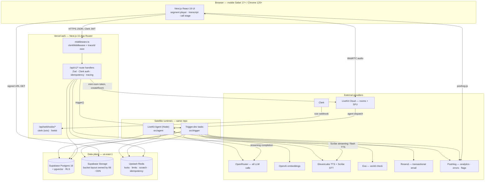
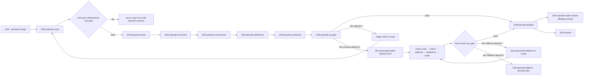
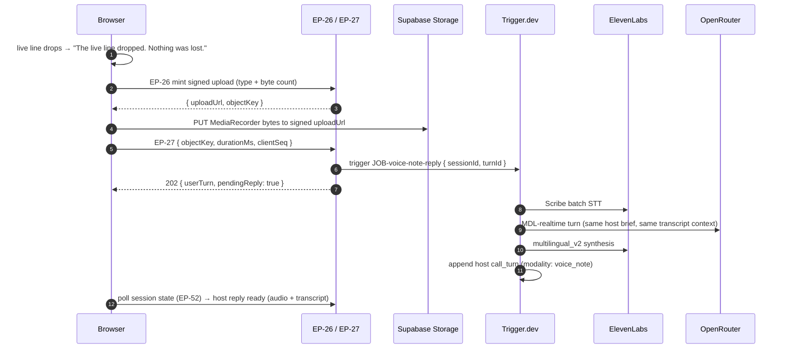
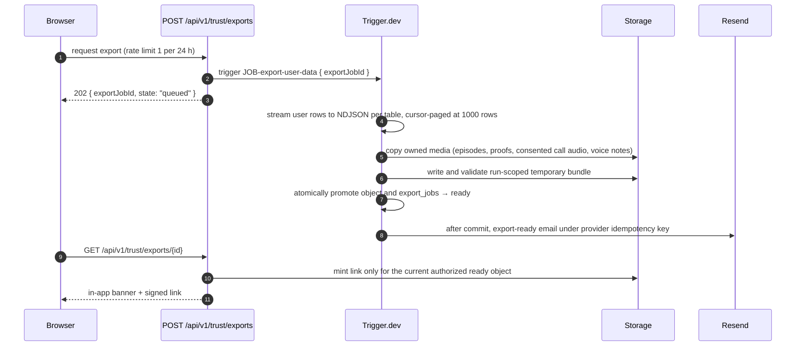
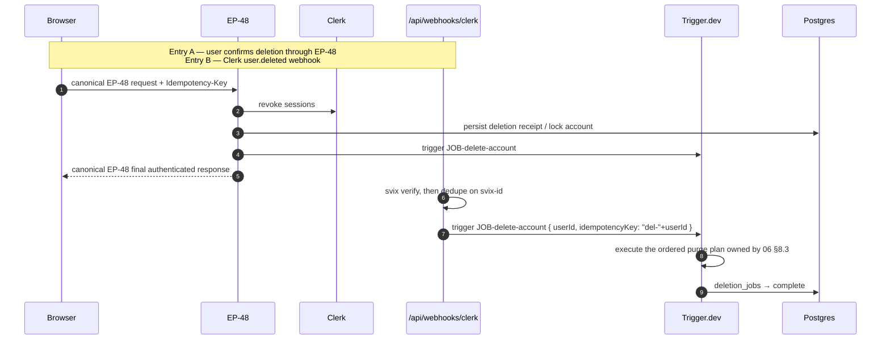

# 05 — Technical Design Document

**Owner of:** architecture detail, repository structure, module boundaries and contracts, inter-service communication, auth flows, background jobs `JOB-*`, environment configuration, deployment, caching, observability, threat model, failure models, performance envelopes.

**Not owner of:** schema fields and endpoints (06-data-api-spec), prompts and model matrix (07-ai-spec), requirements `FR-###`/`NFR-##` (04-srs), screens and copy (02-ux-spec), tokens and components (03-design-system), test cases (08-eval-testing-plan). This document cites those by ID and never restates their values.

**Conformance:** `00-decisions.md` is binding. RFC 2119 keywords are normative. Latency figures quoted here are copies of the envelopes in `00-decisions.md` §8, whose normative per-budget statements are the `NFR-##` rows in 04-srs.

---

## 1. System overview

For one is a **modular monolith**: one repository, one Next.js application, and exactly two satellite runtimes deployed from the same repository — the LiveKit voice agent and the Trigger.dev task set (ADR-0004). There is no message bus, no service mesh, and no queue other than Trigger.dev.

Three runtimes, three deployment targets, one codebase:

| Runtime | Deployed to | Responsibility | Latency class |
|---|---|---|---|
| **Web app** (`src/app`) | Vercel `iad1` | UI, all `/api/v1/*` route handlers, webhook receivers, and durable acceptance/readback of intake turns | Interactive (< 500 ms server time) |
| **Voice agent** (`src/agent`) | LiveKit Cloud US East | The live call-in loop only: STT → LLM → TTS inside a LiveKit room | Real-time (< 1.5 s turn) |
| **Tasks** (`src/trigger`) | Trigger.dev US | Every generation, assessment, planner, export, deletion, and reconciliation job | Asynchronous (seconds to minutes) |

The division rule is absolute and MUST be applied when placing new code:

- **INV-RUNTIME-1** — Work that a user waits on with the browser open and whose result does not need to survive the user navigating away runs in a route handler.
- **INV-RUNTIME-2** — Work whose result MUST survive the user leaving the page, and every model, STT, or TTS call outside the live voice loop, runs as a Trigger.dev task. Generation, assessment, and intake-producer inference MUST NOT run in request handlers (`00` §4).
- **INV-RUNTIME-3** — Work bounded by a sub-second conversational turn runs in the voice agent, which is the only latency-critical server path in the system.

### 1.1 Architecture



### 1.2 Communication rules

| Edge | Mechanism | Rule |
|---|---|---|
| Browser → server | REST `/api/v1/*` over HTTPS, Clerk session JWT (`00` §6) | The only data path. No client-side Supabase queries (ADR-0012). No server actions for mutation. |
| Browser → media | Signed Supabase Storage URLs, `GET` only | Audio never transits our API (`00` §6). |
| Browser ↔ voice | WebRTC to LiveKit, room-scoped token from `POST /api/v1/call-tokens` | Audio never transits Vercel. |
| Route handler → tasks | `tasks.trigger()` / `tasks.batchTrigger()` with an idempotency key | Handlers normally return after durable enqueue. The sole bounded join is EP-04's staleness path (§5.1): it waits on the Trigger.dev run handle, never executes provider work in the handler, and returns the prior bootstrap document when its owner-defined deadline expires. |
| Task → task | Direct `trigger()` for fan-out, `triggerAndWait()` only inside an orchestrator task | Wait depth MUST NOT exceed 2. |
| Agent → data | Same repository modules against Supavisor session-mode pool | The agent MUST NOT call `/api/v1/*`. |
| Provider → us | Webhooks on `/api/webhooks/*`, signature-verified, deduplicated in Redis | Unverified webhooks are rejected with 401 before any work; exact receivers are owned by 06 §13. |
| Client → job progress | Polling the session-state endpoint `EP-52`, catalogued by 06 (ADR-0020) | No long-lived connections in v1 (§6.4). 05 defines no path or payload for this endpoint. |

---

## 2. Repository layout

**Decision: one npm package, no workspaces, no Turborepo.** All three runtimes import the same `src/modules/*` and `src/platform/*` source through TypeScript path aliases. Workspaces would force internal package boundaries, duplicate dependency graphs, and a build-order tool for a codebase whose only real boundary rule (module public API) is enforced by ESLint instead. Boundaries are enforced by lint, not by package manifests (§3.3).

Three build targets from one `package.json`: `next build` (Vercel), `tsup src/agent/index.ts` (agent image), `trigger.dev deploy` (tasks).

```
for-one/
├─ .github/workflows/ci.yml
├─ .env.example                      # names only, never values
├─ eslint.config.mjs                 # flat config, boundary rules (§3.3)
├─ next.config.ts
├─ tailwind.config.ts                # maps 03-design-system tokens
├─ tsconfig.json                     # strict, paths: @/modules/* @/platform/* @/ui/*
├─ trigger.config.ts                 # dirs: ["src/trigger"], ffmpeg build extension
├─ drizzle.config.ts                 # out: ./drizzle, DIRECT_DATABASE_URL
├─ package.json
├─ supabase/config.toml              # local stack, bucket definitions
├─ drizzle/                          # forward-only SQL migrations + meta/
├─ scripts/
│  ├─ dev-agent.ts                   # local agent runner against LiveKit dev project
│  ├─ seed.ts                        # seed data owned by 06 (languages, chassis, taxonomy, formats)
│  └─ check-migrations.ts            # CI gate: schema drift + destructive-statement scan
├─ src/
│  ├─ app/                           # Next.js App Router
│  │  ├─ middleware.ts               # clerkMiddleware + traceId
│  │  ├─ (marketing)/                # public landing, sign-in, sign-up
│  │  ├─ (onboarding)/               # SCR-01..SCR-0n intake flow
│  │  ├─ (show)/today | episode | notes | call | after-show | archive | your-show
│  │  └─ api/v1/
│  │     ├─ pitches/ sessions/ episodes/ articles/ definitions/
│  │     ├─ call-tokens/ calls/ chat/ cast/ intake/ trust/ identity/
│  │     └─ webhooks/{clerk,livekit,trigger-alert}/route.ts
│  ├─ agent/                         # deployable 2 — LiveKit voice agent
│  │  ├─ index.ts                    # worker entry, JobContext, room accept
│  │  ├─ pipeline.ts                 # STT→LLM→TTS wiring, interruption handling
│  │  ├─ turn-policy.ts              # endpointing, silence rules (§5.4)
│  │  ├─ call-clock.ts               # 5:30 close, 7:00 hard cut
│  │  └─ persistence.ts              # call_turns writes via realtime module
│  ├─ trigger/                       # deployable 3 — thin task shells
│  │  ├─ generation/ planner/ session/ proof/ trust/ ops/
│  │  └─ _shared/{idempotency.ts,trace.ts}
│  ├─ modules/                       # domain — one folder per module (§3)
│  │  └─ <module>/
│  │     ├─ index.ts                 # THE public API — only importable file
│  │     ├─ service.ts               # use cases
│  │     ├─ repo.ts                  # userId-scoped data access
│  │     ├─ schema.ts                # Drizzle tables OWNED by this module
│  │     ├─ types.ts                 # Zod schemas + inferred types
│  │     └─ internal/                # never imported across modules
│  ├─ platform/                      # infrastructure adapters, zero domain logic
│  │  ├─ db/{client.ts,schema.ts,rls.ts,tx.ts}
│  │  ├─ redis/{client.ts,locks.ts,ratelimit.ts,idempotency.ts}
│  │  ├─ storage/{client.ts,paths.ts,signed-urls.ts}
│  │  ├─ ai/{openrouter.ts,structured.ts,embeddings.ts,cost.ts}
│  │  ├─ tts/ stt/ search/ email/ livekit/ analytics/
│  │  ├─ http/{handler.ts,auth.ts,errors.ts,idempotency.ts,pagination.ts}
│  │  └─ observability/{trace.ts,logger.ts,events.ts}
│  ├─ prompts/                       # PRM-*@v<n> artifacts — content owned by 07
│  ├─ ui/                            # DS-* components — content owned by 03
│  └─ config/{env.ts,flags.ts,constants.ts}
└─ tests/
   ├─ unit/ integration/ e2e/ fixtures/ evals/
```

Placement rules:

1. Drizzle table definitions live in the owning module's `schema.ts`. `src/platform/db/schema.ts` re-exports every module schema for drizzle-kit. Table ownership is therefore physical, not conventional.
2. `src/trigger/**` files MUST contain only: payload schema, idempotency key derivation, a call into one or more module services, and persistence of stage state. Domain logic in a task file is a defect.
3. `src/agent/**` MUST NOT contain domain rules that also exist server-side. Recast policy, host briefs, and memory retrieval come from `src/modules/realtime` and `src/prompts`.
4. Prompts are files, never string literals in service code (`00` §7).

---

## 3. Modules

### 3.1 Tiering and dependency direction

Modules are assigned tiers. **A module MUST import only modules in a strictly lower tier**, and only through `index.ts`. Orchestration across tiers upward happens in `src/trigger/**` and route handlers, never inside a module.

| Tier | Modules |
|---|---|
| 0 | `telemetry`, `language-packages`, `identity` |
| 1 | `learner-file`, `cast`, `lexicon` |
| 2 | `assessment`, `generation`, `planner` |
| 3 | `session` |
| 4 | `realtime`, `proof` |
| 5 | `archive`, `trust` |

This removes every cycle. The one that would otherwise exist — assessment needing call transcripts owned by `realtime` — is broken by dependency inversion: `assessment.analyzeSession()` accepts an evidence object that the post-session task assembles from `session` and `realtime`.

### 3.2 Module contracts

Table ownership is drawn from the closed entity census in `00` §5. Every census table has exactly one owner. Only the owning module MAY write its tables; other modules read through the owner's public API.

---

**`identity`** — Owns who the user is, their locale, timezone, age gate, and consent record.
Tables: `users`, `consent_events`.
```ts
resolveUser(clerkUserId: string): Promise<UserRef>              // Redis-cached, §6.1
syncFromClerk(event: ClerkUserEvent): Promise<void>
upsertOnboardingProfile(clerkUserId: string, input: OnboardingProfileInput): Promise<AgeGateResult>  // canonical EP-05 path
setTimezone(userId: UserId, ianaZone: string): Promise<void>
recordConsent(userId: UserId, kind: ConsentKind, granted: boolean): Promise<ConsentEvent>
currentConsent(userId: UserId, kind: ConsentKind): Promise<boolean>
requireEmailVerifiedForSession(userId: UserId, priorSessionCount: number): Promise<void>
acceptIntakeWork(userId: UserId, input: IntakeWorkInput): Promise<IntakeWorkReceipt>  // durable initial/reply acceptance; no provider call
completeIntakeWork(userId: UserId, workId: IntakeWorkId, result: IntakeTurnResult): Promise<IntakeTurn>  // ordered, idempotent terminal writer
applyLevelEstimate(userId: UserId, estimate: LevelEstimate): Promise<void>  // idempotent complete-tuple write after intake
```
Emits: `consent.voice.revoked` (consumed by `trust`), `user.deleted` (consumed by `trust`).

---

**`learner-file`** — Owns the four-section learner file and the retrieval index. Single writer for embeddings, because every retrieval is user-scoped memory retrieval.
Tables: `learner_facts`, `interests`, `follow_ups`, `embeddings`.
```ts
getFile(userId: UserId): Promise<LearnerFile>                   // four sections, FR-400
whatWorks(userId: UserId, asOf: Date): Promise<WhatWorksProjection>  // exact derived projection in §5.5.1
applyExtraction(userId: UserId, extraction: FactExtraction, provenance: Provenance): Promise<ApplyResult>
correctFact(userId: UserId, factId: FactId, replacement: string): Promise<LearnerFact>   // high confidence, immediate
effectiveSalience(userId: UserId, sourceId: SourceId, asOf: Date): Promise<number>  // lazy 07 §7.3 computation
touchSalience(userId: UserId, sourceId: SourceId, event: SalienceEvent, at: Date): Promise<void>  // fold elapsed decay, then apply event
setPinnedDormancy(userId: UserId, factId: FactId, dormant: boolean): Promise<LearnerFact>  // EP-44 transaction and re-embed contract
dueFollowUps(userId: UserId, asOf: Date): Promise<FollowUp[]>
indexContent(userId: UserId, source: EmbeddingSource, items: EmbeddableItem[]): Promise<void>
retrieve(userId: UserId, query: string, budget: RetrievalBudget): Promise<RetrievedContext>
knowledgeSummary(userId: UserId): Promise<PlainLanguageSummary>  // life facts + interests only, never language profile
```
Consumes: extraction output from `assessment`. Emits nothing.
**INV-LF-1** — `retrieve` and `getFile` accept `userId` and MUST NOT be callable without it; the repository layer appends the `user_id` predicate structurally.

There is no salience-decay job and no clock-driven learner-file mutation. Reads compute 07 §7.3's effective value lazily and exclude automatic dormancy without writing a status. An actual salience event folds the elapsed decay into the stored value before applying that event and updating the touch instant. Only EP-44 calls `setPinnedDormancy`: pinning removes retrieval eligibility and its embedding in the owner-defined transaction; unpinning applies 07 §7.4's re-entry contract and enqueues replacement embedding work. Extraction and weekly assessment cannot call that method.

---

**`cast`** — Owns hosts, their voices, and per-character relational memory.
Tables: `characters`, `character_memories`, `voices`.
```ts
roster(userId: UserId): Promise<{ duo: Character[]; created: Character[] }>  // duo excluded from the 6 cap
createCharacter(userId: UserId, draft: CharacterDraft): Promise<Character>   // maps to 1 of 6 chassis, invisible
retire(userId: UserId, characterId: CharacterId): Promise<void>              // memory preserved, reversible
castForSession(userId: UserId, selection: CastSelection): Promise<Character[]>  // 1 or 2, any active
recordCharacterMemory(userId: UserId, characterId: CharacterId, memory: CharacterMemoryInput): Promise<void>
voiceInventory(languagePackageId: PackageId, dialectId: DialectId): Promise<Voice[]>
installAuthoredDuoSeed(packageId: PackageId, seed: ReviewedDuoSeed): Promise<void>  // package-build orchestration only
```

`cast.retire()` locks the character and the user's current unaccepted pitch set in one transaction. It marks the character retired, leaves every created session and produced artifact frozen, and replaces each affected unaccepted pitch through the deterministic package-authored projection owned by 06. The repair calls no model, creates no `planner_runs` row, preserves set shape, and increments the set revision atomically. EP-16 racing that transaction either commits first with the still-active character or loses the revision/active-character predicate with the 06-owned state conflict; the losing client then reads the repaired set through EP-12. This is lifecycle repair under FR-706, not a fourth ADR-0009 trigger.

---

**`language-packages`** — Owns per-language configuration produced by the ADR-0002 pipeline: taxonomy localisation, band descriptors, chassis documents, dialect lists, duo definitions, and reviewed authored package media.
Tables: `language_packages`, `dialects`.
```ts
getPackage(target: LanguageCode, dialectId: DialectId): Promise<LanguagePackage>
supportedTargets(): Promise<LanguageCode[]>       // intersection of flash_v2_5 and scribe_v2 (ADR-0019)
supportedNatives(): Promise<LanguageCode[]>
buildPackageArtifact(target: LanguageCode): Promise<ReviewedMigrationCandidate> // invoked by JOB-build-language-package
```
**INV-LP-1** — No prompt, taxonomy, or descriptor may be hard-coded per language in application code (FR-631).
**INV-LP-2** — `JOB-build-language-package` generates and validates a versioned review candidate containing the authored duo-introduction, authored-host sign-off, fallback-episode assets, and the remaining FR-632 groups. Native-speaker approval produces a forward-only migration artifact; only deployment of that reviewed migration activates the 06-owned catalog references. The task holds no runtime catalog DML grant and MUST NOT publish directly. Runtime call or episode code MUST NOT synthesize substitutes for those assets. `JOB-character-intro` is outside this pipeline and synthesizes only a newly created user's character introduction.

---

**`lexicon`** — Owns definitions and define events. Definitions are **shared, not user-owned** (§5.3.4).
Tables: `definitions`, `define_events`.
```ts
tagSenses(packageId: PackageId, nativeLanguage: LanguageCode, tokens: TranscriptToken[]): Promise<SenseTag[]>
ensureDefinitions(packageId: PackageId, nativeLanguage: LanguageCode, senses: SenseKey[]): Promise<DefinitionRef[]>
lookup(refs: DefinitionRef[]): Promise<Definition[]>
recordDefineEvent(userId: UserId, event: DefineEventInput): Promise<void>
```

---

**`telemetry`** — Owns the cost and AI-call ledger. Tier 0 so every module may write to it.
Tables: `cost_events`.
```ts
recordAiCall(record: AiCallRecord): Promise<void>       // mandatory fields in §9.3
recordSynthesis(record: SynthesisRecord): Promise<void>
sessionCost(userId: UserId, sessionId: SessionId): Promise<CostBreakdown>
rollup(window: DateRange): Promise<CostRollup>
```
**INV-TEL-1** — Every provider call that spends money MUST write one `cost_events` row, including failed and retried attempts.

---

**`assessment`** — Owns the language profile: errors, targets, CAF ratings, vocabulary rings.
Tables: `targets`, `error_observations`, `assessments`, `vocab_items`.
```ts
analyzeSession(userId: UserId, evidence: SessionEvidence): Promise<SessionAnalysis>
  // returns error observations, new vocab, target-produced flags, uptake 0–2, energy signal
applyTargetOutcomes(userId: UserId, outcomes: TargetOutcome[]): Promise<TargetTransition[]>  // FR-441 transcript order
advanceRechecks(userId: UserId, asOf: LocalDate): Promise<TargetTransition[]>                 // FR-442 interval state
assignTargets(userId: UserId, sessionId: SessionId): Promise<TargetAssignment[]>              // FR-440 deterministic selection
rankTargetCandidates(userId: UserId, localDate: LocalDate): Promise<TargetCandidate[]>        // same FR-440 ordering, read-only planner hint
weeklyCaf(userId: UserId, window: DateRange): Promise<Assessment>  // 1-week and 2-week; 2-week wins on disagreement
avoidanceScan(userId: UserId): Promise<AvoidanceFlag[]>
currentEdge(userId: UserId): Promise<{ band: LevelBand; step: 1|2|3; confidence: LevelConfidence; energy: EnergyState }>
```
**INV-ASSESS-1** — Every write to `error_observations`, `targets`, and `learner_facts` passes the deterministic gate (schema + rule checks + confidence threshold) before persistence (`00` §7). Model output is evidence, never truth.
**INV-ASSESS-2** — `currentEdge` output MUST NOT appear in any API response schema (`00` §5).

---

**`generation`** — Owns the content pipeline and its artifacts.
Tables: `generation_jobs`, `episodes`, `articles`.
```ts
startEpisode(userId: UserId, brief: EpisodeBrief, opts: { idempotencyKey: string }): Promise<GenerationJobId>
runStage(jobId: GenerationJobId, stage: GenerationStage): Promise<StageResult>   // pure per-stage, resumable; call_brief reads the frozen article-stage payload member
qualityGateFast(draft: ColdOpenDraft, ctx: GateContext): Promise<GateVerdict>    // deterministic, < 500 ms
qualityGateRated(script: EpisodeScript, article: Article, ctx: GateContext): Promise<GateVerdict>
publish(jobId: GenerationJobId): Promise<Episode>
shipFallback(jobId: GenerationJobId): Promise<Episode>
manifest(userId: UserId, episodeId: EpisodeId): Promise<AudioManifest>           // §5.2
```
Emits: `generation.published`, `generation.failed`, `generation.fallback_shipped`.
**INV-GEN-1** — Every stage is idempotent on `(jobId, stage, inputHash)`; re-running a completed stage returns the stored output without a provider call.
**INV-GEN-2** — A failed stage retries alone; upstream completed stages MUST NOT re-run.
**INV-GEN-3** — A pre-generated episode exposes no media before its complete blocking quality gate passes. An on-selection segment exposes no media before that segment's law and canon gates pass; later advisory complete-script results cannot revoke it.
**INV-GEN-4** — `episodes.content_terminal_at` changes from null to non-null only through the 06-owned `enforce_content_terminal_freeze()` trigger after the complete linked folio is mutually consistent. After that transition, the active manifest epoch, script, transcript, segment set, article, definitions, call brief, chat-opener descriptor, and delivered cast are immutable; only the master-object projection fields may advance from master-pending to complete.

---

**`planner`** — Owns pitch sets and planner runs.
Tables: `pitches`, `planner_runs`.
```ts
run(userId: UserId, trigger: PlannerTrigger): Promise<PlannerRun>    // coalesced, §5.5
initializeOnboardingPitch(userId: UserId, ordinal: 1|2): Promise<OnboardingPitch>  // one-time FR-026 workflow; never a PlannerRun
currentPitches(userId: UserId): Promise<PitchSet>
isStale(userId: UserId, now: Date): Promise<boolean>                 // > 20 h
predictedPick(runId: PlannerRunId): Promise<Pitch>
```
Emits: `planner.completed` (consumed by the pregeneration task).
**INV-PLAN-1** — A planner run replaces the pitch set atomically; partial patches are prohibited (FR-118).
**INV-PLAN-2** — A world-check failure MUST NOT fail the run; the planner falls back to interests, follow-ups, and the wildcard.

---

**`session`** — Owns the session state machine and the after-show thread.
Tables: `sessions`, `chat_messages`.
```ts
create(userId: UserId, input: StartSessionInput, opts: { idempotencyKey: string }): Promise<Session>
transition(userId: UserId, sessionId: SessionId, to: SessionState): Promise<Session>  // forward-only
pause(userId: UserId, sessionId: SessionId, position: StagePosition): Promise<void>
resume(userId: UserId, sessionId: SessionId): Promise<ResumeContext>
abandon(userId: UserId, sessionId: SessionId, reason: AbandonReason): Promise<void>
dailyCapStatus(userId: UserId, localDate: string): Promise<{ used: number; capped: boolean }>
appendChatMessage(userId: UserId, sessionId: SessionId, msg: ChatMessageInput): Promise<ChatMessage>
claimNextHostOrdinal(userId: UserId, sessionId: SessionId, cause: AfterShowCause): Promise<HostOrdinalClaim>
commitHostMessage(userId: UserId, sessionId: SessionId, claim: HostOrdinalClaim, msg: ChatMessageInput): Promise<ChatMessage>
completeAfterShow(userId: UserId, sessionId: SessionId, cause: AfterShowCloseCause): Promise<boolean>  // exactly-once chatting → complete CAS
threadState(userId: UserId, sessionId: SessionId): Promise<ThreadLifecycle>  // open | closing | closed | note-for-next-time
runtimeState(userId: UserId, sessionId: SessionId): Promise<SessionRuntimeState>  // the state EP-52 serves, §6.4
```
Emits: `session.completed`, `session.abandoned` (consumed by the post-session task).
**INV-SES-1** — The state machine is forward-only; a transition request to an earlier state returns 409 (`00` §6).
**INV-SES-2** — The daily cap is evaluated in the user's stored IANA zone, server-side, on create.

---

**`realtime`** — Owns everything the live call produces, in both live and voice-note modality.
Tables: `call_turns`.
```ts
prepareCall(userId: UserId, sessionId: SessionId): Promise<CallPreparation>  // room name, host brief, consent state
mintToken(userId: UserId, sessionId: SessionId): Promise<{ token: string; url: string; expiresAt: Date }>
appendTurn(userId: UserId, sessionId: SessionId, turn: CallTurnInput): Promise<CallTurn>  // modality: live | voice_note
acceptVoiceNote(userId: UserId, sessionId: SessionId, input: AcceptedVoiceNote): Promise<CallTurn>  // one pending reply
requestVoiceNoteEnd(userId: UserId, sessionId: SessionId): Promise<VoiceNoteCloseState>
requestLiveEnd(userId: UserId, sessionId: SessionId, requestId: UUID): Promise<LiveEndReceipt>
commitVoiceNoteReply(userId: UserId, sessionId: SessionId, input: VoiceNoteReplyResult): Promise<CallTurn>
callEvidence(userId: UserId, sessionId: SessionId): Promise<CallEvidence>
closeCall(userId: UserId, sessionId: SessionId, reason: CallCloseReason): Promise<void>
degradeToVoiceNotes(userId: UserId, sessionId: SessionId, cause: DegradeCause): Promise<void>
finalizeLiveCall(userId: UserId, sessionId: SessionId, input: LiveCallFinalization): Promise<FinalizationReceipt>
```
**INV-RT-1** — Transcript is always written; audio is written only when `voice_consent = true` **at record time** (`00` §10).
**INV-RT-2** — Live and voice-note turns share one table and one turn schema, so degradation loses no session state.

---

**`proof`** — Owns Weekly Proof generation and its qualification rule.
Tables: `proofs`.
```ts
qualifies(userId: UserId, week: IsoWeek): Promise<boolean>        // ≥2 completed sessions
assembleInput(userId: UserId, assessmentId: AssessmentId): Promise<ProofInput>  // closed 06/07 evidence projection, §7
generate(userId: UserId, week: IsoWeek): Promise<Proof>
deliverySlot(userId: UserId): Promise<Weekday>                    // highest-completion weekday
```
**INV-PROOF-1** — The generator receives only the real deltas of its linked assessment through `assembleInput`. A flat week requires a valid assessment with no reportable delta and is stated plainly with one named planner change (FR-505); a missing or failed assessment is omission, never flatness.

---

**`archive`** — Owns no tables. Read-only composition across `session`, `generation`, `realtime`, `proof` for the Archive surface, plus placeholder semantics for deleted audio.
```ts
list(userId: UserId, cursor?: Cursor): Promise<Paginated<ArchiveEntry>>
entry(userId: UserId, sessionId: SessionId): Promise<ArchiveDetail>
```
**INV-ARCH-1** — Archive exposes no statistics, charts, or aggregates (FR-512).

---

**`trust`** — Owns the data-rights surface: export, deletion, consent revocation effects.
Tables: `export_jobs`, `deletion_jobs`.
```ts
requestExport(userId: UserId): Promise<ExportJob>
exportArtifact(userId: UserId, exportJobId: ExportJobId): Promise<{ url: string; expiresAt: Date }>  // signed, TTL per 06 §9.1
requestDeletion(userId: UserId, confirmation: string): Promise<DeletionJob>
purgeVoiceAudio(userId: UserId, reason: PurgeReason): Promise<PurgeReport>
deletionStatus(userId: UserId): Promise<DeletionStatus>
```
**INV-TRUST-1** — Deletion purges primary stores within 24 h; backups age out within 30 days under a deletion-on-restore policy (ADR-0001).

### 3.3 Boundary enforcement

Cross-module imports are permitted **only** through `index.ts`. Enforcement is mechanical, using `eslint-plugin-boundaries` in the flat config:

```js
// eslint.config.mjs (excerpt)
settings: {
  "boundaries/elements": [
    { type: "app",       pattern: "src/app/**" },
    { type: "agent",     pattern: "src/agent/**" },
    { type: "trigger",   pattern: "src/trigger/**" },
    { type: "module-t0", pattern: "src/modules/(telemetry|language-packages|identity)/**", capture: ["name"] },
    { type: "module-t1", pattern: "src/modules/(learner-file|cast|lexicon)/**",            capture: ["name"] },
    { type: "module-t2", pattern: "src/modules/(assessment|generation|planner)/**",        capture: ["name"] },
    { type: "module-t3", pattern: "src/modules/(session)/**",                              capture: ["name"] },
    { type: "module-t4", pattern: "src/modules/(realtime|proof)/**",                       capture: ["name"] },
    { type: "module-t5", pattern: "src/modules/(archive|trust)/**",                        capture: ["name"] },
    { type: "platform",  pattern: "src/platform/**" },
    { type: "ui",        pattern: "src/ui/**" },
    { type: "config",    pattern: "src/config/**" }
  ]
},
rules: {
  "boundaries/element-types": ["error", { default: "disallow", rules: [
    { from: ["app","agent","trigger"], allow: ["module-t0","module-t1","module-t2","module-t3","module-t4","module-t5","platform","ui","config"] },
    { from: ["module-t5"], allow: ["module-t0","module-t1","module-t2","module-t3","module-t4","platform","config"] },
    { from: ["module-t4"], allow: ["module-t0","module-t1","module-t2","module-t3","platform","config"] },
    { from: ["module-t3"], allow: ["module-t0","module-t1","module-t2","platform","config"] },
    { from: ["module-t2"], allow: ["module-t0","module-t1","platform","config"] },
    { from: ["module-t1"], allow: ["module-t0","platform","config"] },
    { from: ["module-t0"], allow: ["platform","config"] },
    { from: ["platform"],  allow: ["platform","config"] },
    { from: ["ui"],        allow: ["ui","config"] }
  ]}],
  "boundaries/entry-point": ["error", { default: "disallow", rules: [
    { target: ["module-t0","module-t1","module-t2","module-t3","module-t4","module-t5"], allow: "index.ts" },
    { target: ["platform","ui","config"], allow: "**" }
  ]}],
  "import/no-cycle": ["error", { maxDepth: 1 }]
}
```

The `boundaries/entry-point` rule is what makes `index.ts` the public API: a deep import of `src/modules/planner/repo.ts` from any other module fails lint. CI runs lint as a blocking stage (§10.3).

---

## 4. Authentication, identity, and authorization

Clerk is the identity provider (ADR-0014). Postgres never stores credentials. `users.id` is our own UUID; `users.clerk_user_id` is the external key.

### 4.1 Request path

1. **Middleware** (`src/app/middleware.ts`) runs `clerkMiddleware()` on every non-static path. It mints a `traceId` (ULID) when the `x-trace-id` header is absent and sets it on the request and response. Public matchers: `/`, `/sign-in(.*)`, `/sign-up(.*)`, `/verify-email(.*)`, `/api/webhooks/(.*)`. The verification page itself is public so an emailed provider token can be consumed before a product session is refreshed; it exposes no product data. Everything else requires a session.
2. **Route handler kit** (`src/platform/http/handler.ts`) wraps every `/api/v1/*` handler and performs, in order:
   1. `const { userId: clerkUserId, sessionClaims } = await auth()` — null → `401 UNAUTHENTICATED`.
   2. `identity.resolveUser(clerkUserId)` — Redis-cached (§6.1). A missing or provisional profile is admitted only to authenticated EP-01 for the language catalog, EP-05 for profile completion, and EP-58 for verification resend; every other product route takes the exact status/code mapping owned by 06. EP-05 and EP-58 run under 06's `verified_clerk_subject` repository scope rather than `app.current_user_id()` until a product row exists.
   3. Rate limit check (§6.3) → `429`.
   4. `Idempotency-Key` handling for mutating POSTs (§6.7).
   5. Zod parse of params, query, and body → `400 VALIDATION_FAILED`.
   6. Handler execution with `{ userId, traceId, requestId: traceId }` in context.
   7. Error mapping to the single envelope in `00` §6, with `requestId = traceId`.
3. **Repository layer** appends `user_id = $userId` to every query on a user-owned table. RLS is the structural backstop, not the primary control (`00` §4).

**INV-AUTH-1** — A route handler MUST NOT read `userId` from the request body or query. It comes from the verified session only.

### 4.2 Age gate

Self-declaration is the only check (FR-002). Birth date and the two language choices are collected by us through canonical EP-05 after Clerk sign-up (ADR-0014). The Clerk sync job and EP-05 share one provisional-user upsert, so either arrival order converges on one `users` row and neither overwrites a completed profile.

```mermaid
sequenceDiagram
  participant U as User
  participant C as Clerk
  participant W as /api/webhooks/clerk
  participant T as JOB-identity-sync
  participant A as EP-05 onboarding profile
  participant D as Postgres
  U->>C: Sign up (email+password / Google / Apple)
  C-->>U: Session established
  C->>W: signed user.created
  W->>T: enqueue after verification/dedupe
  T->>D: idempotent provisional-row upsert
  U->>A: canonical EP-05 request
  A->>A: age = fullYearsAt(now, birthDate)
  alt age < 18
    A->>D: atomically write the 06-owned under-age deletion receipt and remove the provisional product row
    A->>T: enqueue registered JOB-delete-account after commit
    T->>C: delete user and confirm provider absence
    A-->>U: owner-defined EP-05 rejection + sign-out; durable receipt blocks recreation
  else age >= 18
    A->>D: idempotently complete the provisional profile
    A-->>U: canonical EP-05 success response
  end
```

No personal profile or consent row survives a rejected birth date. The deliberately non-FK `deletion_jobs` receipt is the recovery authority: middleware and `JOB-identity-sync` check its opaque Clerk-subject key before any provisional upsert, so a failed or delayed provider deletion cannot recreate or admit the identity. `JOB-delete-account` retries until a provider read confirms absence, and `Q-JOB-LIVENESS` recovers a committed receipt whose enqueue was lost. The 15-minute Redis response value is only a cache. EP-04 refreshes timezone from its app-open query under the contract owned by 06 (`00` §1); 05 defines no second timezone-refresh endpoint.

### 4.3 Email verification before session 2

The session-two verification rule is enforced at `POST /api/v1/sessions`. The separate verified-email export gate is owned by EP-46 and does not affect session eligibility.

```
priorSessions = count(sessions WHERE user_id = $u)
if priorSessions >= 1 AND sessionClaims.evf !== true → EP-16's owner-defined EMAIL_VERIFICATION_REQUIRED response
```

`evf` is a custom session-token claim configured in Clerk that maps the primary email verification status to a boolean, so verification state is read from the JWT with no Clerk API round trip. The count includes every lifetime session row, regardless of current or terminal state; nothing blocks the first session (FR-004).

EP-58 is the sole resend mutation. It resolves the primary email-address ID from the verified Clerk subject, accepts no email address, token, subject, or redirect from the browser, and asks Clerk to prepare the provider-owned email-link verification using the fixed allowlisted `${APP_ORIGIN}/verify-email` redirect. The 06-owned `verification-resend:{HMAC-SHA256(clerkSubject)}` 60-second result record is the single-writer boundary: one token-owning request calls Clerk and concurrent callers join its byte-identical result at the owner cadence/deadline; none steals the lease or sends a second email. `RL-VERIFICATION-RESEND` independently bounds non-concurrent attempts. `sent` renders SCR-03/S3, `already_verified` refreshes the Clerk session and renders S6, provider exhaustion renders S4, and offline input never calls the endpoint.

The emailed link is single-use and valid for exactly 24 hours under EP-58's Clerk configuration. It is redeemed only by Clerk on the public `/verify-email` page. The page accepts the provider token through Clerk's pinned verification component, never posts it to a product endpoint, then forces a Clerk session-token refresh before any retry of EP-16 or EP-46 so `evf` cannot remain stale. Expired tokens render SCR-03/S7 and call EP-58 only after the user chooses the new-link action; an already-used token resolves as already verified, while a token bound to a different Clerk subject is rejected as not-found and uses the same non-disclosing S7 surface. When SCR-03/S5 opened, the browser stores the selected pitch ID, revision, current application user ID, and creation instant in a device-local pending-navigation record with the same exact 24-hour TTL before leaving the programme. After same-user verification it reads the current EP-12 projection: an unchanged active pitch returns directly to that pitch, while an absent or replaced pitch returns to the ordinary current Today set. The record contains no token or email and is cleared after success, user mismatch, or its 24-hour expiry.

### 4.4 Clerk webhook sync

`POST /api/webhooks/clerk` is public to the middleware and protected by signature.

1. Read the raw body. Verify with `svix` using `CLERK_WEBHOOK_SIGNING_SECRET`. Invalid → `401`, no work performed.
2. Deduplicate through the 06 §13.1 owner contract. Its `wh:clerk:{svix-id}` key and seven-day TTL are the only Clerk-delivery dedupe mechanism. Already present → `200` immediately, because webhook delivery is at-least-once.
3. Enqueue `JOB-identity-sync` with idempotency key `clerk-{svix-id}` and return `200` within 200 ms. The handler never performs database work inline, so a slow database cannot cause Clerk retry storms.

`JOB-identity-sync` handles `user.created` and `user.updated` through the ADR-0014 provisional-row upsert and owner-defined synchronized fields. `user.deleted` converges on `JOB-delete-account`. Exact event-to-field mappings and error codes are owned by 06; the webhook handler itself performs none of those writes.

### 4.5 Service-role rules

The Supabase service-role key exists in exactly two runtimes: Trigger.dev tasks and the voice agent. Rules:

1. Service role is used **only** through the same `src/modules/*/repo.ts` functions the web app uses, which take `userId` and scope every statement. Ad-hoc service-role SQL is prohibited outside `drizzle/` migrations and `scripts/seed.ts`.
2. `SUPABASE_SERVICE_ROLE_KEY` is never present in the Next.js client bundle. `src/config/env.ts` splits the schema into `serverEnv` and `clientEnv`, and the client schema accepts only `NEXT_PUBLIC_*` names.
3. Storage writes use service role; browser reads use signed URLs only (§6.5).

### 4.5.1 The scanner role — the one sanctioned cross-user read

Scheduled and reconciling jobs have a problem the scoped-repository rule cannot solve on its own: they must answer "which users need work right now" *before* they have a `userId` to scope by. Discovery is inherently cross-user.

ADR-0018 grants exactly one narrow exception: a read-only Postgres role **`app_scanner`**. Its properties, which this document owns:

1. **Read-only, views-only.** `SELECT` on the content-free scan views and nothing else. No base-table grant, no write of any kind, on any object.
2. **Content-free by construction.** Every readable view emits identifiers, states, timestamps, and counts. No transcript, fact, message, script, or generated-content column appears in any of them. The single sanctioned exception is the voice-purge view's storage object key, which is unavoidable because the purge worker deletes objects and is filtered to audio that MUST be destroyed.
3. **Discovery only.** The scanner yields identifiers. Every job then fans out one task per user, connecting under the normal user-scoped role with that user's claim, and does the actual work there.

**Membership of the view set is owned by 06 §7.4 and is not restated here** (`00` one-source-of-truth rule). 06 is also the place where a new view is added or an existing one is widened; 05 never introduces one. CI asserts set equality between the role's grant list and the 06 §7.4 enumeration — not a count, so a swap that preserves the number still fails (stage 7, §10.3).

**INV-SCAN-1** — `app_scanner` may read only the views enumerated in 06 §7.4, and every one of them MUST be content-free as defined above. A content column reachable by this role is a security defect.

**INV-SCAN-2** — The scanner produces identifiers and nothing else. All fanned-out work runs through the normal scoped repositories, one user at a time. The scanner never reads the rows the job will act on.

This preserves the property that matters, and it is the reason the exception is acceptable at all: there is still no code path anywhere that reads one user's content while acting for another. Widening the role is therefore not a matter of adding a grant — it requires a new content-free view in 06 §7.4, which is a reviewed change in the document that owns the schema.

Discovery needs of the jobs in §7, each served by a view in the 06 §7.4 enumeration: 48-hour session abandonment · follow-up due for the planner hook · target recheck scheduling · weekly CAF assessment windows · Weekly Proof candidates · liveness of async job records · reconciliation of work that left no job record · voice-revocation audio purge · every time-based retention age-out, through the single categorised retention view · embedding backfill after a provider outage · weekly cost review. Pitch staleness is deliberately absent: it resolves inside the app-open path (§5.1), no job consumes it, and 06 removed the view for that reason.

**Staleness thresholds are 05's policy, not the view's.** The liveness view emits `age_seconds` and applies no cut-off, because a single number baked into a view would force every job kind to share it. The per-kind thresholds are in §9.6 and are the reconciler's to change.

### 4.6 LiveKit token minting

The canonical EP-24 request body is `{ sessionId, entryNonce }`; 06 owns its schema, response union, errors, limit, and durable entry transaction. The route wiring is:

1. Verify ownership, AI-disclosure consent, episode playability, dependency health, and the exact 06-owned entry case. A first entry proceeds only while the row is `reading`. A `speaking` row is accepted only for a same-`entryNonce` lost-response replay in the same room or for a fresh nonce during the recorded 30-second departure grace; arbitrary `speaking` is not an idempotent resume.
2. Apply EP-24's named rate limit from the 06 register; this document defines no local value.
3. For a healthy first entry, allocate the stable room, create exactly one explicit dispatch (`AgentDispatchClient.createDispatch`) with idempotency identity `{roomName,entryNonce}`, receive that dispatched agent's stable server-authored identity, and sign the room-scoped 900-second token before the state compare-and-set. The dispatched agent MUST NOT accept or publish browser media until the committed entry tuple is visible. Room creation is idempotent on the server-derived stable name.
4. Under the session-row lock, compare-and-set `reading → speaking` and atomically store the complete 06-owned tuple `(live_room_name, live_agent_identity, live_entry_nonce, live_room_issued_at)`. Any allocation, dispatch, identity, signing, or compare-and-set failure cancels the dispatch, deletes the empty room when one was allocated, and leaves the session in `reading`. The database constraint therefore never observes a room without its agent identity. An in-grace re-entry instead keeps `speaking`, preserves the existing room and agent identity, rotates the nonce, and atomically clears both `live_participant_left_at` and its paired `live_participant_left_event_id`; a stale or mismatched grace record is rejected.
5. After the commit, return the signed token. A transient agent failure from that point uses §8.2's one reassignment/recovery attempt inside 5 seconds against the same room and durable entry tuple. Exhaustion persists the typed `agent_worker_recovery_exhausted` cause and takes §5.4.3's one-way voice-note branch; it neither creates a second room nor rolls the session back.
6. The token identity is `user_{userId}` with grants `{ roomJoin: true, room: stableRoomName, canPublish: true, canSubscribe: true, canPublishData: false, canUpdateOwnMetadata: false }`. A lost HTTP response replay with the same nonce re-signs that room and joins the existing dispatch without another transition or dispatch. A different nonce outside the exact grace branch conflicts. Room metadata is the agent's entire input; the agent performs no lookup keyed by user-supplied data.

**INV-AUTH-2** — Room names are derived server-side from `sessionId`. A token grant MUST be scoped to exactly one room, MUST NOT include `roomCreate`, and MUST NOT exceed the validity owned by `EP-24` in 06.

---

## 5. Runtime flows

### 5.0 Intake turn execution

Both the initial producer turn and every reply turn use `JOB-intake-turn`; no intake route handler calls OpenRouter, Scribe, or ElevenLabs. The 06-owned intake work contract is the durable authority for the accepted user event, its pending/failed/complete state, the repeatable same-row explicit-recovery generation, and the producer event that resolves it.

1. The profile-completion path accepts one `initial` work item after EP-05's canonical provisional-row upsert is complete. For replies, EP-07 locks the user row and replays an existing `clientReplyId` before doing anything else. The first new reply to the latest answered producer event appends an accepted user event, opens the 06-owned 500 ms server-time batch, and creates one durable `generation_jobs(kind = 'intake_turn')` row. Further replies to that same parent accepted before the boundary append in sequence and join the existing job; they MUST NOT create another model call. A reply after the parent is answered takes the owner-defined conflict.
2. After the first-reply transaction commits, the handler triggers `JOB-intake-turn` with key `intake-turn-{userId}-{parentProducerEventId}`; the initial turn uses `intake-turn-{userId}-initial`. EP-05 and EP-07 replay only their original accepted result and may repair a lost original enqueue while the job remains queued. A failed-turn Retry calls authenticated EP-59 with only `initial` or the durable parent event ID; the route reconstructs work from the accepted transcript, requeues the same row, increments `manual_recovery_generation`, and enqueues the matching recovery suffix. No original profile/reply/upload bytes cross the recovery request.
3. Trigger.dev serializes this job on concurrency key `intake:{userId}` and delays a reply batch until its persisted close instant. The task then row-locks the intake record and exits without a provider call when the job's producer event already exists. Otherwise it snapshots every accepted child of that parent in `seq` order, runs the 07-owned intake assembler and `PRM-intake-producer@v1`, and synthesizes the validated producer text.
4. The terminal writer re-locks the row and commits exactly one producer event naming all answered user-event IDs, marks those children answered, applies the 07-approved extraction writes, advances deterministic collection state, clears the pending batch, and marks the generation job succeeded in one transaction. It refuses a child outside the persisted batch and refuses a second producer answer. Only a later reply to that newly answered producer event can open the next batch.
5. Timeout or retry exhaustion marks the generation job failed without appending a producer event or clearing its batch and leaves the same parent job retryable. Retrying reads the same ordered child set; it never appends another user event, creates a second answer, or skips ahead. The job's bound and final response are in §7 and §8.3.

#### 5.0.1 Onboarding handoff and its single pitch

Onboarding pitch initialization is not a fourth planner trigger. After the intake completion transaction commits, `JOB-intake-level-estimate` writes the complete hidden level tuple and then idempotently enqueues `JOB-onboarding-pitch` with ordinal 1. That dedicated job uses the 04/07 first-pitch rules, publishes exactly one pitch through the 06-owned onboarding-pitch lifecycle, and triggers pitch-scoped pre-generation only after publication. It creates neither a `planner_runs` row nor a `sessions` row.

If the user takes FR-026's single alternative, the 06-owned alternative action atomically retires variant 1 and enqueues the same job with prompt ordinal 2. The job's `(userId, ordinal)` idempotency key makes each model-generated variant write-once. No prompt ordinal 3 exists: a second rejection or terminal generative failure publishes stored variant 3 deterministically from the user's highest-salience interest, and only an empty interest set uses the language package's authored starter topic (07 `PRM-onboarding-pitch@v1`). That terminal fallback uses no model and keeps handoff from stranding on a missing pitch.

The 06-owned handoff state becomes complete only when the selected onboarding outcome and its attachment state are durably readable. An intake-completion replay, a level-task replay, and a pitch-task replay all converge on that same state. The first `sessions` row is written through the same canonical session-creation transaction used by EP-16: explicit acceptance selects variant 1 or 2, while rejection of variant 2 or terminal prompt/gate failure durably authorizes the worker to select deterministic variant 3 and invoke that transaction automatically. No separate route handler or second session writer exists. Before the first steady-state planner publication, EP-04 and EP-12 return 06's explicit `pending_first_set` programme union; only the post-session planner's atomic normal or terminal starter-set publication changes it to ready. Neither app-open nor onboarding synthesizes a partial set. EP-13 is retired: F-14 and FR-122 define no manual refresh action, and the retired identifier MUST NOT be reused.

### 5.1 App open → pitch fetch → staleness refresh (< 5 s)

Budget source: `00` §8 — staleness pitch refresh < 5 s at app open.

```mermaid
sequenceDiagram
  autonumber
  participant B as Browser
  participant A as EP-04 GET /api/v1/me
  participant D as Postgres
  participant T as Trigger.dev
  B->>A: EP-04 { timezone }
  A->>D: Q-BOOTSTRAP
  alt fresh (≤ 20 h)
    A-->>B: exact EP-04 bootstrap document
  else stale (> 20 h; exactly 20 h remains fresh)
    A->>T: trigger JOB-planner-run { reason: "staleness" }
    A->>T: bounded join on that Trigger.dev run handle
    alt text phase commits inside EP-04 deadline
      T-->>A: committed programme projection from the winning planner result
      A-->>B: original Q-BOOTSTRAP document with only its programme block replaced by that committed projection
    else deadline expires or another reason owns the lock
      A-->>B: exact EP-04 stale response from the original snapshot
    end
    Note over A,B: The planner task continues after response;<br/>the client follows the 06-owned stale re-fetch contract.
  end
```

EP-04 is the sole app-open bootstrap and its response is exactly the schema owned by 06; this document defines no parallel `/pitches` bootstrap and no `leadReady`, `coldOpenUrl`, or `refreshing` field. Q-BOOTSTRAP is the handler's only SQL statement. On a successful bounded join, the winning planner task returns the exact committed programme projection produced by its publication transaction; the handler substitutes that block into the original bootstrap document without another database read. An absent, invalid, or late task result leaves the original complete programme unchanged. The Trigger.dev run handle is the sole staleness rendezvous: Redis coordinates planner ownership but carries no second completion channel. The planner commits pitch text before it triggers pre-generation, so the bounded join ends at atomic set publication and pre-generation continues asynchronously (FR-130). The client obtains pre-generated media only through the 06-owned pitch-scoped artifact attachment and manifest contracts (§5.2), and never constructs a storage key.

### 5.2 Pitch accept → playback

Budgets: pre-generated start < 2 s; on-selection playable < 30 s (`00` §8).

```mermaid
sequenceDiagram
  autonumber
  participant B as Browser
  participant S as POST /api/v1/sessions
  participant T as Trigger.dev
  participant ST as Supabase Storage
  Note over B,ST: On programme render, the client prefetches only through<br/>the 06-owned pitch artifact attachment; it never derives an object path.
  B->>S: canonical EP-16 request + Idempotency-Key
  S->>S: daily cap · email-verification gate · rate limit · named regeneration caps · daily cost guard
  alt pitch carries a published pre-generation attachment
    S->>S: atomically attach that artifact to the new session
    S->>T: trigger JOB-episode-synthesis-remaining from the attached generation job
    S-->>B: canonical EP-16 201 document
    Note over B: Segment 000 is already in the browser cache —<br/>Play starts < 2 s with zero media round trips
  else pitch has no published attachment
    S->>T: trigger JOB-generate-episode { idempotencyKey: "gen-"+sessionId }
    S-->>B: canonical EP-16 201 document
    loop poll session state — EP-52, cadence per ADR-0020
      B->>S: state?
      S-->>B: generation progress document owned by EP-52
    end
    B->>S: fetch manifest through EP-53 when EP-52 is playable
    B->>ST: GET segment 000 signed URL
    Note over B: "The opening is ready; the rest is arriving"
  end
```

**Pre-generation synthesises the cold open only, not the whole episode** (07 §9.3). The predicted pick is taken through script, article, call-in brief, lexical index, definitions, and the full quality gate ahead of time, but only segment 000 (≤ 30 s) is synthesised. The remaining segments are produced by `JOB-episode-synthesis-remaining` on acceptance.

The reason is cost, not latency. Predicted-pick acceptance runs at roughly 45%, so full pre-synthesis discards about $0.54 of audio per miss — 36% of the entire per-cycle envelope in `00` §8 — against $0.045 for cold-open-only. The < 2 s budget still holds because the pitch list prefetches segment 000 when it renders, so the first bytes are in the browser cache before the tap, and the manifest arrives with the session-creation response.

The two paths therefore converge on one player contract: both start with segment 000 ready and the remainder arriving, but their release gates differ. A pre-generated episode becomes readable only after its complete five-check blocking gate passes; an on-selection segment becomes readable after that segment's law and canon gates pass, while the other complete-script checks remain advisory. They differ only in *when* the script, article, definitions, and applicable gates happened. A pre-generated artifact is pitch-scoped until EP-16 atomically attaches it to its newly created session under the 06-owned artifact/attachment contract; 05 defines no shadow `episodeId`, attachment row, or response field.

Planner step 3 calls read-only `assessment.rankTargetCandidates()` and stores 1–2 candidate IDs in each 06-owned pitch brief using the exact FR-440 overdue-recheck-first ordering and score/tie-break algorithm implemented by `assessment`; planner prose never scores, reorders, or mutates a target. This makes FR-128's invisible pedagogy threading concrete without claiming that a pitch owns lifecycle state.

#### 5.2.1 Acceptance-prediction formula (FR-129)

The planner publication transaction freezes `evaluationInstant = transaction_timestamp()` and evaluates history strictly before it. It derives exactly three normalized decimal inputs for each candidate; no fourth input is legal:

1. `interest = clamp(max(effectiveSalience for PitchBrief.sourceInterestIds) / 1.5, 0, 1)`, with an empty source array equal to 0. `effectiveSalience` uses 07 §7.3 at the same frozen instant.
2. `format = (completed + 1) / (started + 2)` over the latest 20 earlier sessions with the candidate `format_key`, ordered `started_at DESC, id DESC`; `completed` counts `state='complete'`. No matching session yields 0.5.
3. `recency = 1` when no earlier session has the brief's `predictionTopicKey`; otherwise it is `min(max(evaluationLocalDate - mostRecentTopicLocalDate, 0), 28) / 28`, using full calendar days in `users.timezone`. A topic used on the evaluation date scores 0; one unused for 28 or more days scores 1.

The sparse window is active exactly when `cardinality(users.sparse_fields) > 0` and `evaluationLocalDate - (users.created_at AT TIME ZONE users.timezone)::date` is 0 through 6. Standard score is `roundHalfUp4(0.50×interest + 0.30×format + 0.20×recency)`; sparse-window score is `roundHalfUp4(0.70×interest + 0.20×format + 0.10×recency)`. Both use exact decimal arithmetic and round half upward to four places; higher predicts acceptance. Candidates order by score descending, original candidate position ascending, then preallocated pitch UUID ascending, producing contiguous `predicted_rank`; rank 1 alone starts pre-generation. If input integrity prevents scoring, the fallback selects the candidate with greatest unnormalized linked effective salience, then the same position/UUID tie-break; all-empty interest arrays therefore select by that tie-break.

The writer persists `{ interest, format, recency, formatStarted, formatCompleted, mostRecentTopicAt, sparseWindow, weights }`, the score, and `evaluationInstant` in the 06-owned prediction columns. Same-run replay reads them without recomputation. The model's `predictedFirstTapIndex` remains evaluation telemetry and never affects rank.

#### 5.2.2 Terminal starter-set assembly (FR-127)

If every generative planner attempt fails, the same run calls no further model and freezes FR-100 inputs at its publication transaction instant. `firstWeek` means the evaluation local date in `users.timezone` is 0–6 days after the account-created local date. `sparse = firstWeek AND (cardinality(users.sparse_fields) > 0 OR activeInterestCount < 3)`. `engagedInterestCount` counts active `interests` rows with `engagement_count > 0`. `targetSize` is 3 when sparse, 5 when not sparse and `engagedInterestCount >= 3`, otherwise 4. The run records those frozen inputs in `planner_runs.payload`.

The existing `planner_runs.id` and user ID produce unsigned `seed = low63(SHA-256(UTF8(userId || ':' || plannerRunId)))`, interpreting digest bytes big-endian. Sort both validated banks by Unicode code-point ascending stable `key`; select wildcard index `seed mod wildcardCount`; scan starters circularly from `(seed div wildcardCount) mod starterCount`, accepting the first member of each not-yet-used `formatKey` until exactly `targetSize - 1` are selected. Wildcard position is `1 + ((seed div (wildcardCount * starterCount)) mod targetSize)`; accepted starters fill the remaining positions in scan order. Each pitch copies its reviewed line, topic, format, argument seed, and cast size byte-identically.

The roster lock covers the authored duo in package order followed by active created hosts ordered `(created_at,id)`; retired hosts are excluded. At position `p`, primary index is `(seed + p - 1) mod rosterCount`; a two-host seed takes the next cyclically distinct entry. Each brief uses `source='package_starter'`, its bank key as `sourceKey`, the owner-normalized topic key, and empty interest/target/frontier/fact arrays. Apply §5.2.1 to all `targetSize` rows; exactly rank 1 starts pre-generation. The planner then invokes 06 §15.4's serializable publication transaction. If retirement owns the roster lock first, assembly uses the repaired roster; if publication owns it first, EP-36 repairs the just-published revisions. A same-run replay returns the `targetSize` rows by `planner_run_id` and cannot reselect size, text, order, cast, rank, target, or set sequence.

At the accepted-session generation evidence cutoff, `assessment.assignTargets()` reruns that same deterministic algorithm against the current 06-owned target state and the session's local date. It freezes the selected IDs and evidence cutoff in the canonical 06 assignment snapshot and the 07 §6.3.1 input manifest; the same transaction records owner-defined last-threaded persistence before any authoring prompt runs. A still-eligible pitch candidate naturally resolves to the same target; a stale or ineligible candidate is replaced by the canonical ranking rather than forced into the session. A due re-check is selected and later interpreted only under FR-440–FR-442.

The 30 s of cold open is also the buffer head start: at concurrency 4 the first remaining segment lands about 6 s after acceptance, and production continues at roughly 13× realtime, so the playhead never catches the producer (§5.3.2).

**Intake completion precedes this flow and never creates a session.** The intake-completion endpoint owned by 06 commits the intake evidence and completion marker, then enqueues `JOB-intake-level-estimate` after that transaction commits. The task runs `PRM-level-estimate@v1`, applies 07 §4.2's deterministic post-step, writes the complete level tuple through `identity.applyLevelEstimate()`, and only then enqueues `JOB-onboarding-pitch`. The dedicated initialization contract in §5.0.1 publishes one pitch and never enters the steady-state planner trigger enum. The first `sessions` row is created only when the user explicitly accepts onboarding variant 1 or 2, or when the durable terminal authorization for deterministic variant 3 invokes EP-16's canonical transaction internally; after either authorization the ordinary paths above apply (FR-014, FR-026).

The level task's idempotency key is stable for the user's sole intake. It returns only after the onboarding-pitch enqueue is accepted. On redelivery it reuses an already-complete level tuple instead of calling the model again, but repeats the same idempotent child enqueue; therefore a crash between the level write and child enqueue cannot strand onboarding. A duplicate intake-completion request returns the existing completion marker and cannot create another estimate or initialization job. The exact completion response and handoff fields are owned by 06.

### 5.3 Generation pipeline

#### 5.3.1 Task graph



The durable `generation_jobs.stage` order is exactly the owner-defined machine in 06 §6.3, implementing FR-410: primary and generated-fallback modes use `brief → script → article → call_brief → chat_opener → definitions → audio → qa_gate → done`; terminal authored mode uses `fallback_folio → done`. The cold open is the initial contiguous run in the episode-script output, not a ninth durable stage. Its deterministic sub-gate runs before the `script` stage commits, so a rejection reruns only `JOB-episode-script` and never creates a `cold_open` stage value that 06 cannot store.

`chat_opener` persists a versioned runtime invocation descriptor: `PRM-chat-opener@v1`, the host and article references, and the retrieval plan. It MUST NOT persist a message or a call transcript. At call end `JOB-after-show-turn` supplies the then-complete call transcript and executes the descriptor, which is how FR-410's generation-time definition and runtime-transcript rules both hold.

`call_brief` never reads an `articles` table armament column because none exists. It loads the exact latest successful `article` stage entry from the current job’s 06-owned append-only `payload.stages`, requires its `validatedOutput.armament` to validate against the current `PRM-article` schema, and copies `{ kind, statement }` unchanged into the `call_brief` input manifest. A missing stage, ambiguous successful entry, expired payload before session expiry, schema/version mismatch, or invalid armament fails `JOB-episode-host-brief`; no default stance or reconstructed armament is legal. Final exhaustion takes the canonical `orchestrator_exhausted` authored-folio takeover.

On the **pre-generation** path the same graph runs, but the `audio` stage synthesises segment 000 only and records that scope before `qa_gate`. Acceptance triggers `JOB-episode-synthesis-remaining`, which fans out the rest and then hands off to `JOB-episode-audio-master`. On the **on-selection** path segment 000 satisfies the playable boundary; remaining segment children continue after publish and `JOB-episode-synthesis-remaining` never runs.

#### 5.3.2 Stage table

Every stage writes its output into `generation_jobs` before returning. That is what makes partial regeneration real: a failed stage retries alone and reads completed upstream outputs from the row (`INV-GEN-2`).

| Durable stage | Input | Output persisted | Timeout | Retries | Idempotency key |
|---|---|---|---|---|---|
| `brief` | planner or accepted-pitch brief | immutable brief snapshot | route/orchestrator write | 0 | `gen:{jobId}:brief:{briefHash}` |
| `script` | brief + owner-resolved applicable duration band | full segmented script, including the initial `cold_open` run, the exact duration band, and its deterministic sub-gate result | 60 s | 2, exponential from 2 s | `gen:{jobId}:script:{briefHash}` |
| `article` | script | article body, banded word count | 45 s | 2 | `gen:{jobId}:article:{scriptHash}` |
| `call_brief` | script + the exact validated `article` stage member loaded from `generation_jobs.payload` + learner file | position, pushback material, recast list | 30 s | 2 | `gen:{jobId}:call_brief:{scriptHash}` |
| `chat_opener` | script + article + cast | versioned runtime invocation descriptor; no call transcript and no generated message | 5 s | 2 | `gen:{jobId}:chat_opener:{articleHash}` |
| `definitions` | script + article tokens | sense tags + shared definition refs | 90 s | 3 | `gen:{jobId}:definitions:{scriptHash}` |
| `audio` | script segments + applicable duration band | segment audio objects + per-segment alignment + the deterministic measured-duration result; scope is segment 000 or all segments | 30 s per segment | 2 per segment | `gen:{jobId}:seg:{index}:{segmentHash}` |
| `qa_gate` | script + article + persisted stage outputs | verdict + per-check results | 20 s | 1 | `gen:{jobId}:qa_gate:{executionMode}:{scriptHash}:{gateAttempt}` |
| `done` | passed gate + publish transaction | `episodes` + `articles` rows and manifest | 10 s publish step | 3 | `gen:{jobId}:publish` |

For the gate key, `gateAttempt` is exactly `generation_jobs.regeneration_count` in primary mode and `generated_fallback_regeneration_count` in generated-fallback mode, so each mode has the closed values 0 then 1 and the two modes cannot collide.

**The quality gate is path-aware, and this is deliberate.** FR-415 requires all checks to be evaluated while NFR-02 requires on-selection playback within 30 s. Pre-generation holds every URL until the complete five-check gate passes. On-selection instead requires the deterministic law scan and canon check on each segment before that segment becomes readable; level fit, target presence, and pitch test on the complete script are advisory signals that persist and feed the planner. Their failure MUST NOT set the blocking verdict false, take `qa_gate → script`, or revoke a segment the user may already have heard. The 06 gate result persists each check’s pass/fail status and its path disposition separately; `gate_passed` means every check that blocks on that path passed.

- **The cold-open sub-gate** runs inside the `script` stage in under 500 ms with no model call: banned-lexicon law scan against the 02 catalog, the personal-reference cap in FR-216, canon check against high-confidence facts only, target-language check. A pass is required before the stage commits.
- **The `qa_gate` stage** runs `MDL-judge` with the path disposition above. On pre-generation, audio objects remain private and `playable` flips only after every blocking result passes and the publish transaction commits. On-selection publishes only individually law/canon-passed segments; its later complete-script advisory results cannot send the job backward.

**INV-GEN-3 at flow level:** a pre-generated episode issues no media URL before its complete blocking `qa_gate` passes. An on-selection episode issues a segment URL only after that exact segment has passed its blocking law and canon checks. A later advisory result never revokes streamed audio. No URL is issued for content that failed a check blocking on its path.

**Duration is a separate deterministic audio-stage contract, not a sixth FR-415 check.** The script assembler receives the applicable owner band: FR-027 for the first episode and FR-210 otherwise. It recomputes the predicted spoken duration against that exact pair before script-stage success. As each TTS segment finishes, the audio stage sums measured decoded durations and appends the exact 06 §6.3 `generation_jobs.payload.durationDecisions` member before taking its guarded transition. 06 owns that member's fields, candidate/disposition enums, numeric invariants, replay rule, and separation from `gate_results`; this document owns the orchestration below and does not define a parallel payload shape.

Before segment 000 becomes readable, duration recovery has exactly four generated candidates and uses counters independent of FR-416's gate counters: primary at `duration_regeneration_count=0`, regenerated primary at `1`, generated fallback at `generated_fallback_duration_regeneration_count=0`, and regenerated generated fallback at `1`. An out-of-band projection for candidate 1 takes `audio → script` and increments the primary duration counter; candidate 2 enters generated-fallback mode; candidate 3 takes its independent `audio → script` edge; candidate 4 claims the authored folio only for a session-owned or EP-16-attached row. For unattached pitch pre-generation, candidate 4 ends the pre-generation failed and preserves the EP-16 on-selection path. A quality-gate regeneration neither consumes nor resets either duration counter, and a duration regeneration neither consumes nor resets either quality-gate counter.

On an on-selection candidate after readability, already-published segments are immutable. A failed remaining segment closes with the measured authored throw when the contiguous playable prefix plus that throw is inside the applicable band. When that result is below the lower bound, the current segment remains playable only to its clean boundary while `JOB-episode-fallback` prepares the complete level-band-specific folio. The publisher then atomically advances the 06-owned manifest epoch to that folio; no client response combines epochs.

When EP-53 first returns a greater epoch, the player stops the old epoch at the current segment boundary, discards every queued old-epoch URL, resets `positionMs` to `0`, renders COPY-063 and the conditional COPY-334 authored-cast attribution, and requires an explicit Play action before requesting the complete new folio. It never auto-plays the replacement, resumes the old epoch, maps an old position into the new audio, or renders both transcripts. An out-of-band completed on-selection candidate follows the same in-band close or atomic replacement disposition and never takes an advisory `qa_gate → script` edge after publication. Exact payload fields, disposition values, epoch monotonicity, and atomic pointer transition are 06 companion schema work.

**The two-by-two gate rule.** One primary `qa_gate` failure takes 06 §6.3's primary backward transition to `script`, increments `regeneration_count`, and replaces every private downstream output exactly once. A second primary failure atomically selects and freezes 06's deterministic highest-salience-interest or starter source, changes the same row to `execution_mode='generated_fallback'`, and runs the complete callback-free pipeline in the selected cast. That candidate is gated only on level fit, canon consistency, and law scan. Its first failure takes the generated-fallback `qa_gate → script` edge and increments `generated_fallback_regeneration_count`; its second failure claims the terminal reviewed folio with `generated_fallback_exhausted` only for a session-owned or EP-16-attached row. The same failure on unattached pitch pre-generation ends that pre-generation failed and preserves EP-16's ordinary on-selection branch. The reviewed package leaf then atomically supplies the playable episode, Notes, complete definitions, call brief, and chat opener without another model call (FR-417). User-visible state follows COPY-063/COPY-099 and never claims topic continuity or exposes pipeline vocabulary.

**Measured allocation for the on-selection path:**

| t | Event |
|---|---|
| 0.0 s | Session created, task triggered |
| 0.4 s | Task picked up |
| 3.5 s | Script returned with its cold-open sub-gate passed |
| 6.0 s | Article returned |
| 8.0 s | Call brief and chat-opener descriptor persisted in order |
| 11.0 s | Definition pre-computation persisted |
| 16.0 s | Segment 000 uploaded; remaining segments queue at concurrency 4 |
| 20.0 s | `qa_gate` passed → publish → `playable: true` |
| p95 | 26 s, inside the 30 s budget |

**Staying ahead of the playhead.** After publish, synthesis continues while the user listens. A 6-minute episode is roughly 24 segments; at concurrency 4 and ≤ 6 s per ≤ 20 s segment, production runs at about 13× realtime, so the buffer only grows. The synthesis task computes `leadSeconds = readyAudioSeconds − playheadSeconds` from the last polled position and raises concurrency to 8 when `leadSeconds < 20`. If lead reaches zero the player shows local buffering (design §Buffering and errors) and does not reset to a generation state.

#### 5.3.3 Audio streaming mechanism and player contract

**Decision: segment-manifest progressive playback, followed by a concatenated master.** No HLS packaging, no Media Source Extensions.

*Phase 1 — segments.* The script is a list of utterances. Consecutive utterances by the same host are packed into segments of 8–20 s that always break on an authored pause. Each segment is synthesised independently (`eleven_multilingual_v2`, `mp3_44100_128`, timestamps enabled) and uploaded under the episode-audio key pattern owned by 06 §9.1, with the `Cache-Control` §6.5 assigns to episode objects.

*Phase 2 — master.* `JOB-episode-audio-master` concatenates the segments with ffmpeg (Trigger.dev v4 ffmpeg build extension) into the `master.mp3` object at the path 06 §9.1 fixes, re-muxed so the duration header is exact and native seeking works. One task run is bounded to the §7 attempts; exhaustion is not a terminal product failure and leaves the immutable complete segment manifest playable in the owner-defined master-pending projection. `JOB-reconcile` schedules exactly one repair key `master-repair-{episodeId}-{localDate}` per user-local date while the master is absent. Each repair reuses that manifest, never resets another job's attempts, and repeats daily until the master transaction commits. Only that commit changes streaming state to `complete`. Active playback and Archive replay use EP-53's segments while master-pending; on the next load after completion, or immediately when playback has not started, they prefer the master. Export and offline-master caching wait for the master and neither fail nor export a locally concatenated substitute.

*Word timing comes from TTS, not STT.* EP-53 retains every word in the complete script. Each word is exactly one of `ready` with concrete integer `sMs` and `eMs`, `pending` with both values null while its segment is unsynthesised, or `unavailable` with both values null after a terminal in-band truncation. TTS fills `ready` timings segment by segment from returned alignment; code shifts them by the segment's measured start and never invents a timing for a pending or unavailable word. Appended authored-throw words carry the throw asset's reviewed ready timings. There is no separate forced-alignment stage and no STT cost on produced audio.

*Manifest contract* — the manifest is served by the episode-manifest endpoint catalogued by 06 as `EP-53` (ADR-0021). 06 owns its path, response schema, ETag semantics, and signed-URL policy; 05 restates none of them. What 05 owns is the player behaviour that consumes it.

*Player rules — the contract the `DS-*` player components implement:*

1. Playback uses two `HTMLAudioElement` instances. A plays segment *n* while B preloads segment *n+1*; on `ended` the roles swap. Segment boundaries fall on authored pauses, so container padding is inaudible.
2. The virtual timeline is `sum(durationMs of segments before n) + element.currentTime` (EP-53 states all durations in integer milliseconds; `currentTime` is converted at the boundary). Elapsed and total are computed from the manifest, never from one element.
3. The **available range** is the contiguous prefix of `state: "ready"` segments. The scrubber shows it distinctly from total duration and never fakes availability.
4. Seeking maps virtual time to `(segment, offset)`. Seeking past the available range shows local buffering and refetches the manifest; it does not reset the page to a generation state.
5. Word highlighting and transcript seeking use only words whose timing state is `ready`; `pending` and `unavailable` words never drive either. Highlighting uses the active element's media clock plus the segment offset and re-syncs at every utterance boundary. Drift beyond the design threshold falls back to line-level highlighting with "Word timing is temporarily unavailable".
6. Once `state: "complete"`, the player loads `masterUrl` into a single element at the stored position and enables Media Session metadata and background playback. Media Session is not promised during phase 1.
7. Persisted player state: `{ episodeId, manifestEpoch, source, positionMs, durationMs, speed, availableRange, followTranscript }`. It does not persist across sign-out (design §Player persistence). A stored epoch lower than EP-53's current epoch is discarded with its position before rendering the replacement state.
8. The player refetches the manifest when a segment URL is within 300 s of the `urlsExpireAt` instant EP-53 reports, or when a media fetch returns 403 — and it MUST omit `If-None-Match` on that refetch, because EP-53's ETag covers manifest state only and a 304 never carries fresh URLs.
9. Every segment request and buffered element belongs to one manifest epoch. A higher epoch triggers the replacement rule in §5.3.2; a lower epoch is stale and ignored, and equal-epoch polling may only advance readiness. The player never stitches segment or transcript state across epochs.

#### 5.3.4 Definitions: shared senses, not per-user rows

Tap-to-define must answer in under 300 ms, which requires pre-computation (`00` §8, ADR-0010). Generating a definition per word per user per episode would be O(words × users) model calls for content that does not vary by user.

A definition in a given sense — native-language meaning, part of speech, one target-language example — is identical for every user sharing a native/target pair. Only *sense selection* is contextual. Therefore:

1. `lexicon.tagSenses()` runs one batched `MDL-lexicon` pass over transcript and article tokens (200 tokens per call) and emits `(tokenIndex, lemma, senseKey)`.
2. `lexicon.ensureDefinitions()` looks up `(packageId, nativeLanguage, lemma, senseKey)` and generates only the misses.
3. Transcript tokens carry `senseRef`; the popover reads a row that already exists.
4. Definition-ready is all-or-nothing: every emitted `senseRef` resolves before publication. A tap reads the definition set already delivered with the episode or article and performs no network request, so there is no tap-time retry or partial-definition surface (ADR-0010).

Consequences: `definitions` is a **shared, non-user-owned table** — RLS grants select to any authenticated role and restricts writes to service role, and the table holds no personal data (§11.3). Hit rate rises quickly inside a language pair, so per-episode definition cost trends toward the cost of the tagging pass alone. 06 defines the uniqueness constraint.

### 5.4 Live call-in

Budget: end-to-end voice response < 1.5 s (`00` §8).

**Entry ordering is fixed.** SCR-12/S1 and S2 render before either the browser permission request or a server-side room allocation. The browser performs these steps in order:

1. If it is offline, it renders SCR-12/S19 and calls no endpoint. The offered voice-note action first renders the same permission education and calls `getUserMedia()` locally. On grant, the browser generates one `offlineAttemptId`, records at most one note inside the duration and byte limits accepted by EP-26/EP-27 into an in-memory `Blob`, records the client instant, stops every track, and waits for connectivity. It MUST NOT write the audio to `localStorage`, IndexedDB, Cache Storage, the origin-private file system, or a service worker queue. Navigation, reload, tab close, sign-out, explicit discard, or recording a replacement releases the object URL and drops the only Blob reference immediately; no unload upload is attempted, and the durable session remains in `reading`. On reconnection in the same document it calls EP-26's `offline_at_entry` branch, uploads through the signed target, then submits EP-27. A denial records nothing and remains at S19. This is the complete meaning of FR-230's “recorded locally”: temporary memory only, no unauthorised durable client store.
2. When it is online and the user chooses the entry action, the browser renders the permission education, then calls `getUserMedia()` exactly once. A denial calls no `EP-24`; the browser stops at SCR-12/S3 with the session still `reading`. Choosing the voice-note action from that state invokes the 06-owned `microphone_denied` authorization branch with a new client `entryNonce`; that branch performs the single `reading → speaking` plus durable voice-note cause/authorization commit before any signed upload is minted. A browser permission retry repeats only `getUserMedia()`.
3. On permission grant, the browser retains the returned `MediaStream` locally without publishing it, then calls `EP-24` with a fresh `entryNonce`. If connectivity disappears before that call, it stops every local track, renders SCR-12/S19, and leaves the session in `reading`; an offline action is never queued.
4. A live `EP-24` response authorizes connection to its one room. The browser publishes the already-granted stream only after LiveKit connects. A voice-note response means the endpoint has already committed the terminal `livekit_unavailable` cause; the browser stops the live stream and enters the 06-owned voice-note upload flow. Any endpoint error stops every local track before rendering its owner-mapped state.

This order prevents a denied browser prompt from consuming the Call-in stage or allocating an empty room, while keeping the microphone-denial and LiveKit-unavailable writers mutually exclusive. Offline bytes remain unauthorised until EP-26 validates and commits the `offline_at_entry` identity after reconnection; the client never manufactures a durable authorization from offline state, elapsed time, or a permission result alone.

**Voice-note client buffer policy.** The same memory-only policy applies after an entered live call degrades while connectivity is absent. The queue capacity is exactly one unsent note because the server permits one accepted note awaiting a reply and the interface MUST NOT invite a second recording while either an unsent Blob or an accepted pending reply exists. The one-item queue is therefore FIFO by construction. Reconnection processes it in this fixed order: mint EP-26 for the existing durable authorization, upload the exact Blob, submit EP-27, await its 202 acceptance, then release the object URL and every byte reference. Upload success alone does not clear the Blob because the server has not accepted the turn; a failed EP-27 submission retains the same Blob and replays the same signed declaration while valid, or remints EP-26 for the same upload identity after expiry. Cancel, replacement, stage close, sign-out, navigation, reload, and tab close delete the local item immediately. A page that resumes after any of those events reconstructs only server-accepted turns from EP-25 and never claims an unsent note survived.

The Blob is origin-memory data: it is never logged, inspected by analytics, copied into crash reports, included in a client backup, or readable by another tab. Browser recording permission is required before bytes exist. The current server-side voice-storage consent controls only what happens after EP-27 acceptance under the 06-owned move/delete contract; it never authorizes durable browser persistence. When consent is false, the temporary object is still direct-uploaded solely for transcription and is then hard-deleted under 06's retention rule. The UX owner MUST state the navigation/reload loss before recording and provide the explicit discard action; 05 owns this storage behavior, not that copy.

```mermaid
sequenceDiagram
  autonumber
  participant B as Browser
  participant API as POST /api/v1/call-tokens
  participant LK as LiveKit Cloud
  participant AG as Voice agent
  participant EL as ElevenLabs
  participant OR as OpenRouter
  participant D as Postgres
  B->>API: canonical EP-24 request
  API->>LK: createRoom(call_{sessionId}, metadata) + createDispatch
  API-->>B: canonical EP-24 response
  B->>LK: connect (WebRTC), publish microphone
  LK->>AG: job assigned with room metadata
  AG->>D: host brief, learner-file slice, entry storage mode, partial transcript (once, at join)
  AG->>EL: open Scribe streaming socket + TTS websocket
  AG->>OR: open HTTP/2 connection, assemble immutable system prefix
  AG->>B: host opening line (flash TTS)
  loop each user turn
    B->>LK: audio frames
    LK->>AG: audio track
    AG->>EL: streaming STT (interim + final)
    AG->>AG: endpointing decision (turn-policy.ts)
    AG->>OR: streaming completion (MDL-realtime), turn window only
    OR-->>AG: first sentence
    AG->>EL: flash_v2_5 synthesis, sentence-chunked
    EL-->>AG: audio
    AG->>LK: publish audio
    AG--)D: append call_turn, fire-and-forget (transcript always; audio only under consent)
  end
  AG->>D: closeCall(reason)
  AG->>LK: disconnect
```

**Latency allocation (p95 per hop, summing to 1450 ms against the 1500 ms budget):**

| Hop | Budget | Mechanism |
|---|---|---|
| End-of-speech detection | 250 ms | Silero VAD with `minSilenceDuration` 250 ms, plus a semantic turn check that adds no latency when VAD is confident |
| Final STT transcript after endpoint | 150 ms | One Scribe streaming socket held open for the whole call; finals arrive on endpoint |
| LLM first token | 600 ms | `MDL-realtime` streaming through OpenRouter; the system prompt is assembled once at connect and only the turn window changes |
| TTS first audio chunk | 250 ms | `eleven_flash_v2_5`, synthesis begins on the first complete sentence rather than the full completion |
| Transport, jitter buffer, playout | 200 ms | LiveKit US East, co-located with the agent |

Enforcement: the agent measures each hop per turn and writes them to `cost_events` with the model record. Repeated end-to-end breach switches to the `MDL-realtime` fallback under AIF-10 and records the switch. TTS latency records a hop-budget breach but does not by itself enter voice notes; only an unrecoverable TTS websocket or synthesis failure takes AIF-11, as FR-222 and FR-230 require.

**Hot-path rules (`INV-RT-3`).** Three constraints make the allocation above achievable, and each one is a defect if violated (07 §9.1; overall budget 1,200 ms p50, 1,500 ms p95):

1. **Zero blocking database reads on the response path.** Host personality, host brief, learner-file slice, prior partial transcript, package configuration, and the consent value used for the entry disclosure are loaded once at room join. The response path performs no database read per turn. Turn persistence is fire-and-forget and does not block the next response; before any audio object write, that off-path persistence worker resolves current consent through the scoped `identity` repository. A stale room-join value never authorizes storage. A failed write is retried from the in-memory turn log at `closeCall`, and every retry re-evaluates consent.
2. **The system prefix is immutable for the call.** The roughly 3,450-token prefix (personality, brief, learner slice, package rules) is assembled once and never rebuilt mid-call. Rebuilding invalidates the provider's prompt cache, adds about 200 ms to first-token, and raises the call's LLM cost from $0.021 to $0.054. Everything that changes during the call lives strictly *after* the cache boundary.
3. **Connections are warm before the first turn.** The OpenRouter HTTP/2 connection and the ElevenLabs TTS websocket are both opened during room join, alongside the Scribe streaming socket, so no turn pays TLS or connection setup.

**Context discipline.** The agent never resends the full transcript. The mutable suffix after the cache boundary is the last 8 turns plus a rolling 60-word summary of everything earlier, refreshed every 6 turns by a background call that neither blocks a turn nor touches the prefix.

#### 5.4.1 Turn-taking and interruption

1. The host never interrupts mid-formulation: a turn starts only after endpointing, and a filled pause under 900 ms does not end the user's turn.
2. If the user speaks while the host is speaking, the agent stops publishing immediately, truncates the host turn at the last delivered word, and stores the truncated text as the host turn, so context matches what the user actually heard.
3. Barge-in requires 300 ms of voiced audio, which keeps echo and background noise from cutting the host off. If the agent detects host audio returning through the microphone, it surfaces the design doc's headphones message.
4. Recasts are embedded only (`00` §1 law 5, FR-444). Enforcement is prompt plus gate design (ADR-0015); the agent adds no per-turn correction logic and never grades or praises.

#### 5.4.2 Silence and close

| Rule | Agent behaviour | User-visible state |
|---|---|---|
| 5 s silence | One gentle in-character prompt | No change; status stays "Listening" |
| Two consecutive 15 s silences | Host offers to wrap up | End becomes slightly more prominent; no warning, no timer |
| 5:30 elapsed | `closing = true` enters the system state; the host begins a natural close | Status may read "Bringing it home" |
| Sign-off boundary | If natural close has not finished, start the pre-synthesised sign-off at `7:00 − assetDuration`; no new user turn is started | Primary control becomes End now |
| 7:00 elapsed | Cancel any remaining playout and disconnect exactly at the boundary | Transition to the After-show waiting state through `room_finished` |
| Room `maxDuration` 480 s | LiveKit closes the room as a backstop when the agent clock fails | Call ends; transcript preserved |

The interface never displays a countdown or the words "time's up". The hard-cut timer is independent of TTS and LiveKit callbacks. If the authored sign-off is missing, late, or longer than the remaining window, the agent still disconnects at 7:00 and marks the call-end context `abruptSignoff: true`; `PRM-chat-opener@v1` receives that context so the After-show can apply FR-221's in-character acknowledgement.

#### 5.4.3 Voice-note fallback — zero session loss

Triggers are exactly FR-230's closed terminal classes; 06 §5.11 owns their durable cause identifiers. Recoverable ICE restarts, worker reassignment, STT/TTS recovery, realtime-LLM fallback, and ordinary latency degradation remain live and do not expose the fallback surface.

All trigger detection converges on `realtime.degradeToVoiceNotes()`, the sole durable mode writer. EP-24 supplies the server-observed entry-unavailable signal; the agent supplies exhausted STT, TTS, realtime-LLM, or worker recovery signals; the LiveKit connection monitor supplies the exhausted transport signal; and the voice-note entry action supplies the browser-observed microphone-denial choice. Callers pass one of the 06-owned typed causes, never free text. The method locks the session, requires the 06-owned `live_end_request_id IS NULL` guard, and compare-and-sets the 06-owned call delivery mode from `live` to `voice_note`, storing its server timestamp and cause before any degraded UI or upload is accepted. A committed EP-60 End intent makes the degradation writer a no-op. Latency metrics cannot call this method (FR-222).

The transition is one-way for the stage. A recovered room, late agent callback, duplicate detector, or live `room_finished` event reads the durable voice-note mode and cannot switch back or close the exchange. EP-26/EP-27 accept degraded work only after that mode is durable; if the transition write fails, the session pauses with its transcript intact rather than presenting a fallback that the server cannot resume (FR-230–FR-232).



Audio bytes go from the browser directly to the signed Storage URL; neither EP-26 nor EP-27 accepts audio bytes (`00` §6). Because both modalities append to `call_turns` under one schema (`INV-RT-2`), assessment, the after-show opener, and the Weekly Proof consume a single transcript regardless of how the call was conducted. The stage stays Call-in and the argument continues. Recording, upload, and failed-send state remain client-local until EP-27 accepts the object; accepted user and host turns are durable `call_turns`, and EP-52 owns only the pending-host-reply signal. A note whose upload fails is retried by the client from local state without creating a turn.

EP-27 accepts a note only when no accepted user note is awaiting its host reply; the repository enforces that one-pending invariant with the 06-owned constraint and returns its owner-defined conflict otherwise. `JOB-voice-note-reply` writes exactly one host turn for the accepted user turn. Explicit End calls `requestVoiceNoteEnd()`: with no pending reply, the session immediately performs one `speaking → chatting` compare-and-set; with a pending reply, it durably marks that reply terminal and waits for the writer. The terminal signal from 07, including the fifth host reply, follows the same writer path. `commitVoiceNoteReply()` stores the terminal host turn before performing the single compare-and-set; duplicate delivery finds the persisted reply/transition and is a no-op. Whichever writer wins the transition enqueues the first `JOB-after-show-turn`, exactly as the `room_finished` writer does. A terminal-generation failure pauses the session with the close request retained, never advances without the promised host reply, and remains retryable under the §7 bound (FR-231).

#### 5.4.4 Authoritative live-call end

**Browser End control.** The live End control MUST use the authenticated, idempotent live-End endpoint catalogued by 06; it MUST NOT call EP-18, close the LiveKit room directly, or rely on `participant_left`. The first activation always stops microphone publication and remote-audio rendering immediately, before any network work. When SCR-12/S12 requires confirmation because an utterance is active, that activation opens the confirmation with local audio still cut and does not allocate an `endRequestId` or call EP-60. Cancel MAY reconnect local media only when a fresh EP-52 read still reports eligible live `speaking`, no End intent or finalization receipt exists, no terminal degradation has committed, and the 7:00 boundary has not arrived; otherwise Cancel follows the terminal state and never resumes audio. Confirm allocates one UUID `endRequestId`, uses it as both the request identity and `Idempotency-Key`, disables the control, and sends EP-60. When confirmation is not required, the first activation performs that allocation and send immediately after the local cutoff. Once EP-60 has been sent, no response or Cancel path may re-enable live audio. The local cutoff never waits for the HTTP response, an agent acknowledgement, or `room_finished`.

A matching accepted/replayed response stops the retry loop; the browser then follows EP-52 until the stage advances. A network error or 5xx keeps audio cut off and retries the same bytes after 1 s, 2 s, 4 s, then every 5 s while that document remains open and EP-52 still reports live `speaking`. A 401 stops the loop and takes the ordinary authentication path. The 06-owned terminal conflict stops the loop, refreshes EP-52, and never re-enables live audio or silently invokes the voice-note End route. Navigating away ends only the browser loop; `participant_left`, `room_finished`, and reconciliation retain their independent durable recovery paths.

The route authenticates the Clerk session, applies owner/not-found semantics, locks the live-mode `speaking` session, and persists the 06-owned request identity, database request instant, and `user_ended` intent before notifying LiveKit. It then sends one reliable, server-authored LiveKit data RPC targeted to the dispatched agent identity with the closed payload `{ version:1, type:'end_call', sessionId, roomName, endRequestId, requestedAt }`. Participant-supplied data packets are never accepted as this control. A lost notification is retried with the same request identity by endpoint replay and by the live-finalization reconciliation path; notification failure cannot erase the durable intent.

On the first valid RPC, the agent atomically enters its terminal drain: reject new input frames; cancel the current LLM stream and unsent TTS; stop publishing playout immediately; close STT input; and drain only already-final durable work. A host turn is persisted only through the last word whose audio was actually published before cutoff; zero delivered words produce no host row. A user turn is persisted only when Scribe produced a final result whose endpoint instant is no later than the persisted request instant; an interim hypothesis is discarded rather than promoted or reconstructed. The agent then drains the ordered persistence queue and calls `realtime.finalizeLiveCall()` with the exact end request identity and `call_end_context='user_ended'` before disconnecting. The finalization receipt, last durable sequence, context, and request-consumption marker commit together.

Terminal races serialize on the session lock. An accepted End intent committed before any finalization receipt fixes `user_ended`; a later 7:00 hard cut, natural close, provider failure, `participant_left`, or `room_finished` cannot replace it. A finalization receipt committed first makes a late End request an idempotent terminal replay and sends no RPC. A prior `participant_left` grace remains cancellable: accepting End while the session is still live and `speaking` consumes that grace, and its delayed run becomes a no-op. If the agent dies after the End intent commits, `room_finished` or `JOB-live-call-finalize` uses only durable turns plus that intent, writes the `user_ended` degraded receipt without inventing a partial, and performs the ordinary `speaking → chatting` compare-and-set. A terminal live-to-voice-note degradation committed first makes live End conflict with the 06-owned voice-note End route; the client refreshes state and invokes EP-54 only on a new explicit action. Exactly one finalization winner claims After-show ordinal 1.

The agent, not the webhook process, owns the in-memory tail. On every normal close it stops accepting new audio, drains its ordered turn-persistence queue, and calls `realtime.finalizeLiveCall()` before disconnecting. That one transaction appends any final transcript turn still owned by the agent, writes the validated 06-owned call-finalization receipt and `call_end_context`, and records the last durable turn sequence. Only a committed receipt authorizes the live-call `speaking → chatting` writer. The exact 7:00 disconnect is never delayed: the agent begins this handoff before the hard-cut boundary and disconnects at the boundary even if the receipt write is still unavailable.

`POST /api/webhooks/livekit` receives the signed `room_finished` event catalogued by 06 §13.2. The handler verifies the signature, deduplicates on the provider event identifier, resolves only server-authored room metadata, and reads the durable finalization receipt. It has no mechanism to read agent memory and MUST NOT synthesize or append an alleged in-memory partial. When the receipt exists and the durable call mode is live, it performs the `speaking → chatting` compare-and-set. Only the winner claims the first After-show ordinal and enqueues `JOB-after-show-turn`, which executes `PRM-chat-opener@v1` against the now-complete durable transcript.

When `room_finished` arrives before a receipt, or the agent crashed before writing one, the handler enqueues `JOB-live-call-finalize` and returns without changing session state. That recovery task uses only persisted `call_turns`, the verified provider close event, and the frozen call record; it writes the 06-owned degraded finalization receipt and then invokes the same compare-and-set. It never fabricates a lost partial. The 06-owned liveness/reconciliation contract keeps the session recoverable if the enqueue itself is interrupted. When durable mode is already voice note, both webhook and recovery task are no-ops because the voice-note terminal writer owns the eventual transition.

A verified user `participant_left` event for the current room starts the separate reconnect-grace path. Under the session lock, the webhook requires live mode and `state = 'speaking'`, writes the event instant to the 06-owned `live_participant_left_at` only when it is later than the stored instant, commits, and durably schedules `JOB-live-call-finalize` for that instant plus 30 seconds. The task payload is `{ sessionId, roomName, participantLeftEventId, participantLeftAt }`, and its idempotency key is `call-finalize-{participantLeftEventId}`. A duplicate event therefore schedules no second run; a later departure supersedes the earlier timestamp and gets its own delayed run.

Successful EP-24 re-entry locks the same row and atomically clears the matched pair `live_participant_left_at` and `live_participant_left_event_id` as 06 specifies. It MAY best-effort cancel the delayed run, but correctness never depends on cancellation. At expiry, `JOB-live-call-finalize` locks the session and proceeds only when the delivery mode is still live, state is still `speaking`, `live_room_name` still equals the payload room, both stored departure fields still equal the payload event identity and instant, and database time is at or after that instant plus 30 seconds. A cleared pair, a newer departure, an existing state transition, or voice-note mode makes the run a no-op. Thus an EP-24 reconnect racing the expiry is serialized: if re-entry clears the pair first, the task exits; if finalization commits first, EP-24 observes `chatting` and cannot reopen the call.

The expiry reads only persisted `call_turns` and the frozen call record. If the agent's normal receipt already exists, it invokes the ordinary compare-and-set. Otherwise it conditionally writes the same 06-owned degraded receipt with the highest durable turn sequence and the owner-defined `silent_call` or `abrupt_signoff` context, then invokes that compare-and-set. The receipt write, state transition, first After-show claim, and child enqueue retain their existing single-writer guards. A `room_finished` event may complete this flow earlier; its recovery run and the delayed departure run race on the receipt and session locks, so exactly one receipt/state writer wins and the loser exits after reading the committed result. Reconciliation covers both a persisted provider close without a receipt and an expired, uncleared participant departure whose delayed enqueue or run was lost.

`room_finished` MUST NOT enqueue `JOB-post-session`: the After-show has only just opened, so its evidence does not exist yet. `JOB-post-session` is triggered only by `session.completed` or `session.abandoned` as §5.5 and the §7 catalog specify. This ordering preserves the After-show messages in the evidence object and keeps the first host message on the NFR-33 path. Duplicate or late provider events are no-ops after the finalization receipt and state compare-and-set.

#### 5.4.5 Leaving and resuming

The 30-second `participant_left` grace in §5.4.4 occurs while the session is still `speaking`; a successful EP-24 re-entry during it rejoins the current call and is not a paused-session resume. Grace expiry commits the session to `chatting`, so live audio cannot reopen. A persisted `paused` session whose prior state was `speaking` is limited to a failed degraded voice-note exchange under FR-204 and resumes that same voice-note mode with its durable turn history. The interface never reconstructs a fabricated live moment.

#### 5.4.6 After-show serialization and close

`JOB-after-show-turn` is the sole host-message writer. It claims the next host ordinal in the same transaction that checks the thread lifecycle; the unique session/ordinal constraint makes a racing user-triggered and 15-second autonomous trigger collapse to one host message. After each persisted non-closing host message the task schedules itself for 15 seconds later. If no user message has arrived, that child run continues autonomously even when the user has navigated away; a user message instead triggers the same next-ordinal job and the claim resolves the race.

The task applies FR-235's deterministic close policy: a never-reply thread closes silently on host message 3; an ordinary thread closes on message 4 unless a user reply after message 3 requires message 5. Thus every ordinary thread has 3–5 host messages. A failed first message uses FR-234's authored opener; a later pre-closer failure uses the package-authored neutral continuation; ordinal 3 or later uses the package-authored closer. Failure therefore cannot close below the three-message floor. After the closer is persisted, the thread remains open for the 60-second final window. At most one final user reply produces exactly one short terminal host reply; window expiry or navigation away after the closer invokes the same terminal writer without a notification or unread badge.

`session.completeAfterShow()` is the only `chatting → complete` writer. It closes the thread and performs the state compare-and-set in one transaction, emits `session.completed` only for the winning write, and thereby enqueues `JOB-post-session` exactly once. Autonomous scheduling and terminal close are server-side and continue while the user is away (FR-235).

### 5.5 Post-session → planner → next-day pitches

Budget: post-session analysis ≤ 10 min; the planner completes inside the same window (`00` §8).

```mermaid
sequenceDiagram
  autonumber
  participant S as session module
  participant T as Trigger.dev
  participant AS as assessment
  participant LF as learner-file
  participant PL as planner
  participant D as Postgres
  participant R as Upstash
  S->>T: session.completed / session.abandoned → JOB-post-session
  T->>S: session evidence (stages, skips, timings, chat)
  par exactly three post-session prompts over one frozen evidence manifest
    T->>AS: PRM-error-extraction
  and
    T->>LF: PRM-memory-extraction
  and
    T->>AS: PRM-uptake, or deterministic absent result
  end
  AS-->>T: observations, target outcomes, vocab evidence, uptake
  LF-->>T: facts, interests, follow-ups, character memory, summary
  T->>T: validate all three terminal results
  T->>D: one atomic post-session commit
  T->>T: trigger JOB-planner-run { reason: "post_session" }
  T->>R: SET planner:lock:{u} holderToken NX PX 120000
  alt lock acquired
    T->>PL: run() → world check → pitch writing → pedagogy threading → prediction
    PL-->>T: pitch set committed atomically
    T->>R: atomically consume highest pending reason while retaining the lock
    opt pending reason present
      T->>PL: one follow-up run for that retained reason
    end
    T->>R: token-checked release; consume any reason that arrived during follow-up
    opt later reason present
      T->>T: enqueue one bounded successor JOB-planner-run
    end
    T->>T: trigger JOB-pregenerate-predicted
  else lock held
    T->>R: atomically retain highest-priority reason in planner:pending:{u}
    T-->>T: return coalesced without a planner_runs write
  end
```

**Exactly three prompts run in parallel over one frozen evidence manifest:** `PRM-error-extraction@v1`, `PRM-memory-extraction@v1`, and `PRM-uptake@v1` (07 §§4.14, 4.16, 4.18). There is no separate vocabulary prompt and no separate target-production prompt: the error-extraction output already owns stable productive-vocabulary evidence and `targetsProduced`. Uptake resolves to the deterministic absent result, without a provider call, when Notes was skipped or no usable user speech exists. No fourth post-session model call is legal.

**Commit and retry model.** Parallel execution is an optimization; persistence is one atomic application boundary. Each attempt freezes the ordered call-turn IDs, chat-message IDs, session stage evidence, assignment snapshot, article hash, package version, and `evidenceCutoffAt` before dispatch. Provider calls MAY finish in any order, but none writes a domain table. Their validated outputs remain attempt-local until both required outputs (error and memory extraction) and either a validated or terminal-absent uptake result exist. The writer then locks the user and session and commits, in one transaction: gated observations; the matching immutable target outcomes and lifecycle changes in transcript order; the stable 07 productive-vocabulary evidence tuples followed by the vocabulary-ring rebuild; learner facts, interests, follow-ups, and character memories; the session summary and embedding-pending markers; uptake fields when present; energy/level application; and the durable post-session application identity owned by 06. A constraint, gate, or write failure rolls back the whole bundle. `session.summary` and the applied identity become visible in the same commit, so a planner can never observe half an analysis pass.

A job-attempt failure before that commit causes Trigger.dev to retry the complete attempt under `JOB-post-session`'s §7 bound against the same immutable session evidence. It MAY call the prompts again; `cost_events` makes that spend visible, while the domain transaction remains exactly-once. A replay after the application identity committed makes zero provider calls and returns the committed result. Crossing 10 minutes emits the SLA event but neither cancels nor commits partial output; the 12-minute per-attempt timeout is a real failure and follows the job retry row. Only after the atomic commit does the winner enqueue `JOB-planner-run`. Final exhaustion leaves every domain table at its prior committed state and is rediscovered by the 06-owned missing-summary reconciliation predicate. This is the single interpretation used by §8.4 and AIF-15.

Inside that transaction the assessment writer recomputes queue admission, applies `targetsProduced[]` in transcript order, and evaluates 07 §7.7's deterministic recast-uptake rule against the immutable 06 recast identities. `JOB-weekly-assessment` calls `advanceRechecks()` against the 06-owned due scan; that operation only makes an anchored re-check eligible and does not invent an outcome or shift an interval. The planner reads only the fully committed snapshot and MAY carry target context into pitch briefs, while deterministic assignment remains frozen at the generation cutoff (FR-440–FR-442; 07 §7.7).

Coalescing is two-layered. Steady-state runs use `planner-{userId}-{reason}-{5-minute bucket}`, which collapses duplicate triggers at the queue. The token-owned Redis lock plus pending-reason register collapses concurrent triggers of different reasons. A Lua compare writes a pending value only when the arriving reason outranks the stored one: `post_session` > `staleness` > `follow_up`, the ADR-0009/FR-123 order. A boolean is prohibited because it would lose the reason required for the follow-up run and its `planner_runs.trigger` record.

The holder consumes the highest reason atomically while retaining its lock, executes at most one in-task follow-up, and uses a token-checked release script. A reason arriving during that follow-up is atomically returned by the release script and becomes one bounded successor job; it is never dropped or allowed to create a parallel writer. The only legal `PlannerTrigger` values and `planner_runs.trigger` values are the three steady-state reasons. `JOB-onboarding-pitch` neither takes this lock nor writes that enum. `INV-PLAN-1` holds because every produced set is replaced inside a single transaction.

The post-session pass ending by triggering the planner is what makes the event-hooked rule in `00` §1 work end to end: there is no cron anywhere in the system that produces pitches (ADR-0009).

#### 5.5.1 Exact “What works on them” projection

`learner-file.whatWorks()` is a deterministic read projection, not a model output and not a fifth stored section. It reads the most recent 20 terminal sessions for one user through the 06-owned `Q-WHAT-WORKS` companion query, ordered by `COALESCE(completed_at,abandoned_at) DESC, id DESC`, and returns all five FR-400 metrics in this closed shape:

```ts
type WhatWorksProjection = {
  asOf: string;
  sampleSessionIds: UUID[];
  formats: Array<{ formatKey: string; starts: number; completions: number; completionRate: number }>;
  talkInducingTopics: Array<{ topicKey: string; sessions: number; userCallTurns: number; userCallWords: number; wordsPerSession: number }>;
  characters: Array<{ characterId: UUID; sessions: number; engagedSessions: number; engagementRate: number; userProductionWords: number }>;
  abandonment: Array<{ lastStage: 'pitched'|'listening'|'reading'|'speaking'|'chatting'; starts: number; abandonments: number; abandonmentRate: number }>;
  preferredSessionTime: null | { localHour: number; completedSessions: number; latestCompletedAt: string };
};
```

All ratios are `numerator / denominator`, rounded once to four decimals; a zero denominator produces `0`, never `NaN` or a missing member. A format start is any sampled session with that `format_key`; completion means `state='complete'`. Topic identity is the frozen `sessions.brief.predictionTopicKey`; sessions with no legal key use `scratch:{sessionId}` and therefore never collapse unrelated scratch topics. Talk output counts only user `call_turns` with a non-null complete transcript and sums their stored `word_count`; `wordsPerSession` divides by every sampled session for that topic, including a skipped or silent Call-in. Format rows sort by completion rate descending, completions descending, starts descending, then `formatKey` ascending. Topic rows sort by words per session descending, user call words descending, sessions descending, then `topicKey` ascending.

A character participates when it is in the session’s effective delivered-or-selected cast. The session is engaged for that character when the user produced at least one complete call turn or one non-empty After-show message; `userProductionWords` is the sum of complete user call-turn `word_count` plus the deterministic language-package token count of user chat bodies. In a duo, the same session-level production is deliberately attributed to both characters because this metric evaluates cast presence, not causal turn response. Character rows sort by engagement rate descending, production words descending, sessions descending, then character ID ascending.

`lastStage` is the furthest non-null entered-stage timestamp, with `pitched` when none exists; every sampled session increments that stage’s starts, and only `state='abandoned'` increments abandonments. Abandonment rows always occur in the fixed stage order above, including zero rows. Preferred time uses the frozen local start hour `0..23` from the 06 companion storage. It is null below three completed sampled sessions. Otherwise the winning hour has the most completions, then the latest completion instant, then the lower hour. No abandoned session votes in this field.

An empty history returns the complete object with empty format/topic/character arrays, five zero abandonment rows, and null preferred time. `Q-WHAT-WORKS` is one owner-scoped snapshot query; if it fails, `getFile()` returns that same empty projection, logs `learner_file.what_works_failed`, and leaves the other three sections intact. The planner receives this projection as a frozen input manifest. A retry reads the same cutoff and sample IDs rather than a later window.

#### 5.5.2 Avoidance and receptive-exposure orchestration

`JOB-weekly-assessment` loads the reviewed expected-structure catalog through the user's stored band/step from the active language-package version and compares it with stable qualified production evidence through the 06-owned query companion. The catalog is data, not prompt invention: every member has a stable `structureKey`, error-taxonomy category, first expected band/step, and reviewed natural receptive form. The job’s identity remains `caf-{userId}-{assessmentWeekStart}`. It freezes package version, the half-open assessment window, ordered input session IDs, and the evidence cutoff before any model call. A week with zero usable user-production turns creates no flags.

The weekly writer persists the 07-owned closed avoidance projection in the current assessment transaction. Replay with the same job identity and input hash is a no-op. A changed canonical input increments the assessment revision and rebuilds the whole projection in 07's deterministic order; it never appends duplicate flags. A structure is absent only when zero qualified production evidence exists at or before the cutoff. The flag ID is the 07-defined UUIDv5 over the 06-owned namespace and stable owner/package/structure tuple; its first timestamps never move across revisions. The exact 06 JSON shape and package column are companion changes, not duplicated here.

Generation selects at most two still-absent receptive flags in the exact 07 order, freezes their stable IDs in the session/generation manifest, and supplies only their reviewed natural forms to `PRM-episode-script`. They are never added to productive `target_assignments`, never appear in the article armament, never become a host question, and never cause an invitation to use the form. A segment counts as delivery only after its blocking gate passes and the media element emits that segment's first `playing` event. The player immediately submits EP-19's exact `playedSegment` tuple outside the ordinary pause-state throttle; the 06-owned authenticated writer validates the active epoch, ready segment, frozen avoidance assignment, and package structure before appending stable database-timed evidence idempotently. Generation, synthesis, discarded, pending, superseded-epoch, or unplayed audio cannot claim delivery.

The first delivered exposure sets `receptiveStartedAt`. The 07-owned rule makes the flag ready at that instant plus seven elapsed days after exposure in at least two distinct sessions, or plus fourteen elapsed days after only one delivered session; without delivery it remains awaiting exposure. Readiness is evaluated from database instants, not job-run count or client clock. Even after readiness, the absence flag remains receptive-only until the user attempts the structure imperfectly and a gated stable production observation changes readiness to `attempted_imperfect`; elapsed time alone never creates a target. A correct first attempt records evidence and removes avoidance but creates no target.

### 5.6 Export



Memory safety: the archive is streamed to Storage and never assembled in process memory. The collector iterates only the closed export allowlist owned by 06's export contract; it has no generic “all tables” path and no local inclusion/exclusion enumeration. Every allowlisted relation is read through its user-scoped repository, and every allowlisted object key comes from those rows rather than a bucket scan. Before publication a second pass rejects any manifest member outside that owner registry. `JOB-purge-expired-exports` removes the artifact and row once the export retention window in 06 §9.1 has elapsed.

**Replacement, retry, and link invalidation.** A ready export and an in-flight export are different cases. An in-flight request replays or returns the owner-defined conflict and never starts a second collector. A user-confirmed replacement of a ready export runs one trust-repository transaction that creates the new queued row and marks the prior row non-downloadable under the 06-owned replacement tuple. After commit, the replacement worker deletes the prior Storage object and requires an owner-scoped missing-object check before collecting or publishing the new bundle. That delete/check step retries idempotently under the new row's job key; while it is unresolved the new row remains queued, EP-47 refuses both rows, and reconciliation may recover it. EP-47 mints a URL only while the replacement tuple authorizes the row and the object exists. Because export responses use `private, max-age=0`, confirmed deletion plus refusing every later mint invalidates both a previously issued link and every replay; replacement never waits for the old link's nominal expiry.

`JOB-export-user-data` writes to a run-scoped temporary key and records no ready pointer until the complete stream, manifest member hashes, archive hash, byte count, and owner allowlist pass validate. An automatic task retry deletes that temporary key and rebuilds the same export row from zero. After the §7 automatic bound exhausts, the row becomes immutable `failed/retryable`. SCR-26/S9's user Retry invokes EP-46's 06-owned retry branch exactly once, creating a queued successor whose `replaces_export_job_id` names that failed row; it inherits no object or partial bytes. A second terminal failure is `failed/support_required`, produces SCR-26/S10, and cannot be retried by the public route. The successor's seven-day download clock begins only if its own ready transaction succeeds. That transaction atomically promotes the completed object, writes its byte count and row counts, sets `completed_at`/`expires_at`, and changes status to succeeded. Losing workers delete their temporary objects and cannot replace the winner.

**Export-ready email handoff.** The ready transaction changes the 06-owned encrypted outbox from held to queued; it never sends inside the database transaction. After commit, a dispatcher compare-and-sets queued to sending and calls Resend with deterministic idempotency key `export-ready-{exportJobId}` and the exact 02-owned subject/body. A retry uses the same key and same recipient/body hash. Only a provider-accepted response may compare-and-set the 06-owned receipt to sent and erase the envelope. A sending claim still unresolved after five minutes is eligible for the same provider-idempotent replay; a crash before the receipt write therefore does not create a second message. Three failed send attempts atomically mark email failed and erase the envelope while leaving the in-app ready banner and link intact; email never rolls the export back. Replacement suppresses an unsent old-row notification before the new row can become ready.

### 5.7 Account deletion



EP-48 is the sole user-requested product entry and performs its 06-owned validation, receipt write, account lock, session revocation, response, and post-commit enqueue; the Clerk webhook is the second ordinary account entry and converges on the same job. EP-05's under-age receipt is a third internal entry to the registered `JOB-delete-account`, but its 06-owned source branch has no retained profile to export or purge and sends no account-deletion confirmation email. `JOB-delete-account` executes the exact source-specific ordered steps in 06 §8.3 and does not keep a local table list. For an ordinary account, the `users` cascade removes `cost_events` and `consent_events` with every other user-owned row; the only surviving receipt is the deliberately non-FK `deletion_jobs` record defined by 06. The user is signed out immediately, primary-store purge completes within 24 h (`00` §1, ADR-0001), and backups age out within 30 days under deletion-on-restore. Re-entry is idempotent: completed 06 stages are not repeated and confirmation is not sent until every preceding owner-defined stage succeeds.

**Crash-safe final email.** EP-48 seals the verified destination into the 06-owned deletion receipt before session revocation; the task payload is not the authority because it can be lost. The envelope is encrypted with AES-256-GCM under a versioned key held in the platform vault, with `{deletionJobId,clerkUserId}` as additional authenticated data. No log or telemetry field carries the address or ciphertext. Only after storage purge, analytics deletion, the primary cascade, Redis purge, and confirmed Clerk absence have all committed may the job decrypt it and call Resend with deterministic idempotency key `deletion-complete-{deletionJobId}` and the exact 02-owned confirmation email. A retry sends the identical provider-idempotent request. The provider receipt is compare-and-set once; its winning transaction erases the ciphertext, nonce, and authentication tag. Permanent nondelivery records the terminal delivery outcome and erases the envelope without changing completed purge state. Under-age deletion never creates an envelope. Thus a crash before provider acceptance retries, a crash after acceptance repeats one idempotent request, and a replay after the receipt performs no provider call or later product message.

After the last purge step, the task changes the deletion outbox from held to queued and uses the same queued-to-sending compare-and-set, five-minute stale-claim recovery, and three-attempt bound as the export dispatcher. A terminal provider failure marks only email delivery failed; it never reopens the deleted account or changes the completed purge receipt.

### 5.8 Consent revocation

Immediate flag flip, audio purge within 24 h (FR-604). `POST /api/v1/trust/voice-consent { granted: false }` writes an append-only `consent_events` row and flips the effective flag in the same transaction, then triggers `JOB-purge-voice-audio`. Archived call players enter "Removal in progress" and cannot be replayed; on completion the Archive shows "Audio removed; transcript remains". The Weekly Proof switches to verbatim text quotes with no feature loss (FR-504).

### 5.9 Knowledge summary and correction orchestration

The Your-show path is direct: the summary route composes the 06-owned closed projection through `learner-file.knowledgeSummary()`, and EP-43 calls `learner-file.correctFact()` through the ordinary authenticated handler. The transaction supersedes the old row, writes the replacement at the owner-defined correction confidence, removes the old embedding, and creates the replacement-embedding work exactly as 06/07 specify. The route returns only EP-43's response and never exposes the hidden file.

Every direct text correction allocates a client UUID `operationId` before EP-43. The canonical writer computes the exact 06-owned correction request hash and uses the owner-scoped operation identity as its durable replay guard. Under one transaction it locks that identity and the source row, rejects a changed hash, applies the 06/07 correction and embedding swap, and records the terminal operation result. No success response is possible before that commit.

Conversational reachability uses the same operation writer, never a second inference write path. A live agent or `JOB-after-show-turn` MAY call it only from the typed correction tool owned by 07, carrying a resolved fact identifier, replacement statement, and runtime-supplied `operationId`; free text is not written directly. The operation result controls the turn: pending or failed emits only its 02-owned non-success copy, while persisted attempts the one acknowledgement claim bound to that operation. Only the compare-and-set winner emits COPY-210; a loser or later replay emits no success line. The direct UI returns the same persisted operation result but never consumes the conversational acknowledgement claim. A changed source/replacement under the same operation ID is a conflict, not a new correction. This ordering is: allocate identity → authorize and lock → correction plus operation-result commit → acknowledgement claim → owner-copy delivery. Model prose never enters that sequence.

**Voice correction from SCR-22/S5.** The voice option is transport for the same correction, not stored call audio and not a second mutation path. The browser allocates `operationId`, calls EP-43's `voice_upload` action with the owner-defined declaration, writes the MediaRecorder bytes directly to the returned private create-only Storage key, and then calls EP-43's `voice_finalize` action with the returned `uploadReceipt` and object identity. Audio never transits a route handler. EP-43 owns the discriminated request/response schemas, receipt claims, verification, attempts, retention, status polling, and error unions; this architecture does not restate them. The finalize transaction verifies the receipt and uploaded object, binds the accepted upload once to the correction operation, creates the durable transcription work, and only its compare-and-set winner enqueues `JOB-knowledge-correction-transcribe`. The task runs `scribe_v2`, rejects empty or over-limit text without truncation, normalizes only Unicode NFC and outer whitespace, and invokes the same canonical correction writer with the same `operationId`. It never writes transcript text anywhere else. On success or terminal failure it hard-deletes the temporary object; reconciliation deletes an unclaimed or stranded correction upload within the 06-owned retention bound regardless of voice-storage consent. A task replay reuses the operation result and makes no second STT or correction call after commit.

At task start, the worker locks the durable correction operation. A terminal operation deletes any remaining temporary object and exits without STT. Only `queued`, or `transcribing` with an expired claim, may compare-and-set a new random owner token and a database-time claim expiry 120 seconds later; every other delivery exits. The token owner calls Scribe, then re-locks and verifies that token before invoking the canonical correction transaction. A crash before that transaction may repeat STT after claim expiry and records both provider attempts in `cost_events`; a crash after it cannot repeat STT because the terminal operation result wins the initial check. No Redis state participates in this decision.

A failed commit produces the 02-owned honest failure response and the same idempotent operation remains retryable. The architecture intentionally defines no duplicate correction schema: 07 owns tool recognition/output, 06 owns the operation, upload, and persisted correction fields, and this section owns transactional ordering and task execution.

After a successful correction, affected unaccepted pitches follow FR-520's owner-defined cheap-regeneration contract without adding a fourth steady-state planner trigger. A session already created and every produced audio artifact remain frozen. The 06 data contract must identify affected pitch artifacts and their regeneration eligibility; 05 does not infer that relationship from text.

---

## 6. Caching and state strategy

Every entry names an owner, a TTL, and an invalidation rule. Nothing is cached without all three.

### 6.1 Upstash Redis inventory

| Key | Owner | Value | TTL | Invalidation |
|---|---|---|---|---|
| `identity:clerk:{clerkUserId}` | `identity` | `{ userId, ianaTimezone, ageGateAt }` | 3600 s | Deleted by `JOB-identity-sync` and by deletion |
| `planner:lock:{userId}` | `planner` | holder token | 120 s | Released by the holder; expiry is the crash guard |
| `planner:pending:{userId}` | `planner` | highest pending reason: `post_session` \| `staleness` \| `follow_up` | 300 s | Atomically consumed by the token-owning holder; lower-priority writes cannot replace it |
| `gen:{episodeId}:state` | `generation` | `{ stage, playable, segmentsReady, updatedAt }` | 3600 s | Overwritten per stage; durable copy in `generation_jobs` |
| `session:{sessionId}:runtime` | `session` | `{ state, stage, positionSec, threadLifecycle }` | 172800 s | Overwritten on transition; deleted on complete or abandon |
| `call:{sessionId}:scratch` | `realtime` | turn window, rolling summary, closing flag, silence counters | 1800 s | Deleted by `closeCall` |
| `tts:sem:global` | `generation` | provider concurrency token bucket | 60 s window | Sliding window |
| `rl:*` | `platform/redis` | rate-limit counters (§6.3) | per window | Sliding window |
| `idem:{userId}:{route}:{key}` | `platform/http` | Exact coordination record owned by 06 §11.1; 05 defines no shadow fields | 86400 s | Expiry only |
| `wh:{provider}:{eventId}` | `platform/http` | `1` | Seven days, owned by 06 §8.1 and §13 | Expiry only |
| `verification-resend:{HMAC-SHA256(clerkSubject)}` | `identity` | Exact in-flight/completed result record owned by EP-58 | 60 s | Expiry only; token owner alone may complete it |
| `cost:day:{userId}:{localDate}` | `telemetry` | rolling USD sum for the $4.00 daily guard (§6.3.1) | 172800 s (garbage collection only) | Resets by key rotation at the user's local midnight, not by TTL; durable truth stays in `cost_events` |

**INV-CACHE-1** — Redis is never the system of record. Every entry is derivable from Postgres or is disposable coordination state. Losing the entire Redis instance costs in-flight coordination and rate-limit counters, and nothing else.

### 6.2 Pre-computed work — the real latency strategy

| Artifact | Produced by | Budget it satisfies | Behaviour when missing |
|---|---|---|---|
| Predicted-pick episode: script, article, call-in brief, chat-opener descriptor, definitions, gate, **cold-open audio only** | `JOB-pregenerate-predicted` | Pre-generated start < 2 s | The lead pitch behaves as an on-selection pitch (< 30 s) |
| Segment 000 bytes in the browser cache | Client prefetch on pitch-list render | Removes the media round trip from the tap | Play waits one CDN fetch, roughly 300 ms |
| Definitions and sense tags | `JOB-episode-definitions` | Popover < 300 ms | An incomplete set blocks definition-ready; the stage retries or applies 07's deterministic fallback before publication (ADR-0010) |
| Authored host sign-off, authored duo introduction, authored fallback episode | `JOB-build-language-package` | Removes live synthesis from onboarding, terminal call close, and terminal episode fallback | The language/dialect pair is not offered; runtime never synthesizes a substitute |
| Created-character introduction | `JOB-character-intro` | Makes a newly created user's character previewable | That created character remains usable and its introduction offers Retry |
| Episode master MP3 | `JOB-episode-audio-master` | Exact seeking, Media Session, offline, export | Player stays in segment mode |
| Language package artifacts | `JOB-build-language-package` | Adding a language stays configuration (FR-633) | The language is not offered |

### 6.3 Rate-limit enforcement

Every endpoint uses its named class from the closed 06 §11.1 rate-limit register. This document owns only the wiring: `@upstash/ratelimit` applies the owner-defined sliding window before handler logic, uses the owner-defined subject key, and returns the 06-owned `RATE_LIMITED` envelope with `Retry-After`. No numeric request limit or route membership is restated here. Generation count has no universal daily counter: the session cap, one onboarding alternative, FR-416's one primary quality-gate regeneration, FR-417's one generated-fallback quality-gate regeneration, and FR-210's independent one synthesized-duration regeneration in each generated execution mode are the complete count-based controls. The per-user money guard remains separate in §6.3.1.

#### 6.3.1 Per-user daily cost guard

The session cap and the two named regeneration limits bound user-driven generation count. They do not bound what permitted generations *cost*, which is what a provider price change moves. 07 §10.6 sets the money backstop and owns its derivation: **$4.00 per user per local calendar day.**

Mechanics:

1. **Key and accumulation.** Every provider call increments `cost:day:{userId}:{localDate}` in Redis by its `cost_usd` at the same moment it writes its `cost_events` row (`INV-TEL-1`). Redis holds the rolling sum for the fast path; `cost_events` remains the durable truth, and `JOB-cost-rollup` reconciles the two daily.
2. **Daily reset is by key rotation, not by TTL.** `{localDate}` is the calendar date in the user's stored IANA zone, so the counter a request reads changes by itself at that user's local midnight. The 48 h TTL on the key is garbage collection only and carries no semantics. This is deliberate: a TTL computed to expire at local midnight would be wrong for any user whose timezone changed during the day, and `00` §1 refreshes the stored zone on every app open, so that case is expected rather than hypothetical.
3. **Enforcement point.** Synchronous admission checks run at the closed endpoint set owned by 06 §11.1. Every already-durable background job checks before its first new provider call in the current attempt. EP-14 and EP-15 create pitch text only and start no generation job. The guard is last in the admission order (§4.1), after any session or named-regeneration cap.
4. **A tripped guard blocks new generation only and MUST NOT interrupt an in-flight session.** A session already past `pitched` runs to completion, including its remaining synthesis, call-in, after-show, and post-session analysis — roughly $0.17 of remaining cost. This is not an oversight: a user losing a session to a budget control would violate the trust contract, and the cost of finishing is an order of magnitude below the guard itself.
5. **User-visible response.** A synchronous refusal returns the 06-owned `DAILY_COST_GUARD_REACHED` `429` and maps to COPY-331, never the two-session COPY-083. The user is shown no number, total, or budget. Background generation admissions keep the last valid content under 06's screen mapping. A planner denial never exposes cost copy: before its first provider call the run executes §5.2.2, publishes a normal complete set, and succeeds, so both an existing programme and `pending_first_set` converge without SCR-06/S11.
6. **Background resume.** When an already-durable `generation_jobs` row is denied before its next provider call, the worker takes 06 §6.3's legal queued/running-to-`parked` edge, preserves `attempt`, stores the complete parking tuple, and schedules the same registered task with `cost-resume-{generationJobId}-{nextLocalDate}`. At or after the boundary one compare-and-set takes `parked → queued`, clears the tuple, and preserves both attempt and domain idempotency key. If the guard remains closed, it advances the parked tuple without an attempt. A provider call already dispatched completes normally; parking cannot win that race retroactively. The reconciliation scan and delayed run share the same compare-and-set. Synchronous refusals have no parked job and require later user action.

**INV-COST-1** — The daily cost guard is an admission control on new work. No control in this system may terminate, degrade, or discard a session that a user has already started.

Sub-caps, each enforced at its own decision point (07 §10.6):

| Sub-cap | Limit | Enforcement point |
|---|---|---|
| Alternative pitch at onboarding | 1 | First-pitch rejection path (FR-026) |
| Primary quality-gate regeneration | 1 per episode before generated fallback | `regeneration_count` (§5.3.2; 06 §6.3) |
| Generated-fallback quality-gate regeneration | 1 per episode before terminal authored folio | `generated_fallback_regeneration_count` (§5.3.2; 06 §6.3) |

A trip emits the PostHog event `cost.budget_guard_tripped` with `userId`, `localDate`, `runningTotalUsd`, and `blockedAction`, and pages through the alert webhook. A single user tripping is a product signal worth reading; several users tripping in one day is a cost-model defect, which is why it pages rather than logging quietly.

### 6.4 Client progress: polling, not sockets

**Decision (ADR-0020): the client polls the session-state endpoint, `EP-52`.** 06 owns that endpoint — its path, its request and response schema, its ETag semantics, and its rate-limit class — and 05 restates none of them. One endpoint carries all three "arrives when it arrives" signals: generation readiness, pending After-show reply state, and pending voice-note reply state.

What 05 owns is the state the endpoint reads. `session:{sessionId}:runtime` and `gen:{episodeId}:state` in the Redis inventory (§6.1) are written by the `session` and `generation` modules as their stages advance, and `sessions` plus `generation_jobs` are the durable fallback on a cache miss (`INV-CACHE-1`). Nothing pushes to the client: a job's progress reaches a browser only by being written to that state and read back through `EP-52`.

Cadence tiers are owned by ADR-0020 and catalogued with `EP-52` in 06 §11.1; 05 restates none of them. The only figure 05 carries is the sizing worst case behind §12.1 and the endpoint's rate-limit class: one request per second per active session, reached only while a determinate wait is on screen.

Server-sent events were rejected for v1 because they hold a serverless invocation open for the entire wait and buy nothing over a sub-10 ms Redis read at 2 sessions per user per day (ADR-0020). Evidence trigger for revisiting: p95 perceived readiness lag above 2 s attributable to poll interval, or polling exceeding 5% of function invocations.

### 6.5 CDN and signed URLs

**06 §9.1 owns the storage layout — which buckets exist, the key pattern inside each, and the signed-URL TTL per bucket. 05 restates none of the three.** What 05 owns is the delivery behaviour around that layout: the response `Cache-Control` per object class, and the rule that decides whether an object is user-owned at all.

Everything generated for, recorded by, or derived from one user is reachable only through a signed URL minted server-side after an ownership check; the browser never holds a storage credential and never reads storage directly (ADR-0012). The one exception is the public `catalog` bucket (ADR-0017), which holds authored content that is byte-identical for every user of a language package and is derived from no user. Its objects are served straight from the CDN with no signing step, and that exception is bought for latency where it is most visible: the dialect sampler and the voice sampler are the highest-fan-out screens in onboarding, and a mint per sample would put a round trip on every tap.

`Cache-Control` per object class. An immutable public cache entry is safe on a signed URL because the URL is unique per mint and dies with its signature, so a cached response becomes unreachable the moment the signature expires:

| Object class | Cache-Control |
|---|---|
| Episode segments and master | `public, max-age=31536000, immutable` |
| Proof audio | `public, max-age=31536000, immutable` |
| Created-character intros | `public, max-age=31536000, immutable` |
| Consented call audio | `private, max-age=0` |
| Voice notes | `private, max-age=0` |
| Intake producer audio | `private, max-age=0` |
| Export bundles | `private, max-age=0` |

Catalog objects are not in the table because their cache policy is part of the bucket definition 06 §9.1 owns.

**INV-STORE-1** — An object may live in the public bucket only when it is authored content that is byte-identical for every user of its language package. Anything generated for, recorded by, or derived from an individual user lives in a private bucket behind a signed URL, without exception.

**Invalidation is structural, not operational.** No stored object is ever rewritten in place: private regeneration writes fresh candidate keys; the sole post-readability replacement writes fresh epoch-2 keys while 06 retains the immutable epoch-1 audit tuple; and a revised package ships as new authored objects rather than an overwrite. A current manifest never points to a superseded key. User-recorded audio is never long-cached, because it must be deletable within 24 h (`INV-TRUST-1`).

### 6.6 Deliberately not cached in v1

| Not cached | Why |
|---|---|
| Pitch sets | Written once per planner run and read once per app open; a cache would add an invalidation path for a single indexed read |
| Learner file and retrieval results | Correctness beats latency — stale memory produces a host who contradicts the user, which breaks the trust contract |
| Definition delivery during episode/article fetch | The complete resolved set is already part of the definition-ready payload; taps make no request |
| Archive listings | Cursor-paginated indexed reads at low frequency |
| LLM responses | Personalisation drives the hit rate near zero, and staleness would surface as a host repeating itself |

### 6.7 Idempotency

`Idempotency-Key` is required on the endpoint set owned by 06 §11.1 (`00` §6). `src/platform/http/idempotency.ts` implements that owner contract as one state machine: the Redis value carries the canonical request-body hash and `in_flight|done` state; a matching-hash concurrent request joins the first operation and returns its exact stored status/body with `Idempotency-Replayed: true`; a completed matching replay returns the same result immediately; and a different hash returns the 06-owned `IDEMPOTENCY_KEY_CONFLICT` 409. No architecture-local idempotency error code or alternate status exists. The route's durable unique key remains the backstop when the Redis value is evicted.

Trigger.dev idempotency keys (catalog in §7) are the second layer: even if the HTTP layer is bypassed, a duplicate trigger collapses at the queue.

---

## 7. Background jobs catalog

All jobs are Trigger.dev v4 tasks under `src/trigger/**`. Every job declares an idempotency key, a timeout, and a bounded retry policy. Unbounded retries are prohibited. Machine presets are named only where the default is insufficient.

| ID | Trigger | Idempotency key | Timeout | Retry | On final failure |
|---|---|---|---|---|---|
| `JOB-identity-sync` | Clerk webhook | `clerk-{svixId}` | 30 s | 5, exponential 1 s → 30 s | Alert `identity_sync_failed`; `JOB-reconcile` retries daily |
| `JOB-intake-turn` | EP-05 initial-turn acceptance, the first EP-07 reply in a parent batch, or EP-59 recovery after commit | initial: `intake-turn-{userId}-initial`; reply: `intake-turn-{userId}-{parentProducerEventId}`; EP-59 appends `-recovery-{manualRecoveryGeneration}` | 90 s | 3, exponential from 2 s | Mark the 06-owned intake job failed without a producer event or batch clear; only EP-59 may requeue that row from durable accepted state, and no later parent may overtake it |
| `JOB-intake-level-estimate` | Committed intake completion | `intake-level-{userId}` | 90 s | 3, exponential from 2 s | Apply 07 §4.2's deterministic insufficient-evidence post-step, persist the complete tuple, then enqueue `JOB-onboarding-pitch`; alert if the durable handoff still fails |
| `JOB-onboarding-pitch` | Successful `JOB-intake-level-estimate`, or FR-026's one alternative | `onboarding-pitch-{userId}-{ordinal}` where ordinal is 1 or 2 | 120 s | 3, exponential from 2 s | Publish deterministic stored variant 3 from the highest-salience interest; only an empty interest set uses the authored starter topic; alert if the durable handoff cannot commit |
| `JOB-planner-run` | Successful `JOB-post-session`, EP-04 staleness, follow-up due | `planner-{userId}-{reason}-{5minBucket}` | 120 s | 3, exponential from 2 s | Publish FR-100's exact 3/4/5 target size through §5.2.2 and §5.2.1 using 06's atomic writer; a planner run never ends without a set (FR-127) |
| `JOB-world-check` | Child of planner run | `world-{userId}-{interestSetHash}-{date}` | 20 s | 2, exponential from 1 s | Planner continues on interests, follow-ups, wildcard (`INV-PLAN-2`); no user-visible banner |
| `JOB-pregenerate-predicted` | Predicted steady-state pitch published, or onboarding pitch published | `pregen-{pitchId}` | 15 min | 1 | The pitch loses "Ready now"; the on-selection path applies |
| `JOB-episode-synthesis-remaining` | Acceptance of a pre-generated pitch | `synthrest-{episodeId}` | 10 min | 2 | Playback continues through the current clean prefix while the server closes with an in-band authored throw or performs the under-band epoch-2 authored replacement; this exhaustion exposes no client Retry |
| `JOB-generate-episode` | EP-16 session creation after an ordinary, remixed, or scratch pitch is selected | `gen-{sessionId}` | 15 min | 0 at orchestrator level; stages retry individually | `JOB-episode-fallback` |
| `JOB-episode-script` | Child | `gen:{jobId}:script:{briefHash}` | 60 s | 2, exponential from 2 s | Session-owned exhaustion claims authored fallback with `orchestrator_exhausted`; unattached pre-generation fails |
| `JOB-episode-article` | Child | `gen:{jobId}:article:{scriptHash}` | 45 s | 2 | Session-owned exhaustion claims authored fallback with `orchestrator_exhausted`; unattached pre-generation fails; no successor stage starts without a valid article (FR-410) |
| `JOB-episode-host-brief` | Child; loads the exact validated article-stage payload member, including structured armament | `gen:{jobId}:call_brief:{scriptHash}` | 30 s | 2 | No partial substitute. A session-owned row claims `JOB-episode-fallback` with `fallback_reason='orchestrator_exhausted'`; an unattached pitch pre-generation fails and loses Ready-now eligibility |
| `JOB-episode-chat-opener` | Child | `gen:{jobId}:chat_opener:{articleHash}` | 5 s | 2 | Persist the deterministic invocation descriptor assembled from validated package and episode inputs; the call transcript is still supplied only at runtime |
| `JOB-episode-definitions` | Child | `gen:{jobId}:definitions:{scriptHash}` | 90 s | 3, exponential from 2 s | A partial result MUST NOT publish. The stage applies 07's deterministic-tokenisation fallback and resolves every resulting sense before readiness; session-owned exhaustion claims authored fallback with `orchestrator_exhausted`, while unattached pre-generation fails (FR-240, ADR-0010) |
| `JOB-episode-synthesis` | Child, fan-out per segment | `gen:{jobId}:seg:{index}:{segmentHash}` | 30 s per segment | 2 per segment | Before publication, session-owned exhaustion enters FR-417 automatically while unattached pre-generation fails. After publication, close with the authored throw when the measured prefix plus throw is in band; when it is under the lower bound, keep the current segment only to its clean boundary and atomically replace the manifest epoch with the complete authored folio |
| `JOB-episode-qa-gate` | Child | `gen:{jobId}:qa_gate:{executionMode}:{scriptHash}:{gateAttempt}` | 20 s | 1 | Counted under §5.3.2's two-by-two gate rule for the row's execution mode |
| `JOB-episode-publish` | Child | `gen:{jobId}:publish` | 10 s | 3, exponential from 1 s | Session-owned primary/generated publication exhaustion claims `JOB-episode-fallback` with `orchestrator_exhausted`; unattached pre-generation fails; only terminal folio publication exhaustion writes support-required |
| `JOB-episode-audio-master` | Every segment ready after publication; daily repair while master absent | initial `gen:{jobId}:master:{manifestHash}`; repair `master-repair-{episodeId}-{localDate}` | 120 s, `machine: small-2x`, ffmpeg extension | 2 per run | Keep all segment playback readable and leave the episode in the owner-defined master-pending projection; the next daily repair run resumes from the same segment manifest |
| `JOB-episode-fallback` | Immediate first-session preparation; generated-fallback gate exhaustion; provider/orchestrator exhaustion after its job bound; first-episode execution at origin +165 s | prepare: `fallback-prepare-{sessionId}-{packageVersion}`; publish: `fallback-{sessionId}`; automatic pre-session dispatcher: `first-episode-deadline-{authorizationId}` at origin +135 s | 5 min ordinary; first-episode publication has a 15 s internal deadline | 1 | Preparation stages immutable reviewed bytes without readiness; execution atomically publishes the complete folio by origin +180 s. On exhaustion alert `fallback_failed`, commit the 06-owned closed failed tuple, and retain SCR-05/S15, SCR-07/S18, or SCR-08/S15 with COPY-341 and no Retry |
| `JOB-embed` | `generation.published`, `session.completed` | `embed-{sourceType}-{sourceId}` | 60 s | 3 | Retrieval degrades to recency ordering; reconciler backfills |
| `JOB-voice-note-reply` | Accepted voice note | `vn-{turnId}` | 90 s | 3, exponential from 2 s | Ordinary note remains retryable; a terminal note pauses with its close request retained and MUST NOT transition before its host reply is stored |
| `JOB-live-call-finalize` | Verified `room_finished` with no durable agent finalization receipt; verified current-room user `participant_left` delayed until its persisted instant + 30 s; or a durable unconsumed EP-60 End intent selected by Q-LIVE-END | Provider subjects use `call-finalize-{livekitEventId}`; End subjects use `call-finalize-{endRequestId}`. Q-LIVE-END first performs the exact-agent resend/absence branch at +5 s and invokes this durable-turn-only finalizer no later than +30 s | 30 s | 5, exponential from 1 s | Keep the session in `speaking`, alert `call_finalize_failed`, and let the 06-owned reconciliation contract re-enqueue from durable turns plus the persisted close, departure, or End-intent state |
| `JOB-after-show-turn` | Call closed, user message posted, or 15-second autonomous continuation | `chat-{sessionId}-{turnOrdinal}` | 60 s | 3, exponential from 2 s | First ordinal uses FR-234's authored opener; later ordinals below 3 use the package-authored neutral continuation; ordinal 3 or later uses the package-authored closer, then runs the same terminal writer |
| `JOB-post-session` | `session.completed`, `session.abandoned` | `post-{sessionId}` | 12 min | 3, exponential from 10 s | At 10 minutes emit telemetry only; a real failure or 12-minute timeout retries. On final failure alert `post_session_failed`; learner file remains transactionally consistent and reconciler retries |
| `JOB-weekly-assessment` | Monday 03:00 in the user's zone for the completed Monday–Sunday assessment week W, discovered through `v_scan_assessment_due` | `caf-{userId}-{assessmentWeekStart}` | 5 min | 3 | Write the 06-owned omitted Proof outcome for W when qualified; never invoke the Proof prompt and never label the week flat |
| `JOB-weekly-proof` | Delayed child after W's assessment commits, due at the preferred weekday 09:00 local in delivery week W+1; `v_scan_proof_candidates` is recovery | `proof-{userId}-{assessmentWeekStart}` | 10 min | 2 | Proof is silently omitted (FR-501) |
| `JOB-knowledge-correction-transcribe` | The 06-owned EP-43 `voice_finalize` transaction after a private upload is durably bound to an operation | `knowledge-correction-{operationId}` | 90 s | 3, exponential from 2 s | Mark the operation failed, hard-delete its temporary audio, and expose SCR-22/S21; the original knowledge item remains unchanged |
| `JOB-character-intro` | User-created character committed | `charintro-{characterId}` | 90 s | 3 | Created character is usable; its introduction offers Retry; authored-duo media is never synthesized here |
| `JOB-abandon-stale-sessions` | Schedule, hourly | `abandon-{hourBucket}` | 60 s | 3 | Alert; the next hour retries |
| `JOB-export-user-data` | Export requested | `export-{exportJobId}` | 15 min, `machine: small-2x` | 2, exponential from 30 s | `export_jobs` → failed; in-app Retry; no email sent |
| `JOB-purge-expired-exports` | Schedule, daily 04:00 UTC | `exppurge-{date}` | 5 min | 3 | Alert; retried next day |
| `JOB-delete-account` | EP-48 deletion requested, Clerk `user.deleted`, or EP-05 durable under-age rejection | User account: `del-{userId}`; under-age subject: the 06-owned opaque receipt key | 30 min | 5, exponential from 60 s | **Page-level alert** `deletion_overdue` with a manual runbook; an under-age receipt continues blocking identity recreation |
| `JOB-purge-voice-audio` | Consent revoked | `voicepurge-{userId}-{consentEventId}` | 10 min | 5, exponential from 30 s | **Page-level alert** `voice_purge_overdue` |
| `JOB-cost-rollup` | Schedule, daily 05:00 UTC | `costroll-{date}` | 5 min | 3 | Alert; the cost review falls back to raw `cost_events` |
| `JOB-reconcile` | Schedule, daily 06:00 UTC | `reconcile-{date}` | 10 min | 3 | Page-level alert — the reconciler is the last line of defence (§9.6) |
| `JOB-build-language-package` | Manual dispatch, package version bump | `pkg-{languageCode}-{version}` | 60 min | 1 | Generate and validate the complete FR-632 review candidate and forward-only migration artifact. Native-speaker approval plus normal deployment activates it; the task never writes the runtime catalog directly. Failure leaves the prior version active and the new language/dialect pair unavailable |

The authored-folio lookup key is the session's frozen `(packageVersionId,dialectCode,nativeLanguageCode,levelBand)`; `JOB-episode-fallback` MUST resolve exactly one reviewed folio at that key or fail closed. A pitch-scoped `JOB-pregenerate-predicted` has `session_id = NULL` and therefore has no legal fallback lookup or `fallback-{sessionId}` key: child-stage or provider exhaustion terminates that pre-generation as failed, removes Ready-now eligibility, and makes EP-16 create the ordinary session-owned on-selection job. The same rule applies when deterministic onboarding variant 3 observes terminal pre-generation failure. Only a generation job already attached by EP-16 or created with a session may claim the authored-folio takeover.

**INV-JOB-4 — the Weekly Proof MUST NOT run ahead of its assessment.** `proofs.assessment_id` links a Proof to the CAF whose `deltas` are the only input it MAY quote, which is how FR-506's ban on fabricated wins is enforced (06 §5.20, §5.22). `JOB-weekly-proof` for assessment week W therefore exits without a prompt call unless the matching assessment exists and succeeded. Missing after assessment retry exhaustion writes the owner-defined omitted outcome. It never manufactures a zero-delta assessment and never maps assessment failure to `flat_week`.

The normal scheduling chain is durable and ordered under ADR-0023. `v_scan_assessment_due` discovers the completed assessment week W. After `JOB-weekly-assessment` commits it, the same orchestrator calls `proof.deliverySlot()` over the 06-owned completion history. At Proof-row creation it freezes the current IANA zone, the preferred weekday's 09:00 local due instant inside the immediately following delivery week W+1, and that delivery week's following Monday 00:00 local exclusive expiry. It then creates the delayed `JOB-weekly-proof` run for the due instant. A later timezone refresh does not move either instant. A crash after the assessment commit but before delayed enqueue is recovered by `v_scan_proof_candidates`, which emits only identifiers and frozen schedule state; its user-scoped child repeats the same idempotent enqueue. If recovery finds the due instant already passed but database time is still before expiry, the child runs immediately and a successful late result becomes eligible on the next app open. At or after expiry it writes the silent owner-defined omission without provider work.

`proof.assembleInput()` is the only prompt-input assembler. It first locks and validates the linked assessment and qualification record, then projects the exact 06-owned evidence into the 07-owned `PRM-proof-script@v1` blocks: the assessment's real deltas and their stable IDs, the eligible side-by-side evidence under current consent, the deterministic wins projection, the one real planner change required only for a valid flat assessment, next focus, and the owner-resolved cast. No arbitrary learner-file row, model-authored win, or unlinked assessment enters the result. The method returns the 07-defined input type rather than a second JSON shape in this document. `wins = NONE` is permitted only when a valid assessment exists; absence of that assessment returns `omitted` before prompt assembly.

**Proof production and atomic publication.** `JOB-weekly-proof` is the complete `brief → script → audio → qa_gate → done` worker represented by 06's `generation_jobs(kind='proof')` state machine, not merely a prompt invocation:

1. **Claim.** Lock the unique user/week Proof row. A ready, played, failed, omitted, or owner-expired row exits without provider work. A generating replay reuses its frozen canonical `ProofInput` and content hash. The worker verifies the exact assessment and delivery window before spending.
2. **Script.** Call `PRM-proof-script@v1` with that one frozen input. Apply 07 §4.17's schema and deterministic evidence gate. The two `tape_readout` segments must be the canonical before and after quotes in order; no generated quote or newly selected evidence is accepted.
3. **Render plan.** For every ordinary segment, synthesize its validated text with `eleven_multilingual_v2` and the segment's owner-resolved cast voice. For `comparisonKind='audio'`, replace the two tape-readout segments with the two frozen `call-audio` clips in before/after order. Re-check current consent and object existence immediately before each read; any revoked or missing clip switches the whole pair to the already-frozen text quotes and synthesizes those two segments instead. The render plan never mixes one audio side with one text side.
4. **Merge.** Decode every source to one sample rate/channel layout, remove only codec padding and leading/trailing digital silence, apply the package loudness target, concatenate in script order, and offset each segment's validated word timings by its exact cumulative decoded duration. Source-audio comparison words use the frozen quote and a `scribe_v2` alignment over that clip; a normalized mismatch discards both clips and rebuilds the pair as text. The merged transcript must reassemble every spoken word in order and use only the validated script plus the two frozen quotes.
5. **Duration and gate.** Recompute final decoded duration. A result outside FR-502's inclusive bound discards the TTS objects and performs the one script regeneration with the measured correction; a second out-of-bound result fails the job. The final gate rechecks branch shape, selected-delta membership, quote/source hashes, cast, transcript/audio agreement, consent substitution, and duration. Any evidence or law failure is terminal for that Proof and never publishes a partial.
6. **Publish.** Upload the complete MP3 to the exact 06 §9.1 `proof-audio` key as an unreferenced object. Before persistence, map the validated 07 roles deterministically: `open`, `tape_setup`, and `teaser` become 06 `host`; the first and second `tape_readout` become `comparison_before` and `comparison_after`; `wins` becomes `win`; and `flat_week` becomes `flat_truth`. Preserve source order, renumber contiguously from zero, and attach the exact merged audio interval for each mapped segment. In one transaction, require the frozen input hash and generating state, write that closed 06 script, the merged word-timed transcript, duration, comparison projection, wins/flat fields, next focus, cast, and object key, then change the Proof and generation job to ready/done. Only that transaction makes EP-40 or Q-PROOF-AVAILABLE able to mint a URL. A losing worker deletes its unreferenced object. There is no state in which ready points at partial audio or audio is exposed without the complete transcript.

**Delivery cutoff and cost admission.** A ready unplayed Proof for assessment week W is eligible only from its frozen preferred-day 09:00 due instant through the frozen Monday 00:00 exclusive end of delivery week W+1; a played Proof remains in Archive under the assessed W dates. Every app-open read first applies the owner-defined expiry compare-and-set, so a late worker cannot resurrect an expired slot. If the daily money guard blocks before the first provider call, the durable Proof job MAY park only while its next local-midnight retry still falls strictly before that expiry. Otherwise it writes `omitted` without a provider call. A job finishing at or after expiry loses the publish predicate, deletes its unreferenced audio, and becomes omitted. No Proof for W is delivered after W+1, and no expiry or cost outcome emits copy, email, badge, or notification (ADR-0023; FR-501; FR-507).

This is why weekly assessment is discovered by a scheduled scan rather than event-hooked off the post-session pass: complete week W must be rated before its W+1 delivery slot is created. ADR-0009 is not in tension because it binds only the steady-state planner triggers.

**INV-JOB-1** — Every job is idempotent under duplicate delivery. Re-running a completed job MUST produce no additional provider calls and no duplicate rows.
**INV-JOB-2** — Every job that spends provider money writes `cost_events` before it can be retried, so a retry storm becomes visible in the cost ledger within one rollup window.
**INV-JOB-3** — No job retries indefinitely. Maximum attempts and total retry window are declared above and enforced in the task definition.

---

## 8. Failure models

One table per critical workflow. Every row states detection, retry policy, the exact user-visible state (quoting the design doc's states, which 02 owns as copy), the recovery path, and the invariant that survives.

### 8.1 Generation

| Failure | Detection | Retry policy | User-visible state | Recovery | Invariant preserved |
|---|---|---|---|---|---|
| OpenRouter 429 or 5xx on a script stage | Non-2xx or timeout in the AI client | 2 attempts, exponential from 2 s, then the role's fallback model chain (07) | Stable production state, "Making the opening" | Stage retries alone against upstream outputs | `INV-GEN-2` |
| Model returns output that fails Zod validation | Structured-output runner | 1 revalidation retry, then fallback model (`00` §7) | Unchanged | Same stage, new attempt | `INV-ASSESS-1` |
| Cold-open sub-gate fails inside `script` | Deterministic checks | 1 script regeneration with the rejection reasons | Unchanged; no synthesis spend yet | Rerun `JOB-episode-script`, then continue | `INV-GEN-3` |
| `qa_gate` fails, attempt 1 | `MDL-judge` verdict | Take the one `qa_gate → script` transition in 06 §6.3 | "Quality retry" is never named; the same stable production state persists | Replace every downstream output, then re-gate | 2-attempt rule |
| Primary `qa_gate` fails, attempt 2 | `MDL-judge` verdict | Atomically enter 06's generated-fallback mode; run the full callback-free pipeline from the frozen deterministic fallback brief | COPY-063/COPY-099's automatic simpler-episode state; no topic-continuity claim or action | The generated fallback preserves the selected cast, passes level/canon/law, and gets one `qa_gate → script` regeneration | FR-417 |
| Generated fallback `qa_gate` fails, attempt 2 | Three-check `MDL-judge` verdict | None; claim terminal authored folio with `generated_fallback_exhausted` | COPY-099 plus ADR-0022's conditional COPY-334 delivered-duo attribution | `JOB-episode-fallback` atomically publishes the reviewed complete folio and records the authored-duo delivered-cast exception | FR-417; ADR-0022 |
| ElevenLabs failure on segment *n* | Non-2xx or timeout | Per the `JOB-episode-synthesis` row | Before first publication, exhaustion leaves the determinate automatic-fallback state with no client Retry. After publication, the current approved segment remains playable only to its clean boundary while the server chooses the closed disposition; SCR-09/S11 is reachable only for a retryable media-delivery fetch, not a terminal generation decision. | Pre-publication exhaustion enters FR-417. Post-publication exhaustion closes with the measured authored throw when prefix plus throw is in band. If it is below the lower bound, `JOB-episode-fallback` prepares the complete level-band folio, publishes a greater manifest epoch atomically, and the player stops at the old segment boundary, resets to zero, renders COPY-063 plus conditional COPY-334, and waits for explicit Play. The old epoch never resumes. | `INV-GEN-1`; `INV-GEN-3`; FR-027; FR-210 |
| Publish fails after synthesis: audio is uploaded but the readable transaction does not commit, or storage finalize returns non-2xx | Task failure in `JOB-episode-publish` | The bounded `JOB-episode-publish` row, with no retry-budget reset | A session-owned row remains in the determinate automatic-fallback state; an unattached pre-generation loses Ready-now eligibility; terminal folio publication exhaustion alone reaches COPY-341 support | Session-owned primary/generated exhaustion atomically claims the reviewed folio with `orchestrator_exhausted`; unattached pre-generation fails for EP-16's on-selection branch. `JOB-reconcile` may deliver a lost already-authorized takeover or enqueue acknowledgement, but MUST NOT return the failed publisher to queued, clear attempts, or create another publication budget. Exhaustion while publishing the reviewed folio writes the one 06 support-required tuple. | `INV-GEN-3`; `INV-JOB-3`; FR-417 |
| ffmpeg master concatenation fails | Task failure | Two attempts in the current run | None — active playback and Archive replay continue from the immutable complete segment manifest while the episode remains truthfully master-pending | Reconciliation schedules at most one `master-repair-{episodeId}-{localDate}` run per user-local date until the deterministic concat succeeds. Each run has its own bounded two attempts and reuses the immutable manifest hash; `streaming_state='complete'` is written only with the master object. This recurring repair is not a reset of one failed task’s attempt counter and makes no provider call. Export and offline-master caching wait; Archive switches to the master only after commit. | Segment playback is self-sufficient; no visible error or unbounded single-task retry |
| Definitions stage is partial or wholly unusable after its retry bound | Missing sense entries, or task failure after the §7 bound | Per the `JOB-episode-definitions` row in §7 | Determinate waiting state persists; no incomplete definition set reaches a tappable surface | The stage applies 07's deterministic-tokenisation fallback and resolves every resulting sense before readiness. If completeness still cannot be achieved, the episode fallback runs; no successor stage starts without a complete valid set | FR-240; FR-410; ADR-0010 |
| Article stage fails | Task failure after the §7 bound | Per the `JOB-episode-article` row in §7 | The determinate waiting state persists | Route to the episode fallback from the stored brief and script | FR-410 |
| Trigger.dev worker crashes mid-pipeline | Run marked crashed; heartbeat gap | Orchestrator resumes from stage state | Unchanged | Completed stages are not re-run | `INV-GEN-2` |
| Duplicate `JOB-generate-episode` trigger | Idempotency key `gen-{sessionId}` | Collapsed at the queue | Unchanged | Second trigger is a no-op | `INV-JOB-1` |
| First episode approaches its 180 s ceiling | Immutable explicit-acceptance or automatic-authorization origin; execution instant is +165 s | No client retry; immediate folio preparation and automatic fallback are mandatory | SCR-05/S8 states that a simpler episode is being selected without naming the gate | Stage verified fallback bytes immediately after session creation; ensure automatic session creation by +135 s; claim/publish at +165 s if no readable primary or generated-fallback opening exists; commit first-frame readiness by +180 s. The proactive reconciliation predicate begins 5 s after the relevant authorization/session commit when an acknowledgement is missing. Late non-authored writers fail the claim predicate. | NFR-03; FR-416; FR-417 |

### 8.2 Call-in

| Failure | Detection | Retry policy | User-visible state | Recovery | Invariant preserved |
|---|---|---|---|---|---|
| Microphone permission denied | `getUserMedia` rejection | None | Permission panel: Try again / Continue with voice notes | Voice-note mode inside the Call-in stage | `INV-RT-2` |
| WebRTC disconnect | LiveKit connection state | 2 ICE restarts inside 10 s in the same stable room | None while recovery is possible; on exhaustion, the dropped-line sheet | Recovery remains in the current room; exhaustion persists `connection_recovery_exhausted` before one-way voice-note entry, with no manual live retry | Partial transcript preserved |
| Agent worker crash | LiveKit job failure event | LiveKit reassigns once inside 5 s to the same stable room | Connecting status persists; the dropped-line sheet appears only after exhaustion | Reassignment retains the room/transcript; exhaustion persists `agent_worker_recovery_exhausted` before one-way voice-note entry and never creates a fresh room | `INV-RT-2` |
| Scribe stream fails | Hard socket close, or AIF-09's 3.0 s no-partials-with-voice-energy detector | Hard close: reconnect twice, 500 ms apart, then treat the live transport as failed. Soft dropout: reconnect once while keeping the room open; if reconnect fails, inject `low_confidence_transcript` and ask for the content again in character | None for recovered hard close; the AIF-09 in-character repeat request for a soft dropout | Hard transport failure degrades to voice notes; a soft dropout stays live unless a subsequent transport failure occurs | Transcript continuity; AIF-09 |
| End-to-end turn latency exceeds 1.5 s twice | AIF-10 per-turn timer | Switch to `MDL-realtime` fallback 1 for the rest of the call | None | Model switch recorded in `cost_events`; latency alone never enters voice notes | FR-222 |
| Realtime LLM chain or TTS websocket/synthesis becomes unrecoverable | Configured realtime LLM fallback chain exhausted, or TTS socket/provider error after its recovery attempt | Enter AIF-13 for LLM or AIF-11 for TTS; latency alone does not satisfy either detector | Dropped-line sheet after the corresponding durable cause is stored | One-way voice-note exchange; an accepted note remains pending if the LLM outage prevents its reply | Zero session loss; FR-230 |
| Both hosts silent or model/audio work stalls | The agent's independent monotonic 7:00 hard-cut timer (FR-221) | None | Call ends; transition to After-show | Cancel playout, persist the transcript, and disconnect exactly at 7:00. The room `maxDuration = 480 s` is a later safety cleanup and is never the product timer | FR-221 |
| User leaves the live room | Verified current-room user `participant_left` | Schedule the §7 finalization job for the persisted departure instant + 30 s | Re-entry within the grace continues the current Call-in; after expiry the guarded writer opens After-show | EP-24 atomically clears the matched departure event ID and instant on an in-grace re-entry; otherwise the delayed task applies §5.4.4 without losing durable turns | FR-204; FR-221 |
| Consent is false or unreadable when off-path persistence handles audio | Current-consent lookup in `realtime.appendTurn` before the object write | None; the audio write is refused | None | Transcript written, buffered audio discarded; retries re-check consent | `INV-RT-1` |
| Terminal voice-note reply exhausts its job attempts | `JOB-voice-note-reply` final failure with close requested | Per the §7 job row | Session paused; the close request remains | Retry the same accepted turn; no new note is accepted and no state transition occurs until its terminal host reply is durable | FR-231 |
| Live room closes before the agent receipt commits, or the reconnect grace expires without re-entry | Verified `room_finished` finds the 06-owned receipt absent, or the delayed task finds the same persisted departure event ID and instant after 30 seconds | Per the `JOB-live-call-finalize` row in §7 | The Call-in waiting/resume state persists until the guarded writer commits; After-show does not open early | Recovery reads only durable turns, conditionally writes the degraded receipt, then invokes the same compare-and-set; reconnect clears the matched departure pair, while duplicate/racing close runs read the winner and exit | Transcript durability; FR-204; FR-221 |
| User-message and autonomous After-show triggers race | Duplicate claim for the next host ordinal | Queue retries collapse on the same ordinal key | One host message, never two | The winning claim writes; the loser reads the committed ordinal and exits | FR-235 |
| After-show generation exhausts retries | `JOB-after-show-turn` final failure | Per the §7 job row | No error banner | Use FR-234's authored opener at the first ordinal, the package-authored neutral continuation at later ordinals below 3, or the authored closer at ordinal 3+, preserving the minimum before the exactly-once terminal writer | FR-234; FR-235; FR-236 |

### 8.3 Planner

| Failure | Detection | Retry policy | User-visible state | Recovery | Invariant preserved |
|---|---|---|---|---|---|
| Intake producer turn exhausts provider retries or times out | `JOB-intake-turn` reaches its §7 bound | Per the §7 job row | The 02-owned intake retry state for that parent batch | Persist terminal failure without a producer event or batch clear; retry the same ordered child set and reject replies to any later parent until it resolves | Durable intake order; `INV-RUNTIME-2` |
| Intake level-estimate provider chain exhausts | `JOB-intake-level-estimate` reaches its final model attempt without valid output | Per the §7 job row | The 02-owned onboarding handoff waiting state persists | Construct the schema-valid `insufficient` result, apply 07 §4.2's deterministic post-step, persist the complete level tuple, and enqueue idempotent `JOB-onboarding-pitch`; an infrastructure failure in either durable write remains failed and alerts rather than publishing a pitch early | FR-014; initialization never runs before the level tuple |
| Onboarding pitch generation exhausts | `JOB-onboarding-pitch` reaches its final generative attempt | Per the §7 job row | The handoff waiting state persists only until the fallback commits | Publish deterministic stored variant 3 from the highest-salience interest through the same 06-owned onboarding lifecycle; only an empty interest set uses the authored starter topic; an infrastructure write failure remains retryable and cannot mark handoff complete | FR-026; `PRM-onboarding-pitch@v1` |
| Exa world check fails or times out | Non-2xx or 20 s timeout | 2 attempts | None — interest-based pitches render normally with no warning | Pitches fall back to interests, follow-ups, wildcard | `INV-PLAN-2` |
| Every generative planner step fails | Task failure after 3 attempts | 3 attempts, exponential from 2 s | A normal full programme built from the language package's authored starter topics | Publish the terminal fallback atomically, satisfying FR-100 and FR-104 | FR-127; `INV-PLAN-1` — no partial set is ever written |
| Two steady-state triggers arrive at once | Redis lock contention | Loser atomically retains the highest-priority pending reason | None | One run, then one follow-up for the retained reason; a later arrival becomes one bounded successor | FR-702; trigger priority is preserved |
| Lock holder crashes | 120 s lock expiry | Next trigger acquires the lock | None | Run repeats from the start | Runs are pure with respect to the pitch set |
| Staleness refresh exceeds EP-04's deadline | The bounded Trigger.dev run-handle join expires | None | EP-04's owner-defined stale response; no invented progress field | The planner continues and the client follows the 06-owned re-fetch contract | < 5 s is a response budget, not a work budget |
| Pre-generation of the predicted pick fails | Task failure | 1 attempt | Lead pitch loses "Ready now" | Selection follows the on-selection path | < 30 s budget still holds |
| Remaining-segment synthesis fails after a pre-generated accept | Task failure | 2 attempts | Playback runs to the cold-open boundary, then local buffering and Retry audio | Only failed segments re-enqueue; the cold open and transcript stay usable | Cold open is already gate-passed and playable |
| Daily cost guard trips before a generation | Redis rolling sum check | None | `429` with the in-character copy owned by 02 | The guard clears at the user's local midnight | `INV-COST-1` — an in-flight session is never interrupted |

### 8.4 Post-session analysis

| Failure | Detection | Retry policy | User-visible state | Recovery | Invariant preserved |
|---|---|---|---|---|---|
| Extraction model returns invalid structure | Zod validation | 1 revalidation, then fallback model | None | Same task, next attempt | `INV-ASSESS-1` |
| Extraction passes schema but fails the confidence gate | Deterministic gate | None | None | Observations are stored as evidence; no target or fact is written | Model output is evidence, never truth |
| `JOB-post-session` fails on its final attempt | Trigger.dev run failure with the task's retry policy exhausted | Per the `JOB-post-session` row in §7; this table adds no attempts of its own | None | Learner file unchanged; `JOB-reconcile` retries the next day; the planner runs on the prior file | The file is never left half-updated: extraction application is one transaction |
| Session abandoned at 48 h | `JOB-abandon-stale-sessions` | Per the `JOB-abandon-stale-sessions` row in §7; this table adds no attempts of its own | Archive shows the session as abandoned | Partial production evidence still feeds assessment | FR-206 |
| Post-session and planner overrun the 10-minute window without failing — a latency-budget breach, not a task failure | Elapsed measurement on a run that is still progressing or has already succeeded | None, and none is possible: nothing has failed, so there is no attempt to repeat. A run that does fail is the `JOB-post-session` row above | None — pitches simply appear at the next app open | Staleness hook covers the gap | `00` §8 |

### 8.5 Export

| Failure | Detection | Retry policy | User-visible state | Recovery | Invariant preserved |
|---|---|---|---|---|---|
| Task fails mid-archive | Run failure | 2 attempts, exponential from 30 s | Export state shows failed with Retry | Restart from zero; the partial object is deleted first | No partial archive is ever signed |
| Storage write fails | Non-2xx from Storage | 2 attempts | Same | Same | Same |
| Email delivery fails | Resend non-2xx | 3 attempts | The in-app banner still carries the link | The link is the primary channel; email is secondary | Data rights do not depend on email |
| Signed link expires unused | Export retention window elapsed (06 §9.1) | None | Expired state with a fresh Request export action | New export job | ADR-0001 |

### 8.6 Deletion

| Failure | Detection | Retry policy | User-visible state | Recovery | Invariant preserved |
|---|---|---|---|---|---|
| Storage deletion partially fails | Per-path result check | 5 attempts, exponential from 60 s | "Deletion in progress" | Remaining paths retried; job stays open until every path is confirmed | `INV-TRUST-1` |
| Postgres user cascade fails | The single 06 §8.3 primary-purge transaction rolls back | 5 attempts | Same | Retry that one user-delete transaction after storage and analytics stages are confirmed; do not delete table groups independently | No user-owned row is reported purged from a partial database transaction |
| PostHog deletion API fails | Non-2xx | 5 attempts, then page-level alert | None | Manual runbook `RB-deletion-overdue` | Deletion is not reported complete until every store confirms |
| Clerk deletion fails | Non-2xx | 5 attempts | The user is already signed out | Manual runbook | The account cannot be used while the job is open |
| 24 h elapses with the job open | `JOB-reconcile` | None | "Deletion in progress" persists honestly | Page-level alert `deletion_overdue` | The user is never told deletion finished when it has not |

### 8.7 Consent revocation

| Failure | Detection | Retry policy | User-visible state | Recovery | Invariant preserved |
|---|---|---|---|---|---|
| Flag flip succeeds, purge job fails | Run failure | 5 attempts, exponential from 30 s | Archive shows "Removal in progress"; players cannot be replayed | Reconciler re-enqueues; page-level alert at 20 h | New audio is refused the instant the flag flips, independently of the purge |
| Purge runs while a call is live | Write-time consent check per turn | None | None | The live call continues; no audio is written from the flip onward | `INV-RT-1` |
| Consent event written, transaction rolls back | Transaction boundary | None | None | The flip and the append-only event share one transaction, so neither exists without the other | Consent history is truthful |

---

## 9. Observability

The standard's question list is the acceptance test for this section: *why did this user's episode fail, at which stage, on which provider call, with which model and prompt version, on what context, taking how long, was it retried, what did it cost, and did the user end up with a result?* Every question below is answerable with one query.

### 9.1 Correlation

One identifier, `traceId`, a ULID minted at the first server touch of a user action:

1. `middleware.ts` mints it when `x-trace-id` is absent and echoes it on the response.
2. The route handler puts it in the request context; the error envelope returns it as `requestId` (`00` §6).
3. Every Trigger.dev payload carries `traceId`; child tasks inherit it unchanged.
4. LiveKit room metadata carries it, so agent turns join the same trace.
5. Every `cost_events` row carries it.
6. Every PostHog event carries it as the `trace_id` property.

**INV-OBS-1** — A `traceId` MUST NOT be generated inside a task or the agent. It is always inherited. A missing inherited `traceId` is a defect and is logged as `trace_orphan`.

### 9.2 Structured logs

JSON to stdout in every runtime, collected by Vercel, Trigger.dev, and LiveKit respectively. Mandatory fields on every line:

`ts`, `level`, `runtime` (`web` | `agent` | `task`), `traceId`, `userId`, `sessionId`, `module`, `operation`, `outcome` (`ok` | `degraded` | `failed`), `durationMs`, `attempt`, `errorCode`.

Prohibited in logs: transcript text, chat message bodies, learner facts, email addresses, prompt bodies, model completions, and any signed URL. Content is referenced by identifier only. A log line carrying user content is a security defect.

### 9.3 The mandatory AI-call record

Every LLM, embedding, TTS, and STT call — including failed and retried attempts — writes one `cost_events` row before the caller may retry (`INV-TEL-1`, `INV-JOB-2`). Fields, which 06 types:

| Field | Meaning |
|---|---|
| `trace_id`, `user_id`, `session_id`, `generation_job_id` | Correlation |
| `stage` | Pipeline stage or agent hop |
| `prompt_id`, `prompt_version` | `PRM-*@v<n>` (07) |
| `model_role`, `model_id`, `provider` | `MDL-*`, the resolved OpenRouter model, the provider actually served |
| `attempt`, `is_fallback` | Retry position and whether the fallback chain was entered |
| `tokens_in`, `tokens_out`, `audio_seconds`, `characters` | Usage by modality |
| `cost_usd` | Fully-loaded cost |
| `latency_ms`, `ttft_ms` | Total and first-token or first-chunk |
| `validation_outcome` | `valid` \| `schema_failed` \| `gate_failed` \| `not_applicable` |
| `disposition` | `used` \| `discarded` \| `retried` \| `fell_back` |
| `context_bytes`, `context_sources` | Retrieval budget actually spent, and which sources were assembled |

This single table answers the whole question list. "Why did this user's episode fail" is one query filtered by `trace_id`, ordered by time, joined to `generation_jobs` for stage state.

### 9.4 PostHog event taxonomy

Client events through `posthog-js` (autocapture off, session recording off, `person_profiles: 'identified_only'`); server events through `posthog-node` keyed on `users.id`. Every event carries `trace_id`, `session_id` where applicable, `language_pair`, and `package_version`.

**Session lifecycle:** `pitch_set_viewed`, `pitch_accepted`, `pitch_remixed`, `own_idea_started`, `session_started`, `episode_play_started`, `episode_play_completed`, `notes_opened`, `notes_completed`, `call_entered`, `call_connected`, `call_completed`, `call_degraded_to_voice_notes`, `aftershow_opened`, `aftershow_closed`, `session_completed`, `session_abandoned`, `session_paused`, `session_resumed`, `stage_skipped`, `session_cap_reached`.

**Content and trust:** `define_tapped`, `character_created`, `character_retired`, `memory_corrected`, `knowledge_summary_viewed`, `voice_consent_granted`, `voice_consent_revoked`, `export_requested`, `export_ready`, `deletion_requested`, `proof_played`.

**System health as product signal:** `generation_fallback_shipped`, `generation_failed`, `audio_retry_tapped`, `world_check_failed`, `cost.budget_guard_tripped` (properties `runningTotalUsd`, `blockedAction`), `predicted_pick_accepted` (the ranking signal behind the pre-generation economics in §5.2).

**Onboarding:** `intake_started`, `intake_turn_completed`, `intake_completed`, `first_episode_playable`, `first_episode_completed`.

Mapping to the success metrics in 01 §6. The target values are owned by 01 §6; the rows below give only the measurement expression over this taxonomy.

| Metric | Definition |
|---|---|
| Sessions per user per week (target owned by 01 §6) | `session_started` per distinct user per ISO week |
| Full-cycle completion (target owned by 01 §6) | `session_completed` ÷ `session_started` |
| Call-in participation (target owned by 01 §6) | sessions where `speaking` is absent from `skipped_stages` ÷ sessions reaching a terminal state — `call_entered` arrival counting is dead per the D-01 adjacent-only ruling (every completed session enters `speaking`) |
| Week-4 retention among users with ≥ 1 Proof (target owned by 01 §6) | Cohort on first `session_started`, retained if any `session_started` in week 4, filtered to users with a `proof_played` |
| Target retirement within 3 weeks (target owned by 01 §6) | Server-side `target_retired` with `days_since_activation`, emitted by `assessment.applyTargetOutcomes` |

Errors are captured with `posthog.captureException` from all three runtimes, tagged with `traceId`, `runtime`, `module`, and `errorCode` (ADR-0013). Feature flags are read server-side through `posthog-node` with a 60 s local cache and a hard-coded default per flag, so a PostHog outage never changes behaviour.

### 9.5 Alerts

| Alert | Condition | Threshold | Runbook |
|---|---|---|---|
| `generation_failure_rate` | Failed or fallback episodes ÷ started, 30 min window | > 10% | `RB-generation` — check provider status, gate verdict distribution, then pin the fallback model chain |
| `fallback_shipped_spike` | `generation_fallback_shipped` count, 1 h | > 5% of sessions | `RB-gate-tuning` — inspect `qa_gate` check-level failure histogram before touching prompts |
| `playable_p95_breach` | p95 time from session create to `playable` | > 30 s over 30 min | `RB-latency` — inspect stage timings in `generation_jobs` |
| `call_turn_latency_breach` | p95 end-to-end call turn | > 1.5 s over 15 min | `RB-call-latency` — per-hop breakdown from `cost_events` |
| `call_degradation_rate` | `call_degraded_to_voice_notes` ÷ `call_entered`, 1 h | > 5% | `RB-livekit` |
| `post_session_overdue` | Sessions completed > 15 min ago without a finished `JOB-post-session` | ≥ 1 | `RB-post-session` |
| `planner_stale_observed` | An authorized EP-04 app-open staleness trigger observes the current published set older than 26 h | ≥ 1 observed open | `RB-planner`; observability only, never a scan or fourth trigger |
| `deletion_overdue` | Open `deletion_jobs` older than 20 h | ≥ 1 | `RB-deletion-overdue` — **page** |
| `voice_purge_overdue` | Open voice purges older than 20 h | ≥ 1 | `RB-voice-purge` — **page** |
| `cost_per_cycle_p95` | Fully-loaded cost per completed cycle | > $2.50 p95 (`00` §8) | `RB-cost` — model routing review before feature change |
| `cost_per_cycle_p50` | Same | > $1.50 p50 | `RB-cost` |
| `cost_budget_guard_tripped` | Users hitting the $4.00 daily cost guard | ≥ 1 user, or ≥ 3 users in a day | `RB-cost-guard` — **page** on the multi-user threshold, which indicates a cost-model defect rather than one heavy user |
| `pregen_waste_ratio` | Cold-open audio synthesised for pitches never accepted | > 70% over 7 days | `RB-prediction` — the predicted-pick ranking is underperforming its 45% assumption |
| `provider_error_rate` | Non-2xx per provider, 15 min | > 5% | `RB-provider` — enter the fallback chain, then post status |
| `webhook_verification_failures` | svix failures, 15 min | > 10 | `RB-webhook` — treat as a probe until proven otherwise |
| `rate_limit_saturation` | Users receiving `RATE_LIMITED` from any generation-triggering class in the closed 06 §11.1 register | > 2% of active users | `RB-limits` |
| `trace_orphan` | Task or agent operations without an inherited `traceId` | ≥ 1 | `RB-observability` |
| `reconcile_findings` | Any anomaly class found by `JOB-reconcile` | ≥ 1 | Per-class runbook — **page** on repeat |

Alert delivery uses Trigger.dev's run-alert integration and PostHog's configured error-threshold notifications directly to the operator. The application exposes no alert webhook and sends no additional user email; 06 §13 is the closed webhook register.

### 9.6 Silent job death

Two independent mechanisms, because Trigger.dev cannot report a job that was never enqueued.

1. **Run monitoring.** Trigger.dev alerts on run failure, crash, and timeout for every task, delivered to the alert webhook. This catches jobs that started and died.
2. **Daily reconciliation — `JOB-reconcile`.** This catches jobs that never started, which is the failure mode monitoring cannot see. It scans for:

Every row below reads through a scan view in the 06 §7.4 enumeration (§4.5.1); the reconciler holds no query of its own against a base table. **Two detections, not one** — a job record that exists and stopped moving, and work that should have happened and left no record at all. No query over job tables can see the second, which is exactly the never-enqueued case `INV-OBS-2` exists for, so each has its own view.

*Liveness — a record exists and stopped moving.* Read from `v_scan_job_liveness`, which emits `age_seconds` and no threshold. **The thresholds below are 05's policy** and are the only place they are stated:

| `source_table` / kind | Threshold | Action |
|---|---|---|
| `generation_jobs`, non-terminal | 30 min | Repair only a lost enqueue/outcome under the row's still-remaining bound; after that bound, ship the fallback. A publisher whose attempts are exhausted is never returned to queued: reconciliation delivers its already-authorized authored takeover, or the support-required result if that terminal publisher exhausted |
| `planner_runs`, queued or running | 15 min | Re-enqueue; the staleness hook covers the user meanwhile |
| `export_jobs`, queued | 1 h | Re-enqueue |
| `deletion_jobs`, open | 20 h | Re-enqueue and page — the 24 h purge promise is at stake |

*Reconciliation — no record exists at all.* Read from `v_scan_reconciliation_due` by `category`:

| Category | Detects | Action |
|---|---|---|
| `post_session_analysis` | Session `complete` or `abandoned` with no summary 15 min after it ended | Enqueue `JOB-post-session` |
| `episode_audio_master` | All segments are ready but the master object is absent | Enqueue at most one `master-repair-{episodeId}-{localDate}` `JOB-episode-audio-master` run for the current user-local date; stop only when the master commits and streaming state becomes complete |
| `live_call_finalization` | A verified closed live room has no durable finalization receipt; a live-mode `speaking` session has an uncleared participant departure more than 30 seconds old; or Q-LIVE-END selects a non-null `live_end_request_id` with null `live_end_consumed_at`, due from `coalesce(live_end_rpc_last_sent_at,live_end_requested_at) + 5 seconds` | Provider close/departure subjects enqueue `JOB-live-call-finalize` from their stored event identity. The End branch repeats EP-60's exact-agent notification while before the request's +30-second boundary, invokes the durable-turn-only finalizer immediately when that agent is absent, and invokes it unconditionally at or after +30 seconds under `call-finalize-{endRequestId}`; every branch repeats the §5.4.4 locks and single-writer guards |
| `first_episode_deadline` | Five seconds after authorization/session commit, any 06 §5.11 dispatcher, preparation, or execution acknowledgement is missing | Schedule the missing +135 s dispatcher, immediate preparation, or +165 s canonical execution; this is proactive crash-gap recovery, not a due-time scan |
| `cost_guard_resume` | A generation job parked with `DAILY_COST_GUARD_REACHED` has `cost_guard_retry_at` due | Apply the 06-owned `parked → queued` compare-and-set without changing `attempt`, clear the complete parking tuple, and enqueue `cost-resume-{generationJobId}-{cost_guard_retry_local_date}` against the same registered task and domain job row |

Initial intake and onboarding-pitch work create their durable `generation_jobs` row before enqueue and recover through Q-JOB-LIVENESS; they are intentionally absent from the outcome-only category enum.

*Everything else:*

| Anomaly | Discovery | Action |
|---|---|---|
| Overdue voice purge | `v_scan_audio_purge` — rows persisting past 24 h | Re-enqueue and page |
| Retention age-outs | `v_scan_retention_due`, by category | Purge the category's objects and rows |
| Embedding gaps | `v_scan_embedding_backfill` | Enqueue `JOB-embed` |
| Weekly CAF windows missed | `v_scan_assessment_due` with a window older than 48 h | Enqueue `JOB-weekly-assessment` for that window |
| Orphaned storage | Objects with no owning row, older than 48 h | Delete |
| Orphaned rows | Rows referencing a missing storage object | Mark the media unavailable so no player breaks |

Three deliberate absences. **Pitch staleness** has no row: it resolves on the app-open path (§5.1), so a sweep would duplicate a mechanism that runs on every visit. **The voice purge needs no liveness entry**: its own view is the alarm, because a row surviving past 24 h means the purge worker is dead, which is the thing a liveness check would have told us. **The two orphan rows** are storage-versus-database comparisons rather than per-user discovery, so they run against the storage listing and object-reference columns and never through the scanner.

**INV-OBS-2** — Every asynchronous workflow has a reconciler row above. A new job without a reconciliation query is incomplete.

### 9.7 Health checks

`GET /api/health` returns 200 with a dependency map: Postgres (`SELECT 1` through the pooler), Redis (`PING`), Storage (signed-URL mint on a canary object), and the last successful `JOB-reconcile` timestamp. Provider reachability is deliberately excluded, because a provider outage degrades rather than breaks the product and MUST NOT mark the app unhealthy.

---

## 10. Environments, delivery, and deployment

### 10.1 Environments

| Environment | App | Database | Jobs | Voice | Analytics |
|---|---|---|---|---|---|
| `local` | `next dev` on 3000 | Supabase CLI stack | `trigger.dev dev` | LiveKit dev project + `scripts/dev-agent.ts` | PostHog project `for-one-dev` |
| `preview` | Vercel preview per branch | Supabase branch database | Trigger.dev preview branch | LiveKit dev project | `for-one-preview` |
| `production` | Vercel `iad1` | Supabase `us-east-1` | Trigger.dev US | LiveKit Cloud US East | `for-one-prod` |

### 10.2 Local setup

```bash
npm install
cp .env.example .env.local                 # fill from the shared vault
npx supabase start                         # Postgres 16 + pgvector + Storage on 54321/54322
npm run db:migrate                          # drizzle-kit migrate against DIRECT_DATABASE_URL
npm run db:seed                             # language catalog, chassis, taxonomy, formats, duo (06 seed data)
npm run dev                                 # Next.js
npx trigger.dev@v4 dev                      # tasks against the local database
npm run dev:agent                           # LiveKit agent against the dev project
```

Environment variable names (values live only in the Vercel, Trigger.dev, and LiveKit vaults, never in the repository):

**Shared:** `APP_ENV`, `NEXT_PUBLIC_APP_URL`, `DATABASE_URL` (Supavisor transaction pooler, port 6543), `DIRECT_DATABASE_URL` (port 5432, migrations only), `SUPABASE_URL`, `SUPABASE_SERVICE_ROLE_KEY`, `UPSTASH_REDIS_REST_URL`, `UPSTASH_REDIS_REST_TOKEN`, `OPENROUTER_API_KEY`, `OPENROUTER_REFERER`, `OPENAI_API_KEY`, `ELEVENLABS_API_KEY`, `POSTHOG_API_KEY`, `POSTHOG_HOST`. Storage bucket names are code constants generated from the 06 §9.1 catalog, not environment-specific configuration.

**Web only:** `NEXT_PUBLIC_CLERK_PUBLISHABLE_KEY`, `NEXT_PUBLIC_POSTHOG_KEY`, `NEXT_PUBLIC_POSTHOG_HOST`, `NEXT_PUBLIC_SUPPORT_EMAIL`, `CLERK_SECRET_KEY`, `CLERK_WEBHOOK_SIGNING_SECRET`, `LIVEKIT_URL`, `LIVEKIT_API_KEY`, `LIVEKIT_API_SECRET`, `TRIGGER_SECRET_KEY`, `TRIGGER_PROJECT_ID`. `NEXT_PUBLIC_SUPPORT_EMAIL` is REQUIRED in every environment and MUST parse at process start as exactly one RFC 5322 `addr-spec` with no display name, comments, comma, whitespace, or control character. It is the sole runtime value for every 02 `{supportEmail}` placeholder and `mailto:` support action; client code MUST NOT carry another address.

**Tasks only:** `EXA_API_KEY`, `RESEND_API_KEY`, `RESEND_FROM_ADDRESS`, `POSTHOG_PERSONAL_API_KEY` (person deletion), `CLERK_SECRET_KEY`.

**Agent only:** `LIVEKIT_URL`, `LIVEKIT_API_KEY`, `LIVEKIT_API_SECRET`, `LIVEKIT_AGENT_NAME`.

`src/config/env.ts` validates every name with Zod at process start. A missing or malformed variable fails the boot, never the first request.

### 10.3 CI pipeline

Stages 1–8a block merge on every pull request. Stage 9 runs on merge. N1 and R1 run on their own cadence. Suite membership and test IDs are owned by 08 §2.7; this table is the pipeline definition and the two documents describe one pipeline.

| # | Stage | What runs | Blocks | Budget (p95 wall clock) |
|---|---|---|---|---|
| 1 | **Install** | `npm ci` with a lockfile integrity check | PR | 90 s |
| 2 | **Typecheck** | `tsc --noEmit`, `strict: true` | PR | 120 s |
| 3 | **Lint** | ESLint including `boundaries/element-types`, `boundaries/entry-point`, and `import/no-cycle` (§3.3). A boundary violation fails CI | PR | 90 s |
| 4 | **Law scan** | `scripts/law-scan.ts` over `src/prompts/**`, `src/ui/**`, and copy catalogs against the banned-lexicon catalog owned by 02 | PR | 30 s |
| 5 | **Unit tests** | Pure domain logic including the session state machine, target lifecycle, lazy effective-salience calculation and touch folding, and the deterministic gates | PR | 180 s |
| 6 | **Integration tests** | Against a real Postgres 16 service container: repository scoping, RLS "A cannot read B" per resource, transaction boundaries, idempotency replay, and the `security` and `contract` suites | PR | 600 s |
| 7 | **Migration check** | `scripts/check-migrations.ts` fails on schema drift between `src/modules/*/schema.ts` and `drizzle/`, and on any destructive statement (`DROP COLUMN`, `DROP TABLE`, `ALTER COLUMN … TYPE`, `NOT NULL` added without a default) outside a labelled contract migration. Also asserts the `app_scanner` grant list is set-equal to the 06 §7.4 enumeration (§4.5.1) | PR | 120 s |
| 8 | **Build** | `next build` plus `tsup` for the agent | PR | 300 s |
| **8a** | **API and E2E smoke** | All `api` specs, the E2E smoke set, and the axe accessibility pass over the 27 screens | PR | 600 s |
| 9 | **Deploy** | `drizzle-kit migrate` against production, then Vercel promotion, then `trigger.dev deploy`, then the agent image, then the post-deploy smoke check. Migrations run first because expand-and-contract guarantees the old code runs against the new schema | merge to `main` | 120 s |
| **N1** | **Nightly** | Full E2E set, cross-browser matrix, i18n matrix, and the eval drift run | Not merge-blocking; a failure opens a release-blocking defect | 45 min |
| **R1** | **Pre-release** | Load suite against the §12.1 profile, migration rehearsal on production-shaped data, the full eval suite across all prompts, and the manual accessibility protocol on changed screens | deploy | 150 min |

Two rules govern the table, both adopted from 08 §2.7:

- **CI1 — the pull-request path stays under 20 minutes.** Stages 1 through 8a MUST sum to 20 minutes or less at p95. A suite that outgrows its budget MUST be split across stages or moved to N1 with an explicit row here. It MUST NOT be silently skipped.
- **CI2 — no suite on the pull-request path is advisory.** Every stage 1–8a suite blocks merge. A test expected to fail MUST be marked withdrawn against a defect reference rather than skipped, so the difference between "known broken" and "quietly disabled" stays visible.

The reason 8a sits on the pull-request path rather than in N1 is that API contract drift, a broken core journey, and an accessibility regression are all cheap to fix at authoring time and expensive to find after merge. The reason the load suite sits in R1 rather than nightly is the opposite: it needs the production-shaped dataset and the §12.1 concurrency profile, which cost more to stand up than a nightly cadence justifies.

### 10.4 Migration discipline

Forward-only, expand-and-contract (`00` §11). Every schema change ships as two releases:

1. **Expand** — add the column, table, or index as nullable or defaulted. Deploy. Backfill with a task when the table is large enough that an inline backfill would hold a lock.
2. **Contract** — a later release, after the expanded shape is confirmed live, drops the old column. A contract migration MUST be labelled `NNNN_contract_*.sql`, and the migration check permits destructive statements only in those files.

Indexes on tables expected to exceed 100k rows are created `CONCURRENTLY` in their own migration file. Rollback of a migration is never performed; a mistake is corrected by a forward migration.

### 10.5 Rollback

| Failure | Action |
|---|---|
| Bad app release | Vercel instant rollback to the previous deployment. Safe because migrations are expand-only within a release window. |
| Bad task release | `trigger.dev promote` to the previous deployment version. In-flight runs finish on the version they started on. |
| Bad agent release | Redeploy the previous image tag. Live calls on the old version complete; new rooms land on the rollback. |
| Bad prompt version | Prompts are versioned artifacts; pin the prior `PRM-*@v<n>` through the model-role config and redeploy tasks. No schema change, no rollback of data. |
| Bad migration | Forward fix only. A destructive migration outside a labelled contract file cannot reach production because CI blocks it. |

### 10.6 Feature flags

PostHog flags exist for staged rollouts only (`00` §11), and **v1 launches with zero flags defined**. Rollout flags for `character-creation` and `weekly-proof` were considered and rejected: FR-303 requires character creation to be available from day one, and FR-500 makes Proof generation an unconditional MUST for every qualifying user — a default-off flag would put the implementation in direct violation of both. A flag MUST gate only behaviour that no FR mandates, MUST carry an expiry date, and a flag past expiry fails CI's flag-expiry check.

Flags MUST NOT be used for configuration, kill switches on core paths, or A/B testing of pedagogy. Provider fallbacks are handled by the fallback chains in 07, not by flags.

---

## 11. Threat model

Lightweight STRIDE per trust boundary. Every risk names one specific control, not a posture.

### 11.1 Browser ↔ API

| Threat | Risk | Control |
|---|---|---|
| Spoofing | Acting as another user | Clerk-verified session JWT is the only source of `userId` (`INV-AUTH-1`). No user identifier is accepted from body or query. |
| Tampering | Forged `sessionId` or `episodeId` in a path | Every repository call is scoped by `userId`; a foreign identifier returns `404` (not-found-or-not-yours, `00` §6), which also prevents existence probing. |
| Repudiation | Disputed consent | `consent_events` is append-only and written in the same transaction as the flag flip. |
| Information disclosure | Enumerating other users' media | Media is reachable only through signed URLs minted after an ownership check; no path is guessable without a signature. |
| Denial of service | Generation flooding | The named generation-triggering classes in 06 §11.1 plus the per-user cost guard (§6.3.1), enforced server-side before any provider call. |
| Elevation | Reaching internal endpoints | Middleware protects every path except explicit public matchers; there is no admin surface in v1. |

### 11.2 API ↔ database

| Threat | Risk | Control |
|---|---|---|
| Tampering | Cross-user write | RLS on every user-owned table plus repository-layer `userId` scoping — two independent layers (`00` §4). |
| Information disclosure | Cross-user read | Same, verified by a mechanical "A cannot read B" integration test per resource, owned by 08. |
| Elevation | Service-role key leaking to the browser | `src/config/env.ts` splits server and client schemas; only `NEXT_PUBLIC_*` names are readable client-side. CI fails if a non-public secret name appears in the client bundle. |
| Denial of service | Connection exhaustion | Supavisor transaction pooling with declared pool caps per runtime (§12.2). |

### 11.3 Satellites ↔ database

| Threat | Risk | Control |
|---|---|---|
| Elevation | Service role bypassing scoping | Tasks and the agent use only the shared `repo.ts` functions, which require `userId`. Ad-hoc service-role SQL is prohibited outside migrations and seeds, and reviewed as a boundary violation. |
| Tampering | Agent writing for the wrong user | The agent's `userId` comes from room metadata that we created server-side; the agent never derives identity from participant-supplied data (`INV-AUTH-2`). |
| Information disclosure | Shared `definitions` leaking personal data | `definitions` rows contain lemma, sense, meaning, part of speech, and one generic example. Personal content is structurally excluded because the row is keyed only by language pair and sense. |
| Information disclosure | The `app_scanner` role reading across users | The role has `SELECT` on the content-free views enumerated in 06 §7.4 and nothing else; every one returns identifiers, states, timestamps, and counts only (`INV-SCAN-1`). CI asserts set equality between the grant list and that enumeration, so a count-preserving swap fails too, and widening the role requires a reviewed change in 06. |
| Elevation | Scanner output used to act on data directly | The scanner yields `userId` values; all work runs through scoped repositories one user at a time (`INV-SCAN-2`). |
| Information disclosure | Personal audio placed in the public `catalog` bucket | `INV-STORE-1` confines `catalog` to authored content that is byte-identical for every user of a package; storage path construction lives in `src/platform/storage/paths.ts`, so bucket choice is a single reviewed function rather than a per-call decision. |

### 11.4 App ↔ providers

| Threat | Risk | Control |
|---|---|---|
| Tampering | Prompt injection through world-check content | External content enters prompts as data, never as instructions, inside a delimited block with a standing instruction that it cannot change behaviour; every artifact it touches passes the quality gate (`00` §10). |
| Tampering | Prompt injection through user free text | User text steers topic, format, and cast only. Pedagogy rules, targets, difficulty, and user isolation are assembled server-side from typed values and are unreachable from free text. |
| Information disclosure | Server-side request forgery | The system fetches external content exclusively through the Exa API. There is no arbitrary-URL fetch path anywhere in the codebase, and adding one requires an ADR. |
| Information disclosure | Provider retention of learner data | OpenRouter training opt-out, ElevenLabs no-retention where offered; the data-to-provider inventory is owned by 07 §12 and §12.2. |
| Denial of service | Provider outage cascading | Per-role fallback chains (07), bounded retries (§7), and designed degradation for every workflow (§8). |
| Spoofing | Stolen provider key | Keys live only in platform vaults, are per-environment, and are rotatable without a code change because every key is read through `src/config/env.ts`. |

### 11.5 Webhooks

| Threat | Risk | Control |
|---|---|---|
| Spoofing | Forged Clerk webhook | svix signature verification against `CLERK_WEBHOOK_SIGNING_SECRET` before any parsing or work; failure returns 401. |
| Replay | Duplicate delivery causing duplicate work | The 06-owned `wh:{provider}:{eventId}` dedupe key with its seven-day TTL, plus job-level idempotency keys (`INV-JOB-1`). |
| Denial of service | Webhook flooding | The handler performs no database work; it verifies, dedupes, enqueues, and returns within 200 ms. |

### 11.6 Media and voice

| Threat | Risk | Control |
|---|---|---|
| Information disclosure | Long-lived audio links | Every audio object is reached through a short-lived signed URL, with the per-bucket TTLs owned by 06 §9.1; recorded audio additionally carries `private, max-age=0` so no intermediary retains a copy (§6.5). |
| Repudiation | Audio stored without consent | Consent is checked at write time in `realtime.appendTurn`, not at read time (`INV-RT-1`). |
| Information disclosure | Audio surviving revocation | `JOB-purge-voice-audio` with a page-level alert at 20 h and a reconciler check (§9.6). |
| Information disclosure | Content in logs | Logs carry identifiers only; transcript, message, fact, prompt, completion, and signed-URL values are prohibited (§9.2). |

---

## 12. Performance and scale

### 12.1 Sizing baseline

Beta assumption: 1,000 active users, 2 sessions per user per day maximum (the hard cap), 2,000 sessions per day, 15% of daily volume inside the peak hour.

| Quantity | Peak-hour figure | Derivation |
|---|---|---|
| Sessions started | 300 / h | 2,000 × 15% |
| Concurrent live calls | ~28 | 300 × 5.5 min ÷ 60 |
| Episode generations | 300 / h | One per session, plus remixes inside the daily budget |
| Segments synthesised | ~7,500 / h | 300 accepted × 24 segments, plus ~165 cold opens pre-generated but never accepted |
| Produced audio minutes | ~1,800 / h | 300 × 6 min |

### 12.2 Known bottlenecks, with numbers

| Bottleneck | Limit | Control | Breach behaviour |
|---|---|---|---|
| **TTS throughput** | Provider concurrency is the binding constraint on generation | Global token bucket `tts:sem:global` capped at 12 concurrent synthesis calls; per-episode fan-out capped at 4, raised to 8 only when `leadSeconds < 20` | Excess segment tasks queue in Trigger.dev; the playhead-lead guard prioritises episodes already being listened to |
| **LiveKit concurrent rooms** | One room and one agent session per call | Agent workers sized at 8 concurrent sessions per 2 vCPU instance; 4 instances cover 32 concurrent calls against a peak of 28 | Sessions beyond capacity enter the voice-note fallback rather than queuing, so no user waits on a busy signal |
| **Postgres connections** | Supabase small instance, 60 direct connections | Supavisor **transaction mode** (port 6543) for the app and tasks, `prepare: false` on the postgres.js driver; **session mode** (port 5432) only for drizzle-kit migrations; agent pool max 5, task pool max 5, web pool 1 per invocation | Pool saturation returns `503` from the health check before user-facing timeouts appear |
| **pgvector retrieval** | Growth in `embeddings` per user | HNSW index, retrieval always filtered by `user_id` first so scans stay inside one user's partition of the index | Retrieval budget per role is capped in 07; an over-budget assembly is truncated, never expanded |
| **Trigger.dev concurrency** | Account-level concurrent runs | Per-queue concurrency: generation 40, synthesis 12 (matching the TTS bucket), post-session 20, trust jobs 2 | Queued runs delay; the reconciler catches anything that ages past its window |
| **Vercel function duration** | Route handlers must stay short | Every handler returns after enqueue except EP-04's bounded Trigger.dev staleness join; that join uses the deadline owned by EP-04 | Budget expiry returns EP-04's canonical stale bootstrap document |
| **Cost per cycle** | Envelope $1.50 p50 / $2.50 p95 (`00` §8); 07 §11 models the design at **$0.93 p50 / $1.39 p95** | Audio synthesis is 61% of the cycle and all LLM calls together are under 30%, so the levers that matter are synthesis-side: cold-open-only pre-generation (§5.2), segment-level retry rather than whole-episode, and shared definitions (§5.3.4). Model routing and retrieval budgets are owned by 07 | Alerts at both envelope thresholds, plus the $4.00 per-user daily cost guard (§6.3.1) as admission control |

### 12.3 The 10× path — written, not built

At 10,000 active users and roughly 280 concurrent calls, in the order the constraints actually bind:

1. **Agent workers** scale horizontally to ~35 instances. No code change; the agent is already stateless per room.
2. **TTS concurrency** raises the global bucket and adds a second synthesis provider behind the existing `src/platform/tts` port. The port exists now; the second implementation does not.
3. **Postgres** moves to a larger instance and adds a read replica for Archive and export reads, which are the only read-heavy, latency-tolerant paths.
4. **`call_turns` and `chat_messages`** become monthly partitions. Both are append-only and queried by session, so partitioning is transparent to the repository layer.
5. **Trigger.dev queue concurrency** rises per queue; the per-queue split already isolates trust jobs from generation load.
6. **Multi-region** serves the app and CDN from a second region with the database staying primary in `us-east-1`. The voice agent stays co-located with LiveKit and the database, because a cross-region hop would consume the entire 200 ms transport allocation (ADR-0008).

None of this is built in v1. Each item is unblocked by a decision already made, which is the whole point of writing it down.

### 12.4 Needed now, foundation now, evidence later

| Needed now | Foundation now, built later | Only when evidence justifies |
|---|---|---|
| Per-stage idempotency and stage-state persistence | Provider ports (`tts`, `stt`, `search`, `ai`) with one implementation each | Second TTS provider |
| Redis coalescing for the planner | Immutable content-addressed storage paths | Read replica |
| Shared definitions | Per-queue Trigger.dev concurrency | Table partitioning |
| Bounded retries everywhere | `traceId` propagation through every runtime | Distributed tracing vendor |
| Named session/regeneration admission controls | `cost_events` at full fidelity from day one | Real-time cost dashboards |
| Voice-note fallback | Polling endpoint with an ETag | Server-sent events or WebSocket push |
| Deletion and export jobs | Deletion-on-restore backup policy | Multi-region |

Deliberately **not** built in v1, with the evidence that would change the decision:

| Not built | Evidence trigger |
|---|---|
| Server-sent events for progress (ADR-0020) | p95 perceived readiness lag above 2 s attributable to poll interval, or polling above 5% of invocations |
| A second LLM gateway alongside OpenRouter | OpenRouter availability below 99.5% over a 30-day window |
| Caching of retrieval results | Retrieval latency above 200 ms p95 in the post-session pipeline |
| Custom audio CDN | Supabase Storage p95 first-byte above 400 ms from the US |
| Read replica | Read latency above 100 ms p95 on Archive listings |
| Separate error-tracking vendor | PostHog error volume exceeding its plan, or a grouping quality complaint from two consecutive incidents (ADR-0013) |

---

## 13. Invariant index

Referenced by 08-eval-testing-plan; each one is a test target.

| ID | Statement |
|---|---|
| INV-RUNTIME-1/2/3 | Work placement rules across the three runtimes (§1) |
| INV-AUTH-1 | `userId` comes only from the verified session |
| INV-AUTH-2 | LiveKit grants are single-room, exclude `roomCreate`, and use the validity owned by EP-24 |
| INV-LF-1 | Learner-file reads are structurally `userId`-scoped |
| INV-LP-1 | No per-language content is hard-coded in application code |
| INV-TEL-1 | Every money-spending provider call writes one `cost_events` row |
| INV-ASSESS-1 | Every learner-file, target, and observation write passes the deterministic gate |
| INV-ASSESS-2 | Level band, step, and confidence never appear in an API response |
| INV-GEN-1 | Stages are idempotent on `(jobId, stage, inputHash)` |
| INV-GEN-2 | A failed stage retries alone; completed upstream stages do not re-run |
| INV-GEN-3 | Pre-generation requires its complete blocking gate; on-selection publication requires that segment's law/canon gate, and later advisory results cannot revoke it |
| INV-GEN-4 | The 06 content-terminal trigger freezes every active content pointer and delivered cast; only master projection fields may advance afterward |
| INV-PLAN-1 | Pitch sets replace atomically; no partial patches |
| INV-PLAN-2 | A world-check failure never fails a planner run |
| INV-SES-1 | The session state machine is forward-only |
| INV-SES-2 | The daily cap is evaluated server-side in the user's stored zone |
| INV-RT-1 | Transcript always; audio only under consent checked at write time |
| INV-RT-2 | Live and voice-note turns share one table and one schema |
| INV-RT-3 | Zero blocking database reads on the response path; the system prefix is immutable for the call; off-path audio persistence re-checks current consent |
| INV-COST-1 | The daily cost guard is admission control; no control terminates a started session |
| INV-STORE-1 | `catalog` holds only authored, user-identical content; everything user-derived is signed |
| INV-SCAN-1 | `app_scanner` reads only the content-free views enumerated in 06 §7.4 |
| INV-SCAN-2 | The scanner yields identifiers only; fanned-out work runs user-scoped |
| INV-PROOF-1 | The Proof receives only real deltas; flat weeks are stated plainly |
| INV-ARCH-1 | The Archive exposes no statistics, charts, or aggregates |
| INV-TRUST-1 | Primary-store purge within 24 h; backups within 30 days |
| INV-CACHE-1 | Redis is never the system of record |
| INV-JOB-1/2/3 | Job idempotency, cost recording before retry, bounded retries |
| INV-JOB-4 | The Weekly Proof never runs for a week whose assessment does not exist |
| INV-OBS-1 | `traceId` is inherited, never regenerated downstream |
| INV-OBS-2 | Every asynchronous workflow has a reconciliation query |

---

## 14. Related decisions

ADR-0003 (Your-show sheet is a trust surface, not settings) · ADR-0004 (modular monolith and two satellites) · ADR-0005 (REST) · ADR-0006 (Drizzle) · ADR-0008 (single US region) · ADR-0009 (event-hooked planner) · ADR-0010 (pre-computed tap-to-define) · ADR-0011 (LiveKit Agents on Node) · ADR-0012 (no client-side database access) · ADR-0013 (PostHog as the sole analytics, error, and flag tool) · ADR-0014 (Clerk) · ADR-0015 (recast enforcement in the live agent, §5.4.1) · ADR-0017 (public-immutable catalog media, §6.5) · ADR-0018 (scanner role for cross-user job discovery, §4.5.1) · ADR-0020 (polling over server-sent events for session progress, §6.4) · ADR-0021 (segment-manifest progressive playback, §5.3.3), all in `09-adrs/`.
