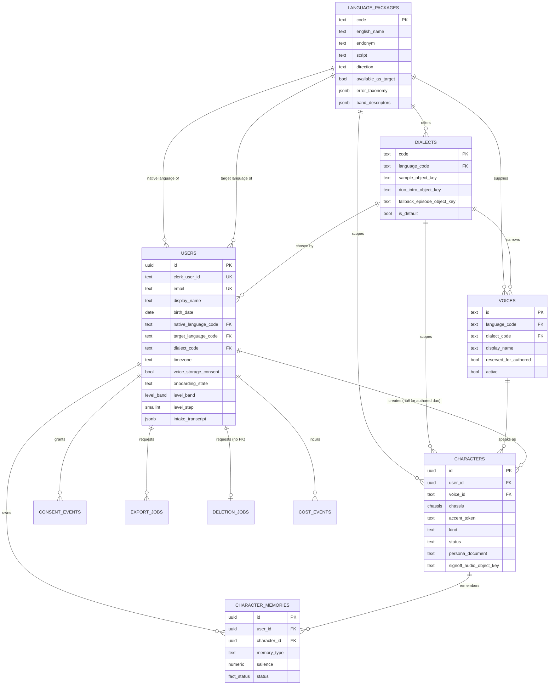
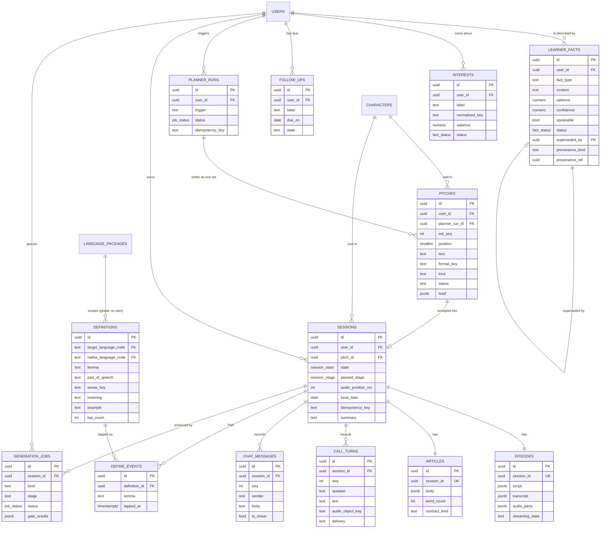
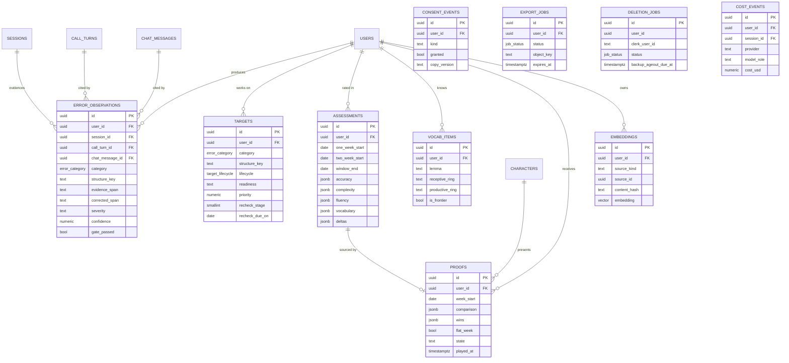
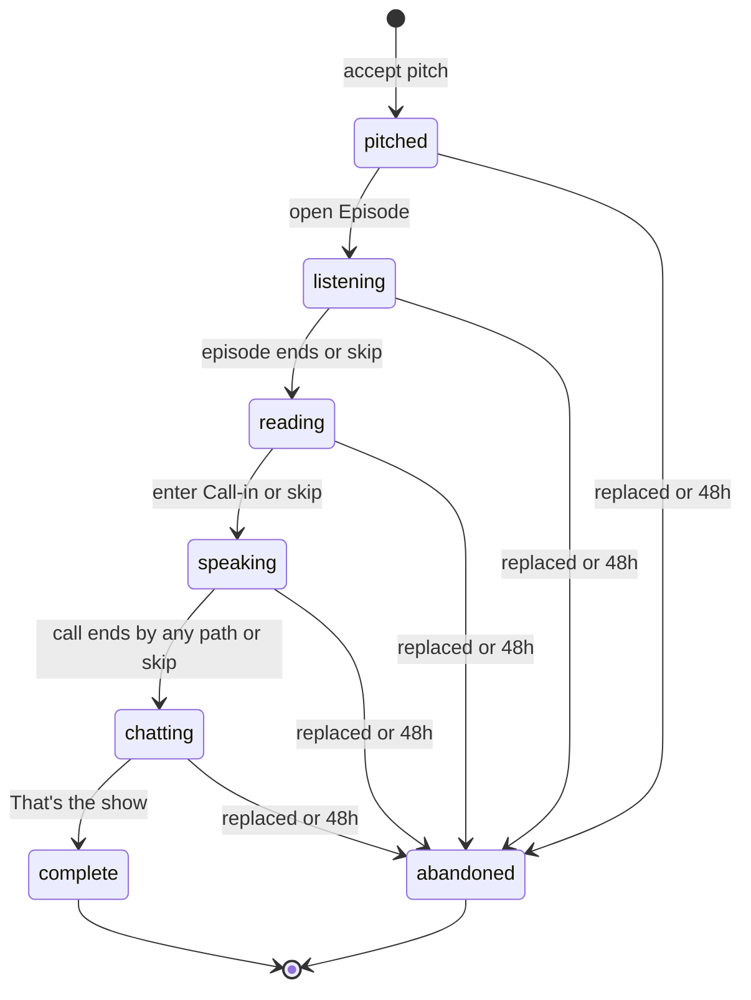
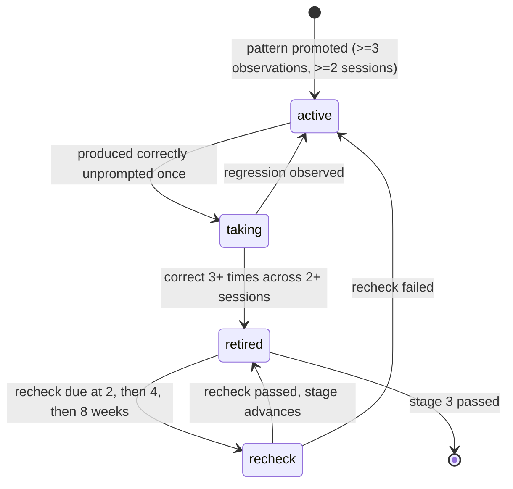
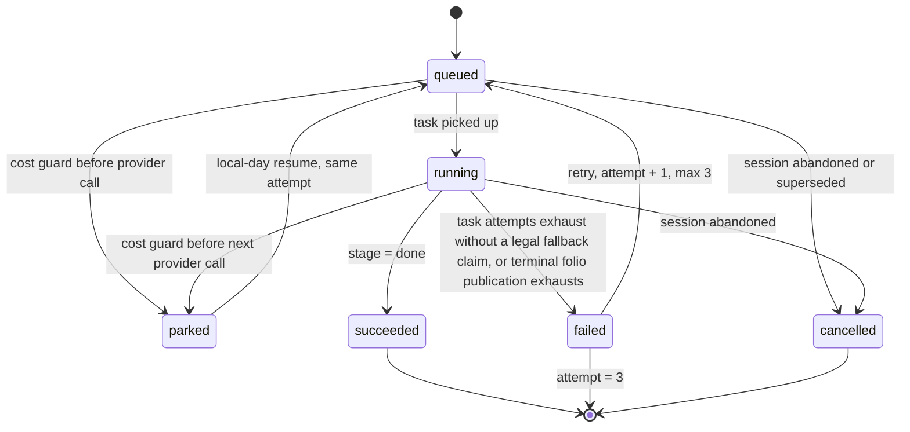
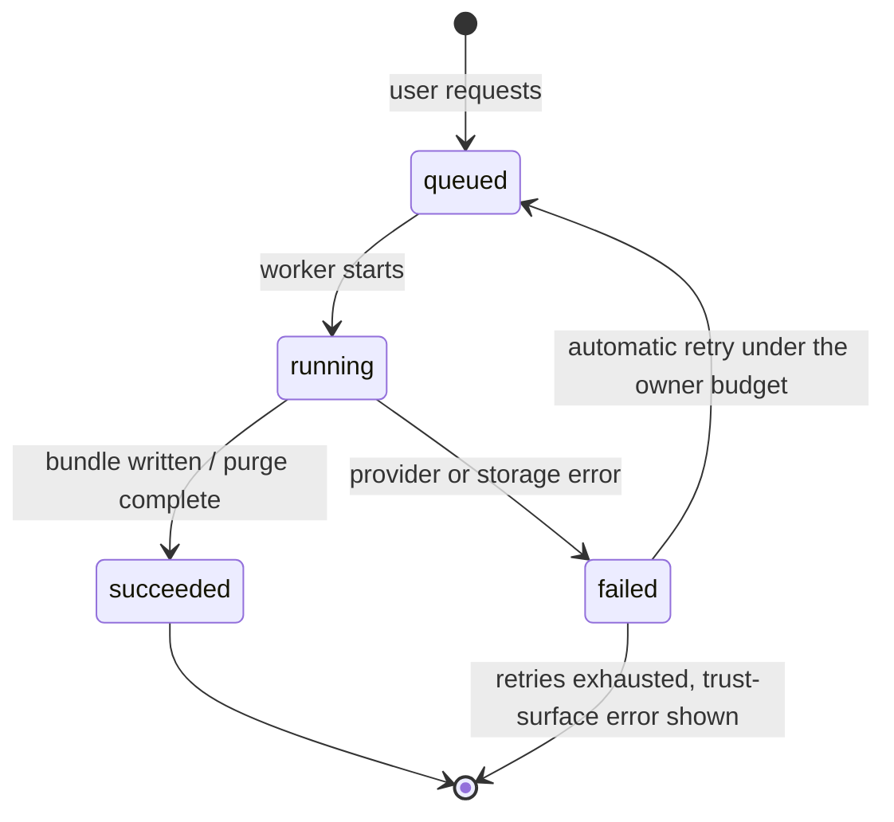

# 06 — Data & API Specification

**Status: NORMATIVE for schema, ERD, endpoints, error codes, and seed data. Subordinate to `00-decisions.md`; where this document and 00 disagree, 00 wins and this document has a defect.**

**Owner of:** every column (type, nullability, default, constraint), every relationship and its delete behavior, every index, every RLS policy, the endpoint catalog, the closed error-code catalog, storage layout, vector strategy, seed data, migration mechanics.

**Not owner of:** architecture, module wiring, job orchestration (`05-tdd`); prompt text, model routing, context-assembly logic (`07-ai-spec`); requirement statements FR/NFR (`04-srs`); screens, states, and user-facing copy (`02-ux-spec`); tokens and components (`03-design-system`). This document cites those by ID and never restates their values.

Normative language is RFC 2119. Version 1.0, 2026-08-08.

---

## 1. Modeling principles applied

Five principles decide every structural question below. Where a table looks unusual, one of these five is the reason.

**1.1 Evidence and interpretation are separate rows, and interpretation is disposable.**
What the learner actually did is recorded verbatim and never rewritten: `call_turns`, `chat_messages`, `define_events`, `error_observations.evidence_span`, `consent_events`, `cost_events`. What the system *believes* about the learner is a separate row carrying `confidence` and provenance: `learner_facts`, `targets.readiness`, `assessments`, `vocab_items`, `character_memories`. Every interpretation row MUST be reconstructible from evidence rows alone. This is what makes a bad model release recoverable: interpretations are truncated and rebuilt, evidence is never touched. It is also what makes 00 §5's rule "model output is evidence, never truth" enforceable — an interpretation write that fails its deterministic gate is simply not inserted, and the evidence that produced it remains.

**1.2 Happened-things are append-only; is-things mutate.**
Append-only tables MUST have `UPDATE` and `DELETE` revoked from the runtime database role rather than relying on discipline (§7.3). Append-only: `call_turns`, `chat_messages`, `define_events`, `error_observations`, `consent_events`, `cost_events`, `character_memories` (insert + salience column only). Mutable: `users`, `characters`, `learner_facts`, `interests`, `follow_ups`, `sessions`, `targets`, `vocab_items`, and every `*_jobs` table. Two narrow table-level exceptions exist and are granted by column: `call_turns(audio_object_key, audio_purged_at, source_upload_object_key, text, word_count, stt_confidence, transcription_state)` for consent purge, temporary voice-note cleanup, and the single pending-to-final transcription fill; and `chat_messages(answered_in_session_id)` for the next-session callback link. The voice-note trigger rejects any second text/transcription change after finalization.

**1.3 Authoritative versus derived is declared, not inferred.**
Every derived structure names its regeneration source. Dropping and rebuilding a derived structure MUST NOT lose user-visible history.

| Derived structure | Regenerated from | Regeneration trigger |
|---|---|---|
| `embeddings` (all rows, including the mirrored `salience` and `last_touched_at`) | `learner_facts.content`, `sessions.summary`, `character_memories.content`, `interests.label` | Content hash change, embedding-model change, source salience change |
| `assessments` | `error_observations` + `call_turns` + `chat_messages` inside the window | Weekly job; manual replay of a window |
| `definitions` | The lexicon of one language pair — regenerable for any row from `lemma` + `pos` + `sense_key` alone | Cache miss at generation time; lexicon model or prompt-version change |
| `vocab_items` | `define_events` + `call_turns` + `chat_messages` + `episodes`/`articles` exposure | Full rebuild per user; incremental post-session |
| `targets.readiness`, `targets.priority`, `targets.frequency_score`, `targets.recency_score` | `error_observations` | Post-session extraction |
| `users.voice_storage_consent` | Latest `consent_events` row of kind `voice_storage` | Every consent write |
| `users.level_band`, `users.level_step`, `users.level_confidence` | Latest `assessments` row plus session-1–5 calibration evidence | Post-session extraction |
| `pitches` (a whole set) | `planner_runs` inputs (interests, follow-ups, targets, world check) | Every planner run; sets replace, never patch |
| `sessions.summary` | `episodes.script` + `call_turns` + `chat_messages` | Post-session pass |
| `proofs` | `assessments` + `call_turns` + `learner_facts` inside completed assessment week W | Weekly job; retry only before ADR-0023's W+1 delivery expiry |

Everything not in that table is authoritative and MUST survive any model, prompt, or pipeline change.

**1.4 Soft dormancy is not deletion, and the schema keeps them distinguishable.**
Three different withdrawals exist and MUST NOT be conflated. **Dormancy** (`learner_facts.status = 'dormant'`, `interests.status = 'dormant'`) means the row stays and stops being readable by content generation; it is what "Stop using this in the show" performs. **Supersession** (`status = 'superseded'` plus `superseded_by`) means the user corrected a fact; the old row stays as evidence of what the system used to believe. **Deletion** removes rows and objects and happens in exactly two flows: voice-consent revocation (call audio objects and `call_turns.audio_object_key` only) and account deletion (everything). No other code path deletes user rows. Generation context queries MUST filter on `status = 'active'`; the knowledge summary shows dormant rows in a distinct group so the user can undo a dormancy they regret.

**1.5 One writer per table.**
Each table names exactly one owning module from 00 §4. Other modules read freely inside the RLS boundary and mutate only through the owning module's public `index.ts`. This is why `users` is written only by `identity` even though `trust` changes consent and `assessment` changes the level estimate: both call `identity.applyConsent()` and `identity.applyLevelEstimate()`. The owning module is listed for every table in §8.

---

## 2. Conventions that apply to every table

**2.1 Primary keys.** Every table except the seed catalog uses `id uuid PRIMARY KEY`, holding a **UUIDv7** generated in the application by a single shared helper. UUIDv7 is time-ordered, so B-tree inserts stay at the right edge of the index and page splits stay rare — the append-heavy tables (`call_turns`, `define_events`, `cost_events`) are the ones that benefit most. Application generation (not `gen_random_uuid()` as a column default) is REQUIRED because Trigger.dev tasks and the LiveKit agent MUST know the row id before the insert commits, so they can attach storage object keys and idempotency keys without a round trip.

Seed catalog tables use stable text primary keys instead, because they are referenced by seeded content and MUST be identical across `local`, `preview`, and `production`: `language_packages.code` (ISO 639-1 where one exists), `dialects.code` (BCP-47), `voices.id` (the ElevenLabs voice identifier).

**2.2 Timestamps.** All instants are `timestamptz` and stored in UTC. `created_at timestamptz NOT NULL DEFAULT now()` on every table. `updated_at timestamptz NOT NULL DEFAULT now()` on every mutable table, maintained by one shared `BEFORE UPDATE` trigger `touch_updated_at()`. Calendar dates that belong to the user's local timezone (`sessions.local_date`, `follow_ups.due_on`, `assessments.one_week_start`, `assessments.two_week_start`, `assessments.window_end`, `proofs.week_start`) are `date` and are computed by the server from `users.timezone` and the database transaction instant, never accepted from a client clock or client date. An unreadable zone uses UTC for that evaluation and records the FR-705 fallback.

**2.3 Denormalized `user_id`.** Every user-owned table carries `user_id uuid NOT NULL REFERENCES users(id) ON DELETE CASCADE`, including child tables that can reach the user through a parent (`episodes`, `articles`, `call_turns`). The global `definitions` cache is the explicit non-user-owned exception in §5.16. This is deliberate: it makes every user-owned RLS policy a single-column predicate with no join, it makes account deletion a set of independent per-table deletes, and it removes joins from the hot read paths. The cost is one redundant column, enforced consistent by the fact that the owning module writes parent and child in the same transaction.

**2.4 Text bounds and grapheme-semantic caps.** Ordinary storage/cost bounds use `CHECK (char_length(col) <= n)`. They are not a substitute for the two product-semantic limits owned by FR-003/FR-101: display names are 1–60 Unicode extended grapheme clusters and pitch/title text is 1–140 after Unicode whitespace trim. Those fields use the exact grapheme mechanism below, not `char_length`, JavaScript `.length`, or Zod `.min/.max`.

The shared validator is pinned to Unicode 15.1 extended grapheme breaking (UAX #29, GB1–GB999). It applies ECMAScript `TrimString`'s Unicode WhiteSpace set, rejects any remaining General_Category `Cc` code point, segments the trimmed original scalar sequence with the vendored Unicode-15.1 Grapheme_Cluster_Break and Extended_Pictographic tables, and counts the resulting clusters. It MUST NOT normalize the value. The server exposes this as `graphemeText({ min, max })`, a Zod `superRefine` plus transform that returns the trimmed original bytes unchanged; a decomposed sequence stays decomposed. EP-05 uses `(1,60)`; every planner, onboarding, remix-derived, fallback, package-seed, and AI pitch/title writer uses `(1,140)`; the format-label seed/build validator uses `(1,28)`. Validation failure is the owning endpoint's `VALIDATION_FAILED` or the owning AI gate's regeneration/fallback, never truncation.

Database bypass is covered by `app.grapheme_count_15_1(text)`, an `IMMUTABLE STRICT` PL/pgSQL function generated at migration-build time from the same vendored Unicode property tables and conformance vectors as the server function. `enforce_semantic_text_caps()` is a `BEFORE INSERT OR UPDATE` trigger on `users.display_name`, `pitches.text`, every copied title column (`sessions.title`, `episodes.title`, `articles.title`, `proofs.title`), and `dialects.fallback_episode_title`; it rejects a value that differs byte-for-byte from its TrimString result or whose count on those unchanged trimmed bytes is outside its field range. It never normalizes. The migration and server suites MUST both pass every line of the vendored Unicode `GraphemeBreakTest-15.1.0.txt`, plus identical emoji-ZWJ, combining-mark (including decomposed-byte preservation), RTL, and boundary fixtures, before deployment. Thus a route, task, agent, SQL console, or service-role writer reaches the same algorithm. Other per-column `char_length` checks remain independent denial-of-service bounds.

**2.5 Numeric conventions.** Scores in the range 0–1 (`salience`, `confidence`) are `numeric(4,3)`. Money is `numeric(12,6)` in USD, never floating point. Durations are integer milliseconds (`*_ms`); byte counts are `bigint`.

**2.6 Delete behavior.** The default is `ON DELETE CASCADE` from `users`, matching the account-deletion job semantics in §8.3: deleting the `users` row purges every user-owned row in one transaction. Three deliberate exceptions exist and are called out at their tables: `ON DELETE SET NULL` on optional back-references that must survive their target (`pitches.accepted_session_id`, `follow_ups.used_in_session_id`, `chat_messages.answered_in_session_id`, `learner_facts.superseded_by`, `*.generation_job_id`, `proofs.assessment_id`, `define_events.definition_id`, `planner_runs.trigger_session_id`, `planner_runs.predicted_pick_pitch_id`); `ON DELETE RESTRICT` on seed-catalog references (`users.native_language_code`, `dialects.language_code`, `voices.language_code`), because deleting a seeded language while users hold it is a data-loss bug and MUST fail loudly; and **no foreign key at all** on `deletion_jobs.user_id`, because a deletion receipt MUST outlive its subject (§8.3).

Character foreign keys (`pitches.cast_*`, `sessions.cast_*`, `call_turns.character_id`, `chat_messages.character_id`, `character_memories.character_id`, `proofs.cast_*`) use `ON DELETE CASCADE`. Characters are never deleted by any product flow — retirement is a status change — so this cascade fires only during account deletion, where the referencing rows are being deleted anyway. `RESTRICT` here would deadlock the account purge against its own cascade order.

**2.7 Cast columns, not cast arrays.** Cast is one host or a pair (FR-316). Everywhere cast appears it is stored as two columns — `cast_primary_character_id uuid NOT NULL` and `cast_secondary_character_id uuid NULL` — with `CHECK (cast_secondary_character_id IS NULL OR cast_secondary_character_id <> cast_primary_character_id)`. A `uuid[]` would carry no referential integrity; two columns carry full integrity and index cleanly. Adding a third host requires an ADR, which is correct.

**2.8 JSONB is used for frozen documents, never for queried state.** `sessions.brief`, `episodes.script`, `episodes.transcript`, `articles.body`, `assessments.accuracy`, `generation_jobs.gate_results`, `language_packages.error_taxonomy` are JSONB because they are read whole and never filtered on inside the database. Anything the application filters, sorts, or counts on is a real column. No JSONB column in this schema is indexed with GIN, because no query needs it.

**2.9 Extensions.** `vector` (pgvector) is the only extension this schema requires beyond the Supabase defaults. Full-text search extensions are deliberately absent: the design authority decided V1 has no archive search, so a search index would be speculative.

---

## 3. Entity-relationship diagrams

The census is 29 tables. One diagram is unreadable at that size, so it is split into three by domain. Every relationship appears exactly once.

### 3.1 Identity, catalog, and cast



### 3.2 Learner file, planning, and the session folio



### 3.3 Assessment, proof, and trust



---

## 4. Enumerated types

Two mechanisms are in use. **Native Postgres enums** hold value sets that a product law in 00 or a requirement in 04 fixes, where adding a value is a product decision that deserves a migration. **`text` + `CHECK`** holds value sets where operational churn is expected, because `ALTER TYPE … ADD VALUE` cannot be reversed and cannot run inside a transaction with other DDL, while a `CHECK` constraint can be swapped with `ADD CONSTRAINT … NOT VALID` followed by `VALIDATE CONSTRAINT` without a long lock. Each choice is justified below and MUST NOT be changed without an ADR.

### 4.1 Native Postgres enums

| Type | Values (exact) | Why native |
|---|---|---|
| `session_state` | `pitched`, `listening`, `reading`, `speaking`, `chatting`, `complete`, `abandoned` | Fixed by FR-200; a new state changes the product's central state machine |
| `session_stage` | `listening`, `reading`, `speaking`, `chatting` | The four stages are the product (00 §1 session vocabulary) |
| `target_lifecycle` | `active`, `taking`, `retired`, `recheck` | Fixed by FR-441 |
| `fact_status` | `active`, `dormant`, `superseded` | Structural, three values, principle §1.4 depends on it |
| `chassis` | `debater`, `storyteller`, `gentle_skeptic`, `comedian`, `professional`, `hype_man` | Exactly six, fixed by FR-307 |
| `error_category` | `verb_tense_aspect`, `subject_verb_agreement`, `articles`, `prepositions`, `word_order`, `word_choice`, `plurals`, `pronouns`, `comparatives`, `conditionals`, `question_formation`, `register` | Exactly twelve, fixed by FR-422; FR-632 requires the localized set in every language package and FR-633 keeps adding one a configuration change rather than a code change |
| `job_status` | `queued`, `running`, `parked`, `succeeded`, `failed`, `cancelled` | Operational and stable across all five job tables. `parked` is legal only on `generation_jobs` while the daily cost guard defers a durable job without consuming an attempt; the shared trigger rejects it on every other table |
| `level_band` | `A1`, `A2`, `B1`, `B2`, `C1`, `C2` | The CEFR band set does not change |

`app.level_band_index(level_band)` is an `IMMUTABLE STRICT` SQL function with the closed mapping `A1→0, A2→1, B1→2, B2→3, C1→4, C2→5`. Schema checks use it when a band/step pair must be compared as one ordered coordinate; application code uses the byte-identical mapping in 07 §7.10.

### 4.2 `text` + `CHECK` constrained sets

| Column(s) | Allowed values | Why not native |
|---|---|---|
| `users.onboarding_state` | `account`, `intake`, `handoff`, `complete` | Onboarding steps are the most likely part of the product to gain a stage |
| `users.level_confidence` | `calibrating`, `normal` | Calibration policy is expected to gain granularity |
| `learner_facts.fact_type` | `goal`, `register_situation`, `person`, `situation`, `past_attempt`, `place`, `occupation`, `stated_preference` | Intake evolution adds fact types without a product-law change |
| `learner_facts.provenance_kind` | `intake_turn`, `call_turn`, `chat_message`, `user_correction`, `planner_inference` | New evidence sources appear as surfaces are added |
| `characters.kind` | `authored_duo`, `created` | Authored content forms may grow |
| `characters.status` | `active`, `retired` | Paired with `kind` churn |
| `characters.accent_token`, `voices` accent references | `ochre`, `teal`, `plum`, `slate_blue`, `rust`, `olive` | The palette is owned by 03-design-system and may be extended there |
| `character_memories.memory_type` | `running_joke`, `position_taken`, `relational_beat`, `nickname`, `callback_promise` | Relationship memory taxonomy is the most experimental part of the model |
| `pitches.format_key`, `sessions.format_key` | `debate`, `story_time`, `news_rundown`, `interview`, `explain_it_to_me`, `roast`, `custom` | The starter format library is seed content that grows (§15.4) |
| `pitches.origin` | `planner`, `remix`, `scratch`, `onboarding` | Entry points may grow |
| `pitches.kind` | `standard`, `wildcard`, `personal` | Planner composition rules evolve |
| `pitches.status` | `active`, `accepted`, `superseded` | Paired with planner evolution |
| `follow_ups.state` | `pending`, `due`, `used`, `expired` | Follow-up handling is expected to gain states |
| `episodes.streaming_state` | `pending`, `opening_ready`, `complete`, `failed` | Streaming strategy may gain intermediate states |
| `articles.contract_kind` | `counterargument`, `missed_fact`, `side_change` | Content contract may gain an element |
| `call_turns.speaker`, `chat_messages.sender` | `host`, `user` | Trivial; a native enum is not worth a type |
| `call_turns.delivery` | `live`, `voice_note` | Fallback modes may grow |
| `define_events.surface` | `transcript`, `article` | A third readable surface is plausible |
| `learner_facts.confidence_level`, `character_memories.confidence_level` | `high`, `medium`, `low` | Confidence granularity is under active iteration and MUST be cheap to change (§5.7) |
| `definitions.part_of_speech` | `noun`, `verb`, `adjective`, `adverb`, `pronoun`, `preposition`, `conjunction`, `determiner`, `numeral`, `particle`, `interjection`, `other` | Part-of-speech sets differ per language family and will be extended |
| `targets.readiness` | `never_attempted`, `attempted_imperfect`, `ready` | Readiness policy is under active pedagogical iteration |
| `error_observations.source` | `call_turn`, `chat_message` | New evidence sources |
| `error_observations.severity` | `slip`, `error` | Severity granularity may grow |
| `vocab_items.receptive_ring`, `vocab_items.productive_ring` | `unseen`, `emerging`, `confident` | Ring granularity is pedagogically tunable |
| `proofs.state` | `generating`, `ready`, `failed`, `omitted` | Distinct from `job_status` because `omitted` is a product outcome, not a job outcome |
| `proofs.comparison_kind` | `audio`, `text` | Consent-driven; a third comparison form is plausible |
| `generation_jobs.kind` | `intake_turn`, `intake_level_estimate`, `onboarding_pitch`, `episode`, `pitch_pregeneration`, `proof`, `character_intro` | New user-scoped generated artifacts are expected; `JOB-build-language-package` has its own non-user package workflow |
| `generation_jobs.stage` | `intake_response`, `level_estimate`, `onboarding_pitch`, `brief`, `script`, `article`, `call_brief`, `chat_opener`, `definitions`, `audio`, `qa_gate`, `fallback_folio`, `done` | Intake and onboarding have bounded two-stage paths; episode generation uses the FR-410 pipeline plus one terminal authored-folio takeover stage |
| `generation_jobs.execution_mode` | `primary`, `generated_fallback`, `authored_fallback` | One generated FR-417 fallback is a full pipeline mode before the terminal reviewed folio |
| `planner_runs.trigger` | `post_session`, `staleness`, `follow_up` | Exactly the three steady-state replacement triggers in ADR-0009; onboarding is a separate one-pitch initialization workflow and never writes this column |
| `planner_runs.world_check_status` | `ok`, `failed`, `skipped` | Trivial |
| `consent_events.kind` | `voice_storage`, `age_attestation`, `ai_disclosure`, `terms` | New consent kinds arrive with new regulation; this MUST be cheap to extend |
| `consent_events.surface` | `intake`, `trust_sheet`, `account` | Surfaces grow |
| `cost_events.provider` | `openrouter`, `openai`, `elevenlabs`, `exa`, `livekit`, `supabase` | The provider list changes with the stack |
| `cost_events.unit` | `tokens`, `characters`, `seconds`, `requests` | Provider metering units differ |
| `cost_events.outcome` | `success`, `validation_failed`, `fallback`, `error` | Paired with 07's fallback taxonomy |
| `embeddings.source_kind` | `learner_fact`, `session_summary`, `character_memory`, `interest` | New embeddable sources are the expected growth path |
| `language_packages.script` | `Latn`, `Cyrl`, `Grek`, `Arab`, `Deva`, `Hans`, `Hant`, `Jpan`, `Kore`, `Taml` | ISO 15924 subset; grows with the language catalog |
| `language_packages.direction` | `ltr`, `rtl` | Two values, but paired with `script` churn |
---

## 5. Schema, table by table

The census in 00 §5 is 29 tables and this section defines exactly those 29, in census order. Zero additions. Each table states its purpose, its owning module (§1.5), its class, every column, every constraint, every index with the named query that justifies it, and its RLS policy. Indexes not tied to a named query do not exist in this schema.

Notation in the column tables: **N** = nullable (`Y` means the column accepts NULL). Types are Postgres types.

---

### 5.1 `users`

**Purpose:** one row per account, holding identity, language selections, the intake transcript, and the current derived learner-level estimate. **Writer:** `identity`. **Class:** authoritative, mutable.

| Column | Type | N | Default | Constraints |
|---|---|---|---|---|
| `id` | `uuid` | — | app UUIDv7 | PK |
| `clerk_user_id` | `text` | — | — | UNIQUE; `char_length <= 64` |
| `email` | `text` | — | — | `char_length <= 320`; unique on `lower(email)` |
| `email_verified_at` | `timestamptz` | Y | `NULL` | — |
| `display_name` | `text` | Y | `NULL` | When present, exact `app.grapheme_count_15_1(display_name) BETWEEN 1 AND 60` and byte-preserving trim trigger under §2.4 (FR-003); provisional identity-sync rows remain null until EP-05 |
| `name_pronunciation_note` | `text` | Y | `NULL` | `char_length <= 200` |
| `birth_date` | `date` | Y | `NULL` | When present, `BETWEEN DATE '1900-01-01' AND DATE '2100-01-01'` |
| `native_language_code` | `text` | Y | `NULL` | FK → `language_packages(code)` ON DELETE RESTRICT |
| `target_language_code` | `text` | Y | `NULL` | FK → `language_packages(code)` ON DELETE RESTRICT; when both present, `<> native_language_code` |
| `dialect_code` | `text` | Y | `NULL` | FK → `dialects(code)` ON DELETE RESTRICT |
| `timezone` | `text` | — | `'UTC'` | `char_length <= 64`; IANA zone validated at write |
| `voice_storage_consent` | `boolean` | — | `false` | Derived from `consent_events` (§1.3) |
| `onboarding_state` | `text` | — | `'account'` | `IN ('account','intake','handoff','complete')` |
| `intake_transcript` | `jsonb` | — | `'[]'::jsonb` | Ordered intake events; `jsonb_array_length <= 54` |
| `intake_turn_seq` | `integer` | — | `0` | `BETWEEN 0 AND 54`; last committed event sequence |
| `intake_pending_parent_event_id` | `uuid` | Y | `NULL` | Producer event whose concurrent user-reply batch awaits exactly one producer answer |
| `intake_reply_batch_closes_at` | `timestamptz` | Y | `NULL` | Server acceptance instant plus 500 ms; the fixed coalescing boundary |
| `intake_response_job_id` | `uuid` | Y | `NULL` | FK → `generation_jobs(id)` ON DELETE SET NULL, added after both tables exist |
| `intake_completed_at` | `timestamptz` | Y | `NULL` | — |
| `intake_completion_idempotency_key` | `text` | Y | `NULL` | `char_length <= 128`; durable backstop for the sole completion |
| `onboarding_fallback_authorization_id` | `uuid` | Y | `NULL` | Durable identity for the terminal automatic variant-3 path; the EP-57 idempotency UUID or failing onboarding-pitch job id |
| `onboarding_fallback_authorization_source` | `text` | Y | `NULL` | `IN ('second_rejection','generation_failure')` |
| `onboarding_fallback_authorized_at` | `timestamptz` | Y | `NULL` | Server commit instant; once set, the tuple is immutable |
| `onboarding_first_episode_deadline_run_id` | `text` | Y | `NULL` | `char_length <= 128`; acknowledgement for the automatic pre-session dispatcher at authorization +135 seconds |
| `sparse_fields` | `text[]` | — | `'{}'` | `cardinality <= 8` |
| `level_band` | `level_band` | Y | `NULL` | — |
| `level_step` | `smallint` | Y | `NULL` | `BETWEEN 1 AND 3` |
| `level_confidence` | `text` | — | `'calibrating'` | `IN ('calibrating','normal')` |
| `level_offset_applied` | `boolean` | — | `false` | True only while a confidence-conditional intake offset remains |
| `level_unshifted_band` | `level_band` | Y | `NULL` | Validated intake coordinate before the confidence offset |
| `level_unshifted_step` | `smallint` | Y | `NULL` | `BETWEEN 1 AND 3`; paired with `level_unshifted_band` |
| `level_offset_remaining_steps` | `smallint` | — | `0` | `BETWEEN 0 AND 3`; ordinal distance to the unshifted coordinate |
| `level_offset_last_applied_session_id` | `uuid` | Y | `NULL` | FK → `sessions(id)` ON DELETE SET NULL, added after both tables exist; idempotency guard for post-session removal |
| `level_last_applied_assessment_id` | `uuid` | Y | `NULL` | FK → `assessments(id)` ON DELETE SET NULL, added after both tables exist; latest post-calibration movement source |
| `level_last_applied_assessment_revision` | `integer` | Y | `NULL` | `> 0`; exact revision paired with `level_last_applied_assessment_id` |
| `energy_modifier` | `smallint` | — | `0` | `BETWEEN -1 AND 1` (FR-434) |
| `proof_weekday` | `smallint` | — | `5` | `BETWEEN 0 AND 6`; ISO weekday normalized to Monday=0, so Saturday=5 is FR-507's no-history default |
| `last_seen_at` | `timestamptz` | Y | `NULL` | — |
| `deleted_at` | `timestamptz` | Y | `NULL` | Set when a deletion job starts; blocks all API access |
| `created_at` | `timestamptz` | — | `now()` | — |
| `updated_at` | `timestamptz` | — | `now()` | `touch_updated_at()` |

**Tuple constraints:** `CHECK ((intake_completed_at IS NULL) = (intake_completion_idempotency_key IS NULL))`; `CHECK ((intake_pending_parent_event_id IS NULL) = (intake_reply_batch_closes_at IS NULL))`; `CHECK ((onboarding_fallback_authorization_id IS NULL) = (onboarding_fallback_authorization_source IS NULL) AND (onboarding_fallback_authorization_id IS NULL) = (onboarding_fallback_authorized_at IS NULL))`; `CHECK (onboarding_first_episode_deadline_run_id IS NULL OR onboarding_fallback_authorization_id IS NOT NULL)`; `CHECK ((level_unshifted_band IS NULL) = (level_unshifted_step IS NULL))`; `CHECK (level_offset_applied = (level_offset_remaining_steps > 0))`; `CHECK (level_unshifted_band IS NOT NULL OR level_offset_remaining_steps = 0)`; `CHECK ((level_last_applied_assessment_id IS NULL) = (level_last_applied_assessment_revision IS NULL))`; `CHECK (onboarding_state = 'account' OR (display_name IS NOT NULL AND birth_date IS NOT NULL AND native_language_code IS NOT NULL AND target_language_code IS NOT NULL))`.

**Provisional identity and age enforcement.** `JOB-identity-sync` and EP-05 share the identity repository's one `INSERT ... ON CONFLICT (clerk_user_id) DO UPDATE` operation. Identity sync may create only `id`, `clerk_user_id`, `email`, verification state, and `onboarding_state = 'account'`; it MUST NOT invent placeholder profile values. EP-05 fills the nullable profile tuple without overwriting a tuple already completed by a replay. When no product row exists, EP-05 runs in the `verified_clerk_subject` auth mode: middleware has verified the Clerk JWT signature, issuer, audience, expiry, and non-empty `sub`, resolves the primary email from Clerk rather than the request body, and sets transaction-local `app.current_clerk_subject`. The route may invoke only `identity.upsertProvisionalFromVerifiedSubject(subject,email)`. That repository operation is the sole caller of `app.upsert_provisional_user(text,text)`, a `SECURITY DEFINER` function owned by the migration role with `SET search_path = pg_catalog, public`; the function requires its subject argument to equal `current_setting('app.current_clerk_subject',true)`, inserts/updates only the five provisional columns named above, and returns the product UUID. `app_user` has `EXECUTE` on that function but no direct `INSERT` privilege on `users`; after the UUID returns, middleware sets `app.current_user_id` and all remaining work uses ordinary owner-scoped repositories. A body-supplied subject/email, an unverified claim, or any other repository call is rejected as `UNAUTHENTICATED` before SQL.

The 18+ rule is NOT a `CHECK` constraint, because an age test against the current date is not immutable and Postgres rejects it. EP-05 first rejects a date later than the current date or earlier than the current date minus 120 calendar years as `VALIDATION_FAILED` 400, before applying any under-age behavior. It then computes age before retaining the submitted tuple. For a valid but under-age submission, one transaction upserts `deletion_jobs(source='underage_rejection', status='queued')` using the deterministic key `underage:{HMAC-SHA256(clerkUserId)}`, deletes the provisional `users` row, and commits no birth date, consent event, or profile tuple. Only after commit does it enqueue `JOB-delete-account`; the Redis `age-reject:*` value is a 15-minute response cache, never the recovery authority. The job requests Clerk deletion, confirms absence with a provider read returning not-found, records `auth_provider_completed_at` and `status='succeeded'`, and retries through Q-JOB-LIVENESS after any crash. Until that confirmed absence, auth middleware and `JOB-identity-sync` query the inflight receipt by Clerk subject and MUST NOT recreate or expose a product row; after confirmation, a delayed webhook for that deleted subject is acknowledged without an upsert. EP-05 replay returns `UNDER_AGE` 422 while the receipt is queued/running and after its succeeded receipt proves the same deleted subject. No `consent_events` row is retained. For an eligible submission, the profile tuple, `age_attestation`, and the initial `generation_jobs(kind='intake_turn',stage='intake_response',status='queued',idempotency_key='intake-turn-{userId}-initial')` row commit together, and `users.intake_response_job_id` points to it. EP-05 enqueues `JOB-intake-turn` only after commit; a matching replay and Q-JOB-LIVENESS re-enqueue that same durable key after a commit/enqueue crash.

**Intake event and completion contract.** Every `intake_transcript` element is exactly `{ id: uuid, seq: integer, role: 'producer'|'user', text: string|null, audioObjectKey: string|null, audioUpload: { uploadId: uuid, contentType: 'audio/webm'|'audio/mp4'|'audio/ogg', sizeBytes: integer, sha256: lowercaseSha256, durationMs: integer }|null, clientReplyId: uuid|null, parentProducerEventId: uuid|null, answeredUserEventIds: uuid[], status: 'accepted'|'answered', createdAt: RFC3339 }`; `seq` starts at 1 and is contiguous. `audioUpload` is non-null exactly for a voice user event and remains after its transient object is deleted; `audioObjectKey` is nulled by the one-hour purge. These fields plus the path derived from `clientReplyId` are the durable canonical voice-request hash; text events hash their stored text. The capacity is derived, not guessed: at most 18 producer events and at most two accepted user replies for each producer parent require `18 + (18 × 2) = 54` event slots. The route rejects a reply that would exceed either per-parent two or total 54 with `CONFLICT`; the producer never appends a nineteenth producer event. A user event has a non-null `clientReplyId`, names the latest answered producer event as its parent, and starts `accepted`; a producer event has `clientReplyId = null`, carries the ordered IDs of every user event it answers, and is `answered`. EP-07 locks `users`, replays an existing matching `clientReplyId`, and otherwise appends the user event. The first reply for a parent opens a 500 ms server-time batch and creates one durable `generation_jobs(kind='intake_turn')` record; later replies to that same parent accepted before the boundary join the batch and never create another job. The worker claims the batch after the boundary, reads all accepted child events in `seq` order, produces exactly one answer outside the request handler, appends one producer event, marks those child events answered, clears the pending columns, and touches progress in one transaction. A reply after the parent is answered returns `CONFLICT`; a worker replay finds the appended producer event and performs no second answer. The unique client identifier, parent identity, upload receipt, and job row — never arrival order alone or an optional cache key — are the durable authorities. EP-11 similarly sets `intake_completed_at` and `intake_completion_idempotency_key` once; duplicate delivery returns that completion and cannot enqueue a second estimate. Intake completion and variants 1–2 do not create a session. A terminal variant-3 authorization invokes EP-16's canonical session-creation transaction internally after its pitch-owned artifacts are ready or its pre-generation reaches terminal failure; that transaction remains the sole session/onboarding-completion writer and requires no client acceptance request (FR-014, FR-026).

**Level-movement persistence.** A sufficient intake estimate stores its validated coordinate in `level_unshifted_*`, stores the confidence-conditional working coordinate in `level_band` / `level_step`, and sets `level_offset_remaining_steps` to their ordinal distance. `level_offset_applied` is exactly `level_offset_remaining_steps > 0`; an A1/1 clamp that produces no movement therefore records false. An insufficient estimate leaves `level_unshifted_*` null and records no offset. During sessions 1–5, the post-session writer removes at most one remaining ordinal step per successfully applied pass, records that session id before commit, and never advances above the retained unshifted coordinate; replay with the same session id is a no-op. Reaching zero clears `level_offset_applied`.

After calibration, the writer locks `users`, selects only the current assessment and its durable `revision`, and compare-and-sets the tuple `(level_last_applied_assessment_id, level_last_applied_assessment_revision)` to `(assessment.id, assessment.revision)` in the same update that moves `level_band` / `level_step` by zero or one ordinal under 07 §7.10. If the stored tuple already equals the candidate, the replay is a no-op. A revised current assessment may apply once at its new revision; an older assessment cannot become a candidate after a later window has been applied. Concurrent post-session writers lock and apply in session-completion order. All offset, assessment identity, revision, band, step, confidence, and energy columns are internal and MUST NOT be serialized by an API (FR-018, FR-436).

**Language change.** Changing `target_language_code` after `onboarding_state = 'complete'` is out of scope for v1 and MUST be rejected by the `identity` module. The column is not immutable at the database level because account deletion and package corrections need to write it.

**Indexes**

| Index | Definition | Named query |
|---|---|---|
| `users_pkey` | PK on `id` | Q-BOOTSTRAP, every RLS resolution |
| `uq_users_clerk` | UNIQUE `(clerk_user_id)` | Q-RESOLVE-CLAIM — resolves the JWT `sub` to `users.id` on every request |
| `uq_users_email_lower` | UNIQUE `(lower(email))` | Q-EMAIL-UNIQUE — Clerk webhook upsert |
| `idx_users_proof_weekday` | `(proof_weekday)` WHERE `deleted_at IS NULL AND onboarding_state = 'complete'` | Q-PROOF-CANDIDATES — weekly proof scan |

**RLS:** `ENABLE ROW LEVEL SECURITY`. Policy `users_owner` FOR ALL USING `(id = app.current_user_id())` WITH CHECK `(id = app.current_user_id())`.

---

### 5.2 `language_packages`

**Purpose:** one row per supported language; the content package root per ADR-0002, carrying the localized error taxonomy and band descriptors that 07 loads as configuration. **Writer:** `language-packages`; `JOB-build-language-package` authors and validates a version, and the reviewed generated migration atomically activates it. **Class:** authoritative seed.

| Column | Type | N | Default | Constraints |
|---|---|---|---|---|
| `code` | `text` | — | — | PK; `char_length BETWEEN 2 AND 3` |
| `english_name` | `text` | — | — | `char_length <= 60` |
| `endonym` | `text` | — | — | `char_length <= 60` |
| `script` | `text` | — | — | `IN` (§4.2 script set) |
| `direction` | `text` | — | `'ltr'` | `IN ('ltr','rtl')` |
| `tts_supported` | `boolean` | — | `true` | ElevenLabs `eleven_flash_v2_5` and `eleven_multilingual_v2` |
| `stt_supported` | `boolean` | — | `true` | ElevenLabs `scribe_v2` (ADR-0019) |
| `available_as_target` | `boolean` | — | `true` | — |
| `available_as_native` | `boolean` | — | `true` | — |
| `default_dialect_code` | `text` | Y | `NULL` | FK → `dialects(code)` DEFERRABLE INITIALLY DEFERRED |
| `error_taxonomy` | `jsonb` | — | `'{}'::jsonb` | Twelve keys, shape in §15.3 |
| `band_descriptors` | `jsonb` | — | `'{}'::jsonb` | Six band keys A1–C2 |
| `expected_structures` | `jsonb` | — | `'[]'::jsonb` | Closed reviewed structure catalog flattened from the eighteen band/step coordinates; exact shape below |
| `chassis_documents` | `jsonb` | — | `'{}'::jsonb` | Exactly the six `chassis` keys; reviewed documents from `PRM-package-generation@v1` |
| `starter_topics` | `jsonb` | — | `'[]'::jsonb` | Reviewed topic objects; `jsonb_array_length BETWEEN 8 AND 24` when available |
| `wildcard_topics` | `jsonb` | — | `'[]'::jsonb` | Reviewed topic objects; `jsonb_array_length BETWEEN 8 AND 24` when available |
| `tokenisation_rule` | `text` | Y | `NULL` | `char_length BETWEEN 80 AND 2000`; deterministic ADR-0010 fallback rule |
| `tokenisation_fixtures` | `jsonb` | — | `'[]'::jsonb` | Reviewed source/unit fixtures; 20–100 when available |
| `after_show_fallbacks` | `jsonb` | — | `'{}'::jsonb` | Exactly `opener`, `neutralContinuation`, `openerAfterSilentCall`, `openerAfterAbruptSignoff`, `closer`, with reviewed provenance in `review_record` |
| `fallback_folios` | `jsonb` | — | `'{}'::jsonb` | Dialect → native language → effective band (`A1`…`C2`) map of complete reviewed terminal folios; every leaf validates the band-parameterized `authoredFallbackFolioSchema` owned by 07 §4.20 |
| `review_record` | `jsonb` | Y | `NULL` | Native-speaker approval, section hashes, reviewer and approved-at provenance |
| `package_version` | `integer` | — | `1` | `> 0` |
| `created_at` / `updated_at` | `timestamptz` | — | `now()` | — |

**Constraint enforcing ADR-0002:** `CHECK (available_as_target = false OR (tts_supported AND stt_supported))`. A language MUST NOT be offered as a target unless both providers support it. The foreign key to `dialects` is deferrable because `language_packages` and `dialects` reference each other and are seeded in one transaction.

**Expected-structure catalog.** `expected_structures` validates as an array of `{ structureKey, category, firstExpectedBand, firstExpectedStep, receptiveForm }`. `structureKey` matches `^[a-z0-9][a-z0-9._:-]{0,79}$`; `category` is one of the twelve `error_category` values; `firstExpectedBand` is `A1|A2|B1|B2|C1|C2`; `firstExpectedStep` is `1|2|3`; and `receptiveForm` has `char_length BETWEEN 1 AND 240`. Keys are unique. Rows sort by `app.level_band_index(firstExpectedBand)`, `firstExpectedStep`, `category`, then `structureKey`, and stored array order MUST equal that order. The array is the byte-for-byte flattening of 07's reviewed `bands[].steps[].expectedStructures`: set equality on all five members is required at activation, so neither the prompt output nor this queryable package projection can omit, add, move, or rewrite a structure. The stable package-version identity used below is the UTF-8 string `{language_packages.code}@{language_packages.package_version}`.

`Q-EXPECTED-STRUCTURES(languageCode,packageVersion,effectiveBand,effectiveStep)` requires the one target-available package row whose code/version equals the first two arguments, computes coordinate ordinal `3 * app.level_band_index(band) + step - 1`, and returns exactly the stored members whose first-expected ordinal is at or below the requested effective ordinal. It preserves stored canonical order and returns `{ packageVersionId, expectedStructures }`, including an empty array. A missing/version-mismatched package, invalid effective coordinate, invalid JSON member, or stored-order mismatch fails closed; the caller receives no partial catalog and cannot substitute a different version.

**Package activation contract.** The `language-packages` writer validates these frozen JSON documents against the current `PRM-package-generation@v1` output schemas owned by 07; this document does not duplicate them. Before `available_as_target` may become true, all FR-632 sections, a non-null `review_record`, a non-empty valid `expected_structures` catalog, every required dialect artifact in §5.3, both authored hosts in §5.5, and one complete fallback-folio leaf for every `(language_packages.code, package_version, dialect, available native language, effective band A1…C2)` tuple MUST resolve at the same `package_version`. For each `(dialect,native)` map the leaf-key set MUST equal exactly `{A1,A2,B1,B2,C1,C2}`, and each leaf's internal `dialectCode`, `nativeLanguageCode`, and `levelBand` discriminator MUST byte-match its three map keys. Each leaf's article word count MUST satisfy FR-217 for its band key; adjacent band keys may reference byte-identical reviewed artifacts only when those bytes satisfy both bands. Each folio's referenced definitions are upserted into §5.16 during the reviewed migration and every transcript/article sense reference is checked against that exact leaf before activation. A package revision writes and approves a complete new version atomically; runtime code never patches one field from an unapproved draft into the live package.

**Indexes**

| Index | Definition | Named query |
|---|---|---|
| `language_packages_pkey` | PK on `code` | Every join from `users`, `voices`, `dialects` |
| `idx_lang_target` | `(english_name)` WHERE `available_as_target` | Q-LANG-TARGET-LIST — `GET /api/v1/languages` |
| `idx_lang_native` | `(english_name)` WHERE `available_as_native` | Q-LANG-NATIVE-LIST — the native-language picker |

**RLS:** enabled. Policy `language_packages_read` FOR SELECT USING `(true)`. No INSERT/UPDATE/DELETE policy exists; the runtime role holds no write grant. Catalog changes ship as migrations.

---

### 5.3 `dialects`

**Purpose:** the selectable variants per language, each with the 10–15 second audio sample the intake plays (FR-019). **Writer:** `language-packages`. **Class:** authoritative seed.

| Column | Type | N | Default | Constraints |
|---|---|---|---|---|
| `code` | `text` | — | — | PK; BCP-47; `char_length <= 12` |
| `language_code` | `text` | — | — | FK → `language_packages(code)` ON DELETE RESTRICT |
| `english_name` | `text` | — | — | `char_length <= 80` |
| `endonym` | `text` | — | — | `char_length <= 80` |
| `sample_object_key` | `text` | — | — | `char_length <= 400`; bucket `catalog` |
| `sample_duration_ms` | `integer` | — | — | `BETWEEN 8000 AND 20000` |
| `duo_intro_object_key` | `text` | — | — | `char_length <= 400`; authored public-immutable audio in bucket `catalog` (FR-024, FR-632, ADR-0017) |
| `duo_intro_duration_ms` | `integer` | — | — | `BETWEEN 60000 AND 90000` (FR-024) |
| `sample_source_script` | `text` | — | — | `char_length BETWEEN 30 AND 360`; reviewed source used for the sample audio |
| `duo_intro_source_segments` | `jsonb` | — | — | Reviewed ordered speaker segments from the approved package output |
| `duo_intro_transcript` | `jsonb` | — | — | Word-timed transcript derived from the approved source and measured audio |
| `fallback_episode_object_key` | `text` | — | — | `char_length <= 400`; authored public-immutable audio in bucket `catalog` (FR-417, FR-632, ADR-0017) |
| `fallback_episode_duration_ms` | `integer` | — | — | `BETWEEN 240000 AND 300000`; the 4:00–5:00 intersection that satisfies first-episode FR-027 and standard-episode FR-210 |
| `fallback_episode_title` | `text` | — | — | Exact 3–140 grapheme trigger under §2.4; reviewed authored title |
| `fallback_episode_source_segments` | `jsonb` | — | — | Reviewed ordered source retained for ordinary episode publication |
| `fallback_episode_transcript` | `jsonb` | — | — | Word-timed transcript derived from the reviewed source and measured audio |
| `truncated_episode_throw_line` | `text` | — | — | `char_length BETWEEN 10 AND 280`; reviewed failure-time authored copy |
| `authored_media_review` | `jsonb` | — | — | Source hashes, byte hashes, voice bindings, reviewer and approval instant |
| `is_default` | `boolean` | — | `false` | — |
| `sort_order` | `smallint` | — | `100` | `>= 0` |
| `created_at` / `updated_at` | `timestamptz` | — | `now()` | — |

**Constraints**

- `CREATE UNIQUE INDEX uq_dialects_one_default ON dialects (language_code) WHERE is_default` — exactly one default variant per language, enforced structurally.
- `CHECK (sample_object_key ~ ('^dialects/' || code || '/sample/[0-9a-f]{64}\\.mp3$'))`
- `CHECK (duo_intro_object_key ~ ('^duos/' || code || '/intro/[0-9a-f]{64}\\.mp3$'))`
- `CHECK (fallback_episode_object_key ~ ('^dialects/' || code || '/fallback-episode/[0-9a-f]{64}\\.mp3$'))`

The three key checks bind these columns to the exact content-addressed `catalog` patterns in §9.1. All three columns and their reviewed source/transcript contracts are `NOT NULL`: a dialect row is not a shippable package root unless its sample, authored duo introduction, authored terminal fallback audio, deterministic truncated throw, and provenance all exist (FR-632). The fallback publisher copies these stored source segments and transcript into the ordinary `episodes` contract; it never regenerates package text.

**Indexes**

| Index | Definition | Named query |
|---|---|---|
| `dialects_pkey` | PK on `code` | FK resolution from `users`, `voices`, `characters` |
| `uq_dialects_one_default` | UNIQUE `(language_code)` WHERE `is_default` | Q-DEFAULT-DIALECT — silent assignment when a language ships one variant |
| `idx_dialects_by_language` | `(language_code, sort_order)` | Q-DIALECT-SAMPLES — `GET /api/v1/dialects` |

**RLS:** enabled; read-only policy identical to §5.2.

---

### 5.4 `voices`

**Purpose:** the ElevenLabs voice inventory per language and dialect, offered in cast creation and bound to authored hosts. **Writer:** `language-packages`. **Class:** authoritative seed.

| Column | Type | N | Default | Constraints |
|---|---|---|---|---|
| `id` | `text` | — | — | PK; the ElevenLabs voice identifier; `char_length <= 64` |
| `language_code` | `text` | — | — | FK → `language_packages(code)` ON DELETE RESTRICT |
| `dialect_code` | `text` | Y | `NULL` | FK → `dialects(code)` ON DELETE RESTRICT |
| `display_name` | `text` | — | — | `char_length <= 60` |
| `description` | `text` | — | — | `char_length <= 160`; neutral descriptor only |
| `sample_object_key` | `text` | — | — | `char_length <= 400`; bucket `catalog` |
| `sample_duration_ms` | `integer` | — | — | `BETWEEN 5000 AND 20000` |
| `reserved_for_authored` | `boolean` | — | `false` | Duo voices are not offered in cast creation |
| `active` | `boolean` | — | `true` | — |
| `sort_order` | `smallint` | — | `100` | `>= 0` |
| `created_at` / `updated_at` | `timestamptz` | — | `now()` | — |

`description` MUST NOT encode inferred demographic attributes; it carries only what the provider publishes and what the user chooses, per the design authority's cast rules.

**Constraint:** `CHECK (sample_object_key ~ ('^voices/' || id || '/sample/[0-9a-f]{64}\\.mp3$'))` binds every voice sample to the exact content-addressed `catalog` pattern in §9.1 (ADR-0017).

**Indexes**

| Index | Definition | Named query |
|---|---|---|
| `voices_pkey` | PK on `id` | FK resolution from `characters` |
| `idx_voices_pickable` | `(language_code, dialect_code, sort_order)` WHERE `active AND NOT reserved_for_authored` | Q-VOICE-PICKER — `GET /api/v1/voices` |

**RLS:** enabled; read-only policy identical to §5.2.

---

### 5.5 `characters`

**Purpose:** every host — the authored duo (shared, `user_id IS NULL`) and up to six user-created hosts. **Writer:** `cast`. **Class:** authoritative, mutable.

| Column | Type | N | Default | Constraints |
|---|---|---|---|---|
| `id` | `uuid` | — | app UUIDv7 | PK |
| `user_id` | `uuid` | Y | `NULL` | FK → `users(id)` ON DELETE CASCADE; NULL means authored |
| `language_code` | `text` | — | — | FK → `language_packages(code)` ON DELETE RESTRICT |
| `dialect_code` | `text` | Y | `NULL` | FK → `dialects(code)` ON DELETE RESTRICT |
| `kind` | `text` | — | — | `IN ('authored_duo','created')` |
| `name` | `text` | — | — | `char_length BETWEEN 1 AND 40` |
| `voice_id` | `text` | — | — | FK → `voices(id)` ON DELETE RESTRICT |
| `chassis` | `chassis` | — | — | — |
| `accent_token` | `text` | — | — | `IN ('ochre','teal','plum','slate_blue','rust','olive')` |
| `description` | `text` | — | — | `char_length <= 160`; the roster one-liner |
| `traits` | `text[]` | — | `'{}'` | `cardinality <= 4`; each element `char_length <= 60` |
| `quirk` | `text[]` | — | `'{}'` | `cardinality <= 3`; each element `char_length BETWEEN 1 AND 160` |
| `backstory` | `text[]` | — | `'{}'` | `cardinality <= 3`; each element `char_length BETWEEN 1 AND 600` |
| `persona_document` | `text` | — | — | `char_length <= 8000`; consumed by 07 |
| `creation_transcript` | `jsonb` | — | `'[]'::jsonb` | `jsonb_array_length <= 24` |
| `status` | `text` | — | `'active'` | `IN ('active','retired')` |
| `signoff_audio_object_key` | `text` | Y | `NULL` | Authored host's public-immutable hard-cut sign-off in bucket `catalog`; REQUIRED only for `authored_duo` (FR-221, FR-632, ADR-0017) |
| `signoff_duration_ms` | `integer` | Y | `NULL` | `BETWEEN 3000 AND 10000`; measured package audio duration used by the hard-cut scheduler |
| `signoff_source_text` | `text` | Y | `NULL` | `char_length BETWEEN 3 AND 240`; reviewed immutable source |
| `signoff_transcript` | `jsonb` | Y | `NULL` | Word-timed transcript derived from the approved source and measured audio |
| `intro_audio_object_key` | `text` | Y | `NULL` | — |
| `intro_duration_ms` | `integer` | Y | `NULL` | `BETWEEN 30000 AND 60000` |
| `voice_change_allowed_until` | `timestamptz` | Y | `NULL` | Creation time + 24 h |
| `retired_at` | `timestamptz` | Y | `NULL` | — |
| `created_at` / `updated_at` | `timestamptz` | — | `now()` | — |

**Constraints**

- `CHECK ((kind = 'authored_duo' AND user_id IS NULL) OR (kind = 'created' AND user_id IS NOT NULL))`
- `CHECK ((kind = 'authored_duo') = (signoff_audio_object_key IS NOT NULL AND signoff_duration_ms IS NOT NULL AND signoff_source_text IS NOT NULL AND signoff_transcript IS NOT NULL))`
- `CHECK (kind <> 'authored_duo' OR signoff_audio_object_key ~ ('^hosts/' || id::text || '/sign-off/[0-9a-f]{64}\\.mp3$'))` — every authored host carries one package-built sign-off under the exact §9.1 `catalog` pattern; a user-created host cannot point at public catalog media
- `CHECK ((status = 'retired') = (retired_at IS NOT NULL))`
- `CHECK (kind <> 'created' OR cardinality(traits) BETWEEN 1 AND 4)` — FR-304 collects 2–4 traits and caps at 4, but its failure rule completes a creation on **1** trait after a single conversational re-prompt; only zero traits blocks completion. The floor is therefore 1 at the database and 2 in the `cast` module's first ask.
- `CHECK (cardinality(quirk) <= 3)` and `CHECK (cardinality(backstory) <= 3)` — FR-304 caps quirks at 3 and backstory lines at 3. Both are arrays rather than scalars because the requirement counts elements; a single `text` column cannot express "at most 3". The per-element caps carry the budget the old scalar columns held — 160 characters per quirk, 600 characters per backstory line — so the largest legal value is 3 × 160 and 3 × 600, both far inside the 8000-character `persona_document` they feed.
- `CREATE UNIQUE INDEX uq_characters_authored_name ON characters (language_code, coalesce(dialect_code,''), name) WHERE user_id IS NULL`

**Roster cap.** Six active created hosts is a hard product limit under concurrent writes (two browser tabs confirming at once). It is enforced by trigger `enforce_roster_cap()` — a `BEFORE INSERT OR UPDATE` trigger that takes `pg_advisory_xact_lock(hashtextextended(NEW.user_id::text, 0))`, counts `kind = 'created' AND status = 'active'` rows for that user, and raises with `ERRCODE = '23514'` mapped to `ROSTER_FULL` when the count would exceed 6. The `cast` module ALSO checks before starting the creation conversation so the user is told early; the trigger is the authority.

**Accent assignment rule (seed §15.5).** `accent_token` is assigned at insert by the `cast` module, never chosen by the user: pick the palette entry least used among that user's `status = 'active'` characters including the duo, breaking ties by palette order `ochre, teal, plum, slate_blue, rust, olive`. Authored duo members carry fixed accents from the language package (`ochre` for the first host, `teal` for the second). Because the active roster maxes at 6 created plus 2 authored, collisions are possible only above six and are acceptable there.

**Indexes**

| Index | Definition | Named query |
|---|---|---|
| `characters_pkey` | PK on `id` | Cast joins in Q-BOOTSTRAP, Q-SESSION-FOLIO |
| `idx_characters_roster` | `(user_id, status, created_at)` WHERE `user_id IS NOT NULL` | Q-ROSTER — `GET /api/v1/cast`; also the roster-cap count |
| `idx_characters_authored` | `(language_code, dialect_code)` WHERE `user_id IS NULL` | Q-DUO-FOR-USER — resolves the duo at handoff and on every pitch |

**RLS:** enabled. Policy `characters_read` FOR SELECT USING `(user_id IS NULL OR user_id = app.current_user_id())`. Policy `characters_write` FOR INSERT/UPDATE/DELETE USING and WITH CHECK `(user_id = app.current_user_id())` — the authored duo is readable by everyone and writable by no one at runtime.

---

### 5.6 `character_memories`

**Purpose:** the per-character relational layer of the learner file (FR-314) — jokes, positions taken, relational beats. Global life facts live in `learner_facts`; only relationship-scoped memory lives here. **Writer:** `learner-file`. **Class:** interpretation, append-only except salience and status.

| Column | Type | N | Default | Constraints |
|---|---|---|---|---|
| `id` | `uuid` | — | app UUIDv7 | PK |
| `user_id` | `uuid` | — | — | FK → `users(id)` ON DELETE CASCADE |
| `character_id` | `uuid` | — | — | FK → `characters(id)` ON DELETE CASCADE |
| `session_id` | `uuid` | Y | `NULL` | FK → `sessions(id)` ON DELETE SET NULL |
| `memory_type` | `text` | — | — | `IN ('running_joke','position_taken','relational_beat','nickname','callback_promise')` |
| `content` | `text` | — | — | `char_length <= 400` |
| `provenance_quote` | `text` | Y | `NULL` | `char_length <= 280` |
| `salience` | `real` | — | `1.0` | `BETWEEN 0 AND 1.5`; same lazy-decay rule as §5.7 |
| `last_touched_at` | `timestamptz` | — | `now()` | The base the lazy decay reads |
| `confidence_level` | `text` | — | `'medium'` | `IN ('high','medium','low')`; same rationale as §5.7 |
| `status` | `fact_status` | — | `'active'` | `dormant` means user-pinned, identically to §5.7 |
| `embedding_pending` | `boolean` | — | `true` | Cleared when the vector lands |
| `reference_count` | `integer` | — | `0` | `>= 0` |
| `created_at` / `updated_at` | `timestamptz` | — | `now()` | — |

A memory attached to an authored duo member is still scoped by `user_id`; the shared character row carries no user data.

**Indexes**

| Index | Definition | Named query |
|---|---|---|
| `character_memories_pkey` | PK on `id` | — |
| `idx_charmem_topk` | `(user_id, character_id, status, salience DESC)` | Q-CHARMEM-TOPK — 07's per-character context block, bounded to one character before the effective-salience sort |
| `idx_charmem_embedding_backfill` | `(user_id)` WHERE `embedding_pending` | Q-EMBED-BACKFILL — the AIF-14 recovery sweep |

**RLS:** owner-only (`user_id = app.current_user_id()`).

---

### 5.7 `learner_facts`

**Purpose:** the typed, interpreted memory of the user's life — the "Their life" section of the learner file minus interests and follow-ups, which have their own tables. This is the table the knowledge summary renders and the table hosts are allowed to speak from. **Writer:** `learner-file`. **Class:** interpretation, mutable.

| Column | Type | N | Default | Constraints |
|---|---|---|---|---|
| `id` | `uuid` | — | app UUIDv7 | PK |
| `user_id` | `uuid` | — | — | FK → `users(id)` ON DELETE CASCADE |
| `fact_type` | `text` | — | — | `IN` (§4.2 eight values) |
| `subject_key` | `text` | — | — | `~ '^[a-z0-9][a-z0-9._:-]{0,63}$'`; what the fact is *about* |
| `content` | `text` | — | — | `char_length <= 400`; plain language, native language of the user |
| `salience` | `real` | — | `1.0` | `BETWEEN 0 AND 1.5` |
| `last_touched_at` | `timestamptz` | — | `now()` | The base the lazy decay reads |
| `confidence_level` | `text` | — | `'medium'` | `IN ('high','medium','low')` |
| `speakable` | `boolean` | — | GENERATED ALWAYS AS `(confidence_level = 'high' AND status = 'active')` STORED | Enforces "only high-confidence facts may be spoken" as an indexable column |
| `status` | `fact_status` | — | `'active'` | `dormant` here means **user-pinned** dormant |
| `dormant_at` | `timestamptz` | Y | `NULL` | — |
| `superseded_by` | `uuid` | Y | `NULL` | FK → `learner_facts(id)` ON DELETE SET NULL |
| `embedding_pending` | `boolean` | — | `true` | Cleared when the vector lands |
| `provenance_kind` | `text` | — | — | `IN` (§4.2 five values) |
| `provenance_ref` | `uuid` | Y | `NULL` | Row id inside the named evidence source |
| `provenance_quote` | `text` | Y | `NULL` | `char_length <= 280`; verbatim learner words |
| `first_observed_at` | `timestamptz` | — | `now()` | — |
| `reference_count` | `integer` | — | `0` | `>= 0` |
| `correction_operations` | `jsonb` | — | `'[]'::jsonb` | Append-only durable EP-43 replay records; exact schema below |
| `created_at` / `updated_at` | `timestamptz` | — | `now()` | — |

**Salience decays lazily, and there is no decay job.** Stored `salience` is multiplied at read time by `pow(0.95, weeks_since(last_touched_at))`; touching a fact writes both columns and resets the clock. Three consequences, all deliberate. A cron that walks every fact of every user weekly does not exist, which keeps 00 §1's "event-hooked, never nightly cron" stance true of the learner file and not only of the planner. The ceiling is 1.5 rather than 1.0 so a fact the user has raised ten times outranks one mentioned once — a hard cap at 1.0 flattens exactly the signal the planner needs. And **automatic dormancy is a derived predicate, not a column**: a fact is auto-dormant when its effective salience falls below the floor owned by 07 §7.4, which makes it reversible for free the moment the user mentions it again.

**`status = 'dormant'` is reserved for the user's explicit "Stop using this in the show".** It is written only by EP-44 and MUST NOT be set by any extraction or decay path, because a pinned fact must never auto-reawaken (07 §7). Auto-dormancy and pinned dormancy are therefore distinguishable at every read: the first is `effective_salience < floor`, the second is `status = 'dormant'`. Both are excluded from generation context; only the second appears in the knowledge summary's dormant group, because only the second is something the user chose and can undo.

**`confidence_level` is three-valued, not continuous.** A rater cannot meaningfully distinguish 0.72 from 0.78, and a continuous column invites threshold-tuning against false precision. Three levels match what 07's extraction schemas emit, and they make the speakability law a comparison rather than a tuned constant. `text` + `CHECK` rather than a native enum, per §4.2's churn rule.

**Why `provenance_quote` is denormalized.** Principle §1.1 puts evidence in its own row, and `provenance_ref` points at it. The verbatim snippet is copied here anyway because two features quote it directly on a latency budget — the day-two verbatim-callback constraint (FR-028) and the Weekly Proof text comparison — and because intake evidence lives inside `users.intake_transcript` rather than a row that can be joined. The copy is written once and never updated.

**Constraints**

- `CHECK ((status = 'dormant') = (dormant_at IS NOT NULL))`
- `CHECK ((status = 'superseded') = (superseded_by IS NOT NULL))`
- `CHECK (provenance_kind <> 'user_correction' OR confidence_level = 'high')` — a user correction is definitionally certain — FR-520 overwrites the stored fact immediately at the speakable confidence class, and FR-521 makes that precedence permanent
- **No two live facts about the same subject:** `CREATE UNIQUE INDEX uq_facts_live_subject ON learner_facts (user_id, subject_key) WHERE status = 'active'`. This is the structural half of 07 §7.5's automatic supersession. Semantic contradiction is not detectable by a constraint in general, so it is made detectable by construction: the extractor emits a `subject_key` naming what the fact is about (`goal`, `job`, `city`, `person:ahmed`, `team:ahli`), and a second live fact on that subject cannot be inserted. Supersession is therefore forced into one transaction — mark the old row `superseded`, insert the new one — and a code path that forgets the first half fails at the database rather than leaving the show holding two contradictory beliefs. That is a trust-contract guarantee, not a data-hygiene preference.

**Indexes**

| Index | Definition | Named query |
|---|---|---|
| `learner_facts_pkey` | PK on `id` | Correction and dormancy writes |
| `uq_facts_live_subject` | UNIQUE `(user_id, subject_key)` WHERE `status = 'active'` | Q-FACT-SUPERSEDE — the contradiction guard and the correction upsert |
| `idx_facts_summary` | `(user_id, status, fact_type)` | Q-KNOWLEDGE-SUMMARY — `GET /api/v1/trust/knowledge`, grouped by the four display groups |
| `idx_facts_speakable` | `(user_id, salience DESC)` WHERE `speakable` | Q-FACTS-FOR-GENERATION — bounds the scan to this user's speakable facts and pre-orders them |
| `idx_facts_embedding_backfill` | `(user_id)` WHERE `embedding_pending` | Q-EMBED-BACKFILL — the AIF-14 recovery sweep, read through the scan view in §7.4 |

**No expression index on effective salience exists, and none is possible:** the decay formula reads `now()`, which is not immutable. It is not needed either. `idx_facts_speakable` bounds the candidate set to one user's speakable facts — a few hundred rows at the ceiling — and the effective-salience sort runs over that bounded set, which costs less than the index maintenance would.

**RLS:** owner-only.

---

### 5.8 `interests`

**Purpose:** the interest list with salience, the primary planner input and the world-check subject list. Separate from `learner_facts` because interests are ranked, deduplicated, world-checked, and engagement-counted, none of which the other fact types need. **Writer:** `learner-file`. **Class:** interpretation, mutable.

| Column | Type | N | Default | Constraints |
|---|---|---|---|---|
| `id` | `uuid` | — | app UUIDv7 | PK |
| `user_id` | `uuid` | — | — | FK → `users(id)` ON DELETE CASCADE |
| `label` | `text` | — | — | `char_length BETWEEN 1 AND 80` |
| `normalized_key` | `text` | — | — | `char_length <= 80`; lowercased, accent-folded, whitespace-collapsed |
| `salience` | `real` | — | `1.0` | `BETWEEN 0 AND 1.5` — initialized per FR-403, whose value per capture kind is owned by 07 §7.3; same lazy-decay rule as §5.7 |
| `last_touched_at` | `timestamptz` | — | `now()` | The base the lazy decay reads |
| `embedding_pending` | `boolean` | — | `true` | Cleared when the vector lands |
| `engagement_count` | `integer` | — | `0` | `>= 0` |
| `last_used_at` | `timestamptz` | Y | `NULL` | Last time an interest drove a shipped pitch, distinct from `last_touched_at` |
| `world_check_query` | `text` | Y | `NULL` | `char_length <= 200`; the Exa query derived for this interest |
| `world_check_last_at` | `timestamptz` | Y | `NULL` | — |
| `status` | `fact_status` | — | `'active'` | — |
| `dormant_at` | `timestamptz` | Y | `NULL` | `CHECK ((status = 'dormant') = (dormant_at IS NOT NULL))` |
| `provenance_quote` | `text` | Y | `NULL` | `char_length <= 280` |
| `user_corrected` | `boolean` | — | `false` | Permanent precedence bit; model/inference writers MUST NOT alter the label when true (FR-521) |
| `corrected_at` | `timestamptz` | Y | `NULL` | Paired with `user_corrected` |
| `correction_operations` | `jsonb` | — | `'[]'::jsonb` | Append-only durable EP-43 replay records; exact schema below |
| `created_at` / `updated_at` | `timestamptz` | — | `now()` | — |

**Constraints:** `UNIQUE (user_id, normalized_key)` — deduplication is structural, so a second mention of the same interest updates salience rather than creating a twin; `CHECK (user_corrected = (corrected_at IS NOT NULL))`.

**Indexes**

| Index | Definition | Named query |
|---|---|---|
| `interests_pkey` | PK on `id` | — |
| `uq_interests_norm` | UNIQUE `(user_id, normalized_key)` | Q-INTEREST-UPSERT |
| `idx_interests_ranked` | `(user_id, status, salience DESC)` | Q-INTERESTS-RANKED — planner ranking, knowledge summary, pitch composition |
| `idx_interests_worldcheck` | `(user_id, world_check_last_at NULLS FIRST)` WHERE `status = 'active'` | Q-WORLD-CHECK-DUE — planner step 1 picks the stalest interests first |

**RLS:** owner-only.

---

### 5.9 `follow_ups`

**Purpose:** future-dated events seeded at intake and captured in sessions, driving the follow-up planner hook and the "Things to follow up on" knowledge group. **Writer:** `learner-file`. **Class:** interpretation, mutable.

| Column | Type | N | Default | Constraints |
|---|---|---|---|---|
| `id` | `uuid` | — | app UUIDv7 | PK |
| `user_id` | `uuid` | — | — | FK → `users(id)` ON DELETE CASCADE |
| `label` | `text` | — | — | `char_length BETWEEN 1 AND 160` |
| `due_on` | `date` | — | — | Computed in `users.timezone` |
| `state` | `text` | — | `'pending'` | `IN ('pending','due','used','expired')` |
| `status` | `fact_status` | — | `'active'` | `dormant` is the user's pinned "Stop using" state; `superseded` is not used by the mutable v1 correction writer |
| `dormant_at` | `timestamptz` | Y | `NULL` | Paired with pinned dormancy |
| `used_in_session_id` | `uuid` | Y | `NULL` | FK → `sessions(id)` ON DELETE SET NULL |
| `provenance_quote` | `text` | Y | `NULL` | `char_length <= 280` |
| `user_corrected` | `boolean` | — | `false` | Permanent precedence bit; model/inference writers MUST NOT alter the label when true (FR-521) |
| `corrected_at` | `timestamptz` | Y | `NULL` | Paired with `user_corrected` |
| `correction_operations` | `jsonb` | — | `'[]'::jsonb` | Append-only durable EP-43 replay records; exact schema below |
| `created_at` / `updated_at` | `timestamptz` | — | `now()` | — |

**Constraints:** `CHECK ((state = 'used') = (used_in_session_id IS NOT NULL))`; `CHECK ((status = 'dormant') = (dormant_at IS NOT NULL))`; `CHECK (status <> 'superseded')`; `CHECK (user_corrected = (corrected_at IS NOT NULL))`.

**Canonical correction-operation record.** The three `correction_operations` arrays use one imported validator and contain exactly `{ operationId: uuid, requestHash: lowercaseSha256, source: 'fact'|'interest'|'follow_up', sourceItemId: uuid, inputKind: 'text'|'voice', state: 'upload_authorized'|'queued'|'transcribing'|'committed'|'failed', voiceAttempt: integer, upload: { uploadId: uuid, objectKey: string, contentType: 'audio/webm'|'audio/mp4'|'audio/ogg', sizeBytes: integer, sha256: lowercaseSha256, uploadExpiresAt: RFC3339, retentionExpiresAt: RFC3339 }|null, audioDeletedAt: RFC3339|null, claimOwnerToken: uuid|null, claimExpiresAt: RFC3339|null, failureReason: 'empty_transcript'|'transcript_too_long'|'stt_exhausted'|'upload_expired'|'internal'|null, resultItemId: uuid|null, supersededId: uuid|null, text: string|null, dormant: boolean|null, committedAt: RFC3339|null, failedAt: RFC3339|null, acknowledgementClaimedAt: RFC3339|null }`. `operationId` is unique across all three arrays for one user. For text, `requestHash` is SHA-256 over RFC 8785 canonical JSON of `{ sourceItemId, source, inputKind:'text', content }`, `voiceAttempt=0`, and upload/audio-delete/claim/failure fields are null. For voice, it hashes `{ sourceItemId, source, inputKind:'voice' }`, so a bounded retry with new bytes retains the same correction identity; each upload attempt has its own exact declaration and increments `voiceAttempt` from 1 through 3.

The tuple validator is closed: `upload_authorized` has non-null upload and no claim/result/failure/audio-delete instant; `queued` has upload and no claim/result/failure/audio-delete instant; `transcribing` has upload plus both claim fields and no result/failure/audio-delete instant; `committed` has null claim/failure, non-null result/text/dormant/committedAt, and null failedAt; `failed` has null claim/result/text/dormant/committedAt, non-null failureReason/failedAt, and permits another voice upload only while `voiceAttempt < 3`. A terminal text operation has both upload and `audioDeletedAt` null. A terminal voice operation initially retains upload with `audioDeletedAt=null`; after verified object deletion, one cleanup update sets `upload=null` and `audioDeletedAt=database_now()`. EP-43 locks the source row and the user-scoped advisory key for `operationId`, searches all three owner-scoped arrays, and either returns the stored state, rejects a hash mismatch, or appends/advances one record atomically. A committed fact record remains on the superseded source row, so replay by the original path remains possible after its replacement exists. Interest and follow-up arrays retain every operation for the life of the account; corrections are explicit user actions and are never compacted. The conversational writer compare-and-sets `acknowledgementClaimedAt` from null only after commit; direct UI reads the same result but does not claim a host acknowledgement. This embedded operation ledger preserves the 29-entity census while making a process restart and Redis eviction harmless.

**Voice-operation worker contract.** `JOB-knowledge-correction-transcribe` may claim only `queued`, or `transcribing` after `claimExpiresAt`, by writing a random owner token and `claimExpiresAt=database_now()+120 seconds`. The token owner submits the exact verified object to `scribe_v2`, accepts only the user's target-language result, normalizes Unicode NFC plus outer whitespace, and rejects empty text or text beyond the source's EP-43 maximum without truncation. It then re-locks and requires the same token before invoking the ordinary correction writer with the same operation ID. That transaction writes the corrected row and terminal committed operation result together; transcript text is stored nowhere except the corrected row and this replay result. Empty/over-limit/provider exhaustion commits the matching failed reason without altering the source item. After that database commit, the worker hard-deletes the retained upload, then commits the cleanup tuple `upload=null,audioDeletedAt=database_now()`; Q-RETENTION-DUE repairs a crash between those steps from the still-retained key. A worker replay exits on committed/failed except for this deletion cleanup and cannot call STT twice after a terminal commit.

**Indexes**

| Index | Definition | Named query |
|---|---|---|
| `follow_ups_pkey` | PK on `id` | — |
| `idx_followups_user_due` | `(user_id, state, due_on)` | Q-FOLLOWUPS-DUE — planner composition and the knowledge summary group |
| `idx_followups_scan` | `(due_on)` WHERE `state = 'pending'` | Q-FOLLOWUP-HOOK-SCAN — the cross-user follow-up hook, read through the scan view in §7.4 |

**RLS:** owner-only, with the scan-view exception in §7.4.

---

### 5.10 `pitches`

**Purpose:** the daily programme. A pitch set is written atomically by one planner run and replaces the previous set wholesale; a set is never patched. **Writer:** `planner`. **Class:** derived from planner inputs, mutable status only.

| Column | Type | N | Default | Constraints |
|---|---|---|---|---|
| `id` | `uuid` | — | app UUIDv7 | PK |
| `user_id` | `uuid` | — | — | FK → `users(id)` ON DELETE CASCADE |
| `planner_run_id` | `uuid` | Y | `NULL` | FK → `planner_runs(id)` ON DELETE CASCADE; null only for onboarding and scratch pitches, which are outside a daily set |
| `generation_job_id` | `uuid` | Y | `NULL` | FK → `generation_jobs(id)` ON DELETE SET NULL DEFERRABLE INITIALLY DEFERRED, added after both tables exist; required only for onboarding pitches |
| `set_seq` | `integer` | — | — | `> 0`; monotonic per user |
| `position` | `smallint` | — | — | `BETWEEN 1 AND 5`; onboarding pitches are always position 1 |
| `revision` | `integer` | — | `1` | `> 0`; position-local revision, incremented by each remix replacement |
| `text` | `text` | — | — | Exact `app.grapheme_count_15_1(text) BETWEEN 1 AND 140` and byte-preserving trim trigger under §2.4 (FR-101) |
| `topic` | `text` | — | — | `char_length <= 200` (FR-111, FR-115) |
| `format_key` | `text` | — | — | `IN` (§4.2 seven values) |
| `format_description` | `text` | Y | `NULL` | `char_length <= 200`; REQUIRED when `format_key = 'custom'` (FR-116) |
| `cast_primary_character_id` | `uuid` | — | — | FK → `characters(id)` ON DELETE CASCADE |
| `cast_secondary_character_id` | `uuid` | Y | `NULL` | FK → `characters(id)` ON DELETE CASCADE |
| `origin` | `text` | — | `'planner'` | `IN ('planner','remix','scratch','onboarding')` |
| `kind` | `text` | — | `'standard'` | `IN ('standard','wildcard','personal')` |
| `predicted_rank` | `smallint` | — | — | `BETWEEN 1 AND 5` |
| `prediction_score` | `numeric(5,4)` | Y | `NULL` | `BETWEEN 0 AND 1`; deterministic score owned by 05 §5.2.1; null only for onboarding/scratch |
| `prediction_components` | `jsonb` | Y | `NULL` | Exact three-input normalized evidence defined by 05 §5.2.1; null only for onboarding/scratch and never returned by an API |
| `prediction_evaluated_at` | `timestamptz` | Y | `NULL` | Frozen database transaction instant; null only for onboarding/scratch |
| `pregenerated` | `boolean` | — | `false` | True only for the predicted pick |
| `brief` | `jsonb` | — | `'{}'::jsonb` | Exact `PitchBrief` document below; the frozen pedagogy/source thread |
| `status` | `text` | — | `'active'` | `IN ('active','accepted','superseded')` |
| `accepted_session_id` | `uuid` | Y | `NULL` | FK → `sessions(id)` ON DELETE SET NULL |
| `onboarding_variant` | `smallint` | Y | `NULL` | `IN (1,2,3)`: initial, sole alternative, or interest/starter-topic fallback |
| `expires_at` | `timestamptz` | Y | `NULL` | Set when superseded |
| `created_at` | `timestamptz` | — | `now()` | — |

**Constraints**

- `UNIQUE (user_id, set_seq, position, revision)`
- `CHECK (format_key <> 'custom' OR format_description IS NOT NULL)`
- `CHECK ((origin IN ('onboarding','scratch')) = (planner_run_id IS NULL))`
- `CHECK ((origin = 'onboarding') = (generation_job_id IS NOT NULL AND onboarding_variant IS NOT NULL AND position = 1))`
- `CHECK (origin = 'scratch' OR origin = 'onboarding' OR onboarding_variant IS NULL)`
- `CHECK (origin <> 'scratch' OR (generation_job_id IS NULL AND onboarding_variant IS NULL AND position = 1))`
- `CHECK (cast_secondary_character_id IS NULL OR cast_secondary_character_id <> cast_primary_character_id)`
- `CHECK ((status = 'accepted') = (accepted_session_id IS NOT NULL))`
- `CHECK ((prediction_score IS NULL) = (prediction_components IS NULL) AND (prediction_score IS NULL) = (prediction_evaluated_at IS NULL))`
- `CHECK ((origin IN ('onboarding','scratch')) = (prediction_score IS NULL))`
- `CHECK (prediction_components IS NULL OR jsonb_typeof(prediction_components) = 'object')`
- **One active set per user:** `CREATE UNIQUE INDEX uq_pitches_active_position ON pitches (user_id, position) WHERE status = 'active' AND origin IN ('planner','remix')`. At most one active daily-set pitch may occupy each position, so at most one active daily set exists. Replacement is a single transaction over those two origins. A second partial unique index on `(user_id)` where `status='active' AND origin IN ('onboarding','scratch')` permits at most one active explicit pitch outside that set; Q-ACTIVE-EXPLICIT-PITCH is the only read for it.
- **Set shape:** constraint trigger `enforce_pitch_set_shape()`, `DEFERRABLE INITIALLY DEFERRED`, ignores `origin IN ('onboarding','scratch')`; for every other affected `set_seq` it counts only `status='active'` rows and verifies at commit that the active row count is 3–5, active positions are contiguous and unique from 1, exactly one active row has `kind = 'wildcard'`, and exactly one active row has `predicted_rank = 1`. Historical superseded revisions are deliberately excluded. Onboarding is intentionally not forced into the daily 3–5-pitch table: FR-026 exposes variant 1 and at most one generated alternative. Each replacement supersedes the preceding onboarding row before inserting the next, so only one is active. Deterministic variant 3 is never exposed as another pitch action: it remains internal while artifacts are prepared and is accepted by the automatic canonical transaction. A scratch pitch is likewise a single explicit user idea outside the daily set and becomes a session only through EP-16.

**Indexes**

| Index | Definition | Named query |
|---|---|---|
| `pitches_pkey` | PK on `id` | Accept, remix |
| `uq_pitches_active_position` | UNIQUE `(user_id, position)` WHERE `status = 'active' AND origin IN ('planner','remix')` | Q-ACTIVE-PITCHES — the programme block inside Q-BOOTSTRAP |
| `uq_pitches_active_explicit` | UNIQUE `(user_id)` WHERE `status = 'active' AND origin IN ('onboarding','scratch')` | Q-ACTIVE-EXPLICIT-PITCH — EP-06 readiness and EP-16 acceptance |
| `idx_pitches_set` | `(user_id, set_seq DESC)` | Q-LATEST-PITCH-SET — resolves the current active set and its successful publication run |
| `idx_pitches_run` | `(planner_run_id)` | Q-PITCHES-BY-RUN — set-shape trigger and planner replay |

**RLS:** owner-only.

---

### 5.11 `sessions`

**Purpose:** one Full Cycle. Holds the state machine, the pause state the UI restores, the frozen planner brief, and the local calendar date the daily cap counts. **Writer:** `session`. **Class:** authoritative, mutable.

| Column | Type | N | Default | Constraints |
|---|---|---|---|---|
| `id` | `uuid` | — | app UUIDv7 | PK |
| `user_id` | `uuid` | — | — | FK → `users(id)` ON DELETE CASCADE |
| `pitch_id` | `uuid` | Y | `NULL` | FK → `pitches(id)` ON DELETE SET NULL |
| `title` | `text` | — | — | Exact 1–140 grapheme trigger under §2.4; copied from the accepted pitch without changing clusters (FR-101) |
| `topic` | `text` | — | — | `char_length <= 200` (FR-111, FR-115); copied from the accepted pitch without narrowing |
| `format_key` | `text` | — | — | `IN` (§4.2 seven values) |
| `format_description` | `text` | Y | `NULL` | `char_length <= 280` |
| `cast_primary_character_id` | `uuid` | — | — | FK → `characters(id)` ON DELETE CASCADE |
| `cast_secondary_character_id` | `uuid` | Y | `NULL` | FK → `characters(id)` ON DELETE CASCADE |
| `delivered_cast_primary_character_id` | `uuid` | Y | `NULL` | FK → `characters(id)` ON DELETE RESTRICT; effective primary only for the authored-fallback exception |
| `delivered_cast_secondary_character_id` | `uuid` | Y | `NULL` | FK → `characters(id)` ON DELETE RESTRICT; effective secondary authored-duo host |
| `delivered_cast_override_reason` | `text` | Y | `NULL` | `IN ('terminal_authored_folio')` |
| `delivered_cast_overridden_at` | `timestamptz` | Y | `NULL` | Atomic fallback-publication instant |
| `state` | `session_state` | — | `'pitched'` | — |
| `paused_stage` | `session_stage` | Y | `NULL` | — |
| `audio_position_ms` | `integer` | — | `0` | `>= 0` |
| `follow_transcript` | `boolean` | — | `true` | — |
| `playback_speed` | `numeric(2,1)` | — | `1.0` | `IN (0.8, 1.0)` — no speed above 1.0× (FR-215) |
| `article_scroll_pct` | `numeric(5,2)` | — | `0` | `BETWEEN 0 AND 100` |
| `skipped_stages` | `session_stage[]` | — | `'{}'` | `cardinality <= 4`; holds each stage the user **left early**, appended on a `skip` transition (§6.1) |
| `brief` | `jsonb` | — | `'{}'::jsonb` | Frozen copy of the accepted pitch brief |
| `effective_level_band` | `level_band` | — | — | Frozen effective band used for this session; internal-only (FR-434) |
| `effective_level_step` | `smallint` | — | — | `BETWEEN 1 AND 3`; frozen effective step used for this session |
| `applied_energy_modifier` | `smallint` | — | `0` | `BETWEEN -1 AND 1`; exact modifier applied to the working coordinate |
| `target_assignments` | `jsonb` | — | `'[]'::jsonb` | Frozen reproducibility record for the 0–2 targets selected for this session |
| `target_outcomes` | `jsonb` | — | `'[]'::jsonb` | Immutable per-assignment outcome evidence written by the post-session pass |
| `summary` | `text` | Y | `NULL` | `char_length <= 1200`; written by the post-session pass, embedded per §10 |
| `summary_embedding_pending` | `boolean` | — | `false` | Set true when a summary is written, cleared when its vector lands |
| `uptake_rating` | `smallint` | Y | `NULL` | `BETWEEN 0 AND 2`; absent for skipped Notes, empty user speech, or invalid rating |
| `uptake_evidence` | `text` | Y | `NULL` | `char_length <= 300`; validated evidence for the persisted rating |
| `uptake_model_id` | `text` | Y | `NULL` | `char_length <= 120` |
| `uptake_prompt_version` | `text` | Y | `NULL` | `char_length <= 40` |
| `uptake_evaluated_at` | `timestamptz` | Y | `NULL` | Server completion instant |
| `post_session_application_id` | `uuid` | Y | `NULL` | Stable UUIDv5 application identity; exact derivation below |
| `post_session_input_hash` | `text` | Y | `NULL` | Lowercase SHA-256 of the frozen post-session input manifest |
| `post_session_evidence_cutoff_at` | `timestamptz` | Y | `NULL` | Frozen database evidence boundary for the application |
| `productive_vocab_evidence` | `jsonb` | — | `'[]'::jsonb` | Closed stable evidence tuples accepted from 07 §4.14; exact shape below |
| `attempted_structure_evidence` | `jsonb` | — | `'[]'::jsonb` | Closed stable structure-attempt tuples accepted from 07 §4.14; exact shape below |
| `receptive_exposure_evidence` | `jsonb` | — | `'[]'::jsonb` | Append-only delivered receptive-exposure receipts; exact shape below |
| `last_progress_at` | `timestamptz` | — | `now()` | Server-originated instant of the latest monotonic client-visible progress |
| `progress_version` | `bigint` | — | `0` | `>= 0`; increments with every monotonic progress write |
| `first_episode_origin` | `text` | Y | `NULL` | `IN ('explicit_acceptance','automatic_variant3')`; non-null only for onboarding's first session |
| `first_episode_origin_at` | `timestamptz` | Y | `NULL` | EP-16 commit instant for explicit acceptance; immutable `users.onboarding_fallback_authorized_at` for automatic variant 3 |
| `first_episode_fallback_execution_at` | `timestamptz` | Y | `NULL` | Exactly `first_episode_origin_at + interval '165 seconds'`; internal 15-second delivery headroom |
| `first_episode_deadline_at` | `timestamptz` | Y | `NULL` | Exactly `first_episode_origin_at + interval '3 minutes'` |
| `first_episode_fallback_prepare_run_id` | `text` | Y | `NULL` | `char_length <= 128`; acknowledgement for immediate `fallback-prepare-{sessionId}-{packageVersion}` |
| `first_episode_deadline_run_id` | `text` | Y | `NULL` | `char_length <= 128`; acknowledgement for the canonical session-owned `fallback-{sessionId}` schedule |
| `first_episode_fallback_claimed_at` | `timestamptz` | Y | `NULL` | Winning database claim when no playable opening exists at the +165-second fallback-execution instant |
| `voice_note_pending_turn_id` | `uuid` | Y | `NULL` | FK → `call_turns(id)` ON DELETE SET NULL, added after both tables exist; at most one accepted note awaiting reply |
| `call_delivery_mode` | `text` | — | `'live'` | `IN ('live','voice_note')`; voice-note mode is a durable technical degradation, never a user preference |
| `voice_note_authorized_at` | `timestamptz` | Y | `NULL` | Set only by a verified degradation writer |
| `voice_note_authorization_id` | `uuid` | Y | `NULL` | Durable identity of the EP-24 entry nonce, EP-26 microphone-denial nonce, or EP-26 offline attempt that authorized the mode |
| `voice_note_degradation_cause` | `text` | Y | `NULL` | `IN ('offline_at_entry','livekit_unavailable','microphone_denied','connection_recovery_exhausted','agent_worker_recovery_exhausted','stt_recovery_exhausted','llm_recovery_exhausted','tts_recovery_exhausted')`; closed terminal-cause set below |
| `voice_note_host_reply_count` | `smallint` | — | `0` | `BETWEEN 0 AND 5` |
| `voice_note_close_requested_at` | `timestamptz` | Y | `NULL` | Durable explicit-End or AI-terminal request |
| `voice_note_closed_at` | `timestamptz` | Y | `NULL` | Set only after the terminal result is durable or End finds no pending reply |
| `voice_note_terminal_reply_failed_at` | `timestamptz` | Y | `NULL` | Final-attempt failure instant for the still-pending terminal reply; the sole speaking-pause authority |
| `call_end_context` | `text` | Y | `NULL` | `IN ('natural_close','user_ended','silent_call','abrupt_signoff')`; authoritative opener input |
| `live_room_name` | `text` | Y | `NULL` | `char_length <= 160`; stable room allocated by EP-24 |
| `live_agent_identity` | `text` | Y | `NULL` | `char_length BETWEEN 1 AND 160`; server-authored dispatched-agent identity targeted by EP-60 |
| `live_entry_nonce` | `uuid` | Y | `NULL` | Durable replay/compensation identity for EP-24 |
| `live_room_issued_at` | `timestamptz` | Y | `NULL` | Token-entry transaction commit instant |
| `live_end_request_id` | `uuid` | Y | `NULL` | Durable EP-60 body/idempotency identity |
| `live_end_request_hash` | `text` | Y | `NULL` | Lowercase SHA-256 of EP-60's canonical request body |
| `live_end_requested_at` | `timestamptz` | Y | `NULL` | Database instant that fixes `call_end_context='user_ended'` |
| `live_end_rpc_attempt` | `integer` | — | `0` | `>= 0`; durable targeted-notification attempts |
| `live_end_rpc_last_sent_at` | `timestamptz` | Y | `NULL` | Latest accepted server-to-agent RPC send instant |
| `live_end_consumed_at` | `timestamptz` | Y | `NULL` | Agent or degraded finalizer's atomic request-consumption receipt |
| `live_participant_left_at` | `timestamptz` | Y | `NULL` | Durable start of the 30-second reconnect grace; cleared on successful re-entry |
| `live_participant_left_event_id` | `text` | Y | `NULL` | Verified provider event identifier paired with the active reconnect grace and used for delayed-finalization dedupe |
| `live_close_event_id` | `text` | Y | `NULL` | Verified provider event identifier persisted before recovery enqueue |
| `live_close_event_at` | `timestamptz` | Y | `NULL` | Verified provider close instant used by degraded finalization |
| `live_finalized_at` | `timestamptz` | Y | `NULL` | Agent repository's durable finalization-handoff instant |
| `live_final_turn_seq` | `integer` | Y | `NULL` | `>= 0`; highest durable turn included in finalization, or 0 when the call had none |
| `after_show_next_host_ordinal` | `smallint` | — | `1` | `BETWEEN 1 AND 5`; next ordinary host-message claim |
| `after_show_pending_host_ordinal` | `smallint` | Y | `NULL` | `BETWEEN 1 AND 5`; claimed ordinal currently awaiting durable host text |
| `after_show_next_due_at` | `timestamptz` | Y | `NULL` | Autonomous server-side continuation due instant |
| `after_show_closer_ordinal` | `smallint` | Y | `NULL` | `BETWEEN 3 AND 5`; set with the durable closer |
| `after_show_optional_reply_until` | `timestamptz` | Y | `NULL` | Closer commit instant plus the FR-235 optional window |
| `after_show_closed_at` | `timestamptz` | Y | `NULL` | Terminal thread instant |
| `after_show_completion_claimed_at` | `timestamptz` | Y | `NULL` | Exactly-once `chatting → complete` claim |
| `local_date` | `date` | — | — | The user's local calendar date at creation |
| `started_local_hour` | `smallint` | — | — | `BETWEEN 0 AND 23`; frozen from the same transaction instant/timezone as `local_date` |
| `idempotency_key` | `text` | Y | `NULL` | `char_length <= 128` |
| `started_at` | `timestamptz` | — | `now()` | — |
| `listened_at` / `read_at` / `spoke_at` / `chatted_at` | `timestamptz` | Y | `NULL` | First entry into each stage |
| `completed_at` / `abandoned_at` | `timestamptz` | Y | `NULL` | — |
| `expires_at` | `timestamptz` | — | `now() + interval '48 hours'` | The 48-hour abandonment window, measured from creation (FR-206) |
| `created_at` / `updated_at` | `timestamptz` | — | `now()` | — |

**Constraints**

- `CHECK ((state = 'complete') = (completed_at IS NOT NULL))`
- `CHECK ((state = 'abandoned') = (abandoned_at IS NOT NULL))`
- `CHECK (paused_stage IS NULL OR state IN ('listening','reading','speaking','chatting'))`
- `CHECK (cast_secondary_character_id IS NULL OR cast_secondary_character_id <> cast_primary_character_id)`
- `CHECK ((delivered_cast_primary_character_id IS NULL) = (delivered_cast_secondary_character_id IS NULL) AND (delivered_cast_primary_character_id IS NULL) = (delivered_cast_override_reason IS NULL) AND (delivered_cast_primary_character_id IS NULL) = (delivered_cast_overridden_at IS NULL))`
- `CHECK (delivered_cast_secondary_character_id IS NULL OR delivered_cast_secondary_character_id <> delivered_cast_primary_character_id)`
- `CHECK (delivered_cast_override_reason IS NULL OR first_episode_fallback_claimed_at IS NOT NULL)`
- `CHECK ((uptake_rating IS NULL) = (uptake_evaluated_at IS NULL))` and `CHECK (uptake_rating IS NOT NULL OR uptake_evidence IS NULL)`
- `CHECK ((post_session_application_id IS NULL) = (post_session_input_hash IS NULL) AND (post_session_application_id IS NULL) = (post_session_evidence_cutoff_at IS NULL))`
- `CHECK (post_session_input_hash IS NULL OR post_session_input_hash ~ '^[0-9a-f]{64}$')`
- `CHECK (post_session_application_id IS NOT NULL OR (productive_vocab_evidence = '[]'::jsonb AND attempted_structure_evidence = '[]'::jsonb))`
- `CHECK ((call_delivery_mode = 'voice_note') = (voice_note_authorized_at IS NOT NULL AND voice_note_authorization_id IS NOT NULL AND voice_note_degradation_cause IS NOT NULL))`
- `CHECK (voice_note_terminal_reply_failed_at IS NULL OR (call_delivery_mode = 'voice_note' AND voice_note_pending_turn_id IS NOT NULL AND voice_note_close_requested_at IS NOT NULL AND voice_note_closed_at IS NULL))`
- `CHECK ((live_room_name IS NULL) = (live_entry_nonce IS NULL))`, `CHECK ((live_room_name IS NULL) = (live_room_issued_at IS NULL))`, and `CHECK ((live_room_name IS NULL) = (live_agent_identity IS NULL))`
- `CHECK ((live_end_request_id IS NULL) = (live_end_request_hash IS NULL) AND (live_end_request_id IS NULL) = (live_end_requested_at IS NULL))`
- `CHECK (live_end_request_hash IS NULL OR live_end_request_hash ~ '^[0-9a-f]{64}$')`
- `CHECK (live_end_request_id IS NOT NULL OR (live_end_rpc_attempt = 0 AND live_end_rpc_last_sent_at IS NULL AND live_end_consumed_at IS NULL))`
- `CHECK (live_end_rpc_last_sent_at IS NULL OR live_end_rpc_attempt > 0)` and `CHECK (live_end_consumed_at IS NULL OR live_finalized_at IS NOT NULL)`
- `CHECK ((live_close_event_id IS NULL) = (live_close_event_at IS NULL))`
- `CHECK ((live_participant_left_event_id IS NULL) = (live_participant_left_at IS NULL))`
- `CHECK ((live_finalized_at IS NULL) = (live_final_turn_seq IS NULL))`
- `CHECK (voice_note_closed_at IS NULL OR voice_note_pending_turn_id IS NULL)`
- `CHECK ((after_show_closer_ordinal IS NULL) = (after_show_optional_reply_until IS NULL))`
- `CHECK ((first_episode_origin IS NULL) = (first_episode_origin_at IS NULL) AND (first_episode_origin IS NULL) = (first_episode_fallback_execution_at IS NULL) AND (first_episode_origin IS NULL) = (first_episode_deadline_at IS NULL))`
- `CHECK (first_episode_fallback_execution_at IS NULL OR first_episode_fallback_execution_at = first_episode_origin_at + interval '165 seconds')`
- `CHECK (first_episode_deadline_at IS NULL OR first_episode_deadline_at = first_episode_origin_at + interval '3 minutes')`
- `CHECK (first_episode_fallback_prepare_run_id IS NULL OR first_episode_origin IS NOT NULL)`
- `CHECK (first_episode_deadline_run_id IS NULL OR first_episode_origin IS NOT NULL)`
- `CHECK (first_episode_fallback_claimed_at IS NULL OR first_episode_origin IS NOT NULL)`
- **One active session per user:** `CREATE UNIQUE INDEX uq_sessions_one_active ON sessions (user_id) WHERE state IN ('pitched','listening','reading','speaking','chatting')`. A second concurrent create fails at the database, and the API maps the unique violation to `ACTIVE_SESSION_CONFLICT`.
- **Idempotent creation:** `CREATE UNIQUE INDEX uq_sessions_idem ON sessions (user_id, idempotency_key) WHERE idempotency_key IS NOT NULL`.
- **Daily cap.** Two sessions per local calendar day (00 §1). This is not expressible as a constraint, so the `session` module MUST, inside the creating transaction, take `pg_advisory_xact_lock(hashtextextended(user_id::text || local_date::text, 0))`, run Q-SESSION-CAP, and raise `SESSION_CAP_REACHED` at 2. The cap counts every `sessions` row with that `local_date` regardless of final state, which is the intended reading of "completed-or-started": creating and immediately abandoning consumes a slot.

**State transitions.** Legal transitions are listed in §6.1 and are **adjacent-only and forward-only**, matching FR-200 and FR-205. Enforcement is **the database trigger `enforce_session_transition()`**, a `BEFORE UPDATE` trigger that rejects any `(OLD.state, NEW.state)` pair outside the legal set with `ERRCODE = '23514'`, mapped to `INVALID_STATE_TRANSITION`. An ordinal jump is rejected at the database, so no client, task, or agent can produce one. The trigger is authoritative because three runtimes write this row — the Next.js app, Trigger.dev tasks, and the LiveKit agent — and a guard that lives in only one of them is not a guard. The `session` module additionally performs every transition as a compare-and-set (`UPDATE … WHERE id = $1 AND state = $2`), so concurrent transitions from two tabs produce a zero-row update and a clean 409 rather than a lost write.

**Frozen edge.** EP-16 computes the effective coordinate from the user's committed working `(level_band, level_step)` and `energy_modifier` using FR-434's ordered-coordinate rule, then writes all three frozen columns in the same transaction that creates the session. Generation reads only this session tuple; it MUST NOT reread a later user estimate or modifier. The tuple is internal and is excluded from every API and export serializer. A post-session change affects only a later session.

**Selected cast versus delivered cast.** EP-16's `cast_primary_character_id` / `cast_secondary_character_id` remain the immutable selected cast and are never overwritten. The delivered tuple is null on every ordinary session. Under the explicit authored-fallback exception only, the atomic fallback publisher sets it to the package's exact authored duo, its reason, and commit instant. Every user-facing cast serializer, episode/Notes byline, Call-in brief assembler, and After-show opener uses `COALESCE(delivered_cast_*, cast_*)`; audit/export includes both selected and delivered tuples plus the reason. Targeting, acceptance history, and pitch provenance continue to use the selected tuple, so the exception cannot silently rewrite the user's choice.

**Target-assignment snapshot.** Each `target_assignments` member is exactly `{ targetId, sourceLifecycle, recheckStage, recheckDueOn, frequency, recency, readiness, score, selectedRank, evidenceCutoffAt }`. The assessment writer computes and selects through FR-440, stores the exact normalized components and weighted score used, then updates each chosen target's last-threaded columns in the same transaction. The frozen snapshot, including an empty array, is the reproducibility input consumed by generation and post-session prompts; they MUST NOT reselect against a later queue. The post-session writer appends exactly one matching `target_outcomes` member `{ targetId, recheckStage, outcome: 'correct_unprompted'|'correct_prompted'|'incorrect'|'not_observed', evidenceTurnIds: uuid[], evaluatedAt }` per assignment, including `not_observed`; that session-owned record is immutable history, while §5.18 holds the current lifecycle and latest re-check projection. Every `evidenceTurnIds` member MUST be a stable `call_turns.id` or `chat_messages.id` returned by the validated `PRM-error-extraction@v1` result, owned by this user and session. The writer de-duplicates while preserving prompt order, requires a non-empty list for every observed outcome, and requires an empty list for `not_observed`; an unresolved or cross-user ID invalidates that outcome and leaves the target unchanged.

**Stable hidden-evidence and application identities.** These UUIDv5 namespaces are constants in the shared data package and MUST NOT be regenerated per environment:

| Identity | UUIDv5 namespace | UTF-8 name bytes |
|---|---|---|
| Post-session application | `a7427ebd-9428-5a6b-8f4d-646cb5b39f64` | `{sessionId}:{postSessionInputHash}` |
| Productive-vocabulary evidence | `f413b7a8-6780-5f24-9c40-10694b5bf4d2` | `{sessionId}:{sourceTurnId}:{surface}:{startUtf16}:{endUtf16}:{lemma}` |
| Structure-attempt evidence | `6c4a0348-6795-5e44-82d6-6f0a04dc4517` | `{sessionId}:{structureKey}` |
| Avoidance flag | `4bb7bcf1-58b0-5b70-9fcb-05c7e6e5e91a` | `{userId}:{packageVersionId}:{structureKey}` |
| Receptive-exposure evidence | `5de4c242-b6f8-5a43-900a-4b4d86cb8e88` | `{avoidanceFlagId}:{sessionId}:{segmentIndex}` |

UUID strings in every name are lowercase canonical strings; integers are base-10 without padding; `surface` is the lowercase enum; and `lemma`/`structureKey` are the already validated stored bytes. `packageVersionId` is the §5.2 `{languageCode}@{packageVersion}` string. No separator escaping is needed because UUIDs, enums, integers, hashes, package codes, and validated keys contain no colon except a `structureKey`; for that final member every preceding field has a fixed parse boundary and the remainder is the key. The application writer computes its UUID only after hashing the canonical frozen input manifest with lowercase SHA-256. A committed `post_session_application_id` is immutable. A replay that finds it returns before any provider call; a different hash for the same session is an integrity conflict and cannot overwrite the evidence.

`productive_vocab_evidence` is an array in deterministic 07 §7.8 order. Each member is exactly `{ evidenceId, sourceTurnId, surface:'call'|'chat', startUtf16, endUtf16, lemma, surfaceForm, communicative:true, prompted:false }`; its `evidenceId` is the UUIDv5 above, offsets are non-negative with `endUtf16 > startUtf16`, and the source turn, exact UTF-16 slice, tokenized lemma, and qualifying booleans pass 07 §4.14's gate. The array has at most 40 members, has no duplicate `evidenceId`, and is stored in the atomic post-session commit. `attempted_structure_evidence` is sorted by `structureKey` and contains exactly `{ evidenceId, structureKey }`; each ID uses the structure-attempt namespace, each key belongs to the frozen expected-structure catalog, and neither key nor ID repeats. It is the stable qualified-production set consumed by the weekly avoidance projection; no model text is reparsed later.

`receptive_exposure_evidence` is append-only JSON evidence on the session. Each member is exactly `{ evidenceId, avoidanceFlagId, packageVersionId, structureKey, manifestEpoch, segmentIndex, deliveredAt }`. `manifestEpoch` is `1|2`; `segmentIndex` is a non-negative integer present in the active EP-53 manifest; `deliveredAt` is the database transaction instant; and `evidenceId` is the receptive-exposure UUIDv5 above. The array is sorted by `(deliveredAt,evidenceId)`, and `evidenceId` and `(avoidanceFlagId,sessionId,segmentIndex)` are each unique. The EP-19 writer validates the flag against the frozen generation input, the package version and structure against Q-EXPECTED-STRUCTURES, the epoch against the current episode, the segment's `receptiveAvoidanceFlagIds`, and the segment's ready state before appending. Generated, discarded, pending, superseded-epoch, or never-played audio cannot satisfy that writer.

`Q-POST-SESSION-EVIDENCE(userId,evidenceBefore)` uses the owner predicate and one repeatable-read snapshot. It selects only `complete|abandoned` sessions with non-null `post_session_application_id` and `COALESCE(completed_at,abandoned_at) < evidenceBefore`, ordered by that terminal instant then `sessions.id`; `evidenceBefore` is an exclusive database instant. It returns exactly `{ sessionId, terminalAt, postSessionApplicationId, postSessionInputHash, postSessionEvidenceCutoffAt, productiveVocabEvidence, attemptedStructureEvidence }`, validates both arrays against this section, and expands no prompt payload or model text. A malformed committed tuple fails the whole read. The vocabulary rebuild and weekly attempt union therefore consume the same stable application/evidence identities and never reparse transcript text.

**Closed voice-note degradation causes and writers.** Only terminal Call-in entry or live-path conditions in FR-230 may call the mode writer. EP-26 writes `offline_at_entry` when its offline-entry receipt passes the exact state/identity guards in EP-26, and writes `microphone_denied` only after the browser permission result passes its separate pre-room entry guards. EP-24 writes `livekit_unavailable` when a room cannot be issued. The connection monitor writes `connection_recovery_exhausted` only after its transport recovery ladder is exhausted. The LiveKit dispatch/recovery path writes `agent_worker_recovery_exhausted`. The agent writes `stt_recovery_exhausted`, `llm_recovery_exhausted`, or `tts_recovery_exhausted` only after the corresponding live provider recovery or complete fallback chain is exhausted or declared unrecoverable. Recoverable disconnects, provider retries, low-confidence transcripts, and every latency detector are forbidden callers and have no representable cause. `realtime.degradeToVoiceNotes()` validates this typed mapping, locks the session, requires `live_end_request_id IS NULL`, changes `call_delivery_mode` from `live → voice_note` once, and stores the cause, identity, and server instant atomically; EP-26's two pre-room branches additionally perform their guarded `reading → speaking` transition in that same transaction. A committed EP-60 intent makes the degradation write a no-op. A later detector is a no-op and cannot overwrite the first terminal cause.

**Progress clock.** `last_progress_at` is written only by the server transaction that durably advances a client-visible monotonic tuple: session state, generation stage/status, ready segment count, content-terminal readiness, article/definition readiness, voice-note pending/reply sequence, or After-show pending/host sequence. The shared `touch_session_progress(session_id)` repository operation increments `progress_version` and takes database `now()` only when that tuple advances; polling, retries that write the same value, and wall-clock passage never touch it. The committed pair is mirrored into Redis with the rest of the runtime document. Thus a Redis eviction reconstructs EP-52 exactly from Postgres, including the honest-delay clock.

**First-episode deadline, preparation, and fallback claim.** Timer origin is immutable: the explicit EP-16 commit for variant 1/2, or the earlier automatic variant-3 authorization commit. The user-facing ceiling is `origin_at + 180 seconds`; fallback execution is scheduled at `origin_at + 165 seconds`, leaving 15 seconds for the winning fallback publication and first frame. Automatic authorization schedules its pre-session dispatcher `first-episode-deadline-{authorizationId}` for `origin_at + 135 seconds`, so a session exists at least 30 seconds before fallback execution even when pre-generation has not terminated. If variant-3 pre-generation creates the canonical session earlier, the dispatcher later replays it.

Every first-session commit immediately schedules two modes of existing `JOB-episode-fallback`: preparation under `fallback-prepare-{sessionId}-{packageVersion}` with no delay, and execution under canonical `fallback-{sessionId}` at `first_episode_fallback_execution_at`. It acknowledges the returned runs in the two session fields. Preparation verifies the immutable package folio and authored-duo binding, copies the catalog fallback audio to the unsigned private staging key, records its hash/package version on the selected generation job, and publishes no episode pointer or readiness. A same-key replay verifies the existing staged bytes. The automatic dispatcher invokes EP-16 if necessary and performs these same schedules; no alternate session writer exists.

The `first_episode_deadline` reconciliation category is proactive. At one `transaction_timestamp()`, it emits an automatic authorization whose dispatcher acknowledgement is null once `authorized_at + 5 seconds` has passed, even though its run is scheduled for +135 seconds. It also emits a first session once `created_at + 5 seconds` has passed when either preparation or execution acknowledgement is null, scheduling the missing immediate preparation or future +165-second execution under its canonical key. It stops emitting an acknowledged branch. Trigger idempotency collapses normal scheduling, replay, and scan recovery well before either due instant.

At or after `first_episode_fallback_execution_at`, the execution worker locks the user, session, episode, and selected generation job. If a primary or generated-fallback opening is already readable, it exits without a claim and deletes the unreferenced staging object. A cancelled job exits because its session is abandoned or superseded. Otherwise every reachable status and stage is claimable. The transaction snapshots the source tuple, compare-and-sets the session claim, switches to queued `fallback_folio`, and rejects all later non-authored publishers through the required predicate `execution_mode IN ('primary','generated_fallback') AND fallback_claimed_at IS NULL`. It promotes the verified staged bytes and complete folio atomically to ordinary episode/Notes/definition/call/chat readiness. If staging is unexpectedly absent at +165 seconds, the worker performs the same verified catalog copy synchronously and pages `first_episode_fallback_prepare_missed`; the publication transaction MUST commit `opening_ready` no later than `first_episode_deadline_at`. A primary or generated-fallback publisher wins only by committing readable segment 00 before the claim lock; after the claim it updates zero rows and discards unreferenced objects.

**Voice-note terminal writer.** `voice_note_pending_turn_id` is the database authority for the one-pending rule. Accepting a note sets it in the same transaction as the user `call_turns` row. A reply commit locks the session, inserts the one host row linked to that user turn, increments `voice_note_host_reply_count`, clears the pending id, and marks the host row terminal when a close was requested, 07 returned terminal, or the count becomes five. A terminal commit first stores that row, persists `call_end_context` (`user_ended` for explicit End, `silent_call` only when the complete transcript has no usable user speech, otherwise `natural_close`), and then compare-and-sets `speaking → chatting`, setting `voice_note_closed_at`; no sixth host reply can be inserted. The compare-and-set winner claims `after_show_pending_host_ordinal = 1` and enqueues the first After-show job from the complete shared transcript. A duplicate delivery finds the linked host row and is a no-op. EP-54 with no pending id sets the close instants/context and performs the same compare-and-set/After-show claim immediately; with a pending id it records only the close request so the promised reply remains durable before transition.

**After-show scheduler and completion writer.** `JOB-after-show-turn` locks this row and atomically moves `after_show_next_host_ordinal` into `after_show_pending_host_ordinal`; the corresponding `chat_messages.host_ordinal` unique index collapses a user-triggered and a timed run. The durable host-row transaction clears the pending ordinal and advances the next ordinal. After every non-closing host row, the winner writes `after_show_next_due_at = now() + interval '15 seconds'`; this server-side due time continues while the user is away. With no user reply, ordinal 3 is the closer. Otherwise the closer is ordinal 4 unless a user replies after ordinal 3, in which case it is ordinal 5. An exhausted ordinal-1 generation writes the reviewed package `opener`, selecting `openerAfterSilentCall` or `openerAfterAbruptSignoff` when that authoritative call-end context applies; an exhausted ordinal-2 generation writes `neutralContinuation`; an exhausted ordinal 3–5 writes `closer`. The closer transaction sets `after_show_closer_ordinal` and `after_show_optional_reply_until = now() + interval '60 seconds'`. One timely final user reply receives one `is_final_reply` host row outside the 3–5 ordinary-host count; expiry or navigation-away closes without it. `session.completeAfterShow()` is the sole closer: one conditional update requiring `state = 'chatting'`, `after_show_closed_at IS NULL`, and `after_show_completion_claimed_at IS NULL` sets both terminal instants, compare-and-sets `chatting → complete`, and emits `session.completed` only for the winning row, so `JOB-post-session` is enqueued exactly once.

**Proof-weekday writer.** The same winning `chatting → complete` transaction recomputes `users.proof_weekday` from completion instants in the trailing eight weeks, projected into the user's current IANA timezone. Weekdays are Monday=0 through Sunday=6. The weekday with the greatest completed-session count wins; a count tie goes to the weekday of the most recently completed session among the tied days, then to the lower weekday integer. With no completed history the value is Saturday (5). EP-04 applies the identical recomputation whenever it changes `users.timezone`; it does not rewrite `sessions.local_date`, because that date is the historical daily-cap coordinate fixed at creation. Q-PROOF-WEEKDAY is the one registered query for both writers.

**Indexes**

| Index | Definition | Named query |
|---|---|---|
| `sessions_pkey` | PK on `id` | Q-SESSION-FOLIO |
| `uq_sessions_one_active` | UNIQUE `(user_id)` WHERE `state IN (5 active states)` | Q-ACTIVE-SESSION — the resume band inside Q-BOOTSTRAP |
| `uq_sessions_idem` | UNIQUE `(user_id, idempotency_key)` WHERE not null | Q-SESSION-IDEM-REPLAY |
| `idx_sessions_cap` | `(user_id, local_date)` | Q-SESSION-CAP — the daily cap count |
| `idx_sessions_archive` | `(user_id, started_at DESC, id DESC)` | Q-ARCHIVE-LIST — keyset pagination of `GET /api/v1/archive` |
| `idx_sessions_expiry` | `(expires_at)` WHERE `state IN (5 active states)` | Q-SESSION-EXPIRY-SWEEP — the 48-hour abandonment job, read through the scan view in §7.4 |
| `idx_sessions_embedding_backfill` | `(user_id)` WHERE `summary_embedding_pending` | Q-EMBED-BACKFILL — the AIF-14 recovery sweep |
| `idx_sessions_analysis_due` | `(coalesce(completed_at, abandoned_at))` WHERE `summary IS NULL AND state IN ('complete','abandoned')` | Q-RECONCILIATION-DUE (`post_session_analysis` category), read through the scan view in §7.4 |

**RLS:** owner-only.
---

### 5.12 `episodes`

**Purpose:** the produced audio piece and its word-timed transcript, one per session. **Writer:** `generation`. **Class:** authoritative.

| Column | Type | N | Default | Constraints |
|---|---|---|---|---|
| `id` | `uuid` | — | app UUIDv7 | PK |
| `user_id` | `uuid` | — | — | FK → `users(id)` ON DELETE CASCADE |
| `session_id` | `uuid` | Y | `NULL` | FK → `sessions(id)` ON DELETE CASCADE; unique when present; null only before pitch acceptance |
| `pitch_id` | `uuid` | Y | `NULL` | FK → `pitches(id)` ON DELETE CASCADE; required for pre-generation and retained as immutable provenance after acceptance |
| `title` | `text` | — | — | Exact 1–140 grapheme trigger under §2.4; carries the accepted pitch line forward (FR-101) |
| `script` | `jsonb` | — | `'[]'::jsonb` | Ordered segments `{ speaker, characterId, text, kind, receptiveAvoidanceFlagIds:uuid[] }`; the final array contains 0–2 frozen flags delivered by that segment and has no duplicates |
| `duration_ms` | `integer` | Y | `NULL` | `BETWEEN 180000 AND 480000` — the 3:00 floor and 8:00 ceiling (FR-210) |
| `audio_parts` | `jsonb` | — | `'[]'::jsonb` | Ordered segment entries `{ index, objectKey, durationMs, bytes }`; the streaming unit (§9.2) |
| `audio_object_key` | `text` | Y | `NULL` | The merged single file written after all segments land; used for archive replay and Media Session |
| `audio_content_type` | `text` | — | `'audio/mpeg'` | — |
| `audio_bytes` | `bigint` | Y | `NULL` | `>= 0` |
| `manifest_epoch` | `smallint` | — | `1` | `BETWEEN 1 AND 2`; epoch 2 exists only after one post-readability terminal-folio replacement |
| `superseded_manifests` | `jsonb` | — | `'[]'::jsonb` | Zero or one immutable private audit record `{ epoch:1, partKeys:string[], partSha256:lowercaseSha256[], masterKey:string|null, masterSha256:lowercaseSha256|null, transcriptSha256:lowercaseSha256, supersededAt, reason:'postpublication_duration_failure' }`; never serialized |
| `content_terminal_at` | `timestamptz` | Y | `NULL` | Set once only after active-epoch duration, transcript, article, definitions, call brief, and chat opener can no longer be replaced |
| `transcript` | `jsonb` | — | `'[]'::jsonb` | Complete script-word array `{ i, w, sMs:number|null, eMs:number|null, timingState:'ready'|'pending'|'unavailable', speaker, lemma, pos, senseKey }`; the trailing three carry the resolved sense a tap looks up in `definitions` (§5.16) |
| `transcript_word_count` | `integer` | — | `0` | `>= 0` |
| `streaming_state` | `text` | — | `'pending'` | `IN ('pending','opening_ready','complete','failed')` |
| `personal_reference_count` | `smallint` | — | `0` | `BETWEEN 0 AND 2` — the ≤2 law from FR-216, enforced at the column |
| `throw_line_present` | `boolean` | — | `false` | The mandatory throw to the user; gate check 5 sets it |
| `generation_job_id` | `uuid` | Y | `NULL` | FK → `generation_jobs(id)` ON DELETE SET NULL |
| `created_at` / `updated_at` | `timestamptz` | — | `now()` | — |

**Constraints:** `CHECK (session_id IS NOT NULL OR pitch_id IS NOT NULL)`; `CHECK (streaming_state <> 'complete' OR (audio_object_key IS NOT NULL AND duration_ms IS NOT NULL))`; `CHECK (jsonb_array_length(superseded_manifests) = manifest_epoch - 1)`; `CHECK (manifest_epoch = 1 OR (session_id IS NOT NULL AND streaming_state = 'complete'))`; `CHECK (content_terminal_at IS NULL OR duration_ms IS NOT NULL)`.

**Content-terminal database invariant (`INV-GEN-4`).** The named trigger family `enforce_content_terminal_freeze()` is the sole database writer/guard for the `NULL → non-NULL` transition and the freeze that follows. Its deferred predicate locks the episode, session, article, referenced generation job, and applicable definition rows in that order and accepts the transition only when all of the following are true in the committing snapshot:

1. `session_id` is non-null; the episode/session/article/user IDs agree; the episode and article are the unique rows for that session; and both name the same non-null `generation_job_id` whose owner is that session or its accepted pitch.
2. `duration_ms` is inside the frozen applicable FR-027/FR-210 band; `audio_parts` is a non-empty, index-contiguous active-epoch array with non-empty object keys, positive durations and bytes; `transcript_word_count` equals the transcript length; the transcript is non-empty; every word is `ready` with valid ordered times or `unavailable` with both times null; and no `pending` word remains.
3. The article has a non-empty body, correct stored `word_count`, positive reading time, and the FR-217 band belonging to `sessions.effective_level_band`. Every `(lemma,pos,senseKey)` referenced by the active transcript or article resolves exactly one immutable §5.16 definition for the session's target/native pair.
4. The payload predicate is discriminated by the locked job's execution mode. `primary` and `generated_fallback` require exactly one successful validated `article`, `call_brief`, `chat_opener`, and `definitions` member for the active mode/attempt; their stored input/output hashes byte-match the active article, definition tuple set, and the call/chat descriptors the session will consume, the applicable blocking gate has passed, and no legal duration decision remains unresolved. `authored_fallback` instead requires exactly one successful validated `fallback_folio` member whose package/version/dialect/native/effective-band key and artifact hashes byte-match the atomically published episode, article, definitions, call/chat descriptors, audio, and delivered-cast tuple; it neither requires nor invents ordinary stage members.
5. A delivered-cast tuple is either wholly null or is the exact ADR-0022 terminal tuple; every speaker/host reference in the active transcript, call brief, and chat opener resolves to the selected cast or that exact delivered override. The Notes serializer derives its visible host names from that same session tuple and stores no competing article-attribution column.

The trigger takes `content_terminal_at` from database `transaction_timestamp()` and rejects a supplied application timestamp. EP-16's ready pre-generation attachment invokes this same predicate after the pitch-owned rows become session-owned; pre-acceptance rows remain null because no downstream surface exists. Direct SQL that sets the marker with a missing or invalid member fails at commit.

After the marker is non-null, the same trigger family rejects any update or delete that changes `manifest_epoch`, `superseded_manifests`, `title`, `script`, `duration_ms`, `audio_parts`, transcript fields, personal-reference/throw fields, the article row/body/metadata, the referenced definition identity/content, the active generation payload's article/call-brief/chat-opener/definitions members, or the session's selected/delivered cast tuple. It permits ordinary session-state and pause/evidence writes. On `episodes`, the only later media projection is the master transaction: `audio_object_key NULL → non-NULL`, `audio_bytes NULL → non-negative`, and `streaming_state 'opening_ready' → 'complete'` in one update with every frozen field byte-identical; an idempotent replay is allowed and every other later episode mutation is rejected. Definition rows are globally append-only for identity/content: after insert only `tap_count` and `updated_at` may change, so one user's terminal folio cannot be altered by another user's cache activity.

**Indexes**

| Index | Definition | Named query |
|---|---|---|
| `episodes_pkey` | PK on `id` | Definitions FK |
| `uq_episodes_session` | UNIQUE `(session_id)` WHERE `session_id IS NOT NULL` | Q-EPISODE-BY-SESSION — `GET /sessions/{id}/episode` and the Postgres fallback of Q-SESSION-RUNTIME-STATE |
| `uq_episodes_pitch` | UNIQUE `(pitch_id)` WHERE `pitch_id IS NOT NULL` | Q-PREGENERATED-ARTIFACTS — acceptance-time transfer and remix invalidation |
| `idx_episodes_master_due` | `(updated_at, id)` WHERE `content_terminal_at IS NOT NULL AND streaming_state = 'opening_ready' AND audio_object_key IS NULL` | Q-RECONCILIATION-DUE (`episode_audio_master` category), read through the scan view in §7.4; excludes generation-pending, authored-publication-failed, and already-mastered rows |

**RLS:** owner-only.

---

### 5.13 `articles`

**Purpose:** the Notes stage — the counter-argument piece that arms the reader against the episode. **Writer:** `generation`. **Class:** authoritative.

| Column | Type | N | Default | Constraints |
|---|---|---|---|---|
| `id` | `uuid` | — | app UUIDv7 | PK |
| `user_id` | `uuid` | — | — | FK → `users(id)` ON DELETE CASCADE |
| `session_id` | `uuid` | Y | `NULL` | FK → `sessions(id)` ON DELETE CASCADE; unique when present; null only before pitch acceptance |
| `pitch_id` | `uuid` | Y | `NULL` | FK → `pitches(id)` ON DELETE CASCADE; required for pre-generation and retained as immutable provenance after acceptance |
| `title` | `text` | — | — | Exact 1–140 grapheme trigger under §2.4 (FR-101) |
| `body` | `jsonb` | — | `'[]'::jsonb` | Paragraphs of word tokens `{ i, w, lemma, pos, senseKey }`; same sense-resolution shape as `episodes.transcript` |
| `word_count` | `integer` | — | — | `BETWEEN 150 AND 600` — the outer envelope of FR-217's three level bands; the band that applies to a given article is selected at generation time |
| `reading_time_sec` | `integer` | — | — | `> 0` |
| `contract_kind` | `text` | — | — | `IN ('counterargument','missed_fact','side_change')` |
| `generation_job_id` | `uuid` | Y | `NULL` | FK → `generation_jobs(id)` ON DELETE SET NULL |
| `created_at` / `updated_at` | `timestamptz` | — | `now()` | — |

**Constraints:** `CHECK (session_id IS NOT NULL OR pitch_id IS NOT NULL)`.

**Indexes**

| Index | Definition | Named query |
|---|---|---|
| `articles_pkey` | PK on `id` | Definitions FK |
| `uq_articles_session` | UNIQUE `(session_id)` WHERE `session_id IS NOT NULL` | Q-ARTICLE-BY-SESSION — `GET /sessions/{id}/article` |
| `uq_articles_pitch` | UNIQUE `(pitch_id)` WHERE `pitch_id IS NOT NULL` | Q-PREGENERATED-ARTIFACTS — acceptance-time transfer and remix invalidation |

**RLS:** owner-only.

**`PitchBrief` document.** Every row validates `{ source: 'planner'|'package_starter'|'onboarding'|'scratch'|'remix', sourceInterestIds: uuid[], targetCandidateIds: uuid[], frontierLemmaIds: uuid[], personalFactIds: uuid[], personalReferenceAllowance: 0|1|2, difficultyStep: 1|2|3|null, argumentSeed: string, sourceKey: string, predictionTopicKey: string }`. UUID arrays preserve deterministic rank order and contain no duplicates; the first three cap at 2, 2, and 3 respectively, and `personalFactIds` caps at `personalReferenceAllowance`. A package-starter brief MUST have empty source-interest, target, frontier, and personal-fact arrays, allowance 0, `difficultyStep=null`, and its reviewed starter/wildcard key in `sourceKey`. The acceptance transaction always re-runs current target assignment under §5.11, so an empty starter brief is not a hidden target decision. `predictionTopicKey` is the Unicode-trimmed, case-folded, accent-folded, whitespace-collapsed topic used only for 05 §5.2.1's recency component; it is persisted so replay never recomputes normalization under a newer Unicode build.

---

### 5.14 `call_turns`

**Purpose:** the call-in transcript, always stored, plus the audio object reference stored only under consent. This is the primary production evidence for assessment. **Writer:** `realtime`. **Class:** evidence, append-only (two-column exception per §1.2).

| Column | Type | N | Default | Constraints |
|---|---|---|---|---|
| `id` | `uuid` | — | app UUIDv7 | PK |
| `user_id` | `uuid` | — | — | FK → `users(id)` ON DELETE CASCADE |
| `session_id` | `uuid` | — | — | FK → `sessions(id)` ON DELETE CASCADE |
| `seq` | `integer` | — | — | `> 0` |
| `speaker` | `text` | — | — | `IN ('host','user')` |
| `character_id` | `uuid` | Y | `NULL` | FK → `characters(id)` ON DELETE CASCADE |
| `text` | `text` | Y | `NULL` | `char_length <= 4000`; null only while an accepted voice note awaits transcription or has no usable transcript |
| `lang` | `text` | — | — | `char_length <= 12` |
| `started_at_ms` | `integer` | — | — | `>= 0`; offset from call start |
| `duration_ms` | `integer` | Y | `NULL` | `>= 0` |
| `word_count` | `integer` | — | `0` | `>= 0` |
| `delivery` | `text` | — | `'live'` | `IN ('live','voice_note')` |
| `client_seq` | `integer` | Y | `NULL` | `> 0`; required only for accepted user voice notes |
| `reply_to_turn_id` | `uuid` | Y | `NULL` | Self-FK → `call_turns(id)` ON DELETE RESTRICT; host voice-note reply's accepted user turn |
| `source_upload_object_key` | `text` | Y | `NULL` | `char_length <= 400`; temporary `voice-notes` object until transcription/move/delete |
| `source_upload_id` | `uuid` | Y | `NULL` | Client-generated upload identity retained after the temporary object is removed |
| `source_upload_content_type` | `text` | Y | `NULL` | `IN ('audio/webm','audio/mp4','audio/ogg')`; signed and verified receipt value |
| `source_upload_bytes` | `bigint` | Y | `NULL` | `BETWEEN 1 AND 20000000`; verified object length |
| `source_upload_sha256` | `text` | Y | `NULL` | `char_length = 64`; lowercase SHA-256 verified against Storage checksum metadata |
| `transcription_state` | `text` | — | `'complete'` | `IN ('pending','complete','empty')` |
| `is_terminal` | `boolean` | — | `false` | Durable terminal result on a host voice-note reply |
| `stt_confidence` | `numeric(4,3)` | Y | `NULL` | `BETWEEN 0 AND 1` |
| `audio_bucket` | `text` | Y | `NULL` | `IN ('call-audio','voice-note-replies')`; identifies the private bucket named by `audio_object_key` |
| `audio_object_key` | `text` | Y | `NULL` | User live/note audio only under consent; every generated host voice-note reply is persisted independently in `voice-note-replies` |
| `audio_purged_at` | `timestamptz` | Y | `NULL` | Set by the revocation purge |
| `recast_applied` | `boolean` | — | `false` | Host turn carried an embedded recast (FR-444); FR-448 reads it to decide whether the recast took hold |
| `recast_target_id` | `uuid` | Y | `NULL` | FK → `targets(id)` ON DELETE NO ACTION DEFERRABLE INITIALLY DEFERRED; mandatory stable frozen-assignment identity for an applied recast |
| `recast_source_observation_id` | `uuid` | Y | `NULL` | Stable source `error_observations.id` emitted by 07; deliberately no FK because observations age out while the durable turn remains |
| `created_at` | `timestamptz` | — | `now()` | — |

**Constraints**

- `UNIQUE (session_id, seq)`
- `CHECK ((audio_object_key IS NULL) = (audio_bucket IS NULL))`
- `CHECK (speaker <> 'host' OR delivery <> 'live' OR audio_object_key IS NULL)` — live TTS remains ephemeral
- `CHECK (speaker <> 'host' OR delivery <> 'voice_note' OR (audio_bucket = 'voice-note-replies' AND audio_object_key ~ ('^u/' || user_id::text || '/s/' || session_id::text || '/reply/' || id::text || '\\.mp3$')))`
- `CHECK (speaker <> 'user' OR audio_object_key IS NULL OR audio_bucket = 'call-audio')`
- `CHECK (speaker = 'host' OR character_id IS NULL)`
- `CHECK (audio_purged_at IS NULL OR audio_object_key IS NULL)` — a purged turn holds no key
- `CHECK ((delivery = 'voice_note' AND speaker = 'user') = (client_seq IS NOT NULL))`
- `CHECK ((delivery = 'voice_note' AND speaker = 'user') = (source_upload_id IS NOT NULL AND source_upload_content_type IS NOT NULL AND source_upload_bytes IS NOT NULL AND source_upload_sha256 IS NOT NULL))`
- `CHECK ((delivery = 'voice_note' AND speaker = 'host') = (reply_to_turn_id IS NOT NULL))`
- `CHECK (is_terminal = false OR (delivery = 'voice_note' AND speaker = 'host'))`
- `CHECK (transcription_state = 'complete' OR (delivery = 'voice_note' AND speaker = 'user'))`
- `CHECK ((transcription_state = 'complete') = (text IS NOT NULL))`
- `CHECK (recast_applied = (recast_source_observation_id IS NOT NULL AND recast_target_id IS NOT NULL))`
- `CHECK (recast_source_observation_id IS NULL OR speaker = 'host')`
- `CHECK ((recast_target_id IS NULL) = (recast_source_observation_id IS NULL))`
- `CREATE UNIQUE INDEX uq_voice_note_client_seq ON call_turns (session_id, client_seq) WHERE delivery = 'voice_note' AND speaker = 'user'`
- `CREATE UNIQUE INDEX uq_voice_note_reply ON call_turns (reply_to_turn_id) WHERE reply_to_turn_id IS NOT NULL`

`enforce_voice_note_contract()` is a `BEFORE INSERT OR UPDATE` trigger over `call_turns` and the voice-note columns on `sessions`. Under a session-row lock it rejects an accepted user note unless the session is `speaking`, `voice_note_pending_turn_id IS NULL`, no close has been requested, and fewer than five host replies exist. It rejects a host reply not linked to the currently pending user turn and rejects every host insert after count five. An accepted user row starts `transcription_state = 'pending'` with null text; exactly one update may change it to `complete` with non-empty text or `empty` with null text and fill the STT fields. The trigger rejects changes to those fields once the old state is not `pending`. `JOB-voice-note-reply` submits the exact verified object to `MDL-STT` with the user's target-language code, accepts only a provider result whose language matches that code and whose word timestamps fit `duration_ms`, normalizes whitespace without rewriting words, and commits `complete`, `text`, `word_count`, and `stt_confidence` together. Provider/schema/language failure follows 05's job retry policy; exhaustion commits `empty` with null text/count zero, then produces the canonical empty-note host response. No host generation may read a pending row. The transaction then applies the terminal writer in §5.11. `source_upload_object_key` is nulled after the object is moved to `call-audio` under consent or hard-deleted without consent; the four verified receipt fields remain and the temporary key is never returned after processing.

`JOB-voice-note-reply` MUST synthesize the validated host text, upload the complete MP3 to `voice-note-replies`, and insert the host row with that key in one publish transaction; a row with no durable host audio is not a completed reply. Retry uses the deterministic turn-id key and overwrites neither row nor object. This persistence applies only to asynchronous host replies. Live host TTS frames are never written to Storage and leave `audio_bucket`/`audio_object_key` null.

**Recast identity writer.** The realtime/voice-note orchestrator accepts a recast meta result only when both its non-null `sourceObservationId` and non-null `targetId` byte-match one prepared recast in the frozen call brief and `targetId` belongs to this session's frozen `target_assignments`. A candidate without either identity is omitted before prompt assembly; a partial or unknown output is rejected, never inferred from form text. The writer inserts `recast_applied=true`, `recast_source_observation_id`, and `recast_target_id` with the host turn in the same transaction. An absent or invalid meta tuple writes exactly `false,NULL,NULL` and logs the validation failure. Live replay is collapsed by `(session_id, seq)` and voice-note replay by `reply_to_turn_id`, so a retry returns the already stored identity and cannot attach a different recast after the fact.

**Client cannot write this table.** Turns are appended by the LiveKit agent through the scoped repository. No API endpoint accepts a transcript turn (§11.7).

**Indexes**

| Index | Definition | Named query |
|---|---|---|
| `call_turns_pkey` | PK on `id` | `error_observations` FK |
| `uq_call_turns_seq` | UNIQUE `(session_id, seq)` | Q-CALL-TRANSCRIPT — the Call-in payload and archive record; idempotent agent re-delivery |
| `uq_voice_note_client_seq` | UNIQUE `(session_id, client_seq)` for user voice notes | EP-27 durable replay and conflicting-content detection |
| `uq_voice_note_reply` | UNIQUE `(reply_to_turn_id)` WHERE not null | Exactly one host reply per accepted voice note |
| `idx_call_turns_evidence` | `(user_id, created_at DESC)` WHERE `speaker = 'user'` | Q-PRODUCTION-EVIDENCE — pooled production for the 1-week and 2-week CAF windows |
| `idx_call_turns_purge` | `(user_id)` WHERE `audio_bucket = 'call-audio' AND audio_object_key IS NOT NULL AND audio_purged_at IS NULL` | Q-AUDIO-PURGE — the ≤24 h revocation sweep; generated host replies are not consented user recordings |

**RLS:** owner-only. Grants: `SELECT, INSERT` plus `UPDATE (audio_bucket, audio_object_key, audio_purged_at, source_upload_object_key, text, word_count, stt_confidence, transcription_state)` guarded by `enforce_voice_note_contract()`; the immutable source-upload receipt fields have no update grant; no `DELETE`.

---

### 5.15 `chat_messages`

**Purpose:** the After-show thread. **Writer:** `session`. **Class:** evidence, append-only (one-column exception per §1.2).

| Column | Type | N | Default | Constraints |
|---|---|---|---|---|
| `id` | `uuid` | — | app UUIDv7 | PK |
| `user_id` | `uuid` | — | — | FK → `users(id)` ON DELETE CASCADE |
| `session_id` | `uuid` | — | — | FK → `sessions(id)` ON DELETE CASCADE |
| `seq` | `integer` | — | — | `> 0` |
| `sender` | `text` | — | — | `IN ('host','user')` |
| `client_message_id` | `uuid` | Y | `NULL` | Required on user rows; durable retry/race identity |
| `character_id` | `uuid` | Y | `NULL` | FK → `characters(id)` ON DELETE CASCADE |
| `body` | `text` | — | — | `char_length BETWEEN 1 AND 2000` |
| `host_ordinal` | `smallint` | Y | `NULL` | `BETWEEN 1 AND 5`; ordinary host-message ordinal, excluding the post-closer final reply |
| `is_closer` | `boolean` | — | `false` | The natural closer at ordinary host ordinal 3–5 (FR-235) |
| `is_final_reply` | `boolean` | — | `false` | The one short reply after the closer |
| `recast_applied` | `boolean` | — | `false` | Host message carried an embedded recast (FR-444) |
| `recast_target_id` | `uuid` | Y | `NULL` | FK → `targets(id)` ON DELETE NO ACTION DEFERRABLE INITIALLY DEFERRED; mandatory stable frozen-assignment identity for an applied recast |
| `recast_source_observation_id` | `uuid` | Y | `NULL` | Stable source `error_observations.id`; deliberately no FK because observations age out before the thread |
| `leave_note` | `boolean` | — | `false` | User message explicitly left for the next show |
| `answered_in_session_id` | `uuid` | Y | `NULL` | FK → `sessions(id)` ON DELETE SET NULL; the next-session callback link |
| `created_at` | `timestamptz` | — | `now()` | — |

**Constraints**

- `UNIQUE (session_id, seq)`
- `CREATE UNIQUE INDEX uq_chat_client_message ON chat_messages (session_id, client_message_id) WHERE client_message_id IS NOT NULL`
- `CHECK ((sender = 'user') = (client_message_id IS NOT NULL))`
- `CHECK (sender = 'host' OR (is_closer = false AND is_final_reply = false))`
- `CHECK (sender = 'user' OR character_id IS NOT NULL)`
- `CHECK (recast_applied = (recast_source_observation_id IS NOT NULL AND recast_target_id IS NOT NULL))`
- `CHECK (recast_source_observation_id IS NULL OR sender = 'host')`
- `CHECK ((recast_target_id IS NULL) = (recast_source_observation_id IS NULL))`
- `CHECK ((sender = 'host' AND is_final_reply = false) = (host_ordinal IS NOT NULL))`
- `CHECK (is_closer = false OR (host_ordinal BETWEEN 3 AND 5 AND is_final_reply = false))`
- `CREATE UNIQUE INDEX uq_chat_host_ordinal ON chat_messages (session_id, host_ordinal) WHERE host_ordinal IS NOT NULL`
- **Host message budget:** constraint trigger `enforce_chat_host_limit()` verifies per session that ordinary host rows with `is_final_reply = false` number at most 5 and host rows with `is_final_reply = true` number at most 1. FR-235 requires three to five ordinary host messages; FR-237 permits at most one terminal acknowledgement after that count. Because the host reply is written by a background task, the check belongs at the database.

The same trigger validates the close shape against the locked `sessions` row: exactly one ordinary closer; a no-user-message thread may close only at ordinal 3; a thread with a user message before ordinal 3 closes at 4 unless a user message after ordinal 3 exists, in which case it closes at 5; and no ordinary host row may follow the closer. Timed and user-triggered jobs race only for `uq_chat_host_ordinal`, so one wins and the other reads the committed row.

The After-show writer accepts only a complete non-null 07 source-observation/target pair that byte-matches the frozen call-brief recast list and whose target belongs to the session assignment snapshot. It stores `true` and both IDs in the same append-only insert as the message. `uq_chat_host_ordinal` and the final-reply singleton make replay return the committed identity; a retry cannot replace it. A targetless candidate is never delivered to the prompt, and invalid, partial, or absent identity writes exactly `false,NULL,NULL` without inference and leaves target state unchanged.

**Indexes**

| Index | Definition | Named query |
|---|---|---|
| `chat_messages_pkey` | PK on `id` | `error_observations` FK |
| `uq_chat_seq` | UNIQUE `(session_id, seq)` | Q-CHAT-THREAD — `GET /sessions/{id}/chat`; also the host-limit count |
| `uq_chat_client_message` | UNIQUE `(session_id, client_message_id)` WHERE not null | EP-29 durable replay |
| `uq_chat_host_ordinal` | UNIQUE `(session_id, host_ordinal)` WHERE not null | Autonomous/user-triggered ordinal claim |
| `idx_chat_evidence` | `(user_id, created_at DESC)` WHERE `sender = 'user'` | Q-PRODUCTION-EVIDENCE-TEXT — text fluency signals in the CAF windows |
| `idx_chat_unanswered_notes` | `(user_id)` WHERE `leave_note AND answered_in_session_id IS NULL` | Q-PENDING-CALLBACK — the one callback line in the next session |

**RLS:** owner-only. Grants: `SELECT, INSERT` plus `UPDATE (answered_in_session_id)`; no `DELETE`.

---

### 5.16 `definitions`

**Purpose:** the shared word-sense lexicon for one language pair — pre-computed, global, reused across every user. **Writer:** `lexicon`. **Class:** derived cache, global, not user-owned.

**This table is keyed by sense, not by episode (07 §6.2).** An earlier draft keyed definitions on `(episode_id, word_index)`, which stored every common word once per user per surface — roughly 1,200 rows per episode per user, nearly all of them re-deriving the same handful of high-frequency senses. Keying on the language pair plus `(lemma, part_of_speech, sense_key)` collapses that to one row per sense per pair, shared by everyone learning that pair; 07 measures the resulting hit rate at ~93%, so the generation-time definitions stage resolves senses and fills only the misses. That is what makes ADR-0010's pre-computation affordable at 32 languages. The word-in-context guarantee 00 §5 requires is carried by `sense_key`: the sense is disambiguated per occurrence at generation time and recorded in the content token, so a tap resolves to the sense that occurrence actually carries.

| Column | Type | N | Default | Constraints |
|---|---|---|---|---|
| `id` | `uuid` | — | app UUIDv7 | PK |
| `target_language_code` | `text` | — | — | FK → `language_packages(code)` ON DELETE RESTRICT |
| `native_language_code` | `text` | — | — | FK → `language_packages(code)` ON DELETE RESTRICT |
| `lemma` | `text` | — | — | `char_length BETWEEN 1 AND 80` |
| `part_of_speech` | `text` | — | — | `IN` (§4.2 twelve values) |
| `sense_key` | `text` | — | — | `~ '^[a-z0-9.]{1,40}$'` |
| `meaning` | `text` | — | — | `char_length <= 200`; written in the native language |
| `example` | `text` | — | — | `char_length <= 200`; written in the target language |
| `tap_count` | `integer` | — | `0` | `>= 0`; batch-incremented, never written on the tap path |
| `model_id` | `text` | — | — | `char_length <= 120` |
| `prompt_version` | `text` | — | — | `char_length <= 40` |
| `created_at` / `updated_at` | `timestamptz` | — | `now()` | — |

**Constraints:** `UNIQUE (target_language_code, native_language_code, lemma, part_of_speech, sense_key)`; `CHECK (target_language_code <> native_language_code)`.

**The example sentence MUST be a standalone illustrative sentence written for the sense, and MUST NOT be copied or paraphrased from the episode or article whose generation triggered the cache fill.** This is a privacy boundary, not a style rule: an episode carries up to two personal references drawn from the learner file, and a row in this table is readable by every user of the language pair. 08 asserts it by seeding a fact-bearing episode for user A and checking that no `definitions` row contains its personal reference.

The popover shows meaning, part of speech, and one example, and nothing else (FR-239). No conjugation, audio, or frequency column exists, because none is displayed. `tap_count` is not displayed either; it exists only for the weekly sampling review owned by 07 §13.5, and is incremented in one batched statement per post-session pass from that session's `define_events`, which keeps the popover a pure read.

**Occurrence resolution lives in the content, not here.** Each token in `episodes.transcript` and `articles.body` carries `{ i, w, lemma, pos, senseKey }`, written by the definitions generation stage. That is the key a tap resolves through, and it is why this table needs no episode, article, surface, or word-index column.

**Indexes**

| Index | Definition | Named query |
|---|---|---|
| `definitions_pkey` | PK on `id` | `define_events` FK |
| `uq_definitions_sense` | UNIQUE `(target_language_code, native_language_code, lemma, part_of_speech, sense_key)` | Q-DEFINITION-CACHE-PROBE — generation-time cache lookup/fill only |
| `idx_definitions_review` | `(target_language_code, native_language_code, tap_count DESC)` | Q-DEFINITION-REVIEW — most-tapped senses per pair for the 07 §13.5 sampling |

**RLS: Shape D — global cache (§7.3).** Readable by every authenticated user; `INSERT` granted to `app_user` because a cache miss during generation is a runtime write; no `DELETE` grant. This table holds **no user data**, carries no `user_id`, and is deliberately outside the account-deletion cascade: deleting one account MUST NOT delete language knowledge every other learner of that pair depends on.

---

### 5.17 `define_events`

**Purpose:** the tap log — one row per offline-safe client event, with an exact repeat count when the client coalesces repeated taps, feeding vocabulary rings and repeat-count analysis. **Writer:** `lexicon`. **Class:** evidence, append-only.

| Column | Type | N | Default | Constraints |
|---|---|---|---|---|
| `id` | `uuid` | — | app UUIDv7 | PK |
| `user_id` | `uuid` | — | — | FK → `users(id)` ON DELETE CASCADE |
| `session_id` | `uuid` | — | — | FK → `sessions(id)` ON DELETE CASCADE |
| `client_event_id` | `uuid` | — | — | Stable client-generated id used across offline replay |
| `payload_hash` | `text` | — | — | `char_length = 64`; rejects identifier reuse with different evidence |
| `definition_id` | `uuid` | Y | `NULL` | FK → `definitions(id)` ON DELETE SET NULL |
| `lemma` | `text` | — | — | `char_length <= 80` |
| `surface_form` | `text` | — | — | `char_length <= 80` |
| `surface` | `text` | — | — | `IN ('transcript','article')` |
| `repeat_count` | `smallint` | — | `1` | `BETWEEN 1 AND 100`; exact number of taps represented by this event |
| `tapped_at` | `timestamptz` | — | `now()` | — |
| `created_at` | `timestamptz` | — | `now()` | — |

`lemma` is copied rather than joined because `definition_id` is nullable after a definitions rebuild and the repeat-count query MUST survive it. Vocabulary and `definitions.tap_count` aggregations use `sum(repeat_count)`, never row count.

**Indexes**

| Index | Definition | Named query |
|---|---|---|
| `define_events_pkey` | PK on `id` | — |
| `uq_define_client_event` | UNIQUE `(user_id, client_event_id)` | Q-DEFINE-EVENT-INGEST — EP-56 replay and conflicting-payload detection |
| `idx_define_lemma` | `(user_id, lemma, tapped_at DESC)` | Q-LEMMA-REPEAT-COUNT — repeat-count across sessions, vocabulary ring updates |
| `idx_define_session` | `(session_id, tapped_at)` | Q-SESSION-TAPS — per-session comprehension signal for the post-session pass |

**RLS:** owner-only. Grants: `SELECT, INSERT`; no `UPDATE`, no `DELETE`.

---

### 5.18 `targets`

**Purpose:** the pedagogical target queue and its lifecycle. Max 4 active; 1–2 threaded per session. **Writer:** `assessment`. **Class:** authoritative lifecycle, derived scores.

| Column | Type | N | Default | Constraints |
|---|---|---|---|---|
| `id` | `uuid` | — | app UUIDv7 | PK |
| `user_id` | `uuid` | — | — | FK → `users(id)` ON DELETE CASCADE |
| `category` | `error_category` | — | — | — |
| `structure_key` | `text` | — | — | `char_length <= 80`; per-language structure identifier |
| `label_native` | `text` | — | — | `char_length <= 120`; plain language, never level wording |
| `lifecycle` | `target_lifecycle` | — | `'active'` | — |
| `readiness` | `text` | — | `'attempted_imperfect'` | `IN ('never_attempted','attempted_imperfect','ready')` |
| `frequency_score` | `numeric(6,3)` | — | `0` | `BETWEEN 0 AND 1` |
| `recency_score` | `numeric(6,3)` | — | `0` | `BETWEEN 0 AND 1` |
| `priority` | `numeric(6,3)` | — | `0` | `BETWEEN 0 AND 1`; weighted FR-440 selection score |
| `correct_unprompted_count` | `integer` | — | `0` | `>= 0` |
| `correct_sessions_count` | `integer` | — | `0` | `>= 0` |
| `observation_count` | `integer` | — | `0` | `>= 0` |
| `observation_session_count` | `integer` | — | `0` | `>= 0` |
| `activated_at` | `timestamptz` | — | `now()` | — |
| `last_threaded_at` | `timestamptz` | Y | `NULL` | Latest session-assignment commit instant |
| `last_threaded_session_id` | `uuid` | Y | `NULL` | FK → `sessions(id)` ON DELETE SET NULL |
| `taking_at` / `retired_at` | `timestamptz` | Y | `NULL` | — |
| `recheck_stage` | `smallint` | — | `0` | `BETWEEN 0 AND 3` — 0 none, 1 at 2 weeks, 2 at 4 weeks, 3 at 8 weeks |
| `recheck_due_on` | `date` | Y | `NULL` | — |
| `last_recheck_outcome` | `text` | Y | `NULL` | `IN ('passed','failed','inconclusive_correct_prompted','inconclusive_not_observed')` |
| `last_recheck_session_id` | `uuid` | Y | `NULL` | FK → `sessions(id)` ON DELETE SET NULL |
| `last_recheck_at` | `timestamptz` | Y | `NULL` | — |
| `created_at` / `updated_at` | `timestamptz` | — | `now()` | — |

**Constraints**

- `UNIQUE (user_id, category, structure_key)`
- `CHECK (lifecycle IN ('active','taking') OR retired_at IS NOT NULL)`
- `CHECK (lifecycle NOT IN ('active','taking') OR (recheck_stage = 0 AND recheck_due_on IS NULL))`
- `CHECK (lifecycle <> 'recheck' OR (recheck_stage BETWEEN 1 AND 3 AND recheck_due_on IS NOT NULL))`
- `CHECK (recheck_due_on IS NULL OR (lifecycle IN ('retired','recheck') AND recheck_stage BETWEEN 1 AND 3))`
- `CHECK ((last_recheck_outcome IS NULL) = (last_recheck_at IS NULL))`
- `CHECK (lifecycle <> 'retired' OR (correct_unprompted_count >= 3 AND correct_sessions_count >= 2))` — the retirement rule from FR-441 is a constraint, not a convention
- `CHECK (readiness <> 'never_attempted' OR lifecycle <> 'active')` — never-attempted structures get receptive exposure, never productive targeting
- **Queue cap:** constraint trigger `enforce_active_target_cap()` rejects a fifth row in the productive queue (`lifecycle IN ('active','taking')`) per user, under the same advisory-lock pattern as the roster cap.
- **Promotion rule:** a pattern enters the queue only at `observation_count >= 3 AND observation_session_count >= 2` (FR-424). The `assessment` module computes both counters from `error_observations` in the same transaction as the insert; the counters are columns rather than subqueries because the promotion check runs on every post-session pass.

**Indexes**

| Index | Definition | Named query |
|---|---|---|
| `targets_pkey` | PK on `id` | — |
| `uq_targets_structure` | UNIQUE `(user_id, category, structure_key)` | Q-TARGET-UPSERT — promotion and counter updates |
| `idx_targets_queue` | `(user_id, last_threaded_at, activated_at, id)` WHERE `lifecycle IN ('active','taking')` | Q-TARGET-QUEUE — deterministic FR-440 candidates and tie-break; also the cap count |
| `idx_targets_recheck` | `(recheck_due_on, id)` WHERE `lifecycle IN ('retired','recheck') AND recheck_due_on IS NOT NULL` | Q-RECHECK-DUE — discover due boundaries and order overdue assignments |

**Selection and re-check transaction.** Q-TARGET-QUEUE first selects at most one overdue `recheck` row by `(recheck_due_on, id)`, then fills remaining capacity from `active`/`taking` using the formula and deterministic tie-break owned by FR-440. One eligible row yields one assignment; two or more yield two except when the one-recheck limit leaves no eligible ordinary row. The writer freezes every component in `sessions.target_assignments` and updates `last_threaded_at` / `last_threaded_session_id` in the same transaction.

On first retirement, `retired_at` is the immutable schedule anchor, `recheck_stage = 1`, and `recheck_due_on` is its 2-week local-date boundary. The scan view emits both `retired` and `recheck` rows whose due date has arrived; the scheduler idempotently changes `retired → recheck` without changing the due date. A pass at stages 1 or 2 returns to `retired`, advances the stage, and writes the 4- or 8-week boundary computed from the original `retired_at`; a stage-3 pass leaves `retired`, stage 3, and clears `recheck_due_on` permanently. `correct_prompted` and `not_observed` persist their distinct inconclusive outcome, keep the same stage/date, and remain eligible. `incorrect` persists failure, returns to `active`, clears `retired_at`, stage and due date, and resets exactly `correct_unprompted_count` and `correct_sessions_count` to zero as FR-441 requires; observation history is not reset. Every outcome records the source session and instant, making replay idempotent per target/session/stage.

**RLS:** owner-only. The API never returns a row from this table (00 §5: the language profile MUST NOT appear in any API response).

---

### 5.19 `error_observations`

**Purpose:** raw production evidence plus one structured tag from the closed 12-category taxonomy. This is the only table targets and accuracy metrics are computed from. **Writer:** `assessment`. **Class:** evidence, append-only.

| Column | Type | N | Default | Constraints |
|---|---|---|---|---|
| `id` | `uuid` | — | app UUIDv7 | PK |
| `user_id` | `uuid` | — | — | FK → `users(id)` ON DELETE CASCADE |
| `session_id` | `uuid` | — | — | FK → `sessions(id)` ON DELETE CASCADE |
| `source` | `text` | — | — | `IN ('call_turn','chat_message')` |
| `call_turn_id` | `uuid` | Y | `NULL` | FK → `call_turns(id)` ON DELETE CASCADE |
| `chat_message_id` | `uuid` | Y | `NULL` | FK → `chat_messages(id)` ON DELETE CASCADE |
| `category` | `error_category` | — | — | — |
| `structure_key` | `text` | — | — | `char_length <= 80` |
| `evidence_span` | `text` | — | — | `char_length <= 280`; the learner's actual words |
| `corrected_span` | `text` | — | — | `char_length <= 280` |
| `severity` | `text` | — | — | `IN ('slip','error')` |
| `rater_model_id` | `text` | — | — | `char_length <= 120` |
| `prompt_version` | `text` | — | — | `char_length <= 40`; the `PRM-*@v<n>` identifier |
| `confidence` | `numeric(4,3)` | — | — | `BETWEEN 0 AND 1` |
| `transcription_doubt` | `boolean` | — | `false` | Exact `PRM-error-extraction@v1` uncertainty bit; retained even when the deterministic gate rejects the observation |
| `gate_passed` | `boolean` | — | — | The deterministic gate result from 00 §7 |
| `created_at` | `timestamptz` | — | `now()` | — |

**Constraints:** `CHECK ((call_turn_id IS NOT NULL) <> (chat_message_id IS NOT NULL))` and `CHECK ((source = 'call_turn') = (call_turn_id IS NOT NULL))`.

Rows with `gate_passed = false` are retained deliberately: they are the eval corpus 08 uses to measure rater drift, and dropping them would hide it.

**Producer projection.** One validated `observations[]` member from `PRM-error-extraction@v1` maps without invention: `surface='call'` resolves `sourceTurnId` to `call_turn_id` and writes `source='call_turn'`; `surface='chat'` resolves it to `chat_message_id` and writes `source='chat_message'`; `span → evidence_span`; `correctedSpan → corrected_span`; and `category`, `structureKey`, `severity`, `confidence`, and `transcriptionDoubt` copy to their like-named columns. The orchestrator supplies `user_id`, `session_id`, `rater_model_id`, `prompt_version`, and `gate_passed` from the validated invocation and deterministic gate. `utterance` is membership-checked as a normalized substring of the resolved source turn but is not copied because the authoritative full utterance already lives in that row. A missing, cross-user, cross-session, or surface-mismatched source ID prevents the observation insert. This is the sole projection; no producer is expected to emit database provenance columns.

**Indexes**

| Index | Definition | Named query |
|---|---|---|
| `error_observations_pkey` | PK on `id` | — |
| `idx_errobs_category_window` | `(user_id, category, created_at DESC)` WHERE `gate_passed` | Q-ERROR-RATE-BY-CATEGORY — errors per 100 words per category in the CAF windows |
| `idx_errobs_promotion` | `(user_id, structure_key, session_id)` WHERE `gate_passed` | Q-PATTERN-PROMOTION — the ≥3 observations across ≥2 sessions rule |
| `idx_errobs_session` | `(session_id)` | Q-SESSION-ERRORS — post-session extraction idempotency and the archive-free debug path |

**RLS:** owner-only. Grants: `SELECT, INSERT`; no `UPDATE`, no `DELETE`. Never returned by any API.

---

### 5.20 `assessments`

**Purpose:** one weekly CAF comparison over paired 1-week and 2-week production windows. **Writer:** `assessment`. **Class:** derived; safe to truncate and rebuild.

| Column | Type | N | Default | Constraints |
|---|---|---|---|---|
| `id` | `uuid` | — | app UUIDv7 | PK |
| `user_id` | `uuid` | — | — | FK → `users(id)` ON DELETE CASCADE |
| `one_week_start` | `date` | — | — | Inclusive start; exactly `window_end - 7` |
| `two_week_start` | `date` | — | — | Inclusive start; exactly `window_end - 14` |
| `window_end` | `date` | — | — | Exclusive shared end of both windows |
| `accuracy` | `jsonb` | — | — | Exact `{ oneWeek, twoWeek }` pair of validated `PRM-caf-rating` accuracy documents |
| `complexity` | `jsonb` | — | — | Exact `{ oneWeek, twoWeek }` pair of validated complexity metric documents, excluding the six placement scalars below |
| `fluency` | `jsonb` | — | — | Exact `{ oneWeek, twoWeek }` pair of validated fluency documents |
| `vocabulary` | `jsonb` | — | — | Exact `{ oneWeek, twoWeek }` pair of validated vocabulary documents |
| `deltas` | `jsonb` | — | `'[]'::jsonb` | Ordered validated changes against the previous window; persisted shape below and the only wins the Proof may quote |
| `flat_week` | `boolean` | — | `false` | True exactly when the current assessment contains no validated `better` delta |
| `one_week_level_band` | `level_band` | — | — | Exact `window1w.complexity.band` |
| `one_week_level_step` | `smallint` | — | — | `BETWEEN 1 AND 3`; exact `window1w.complexity.step` |
| `one_week_level_confidence` | `numeric(4,3)` | — | — | `BETWEEN 0 AND 1`; exact `window1w.complexity.confidence` |
| `two_week_level_band` | `level_band` | — | — | Exact `window2w.complexity.band` |
| `two_week_level_step` | `smallint` | — | — | `BETWEEN 1 AND 3`; exact `window2w.complexity.step` |
| `two_week_level_confidence` | `numeric(4,3)` | — | — | `BETWEEN 0 AND 1`; exact `window2w.complexity.confidence` |
| `raw_window_conflict` | `boolean` | — | — | Exact validated `PRM-caf-rating.windowConflict` bit before FR-432.3 normalization |
| `window_conflict` | `boolean` | — | — | Effective shared decision: raw bit OR ordered placement difference |
| `avoidance_flags` | `jsonb` | — | `'[]'::jsonb` | Closed cumulative avoidance/readiness projection; at most 1440 members, the 07 schema maximum; exact shape below |
| `avoidance_package_version_id` | `text` | Y | `NULL` | Frozen §5.2 `{languageCode}@{packageVersion}` identity for this projection |
| `avoidance_input_hash` | `text` | Y | `NULL` | Lowercase SHA-256 of ordered session/application IDs and expected-structure catalog |
| `avoidance_evidence_cutoff_at` | `timestamptz` | Y | `NULL` | Exclusive database boundary used by the projection |
| `input_session_ids` | `uuid[]` | — | `'{}'` | `cardinality <= 32` |
| `source_word_count` | `integer` | — | `0` | `>= 0` |
| `model_id` | `text` | — | — | `char_length <= 120` |
| `prompt_version` | `text` | — | — | `char_length <= 40` |
| `revision` | `integer` | — | `1` | `> 0`; increments only when the validated assessment content or source membership changes |
| `created_at` | `timestamptz` | — | `now()` | — |

**Persisted delta shape.** Each member is exactly `{ id: uuid, dimension: 'complexity'|'accuracy'|'fluency'|'vocabulary', direction: 'better'|'worse', magnitude: string, evidence: string, before: { turnId: uuid, quote: string }, after: { turnId: uuid, quote: string } }`. The assessment writer assigns `id`, resolves both quoted spans to owner-scoped user `call_turns` rows supplied to the assessment call, and rejects a delta unless the quotes are verbatim normalized substrings of those rows and `before.created_at < after.created_at`. Model-provided array order is retained as the validated salience order. This enrichment turns a narrative model result into stable evidence references; no Proof query reparses transcripts to rediscover them.

**Avoidance/readiness projection.** Each `avoidance_flags` member is exactly `{ avoidanceFlagId, packageVersionId, structureKey, category, firstExpectedBand, firstExpectedStep, receptiveForm, state, firstFlaggedAt, receptiveStartedAt, readyAt, resolvedAt, deliveredSessionCount }`. `state` is the closed union `awaiting_exposure|receptive|ready|resolved`; the package members byte-match Q-EXPECTED-STRUCTURES; `avoidanceFlagId` is §5.11's UUIDv5; all instants are RFC 3339 database instants or null; and `deliveredSessionCount` is a non-negative integer. The array has no duplicate ID or `(packageVersionId,structureKey)`, contains at most 1440 members, and sorts by the 07 §7.7.1 order: unresolved rows first by `readyAt NULLS FIRST, firstFlaggedAt, avoidanceFlagId`, then resolved rows by `resolvedAt, avoidanceFlagId`.

The state/timestamp predicate is exact. `awaiting_exposure` has all three later timestamps null and count 0. `receptive` has non-null `receptiveStartedAt`, null `readyAt/resolvedAt`, and count at least 1. `ready` has non-null `receptiveStartedAt/readyAt`, null `resolvedAt`, and count at least 1. `resolved` has non-null `resolvedAt`; its earlier timestamps retain their historical values. Q-AVOIDANCE-PROJECTION computes distinct delivered sessions from §5.11 `receptive_exposure_evidence`: two or more sessions set `readyAt=receptiveStartedAt + interval '7 days'`, exactly one sets it to `receptiveStartedAt + interval '14 days'`, and zero leaves it null. A validated structure-attempt tuple resolves the matching row at that post-session application's cutoff; a gate-passing imperfect `error_observations` row separately permits the target readiness/admission behavior owned by 07 §7.7. No flag writes an error observation.

`Q-AVOIDANCE-PROJECTION(userId,packageVersionId,asOf)` fixes one repeatable-read snapshot, selects the latest assessment with the same non-null package identity and `avoidance_evidence_cutoff_at <= asOf` by `(window_end DESC,id DESC)`, validates its full stored flag array, and owner-joins every matching `sessions.receptive_exposure_evidence` member with `deliveredAt <= asOf`. For each unresolved flag it derives the first delivery instant and distinct session count, then applies the timestamp rule above and reports `ready` only when `asOf >= readyAt`; a resolved member and all of its stored timestamps remain unchanged. It returns the full closed array in §7.7.1 order. No matching assessment returns an empty array. A package/ID/evidence mismatch, duplicate receipt, malformed array, or query failure returns an empty array and emits the hidden-pipeline repair signal; it never returns a partial projection or a member from another package. The weekly writer uses this query as its prior cumulative state, while generation applies 07's at-most-two selection to the returned unresolved ready rows.

The weekly writer freezes Q-EXPECTED-STRUCTURES, ordered Q-POST-SESSION-EVIDENCE rows, cutoff, and package version, computes `avoidance_input_hash`, and writes the whole array in the same transaction as the assessment revision. With zero usable production applications it carries forward only already-existing flags/readiness and creates no new one. A matching `(user_id,window_end,avoidance_input_hash)` replay is a no-op. A changed canonical input increments `revision` once and recomputes the complete projection; existing stable IDs and their first timestamps are carried forward byte-for-byte, while newly proven absence receives database `transaction_timestamp()`. Missing package data or a hash/schema mismatch fails this projection closed and leaves the prior committed projection available; it never invents a key.

**Constraints and current-revision mapping:** `CHECK (one_week_start = window_end - 7 AND two_week_start = window_end - 14)` defines the two half-open windows; `UNIQUE (user_id, window_end)` makes the weekly comparison idempotent. `CHECK ((avoidance_package_version_id IS NULL) = (avoidance_input_hash IS NULL) AND (avoidance_package_version_id IS NULL) = (avoidance_evidence_cutoff_at IS NULL))`; `CHECK (avoidance_input_hash IS NULL OR avoidance_input_hash ~ '^[0-9a-f]{64}$')`; and `CHECK (avoidance_package_version_id IS NOT NULL OR avoidance_flags = '[]'::jsonb)` close the projection tuple. The writer strips `band`, `step`, and `confidence` from each validated complexity document before storing the remaining metric object under `complexity.oneWeek` / `complexity.twoWeek`, and copies those six scalars plus the raw model conflict bit into the named columns above in the same transaction. It computes `placementOrdinal = 3 * bandIndex + step - 1` and stores `window_conflict = raw_window_conflict OR abs(oneWeekOrdinal - twoWeekOrdinal) >= 1` (FR-432.3). `CHECK (window_conflict = (raw_window_conflict OR (3 * app.level_band_index(one_week_level_band) + one_week_level_step) <> (3 * app.level_band_index(two_week_level_band) + two_week_level_step)))` makes that backstop durable. A byte-identical replay leaves `revision` unchanged. A change to canonical input-session membership, either paired metric document, any of the six placement scalars, either conflict bit, the avoidance input/projection, or the validated deltas increments `revision` by exactly one. `CHECK (flat_week = NOT jsonb_path_exists(deltas, '$[*] ? (@.direction == "better")'))` makes the current assessment's flat/improving classification durable and mutually exclusive.

For post-calibration movement, the current assessment is the user's row with greatest `(window_end, id)`. Its selected placement is exactly the two-week triple when `window_conflict=true`, otherwise the one-week triple. Confidence below 0.70 makes the application a durable zero-move; it does not select the other window. The writer locks that assessment and `users`, then compare-and-sets `(level_last_applied_assessment_id, level_last_applied_assessment_revision)` to its `(id, revision)` in the same update as the zero-or-one ordinal movement. The same revision is a no-op, a later revision may apply once, and no older row may apply after a newer `(window_end,id)` has been recorded. The pair `(id, revision)` is therefore the complete durable application identity consumed by §5.1 and 07 §7.10.

**Indexes**

| Index | Definition | Named query |
|---|---|---|
| `assessments_pkey` | PK on `id` | `proofs` FK |
| `uq_assessments_window` | UNIQUE `(user_id, window_end)` | Q-ASSESSMENT-UPSERT |
| `idx_assessments_latest` | `(user_id, window_end DESC, id DESC)` | Q-LATEST-ASSESSMENT — the current paired comparison for level movement, planner, and Proof input |

**RLS:** owner-only. Never returned by any API.

---

### 5.21 `vocab_items`

**Purpose:** vocabulary rings, receptive and productive, per lemma. **Writer:** `assessment`. **Class:** derived.

| Column | Type | N | Default | Constraints |
|---|---|---|---|---|
| `id` | `uuid` | — | app UUIDv7 | PK |
| `user_id` | `uuid` | — | — | FK → `users(id)` ON DELETE CASCADE |
| `lemma` | `text` | — | — | `char_length BETWEEN 1 AND 80` |
| `receptive_ring` | `text` | — | `'unseen'` | `IN ('unseen','emerging','confident')` |
| `productive_ring` | `text` | — | `'unseen'` | `IN ('unseen','emerging','confident')` |
| `exposure_count` | `integer` | — | `0` | `>= 0` |
| `production_count` | `integer` | — | `0` | `>= 0` |
| `define_tap_count` | `integer` | — | `0` | `>= 0` |
| `is_frontier` | `boolean` | — | generated | `GENERATED ALWAYS AS (receptive_ring = 'emerging' AND productive_ring <> 'confident') STORED`; never accepted from a writer |
| `first_seen_at` | `timestamptz` | — | `now()` | — |
| `last_seen_at` | `timestamptz` | Y | `NULL` | — |
| `created_at` / `updated_at` | `timestamptz` | — | `now()` | — |

**Constraints:** `UNIQUE (user_id, lemma)`; `CHECK (productive_ring = 'unseen' OR receptive_ring <> 'unseen')` — a word cannot be produced before it is received.

`assessment.applyVocabularyEvidence()` is the sole writer for every assignable column in this table. It consumes only Q-POST-SESSION-EVIDENCE plus the retained receptive/tap/error sources in §1.3, records the same session's `post_session_application_id` in its locked application transaction, and applies 07 §7.8 in canonical evidence order. An INSERT or UPDATE that supplies `is_frontier` is rejected by Postgres because the column is generated; application code, a rebuild, a migration backfill, and a repair task all omit it. The generated expression is therefore the single derivation and `idx_vocab_frontier` is a partial index over that stored result, not a second frontier writer.

**Indexes**

| Index | Definition | Named query |
|---|---|---|
| `vocab_items_pkey` | PK on `id` | — |
| `uq_vocab_lemma` | UNIQUE `(user_id, lemma)` | Q-VOCAB-UPSERT — post-session ring updates |
| `idx_vocab_frontier` | `(user_id, productive_ring)` WHERE `is_frontier` | Q-FRONTIER-VOCAB — the planner's frontier plant list per pitch |

**RLS:** owner-only. Never returned by any API.

---

### 5.22 `proofs`

**Purpose:** the Weekly Proof — a ~2-minute produced mini-episode with one side-by-side comparison, 1–3 named wins or the honest flat-week branch, and one next-focus teaser. **Writer:** `proof`. **Class:** derived from `assessments` and evidence, regenerable within its week.

| Column | Type | N | Default | Constraints |
|---|---|---|---|---|
| `id` | `uuid` | — | app UUIDv7 | PK |
| `user_id` | `uuid` | — | — | FK → `users(id)` ON DELETE CASCADE |
| `week_start` / `week_end` | `date` | — | — | `week_end > week_start` |
| `title` | `text` | Y | `NULL` | Ready-only; exact 1–140 grapheme trigger under §2.4 (FR-101) |
| `script` | `jsonb` | — | `'[]'::jsonb` | Ordered segments |
| `transcript` | `jsonb` | — | `'[]'::jsonb` | Word-timed transcript `{ i, w, sMs, eMs, speaker }`, retained with the Proof |
| `audio_object_key` | `text` | Y | `NULL` | — |
| `duration_ms` | `integer` | Y | `NULL` | `BETWEEN 90000 AND 150000` (FR-502) |
| `cast_primary_character_id` | `uuid` | Y | `NULL` | FK → `characters(id)` ON DELETE CASCADE; ready-only |
| `cast_secondary_character_id` | `uuid` | Y | `NULL` | FK → `characters(id)` ON DELETE CASCADE |
| `comparison_kind` | `text` | Y | `NULL` | `IN ('audio','text')`; ready-only and follows consent at generation time |
| `comparison` | `jsonb` | — | `'[]'::jsonb` | Exact durable side-by-side array defined below |
| `wins` | `jsonb` | — | `'[]'::jsonb` | Empty for a ready flat week; one to three entries for a ready improving week |
| `flat_week` | `boolean` | — | `false` | — |
| `planner_change` | `text` | Y | `NULL` | `char_length <= 280` |
| `planner_change_run_id` | `uuid` | Y | `NULL` | Source planner-run UUID, deliberately no FK so the proof retains its audit reference after 90-day job-record age-out |
| `next_focus` | `text` | — | `''` | `char_length <= 280` |
| `assessment_id` | `uuid` | Y | `NULL` | FK → `assessments(id)` ON DELETE SET NULL |
| `input_manifest` | `jsonb` | — | `'{}'::jsonb` | Frozen canonical `ProofInput` membership and source hashes defined below |
| `qualifying_session_count` | `smallint` | — | `0` | `>= 0` |
| `state` | `text` | — | `'generating'` | `IN ('generating','ready','failed','omitted')` |
| `generation_job_id` | `uuid` | Y | `NULL` | FK → `generation_jobs(id)` ON DELETE SET NULL, added after both tables exist; current proof-generation authority |
| `failure_reason` | `text` | Y | `NULL` | `IN ('provider_exhausted','schema_invalid','gate_exhausted','audio_publish_failed','internal')`; present only while retryable work is failed |
| `omission_reason` | `text` | Y | `NULL` | `IN ('below_qualification','assessment_missing','assessment_failed','comparison_unavailable','flat_change_unavailable','no_eligible_win','generation_exhausted','cost_guard_cutoff','delivery_expired')`; terminal silent omission |
| `failure_count` | `smallint` | — | `0` | `BETWEEN 0 AND 3` |
| `delivery_week_start` / `delivery_week_end` | `date` | — | — | The immediately following user-local Monday–Sunday week W+1 (ADR-0023) |
| `delivery_timezone` | `text` | — | — | IANA timezone frozen when the slot row is created; later profile changes do not move it |
| `delivery_due_at` | `timestamptz` | — | — | Preferred weekday at 09:00 in `delivery_timezone`, converted once to UTC |
| `delivery_expires_at` | `timestamptz` | — | — | Monday 00:00 immediately after W+1 in `delivery_timezone`, exclusive |
| `published_at` | `timestamptz` | Y | `NULL` | Atomic ready-publication instant |
| `audio_bytes` | `bigint` | Y | `NULL` | `> 0`; verified published object length |
| `audio_content_type` | `text` | Y | `NULL` | Exactly `'audio/mpeg'` when ready |
| `playback_position_ms` | `integer` | — | `0` | `>= 0`; latest durable user position |
| `playback_version` | `bigint` | — | `0` | `>= 0`; compare-and-set counter for EP-41 |
| `played_at` | `timestamptz` | Y | `NULL` | — |
| `created_at` / `updated_at` | `timestamptz` | — | `now()` | — |

**Constraints**

- `UNIQUE (user_id, week_start)`
- `CREATE UNIQUE INDEX uq_proofs_job ON proofs (generation_job_id) WHERE generation_job_id IS NOT NULL`
- `CHECK (state <> 'ready' OR flat_week = (jsonb_array_length(wins) = 0))` — ready improving and flat branches are mutually exclusive
- `CHECK (state <> 'ready' OR flat_week = false OR (planner_change IS NOT NULL AND planner_change_run_id IS NOT NULL))` — the ready flat-week rule names one persisted concrete planner change (FR-505)
- `CHECK ((state = 'failed') = (failure_reason IS NOT NULL))` and `CHECK ((state = 'omitted') = (omission_reason IS NOT NULL))`
- `CHECK (state <> 'ready' OR (title IS NOT NULL AND cast_primary_character_id IS NOT NULL AND comparison_kind IS NOT NULL AND audio_object_key IS NOT NULL AND audio_bytes IS NOT NULL AND audio_content_type = 'audio/mpeg' AND duration_ms IS NOT NULL AND published_at IS NOT NULL AND generation_job_id IS NOT NULL AND assessment_id IS NOT NULL AND jsonb_array_length(script) > 0 AND jsonb_array_length(transcript) > 0 AND jsonb_array_length(comparison) = 2 AND ((flat_week AND jsonb_array_length(wins) = 0) OR (NOT flat_week AND jsonb_array_length(wins) BETWEEN 1 AND 3))))`
- `CHECK (state = 'ready' OR (title IS NULL AND cast_primary_character_id IS NULL AND cast_secondary_character_id IS NULL AND comparison_kind IS NULL AND audio_object_key IS NULL AND audio_bytes IS NULL AND audio_content_type IS NULL AND duration_ms IS NULL AND published_at IS NULL AND played_at IS NULL))`
- `CHECK (qualifying_session_count >= 2 OR state = 'omitted')` — the ≥2-sessions qualification is structural
- `CHECK (week_end = week_start + 6 AND delivery_week_start = week_start + 7 AND delivery_week_end = week_end + 7)`
- `CHECK (delivery_due_at < delivery_expires_at)`; `CHECK (published_at IS NULL OR published_at < delivery_expires_at)`; the writer validator requires due to equal 09:00 on `users.proof_weekday` inside W+1 and expiry to equal W+1's following Monday 00:00 in the frozen zone
- `CHECK (duration_ms IS NULL OR playback_position_ms <= duration_ms)`; `CHECK (played_at IS NULL OR state = 'ready')`

**Canonical `ProofInput` and comparison selection.** `input_manifest` is exactly `{ assessmentId, assessmentWindowStart, assessmentWindowEnd, assessmentDeltaHash, assessmentFlatWeek, selectedDeltaIds: uuid[], beforeTurnId, afterTurnId, comparisonKind, plannerRunId: uuid|null, plannerChangeHash: string|null, nextFocusSourceId, castSessionIds: uuid[], assembledAt }`. `JOB-weekly-proof` MUST read the current paired assessment whose `one_week_start` and `window_end` exactly equal this Proof's week; `assessmentWindowStart` is that `one_week_start`. The same row also retains the two-week comparison interval, but Proof selection consumes only its shared validated deltas/flat result. A prior paired assessment is never substituted and an absent current row yields `omitted`, never a fabricated flat week. An improving Proof requires `assessmentFlatWeek=false`, takes the first one to three `direction='better'` deltas in stored order as wins, and uses the first selected delta's `before`/`after` evidence for the single side-by-side. A flat Proof requires `assessmentFlatWeek=true` and selects zero wins; its comparison uses the longest non-empty user turn from the earliest qualifying completed session and the longest non-empty user turn from the latest qualifying completed session, breaking a word-count tie by `created_at` then `id`. If either session has no verbatim user turn, the Proof is omitted under FR-504. `comparison` always copies both evidence records as `{ sessionId, turnId, occurredAt, quote, objectKey }`, even when `comparison_kind='audio'`; `quote` is the verbatim retained text and therefore survives audio purge. `objectKey` is nullable and is used only when both selected turns still have consented `call-audio` objects at delivery. Revocation nulls only those copied object references and switches delivery to the already-copied quotes. Stable IDs, hashes, and copied quotes make retry and audit independent of later transcript or audio retention.

**Closed persistent Proof documents.** `script` is an array of one or more `{ index: integer, characterId: uuid, role: 'host'|'comparison_before'|'comparison_after'|'win'|'flat_truth'|'next_focus', text: string, audioStartMs: integer, audioEndMs: integer }`; `index` starts at zero and is contiguous, text is non-empty, each interval is non-negative and ordered, and adjacent intervals never overlap. `wins` is exactly an array of `{ deltaId: uuid, text: string, magnitude: number, evidence: string, beforeTurnId: uuid, afterTurnId: uuid }`, in the same order as `selectedDeltaIds`; all six values come from the validated assessment delta except `text`, which is the generated plain-language rendering. A flat week has no wins. `comparison` is exactly an array of two records in before/after order: `{ position: 'before'|'after', sessionId: uuid, turnId: uuid, occurredAt: RFC3339, quote: string, objectKey: string|null }`. The publisher validates these three documents, transcript timing, object checksum/length, and input-manifest hashes in one transaction before setting `ready`; it never reconstructs a script, win, or publication tuple from a job payload.

**Representable discovery, failure, and delivery tuple.** After the Monday 03:00 assessment of completed user-local assessment week W commits, the candidate upsert always inserts one row that retains W in `week_start/week_end` and freezes the immediately following week W+1 in the delivery fields under ADR-0023. Fewer than two qualifying sessions produces `(state='omitted', omission_reason='below_qualification', qualifying_session_count=0|1, generation_job_id=NULL)`. A missing or terminally failed exact-window assessment produces `assessment_missing` or `assessment_failed`. Selection failures use `comparison_unavailable`, `flat_change_unavailable`, or `no_eligible_win`. A retryable generation failure is `(state='failed', failure_reason, failure_count, generation_job_id)`; a retry claim compare-and-sets it back to `generating`, preserving count and inputs, while exhaustion atomically becomes `(state='omitted', omission_reason='generation_exhausted', failure_reason=NULL)`. `delivery_due_at` is the preferred weekday's 09:00 inside W+1; `delivery_expires_at` is the following Monday 00:00 exclusive and is a publication/Today cutoff, not media retention. Both are computed through `delivery_timezone`, frozen from `users.timezone` at row creation. If a parked cost-guard job resumes at or after that cutoff, it writes `omitted/cost_guard_cutoff`; any other incomplete job or publisher that loses the cutoff race writes `omitted/delivery_expired`. Both paths cancel work without a new provider call or object publication, so work from W never arrives after W+1. A Proof ready at its slot, or ready late when EP-04 next opens strictly before expiry, is eligible for Today exactly while `(state='ready', published_at < delivery_expires_at, delivery_due_at <= now() < delivery_expires_at, played_at IS NULL)`; a Proof published before cutoff remains playable from Archive after expiry.

`enforce_proof_job_pair()` is a deferred constraint trigger over both sides of the circular pointer. A non-null `proofs.generation_job_id` MUST resolve to the same user's `generation_jobs(kind='proof', proof_id=proofs.id)` row, and a proof job's `proof_id` MUST name the row that points back to it. Candidate omission before generation has both sides absent. Retry retains the same pair; no newest-job query or job payload is permitted to choose the current Proof status.

For a flat Proof, `planner_change_run_id` is the latest succeeded `post_session` planner run whose `trigger_session_id` completed inside the same week; `planner_change` is copied from that run's durable `proof_change`. Absence of such a run or change yields `omitted` under FR-505. `next_focus_source_id` names the current planner brief or target-derived source chosen by the proof assembler; the generated teaser may use only that frozen value. Cast selection records every completed session ID counted for FR-502, chooses the most frequent ordered cast pair, breaks a count tie by the pair's latest completed session, and falls back to the authored duo when the winning cast is retired.

**The week's assessment is a hard precondition.** `assessments.deltas` is the only input a Proof may quote, so the proof job MUST NOT run for week W until that exact-window row exists. It MUST NOT carry forward a prior assessment as a flat result. The scheduled ordering in §7.4 makes the absent case an exception rather than the norm, and the ready-row check is the guard behind it.

**Indexes**

| Index | Definition | Named query |
|---|---|---|
| `proofs_pkey` | PK on `id` | `GET /api/v1/proofs/{id}` |
| `uq_proofs_week` | UNIQUE `(user_id, week_start)` | Q-PROOF-UPSERT — weekly job idempotency |
| `uq_proofs_job` | UNIQUE `(generation_job_id)` WHERE not null | Q-PROOF-UPSERT — one exact durable generation authority per Proof |
| `idx_proofs_available` | `(user_id, delivery_expires_at DESC)` WHERE `state = 'ready' AND played_at IS NULL` | Q-PROOF-AVAILABLE — applies `delivery_due_at <= now() AND now() < delivery_expires_at`, then returns the latest one for Q-BOOTSTRAP |
| `idx_proofs_delivery_due` | `(delivery_due_at, user_id)` WHERE `state IN ('generating','failed')` | Q-PROOF-DELIVERY-DUE — due publication/retry and hard expiry projection |
| `idx_proofs_archive` | `(user_id, week_start DESC)` WHERE `state = 'ready'` | Q-ARCHIVE-LIST (proof half) |

**RLS:** owner-only.

---

### 5.23 `planner_runs`

**Purpose:** one row per planner execution, recording the trigger, coalescing, world-check outcome, and the resulting pitch set. **Writer:** `planner`. **Class:** authoritative operational record.

| Column | Type | N | Default | Constraints |
|---|---|---|---|---|
| `id` | `uuid` | — | app UUIDv7 | PK |
| `user_id` | `uuid` | — | — | FK → `users(id)` ON DELETE CASCADE |
| `trigger` | `text` | — | — | `IN ('post_session','staleness','follow_up')`; ADR-0009's complete steady-state trigger enum |
| `trigger_session_id` | `uuid` | Y | `NULL` | FK → `sessions(id)` ON DELETE SET NULL |
| `coalesced_trigger_count` | `smallint` | — | `1` | `>= 1` — concurrent triggers coalesce into one run (FR-702) |
| `status` | `job_status` | — | `'queued'` | — |
| `world_check_status` | `text` | — | `'skipped'` | `IN ('ok','failed','skipped')` |
| `world_check_items` | `jsonb` | — | `'[]'::jsonb` | Exa results retained as data-not-instructions |
| `pitch_count` | `smallint` | Y | `NULL` | `BETWEEN 3 AND 5` |
| `predicted_pick_pitch_id` | `uuid` | Y | `NULL` | FK → `pitches(id)` ON DELETE SET NULL |
| `proof_change` | `text` | Y | `NULL` | `char_length BETWEEN 1 AND 280`; concrete show adaptation persisted by a successful post-session run for FR-505 |
| `idempotency_key` | `text` | — | — | `char_length <= 128` |
| `started_at` / `finished_at` | `timestamptz` | Y | `NULL` | — |
| `duration_ms` | `integer` | Y | `NULL` | `>= 0` |
| `error_code` | `text` | Y | `NULL` | `char_length <= 64`; a code from §12 |
| `error_detail` | `text` | Y | `NULL` | `char_length <= 2000`; never contains user content |
| `payload` | `jsonb` | Y | `NULL` | Pitch-writing prompt and completion text; purged at 14 days, identical rule to §5.24 |
| `payload_expires_at` | `timestamptz` | Y | `NULL` | `created_at + interval '14 days'` |
| `created_at` | `timestamptz` | — | `now()` | — |

**Constraints:** `UNIQUE (user_id, idempotency_key)`; `CHECK (status <> 'succeeded' OR pitch_count IS NOT NULL)`; `CHECK (status <> 'succeeded' OR trigger <> 'post_session' OR proof_change IS NOT NULL)`; `CHECK ((payload IS NULL) = (payload_expires_at IS NULL))`. Planner runs carry a payload for the same reason generation jobs do: pitch writing is an `MDL-author` call, and a pitch that reads wrong is debugged from the prompt that produced it. The concrete `proof_change` is a durable planner output rather than prose reconstructed by the Proof job.

**Indexes**

| Index | Definition | Named query |
|---|---|---|
| `planner_runs_pkey` | PK on `id` | `pitches` FK |
| `uq_planner_idem` | UNIQUE `(user_id, idempotency_key)` | Q-PLANNER-IDEM — trigger coalescing at the database |
| `idx_planner_recent` | `(user_id, finished_at DESC)` WHERE `status = 'succeeded'` | Q-LAST-PLANNER-RUN — successful publication lookup only; queued, running, failed, and cancelled runs cannot refresh set age |
| `idx_planner_inflight` | `(status, created_at)` WHERE `status IN ('queued','running')` | Q-JOB-LIVENESS — the planner arm of `v_scan_job_liveness` (§7.4) |

**RLS:** owner-only, read; writes by the planner module's role path only.

---

### 5.24 `generation_jobs`

**Purpose:** per-stage pipeline state and quality-gate results for every generated artifact. This is the table that answers "why did this user's episode fail, at which stage". **Writer:** `generation`. **Class:** authoritative operational record.

| Column | Type | N | Default | Constraints |
|---|---|---|---|---|
| `id` | `uuid` | — | app UUIDv7 | PK |
| `user_id` | `uuid` | — | — | FK → `users(id)` ON DELETE CASCADE |
| `session_id` | `uuid` | Y | `NULL` | FK → `sessions(id)` ON DELETE CASCADE |
| `pitch_id` | `uuid` | Y | `NULL` | FK → `pitches(id)` ON DELETE SET NULL DEFERRABLE INITIALLY DEFERRED; permits the one-transaction onboarding pitch-job pair and identifies accepted episode work |
| `character_id` | `uuid` | Y | `NULL` | FK → `characters(id)` ON DELETE CASCADE |
| `proof_id` | `uuid` | Y | `NULL` | FK → `proofs(id)` ON DELETE CASCADE |
| `kind` | `text` | — | — | `IN ('intake_turn','intake_level_estimate','onboarding_pitch','episode','pitch_pregeneration','proof','character_intro')`; reviewed package construction is not a user-scoped generation job |
| `stage` | `text` | — | — | `IN ('intake_response','level_estimate','onboarding_pitch','brief','script','article','call_brief','chat_opener','definitions','audio','qa_gate','fallback_folio','done')`; the creator supplies the kind's legal initial stage |
| `status` | `job_status` | — | `'queued'` | — |
| `attempt` | `smallint` | — | `0` | `BETWEEN 0 AND 3` |
| `manual_recovery_generation` | `bigint` | — | `0` | `>= 0`; only EP-59 increments it while recovering the same failed `intake_turn` row from durable accepted state |
| `regeneration_count` | `smallint` | — | `0` | `BETWEEN 0 AND 1` — one primary regeneration on gate failure (FR-416) |
| `generated_fallback_regeneration_count` | `smallint` | — | `0` | `BETWEEN 0 AND 1` — one regeneration of the generated FR-417 fallback after its first three-check gate failure |
| `duration_regeneration_count` | `smallint` | — | `0` | `BETWEEN 0 AND 1` — one primary `audio → script` regeneration after deterministic synthesized-duration failure (FR-210) |
| `generated_fallback_duration_regeneration_count` | `smallint` | — | `0` | `BETWEEN 0 AND 1` — one generated-fallback `audio → script` duration regeneration (FR-210) |
| `gate_results` | `jsonb` | — | `'{}'::jsonb` | Exact five-key object `levelFit|targetPresence|canonConsistency|pitchTest|lawScan → { status:'pass'|'fail'|'not_applicable', reason:string, evidence:string|null }`; only generated fallback writes `not_applicable`, and only for target presence/pitch test |
| `gate_passed` | `boolean` | Y | `NULL` | Path-qualified blocking disposition derived in §6.3; advisory failures remain visible in `gate_results` and do not make this false |
| `fallback_used` | `boolean` | — | `false` | A generated or terminal authored fallback reached readable publication |
| `execution_mode` | `text` | — | `'primary'` | `IN ('primary','generated_fallback','authored_fallback')` |
| `generated_fallback_brief` | `jsonb` | Y | `NULL` | Frozen callback-free FR-417 source and ordinary generation brief; exact union below |
| `fallback_claimed_at` | `timestamptz` | Y | `NULL` | Durable authored-fallback takeover instant |
| `fallback_reason` | `text` | Y | `NULL` | `IN ('generated_fallback_exhausted','orchestrator_exhausted','first_episode_deadline','postpublication_duration_failure')` |
| `fallback_source_stage` | `text` | Y | `NULL` | The exact stage observed by the takeover lock |
| `fallback_source_status` | `job_status` | Y | `NULL` | The exact status observed by the takeover lock |
| `fallback_source_attempt` | `smallint` | Y | `NULL` | `BETWEEN 0 AND 3`; the attempt observed by the takeover lock |
| `fallback_trigger_run_id` | `text` | Y | `NULL` | `char_length <= 128`; acknowledgement for the winning `fallback-{sessionId}` run |
| `fallback_prepare_run_id` | `text` | Y | `NULL` | `char_length <= 128`; first-episode preparation run acknowledgement |
| `fallback_prepared_at` | `timestamptz` | Y | `NULL` | Immutable-catalog folio and staged-audio copy verified instant |
| `fallback_prepared_object_key` | `text` | Y | `NULL` | `char_length <= 400`; unreferenced private staging object until fallback publication |
| `fallback_prepared_package_version` | `integer` | Y | `NULL` | `> 0`; package version whose folio/audio hashes were verified |
| `idempotency_key` | `text` | — | — | `char_length <= 128` |
| `trigger_run_id` | `text` | Y | `NULL` | `char_length <= 128`; the Trigger.dev run identifier |
| `queued_at` | `timestamptz` | — | `now()` | — |
| `started_at` / `finished_at` | `timestamptz` | Y | `NULL` | — |
| `duration_ms` | `integer` | Y | `NULL` | `>= 0` |
| `error_code` | `text` | Y | `NULL` | `char_length <= 64` |
| `error_detail` | `text` | Y | `NULL` | `char_length <= 2000`; never contains user content |
| `cost_guard_retry_at` | `timestamptz` | Y | `NULL` | Exact next local-day boundary computed from database time and the user's stored timezone when the guard parks a durable job |
| `cost_guard_retry_local_date` | `date` | Y | `NULL` | Date component frozen with `cost_guard_retry_at`; used in the orchestration key |
| `cost_guard_parked_at` | `timestamptz` | Y | `NULL` | Database instant at which the current parking tuple was written |
| `payload` | `jsonb` | Y | `NULL` | Append-only stage-call audit document defined below; purged at 14 days |
| `payload_expires_at` | `timestamptz` | Y | `NULL` | `queued_at + interval '14 days'` |
| `created_at` / `updated_at` | `timestamptz` | — | `now()` | — |

**`payload` is the only place prompt and completion text may live.** Its exact document is `{ stages: Array<{ sequence: integer, stage: <generation_jobs.stage>, candidate: 'primary_1'|'primary_2'|'generated_fallback_1'|'generated_fallback_2'|null, prmId: string|null, promptVersion: string|null, inputManifest: object, inputSha256: lowercaseSha256, assembledPrompt: string|null, rawCompletion: string|null, validatedOutput: unknown|null, outputSha256: lowercaseSha256|null, modelId: string|null, validationOutcome: 'valid'|'schema_failed'|'gate_failed'|'not_applicable', startedAt: RFC3339, finishedAt: RFC3339 }> }`. `sequence` starts at 1 and is contiguous. An episode/pitch-pregeneration stage always carries the current candidate; another job kind always carries null. Every model call, including validation retries and fallback-model calls, appends one entry before another provider attempt may begin; deterministic and synthesis stages append `prmId=null`, `assembledPrompt=null`, `rawCompletion=null`, and `validationOutcome='not_applicable'` with their allowlisted input/output manifest. `inputSha256` hashes canonical JSON of `inputManifest`; `outputSha256` is non-null exactly for `validationOutcome='valid'` and hashes canonical JSON of `validatedOutput`. A stage replay reads the existing matching sequence/disposition and never overwrites a prior attempt. The constraint trigger `enforce_generation_payload()` checks contiguous sequence, the candidate/kind rule, both hashes, and at most one `valid` member for one `(stage,candidate,inputSha256)` tuple. 07 §1.4 forbids prompt or completion text in telemetry, so `cost_events` carries token counts and never text, PostHog carries neither, and `error_detail` is restricted to codes and provider status. The full exchange lives here for 14 days, which is long enough to answer "why did this user's episode fail, at which stage, with what context" and short enough that a stale debugging artifact is not an indefinite copy of a user's life. The column cascades from `users` like every other column on this table, so account deletion takes it; the 14-day sweep is a floor on retention, not the only path.

**Retained article-stage accessor.** `generation.getSuccessfulStageOutput()` is implemented only by Q-GENERATION-STAGE-OUTPUT. For `stage='call_brief'`, it locks the generation row, requires the durable row to be at `call_brief`, derives the current candidate from execution mode plus its quality/duration regeneration counters, and selects exactly one earlier `payload.stages` member with `stage='article'`, that candidate, `validationOutcome='valid'`, and an `inputSha256` equal to the article stage's frozen input hash. It then canonical-hashes `validatedOutput`, requires equality with `outputSha256`, and byte-matches that output against the stored `articles` row named by the same generation job. The accessor returns the validated article document and its output hash; it never queries a current article by user, topic, or newest timestamp and never regenerates or reconstructs it.

Zero matches, more than one match, a candidate/hash/job/owner mismatch, a missing stored article, or an invalid schema fails the `call_brief` stage before any `PRM-callin-brief` call. The worker records the allowlisted integrity code, retries under the 05-owned `call_brief` bound, and on bound exhaustion follows FR-224/FR-417's `orchestrator_exhausted` authored-folio claim for a session-owned row or the pre-session pregeneration failure rule in §6.3. It does not fall back to `episodes.script`, an `articles` table scan, a later candidate, or an empty armament document. This is the sole call-brief article accessor.

**Generated-fallback brief.** The locked primary-to-generated-fallback transition runs `Q-ONBOARDING-FALLBACK-INTEREST` at one `transaction_timestamp()` and writes exactly one of `{ source:'interest', interestId:uuid, effectiveSalience:decimal(6,5), evaluatedAt:RFC3339, topic:string }` or `{ source:'starter_topic', starterKey:string, evaluatedAt:RFC3339, topic:string }`. It then appends the ordinary frozen generation fields `{ mode:'generated_fallback', argumentSeed:string, formatKey:sessions.format_key, formatDescription:sessions.format_description, primaryCharacterId:sessions.cast_primary_character_id, secondaryCharacterId:sessions.cast_secondary_character_id, targetAssignments:sessions.target_assignments, effectiveBand:sessions.effective_level_band, effectiveStep:sessions.effective_level_step, personalFactIds:[], callback:null, worldCheck:[] }`. `topic` is the selected interest label or reviewed starter topic byte-for-byte. For an interest, `argumentSeed` is exactly `Find a concrete disagreement inside this topic: {topic}` with that stored label substituted unchanged; for a starter, it is the selected reviewed starter's `argumentSeed` unchanged. No other key is permitted. The selected cast and learning snapshot remain the session's immutable values; the generated fallback therefore uses the selected cast and contains no callback, personal fact, or world-check material. Replay reads this document and never reruns salience selection.

**Constraints**

- `UNIQUE (user_id, idempotency_key)` — the durable half of idempotency (§11.3)
- `CHECK ((payload IS NULL) = (payload_expires_at IS NULL))`
- `CHECK ((cost_guard_retry_at IS NULL) = (cost_guard_retry_local_date IS NULL) AND (cost_guard_retry_at IS NULL) = (cost_guard_parked_at IS NULL))`
- `CHECK ((status = 'parked') = (error_code = 'DAILY_COST_GUARD_REACHED'))`
- `CHECK (status <> 'parked' OR (cost_guard_retry_at IS NOT NULL AND finished_at IS NULL))`
- `CHECK ((fallback_claimed_at IS NULL) = (fallback_reason IS NULL) AND (fallback_claimed_at IS NULL) = (fallback_source_stage IS NULL) AND (fallback_claimed_at IS NULL) = (fallback_source_status IS NULL) AND (fallback_claimed_at IS NULL) = (fallback_source_attempt IS NULL))`
- `CHECK ((execution_mode = 'authored_fallback') = (fallback_claimed_at IS NOT NULL))`
- `CHECK (execution_mode <> 'generated_fallback' OR (generated_fallback_brief IS NOT NULL AND fallback_claimed_at IS NULL))`
- `CHECK (execution_mode <> 'primary' OR generated_fallback_brief IS NULL)`; an authored takeover from generated fallback retains the brief for audit, while a direct deadline/orchestrator takeover from primary leaves it null
- `CHECK ((fallback_prepared_at IS NULL) = (fallback_prepare_run_id IS NULL) AND (fallback_prepared_at IS NULL) = (fallback_prepared_object_key IS NULL) AND (fallback_prepared_at IS NULL) = (fallback_prepared_package_version IS NULL))`
- `CHECK (fallback_prepared_at IS NULL OR (kind IN ('episode','pitch_pregeneration') AND session_id IS NOT NULL))`
- `CHECK (fallback_claimed_at IS NULL OR session_id IS NOT NULL)`
- `CHECK (fallback_claimed_at IS NULL OR (kind IN ('episode','pitch_pregeneration') AND stage IN ('fallback_folio','done')))`
- `CHECK (NOT fallback_used OR execution_mode IN ('generated_fallback','authored_fallback'))`
- `CHECK (status <> 'succeeded' OR execution_mode = 'primary' OR fallback_used)`
- `CHECK (status <> 'succeeded' OR stage = 'done')`
- `CHECK (kind IN ('episode','pitch_pregeneration') OR (regeneration_count = 0 AND generated_fallback_regeneration_count = 0 AND duration_regeneration_count = 0 AND generated_fallback_duration_regeneration_count = 0))`
- `CHECK (kind <> 'episode' OR (session_id IS NOT NULL AND character_id IS NULL AND proof_id IS NULL))`
- `CHECK (kind <> 'pitch_pregeneration' OR (pitch_id IS NOT NULL AND character_id IS NULL AND proof_id IS NULL))`
- `CHECK (kind <> 'onboarding_pitch' OR (session_id IS NULL AND character_id IS NULL AND proof_id IS NULL AND (status <> 'succeeded' OR pitch_id IS NOT NULL)))`
- `CHECK (kind NOT IN ('intake_turn','intake_level_estimate') OR (session_id IS NULL AND pitch_id IS NULL AND character_id IS NULL AND proof_id IS NULL))`
- `CHECK (kind <> 'proof' OR (proof_id IS NOT NULL AND session_id IS NULL AND pitch_id IS NULL AND character_id IS NULL))`
- `CHECK (kind <> 'character_intro' OR (character_id IS NOT NULL AND session_id IS NULL AND pitch_id IS NULL AND proof_id IS NULL))`
- `CHECK ((kind = 'intake_turn' AND stage IN ('intake_response','done')) OR (kind = 'intake_level_estimate' AND stage IN ('level_estimate','done')) OR (kind = 'onboarding_pitch' AND stage IN ('onboarding_pitch','done')) OR (kind IN ('episode','pitch_pregeneration') AND stage IN ('brief','script','article','call_brief','chat_opener','definitions','audio','qa_gate','fallback_folio','done')) OR (kind = 'proof' AND stage IN ('brief','script','audio','qa_gate','done')) OR (kind = 'character_intro' AND stage IN ('script','audio','done')))`

`enforce_generation_job_owner()` is a deferred constraint trigger for the cross-row attachment rule. A `pitch_pregeneration` row starts with `pitch_id` non-null and `session_id=NULL`. EP-16 may set `session_id` without changing `kind`, `pitch_id`, status, stage, attempt, or payload only when status is `queued`, `running`, or the ready `succeeded` shape in EP-16; a `failed` or `cancelled` row cannot attach. At commit the named pitch MUST be `accepted`, its `accepted_session_id` MUST equal the new `session_id`, and that session's `pitch_id` MUST equal the same pitch. The session's unique episode MUST name this attached job in `generation_job_id`. In the on-selection branch, that episode MUST instead name the one `kind='episode'`, `status='queued'`, `stage='brief'` job for the same session. The trigger rejects a committed session without that episode/job pointer, a second session-scoped episode-generation candidate, or a pointer to a job owned by another session or pitch. No other writer may attach or detach a pre-generation row. An attached job continues its current stage and publishes progress under the session; replay of EP-16 sees the same attachment. This is the only legal `pitch_pregeneration.session_id IS NOT NULL` shape and the database basis for EP-52's one-row projection.

**Indexes**

| Index | Definition | Named query |
|---|---|---|
| `generation_jobs_pkey` | PK on `id` | `episodes`/`articles` FK |
| `uq_genjobs_idem` | UNIQUE `(user_id, idempotency_key)` | Q-GENJOB-IDEM — duplicate enqueue collapses at the database |
| `idx_genjobs_session` | `(session_id, kind, created_at DESC)` | Q-JOB-FOR-SESSION — bounded diagnostic history; EP-52's current row follows `episodes.generation_job_id` instead of choosing newest |
| `idx_genjobs_inflight` | `(status, queued_at)` WHERE `status IN ('queued','running')` | Q-JOB-LIVENESS — the generation arm of `v_scan_job_liveness` (§7.4) |
| `idx_genjobs_payload_expiry` | `(payload_expires_at)` WHERE `payload IS NOT NULL` | Q-RETENTION-DUE (payload category) — the 14-day payload purge, read through `v_scan_retention_due` (§7.4) |

**RLS:** owner-only, read.

---

### 5.25 `cost_events`

**Purpose:** the fully-loaded variable cost of every provider call, mandatory from day one (00 §8). **Writer:** `telemetry`. **Class:** evidence, append-only.

| Column | Type | N | Default | Constraints |
|---|---|---|---|---|
| `id` | `uuid` | — | app UUIDv7 | PK |
| `user_id` | `uuid` | — | — | FK → `users(id)` ON DELETE CASCADE |
| `session_id` | `uuid` | Y | `NULL` | FK → `sessions(id)` ON DELETE CASCADE |
| `generation_job_id` | `uuid` | Y | `NULL` | FK → `generation_jobs(id)` ON DELETE SET NULL |
| `planner_run_id` | `uuid` | Y | `NULL` | FK → `planner_runs(id)` ON DELETE SET NULL |
| `provider` | `text` | — | — | `IN ('openrouter','openai','elevenlabs','exa','livekit','supabase')` |
| `model_role` | `text` | Y | `NULL` | `char_length <= 40`; the `MDL-*` identifier |
| `model_id` | `text` | Y | `NULL` | `char_length <= 120` |
| `prompt_version` | `text` | Y | `NULL` | `char_length <= 40` |
| `operation` | `text` | — | — | `char_length <= 60` |
| `input_units` | `integer` | — | `0` | `>= 0` |
| `output_units` | `integer` | — | `0` | `>= 0` |
| `unit` | `text` | — | — | `IN ('tokens','characters','seconds','requests')` |
| `cost_usd` | `numeric(12,6)` | — | — | `>= 0` |
| `latency_ms` | `integer` | Y | `NULL` | `>= 0` |
| `outcome` | `text` | — | — | `IN ('success','validation_failed','fallback','error')` |
| `created_at` | `timestamptz` | — | `now()` | — |

**Indexes**

| Index | Definition | Named query |
|---|---|---|
| `cost_events_pkey` | PK on `id` | — |
| `idx_cost_session` | `(session_id)` | Q-COST-PER-SESSION — the ≤$1.50 per completed cycle check |
| `idx_cost_user_recent` | `(user_id, created_at DESC)` | Q-COST-PER-USER — per-user weekly review against the 2-sessions/day worst case |
| `brin_cost_created` | BRIN `(created_at)` `pages_per_range=32` | Q-COST-WEEKLY-ROLLUP — the fleet-wide weekly aggregate; BRIN because this table is append-only and physically time-ordered, so a B-tree here would cost storage for nothing |

**RLS:** owner-only. Grants: `SELECT, INSERT`; no `UPDATE`, no `DELETE`. The weekly rollup reads the scan view in §7.4.

---

### 5.26 `consent_events`

**Purpose:** the append-only consent history — the authoritative record behind `users.voice_storage_consent`. **Writer:** `trust`. **Class:** evidence, append-only, no exceptions.

| Column | Type | N | Default | Constraints |
|---|---|---|---|---|
| `id` | `uuid` | — | app UUIDv7 | PK |
| `user_id` | `uuid` | — | — | FK → `users(id)` ON DELETE CASCADE |
| `kind` | `text` | — | — | `IN ('voice_storage','age_attestation','ai_disclosure','terms')` |
| `granted` | `boolean` | — | — | — |
| `operation_id` | `uuid` | — | — | Durable mutation/replay identity supplied by EP-10/EP-45 or deterministically derived by EP-05 |
| `request_hash` | `text` | — | — | `char_length = 64`; lowercase SHA-256 of the canonical mutation body |
| `copy_version` | `text` | — | — | `char_length <= 40`; the exact consent copy the user saw, owned by 02 |
| `surface` | `text` | — | — | `IN ('intake','trust_sheet','account')` |
| `purge_due_by` | `timestamptz` | Y | `NULL` | Set only for a `voice_storage` revocation; immutable replay result and ≤24-hour deadline |
| `affected_clip_count` | `integer` | Y | `NULL` | `>= 0`; frozen count set only for a `voice_storage` revocation |
| `ip_hash` | `text` | Y | `NULL` | `char_length = 64`; SHA-256 of address plus a rotating server salt, never the address |
| `user_agent` | `text` | Y | `NULL` | `char_length <= 400` |
| `created_at` | `timestamptz` | — | `now()` | — |

**Indexes**

| Index | Definition | Named query |
|---|---|---|
| `consent_events_pkey` | PK on `id` | — |
| `uq_consent_operation` | UNIQUE `(user_id, operation_id)` | Q-CONSENT-OPERATION — durable replay/conflict lookup for every consent writer |
| `idx_consent_current` | `(user_id, kind, created_at DESC)` | Q-CURRENT-CONSENT — resolves the effective consent per kind; also the audit read in the export bundle |
| `idx_consent_history` | `(user_id, created_at DESC, id DESC)` | Q-CONSENT-HISTORY — stable keyset order for EP-55 and export |

**Constraints:** `CHECK ((purge_due_by IS NOT NULL OR affected_clip_count IS NOT NULL) = (kind = 'voice_storage' AND granted = false))`; `CHECK ((purge_due_by IS NULL) = (affected_clip_count IS NULL))`.

**RLS:** owner-only, `SELECT` and `INSERT` only. The runtime role holds no `UPDATE` or `DELETE` grant on this table under any condition. Every writer computes `request_hash` from RFC 8785 canonical JSON of `{ kind, granted, copyVersion, surface }`, locks Q-CONSENT-OPERATION, and returns the stored result for the same hash or `IDEMPOTENCY_KEY_CONFLICT` for a different hash. EP-05 derives `operation_id` as UUIDv5 of namespace `for-one:age-attestation` and the accepted profile's durable user ID; EP-10 and EP-45 require the client UUID. The consent event and any `users.voice_storage_consent` projection commit together, so cache loss cannot repeat or split a consent mutation.

---

### 5.27 `export_jobs`

**Purpose:** full data export (ADR-0001). **Writer:** `trust`. **Class:** authoritative operational record.

| Column | Type | N | Default | Constraints |
|---|---|---|---|---|
| `id` | `uuid` | — | app UUIDv7 | PK |
| `user_id` | `uuid` | — | — | FK → `users(id)` ON DELETE CASCADE |
| `status` | `job_status` | — | `'queued'` | — |
| `attempt` | `smallint` | — | `0` | `BETWEEN 0 AND 3` |
| `replaces_export_job_id` | `uuid` | Y | `NULL` | Self-FK → `export_jobs(id)` ON DELETE SET NULL; explicit retry/replacement lineage |
| `object_key` | `text` | Y | `NULL` | Bucket `exports` |
| `bytes` | `bigint` | Y | `NULL` | `>= 0` |
| `row_counts` | `jsonb` | — | `'{}'::jsonb` | Per-table counts included in the bundle |
| `manifest_sha256` | `text` | Y | `NULL` | `char_length = 64`; lowercase hash of the exact `manifest.json` bytes |
| `requested_at` | `timestamptz` | — | `now()` | — |
| `collecting_at` | `timestamptz` | Y | `NULL` | Worker claim instant; durable 04 `collecting` entry |
| `packaging_at` | `timestamptz` | Y | `NULL` | All table/object collection and exclusion checks completed; durable 04 `packaging` entry |
| `completed_at` | `timestamptz` | Y | `NULL` | — |
| `expires_at` | `timestamptz` | Y | `NULL` | `completed_at + interval '7 days'` (00 §9.3) |
| `invalidated_at` | `timestamptz` | Y | `NULL` | Link/object invalidation instant for replacement, expiry, or deletion |
| `invalidation_reason` | `text` | Y | `NULL` | `IN ('replaced','expired','deletion')` |
| `public_failure` | `text` | Y | `NULL` | `IN ('retryable','support_required')`; closed EP-47 failed mapping |
| `email_state` | `text` | — | `'not_required'` | `IN ('not_required','held','queued','sending','sent','failed')`; `held` has a recipient but cannot send before artifact success |
| `email_recipient_ciphertext` | `text` | Y | `NULL` | Envelope-encrypted `{ email, displayName }` snapshot, never plaintext |
| `email_recipient_key_id` | `text` | Y | `NULL` | `char_length <= 128`; KMS key/version for the snapshot |
| `email_idempotency_key` | `text` | Y | `NULL` | `char_length <= 160`; exactly `export-ready-{id}` |
| `email_attempt` | `smallint` | — | `0` | `BETWEEN 0 AND 3` |
| `email_provider_message_id` | `text` | Y | `NULL` | `char_length <= 160`; provider acceptance receipt |
| `email_last_error_code` | `text` | Y | `NULL` | `char_length <= 64`; never recipient or content |
| `email_sent_at` | `timestamptz` | Y | `NULL` | Provider-accepted transactional email instant |
| `email_recipient_purged_at` | `timestamptz` | Y | `NULL` | Snapshot erasure instant after sent or final failure |
| `idempotency_key` | `text` | — | — | `char_length <= 128` |
| `error_code` | `text` | Y | `NULL` | `char_length <= 64` |
| `created_at` / `updated_at` | `timestamptz` | — | `now()` | — |

**Constraints**

- `UNIQUE (user_id, idempotency_key)`
- `CREATE UNIQUE INDEX uq_export_inflight ON export_jobs (user_id) WHERE status IN ('queued','running')` — one export in flight per user; a second request returns `EXPORT_IN_PROGRESS`
- `CHECK (status <> 'succeeded' OR invalidated_at IS NOT NULL OR (object_key IS NOT NULL AND bytes IS NOT NULL AND manifest_sha256 IS NOT NULL AND expires_at IS NOT NULL))`
- `CHECK ((status = 'succeeded') = (completed_at IS NOT NULL))`; `CHECK (email_sent_at IS NULL OR email_sent_at >= completed_at)`
- `CHECK (collecting_at IS NULL OR collecting_at >= requested_at)`; `CHECK (packaging_at IS NULL OR (collecting_at IS NOT NULL AND packaging_at >= collecting_at))`; `CHECK (completed_at IS NULL OR (packaging_at IS NOT NULL AND completed_at >= packaging_at))`
- `CHECK (status = 'queued' OR collecting_at IS NOT NULL)`; succeeded already requires `completed_at`, which requires packaging, while a collection failure may have `packaging_at=NULL`
- `CHECK ((invalidated_at IS NULL) = (invalidation_reason IS NULL))`; `CHECK (invalidated_at IS NULL OR status = 'succeeded')`
- `CHECK ((status = 'failed') = (public_failure IS NOT NULL))`
- `CHECK ((email_recipient_ciphertext IS NULL) = (email_recipient_key_id IS NULL))`; `CHECK ((email_state IN ('held','queued','sending')) = (email_recipient_ciphertext IS NOT NULL))`
- `CHECK ((email_state = 'sent') = (email_sent_at IS NOT NULL))`; `CHECK (email_recipient_purged_at IS NULL OR email_recipient_ciphertext IS NULL)`
- `CHECK ((email_state = 'not_required') = (email_idempotency_key IS NULL))`; `CHECK ((email_state IN ('sent','failed')) = (email_recipient_purged_at IS NOT NULL))`; `CHECK ((email_state = 'sent') = (email_provider_message_id IS NOT NULL))`

**Indexes**

| Index | Definition | Named query |
|---|---|---|
| `export_jobs_pkey` | PK on `id` | `GET /api/v1/trust/exports/{id}` |
| `uq_export_inflight` | UNIQUE `(user_id)` WHERE in flight | Q-EXPORT-INFLIGHT; also the export arm of Q-JOB-LIVENESS — the in-flight set is at most one row per user and needs no separate age index |
| `idx_export_expiry` | `(expires_at)` WHERE `status = 'succeeded' AND object_key IS NOT NULL` | Q-RETENTION-DUE (export category) — deletes the object at 7 days, read through `v_scan_retention_due` (§7.4) |
| `idx_export_email_due` | `(email_state, updated_at)` WHERE `email_state IN ('queued','sending')` | Q-TRANSACTIONAL-EMAIL-DUE — durable export-ready outbox claim |

**RLS:** owner-only.

The export worker retries the same row through the §6.4 job machine and 05-owned attempt schedule. On terminal exhaustion it writes `status='failed'` and sets `public_failure='support_required'` exactly when `replaces_export_job_id` names a failed predecessor; otherwise it sets `retryable`. Thus a new export or replacement gets one user-requested retry, while failure of that retry closes the loop without creating an unbounded chain. Terminal failure also changes held email to failed and erases its recipient snapshot in the same transaction.

---

### 5.28 `deletion_jobs`

**Purpose:** ordinary account deletion (ADR-0001), under-age provider deletion, and their source-specific receipts. **Writer:** `trust`. **Class:** authoritative operational record that outlives its subject.

| Column | Type | N | Default | Constraints |
|---|---|---|---|---|
| `id` | `uuid` | — | app UUIDv7 | PK |
| `user_id` | `uuid` | — | — | **No foreign key** — see below |
| `clerk_user_id` | `text` | — | — | `char_length <= 64` |
| `source` | `text` | — | `'user_request'` | `IN ('user_request','clerk_webhook','underage_rejection')` |
| `status` | `job_status` | — | `'queued'` | — |
| `attempt` | `smallint` | — | `0` | `BETWEEN 0 AND 5` |
| `requested_at` | `timestamptz` | — | `now()` | — |
| `confirmed_at` | `timestamptz` | Y | `NULL` | Type-to-confirm timestamp |
| `revoked_at` | `timestamptz` | Y | `NULL` | Session-revocation confirmation; purge is forbidden before this instant |
| `purging_primary_at` | `timestamptz` | Y | `NULL` | First durable primary/storage/cache purge claim |
| `primary_purge_completed_at` | `timestamptz` | Y | `NULL` | Ordinary account deletion only; MUST be within 24 h of `requested_at` |
| `storage_purge_completed_at` | `timestamptz` | Y | `NULL` | — |
| `cache_purge_completed_at` | `timestamptz` | Y | `NULL` | User-prefixed Redis deletion verified |
| `propagating_at` | `timestamptz` | Y | `NULL` | Set only after primary/storage/cache completion; durable provider-propagation entry |
| `analytics_purge_completed_at` | `timestamptz` | Y | `NULL` | PostHog person deletion |
| `auth_provider_completed_at` | `timestamptz` | Y | `NULL` | Clerk user deletion confirmed, or Clerk `user.deleted` was the initiating event |
| `completed_at` | `timestamptz` | Y | `NULL` | All source-required purge/provider stages verified |
| `retry_stage` | `text` | Y | `NULL` | `IN ('purging_primary','propagating')`; derives 04 `purge_retry`/`propagate_retry` |
| `retry_due_at` | `timestamptz` | Y | `NULL` | Database-time retry instant paired with `retry_stage` |
| `backup_ageout_due_at` | `timestamptz` | — | `requested_at + interval '30 days'` | The deletion-on-restore horizon (00 §1) |
| `backup_aged_at` | `timestamptz` | Y | `NULL` | Reconciliation instant proving the 30-day restore horizon elapsed |
| `deleted_row_counts` | `jsonb` | — | `'{}'::jsonb` | Per-table counts, the deletion receipt |
| `idempotency_key` | `text` | — | — | `char_length <= 128` |
| `error_code` | `text` | Y | `NULL` | `char_length <= 64` |
| `email_state` | `text` | — | `'not_required'` | `IN ('not_required','held','queued','sending','sent','failed')`; user-request rows are held until purge success |
| `email_recipient_ciphertext` | `text` | Y | `NULL` | Envelope-encrypted `{ email, displayName }` snapshot captured before primary purge |
| `email_recipient_key_id` | `text` | Y | `NULL` | `char_length <= 128`; KMS key/version |
| `email_idempotency_key` | `text` | Y | `NULL` | `char_length <= 160`; exactly `deletion-complete-{id}` |
| `email_attempt` | `smallint` | — | `0` | `BETWEEN 0 AND 3` |
| `email_provider_message_id` | `text` | Y | `NULL` | `char_length <= 160`; provider acceptance receipt |
| `email_last_error_code` | `text` | Y | `NULL` | `char_length <= 64`; never recipient or content |
| `email_sent_at` | `timestamptz` | Y | `NULL` | Provider-accepted confirmation instant |
| `email_recipient_purged_at` | `timestamptz` | Y | `NULL` | Snapshot erasure instant after sent or final failure |
| `created_at` / `updated_at` | `timestamptz` | — | `now()` | — |

**Why no foreign key.** Every other table cascades from `users`. If `deletion_jobs` did too, completing the deletion would erase the proof that the deletion happened. The column holds the (now dangling) user id and the Clerk id so an operator or an auditor can answer "was this account deleted, when, and how many rows went". The only additional personal field is the encrypted, short-lived transactional-email snapshot; it is erased after provider acceptance or final send failure and therefore is absent from the retained receipt. Receipts are purged at 90 days by the same sweep that ages out exports.

**Constraints**

- `UNIQUE (user_id, idempotency_key)`
- `CREATE UNIQUE INDEX uq_deletion_underage_subject ON deletion_jobs (clerk_user_id) WHERE source = 'underage_rejection'` — the durable under-age replay/sync blocker; its opaque subject is already the provider identifier retained by every deletion receipt
- `CREATE UNIQUE INDEX uq_deletion_inflight ON deletion_jobs (user_id) WHERE status IN ('queued','running')` — a second request returns `DELETION_IN_PROGRESS`
- `CHECK ((retry_stage IS NULL) = (retry_due_at IS NULL))`; `CHECK (purging_primary_at IS NULL OR revoked_at IS NOT NULL)`
- `CHECK (propagating_at IS NULL OR (primary_purge_completed_at IS NOT NULL AND storage_purge_completed_at IS NOT NULL AND cache_purge_completed_at IS NOT NULL))`
- `CHECK (completed_at IS NULL OR completed_at >= COALESCE(propagating_at, revoked_at, requested_at))`; `CHECK (backup_aged_at IS NULL OR backup_aged_at >= backup_ageout_due_at)`
- `CHECK ((status = 'succeeded') = (completed_at IS NOT NULL))`; `CHECK (email_sent_at IS NULL OR email_sent_at >= completed_at)`
- `CHECK (status <> 'succeeded' OR (source = 'underage_rejection' AND auth_provider_completed_at IS NOT NULL AND completed_at IS NOT NULL AND primary_purge_completed_at IS NULL AND storage_purge_completed_at IS NULL AND cache_purge_completed_at IS NULL AND analytics_purge_completed_at IS NULL) OR (source <> 'underage_rejection' AND revoked_at IS NOT NULL AND primary_purge_completed_at IS NOT NULL AND storage_purge_completed_at IS NOT NULL AND cache_purge_completed_at IS NOT NULL AND analytics_purge_completed_at IS NOT NULL AND auth_provider_completed_at IS NOT NULL AND completed_at IS NOT NULL))`
- `CHECK ((email_recipient_ciphertext IS NULL) = (email_recipient_key_id IS NULL))`; `CHECK ((email_state IN ('held','queued','sending')) = (email_recipient_ciphertext IS NOT NULL))`
- `CHECK ((email_state = 'sent') = (email_sent_at IS NOT NULL))`; `CHECK (email_recipient_purged_at IS NULL OR email_recipient_ciphertext IS NULL)`
- `CHECK (source = 'user_request' OR email_state = 'not_required')`
- `CHECK ((email_state = 'not_required') = (email_idempotency_key IS NULL))`; `CHECK ((email_state IN ('sent','failed')) = (email_recipient_purged_at IS NOT NULL))`; `CHECK ((email_state = 'sent') = (email_provider_message_id IS NOT NULL))`

**Indexes**

| Index | Definition | Named query |
|---|---|---|
| `deletion_jobs_pkey` | PK on `id` | `GET /api/v1/trust/deletion/{id}` |
| `uq_deletion_inflight` | UNIQUE `(user_id)` WHERE in flight | Q-DELETION-INFLIGHT; also the deletion arm of Q-JOB-LIVENESS, which is compliance-critical because the ≤24 h purge deadline (00 §1) has no other alarm |
| `uq_deletion_underage_subject` | UNIQUE `(clerk_user_id)` WHERE under-age source | Q-UNDERAGE-SUBJECT-BLOCK — middleware and identity sync check the one durable deletion/absence receipt before provisional upsert |
| `idx_deletion_receipts` | `(requested_at)` | Q-RETENTION-DUE (receipt category) — the 90-day receipt purge and the deletion-on-restore checklist |
| `idx_deletion_email_due` | `(email_state, updated_at)` WHERE `email_state IN ('queued','sending')` | Q-TRANSACTIONAL-EMAIL-DUE — durable deletion-confirmation outbox claim |

**RLS:** policy `deletion_jobs_owner` USING `(user_id = app.current_user_id())`. After the purge the row is unreachable through the API, which is correct: the receipt exists for operators, not for a user who no longer has an account.

---

### 5.29 `embeddings`

**Purpose:** the pgvector store backing 07's retrieval-based context assembly. One row per embeddable source object. **Writer:** `learner-file`. **Class:** derived; safe to truncate and rebuild.

| Column | Type | N | Default | Constraints |
|---|---|---|---|---|
| `id` | `uuid` | — | app UUIDv7 | PK |
| `user_id` | `uuid` | — | — | FK → `users(id)` ON DELETE CASCADE |
| `source_kind` | `text` | — | — | `IN ('learner_fact','session_summary','character_memory','interest')` |
| `source_id` | `uuid` | — | — | Row id in the named source table; no FK (§10.2) |
| `content` | `text` | — | — | `char_length <= 1200`; the exact text embedded |
| `content_hash` | `text` | — | — | `char_length = 64`; SHA-256 of `content` plus `model_id` |
| `embedding` | `vector(1536)` | — | — | OpenAI `text-embedding-3-small` (ADR-0007) |
| `model_id` | `text` | — | `'text-embedding-3-small'` | `char_length <= 60` |
| `salience` | `real` | — | `1.0` | `BETWEEN 0 AND 1.5`; mirrored from the source row |
| `last_touched_at` | `timestamptz` | — | `now()` | Mirrored from the source row |
| `created_at` / `updated_at` | `timestamptz` | — | `now()` | — |

**Constraints:** `UNIQUE (source_kind, source_id)` — one current vector per source object; re-embedding is an upsert keyed on this pair and is skipped when `content_hash` is unchanged, which is what keeps embedding cost proportional to change rather than to traffic.

**A row here exists only for a live, unpinned source, and the decay inputs are mirrored.** Two rules together close a gap that a vector index cannot close on its own. First, the owning writer **MUST delete** the embedding row in the same transaction that marks a source `superseded` or user-pinned `dormant` — a fact the user asked the show to stop using MUST NOT remain semantically retrievable, and a superseded belief MUST NOT compete with the correction that replaced it. Second, `salience` and `last_touched_at` are mirrored here from the source row by that same writer, so the automatic-dormancy floor is applied inside the retrieval query without joining four different source tables. Mirroring a mutable value is normally a defect; it is legitimate here for two reasons stated in §1.3 — this table is derived and rebuildable, so drift is repaired by a rebuild rather than by reconciliation, and the alternative (a four-way `UNION ALL` join on the 40 ms retrieval budget, inside the call-start path) costs more than it protects.

**Indexes**

| Index | Definition | Named query |
|---|---|---|
| `embeddings_pkey` | PK on `id` | — |
| `uq_embeddings_source` | UNIQUE `(source_kind, source_id)` | Q-EMBED-UPSERT |
| `idx_embeddings_hnsw` | HNSW `(embedding vector_cosine_ops)` WITH `(m = 16, ef_construction = 64)` | Q-CONTEXT-RETRIEVE — top-k cosine within one user (§10.3) |
| `idx_embeddings_owner` | `(user_id, source_kind)` | Q-CONTEXT-RETRIEVE pre-filter and Q-EMBED-REBUILD |

**RLS:** owner-only. Never returned by any API.
---

## 6. State machines

Four tables are stateful. For each, the diagram below is the complete set of legal transitions; **anything not drawn is illegal and MUST be rejected**. Enforcement is stated per machine.

### 6.1 `sessions.state`



**The rule the trigger encodes: adjacent-only and forward-only.** Order the five progress states `pitched(0) < listening(1) < reading(2) < speaking(3) < chatting(4)`. A transition is legal in exactly three cases: the target ordinal is the source ordinal **plus one**; the target is `complete` from `chatting`; or the target is `abandoned` from any progress state. Everything else is illegal, including every ordinal jump, every backward move, `chatting → speaking`, any transition out of `complete` or `abandoned`, and any transition out of `pitched` other than to `listening` or `abandoned`. This matches FR-200's legal table and FR-205's "one stage per skip action" exactly; the two documents now describe one machine.

**`speaking → complete` is unreachable and MUST NOT be legal.** After-show entry is automatic — the host message is sent at call end regardless of what the user does (FR-221, FR-234) — so a session that finishes a call is in `chatting` whether or not the user reads or answers the thread. A user who ignores the After-show reaches `complete` through `chatting → complete` with `chatting` marked skipped, not by bypassing the state.

**Enforcement:** trigger `enforce_session_transition()` (`BEFORE UPDATE ON sessions`), authoritative, for the reason given in §5.11. The `session` module additionally issues every transition as a compare-and-set. Pause is not a state: it is `paused_stage` plus the position columns, so a paused session is still `listening`/`reading`/`speaking`/`chatting` and still holds the one-active-session slot. The trigger rejects `paused_stage='speaking'` unless `state='speaking'`, `call_delivery_mode='voice_note'`, `voice_note_terminal_reply_failed_at IS NOT NULL`, `voice_note_pending_turn_id IS NOT NULL`, `voice_note_close_requested_at IS NOT NULL`, and `voice_note_closed_at IS NULL`. The final-attempt failure writer sets that tuple atomically; a successful retry clears the failure instant and pause before clearing the pending turn and advancing. Replay of a completed episode and re-reading of an article change no state at all.

**Skips are one adjacent guarded hop, and they mark the stage being left.** A skip is not a shortcut around a stage; it is leaving a stage before its natural end after the target transition's guard is satisfied. `POST /sessions/{id}/transitions` carries `reason = 'skip'`, and the handler appends the **source** stage to `skipped_stages`. A replaceable Episode exposes no skip into Notes and a forged request returns `MEDIA_NOT_READY`; once content-terminal, skipping the Notes is `reading → speaking` with `reading` marked, not `listening → speaking`.

Every forward transition stamps the target stage's entry timestamp (`listened_at`, `read_at`, `spoke_at`, `chatted_at`), including a stage the user passes through immediately. That is what makes a skip honest in the data rather than invisible: the stage was entered, its dwell is `next entry − this entry` and reads as near zero, and it carries the skip marker. A skipped stage therefore has a row-level record and a measurable dwell, and no separate zero-dwell column is needed to represent one.

Skips are energy signals for the assessment engine (FR-435) and MUST NOT be treated as failure on any surface. One consequence for anyone reading this data: because every completed session now passes through `speaking`, call-in participation is the count of sessions where `speaking` is **absent** from `skipped_stages`, never the count of sessions that reached the state.

**Call-in departure and pause.** A live-mode participant departure is not a pause. The verified `participant_left` receipt opens FR-204's 30-second grace: EP-24 may rejoin that participant to the same room inside the grace, with the same transcript and no new host opening; expiry compare-and-sets `speaking → chatting` and starts After-show. No route creates a fresh live room from a paused `speaking` session. `paused_stage='speaking'` is permitted only for an authorized degraded voice-note exchange whose promised host reply exhausted generation attempts under FR-231. Resuming that session retries the same accepted note/reply writer and preserves `call_delivery_mode='voice_note'`; it never returns to live audio or creates a new opening.

### 6.2 `targets.lifecycle`



**Enforcement:** application-layer only, inside the `assessment` module's single `advanceTarget()` function. This is the one machine where the database is not the authority, and the reason is that every legal transition here is also conditioned on counters the same function computes in the same transaction (`correct_unprompted_count`, `observation_session_count`, `recheck_stage`), so a trigger would either duplicate that arithmetic or accept transitions it cannot verify. The invariants a trigger *can* verify are `CHECK` constraints instead: retirement requires the counters (§5.18), `recheck` requires a due date, and `never_attempted` structures cannot be `active`. Only `assessment` writes this table, so a single guarded function is a complete guard.

### 6.3 `generation_jobs.status` (and `planner_runs.status`)



**Enforcement:** trigger `enforce_job_transition()`, shared by `generation_jobs` and `planner_runs`, authoritative. Retries and cancellations are issued by Trigger.dev workers and by request handlers, so no single application module owns the write path and the database MUST hold the rule. `attempt` is checked in the same trigger: an ordinary transition to `queued` from `failed` requires `NEW.attempt = OLD.attempt + 1` and `NEW.attempt <= 3`. The sole guarded exception is EP-59: a failed `intake_turn` may return to queued with `attempt=0` only while its durable initial/batch predicate still holds, and the same update increments `manual_recovery_generation`. EP-05 and EP-07 cannot call that repository operation. The endpoint rate limit and cost guard bound explicit recoveries. `parked` is rejected on `planner_runs` and on every job table other than `generation_jobs`. A generation job may enter it from queued, or from running only before the next provider call has begun, while preserving `attempt`; it may return to queued only when `transaction_timestamp() >= cost_guard_retry_at`, preserving `attempt` again and clearing the complete parking tuple. If the guard still denies at that instant, one locked update advances the parking tuple to the next local-day boundary without changing status or attempt. A normal delayed run and scanner recovery use the same compare-and-set, so exactly one resumes; an early or losing run exits without a call.

`stage` advances independently and forward-only on the sequence selected by `kind`: `intake_turn: intake_response → done`; `intake_level_estimate: level_estimate → done`; `onboarding_pitch: onboarding_pitch → done`; primary or generated-fallback `episode|pitch_pregeneration: brief → script → article → call_brief → chat_opener → definitions → audio → qa_gate → done`; authored fallback: `fallback_folio → done`; `proof: brief → script → audio → qa_gate → done`; `character_intro: script → audio → done`. The trigger rejects a stage not present in that kind's sequence and rejects skipped or backward stages.

`gate_results` always persists all five deterministic signals. `gate_passed` is derived from the closed path table: primary `pitch_pregeneration` requires all five `pass`; primary on-selection `episode` requires only `canonConsistency` and `lawScan` to pass and retains `levelFit`, `targetPresence`, and `pitchTest` as advisory signals; generated fallback requires `levelFit`, `canonConsistency`, and `lawScan` to pass and records the other two `not_applicable`. An advisory-only failure can therefore never take a backward transition after streamed output exists.

`generation_jobs.payload.durationDecisions` is the append-only persistence contract for the independent audio-stage checks below. Each item is exactly `{ minMs, maxMs, measuredPrefixMs, projectedFinalMs: number|null, authoredThrowMs, candidate, disposition }`, where `candidate` is `primary_1|primary_2|generated_fallback_1|generated_fallback_2` and `disposition` is `opening_projection_in_band|complete_in_band|regenerate_mode_duration|enter_generated_fallback|claim_authored_folio|close_with_authored_throw|claim_postpublication_replacement|fail_unattached_pregeneration`. All numeric members are non-negative integers and `minMs <= maxMs`; `projectedFinalMs` is non-null only before readability and equals the exact measured prefix plus frozen remaining-script estimates, while every post-readability item sets it null and decides from exact `measuredPrefixMs + authoredThrowMs`. The writer appends the item before its guarded state transition in the same transaction; replay with the same candidate and input hashes is byte-identical and creates no second item. This object never appears in `gate_results` and survives with the rest of the 14-day payload audit.

For `execution_mode='primary'`, the first blocking `qa_gate` failure takes `qa_gate → script`, increments `regeneration_count`, and invalidates every private downstream primary output pointer; it is allowed exactly once (FR-416). A second primary blocking-gate failure does **not** claim the authored folio. In the same row lock it runs the deterministic query documented with `generated_fallback_brief`, compare-and-sets `execution_mode='generated_fallback'`, `stage='brief'`, `status='queued'`, `attempt=0`, clears the current gate result, preserves the append-only payload audit, and stores the complete generated-fallback brief. No primary publisher can write after that mode change. The generated fallback traverses the same nine stages. A pass sets `fallback_used=true` in the same publication transaction that enters `done`. Its first blocking-gate failure takes `qa_gate → script`, increments `generated_fallback_regeneration_count`, and invalidates its private downstream outputs. Its second blocking-gate failure invokes the terminal claim with reason `generated_fallback_exhausted`.

Synthesized duration is validated at `audio`, outside the five-check FR-415 gate. The applicable band is frozen in the script input manifest. It is 240–300 seconds for a session-owned row whose locked session has non-null `first_episode_origin` (`explicit_acceptance` or `automatic_variant3`), and for a pitch-owned pre-generation row whose locked `pitch_id` resolves to `pitches.origin='onboarding'`; that latter row MUST have `session_id=NULL` until EP-16 attaches it and the attachment MUST preserve the frozen band. Every other row uses 180–480 seconds. An owner mismatch or a session-attached onboarding pitch whose session lacks `first_episode_origin` is an integrity failure, never an ordinary-band fallback.

Before segment 00 is readable, the worker combines its exact measured duration with the remaining script estimates. An out-of-band projection takes the duration edge while no public pointer exists: the first primary failure takes exactly `audio → script`, increments `duration_regeneration_count`, deletes every private script-and-downstream artifact for that attempt, resets `attempt=0`, and retains the append-only audit; the second freezes the generated-fallback brief and enters that mode. Generated fallback has the symmetric first edge through `generated_fallback_duration_regeneration_count`, and its second failure claims the authored folio with `generated_fallback_exhausted`. These counters are independent of the quality-gate counters and `enforce_job_transition()` guards every edge.

After segment 00 is readable, every next segment is synthesized to a private epoch-1 candidate key before it is appended. A candidate that would make the measured prefix plus the authored throw exceed the upper bound is deleted and the current clean prefix closes with the throw. If remaining synthesis exhausts or the final measured piece would end below the lower bound, the worker first tests whether the current clean prefix plus throw is inside the frozen band. An in-band prefix closes in epoch 1 and retains SCR-09/S11's audio-only recovery. An under-band prefix is never presented as a completed episode: it remains playable only to its current clean boundary while `JOB-episode-fallback` prepares the complete reviewed folio and claims `fallback_reason='postpublication_duration_failure'`.

That publication is the sole post-readability replacement. One transaction writes epoch 1's keys and byte hashes—not transcript text or media bytes—to `superseded_manifests`, increments `manifest_epoch` to 2, writes the complete authored-folio manifest/master/transcript/definitions and delivered-cast tuple, sets `content_terminal_at`, and enters `succeeded/done`; no mixed epoch is readable. Epoch-2 keys use the same §9.1 basename literals under their epoch directory. EP-53's changed ETag/epoch tells the client to finish or stop the currently buffered epoch-1 segment at its clean boundary, discard all old URLs and stored position, render COPY-063 plus conditional COPY-334, and wait for Play at epoch-2 position zero. Epoch 1 can never resume and EP-53 never signs it again. Its private objects and immutable keys/hashes audit record follow the ordinary session/episode lifetime and account-deletion cascade in §8.1; there is no separate retention category or cleanup clock. A losing prior-mode publisher updates zero rows. Every completed epoch remains inside its frozen band; no audio is withdrawn mid-word and no manifest epoch is invented by the client.

`content_terminal_at` is the single downstream-read gate. The ordinary active-epoch duration/folio-freeze transaction and the in-band clean-prefix/throw transaction set it only after the measured segment set, active transcript, article, complete definitions, call brief, and chat opener are mutually consistent and no duration/epoch edge remains legal. The epoch-2 transaction above and every complete terminal-authored-folio publication set it in their same atomic publication. Master concatenation is a derived media optimization and is not part of this guard: it may remain pending or enter its bounded repair path after `content_terminal_at` is non-null without blocking Notes or Call-in. EP-18 MUST reject `listening → reading` with `MEDIA_NOT_READY` while it is null, and EP-22 MUST return `MEDIA_NOT_READY` for an active-session article until it is non-null; neither response leaks which recovery branch is pending. Once non-null, a trigger rejects any manifest epoch, active transcript/article/definition, delivered-cast, call-brief, or chat-opener replacement. Playback may continue or pause independently.

The terminal special takeover edge from every non-cancelled primary or generated-fallback **session-owned** episode stage/status, including an EP-16-attached `pitch_pregeneration` row whose `session_id` is now non-null, to queued `fallback_folio` is legal only when the complete null claim tuple becomes populated in that same update. A pre-session `pitch_pregeneration` row with `session_id=NULL` cannot claim: owner-bound exhaustion makes that row terminal failed, EP-16 excludes it from attachment, and acceptance creates the ordinary session-owned on-selection job; automatic variant 3 invokes that same EP-16 transaction after the terminal failure. Provider/orchestration exhaustion after the owning task retries uses `orchestrator_exhausted`; the deadline uses `first_episode_deadline`. The claim sets `execution_mode='authored_fallback'`, retains any generated-fallback brief for audit, resets `attempt=0`, leaves `fallback_used=false` until readable publication, and has no reverse edge. The terminal publication transaction sets `fallback_used=true` with `done` and readable folio pointers. Intake, onboarding, Proof, and character-introduction fallbacks are owned by their 05 job rows and never use these episode-only edges.

### 6.4 `export_jobs.status` and `deletion_jobs.status`



**Enforcement:** the same `enforce_job_transition()` trigger. `cancelled` is not reachable for either table: an export is cheap enough to let finish, and a deletion MUST NOT be cancellable once confirmed, because a cancellable deletion is a dark pattern. A failed export may be re-queued only while `attempt < 3`; a failed deletion may be re-queued only while `attempt < 5`. Deletion advances the source-specific completion tuple within `running`, and `succeeded` requires §5.28's complete shape.

**Canonical 04 export lifecycle projection.** No second stage column exists. Derive exactly one stage in this precedence order: `status='failed' → failed`; `status='succeeded' AND (invalidated_at IS NOT NULL OR database_now() >= expires_at) → expired`; `status='succeeded' AND email_state='sent' → notified`; remaining `status='succeeded' → ready`; `status='running' AND packaging_at IS NOT NULL → packaging`; remaining `status='running' → collecting`; `status='queued' → requested`. The worker's `queued → running` claim writes `collecting_at`; its collection/exclusion-check transaction writes `packaging_at`; atomic ZIP publication writes object key, byte count, manifest hash, `completed_at`, seven-day `expires_at`, succeeded status, and queues email. Provider acceptance derives notified without changing artifact readiness. Expiry/invalidation derives expired and forbids signing. The §5.27 timestamp/tuple checks reject skipping collecting or packaging on success. Thus 04's `requested → collecting → packaging → ready → notified → expired` names this exact projection rather than another machine.

**Canonical 04 deletion lifecycle projection.** For `source='user_request'`, derive exactly one stage in this precedence order: `backup_aged_at IS NOT NULL → backups_aged`; `completed_at IS NOT NULL AND email_state='sent' → notified`; remaining `completed_at IS NOT NULL → completed`; `retry_stage='propagating' → propagate_retry`; `retry_stage='purging_primary' → purge_retry`; `propagating_at IS NOT NULL → propagating`; `purging_primary_at IS NOT NULL → purging_primary`; `revoked_at IS NOT NULL → revoked`; otherwise `confirmed`. EP-48's transaction supplies confirmed. Verified Clerk session revocation writes revoked. The first purge claim writes purging_primary; only verified primary/storage/cache completion may write propagating. Only verified analytics/auth completion may write completed/status succeeded and queue email. Provider email acceptance derives notified. The backup reconciler writes `backup_aged_at` no earlier than the frozen 30-day deadline. A retry writes `retry_stage`/`retry_due_at` without clearing any completion instant and clears both when the matching stage is reclaimed. The checks in §5.28 enforce every guard and there is no reverse transition or route to a usable account. `source='clerk_webhook'` enters at revoked and ends at completed with email not required; `underage_rejection` uses its minimal provider-only status tuple and is outside the user-request diagram.

The persisted-to-public mapping is closed. EP-47 collapses export `requested|collecting|packaging` to `preparing`; `ready|notified` to `ready`; `expired` to `expired`; and `failed` to the stored `retryable|support_required` union. EP-49 returns the raw user-request lifecycle label above plus its closed completion map; top-level job `failed` remains `failed` while `lifecycle` identifies `purge_retry` or `propagate_retry`. No API serializes raw `error_code`, `attempt`, retry deadline, provider IDs, or email state.

Export replacement never mutates a failed row back to queued. EP-46 creates a new row whose `replaces_export_job_id` names the predecessor. For a ready or expired predecessor, creation and predecessor invalidation commit atomically, then the retention worker deletes the old object; EP-47 stops signing it immediately from `invalidated_at`. For a retryable failed predecessor, the new row inherits no object and the predecessor remains immutable. Deletion has no replacement or cancellation path.

---

## 7. Access control at the database

### 7.1 The claim resolver

```sql
CREATE SCHEMA IF NOT EXISTS app;

CREATE OR REPLACE FUNCTION app.current_user_id() RETURNS uuid
  LANGUAGE sql STABLE SECURITY DEFINER
  SET search_path = public, pg_temp
AS $$
  SELECT u.id
  FROM public.users u
  WHERE u.clerk_user_id = current_setting('request.jwt.claims', true)::jsonb ->> 'sub'
    AND u.deleted_at IS NULL
$$;
```

`STABLE` means Postgres evaluates it once per statement rather than once per row. `SECURITY DEFINER` is REQUIRED because the function reads `users` while the caller's own policy on `users` depends on the function. The `search_path` pin closes the standard definer-function hijack. `deleted_at IS NULL` means a user whose deletion job has started resolves to NULL, and every owner-only policy then denies every row — the account goes dark the instant deletion is confirmed, before a single row is purged.

Every request handler and every background task MUST open its transaction with `SELECT set_config('request.jwt.claims', $1::text, true)` where `$1` is the verified claim JSON. `true` makes it transaction-local, so a pooled connection cannot leak a claim into the next user's work.

### 7.2 Roles

| Role | Used by | RLS | Grants |
|---|---|---|---|
| `app_owner` | drizzle-kit migrations only | Owner, bypasses by ownership | Full DDL/DML on `public` |
| `app_user` | Next.js route handlers, Trigger.dev tasks, LiveKit agent | **Enforced; no BYPASSRLS** | Per-table DML per §7.3 |
| `app_scanner` | Cross-user job discovery only | BYPASSRLS | `SELECT` on the views enumerated in §7.4 and nothing else — membership is the enumeration, never a count (ADR-0018) |

There is no fourth role and no service-role key in application code. Trigger.dev tasks and the LiveKit agent are *not* privileged: they connect as `app_user` and set the claim of the user they are working for, which is what makes 00 §4's "the agent uses service role only through the same scoped repositories" true rather than aspirational.

### 7.3 Policy shapes and grants

Four shapes cover all 29 tables: 24 owner-only, 3 catalog, 1 shared-plus-owned, 1 global cache.

**Shape A — owner-only (24 tables).** `users` (on `id`), `character_memories`, `learner_facts`, `interests`, `follow_ups`, `pitches`, `sessions`, `episodes`, `articles`, `call_turns`, `chat_messages`, `define_events`, `targets`, `error_observations`, `assessments`, `vocab_items`, `proofs`, `planner_runs`, `generation_jobs`, `cost_events`, `consent_events`, `export_jobs`, `deletion_jobs`, `embeddings`.

```sql
ALTER TABLE <t> ENABLE ROW LEVEL SECURITY;
ALTER TABLE <t> FORCE ROW LEVEL SECURITY;
CREATE POLICY <t>_owner ON <t> FOR ALL TO app_user
  USING (user_id = app.current_user_id())
  WITH CHECK (user_id = app.current_user_id());
```

`FORCE ROW LEVEL SECURITY` is REQUIRED so the policy also applies to the table owner, which removes the "it worked in migration context" class of bug.

**Shape B — catalog, world-readable, runtime-unwritable (3 tables).** `language_packages`, `dialects`, `voices`.

```sql
ALTER TABLE <t> ENABLE ROW LEVEL SECURITY;
CREATE POLICY <t>_read ON <t> FOR SELECT TO app_user USING (true);
REVOKE INSERT, UPDATE, DELETE ON <t> FROM app_user;
```

**Shape C — shared-plus-owned (1 table).** `characters`, whose authored duo rows are shared:

```sql
CREATE POLICY characters_read ON characters FOR SELECT TO app_user
  USING (user_id IS NULL OR user_id = app.current_user_id());
CREATE POLICY characters_write ON characters FOR INSERT TO app_user
  WITH CHECK (user_id = app.current_user_id());
CREATE POLICY characters_modify ON characters FOR UPDATE TO app_user
  USING (user_id = app.current_user_id())
  WITH CHECK (user_id = app.current_user_id());
```

**Shape D — global cache (1 table).** `definitions`, the shared word-sense lexicon:

```sql
ALTER TABLE definitions ENABLE ROW LEVEL SECURITY;
CREATE POLICY definitions_read ON definitions FOR SELECT TO app_user USING (true);
CREATE POLICY definitions_fill ON definitions FOR INSERT TO app_user WITH CHECK (true);
REVOKE UPDATE, DELETE ON definitions FROM app_user;
GRANT UPDATE (tap_count, meaning, example, model_id, prompt_version, updated_at) ON definitions TO app_user;
```

This is the one runtime-writable table with no ownership predicate, and it is safe precisely because it holds no user data: a row is a lemma, a part of speech, a sense, a meaning, and an illustrative sentence for a language pair. The narrow `UPDATE` grant admits the batched tap counter and a lexicon-quality rewrite while denying a rewrite of the sense key, which would silently repoint every occurrence already recorded in shipped content.

**Append-only grants.** Principle §1.2 is enforced by privilege, not policy:

```sql
REVOKE UPDATE, DELETE ON call_turns, chat_messages, define_events,
  error_observations, consent_events, cost_events FROM app_user;
GRANT UPDATE (audio_object_key, audio_purged_at, source_upload_object_key,
  text, word_count, stt_confidence, transcription_state) ON call_turns TO app_user;
GRANT UPDATE (answered_in_session_id) ON chat_messages TO app_user;
```

Account deletion still works because it runs as `app_owner` inside the deletion task's dedicated connection, which is the single documented exception and the reason the deletion job is the only code path allowed to hold that role.

**The test 08 writes from this section.** For every table in Shape A, seed user A and user B, set B's claim, and assert that `SELECT`, `UPDATE`, and `DELETE` against A's row ids return zero rows and that `INSERT` with `user_id = A` raises `42501`. That is 24 tables × 4 assertions, plus one more pair for `characters` (A cannot read B's created host; both can read the authored duo), all mechanically generable from these lists. `definitions` gets the inverse test: B **can** read the row A's generation created, and that row contains no string from A's learner file (§5.16).

### 7.4 Cross-user scan views

Six background jobs need to find candidates across all users. Rather than grant a job a blanket bypass, `app_scanner` is granted `SELECT` on exactly these views and nothing else. Every view emits identifiers, dates, and counts only — no content column appears in any of them. The scanner selects user ids, then fans out one Trigger.dev task per user; each task connects as `app_user` with that user's claim and does the actual work.

| View | Columns | Consumed by |
|---|---|---|
| `v_scan_session_expiry` | `user_id, session_id, expires_at` | 48-hour abandonment sweep |
| `v_scan_followup_due` | `user_id, follow_up_id, due_on` | Follow-up planner hook |
| `v_scan_target_recheck` | `user_id, target_id, recheck_due_on` from `lifecycle IN ('retired','recheck')`, non-null due date at or before the scan's local date, ordered by due date then target id | Target recheck scheduling |
| `v_scan_proof_candidates` | `user_id, week_start, week_end, delivery_week_start, delivery_week_end, qualifying_session_count, proof_weekday, delivery_timezone, delivery_due_at, delivery_expires_at, assessment_id, assessment_status` | ADR-0023 Weekly Proof candidate upsert; emits omission inputs as well as buildable candidates |
| `v_scan_job_liveness` | `source_table, job_id, user_id, kind, stage, status, queued_at, age_seconds, attempt` | Liveness of **every** async job record |
| `v_scan_audio_purge` | `user_id, call_turn_id, audio_object_key` | ≤24-hour voice-revocation purge |
| `v_scan_retention_due` | `category, table_name, row_id, user_id, object_key, due_at` | **Every** time-based age-out in §8.1 |
| `v_scan_embedding_backfill` | `user_id, source_kind, source_id` | AIF-14 recovery after an embedding-provider outage |
| `v_scan_reconciliation_due` | `category, user_id, subject_id, due_since` | Work that should have happened and left no proof it did |
| `v_scan_assessment_due` | `user_id, window_end` | Weekly paired-window CAF assessment scheduling |
| `v_cost_weekly` | `week_start, user_id, provider, model_role, total_cost_usd, event_count` | Weekly cost review against the ≤$1.50 envelope |

Eleven views. ADR-0018 and 00 §4 bind the scanner to *this enumeration* rather than to a count, so a view is added when a job has a genuine cross-user discovery need and never to reach a number. Four of the eleven deserve their reasoning stated.

**`v_scan_retention_due` is one mechanism, not eight.** Every time-based age-out in §8.1 resolves through this single view: stranded correction audio at one hour, AI payloads at 14 days, export objects at 7 days, job records at 90 days, deletion receipts at 90 days, superseded pitch sets at 90 days, `define_events` at 24 months, `cost_events` at 24 months. Eight separate sweeps would be eight places for a retention promise to quietly stop running; one view with a `category` column means a retention rule that is written in §8.1 and not implemented here shows up as an empty category rather than as silence. It emits `object_key` only for correction-audio and export categories, where the worker must delete storage objects.

**`v_scan_audio_purge` emits an object key**, which is unavoidable because the purge worker deletes objects. It is filtered to users whose latest `voice_storage` consent is `granted = false`, so a key appears only for audio that MUST be destroyed.

For `category='correction_audio'`, `v_scan_retention_due` expands non-null `correction_operations.upload` members across facts, interests, and follow-ups when `retentionExpiresAt <= database_now()` or the operation is terminal. It emits only user ID, source table/row ID, operation ID, object key, and due instant. The owner-scoped child deletes the exact object, then compare-and-sets that same operation/upload identity to the cleanup tuple; a newer retry attempt cannot be cleared by an older scan result.

**`v_scan_embedding_backfill`** unions the four `*_embedding_pending` predicates across `learner_facts`, `character_memories`, `interests`, and `sessions`. It exists because 07 §11 row AIF-14 degrades rather than fails when the embedding provider is down — facts still write, retrieval falls back to recency and salience — and a degradation with no recovery path is an outage that never ends.

**`v_scan_job_liveness` and `v_scan_reconciliation_due` are two different detections, and conflating them is what leaves holes.** A job record that exists and stopped moving is one failure; work that should have happened and left no record at all is a different one, and no query over job tables can see the second. So there is one view for each.

`v_scan_job_liveness` unions the four tables that hold async work records — `generation_jobs`, `planner_runs`, `export_jobs`, `deletion_jobs` — filtered to `status IN ('queued','running')`, and emits `source_table` so `job_id` is unambiguous. `kind` and `stage` are NULL for tables that have no such column. It emits `age_seconds` and applies **no** threshold: the per-kind staleness thresholds are operational policy owned by 05, and baking one number into a view would make every kind share it. A new job kind gets liveness monitoring by existing in one of those four tables, not by someone remembering to add a sweep.

`v_scan_reconciliation_due` states predicates against outcomes rather than jobs. Five categories ship: `post_session_analysis`, `episode_audio_master`, `live_call_finalization`, `first_episode_deadline`, and `cost_guard_resume`. The master category is exactly `episodes.content_terminal_at IS NOT NULL AND streaming_state='opening_ready' AND audio_object_key IS NULL`; it emits `user_id`, episode ID as `subject_id`, and `updated_at` as `due_since`, using `idx_episodes_master_due`. It cannot select a generation-pending/failed episode or make master readiness a content-terminal guard. The live-finalization category includes both a verified provider-close/departure subject without `live_finalized_at` and a non-null `live_end_request_id` with null `live_end_consumed_at`. The End branch first becomes due at `coalesce(live_end_rpc_last_sent_at,live_end_requested_at) + interval '5 seconds'`; its fan-out follows EP-60's exact-agent resend/absence rule before the request's 30-second boundary and unconditionally invokes the durable-turn-only finalizer at or after that boundary. The first-episode category emits any §5.11 dispatcher, preparation, or execution acknowledgement still null five seconds after its owning authorization/session commit; it carries the authorization/session ID plus the immediate or future +135/+165 disposition and never waits for the 180-second ceiling. Initial intake/onboarding jobs recover through Q-JOB-LIVENESS. The cost branch emits a due parked generation row and schedules `cost-resume-{generationJobId}-{cost_guard_retry_local_date}`; its compare-and-set preserves attempt. Trigger idempotency collapses normal and scan scheduling. These five values are the complete category enum consumed by 05 §9.6.

**`v_scan_assessment_due`** finds users owed a weekly CAF window. It is separate from `v_scan_proof_candidates` because the two qualify differently: a Proof needs ≥2 completed sessions that week (FR-500), while an assessment window is computed for anyone with production in it, including the weeks that produce no Proof. Folding them together would silently stop assessing exactly the users whose weeks were thin — the users whose flat-week honesty depends on the data existing. It needs no new index: the candidate set is `users` filtered to completed onboarding, and a weekly sequential scan of the smallest user-scoped table is the correct plan.

This view exists rather than the assessment being event-hooked off the post-session pass, and the reason is an ordering dependency rather than a preference. `assessments.deltas` is the only input the Weekly Proof may quote (§5.20, §5.22), so the Proof for week W requires week W's CAF to already exist. An event-hook that fires the CAF on the user's first session of week W+1 races the Proof, which is delivered on the user's `proof_weekday` in W+1 and can fall earlier — producing a Proof with no deltas, which under FR-506 MUST be omitted rather than filled in, and under FR-501 omitted silently. Scheduled discovery removes the race by ordering the CAF ahead of every `proof_weekday`. ADR-0009 is not in tension here: it binds the *planner* to event hooks, and `v_scan_proof_candidates` is already a scheduled weekly scan on the same footing.

**One view was removed rather than kept.** An earlier draft carried `v_scan_stale_pitches` for staleness reporting. Pitch staleness is resolved inside `GET /api/v1/me` at app open (EP-04), so no job consumes it, and a view no job consumes is exactly the speculative structure this document forbids elsewhere. It stays removed now that the count no longer pressures the list.

---

## 8. Data lifecycle and retention

### 8.1 Per-category lifecycle

| Category | Tables / stores | Created by | Mutated by (owning module) | Retention | Deletion path |
|---|---|---|---|---|---|
| Account identity | `users` | `JOB-identity-sync` or EP-05's shared provisional upsert, then EP-05 profile completion | `identity` | Life of account | Account deletion |
| Intake conversation | `users.intake_transcript` | Intake endpoints | `identity` | Life of account | Account deletion |
| Life memory | `learner_facts`, `interests`, `follow_ups` | Post-session extraction, intake extraction, user corrections | `learner-file` | Life of account; dormant rows retained, never referenced | Account deletion only — dormancy is not deletion (§1.4) |
| Relationship memory | `character_memories` | Post-session extraction | `learner-file` | Life of account; survives host retirement | Account deletion |
| Cast | `characters` | Cast creation conversation | `cast` | Life of account; retired rows retained | Account deletion |
| Programme | `pitches`, `planner_runs` | Planner runs | `planner` | Superseded sets retained 90 days, then purged by the retention sweep | Account deletion; 90-day age-out |
| Session records | `sessions`, `episodes`, `articles` | Pitch acceptance and generation | `session`, `generation` | Life of account — the Archive is the product | Account deletion |
| Call transcripts | `call_turns` (text columns) | LiveKit agent | `realtime` (append-only) | Life of account; disclosed as core show records at consent | Account deletion only. Voice revocation does NOT remove transcripts, and the copy in 02 says so |
| Call audio | `call_turns.audio_object_key`, bucket `call-audio` | LiveKit agent, only when consent true at record time | `realtime` (two-column exception) | Life of account while consent holds | Voice revocation: objects deleted and columns nulled ≤ 24 h. Account deletion |
| Voice-note uploads | bucket `voice-notes` | Client signed upload | `realtime` | Until transcription completes | Moved to `call-audio` when consent true, hard-deleted within 1 h when consent false. Account deletion |
| Generated host voice-note replies | `call_turns.audio_object_key`, bucket `voice-note-replies` | `JOB-voice-note-reply` | `realtime` (append/publish) | Life of account | Account deletion; included in export. Voice-consent revocation does not remove generated host speech |
| Intake voice replies | bucket `intake-audio` (reply objects) | Client signed upload | `identity` | Until transcription completes, ≤ 1 h | Hard-deleted after transcription regardless of consent — intake replies are never retained audio |
| Voice correction transport | embedded `correction_operations.upload`, bucket `correction-audio` | EP-43 signed upload | `learner-file` | Until terminal operation, absolute maximum 1 h from authorization | Hard-deleted on correction commit, terminal failure, one-hour Q-RETENTION-DUE reconciliation, or account deletion; independent of voice-storage consent |
| After-show | `chat_messages` | Session chat endpoints | `session` (append-only) | Life of account | Account deletion |
| Word-sense lexicon | `definitions` | Generation-time cache miss | `lexicon` | Indefinite — this is language knowledge, not user data | **None.** No `user_id`, outside the deletion cascade (§5.16). Occurrence links live in `episodes.transcript` and `articles.body` and are deleted with them |
| Tap log | `define_events` | Client tap | `lexicon` (append-only) | 24 months, then aged out by the retention sweep | Age-out; account deletion |
| Language profile | `targets`, `error_observations`, `assessments`, `vocab_items` | Post-session and weekly extraction | `assessment` | 24 months of `error_observations`; `targets`, `assessments`, `vocab_items` for life of account | Age-out; account deletion. **Never returned by any API** |
| Weekly Proof | `proofs`, bucket `proof-audio` | Weekly proof job | `proof` | Life of account | Account deletion |
| Authored package media | `dialects` authored-media columns, `characters` sign-off columns, `language_packages.after_show_fallbacks`, bucket `catalog` | `JOB-build-language-package` plus human approval (FR-632) | `language-packages`; content-addressed objects written by the package job, references activated by reviewed migration | Indefinite by content hash; a revision writes a new key and updates the seed reference | Migration removes an unreferenced old hash only after the replacement ships; never account deletion |
| Semantic index | `embeddings` | Post-session and post-correction re-embed | `learner-file` | Life of the live source row; deleted the moment its source is superseded or user-pinned dormant (§5.29) | Cascade from `users`; rebuilt on model change |
| Job records | `generation_jobs`, `planner_runs` | Trigger.dev tasks | `generation`, `planner` | 90 days | 90-day age-out; account deletion |
| AI payloads | `generation_jobs.payload`, `planner_runs.payload` | Trigger.dev tasks | `generation`, `planner` | **14 days.** The only durable store permitted to hold prompt or completion text; 07 §1.4's topic preflight deliberately retains no text anywhere | 14-day retention sweep; account deletion cascade |
| Cost telemetry | `cost_events` | Every provider call | `telemetry` (append-only) | 24 months | Age-out; account deletion |
| Consent history | `consent_events` | Consent surfaces | `trust` (insert-only) | Life of account | Account deletion only. No other path may remove a consent record |
| Export bundles | `export_jobs`, bucket `exports` | User request | `trust` | Object 7 days; job row 90 days | Automatic expiry sweep; account deletion |
| Deletion receipts | `deletion_jobs` | User request, Clerk `user.deleted`, or EP-05 under-age rejection | `trust` | 90 days after `requested_at` | Receipt sweep. Deliberately survives the user row (§5.28) |
| Product analytics | PostHog | Client and server events | `telemetry` | PostHog project retention | Account deletion issues a PostHog person delete; recorded in `deletion_jobs.analytics_purge_completed_at` |
| Ephemeral state | Upstash Redis: idempotency records, rate-limit counters, planner coalescing locks, verification-resend coalescing results, webhook dedupe keys | Route handlers and tasks | `telemetry`, `identity` | Idempotency 24 h, rate-limit windows ≤ 24 h, the planner lock exactly 120 s under FR-702, verification-resend result 60 s, other coordination locks ≤ 60 s, webhook dedupe 7 days | TTL only; no deletion path needed because nothing outlives its TTL |
| LiveKit media | — | — | — | **Nothing is retained at LiveKit.** No egress recording is configured; audio that is kept is written by the agent to `call-audio` | Not applicable |

### 8.2 Voice-consent revocation

Revocation writes a `consent_events` row (`kind = 'voice_storage'`, `granted = false`), flips `users.voice_storage_consent`, and enqueues `JOB-purge-voice-audio` (owned by 05 §7). The job deletes every object in `call-audio` under `u/{userId}/`, then sets `call_turns.audio_object_key = NULL`, `audio_bucket = NULL`, and `audio_purged_at = now()` only where the former bucket was `call-audio`; generated host speech in `voice-note-replies` is outside voice-storage consent. In the same run it nulls copied `objectKey` values in affected Proof comparisons and sets their `comparison_kind='text'`; the copied `sessionId`, `turnId`, and verbatim `quote` remain. The job MUST complete within 24 hours. It touches nothing else: transcripts, sessions, and learner memory all remain, and an existing Proof therefore degrades to the text-only "Audio removed; transcript remains" state. Future proofs generate with `comparison_kind='text'` while consent is absent.

### 8.3 Account deletion

For `source IN ('user_request','clerk_webhook')`, deletion sets `users.deleted_at` and revokes Clerk sessions **first**, which makes `app.current_user_id()` return NULL and locks the account out before any row is touched. A user-request transaction first envelope-encrypts the verified primary-email/display-name snapshot into `deletion_jobs`; a Clerk-originated row stores no email snapshot and never sends. The same transaction marks every unexpired export invalidated for deletion, preventing any later signed link. The purge then runs as `app_owner` in this order, because storage and third parties MUST be cleared while the rows that name their keys still exist:

1. Delete every object under `u/{userId}/` in `episode-audio`, `proof-audio`, `call-audio`, `voice-notes`, `voice-note-replies`, `intake-audio`, `correction-audio`, `character-intros`, `exports`; record `storage_purge_completed_at`.
2. `DELETE FROM users WHERE id = $1`, which cascades to every table holding a `user_id` foreign key in one transaction (excluding `deletion_jobs`, whose receipt must outlive the account, `definitions`, which holds no user data, and the three catalog tables), and record `deleted_row_counts` and `primary_purge_completed_at`.
3. Delete Redis keys prefixed with the user id; record `cache_purge_completed_at`. Only after steps 1–3 are verified does the worker set `propagating_at`.
4. Issue the PostHog person deletion; record `analytics_purge_completed_at`.
5. Delete the Clerk user if Clerk did not originate the flow, confirm absence through Clerk's API, and record `auth_provider_completed_at`; after both provider completions, set `completed_at` and `status='succeeded'`. An unconfirmed provider deletion keeps the job `running` or `failed`, never `succeeded`.
6. In the same transaction that marks the source-specific completion tuple succeeded, set `email_state='queued'` for a user-request deletion. The shared sender in §13.4 sends the confirmation; purge completion never depends on provider delivery.

Steps 1–5 MUST complete within 24 hours of `confirmed_at`. `deletion_jobs` survives by design (§5.28). Backups age out within 30 days under the deletion-on-restore policy in 00 §1: any restore of a backup older than a completed deletion MUST replay `deletion_jobs` rows whose `backup_ageout_due_at` has not passed, which is why the receipt retains `user_id` and `clerk_user_id`.

`source='underage_rejection'` is a separate minimal branch. EP-05 already deleted the provisional row in the receipt-creation transaction and retained no product/profile content, so `JOB-delete-account` performs no storage, PostHog, Redis-user-prefix, backup, or Resend step and leaves `primary_purge_completed_at`, `storage_purge_completed_at`, `cache_purge_completed_at`, and `analytics_purge_completed_at` null. It requests provider deletion, polls Clerk until the subject is absent, writes `auth_provider_completed_at` plus `completed_at`, and then marks the receipt `succeeded`; no deletion-confirmation email is sent because no account/email is retained. Until that provider absence is confirmed, Q-UNDERAGE-SUBJECT-BLOCK prevents EP-05 and identity sync from recreating the row.

Clerk's `user.deleted` webhook enters the same flow, so deleting from Clerk's side never leaves orphaned product data.

---

## 9. Storage layout

All buckets are Supabase Storage behind its CDN. Every private object is reached through a signed URL minted server-side; public-immutable `catalog` objects use direct CDN URLs under ADR-0017. The client never holds a storage credential and never queries Supabase directly (ADR-0012).

### 9.1 Buckets

| Bucket | Public | Key pattern | Content type | Signed-URL TTL | Written by |
|---|---|---|---|---|---|
| `episode-audio` | No | accepted/on-selection: `u/{userId}/s/{sessionId}/ep/e-{manifestEpoch}/part-{nn}.mp3`, `u/{userId}/s/{sessionId}/ep/e-{manifestEpoch}/master.mp3`; first-episode unreferenced staging: `u/{userId}/s/{sessionId}/ep/fallback-prepared-{packageVersion}.mp3`; pre-acceptance epoch 1: `u/{userId}/p/{pitchId}/ep/e-1/part-{nn}.mp3`, `u/{userId}/p/{pitchId}/ep/e-1/master.mp3` | `audio/mpeg` | 3600 s — minted by EP-53 and reported to the client as `urlsExpireAt`; staging and superseded-epoch keys are never newly signed | Generation task |
| `proof-audio` | No | `u/{userId}/proof/{proofId}.mp3` | `audio/mpeg` | 3600 s | Weekly proof task |
| `call-audio` | No | `u/{userId}/s/{sessionId}/call/{turnId}.ogg` | `audio/ogg` | 900 s | LiveKit agent, only when consent is true at record time |
| `voice-notes` | No | `u/{userId}/s/{sessionId}/note/{clientSeq}-{uploadId}.webm`, `.mp4`, or `.ogg`, selected by EP-26's exact media-type map | `audio/webm`, `audio/mp4`, or `audio/ogg` matching signed metadata | 300 s upload, 300 s read | Client via EP-26 signed create-only PUT |
| `voice-note-replies` | No | `u/{userId}/s/{sessionId}/reply/{turnId}.mp3` | `audio/mpeg` | 900 s read, minted by EP-25 | Voice-note reply task |
| `intake-audio` | No | producer: `u/{userId}/intake/turn-{turnId}.mp3`; user reply: `u/{userId}/intake/reply-{clientReplyId}-{uploadId}.webm`, `.mp4`, or `.ogg`, selected by EP-08's exact media-type map | producer `audio/mpeg`; reply `audio/webm`, `audio/mp4`, or `audio/ogg` matching signed metadata | 3600 s producer, 300 s reply | Intake task; client via EP-08 signed create-only PUT |
| `correction-audio` | No | `u/{userId}/correction/{operationId}/attempt-{voiceAttempt}-{uploadId}.webm`, `.mp4`, or `.ogg`, selected by EP-43's exact media-type map | `audio/webm`, `audio/mp4`, or `audio/ogg` matching signed metadata | 300 s upload/read; object retention ≤ 1 h | Client via EP-43 signed create-only PUT; correction worker reads/deletes |
| `character-intros` | No | `u/{userId}/cast/{characterId}/intro.mp3` | `audio/mpeg` | 3600 s | Cast intro task |
| `exports` | No | `u/{userId}/exports/{exportJobId}.zip` | `application/zip` | 604800 s (7 days, 00 §9.3) | Export task |
| `catalog` | **Yes** (ADR-0017) | `dialects/{dialectCode}/sample/{sha256}.mp3`, `voices/{voiceId}/sample/{sha256}.mp3`, `duos/{dialectCode}/intro/{sha256}.mp3`, `hosts/{hostId}/sign-off/{sha256}.mp3`, `dialects/{dialectCode}/fallback-episode/{sha256}.mp3` | `audio/mpeg` | Not applicable — CDN-cached `public, max-age=31536000, immutable` | `JOB-build-language-package` after human approval; reviewed migration activates references (FR-632) |

`catalog` is the only public bucket, per ADR-0017, which narrows 00 §3's signed-URL rule to user-owned and user-derived objects. Its contents are authored media shared by every user of a language package and derived from no user: dialect and voice samples, one duo introduction and terminal fallback episode per dialect, and one hard-cut sign-off per authored host (FR-632). Serving these objects as immutable CDN media removes signing from the two highest-fan-out onboarding samplers and from package media that must work even when generation is degraded. Keys carry no `u/{userId}` prefix because the contents belong to no user, so the ownership policy below excludes this bucket. Every other bucket is private and reachable only through a per-request signed URL.

**Every `catalog` key is content-addressed.** `{sha256}` is the lowercase 64-hex SHA-256 of the exact object bytes. A revision writes a new hash-key and atomically updates the owning seed column; it MUST NOT overwrite an existing object. The `dialects` and `characters` checks in §5.3 and §5.5, and the `voices` check in §5.4, enforce both the owning identifier and the hash-bearing key shape. The authored duo introduction URL returned by EP-11 and the authored host sign-off loaded by the LiveKit agent are direct public CDN URLs resolved from those columns.

**The authored fallback still publishes through the ordinary episode contract.** On FR-417's terminal path, `JOB-episode-fallback` reads the dialect's `fallback_episode_object_key`, title, reviewed source segments, and word-timed transcript; copies the immutable source bytes into that session's active-epoch `episode-audio` `part-00.mp3` and `master.mp3` keys; and writes those stored package documents into `episodes` without invoking an authoring prompt. The ordinary terminal path uses epoch 1; only §6.3's post-readability duration replacement writes epoch 2. EP-53 therefore remains the only playback manifest and never gains a public-catalog URL variant; the copied session objects are private because they are now bound to a user-owned session. The catalog object and reviewed dialect columns remain the canonical package source. The separate `truncated_episode_throw_line` closes a partially generated episode and is never substituted for this complete fallback.

**Pre-generation has a real pre-session home.** `JOB-pregenerate-predicted` writes its `episodes`, `articles`, and `generation_jobs` rows against `pitch_id` with `session_id = NULL` and uses the private `u/{userId}/p/{pitchId}/...` key family. EP-16 applies the status matrix in its endpoint contract: only a reusable queued/running or successfully ready pre-generation is attached, while a failed, cancelled, or structurally invalid pre-generation remains pitch-scoped and is excluded. Attached `pitch_id` and pitch-keyed objects remain immutable provenance, so the under-2-second path performs no object copy. The accepted rows then satisfy the ordinary session queries and EP-53 signs the same private keys. Remix or set replacement cancels an in-flight pre-generation and deletes the unaccepted pitch-keyed rows and objects; a late worker result is rejected by the pitch-status compare-and-set. A remix replacement and a scratch pitch deliberately start with no artifacts: EP-16 creates their pending episode and session-owned generation job only after selection, as FR-109 requires. No object or artifact exists without either a pitch owner before acceptance or a session owner after acceptance.

**The `episode-audio` TTL is one number owned here and surfaced in one place.** 3600 s is the value EP-53 mints at, and EP-53 is the only endpoint that mints an `episode-audio` URL. 05's player rules refresh a manifest when a URL is within 300 s of expiry; that threshold is a client behaviour 05 owns, and the TTL it is measured against is this row. Neither document restates the other's number.

### 9.2 Isolation and the streaming layout

Every private key begins `u/{userId}/`, which is what the storage policy keys on:

```sql
CREATE POLICY storage_owner_read ON storage.objects FOR SELECT TO app_user
  USING (
    bucket_id IN ('episode-audio','proof-audio','call-audio','voice-notes','voice-note-replies','intake-audio','correction-audio','character-intros','exports')
    AND (storage.foldername(name))[1] = 'u'
    AND (storage.foldername(name))[2] = app.current_user_id()::text
  );
```

An identical `WITH CHECK` governs writes. A signed URL is minted only after the row that names the key has passed the same RLS predicate, so a leaked key is useless without a mint and a mint is impossible cross-user.

**Why episode audio is written in segments (ADR-0021).** Playback MUST begin within 30 seconds of pitch selection while the full piece runs 3–8 minutes, and Supabase Storage objects are not appendable. The generation task therefore synthesizes and uploads the piece in ordered segments — segment 00 is the cold open — writing each into `episodes.audio_parts` as it lands and moving `streaming_state` to `opening_ready` after segment 00. The `audio_parts` identifier and `part-{nn}.mp3` storage key predate the standardized vocabulary; they store segments and MUST NOT be renamed. The player plays segments back to back from a signed-URL list and presents them as one timeline using the per-segment durations, which needs no streaming library beyond the platform `<audio>` element. When the final segment lands, the publication transaction freezes `duration_ms` from the measured segment sum and sets `content_terminal_at` under §5.8, while leaving `streaming_state='opening_ready'` and `audio_object_key=NULL`. The separately acknowledged `JOB-episode-audio-master` concatenates that frozen segment manifest and uploads `master.mp3`; only its successful commit sets `audio_object_key` and changes `streaming_state` to `complete`. Until then EP-52 exposes the master-pending projection and EP-53, archive replay, export, and Media Session metadata continue to use the complete segment manifest. `v_scan_reconciliation_due` repairs the absent master without reopening content generation. ADR-0021 rejected HLS and Media Source Extensions for this path; adopting either is a new ADR, not a silent upgrade.

---

## 10. Vector strategy

### 10.1 What is embedded, and what is not

Exactly four source kinds are embedded, listed in `embeddings.source_kind`:

| Source kind | Text embedded | Written when |
|---|---|---|
| `learner_fact` | `learner_facts.content` | On insert; on correction; never for `status = 'superseded'` rows |
| `session_summary` | `sessions.summary` | When the post-session pass writes the summary |
| `character_memory` | `character_memories.content` | On insert |
| `interest` | `interests.label` plus its `world_check_query` when present | On insert; on label change |

Deliberately **not** embedded: episode scripts, articles, raw transcripts, chat messages, definitions, error observations. Two reasons. First, none of 07's context blocks retrieve them — the host needs what the show knows about the person, not a search over everything ever said. Second, transcripts are the highest-volume text in the system and embedding them would dominate cost while adding recall that the summary already carries. If a future retrieval need appears, the summary is the correct place to extend, not the transcript.

Re-embedding is skipped when `content_hash` is unchanged, so a post-session pass that revises three facts issues three embedding calls, not a rebuild.

### 10.2 Why `source_id` has no foreign key

`embeddings` points at four different tables. Four nullable FK columns would work but would make the unique constraint and the HNSW pre-filter awkward for zero benefit, because the table is derived (§1.3): a dangling `source_id` is repaired by the rebuild, not by referential integrity. The cascade that matters — `user_id` — is a real foreign key. A nightly reconciliation is not needed either, because each source table's writer deletes the matching embedding row in the same transaction as the source row.

### 10.3 The retrieval query 07 relies on

```sql
SET LOCAL hnsw.ef_search = 40;
SET LOCAL hnsw.iterative_scan = relaxed_order;

SELECT source_kind, source_id, content, 1 - (embedding <=> $2::vector) AS score
FROM embeddings
WHERE user_id = app.current_user_id()
  AND source_kind = ANY($1::text[])
  AND salience * pow(0.95, extract(epoch FROM now() - last_touched_at) / 604800.0) >= $4
ORDER BY embedding <=> $2::vector
LIMIT $3;
```

Named **Q-CONTEXT-RETRIEVE**. Cosine distance (`<=>`) matches the `vector_cosine_ops` index and matches how `text-embedding-3-small` vectors are compared. `$1` lets each of 07's context blocks restrict to the kinds it wants; `$3` is the per-block top-k budget; `$4` is the automatic-dormancy floor. **07 owns all four values and this document restates none of them — `$1` and `$3` per pipeline in 07 §6.3, the `$4` floor as the named constant in 07 §7.4** — including the rule that session summaries are selected by recency rather than by vector, which is a caller decision this query supports by accepting `$1` and is not a property of the index.

**Dormancy is filtered on both axes.** Pinned dormancy and supersession are enforced by row absence (§5.29): those embeddings are deleted by the writer, so no filter can be forgotten. Automatic dormancy is time-varying and cannot be a delete, so it is the `$4` predicate above, evaluated against the mirrored decay columns. Together they mean a context builder cannot retrieve a fact the user asked the show to stop using, a belief that has been corrected, or a fact that has decayed below the floor — and none of the three depends on the caller remembering to ask.

**Index parameters and why.** `m = 16, ef_construction = 64` are pgvector's defaults and are correct here: recall at these settings is above 0.98 for the row counts this product produces, and raising them buys accuracy the use case cannot perceive while raising build time and memory. `ef_search = 40` is set per transaction rather than globally so a block that wants more recall can raise it without affecting the rest.

**The filtered-search caveat, handled.** HNSW searches the whole graph and then applies `WHERE`, so a highly selective per-user filter over a large global index can under-return. `hnsw.iterative_scan = relaxed_order` (pgvector 0.8) makes the scan continue until the limit is satisfied, which removes the failure mode. The btree on `(user_id, source_kind)` gives the planner a second path it will prefer for users with few rows, which is every user in the first weeks. Expected scale is roughly 300–2,000 rows per user, so both paths are fast; the setting exists so behavior does not degrade as the fleet grows.

**Isolation.** The `user_id` predicate is inside the query *and* enforced by RLS, so a context builder that forgets the predicate returns that user's rows anyway. This is what makes 00 §7's "context builders accept `userId` and can only read that user's rows" structurally true.
---

## 11. API catalog

57 live endpoints under `/api/v1` plus 2 webhook receivers (§13), numbered `EP-01` through `EP-60` with `EP-13`, `EP-23`, and `EP-50` retired and never reused (§11.14). The catalog is organized around what the product does — open the show, accept a pitch, get on the line — not around the 29 tables. Nine tables (`targets`, `error_observations`, `assessments`, `vocab_items`, `embeddings`, `cost_events`, `generation_jobs`, `planner_runs`, `definitions` as rows) have no CRUD surface at all, which is the point: the language profile MUST NOT appear in any API response (00 §5).

### 11.1 Conventions applied to every endpoint

**Auth.** Clerk session JWT in `Authorization: Bearer`. "Auth: user" below means a verified session is REQUIRED and the handler resolves `app.current_user_id()`. "Auth: verified_clerk_subject" means the JWT is fully verified and middleware exposes only its Clerk subject/provider identity, without requiring or fabricating a product-row UUID; only EP-05's scoped provisional repository and EP-58's provider resend operation may use it. "Auth: session/catalog" is the EP-01 bootstrap exception: the middleware verifies the Clerk session, admits a missing or provisional product row under 05 §4.1, does not call `app.current_user_id()`, and executes only the catalog query through the catalog-reader role. It cannot read or write user-owned tables. One endpoint is marked "Auth: none".

**Envelope.** Success responses are the resource document. Errors are exactly `{ "error": { "code", "message", "requestId" } }` with a code from §12. `message` is developer-facing English and MUST NOT be rendered to the user; 02 owns every user-visible string and maps it from `code`.

**Casing and shapes.** JSON is camelCase. Instants are RFC 3339 UTC strings. Durations are integer milliseconds. Money never appears in any response.

**Pagination.** Keyset only: `?cursor=<opaque>&limit=<1..100, default 20>` → `{ items, nextCursor }`. `nextCursor` is base64 of the sort tuple. Offset pagination does not exist in this API.

**Idempotency.** Every mutating `POST` accepts `Idempotency-Key` (UUID, ≤128 chars). Ten endpoints REQUIRE it and return `IDEMPOTENCY_KEY_REQUIRED` without it: EP-11 onboarding completion, EP-14 remix, EP-15 own idea, EP-16 session creation, EP-34 cast confirmation, EP-46 export, EP-48 deletion, EP-57 onboarding-pitch decision, EP-59 intake recovery, and EP-60 live End. EP-13 is retired and contributes no route. The exact Redis record at `idem:{userId}:{route}:{key}` is `{ requestHash, state: 'in_flight'|'complete', ownerToken, heartbeatAt: RFC3339|null, responseStatus: integer|null, responseBody: object|null }`, TTL 86400 seconds. An atomic claim creates `in_flight`; its owner refreshes `heartbeatAt` once per second, continues to the durable transaction, and atomically replaces the record with `complete` only after commit. A complete matching-hash replay returns the stored status/body with `Idempotency-Replayed: true`. Any different hash, whether the record is in flight or complete, returns `IDEMPOTENCY_KEY_CONFLICT` 409 and never waits or executes.

A matching-hash request that finds `in_flight` joins the original operation: it MUST NOT run handler logic, return a substitute body, or create a second resource. Same-instance callers await the shared promise; another instance polls the Redis record at 100 ms until `complete`, then returns the byte-identical original status/body with `Idempotency-Replayed: true`. The platform request remains open for that bounded route operation. If the first instance dies, the route-specific durable unique key is authoritative: the next matching caller reads and serializes the committed resource when present; when absent, it atomically replaces an owner lease with a new `ownerToken` after 5 seconds without a heartbeat and executes the same idempotent durable transaction. Only the winning token may publish `complete`. Thus crash recovery returns the one original committed result rather than an `in_flight` approximation. Redis is the coordination fast path; the unique constraints on `sessions`, `generation_jobs`, `planner_runs`, `export_jobs`, and `deletion_jobs`, plus the owning rows/keys named by EP-11, EP-14, EP-34, and EP-57, are the durable backstops when Redis is evicted.

For EP-59, the durable backstop is the locked generation row's committed `manual_recovery_generation`: a recovered response names that generation, and a replay cannot increment it again after the idempotency owner has committed.

EP-60 has one bounded replay-repair exception to the no-handler rule: after selecting the already-complete byte-identical response, a matching replay whose durable End intent remains unconsumed invokes only `realtime.notifyLiveEnd()` with the stored identity and payload. It never reruns End acceptance, changes the response, or waits for finalization. This route-specific maintenance makes endpoint replay and Q-LIVE-END reconciliation independent delivery paths for the same idempotent notification.

**Rate limits.** Upstash sliding window, enforced before handler logic, returning `RATE_LIMITED` with `Retry-After`. Named limits:

| Name | Window | Applies to |
|---|---|---|
| `RL-READ-DEFAULT` | 600 / min / user | Every `GET` without a named limit |
| `RL-PROFILE` | 10 / hour / user | `POST /onboarding/profile`, `POST /onboarding/dialect` |
| `RL-INTAKE-REPLY` | 60 / hour / user | Intake replies |
| `RL-PLANNER` | 5 / hour / user | Remix, own idea, and onboarding-pitch decisions combined; no manual refresh route exists |
| `RL-SESSION-CREATE` | 10 / day / user | `POST /sessions` — deliberately above the 2/day product cap so retries never mask it |
| `RL-STATE-WRITE` | 60 / min / resource | Session transitions/abandon/explicit voice-note End and Proof playback checkpoints; key is `{userId}:{sessionId|proofId}` |
| `RL-PAUSE-STATE` | 30 / min / session | Pause-state upsert |
| `RL-CALL-TOKEN` | 10 / hour / user | Token mint |
| `RL-LIVE-END` | 30 / min / session | Authenticated live End acceptance and same-identity notification repair |
| `RL-UPLOAD-URL` | 60 / hour / user | Every signed-upload mint |
| `RL-CHAT-SEND` | 30 / hour / session | After-show messages |
| `RL-CAST-WRITE` | 20 / hour / user | Cast conversation turns, confirm, retire, unretire, voice change |
| `RL-TRUST-WRITE` | 30 / hour / user | Corrections, dormancy, voice consent |
| `RL-EXPORT` | 1 new export / 24 h / user; at most 3 recovery operations / 24 h / user | EP-46 `action='new'` consumes the new-export counter; `retry` and `replace` are exempt from that counter but consume the separate recovery counter |
| `RL-DELETION` | 3 / 24 h / user | Deletion creation |
| `RL-STATE-POLL` | 120 / min / session | Session state polling (EP-52) |
| `RL-MANIFEST` | 60 / min / user | Episode manifest fetches (EP-53) |
| `RL-DEFINE-EVENT` | 120 / min / user | Offline-safe define-event batches (EP-56) |
| `RL-VERIFICATION-RESEND` | 3 / 15 min / verified Clerk subject | EP-58; keyed before a product row is required |

`RL-STATE-POLL` is sized to EP-52's fastest cadence tier: 1 poll per second is 60 per minute, doubled so that a second open tab on the same session cannot rate-limit the first, and no higher, so a client that drops the cadence tiers is throttled rather than silently tolerated. It is a per-session limit rather than a per-user one because two concurrent sessions cannot exist (§5.11).

`RL-MANIFEST` is sized to what playback actually asks for: a six-minute episode is roughly 24 segments, so segment-advance refetches run at about 4 per minute, and the only other callers are seeks past the available range and the pre-expiry URL refresh, which fires at most once per 3600 s TTL. 60 per minute leaves an order of magnitude of headroom over that and still throttles a client stuck in a refetch loop, which is the failure this limit exists to bound.

**Errors every authenticated endpoint can return** and which are therefore not repeated per endpoint: `UNAUTHENTICATED` 401, `RATE_LIMITED` 429, `INTERNAL` 500, `UPSTREAM_UNAVAILABLE` 503, `MALFORMED_JSON` 400. Endpoint entries list only the codes specific to them.

**Generation admission is a closed set, not a second generation counter.** Binding 00 §10 permits exactly the two-session local-day cap, one primary QA regeneration plus one independently bounded generated-fallback QA regeneration, one onboarding alternative, the named endpoint rate limits above, and the $4.00 local-day cost guard owned by 07 §10.6/05. There is no universal `generation_count`, token-count allowance, or other per-day generation budget in Redis, Postgres, a job payload, or an endpoint response. `DAILY_COST_GUARD_REACHED` is distinct from `SESSION_CAP_REACHED` and `RATE_LIMITED`.

The synchronous guard runs before durable domain mutation or provider work at EP-07, EP-11, EP-14, EP-15, EP-16 only when its locked branch would create a new episode job, EP-31, EP-32, EP-34, EP-35, EP-57, and EP-59. A trip returns `DAILY_COST_GUARD_REACHED` 429 and COPY-331 and creates no new domain state. EP-05 remains outside synchronous admission because its profile and initial durable job commit atomically. Background intake, pre-generation, character-intro, onboarding, and Weekly Proof check before the first new provider call; a durable generation row parks under §6.3 without consuming an attempt. A planner cost denial is different: `planner_runs` cannot park, so before any provider call the worker executes 05 §5.2.2's zero-provider terminal starter assembly, publishes the normal complete set, and marks the run succeeded. It emits cost telemetry but no SCR-06/S11 cost state; pending-first-set therefore converges normally.

For parkable generation work, the locked worker preserves `attempt`, writes `status='parked'`, the cost code and exact next-boundary tuple, and schedules `cost-resume-{generationJobId}-{nextLocalDate}`. A running worker may park only before its next provider call; a dispatched call completes normally. Repeated denial advances the same tuple without an attempt. The exact user-visible projections are EP-07/EP-59 or an initial intake-turn denial → SCR-04/S16; EP-11, EP-57, or onboarding work → SCR-05/S14; direct EP-16 or Weekly Proof → SCR-06/S11; EP-14 → SCR-07/S16; EP-15 → SCR-08/S13; and EP-31/32/34/35 → SCR-20/S11. Planner fallback has no cost projection. The 05-owned Redis check/accounting operation is atomic; endpoint limits and the session cap stay independent.

**Verification gates.** EP-16 enforces FR-004: it returns `EMAIL_VERIFICATION_REQUIRED` only when the user already has at least one session and the `evf` Clerk claim is not true, so nothing blocks session 1. Separately, EP-46 requires `evf = true` for the adopted export interaction in SCR-26. These are the only verification checks; the export gate does not change first-session eligibility (ADR-0014).

**Caching.** `GET /languages`, `GET /dialects`, and `GET /voices` are `public, max-age=3600, stale-while-revalidate=86400`. All three are safe in a shared cache because they carry no user data and, under ADR-0017, no per-user signed URL. EP-52 and EP-53 are `private, no-cache`: both MUST be revalidated on every request, and `no-store` is wrong for them because the client MUST retain the response to hold its `ETag` and issue the conditional request that makes an unchanged fetch a 304. Neither may be stored in a shared cache — EP-53 carries signed URLs scoped to one user, and a shared cache holding them would hand one user another's media. Everything else is `no-store`.

---

### 11.2 Catalog

#### EP-01 · `GET /api/v1/languages`
Language pickers at signup. **Auth:** session/catalog. **Limit:** `RL-READ-DEFAULT`, keyed by the verified Clerk subject before a product user id exists.

**Query:** `{ role: z.enum(['native','target']) }`
**200:** `{ items: Array<{ code, englishName, endonym, script, direction, dialectCount }> }` sorted by `englishName`. Uses Q-LANG-TARGET-LIST or Q-LANG-NATIVE-LIST.
**Errors:** `VALIDATION_FAILED` 400.

#### EP-02 · `GET /api/v1/dialects`
The dialect sample list for intake. **Auth:** user. **Limit:** `RL-READ-DEFAULT`.

**Query:** `{ language: z.string().min(2).max(3) }`
**200:** `{ items: Array<{ code, englishName, endonym, sampleUrl, sampleDurationMs, isDefault }>, autoSelect: boolean }`. `autoSelect` is `true` when the language ships one variant, in which case the intake skips the choice and assigns it silently (§15.2). `sampleUrl` is a permanent public CDN URL over the `catalog` bucket (ADR-0017), so it needs no mint and never expires. Uses Q-DIALECT-SAMPLES.
**Errors:** `VALIDATION_FAILED` 400, `NOT_FOUND` 404.

#### EP-03 · `GET /api/v1/voices`
The voice list for cast creation. **Auth:** user. **Limit:** `RL-READ-DEFAULT`.

**Query:** `{ language: z.string(), dialect: z.string().optional() }`
**200:** `{ items: Array<{ id, displayName, description, sampleUrl, sampleDurationMs }> }`. Excludes `reserved_for_authored` and inactive voices. Uses Q-VOICE-PICKER.
**Errors:** `VALIDATION_FAILED` 400.

---

### 11.3 Bootstrap — Today in one request

#### EP-04 · `GET /api/v1/me`
**The single request that renders Today.** Returns identity, the active session band, the Weekly Proof slot, the full programme, and the roster count. **Auth:** user. **Limit:** `RL-READ-DEFAULT`.

**Query:** `{ timezone: z.string().max(64) }` — the client sends only its current IANA zone on every app open (00 §1). A mismatch with the stored zone updates `users.timezone` in the same request. The server derives today's local date from the effective stored zone and Q-BOOTSTRAP's single database `transaction_timestamp()`; no client date is accepted or trusted (FR-705).

**200:**
```ts
{
  user: { id, displayName, nativeLanguageCode, targetLanguageCode, dialectCode,
          timezone, voiceStorageConsent, emailVerified, onboardingState,
          sessionsUsedToday: 0|1|2, rosterCount, rosterCapacity: 6 },
  activeSession: null | { id, title, state, pausedStage, audioPositionMs,
                          articleScrollPct, followTranscript, playbackSpeed,
                          castNames: string[], expiresAt },
  proof: null | { id, title, weekStart, weekEnd, durationMs,
                  castNames: string[], comparisonKind: 'audio'|'text' },
  programme: { phase: 'pending_first_set', setSeq: null, generatedAt: null, pitches: [] }
           | { phase: 'ready', setSeq, generatedAt,
               pitches: Array<{ id, position, text, formatKey, formatDescription,
                                castNames, castAccents, ready: boolean,
                                episodeId: string|null, manifestEndpoint: 'EP-53'|null, kind }> },
  serverTime
}
```

`programme.phase='pending_first_set'` is returned exactly when no active planner/remix set exists, including the interval after onboarding's first session and before its first post-session planner publication. Its other three values are fixed as shown; it is not an empty ready set. `ready` on a ready programme is `pregenerated && the episode job for it succeeded`, which is what drives the "Ready now" lead item. A ready pre-accept pitch returns its pitch-owned `episodeId` and `manifestEndpoint='EP-53'`; the client may call EP-53 to mint private segment URLs and prefetch before acceptance. An unready pitch returns both fields null. `castAccents` carries the `accent_token` values so the client colours host marks without a second lookup.

**One SQL statement is a design requirement, not an aspiration.** The handler issues Q-BOOTSTRAP exactly once. Its CTE validates and updates a changed timezone, derives the effective local date from one `transaction_timestamp()` (UTC with the fallback recorded when the supplied zone is unreadable), reads `users` by primary key, the active session through `uq_sessions_one_active`, the daily count through `idx_sessions_cap`, and left-joins the current programme through `uq_pitches_active_position` with `characters` and that set's one succeeded `planner_runs` row, then reads the proof through `idx_proofs_available` and assembles the response. A missing join emits the exact pending-first-set projection. A present set emits `phase='ready'`; its `generatedAt` and internal staleness instant are the named run's `finished_at`. A queued, running, failed, or cancelled run is excluded and cannot make a set exist or fresh. Only the atomic publication transaction owned below changes pending to ready: no bootstrap handler, onboarding pitch, individual pitch insert, pre-generation completion, or Redis value may synthesize a programme. Every terminal planner attempt, including the authored starter fallback, publishes a complete set in one transaction; Q-JOB-LIVENESS and the planner idempotency key recover a commit/enqueue crash. The publication instant and staleness predicate are returned internally and never serialized. Every index is bounded to a handful of tuples; SQL budget is p95 < 80 ms. The handler MUST NOT issue a preliminary or post-rendezvous second Q-BOOTSTRAP.

**Staleness (FR-120).** EP-04 evaluates `transaction_timestamp() - currentActiveSetPublicationAt > interval '20 hours'` only for `phase='ready'`, on every app open including when an active session exists; equality is not stale. Pending-first-set has no publication instant and does not invent a staleness trigger: its first planner run is the post-session event already required by ADR-0009. When a ready set is due, the handler acquires or joins `planner:lock:{userId}` under FR-702's exact 120-second lease and pending-reason priority from ADR-0009, then waits on that Trigger.dev run handle until an internal **4,500 ms** deadline measured from handler entry. The planner publication transaction writes Postgres and places the complete serialized ready `programme` object in the rendezvous result. If that validated result arrives by 4,500 ms, the handler substitutes only that object into Q-BOOTSTRAP's response in memory. At the deadline it returns the prior ready set while the run continues. The API returns no age, `stale`, refresh-pending, or last-refresh field (FR-122); EP-12 only reads the current projection. Pre-generation continues asynchronously.

**Non-disclosing convergence.** After every successful EP-04 response, a foreground Today client records the marker `(programme.phase, programme.setSeq)` and makes EP-12 reads at elapsed 5, 10, 20, 40, 60, 90, and 120 seconds. It stops at the first changed marker, when the user starts or changes a pitch/session, when Today is left, or after the 120-second read. A hidden or offline document pauses the schedule; on becoming visible and online before the deadline it reads immediately and resumes the remaining absolute-time points; after the deadline it makes one final read. This fixed schedule applies equally to pending and ready projections. EP-04 and EP-12 MUST NOT vary response status, timing padding, headers, fields, or cadence according to freshness or pending work.

**Errors:** `VALIDATION_FAILED` 400, `NOT_FOUND` 404 when no `users` row exists yet (the Clerk webhook has not landed; the client retries once after 1 s).

---

### 11.4 Onboarding and intake

#### EP-58 · `POST /api/v1/auth/email-verification/resend`
Resend the provider-owned verification link used by every verification gate. This late endpoint number is not a replacement for a retired route. **Auth:** `verified_clerk_subject`; a valid Clerk session is required but a product row is not. **Limit:** `RL-VERIFICATION-RESEND`.

**Request:** `{}`. Before the provider call, the route atomically claims `verification-resend:{HMAC-SHA256(clerkSubject)}` with `{ state:'in_flight', ownerToken, startedAt }`, TTL 60 seconds. Only the winning token may call Clerk. Concurrent callers poll that record at 100 ms and return its completed byte-identical status/body; they never call the provider. The owner resolves the subject's primary email-address ID from Clerk and invokes Clerk's pinned server-SDK email-link verification preparation with fixed allowlisted redirect `${APP_ORIGIN}/verify-email`; no address, redirect, token, or subject comes from the client. It atomically replaces its token with `{ state:'complete', responseStatus:200, responseBody }` while preserving the TTL. A caller waits at most 12 seconds; if the owner has not completed, it returns `UPSTREAM_UNAVAILABLE` and MUST NOT steal the lease or send. After expiry a later non-concurrent rate-limited request may make a new attempt. **200:** `{ status: 'sent'|'already_verified' }`. When Clerk already reports the primary address verified, the route returns `already_verified` without sending; otherwise `sent` means Clerk accepted delivery. The product creates no verification token, stores no link, and exposes no provider URL; the provider email link is the sole flow. **Errors:** `UPSTREAM_UNAVAILABLE` 503 after the provider retry/wait budget; `RATE_LIMITED` 429 with `Retry-After`.

Clerk email-link verification is configured with an exact **24-hour validity** from provider issuance and is single-use. Opening a used link resolves as already verified; opening an expired link returns to `/verify-email?status=expired`, where the client offers only EP-58 resend. The non-sensitive pending-navigation record may live no longer than the same 24 hours. No application code extends or refreshes a link; only EP-58 causes Clerk to issue a new one.

#### EP-05 · `POST /api/v1/onboarding/profile`
The minimal account step: name, birth date, timezone, both languages. **Auth:** `verified_clerk_subject`, upgraded to ordinary user scope after the scoped provisional upsert returns its UUID. **Limit:** `RL-PROFILE`.

**Request:**
```ts
{ displayName: graphemeText({ min: 1, max: 60 }),
  birthDate: z.string().date(),
  timezone: z.string().max(64),          // IANA
  nativeLanguageCode: z.string().min(2).max(3),
  targetLanguageCode: z.string().min(2).max(3) }
```
**200:** `{ user: { id, displayName, nativeLanguageCode, targetLanguageCode, timezone, onboardingState: 'intake' }, nextStep: 'intake', initialTurn: { status: 'queued', poll: { endpoint: 'EP-06', retryAfterMs: 1000 } } }`. Uses §5.1's `verified_clerk_subject` provisional upsert, then atomically writes the profile tuple, appends `age_attestation`, moves to `intake`, and creates the durable initial-turn job. A matching profile replay returns the same projection and may repair only a queued job's lost original enqueue; it never takes `failed → queued`. Failed intake recovery is exclusively EP-59 and requires no profile resubmission. Subject and primary email come only from verified Clerk context.
**Errors:** `UNDER_AGE` 422 under §5.1's delete-and-lockout contract; `VALIDATION_FAILED` 400 when the birth date is in the future, more than 120 calendar years before the current date, or otherwise invalid, and when `nativeLanguageCode === targetLanguageCode`; `LANGUAGE_UNAVAILABLE` 422 (target language not `available_as_target`); `CONFLICT` 409 (`onboarding_state` is already past `account` with a different tuple). Birth-date validation precedes the under-age branch, so a future date never reaches `UNDER_AGE`.

#### EP-06 · `GET /api/v1/onboarding/intake`
Current intake state and every turn so far, so a reload resumes exactly where it stopped. **Auth:** user. **Limit:** `RL-READ-DEFAULT`.

**200:** a discriminated union over the shared intake projection. Before the first producer event commits it is `{ phase: 'initial_pending', state: 'intake', turns: [], initialTurn: { status: 'queued'|'running'|'failed', retryAfterMs: 1000 }, pendingResponse: null, expecting: 'producer', ...shared }`. After that commit it is `{ phase: 'conversation', turns: [first producer event, ...], initialTurn: null, pendingResponse: null | { parentProducerEventId: uuid, acceptedReplyIds: uuid[], status: 'queued'|'running'|'failed', retryAfterMs: 1000 }, ...shared }`. `phase='conversation'` is also used for handoff/complete. `shared` is `{ state: 'intake'|'handoff'|'complete', firstPitch: null | { id, text, variant: 1|2, episodeId: string|null, manifestEndpoint: 'EP-53'|null, acceptanceEndpoint: 'EP-16' }, firstPitchStatus: 'idle'|'queued'|'running'|'ready'|'fallback'|'failed', automaticSession: null | { id, title, state, castNames, expiresAt, episode: { id, manifestEndpoint: 'EP-53', streamingState, readyForPlayback } }, expecting: 'reply'|'producer'|'dialect'|'consent'|'handoff'|'pitch'|null, turnIndex, targetTurnBudget: 18, aiDisclosureGranted: boolean, dialect: { autoSelect, options } | null }`; every turn has the previously specified stable fields. Empty `turns` with `initialTurn=null` is invalid, so no client invents whether the producer is pending. `aiDisclosureGranted` is read from the latest `consent_events` row of kind `ai_disclosure`; a prior grant survives reload. Once variant 1 or 2 is durable, `firstPitch` retains its ID/text through pre-generation. A terminal failed pre-generation with a pitch ID remains acceptable through EP-16's on-selection path; failure before a pitch row is retried only through EP-11. `firstPitchStatus='fallback'` means immutable variant-3 authorization and no further pitch/accept action; EP-06 eventually returns its canonical `automaticSession` on success or terminal pre-generation failure.
**Errors:** `CONFLICT` 409 when `onboarding_state` is `account`.

#### EP-07 · `POST /api/v1/onboarding/intake/replies`
One user reply, by text or by voice, producing the next producer turn. **Auth:** user. **Limit:** `RL-INTAKE-REPLY`. **Idempotency:** optional; a repeated key replays the same producer turn.

**Request (discriminated union on `kind`):**
```ts
{ kind: 'text', clientReplyId: z.string().uuid(), text: z.string().min(1).max(2000) }
| { kind: 'voice', clientReplyId: z.string().uuid(), uploadId: z.string().uuid(), objectKey: z.string().max(400), uploadReceipt: z.string().max(2048), contentType: z.enum(['audio/webm','audio/mp4','audio/ogg']), sizeBytes: z.number().int().min(1).max(10_000_000), sha256: z.string().regex(/^[0-9a-f]{64}$/), durationMs: z.number().int().min(500).max(120000) }
```
The voice branch names the exact object the client uploaded through EP-08. EP-07 first checks the durable `clientReplyId`; a matching stored request hash replays even after JWS/object expiry, while a mismatch conflicts. Only a new acceptance verifies the unexpired receipt signature/audience and requires every signed declaration to match the request and authenticated owner. It then HEADs the key and requires its length, content type, checksum, and immutable `upload-id`/`client-reply-id` metadata to byte-match that signed declaration; the key path must encode both IDs. A mismatch returns `VALIDATION_FAILED`, and an unknown/missing object returns `NOT_FOUND`. The verified receipt fields are copied into `audioUpload` in the same transaction as the accepted event. The reply object is submitted to `MDL-STT` by the intake job and **hard-deleted within 1 hour** regardless of voice consent — intake replies are never retained audio (§8.1). The worker accepts only the target-language result whose timestamp bounds fit `durationMs`; retry exhaustion fails the existing intake job and leaves the accepted event recoverable through EP-59 rather than fabricating text.

**First-reply disclosure guard.** A matching accepted `clientReplyId` replay returns its original 202 before evaluating current consent. For every new reply, EP-07 locks the user before upload/object validation and reads `Q-CURRENT-CONSENT` for the latest `kind='ai_disclosure'` row. The first accepted reply, and every later reply, requires `granted=true`, `copy_version='COPY-034'`, and `surface='intake'`. If that exact current grant is absent, EP-07 returns `CONSENT_REQUIRED` 403 and writes no intake event, batch, generation job, upload receipt, or enqueue intent. The user lock serializes EP-10 grant and EP-07 acceptance, so a concurrent request is ordered wholly before or after the durable grant and never observes a partial consent event. Revocation after an accepted reply does not invalidate its replay, but blocks the next new reply.

**202:** `{ accepted: { id, seq, clientReplyId, parentProducerEventId }, pendingResponse: true, poll: { endpoint: 'EP-06', retryAfterMs: 1000 } }`. The route performs no model or synthesis call. The parent-batch and exactly-one-answer contract is §5.1. A replay with the same `clientReplyId` and byte-identical body returns the original 202; reuse with different content returns `IDEMPOTENCY_KEY_CONFLICT`. It may repair only a queued job's lost original enqueue and never takes `failed → queued`. Failed intake recovery is exclusively EP-59 and reads the already-durable accepted events, so it requires no reply body or upload. The client polls EP-06 until the one producer answer lands or its durable job fails. Extracted facts land only from that worker, with provenance pointing to the accepted user-event IDs.

**Errors:** `VALIDATION_FAILED` 400, `CONSENT_REQUIRED` 403, `NOT_FOUND` 404 (unknown `objectKey`), `CONFLICT` 409 (intake already complete), `DAILY_COST_GUARD_REACHED` 429.

#### EP-59 · `POST /api/v1/onboarding/intake/recover`
Recover a failed producer turn exclusively from its durable accepted state. This late number closes the recovery gap without reusing a retired endpoint. **Auth:** user. **Limit:** `RL-INTAKE-REPLY`. **Idempotency: REQUIRED.**

**Request:** `{ target: { kind: 'initial' } | { kind: 'reply', parentProducerEventId: z.string().uuid() } }`. No profile field, reply text, upload key, audio bytes, or client reply ID is accepted.

**202:** `{ recovered: { generationJobId, manualRecoveryGeneration, status: 'queued' }, poll: { endpoint: 'EP-06', retryAfterMs: 1000 } }`. After the common idempotency and cost-admission checks, one transaction locks `users` and its `intake_response_job_id` row. The initial branch requires `onboarding_state='intake'`, an empty transcript, `kind='intake_turn'`, `stage='intake_response'`, and `status='failed'`. The reply branch additionally requires the submitted parent to equal `intake_pending_parent_event_id`, at least one durable accepted child event for that parent, every such child still `status='accepted'`, and no producer event whose `answeredUserEventIds` intersects that batch. Both branches compare-and-set the same job `failed → queued`, reset `attempt=0`, clear `started_at`, `finished_at`, `duration_ms`, `error_code`, `error_detail`, `trigger_run_id`, and the cost-parking tuple, and increment `manual_recovery_generation`. They do not append, replace, or delete an intake event and do not create a job.

After commit, the route enqueues `intake-turn-{userId}-initial-recovery-{manualRecoveryGeneration}` or `intake-turn-{userId}-{parentProducerEventId}-recovery-{manualRecoveryGeneration}` using the committed generation. The job reconstructs its input only from the locked durable profile/transcript/batch. A crash after commit is repaired by an EP-59 same-key replay or Q-JOB-LIVENESS. The generic idempotency record returns the byte-identical original 202; a different body under the same key conflicts. A queued/running/succeeded job, resolved parent, absent batch, completed intake, or stale parent returns `CONFLICT` and performs no enqueue.

**Errors:** `VALIDATION_FAILED` 400, `IDEMPOTENCY_KEY_REQUIRED` 400, `IDEMPOTENCY_KEY_CONFLICT` 409, `CONFLICT` 409, `DAILY_COST_GUARD_REACHED` 429.

#### EP-08 · `POST /api/v1/onboarding/intake/voice-uploads`
Mint a signed upload URL for a voice reply. **Auth:** user. **Limit:** `RL-UPLOAD-URL`.

**Request:** `{ uploadId: z.string().uuid(), clientReplyId: z.string().uuid(), contentType: z.enum(['audio/webm','audio/mp4','audio/ogg']), sizeBytes: z.number().int().min(1).max(10_000_000), sha256: z.string().regex(/^[0-9a-f]{64}$/) }`
**200:** `{ uploadUrl, uploadReceipt, uploadId, objectKey, contentType, expiresInSeconds: 300, maxBytes: 10000000, requiredHeaders: { 'content-type': contentType, 'x-upsert': 'false', 'x-meta-upload-id': uploadId, 'x-meta-client-reply-id': clientReplyId, 'x-meta-declared-sha256': sha256 } }`. The closed map is `audio/webm → .webm`, `audio/mp4 → .mp4`, and `audio/ogg → .ogg`; the key is exactly `u/{userId}/intake/reply-{clientReplyId}-{uploadId}{extension}`. `uploadReceipt` is a compact HS256 JWS under the rotated `UPLOAD_RECEIPT_SECRET` with exact claims `{ v:1, aud:'EP-07', sub:userId, purpose:'intake_reply', uploadId, clientReplyId, objectKey, contentType, sizeBytes, sha256, iat, exp:iat+300 }`; key rotation retains the prior verification key for 300 seconds. The signed PUT authorizes only that key and create-only upload; the receipt is the server-authenticated declaration EP-07 verifies. Storage's computed SHA-256 checksum MUST equal it before acceptance. Reusing an existing key never overwrites it. No pending database row is implied: the signed receipt authorizes processing, and EP-07's durable event plus `audioUpload` receipt become the post-acceptance authority. Audio never transits this API (00 §6).
**Errors:** `VALIDATION_FAILED` 400.

#### EP-09 · `POST /api/v1/onboarding/dialect`
The user's one explicit language choice. **Auth:** user. **Limit:** `RL-PROFILE`.

**Request:** `{ dialectCode: z.string().max(12) }`
**200:** `{ dialectCode, castPreview: Array<{ name, accentToken }> }` — the authored duo for that dialect.
**Errors:** `DIALECT_UNAVAILABLE` 422 (dialect does not belong to the target language), `VALIDATION_FAILED` 400.

#### EP-10 · `POST /api/v1/consents`
Record a consent decision. **Auth:** user. **Limit:** `RL-TRUST-WRITE`.

**Request:** `{ operationId: z.string().uuid(), kind: z.enum(['voice_storage','ai_disclosure','terms']), granted: z.boolean(), copyVersion: z.string().max(40), surface: z.enum(['intake','trust_sheet','account']) }`
`age_attestation` is not accepted here; it is written only by EP-05.
**201:** `{ operationId, kind, granted, recordedAt }`. Appends `consent_events` and, for `voice_storage`, updates `users.voice_storage_consent` in the same transaction. Any voice revocation also freezes `purge_due_by=recordedAt+24h` and Q-AUDIO-PURGE's current affected count on that event, then enqueues the same purge as EP-45 after commit; other events store both fields null. A matching durable operation replay returns the byte-identical 201 and may repair only that lost purge enqueue; Redis and `Idempotency-Key` are not the consent authority.
**Errors:** `VALIDATION_FAILED` 400, `IDEMPOTENCY_KEY_CONFLICT` 409 (operation ID reused with another canonical body).

#### EP-11 · `POST /api/v1/onboarding/complete`
Handoff: introduce the duo and generate the first live pitch. **Auth:** user. **Limit:** `RL-PLANNER`. **Idempotency: REQUIRED.**

**Request:** `{}` (empty; the key carries the identity of the attempt)
**202:** `{ state: 'handoff', introAudioUrl, firstPitch: null, firstPitchStatus: 'queued'|'running'|'ready'|'fallback'|'failed', automaticSession: null, poll: { endpoint: 'EP-06', retryAfterMs: 1000 } }`. On the first call, the endpoint commits the sole completion marker/key and handoff state, then enqueues `JOB-intake-level-estimate`. That task writes the level tuple and enqueues the separate onboarding-pitch job. The job runs ordinal 1 of `PRM-onboarding-pitch@v1`, writes one `pitches(origin='onboarding', onboarding_variant=1)` row through `generation_jobs(kind='onboarding_pitch')`, and enqueues its pitch-owned `pitch_pregeneration` job. EP-06 exposes the durable pitch identity immediately as specified above and exposes its media only when ready. Terminal prompt/gate failure instead atomically sets the immutable fallback-authorization tuple with `source='generation_failure'` and the failing onboarding-pitch job id, writes deterministic variant 3 from the highest-salience active interest (the package starter only for an empty interest file), and enqueues its pitch-owned pre-generation. It does not write `planner_runs`, invoke an ADR-0009 trigger, or reuse the daily pitch writer. Variant-3 pre-generation success or terminal failure invokes EP-16's canonical transaction internally; absence of artifacts selects its session-owned on-selection branch.

**Retry before a pitch exists.** When `onboarding_state='handoff'`, no onboarding pitch row exists, and the latest onboarding-pitch job ended in an infrastructure failure rather than a prompt/gate outcome, EP-11 with a new Idempotency-Key creates exactly one replacement `generation_jobs(kind='onboarding_pitch')` row and returns the same 202 shape. It does not rewrite intake completion, rerun level estimation, or create a session. The RL-PLANNER budget bounds repeated user retries. A same-key replay returns the original result; a call while a job is queued/running returns `CONFLICT`. This is the sole retry action for EP-06's `failed`/null-pitch state.

**Deterministic fallback source.** Q-ONBOARDING-FALLBACK-INTEREST runs inside either the variant-3 authorization transaction or FR-417's primary-to-generated-fallback transaction at its one `transaction_timestamp()`, called `evaluatedAt`. It selects every `interests.status='active'` row, including a row whose effective salience is below 07 §7.4's ordinary retrieval floor; pinned-dormant and superseded rows are excluded by status. It orders by 07 §7.3 effective salience at `evaluatedAt` descending, `last_touched_at DESC`, then UUID `id ASC`, and takes one. The transaction freezes the winning ID, computed decimal salience, and `evaluatedAt` in the owning pitch brief or `generated_fallback_brief`. Only when no active row exists does it select the first reviewed `language_packages.starter_topics` member by Unicode code-point ascending stable `key` and freeze that key instead. Replay reads the already-frozen brief and never reruns the query, recomputes decay, or selects under a later package version. This query deliberately does not reuse Q-INTERESTS-RANKED's retrieval-floor predicate.
**Errors:** `CONSENT_REQUIRED` 403 (no `ai_disclosure` consent on file), `CONFLICT` 409 (dialect not chosen or already complete), `IDEMPOTENCY_KEY_REQUIRED` 400, `IDEMPOTENCY_KEY_CONFLICT` 409, `DAILY_COST_GUARD_REACHED` 429.

#### EP-57 · `POST /api/v1/onboarding/pitches/{pitchId}/reject`
Reject the first onboarding pitch and obtain the single alternative, or authorize the automatic interest/starter episode after rejecting that alternative (FR-026). **Auth:** user. **Limit:** `RL-PLANNER`. **Idempotency: REQUIRED.**

**Request:** `{}`. The path pitch MUST be the user's active onboarding pitch. Variant 1 may be rejected only into displayed variant 2. Rejecting variant 2 durably authorizes automatic deterministic variant 3 and ends the pitching lifecycle; variant 3 has no client-visible pitch, rejection, or acceptance action.

**202 (variant 1):** `{ outcome: 'alternative_queued', rejectedPitchId, nextPitch: null, firstPitchStatus: 'queued', poll: { endpoint: 'EP-06', retryAfterMs: 1000 } }`.

**202 (variant 2):** `{ outcome: 'episode_queued', rejectedPitchId, nextPitch: null, firstPitchStatus: 'fallback', automaticSession: null, poll: { endpoint: 'EP-06', retryAfterMs: 1000 } }`.

In the variant-1 transaction the route locks and supersedes the path pitch, cancels and removes its unaccepted pre-generated artifacts, allocates the next monotonic user `set_seq`, and creates exactly one `generation_jobs(kind='onboarding_pitch')` row. The worker invokes ordinal 2 of `PRM-onboarding-pitch@v1` once, writes variant 2, and enqueues its pitch-owned pre-generation. EP-06 exposes the durable variant-2 ID/text as soon as the pitch commits and reports media readiness separately.

In the variant-2 transaction the route additionally compare-and-sets the previously null fallback-authorization tuple to `(request Idempotency-Key UUID, 'second_rejection', now())`, then writes deterministic variant 3 at the allocated sequence and enqueues exactly one pitch-owned pre-generation job; it makes no model call. Only an empty interest file uses the language package's reviewed starter topic. The route replay returns the original 202. When artifacts become ready **or pre-generation reaches terminal failure**, that worker locks `users` and the variant-3 pitch, verifies the stored authorization id, and calls EP-16's canonical transaction internally with `pitchId`, `replaceActive=false`, and durable idempotency key `onboarding-auto:{authorizationId}`. EP-16 derives the attempt date from its database transaction instant and the current stored timezone; the worker supplies no date. On terminal failure the same transaction creates the session and enqueues its session-owned episode job. That transaction is the sole session and onboarding-completion writer. Its unique session key makes worker replay a read of the same result. The client never calls EP-16 for variant 3; EP-06 returns the resulting session/readiness and is the only poll target.

**Errors:** `NOT_FOUND` 404, `PITCH_EXPIRED` 409, `CONFLICT` 409 (the pitching lifecycle already terminated), `IDEMPOTENCY_KEY_REQUIRED` 400, `IDEMPOTENCY_KEY_CONFLICT` 409, `DAILY_COST_GUARD_REACHED` 429.

---

### 11.5 Programme

#### EP-12 · `GET /api/v1/pitches`
The active set on its own, for the staleness re-fetch and the pitch-detail sheet. **Auth:** user. **Limit:** `RL-READ-DEFAULT`.

**200:** the exact `programme` union EP-04 embeds, including `{ phase:'pending_first_set', setSeq:null, generatedAt:null, pitches:[] }` before the first atomic publication. It never evaluates staleness or starts a planner run. Uses Q-ACTIVE-PITCHES as a left-joined bounded projection rather than treating zero rows as 404.
**Errors:** none beyond the common set.

**Named `PitchProjection`.** Every `pitch` member returned by EP-04, EP-12, EP-14, or EP-15 parses this one schema; writers and readers MUST NOT invent endpoint-specific pitch shapes. `formatKeySchema` is generated from the 06 §4.2 `pitches.format_key` check, and `accentTokenSchema` is imported from the 03-owned accent-token schema cited by §15.5; neither enumeration is copied into endpoint code.
```ts
export const pitchProjectionSchema = z.object({
  id: z.string().uuid(), position: z.number().int().min(1).max(5),
  text: graphemeText({ min: 1, max: 140 }), formatKey: formatKeySchema,
  formatDescription: z.string().max(200).nullable(),
  castNames: z.array(graphemeText({ min: 1, max: 60 })).min(1).max(2),
  castAccents: z.array(accentTokenSchema).min(1).max(2),
  ready: z.boolean(), episodeId: z.string().uuid().nullable(),
  manifestEndpoint: z.literal('EP-53').nullable(), kind: z.enum(['standard','wildcard','personal']),
}).superRefine((p, ctx) => {
  if (p.castNames.length !== p.castAccents.length) ctx.addIssue({ code:'custom', message:'cast arrays differ' });
  if (p.ready !== (p.episodeId !== null && p.manifestEndpoint !== null)) ctx.addIssue({ code:'custom', message:'readiness tuple differs' });
});
```
`ready=true` iff both media fields are non-null and the pitch-owned opening is readable; otherwise both are null. EP-14/15 successful creation always returns `ready=false`, because those routes create no artifact.

#### EP-14 · `POST /api/v1/pitches/{pitchId}/remix`
Edit topic, format, or cast independently before starting (FR-111). **Auth:** user. **Limit:** `RL-PLANNER`. **Idempotency: REQUIRED.**

**Request:**
```ts
{ topic: z.string().min(1).max(200).optional(),
  formatKey: z.enum([...7]).optional(),
  formatDescription: z.string().max(200).optional(),
  castCharacterIds: z.array(z.string().uuid()).min(1).max(2).optional() }
```
At least one field REQUIRED. `formatDescription` is REQUIRED when `formatKey = 'custom'`.

When `topic` is present, the route first applies 07 §4.13/§12.1's exact topic-preflight policy to the submitted topic. The API-owned result enum is:

```ts
export const topicRefusalReasonSchema = z.enum([
  'medical_or_psychiatric_advice',
  'legal_advice',
  'financial_advice',
  'sexual_content_involving_minors',
  'weapons_or_serious_harm_instructions',
  'targeted_harassment_of_named_person',
  'living_person_private_life',
]);
export type TopicRefusalReason = z.infer<typeof topicRefusalReasonSchema>;
```

A refusal returns **200** `{ outcome: 'refused', reason: TopicRefusalReason }`. The client maps that stable reason to 02-owned in-character copy. The refused idempotent result is retained for replay, but the submitted topic is not persisted: the source pitch remains active byte-for-byte and no pitch, artifact, generation job, session, cap lock, or cap count is created or changed.

**201:** `{ outcome: 'pitch_created', pitch: PitchProjection, acceptanceEndpoint: 'EP-16' }`. Under the pitch-position lock, the route accepts only an active daily-set source (`origin='planner'|'remix'`), cancels its pre-generation, removes unaccepted artifacts, supersedes it, and inserts `origin='remix'` with the same `planner_run_id`, `set_seq`, `position`, `kind`, `predicted_rank`, and byte-identical `{ prediction_score, prediction_components, prediction_evaluated_at }`, plus `revision=source.revision+1`. It never re-scores edited content; the tuple is frozen set-publication evidence. The partial index/shape trigger see one active row. The remix has `generation_job_id=NULL` and no episode/article; EP-16 alone creates session-owned on-selection work.
**Errors:** `NOT_FOUND` 404, `PITCH_EXPIRED` 409 (source pitch is not `active`), `VALIDATION_FAILED` 400, `VOICE_UNAVAILABLE` 422 (a named character is retired), `IDEMPOTENCY_KEY_REQUIRED` 400, `IDEMPOTENCY_KEY_CONFLICT` 409, `DAILY_COST_GUARD_REACHED` 429.

#### EP-15 · `POST /api/v1/pitches/scratch`
Bring your own idea. **Auth:** user. **Limit:** `RL-PLANNER`. **Idempotency: REQUIRED.**

**Request:**
```ts
{ topic: z.string().min(1).max(200),
  formatKey: z.enum([...7]),
  formatDescription: z.string().max(200).optional(),
  castCharacterIds: z.array(z.string().uuid()).min(1).max(2) }
```
The route applies 07 §4.13/§12.1's topic-preflight policy before any write. A refusal returns the same **200** `{ outcome: 'refused', reason: TopicRefusalReason }` union and exact persistence behavior as EP-14: only the idempotency replay record survives; no pitch, artifact, generation job, session, cap lock, or cap count exists for the request.

**201:** `{ outcome: 'pitch_created', pitch: PitchProjection, acceptanceEndpoint: 'EP-16' }`. The route locks Q-ACTIVE-EXPLICIT-PITCH. If an older active scratch exists, it marks that row `superseded`, removes any unaccepted scratch artifacts (normally none), and creates the replacement in the same transaction; an active onboarding pitch conflicts and is never replaced. It then creates one standalone `origin='scratch'`, `position=1`, `generation_job_id=NULL` pitch outside the daily set. A transaction failure restores the old row, a same-key replay returns the created row, and the partial unique index prevents two active scratches, so crash recovery cannot leave a half-superseded state. Free-text formats are honoured: the generator maps `formatDescription` to the closest structural pattern (FR-116) and follows the description over the pattern on conflict (FR-113). On this response the same Make interaction immediately submits `pitch.id` to EP-16 with its retained EP-16 idempotency key; no second user decision exists. No artifact or generation job exists before that EP-16 call; its session transaction follows the same pending-episode, session-owned FR-109 path as a remix.
The scratch writer explicitly stores `prediction_score=NULL`, `prediction_components=NULL`, and `prediction_evaluated_at=NULL`; replacing a prior scratch preserves that null tuple rather than manufacturing a rank.
**Errors:** as EP-14 minus `PITCH_EXPIRED`.

---

### 11.6 Sessions and the folio

#### EP-16 · `POST /api/v1/sessions`
Accept a pitch and start the show. **Auth:** user. **Limit:** `RL-SESSION-CREATE`. **Idempotency: REQUIRED.**

**Request:**
```ts
{ pitchId: z.string().uuid(),
  replaceActive: z.boolean().default(false) }
```
`replaceActive` is the confirmed answer to the active-session conflict dialog; when true the existing active session is transitioned to `abandoned` inside the same transaction.

**201:** `{ session: { id, title, state, castNames, expiresAt }, episode: { id: episodeId, manifestEndpoint: 'EP-53', streamingState, readyForPlayback: boolean } }`

The server takes one database `transaction_timestamp()`, resolves the current stored IANA timezone, and computes both `local_date = (transaction_timestamp() AT TIME ZONE effective_timezone)::date` and `started_local_hour = EXTRACT(HOUR FROM transaction_timestamp() AT TIME ZONE effective_timezone)::smallint`; an unreadable zone uses UTC for both and records the FR-705 fallback. The request contains no date, hour, or client clock that can influence Q-SESSION-CAP or Q-WHAT-WORKS.

Transaction order: lock the active pitch and its pitch-scoped pre-generation rows → compute the server-owned local date and local start hour from the same instant/zone → take the cap advisory lock for that date → count Q-SESSION-CAP → optionally abandon the active session → compute and freeze the effective band, step, and applied energy modifier → insert `sessions` (the partial unique index catches a concurrent create) → execute exactly one row of the branch matrix below → mark the pitch `accepted`. For `origin='onboarding'`, the same transaction also compare-and-sets `users.onboarding_state='complete'`; no other writer may complete onboarding. The public handler enters this canonical repository transaction after explicit variant-1/2 or ordinary-pitch acceptance. The authorized variant-3 worker enters the same transaction internally with `pitchId`, `replaceActive=false`, and durable idempotency key `onboarding-auto:{authorizationId}`; it supplies no date or hour and never implements a second insert path.

| Locked pitch state at acceptance | Atomic branch |
|---|---|
| One structurally valid `pitch_pregeneration` job has `status='succeeded'`, `stage='done'`, and its pitch-owned episode has `streaming_state IN ('opening_ready','complete')` | **Ready attach.** Set `session_id` on that job, episode, and any pitch-owned article; retain their IDs and object keys. The response returns the attached episode's real ID and `readyForPlayback=true`. |
| One structurally valid `pitch_pregeneration` job has `status IN ('queued','running')` and any existing pitch-owned episode has `streaming_state IN ('pending','opening_ready')` | **Running attach.** Set `session_id` on the job and every existing pitch-owned artifact without changing job status, stage, attempt, or payload. If no episode row exists yet, insert exactly one `episodes(streaming_state='pending', generation_job_id=<attached job id>)` row before commit so the response has a real episode ID; the attached worker continues into that row. `readyForPlayback` is true only when its opening is already ready. |
| No pre-generation exists, or its job is `failed`/`cancelled`, or the job/artifact tuple violates either reusable shape above | **On-selection.** Do not attach any failed, cancelled, or invalid row. Inside the transaction insert exactly one session-owned `episodes(streaming_state='pending')` row, insert exactly one `generation_jobs(kind='episode', status='queued', stage='brief', session_id=<new session>, pitch_id=<accepted pitch>, idempotency_key='gen-{sessionId}')` row using 05's `JOB-generate-episode` key, and set the episode's `generation_job_id` to that job. Only after the transaction commits does the route enqueue `JOB-generate-episode`; it never exposes uncommitted work to Trigger.dev. The response returns that pending episode's real ID and `readyForPlayback=false`. |

Before this matrix, EP-16 locks every frozen cast character in UUID order and requires `status='active'`, then rechecks pitch status/revision under the same locks. If EP-36 won first, the submitted revision is superseded and EP-16 returns `PITCH_EXPIRED`; if EP-16 won first, the active-session reference makes EP-36 return `CONFLICT`. No acceptance can freeze a retired host. On either rejection the client refreshes EP-12 before accepting another revision.

Every branch commits one session, exactly one session-owned episode ID, and exactly one current generation projection. A failed/cancelled pitch job remains detached with `session_id=NULL` for audit until its retention path removes it; its partial artifacts are not returned or served. A replay reads the same session, episode, and selected job and never reevaluates the matrix. If the process dies after the database commit but before Trigger.dev acknowledges the enqueue, an EP-16 replay enqueues the same 05-owned `gen-{sessionId}` run and returns the stored result; independently, Q-JOB-LIVENESS discovers the durable queued row and re-enqueues that same key. Trigger.dev idempotency and `uq_genjobs_idem` collapse every ordering to one execution.

**Errors:** `IDEMPOTENCY_KEY_REQUIRED` 400, `IDEMPOTENCY_KEY_CONFLICT` 409, `NOT_FOUND` 404, `PITCH_EXPIRED` 409 (including a revision invalidated by host retirement; refresh EP-12), `VOICE_UNAVAILABLE` 422 (defensive retired-cast check), `ACTIVE_SESSION_CONFLICT` 409 (another session is active and `replaceActive` is false), `SESSION_CAP_REACHED` 422, `DAILY_COST_GUARD_REACHED` 429, `EMAIL_VERIFICATION_REQUIRED` 403 (second and later sessions only), `VALIDATION_FAILED` 400.

Every error branch commits zero EP-16 session, episode, generation-job, cap, or acceptance writes. A pitch previously committed by EP-14/EP-15 remains active after `DAILY_COST_GUARD_REACHED`, `ACTIVE_SESSION_CONFLICT`, `SESSION_CAP_REACHED`, or `EMAIL_VERIFICATION_REQUIRED` and may be submitted later under a new EP-16 idempotency key; the client mapping is owned by SCR-07/S16–S17 and SCR-08/S13–S14. `PITCH_EXPIRED` means a newer repaired/superseding revision already owns the slot, so the rejected ID is never retried; `VOICE_UNAVAILABLE` likewise requires a fresh active-cast revision. Neither branch rolls back a separate earlier request or silently manufactures a cast.

#### EP-17 · `GET /api/v1/sessions/{sessionId}`
The folio shell: metadata, state, pause state, and per-stage readiness. Heavy stage payloads are fetched separately (EP-21, EP-22, EP-28, EP-29) because the stages are consumed in sequence and shipping an 8-minute transcript with the shell would waste the first paint. **Auth:** user. **Limit:** `RL-READ-DEFAULT`.

**200:**
```ts
{ id, title, topic, formatKey, state, pausedStage, skippedStages,
  audioPositionMs, articleScrollPct, followTranscript, playbackSpeed,
  cast: Array<{ id, name, accentToken, voiceId }>,
  stages: { episode: { id: string|null, manifestEndpoint: 'EP-53'|null, ready, streamingState, durationMs, contentTerminal: boolean },
            article:  { ready, wordCount, readingTimeSec },
            call:     { available, storageMode: 'transcript_only'|'transcript_and_audio', turnCount },
            chat:     { open, messageCount, closed } },
  startedAt, expiresAt, completedAt, abandonedAt }
```
**Errors:** `NOT_FOUND` 404 (not found or not yours — the two are indistinguishable by design, 00 §6).

#### EP-18 · `POST /api/v1/sessions/{sessionId}/transitions`
Advance the state machine. **Auth:** user. **Limit:** `RL-STATE-WRITE`.

**Request:** `{ to: z.enum(['listening','reading','speaking','chatting','complete']), from: z.enum(['pitched','listening','reading','speaking','chatting']), reason: z.enum(['advance','skip']) }`

**`to` MUST name the adjacent stage.** One request advances exactly one stage. A request whose `to` is more than one stage ahead of `from` is rejected with `INVALID_STATE_TRANSITION` before it reaches the database — a client that wants to reach the Call-in from the Episode issues two requests and passes through the Notes, which is what the user is actually doing. `to = 'complete'` is legal only from `chatting` and only through `session.completeAfterShow()` after a closer is durable; the route cannot bypass the three-ordinary-host minimum. It represents post-closer navigation away and uses the same exactly-once writer as optional-window expiry and the final acknowledgement.

`from` is REQUIRED and is the compare-and-set guard: a stale client tab sends the wrong `from` and gets 409 instead of clobbering. A double-tapped skip therefore advances exactly one stage (FR-205), because the second request carries a `from` that no longer matches.

`reason = 'skip'` appends the **source** stage to `skippedStages`; `reason = 'advance'` does not. Either way the target stage's entry timestamp is stamped, so a passed-through stage is recorded with a near-zero dwell rather than omitted (§6.1).

**200:** `{ state, skippedStages, enteredAt }`
Before a `listening → reading` compare-and-set, the transaction locks the session's episode and requires `content_terminal_at IS NOT NULL`. A null value returns `MEDIA_NOT_READY` without changing session state, `skippedStages`, or entry timestamps. This guard applies to both `advance` and `skip`; the client cannot move through Notes to Call-in while the active folio remains replaceable.

**Errors:** `INVALID_STATE_TRANSITION` 409 (non-adjacent target, backward target, terminal source, or `from` no longer matches), `NOT_FOUND` 404, `MEDIA_NOT_READY` 409 (`to = 'listening'` while `streaming_state = 'pending'`, or `listening → reading` while `content_terminal_at IS NULL`), `CONSENT_REQUIRED` 403 (`to = 'speaking'` with no `ai_disclosure` consent on file).

#### EP-19 · `PUT /api/v1/sessions/{sessionId}/pause-state`
Upsert everything the UI must restore. Idempotent by verb; no key needed. **Auth:** user. **Limit:** `RL-PAUSE-STATE`.

**Request:**
```ts
{ pausedStage: z.enum(['listening','reading','speaking','chatting']).nullable(),
  audioPositionMs: z.number().int().min(0).optional(),
  articleScrollPct: z.number().min(0).max(100).optional(),
  followTranscript: z.boolean().optional(),
  playbackSpeed: z.union([z.literal(0.8), z.literal(1.0)]).optional(),
  playedSegment: z.object({ episodeId:z.string().uuid(), manifestEpoch:z.union([z.literal(1),z.literal(2)]), segmentIndex:z.number().int().min(0) }).optional() }
```
**204:** no body. The client throttles ordinary position/state writes to one per 5 seconds and sends a final write on `visibilitychange` and `pagehide`. Independently, on the first media-element `playing` event for each segment in one manifest epoch, it immediately sends `playedSegment` with the same request; it does not wait for the throttle. The server locks the session and episode, requires `state='listening'`, byte-matches the episode/active epoch/ready segment, resolves that segment's frozen `receptiveAvoidanceFlagIds`, and idempotently appends §5.11's stable receptive-exposure receipt for each matched flag using database time. A segment with no flags remains a successful no-op. A same-tuple replay writes nothing; a stale epoch, pending segment, foreign episode, or flag/package mismatch returns `CONFLICT` and writes neither pause state nor evidence. This is the sole delivered-exposure writer: generation and synthesis cannot claim playback.
**Errors:** `VALIDATION_FAILED` 400 (including any speed above 1.0×), `NOT_FOUND` 404, `CONFLICT` 409 (session is terminal or a `playedSegment` tuple fails the active-manifest/frozen-assignment checks).

#### EP-20 · `POST /api/v1/sessions/{sessionId}/abandon`
End a session early, explicitly. **Auth:** user. **Limit:** `RL-STATE-WRITE`.

**Request:** `{}`
**200:** `{ id, state: 'abandoned', abandonedAt }`. Cancels in-flight generation jobs for the session and enqueues the post-session analysis pass, because partial production evidence still feeds assessment (FR-207).
**Errors:** `NOT_FOUND` 404, `CONFLICT` 409 (already terminal).

#### EP-21 · `GET /api/v1/sessions/{sessionId}/episode`
The Episode payload for the folio, resolved from a session id. **Auth:** user. **Limit:** `RL-READ-DEFAULT`.

**200:**
```ts
{ id, title, wordCount, personalReferenceCount,
  manifest: <the EP-53 document, embedded verbatim> }
```

**This endpoint embeds EP-53's document rather than restating it.** The playback contract — segments, signed URLs, running offsets, master URL, and the word-timed transcript — has exactly one schema, and EP-53 owns it (ADR-0021). EP-21 exists because the folio reaches the Episode stage holding a `sessionId` and the first paint MUST NOT cost two round trips; it resolves `sessionId → episodeId` through `uq_episodes_session` and returns the same document the player will re-fetch from EP-53 for the rest of the episode. A field present here and absent there, or shaped differently, is a defect in this document rather than a variation a client may rely on.

**Errors:** `NOT_FOUND` 404, `MEDIA_NOT_READY` 409 (`streamingState = 'pending'`), `GENERATION_FAILED` 422 (`streamingState = 'failed'`). The three cases are EP-53's, evaluated identically. `GENERATION_FAILED` never authorizes client regeneration: the client reads EP-52's closed `episode.failure` projection, and only `support_required` is a legal terminal generation mapping. SCR-09/S11 remains a post-publication media-delivery state and does not arise from this pre-publication error.

#### EP-53 · `GET /api/v1/episodes/{episodeId}/manifest`
**The playback manifest** — the single contract the player consumes for progressive playback and for archive replay (ADR-0021). **Auth:** user. **Limit:** `RL-MANIFEST`. **Cache-Control:** `private, no-cache`.

`EP-53` is out of numeric sequence for the same reason EP-52 is: the retired `EP-23` number is never reused (§11.14).

**Episode-keyed, not session-keyed, deliberately.** The player holds an `episodeId` from the moment the manifest first lands, and archive replay reaches an episode with no session context in hand, so a session-scoped path would force a join the caller does not need and cannot always supply. Ownership is not weakened by dropping the session from the path: `episodes` is RLS owner-only (§5.12), so an `episodeId` belonging to another user returns zero rows and the handler answers `NOT_FOUND` 404 — indistinguishable from a genuine miss, per 00 §6.

**Path:** `{ episodeId: z.string().uuid() }`
**Request headers:** `{ 'if-none-match': z.string().max(64).optional() }`

**200:**
```ts
{
  episodeId,
  manifestEpoch: 1 | 2,
  contentTerminal: boolean,
  streamingState: 'opening_ready' | 'complete',
  durationMs: number, durationExact: boolean,
  masterUrl: string | null,
  urlsExpireAt,                       // RFC 3339; all URLs below share this expiry
  segments: Array<{ index: number, startMs: number, durationMs: number,
                    state: 'ready' | 'pending', url: string | null }>,
  transcript: Array<{ i, w, sMs: number | null, eMs: number | null,
                      timingState: 'ready' | 'pending' | 'unavailable',
                      speaker, lemma, pos, senseKey }>,
  definitions: Array<{ lemma, pos, senseKey, meaning, example }>
}
```

**Duration is truthful about what it knows.** While scheduled segments remain unwritten, `durationMs` is the sum of the written segment durations plus the script-derived estimate for the remaining segments and `durationExact` is `false`. Once the active epoch's segment set closes and `episodes.duration_ms` is measured, `durationMs` is that stored value and `durationExact` is `true`, even if asynchronous master concatenation leaves `streamingState='opening_ready'` and `masterUrl=null`. `streamingState='complete'` therefore implies an exact duration, but master readiness does not own duration truth or content-terminal readiness. A client MUST render an estimated total as an estimate; this flag is what makes ADR-0021's truthful available-range rule expressible rather than aspirational.

**Segments.** One entry per element of `episodes.audio_parts`, in `index` order, plus one entry per segment the script schedules but synthesis has not yet written. A written segment has `state: 'ready'` and a signed `url`; an unwritten segment has `state: 'pending'` and `url: null`, and its `durationMs` is the script-derived estimate. `startMs` is the running offset — the sum of the `durationMs` of every lower-indexed segment — so the player computes a virtual timeline without arithmetic over the whole list. `masterUrl` is null until `streamingState = 'complete'`, after which it is the signed URL for `master.mp3`. The active-session player and Archive replay the immutable segment manifest while the master is absent and prefer the master once it exists; export, offline caching, and Media Session wait for the master (§9.2).

**Transcript timing.** The complete validated script text, speaker, lexical identity, and definition keys exist before audio publication. Words in a written segment have `timingState='ready'` and concrete non-negative `sMs/eMs` from the TTS alignment shifted by the segment offset. Words in a scheduled but unwritten segment have `timingState='pending'` and both times null. If the duration-safe truncation rule in §6.3 closes the episode after a remaining-segment failure, every never-spoken script word becomes `unavailable` with null times and the authored throw's synthesized words append as `ready`; the original text remains readable but cannot seek or highlight against nonexistent audio. A word with one null time, a non-ready word with a time, or overlapping ready intervals fails the serializer. Define remains local for every retained word because its sense set was completed before readability.

**Manifest epochs.** `manifestEpoch` is the locked `episodes.manifest_epoch` and participates in the ETag. Epoch 1 is every ordinary generated or terminal-authored publication. Epoch 2 exists only for §6.3's post-readability under-band replacement and is returned only after the complete authored folio is atomically active. A client holding a lower epoch MUST discard its URLs and stored media position and apply the 05-owned clean-boundary replacement behavior; it MUST NOT merge segments, transcript timing, definitions, or position across epochs. EP-53 never signs an object key retained only in `superseded_manifests`.

**Downstream readiness.** `contentTerminal` is exactly `episodes.content_terminal_at IS NOT NULL`. `false` means playback may use the available prefix but EP-18 and EP-22 still reject downstream entry because a single authorized manifest/folio replacement remains possible. `true` means the active epoch, duration, transcript, article, definitions, call brief, and chat opener are immutable and the Notes action may render. It is monotonic and participates in both the ETag and EP-52's progress tuple.

**Transcript and definition completeness.** `transcript` is the flat word array of §5.12, identical to the array EP-21 embeds. `definitions` is the de-duplicated complete set for every `(lemma,pos,senseKey)` referenced by that transcript, sorted by `(lemma,pos,senseKey)`. Each item is projected from §5.16 and contains the popover's three values plus its tuple; a missing referenced sense prevents publication. The client resolves every tap locally from this response and performs no definition request (FR-238–FR-240, ADR-0010).

**Signed URLs and their TTL.** Every `url` and `masterUrl` is minted per request over the `episode-audio` bucket at the **3600 s** TTL §9.1 fixes for that bucket, and `urlsExpireAt` states the resulting instant so the client never has to infer it. This is the whole of the signed-URL policy for playback: no other endpoint mints an episode-audio URL, and EP-52 mints none at all, so a progress poll cannot produce media credentials.

**ETag and 304.** The `ETag` is a strong validator over the document **excluding every `url`, `masterUrl`, and `urlsExpireAt`** — that is, over the manifest's *state*: `manifestEpoch`, `contentTerminal`, `streamingState`, `durationMs`, `durationExact`, each segment's `index`/`startMs`/`durationMs`/`state`, the transcript, and the complete definitions array. Signed URLs are excluded because they are re-minted on every request and would otherwise make every ETag unique and the 304 path dead. Two rules follow, and both are normative:

1. A request carrying `If-None-Match` MAY be answered `304` with an empty body, meaning the manifest state is unchanged and the URLs the client already holds remain the current answer.
2. A client that needs fresh URLs — because `urlsExpireAt` is near, or because a media fetch returned 403 — MUST omit `If-None-Match`, which forces a 200 with a freshly minted set. A 304 never carries a URL, so a client that conditionalizes this request cannot refresh its credentials with it.

**Errors:** `NOT_FOUND` 404 (not found or not yours), `MEDIA_NOT_READY` 409 (`streaming_state = 'pending'` — no segment has landed, so there is no manifest to serve), `GENERATION_FAILED` 422 (`streaming_state = 'failed'`).

**Why `pending` and `failed` are not 200 states.** A 200 from this endpoint means "there is something to play", which is why `streamingState` in the response is a two-value union while the column (§5.12) is a four-value one. The generating phase belongs to EP-52, which reports `generation.stage` and `episode.streamingState` and is the endpoint the determinate waiting state polls; the manifest appears at the moment segment 00 lands and the session becomes playable. That split is what keeps the player from having to render a generation state, and it is why no client ever holds a manifest for an episode that cannot be played.

Named **Q-EPISODE-MANIFEST** (§14.1).

#### EP-22 · `GET /api/v1/sessions/{sessionId}/article`
The Notes payload. **Auth:** user. **Limit:** `RL-READ-DEFAULT`.

**200:** `{ id, title, body: Array<{ paragraph: number, words: Array<{ i, w, lemma, pos, senseKey }> }>, definitions: Array<{ lemma, pos, senseKey, meaning, example }>, wordCount, readingTimeSec }`

Each token carries its resolved sense. `definitions` is the de-duplicated complete set for every tuple referenced by `body`, sorted by `(lemma,pos,senseKey)` and projected from §5.16. A referenced tuple missing from that set prevents the article from becoming ready; every tap is therefore a local lookup with no network fallback (ADR-0010). The same token and definition shapes appear in EP-53, which EP-21 embeds.
For an active session, the handler locks its episode and requires `content_terminal_at IS NOT NULL` before returning the article. A null value returns the same `MEDIA_NOT_READY` response as an unfinished article and discloses no recovery mode. Archive reads of an already terminal session resolve the immutable stored folio normally.

**Errors:** `NOT_FOUND` 404, `MEDIA_NOT_READY` 409 (article generation is still running or the active episode is not content-terminal).

#### EP-56 · `POST /api/v1/sessions/{sessionId}/define-events`
Persist locally resolved word taps, including offline replay. Definition content is already embedded in EP-22/EP-53; this endpoint records evidence and never performs a definition lookup. **Auth:** user. **Limit:** `RL-DEFINE-EVENT`.

**Request:** `{ events: z.array(z.object({ clientEventId:z.string().uuid(), definitionId:z.string().uuid().nullable(), lemma:z.string().min(1).max(80), surfaceForm:z.string().min(1).max(80), surface:z.enum(['transcript','article']), repeatCount:z.number().int().min(1).max(100), tappedAt:z.string().datetime() })).min(1).max(100) }`.

The handler canonicalizes each object excluding `clientEventId`, hashes that canonical JSON with SHA-256, and uses Q-DEFINE-EVENT-INGEST. An unseen ID appends one `define_events` row. An existing ID with the same hash is a replay; an existing ID with another hash makes the entire batch fail without writes. `definitionId` may be null only when a rebuild removed the cache row after the already-published surface; the copied tuple remains valid evidence. `repeatCount` is the exact number of locally coalesced taps, so downstream totals use its sum.

**200:** `{ accepted: number, replayed: number }`.
**Errors:** `NOT_FOUND` 404 (session or non-null definition does not resolve for this language pair), `VALIDATION_FAILED` 400, `IDEMPOTENCY_KEY_CONFLICT` 409 (client event ID reused with different evidence).

#### EP-52 · `GET /api/v1/sessions/{sessionId}/state`
**The one progress channel for a session**, carrying generation readiness, pending After-show host reply, and pending voice-note reply. **Auth:** user. **Limit:** `RL-STATE-POLL`. **Cache-Control:** `private, no-cache`.

**Polling, per ADR-0020.** The three signals this endpoint reports all arrive when they arrive and are all bounded by FR-110's 5-second freshness requirement, which a sub-10 ms Redis read on a 1-second cadence meets with headroom. A Server-Sent Events channel was rejected because on serverless it holds a function invocation open for the whole wait and requires reconnect plumbing and a concurrent-stream rate class, all of it bought for latency the product does not need. It is one endpoint rather than three because a session has at most one of the three in flight at a time.

`EP-52` is out of numeric sequence deliberately: it replaces the retired `EP-23`, and a retired endpoint number is never reused (§11.14).

**Path:** `{ sessionId: z.string().uuid() }`
**Request headers:** `{ 'if-none-match': z.string().max(64).optional() }`

**200:**
```ts
{
  sessionId, state: 'pitched'|'listening'|'reading'|'speaking'|'chatting'|'complete'|'abandoned',
  serverTime, lastProgressAt, progressVersion: number, delayed: boolean,
  nextPollMs: 1000 | 3000 | 10000 | null,
  episode: { streamingState: 'pending'|'opening_ready'|'complete'|'failed',
             partsReady: number, availableMs: number,
             durationMs: number | null, contentTerminal: boolean,
             failure: null|'support_required' },
  generation: { kind: 'episode'|'pitch_pregeneration' | null,
                status: 'queued'|'running'|'parked'|'succeeded'|'failed'|'cancelled' | null,
                executionMode: 'primary'|'generated_fallback'|'authored_fallback' | null,
                stage: 'brief'|'script'|'article'|'call_brief'|'chat_opener'
                      |'definitions'|'audio'|'qa_gate'|'fallback_folio'|'done' | null,
                stageIndex: number, stageCount: 2|9, elapsedMs: number,
                regenerating: boolean, fallbackUsed: boolean },
  firstEpisode: null | { origin: 'explicit_acceptance'|'automatic_variant3',
                         executionAt: RFC3339, deadlineAt: RFC3339,
                         preparationAcknowledged: boolean, prepared: boolean,
                         scheduleAcknowledged: boolean,
                         fallbackClaimed: boolean },
  article: { ready: boolean, wordCount: number | null },
  definitions: { ready: boolean, count: number },
  chat: { pendingReply: boolean, hostSeq: number | null },
  voiceNote: { pendingReply: boolean, replyTurnSeq: number | null }
}
```

**304:** empty body, when `If-None-Match` equals the current `ETag`. Every 200 carries an `ETag`.

**Readiness counters only; content is fetched from its owning endpoint.** No field above is a URL, a transcript, a message body, or a reply text. When `chat.pendingReply` flips to `false` with a new `chat.hostSeq`, the client fetches EP-28 for the message; when `voiceNote.pendingReply` flips to `false` with a new `voiceNote.replyTurnSeq`, it fetches EP-25 for the turn; when `episode.partsReady` advances or `episode.streamingState` reaches `complete`, it fetches EP-53 for the updated manifest and freshly signed segment URLs. This keeps signed-URL minting and message serialization on endpoints that already own them, and keeps the polled document small enough that a 1-second cadence is cheap.

**Field derivation.** `episode.availableMs` is the sum of the durations of the `episodes.audio_parts` entries written so far, which is the truthful available range ADR-0021's player contract requires; `durationMs` is `episodes.duration_ms` once that measured value exists and is null before it, independently of master readiness; `contentTerminal` is exactly `episodes.content_terminal_at IS NOT NULL`. EP-52 first resolves the session's one episode through `uq_episodes_session`, then resolves **exactly one** generation row through that episode's non-null `generation_job_id`. The EP-16 matrix makes this row either the attached reusable `pitch_pregeneration` job or the newly inserted session-owned `episode` job, never both. A missing episode, null job pointer, two candidates, or pointer/owner mismatch is an integrity failure returned as `INTERNAL`. `episode.failure='support_required'` exactly when the row is `(streaming_state='failed', generation.execution_mode='authored_fallback', generation.status='failed', generation.error_code='fallback_failed')`; it is null otherwise. Any other terminal failed episode/job tuple is an integrity failure because primary and generated-fallback exhaustion must enter the authored claim rather than publish a public failure. The client maps the closed value to SCR-05/S15, SCR-07/S18, or SCR-08/S15 and resolves `{supportEmail}` only from 05's `NEXT_PUBLIC_SUPPORT_EMAIL`; raw error codes never serialize. `generation.executionMode` projects the durable mode. In primary and generated-fallback modes `stageIndex` is the 1-based position in the nine-position pipeline and `stageCount=9`; in authored-fallback mode `fallback_folio` is index 1, `done` is index 2, and `stageCount=2`. `generation.regenerating` is true exactly while a running primary has either `regeneration_count=1` or `duration_regeneration_count=1`, or a running generated fallback has either `generated_fallback_regeneration_count=1` or `generated_fallback_duration_regeneration_count=1`; it does not expose which internal gate caused regeneration. `fallbackUsed` becomes true only when a generated fallback or authored folio is readable, never merely when its mode is selected. `chat.pendingReply` is exactly `sessions.after_show_pending_host_ordinal IS NOT NULL`; `voiceNote.pendingReply` is exactly `sessions.voice_note_pending_turn_id IS NOT NULL`. `lastProgressAt` is the persisted session value. `delayed` is true exactly when work is pending and `serverTime - lastProgressAt >= 90 seconds`.

`firstEpisode` is null for every non-onboarding session; otherwise it copies the persisted execution/deadline instants, projects both schedule acknowledgements, sets `prepared = generation_jobs.fallback_prepared_at IS NOT NULL`, and projects the claim. EP-52 never derives these from poll time. Preparation is operational readiness only: it exposes no URL and does not change `episode.streamingState`.

**ETag and 304.** The `ETag` is a strong validator: base64url of a 64-bit hash over the response document with `serverTime` and `nextPollMs` excluded. `lastProgressAt`, `delayed`, and the underlying `progressVersion` are included, so the first poll at or after the 90-second boundary receives a 200 even if no artifact advanced. `serverTime` is excluded precisely because including it would make every ETag unique and defeat the mechanism. A 304 carries the `ETag` and `Cache-Control` headers and nothing else.

**Reads Redis first, Postgres on a miss.** The handler reads `session:{sessionId}:runtime` and `gen:{episodeId}:state` from Upstash Redis and falls back to the owning tables — `sessions` (including `last_progress_at` and `progress_version`), `episodes`, `articles`, `generation_jobs`, `chat_messages`, `call_turns` — when either key is absent or expired. Redis is a cache of state the jobs have already committed to Postgres, never the sole copy, so an eviction costs latency and never correctness. Named **Q-SESSION-RUNTIME-STATE** (§14.1).

**Client cadence (ADR-0020).** These four tiers are normative client behavior, and `nextPollMs` in each response carries the tier the server computed so the two cannot drift:

| Condition | Interval | `nextPollMs` |
|---|---|---|
| A determinate wait is on screen, within the first 30 s of that wait | 1 s | `1000` |
| A determinate wait is on screen, past 30 s of that wait | 3 s | `3000` |
| Session foregrounded with no determinate wait on screen | 3 s | `3000` |
| Platform background execution is permitted and the document is not hidden | 10 s | `10000` |
| Session state is `complete` or `abandoned`, or nothing is pending | polling stops | `null` |

Polling MUST be suspended while the tab is hidden and MUST resume with one immediate poll on `visibilitychange` to visible.

**Why the tiers are these values.** FR-110 requires a foregrounded waiting surface to reflect resumed progress within 5 seconds, so both the ordinary determinate wait and the honest delayed state continue at 1 s or 3 s. The delayed state begins on the first response at or after exactly 90 seconds with no monotonic progress; it does not relax the foreground cadence. The 10 s tier applies only where the platform permits background execution while the document remains non-hidden. A hidden document suspends polling entirely and resumes with an immediate request, so it never accumulates a hidden-client freshness promise.

**Errors:** `NOT_FOUND` 404 (not found or not yours). A terminal session is **not** an error: it returns 200 with the terminal `state` and `nextPollMs: null`, because a client that has just finished a session needs the final document, not a 409.

---

### 11.7 Call-in

#### EP-24 · `POST /api/v1/call-tokens`
Mint a LiveKit room token. **Auth:** user. **Limit:** `RL-CALL-TOKEN`.

**Request:** `{ sessionId: z.string().uuid(), entryNonce: z.string().uuid() }`
**200:** `{ mode: 'live', token, url, roomName, expiresInSeconds: 900, storageMode: 'transcript_only'|'transcript_and_audio', castNames }` or `{ mode: 'voice_note', cause: 'livekit_unavailable', storageMode, castNames }`.

The route first verifies ownership, AI-disclosure consent, episode playability, and dependency health while the session remains `reading`. For a healthy dependency it allocates the stable room, dispatches exactly one agent, receives that server-authored agent's stable identity, and signs the 900-second token before the state write; it then locks the session and compare-and-sets `reading → speaking`, storing `live_room_name`, `live_agent_identity`, `live_entry_nonce`, and `live_room_issued_at` in that commit. A failure before the compare-and-set cancels that dispatch, deletes the empty allocated room when one exists, and leaves the state `reading`. If the HTTP response is lost, a replay with the same nonce and room returns a newly signed token without another transition or dispatch. A different nonce while the same room has an active participant returns `CONFLICT`. While `live_participant_left_at` is within its 30-second grace, a fresh nonce may replace the prior nonce and clear both `live_participant_left_at` and `live_participant_left_event_id` while state remains `speaking`; this is FR-204's fresh reconnection and it preserves the prior room, agent identity, and transcript. Once finalization has moved the session to `chatting`, EP-24 returns `INVALID_STATE_TRANSITION` and cannot reopen the line.

When the health check proves LiveKit unavailable, the route instead performs the same `reading → speaking` compare-and-set while durably writing `call_delivery_mode='voice_note'`, `voice_note_degradation_cause='livekit_unavailable'`, `voice_note_authorization_id=entryNonce`, and `voice_note_authorized_at=now()`, then returns the voice-note union. Every repository-only terminal degradation generates one UUID authorization identity in its winning mode-write transaction. The client cannot choose either branch. `storageMode` is resolved from `users.voice_storage_consent` at mint time and is what the persistent in-call line displays. Audio never transits this API (00 §6).
**Errors:** `NOT_FOUND` 404, `INVALID_STATE_TRANSITION` 409 (the guarded entry/resume state does not match), `CONFLICT` 409 (another entry nonce owns the active room), `CONSENT_REQUIRED` 403, `MEDIA_NOT_READY` 409 (episode never became playable).

#### EP-60 · `POST /api/v1/sessions/{sessionId}/live/end`
Accept the live Call-in End control and durably deliver it to the one dispatched agent. **Auth:** user. **Limit:** `RL-LIVE-END`. **Idempotency: REQUIRED.**

**Request:** `{ endRequestId: z.string().uuid() }`. The `Idempotency-Key` header MUST be the same lowercase canonical UUID as `endRequestId`; a missing key returns `IDEMPOTENCY_KEY_REQUIRED`, and a non-UUID key or unequal pair returns `VALIDATION_FAILED` before the idempotency claim.

**202:** `{ outcome: 'accepted', endRequestId, requestedAt }`. **200 late-terminal replay:** `{ outcome: 'already_finalized', endRequestId, finalizedAt }`. `requestedAt` and `finalizedAt` are the stored database instants. A request that first commits the End intent always reconstructs the 202 document, including after finalization; the 200 form occurs only when a live finalization receipt won before any End intent existed. Generic replay preserves the original status and byte-identical body.

Q-LIVE-END resolves the owner-scoped session and locks it. A row with the same `live_end_request_id` and canonical request hash reconstructs the stored 202 response and performs only the notification repair below when the request remains unconsumed. A row with a different non-null End identity returns `CONFLICT`. A live-mode row whose finalization receipt already exists returns the 200 form without storing an End intent or sending an RPC. A committed `call_delivery_mode='voice_note'` returns `LIVE_END_CONFLICT`, even if the state remains `speaking`; the user must make a new explicit EP-54 action. Every other first acceptance requires `state='speaking'`, `call_delivery_mode='live'`, and a complete `(live_room_name,live_agent_identity,live_entry_nonce,live_room_issued_at)` tuple. It atomically stores `live_end_request_id`, the lowercase SHA-256 of canonical `{endRequestId}`, `live_end_requested_at=transaction_timestamp()`, and `call_end_context='user_ended'`, clears both participant-departure grace fields, and commits before provider work. The End intent, timestamp, and context are immutable.

After that commit, `realtime.notifyLiveEnd()` targets only the stored `live_agent_identity` in the stored room and sends LiveKit reliable data with the exact server-authored payload `{ version:1, type:'end_call', sessionId, roomName, endRequestId, requestedAt }`. Participant-authored packets are rejected and never enter this repository. Before each send it increments `live_end_rpc_attempt`; provider acceptance additionally sets `live_end_rpc_last_sent_at` to the database receipt instant. Send rejection or process loss cannot roll back the intent or change the 202 response. A matching endpoint replay invokes this same idempotent notification repair; the Q-LIVE-END due branch emits an unconsumed request at `coalesce(live_end_rpc_last_sent_at,live_end_requested_at) + interval '5 seconds'`.

On the first valid payload, the targeted agent locks its terminal-drain flag by `endRequestId`; a duplicate during or after that drain is a no-op. It rejects new input frames, cancels the current LLM stream and unsent TTS, stops publishing playout immediately, closes STT input, and drains the ordered persistence queue. A host turn is retained only through the last word whose audio was published before cutoff; zero delivered words create no host row. A user turn is retained only from a final Scribe result whose endpoint instant is no later than `live_end_requested_at`; an interim result is discarded. The agent then calls `realtime.finalizeLiveCall(sessionId,endRequestId,'user_ended')`. Under the session lock that repository verifies the full End identity, appends any retained complete turn through the ordinary sequence writer, and atomically sets `call_end_context='user_ended'`, `live_final_turn_seq` to the resulting highest durable sequence or 0, `live_finalized_at=transaction_timestamp()`, and `live_end_consumed_at` to that same instant. It never constructs a partial from agent memory after a failed transaction.

Q-LIVE-END reconciliation fans out under the session lock. Before `live_end_requested_at + interval '30 seconds'`, it resends the same payload when the stored agent is still present in the stored room; if that exact agent is absent, it immediately invokes the durable-turn-only finalizer. At or after 30 seconds it invokes that finalizer regardless of provider presence. The degraded finalizer reads only Q-CALL-TRANSCRIPT, writes no new turn, sets the same receipt fields with `user_ended`, and uses the highest durable sequence or 0. A committed receipt then authorizes the ordinary `speaking → chatting` compare-and-set: the webhook, agent disconnect path, or reconciliation winner atomically consumes any remaining departure grace, claims `after_show_pending_host_ordinal=1`, touches progress, and enqueues the one `JOB-after-show-turn`; losers are no-ops. A hard cut, natural close, provider close, or departure that locks after the End intent cannot replace `user_ended`. If a normal finalization receipt locks first, the late 200 replay sends no RPC. The browser follows EP-52 after either success response and applies the retry/conflict behavior owned by 05 §5.4.4.

**Errors:** `IDEMPOTENCY_KEY_REQUIRED` 400, `IDEMPOTENCY_KEY_CONFLICT` 409, `VALIDATION_FAILED` 400, `NOT_FOUND` 404, `CONFLICT` 409 (a different End identity already owns the live call), `LIVE_END_CONFLICT` 409 (voice-note degradation won first), `INVALID_STATE_TRANSITION` 409 (the row is neither a live speaking call nor an already-finalized live call).

**Transcript append is agent-side.** `call_turns` are written by the LiveKit agent through the scoped repository as the call proceeds. **No client API accepts a transcript turn**, in either direction, under any condition. A client cannot forge a turn, and a dropped client cannot lose one.

#### EP-25 · `GET /api/v1/sessions/{sessionId}/call`
The call record: turns so far, storage mode, and whether the line is resumable. Serves both the live captions panel and the archive record. **Auth:** user. **Limit:** `RL-READ-DEFAULT`.

**200:** `{ storageMode, deliveryMode: 'live'|'voice_note', turns: Array<{ id, seq, speaker, characterId, text: string|null, transcriptionState, startedAtMs, durationMs, delivery, replyToTurnId, isTerminal, audioUrl: string|null, audioRemoved: boolean }>, voiceNoteResumable: boolean }`
For a consented user turn, EP-25 signs its private `call-audio/u/{userId}/s/{sessionId}/call/{turnId}.ogg` key for 900 seconds. For a generated host voice-note reply, it signs `voice-note-replies/u/{userId}/s/{sessionId}/reply/{turnId}.mp3` for 900 seconds. Live TTS has no stored object and therefore returns `audioUrl=null` without `audioRemoved`. `audioRemoved=true` only when a previously stored user clip has `audio_purged_at`; this drives "Audio removed; transcript remains". `voiceNoteResumable` is true exactly when the session remains `speaking`, `call_delivery_mode='voice_note'`, and `voice_note_closed_at IS NULL`; it is never true for a departed live room. Uses Q-CALL-TRANSCRIPT.
**Errors:** `NOT_FOUND` 404.

#### EP-26 · `POST /api/v1/sessions/{sessionId}/voice-notes/uploads`
Signed upload URL for the voice-note fallback. **Auth:** user. **Limit:** `RL-UPLOAD-URL`.

**Request:** `{ uploadId: z.string().uuid(), clientSeq: z.number().int().min(1), contentType: z.enum(['audio/webm','audio/mp4','audio/ogg']), sizeBytes: z.number().int().min(1).max(20_000_000), sha256: z.string().regex(/^[0-9a-f]{64}$/), authorization: { kind: z.literal('existing') } | { kind: z.literal('microphone_denied'), entryNonce: z.string().uuid() } | { kind: z.literal('offline_at_entry'), offlineAttemptId: z.string().uuid(), recordedAt: z.string().datetime() } }`
**200:** `{ uploadUrl, uploadReceipt, uploadId, objectKey, contentType, expiresInSeconds: 300, maxBytes: 20000000, authorizationId, requiredHeaders: { 'content-type': contentType, 'x-upsert': 'false', 'x-meta-upload-id': uploadId, 'x-meta-client-seq': clientSeq, 'x-meta-authorization-id': authorizationId, 'x-meta-declared-sha256': sha256 } }`
The route locks the session before resolving the discriminated authorization. `existing` requires `state='speaking'` plus an already complete non-null voice-note authorization tuple. Both activation branches are pre-room entry paths. `microphone_denied` requires `state='reading'`, all three live-room fields null, no call turn, no close request, no prior voice-note authorization, and `now() <= expires_at`; `entryNonce` is the client-generated identity for this permission attempt, not an EP-24 nonce. The winning transaction compare-and-sets `reading → speaking` and writes `call_delivery_mode='voice_note'`, cause `microphone_denied`, `voice_note_authorization_id=entryNonce`, and the database authorization instant. `offline_at_entry` applies the same state/room/turn/close/prior-authorization/expiry guards, additionally requires `recordedAt` between `started_at` and database `now() + interval '30 seconds'`, and writes cause `offline_at_entry` with `offlineAttemptId` as the authorization identity. A replay whose activation kind and identity match the committed cause/identity returns the same authorized mode while state remains `speaking`; a different activation kind or identity after activation returns `CONFLICT`. The authenticated live-agent repository may write only `connection_recovery_exhausted`, `agent_worker_recovery_exhausted`, `stt_recovery_exhausted`, `llm_recovery_exhausted`, or `tts_recovery_exhausted`, after the exact terminal condition mapped in §5.11; no client request can assert them. A recoverable fault, confidence result, or latency threshold is never authorization. EP-26 never changes the mode back to live.

After authorization, the key is exactly `u/{userId}/s/{sessionId}/note/{clientSeq}-{uploadId}{extension}`, with the same closed media-type map as EP-08. `uploadReceipt` uses the same JWS/key-rotation contract as EP-08 and exact claims `{ v:1, aud:'EP-27', sub:userId, purpose:'voice_note', sessionId, uploadId, clientSeq, authorizationId, objectKey, contentType, sizeBytes, sha256, iat, exp:iat+300 }`. The signed PUT authorizes only that key and create-only upload; the JWS is the server-authenticated declaration EP-27 verifies. Storage's computed checksum MUST equal it before acceptance. Reusing a key never overwrites it; no arbitrary object under the user's prefix is accepted.
**Errors:** `NOT_FOUND` 404, `INVALID_STATE_TRANSITION` 409 (new activation is not entering from `reading`, or existing authorization is not in `speaking`), `CONFLICT` 409 (activation kind/identity differs or a room, turn, close request, or prior authorization forbids first activation), `VALIDATION_FAILED` 400 (upload declaration or offline receipt invalid), `CALL_UNAVAILABLE` 422 (voice-note mode has no durable verified cause).

#### EP-27 · `POST /api/v1/sessions/{sessionId}/voice-notes`
Submit an uploaded voice note and get the host's reply. **Auth:** user. **Limit:** `RL-CHAT-SEND`. **Idempotency:** optional; `clientSeq` makes retries safe without a key.

**Request:** `{ uploadId: z.string().uuid(), objectKey: z.string().max(400), uploadReceipt: z.string().max(2048), contentType: z.enum(['audio/webm','audio/mp4','audio/ogg']), sizeBytes: z.number().int().min(1).max(20_000_000), sha256: z.string().regex(/^[0-9a-f]{64}$/), durationMs: z.number().int().min(500).max(120000), clientSeq: z.number().int().min(1) }`
**202:** `{ userTurn: { id, seq }, pendingReply: true, hostRepliesRemaining: 1|2|3|4|5, poll: { endpoint: 'EP-52', retryAfterMs: 1000 } }`. The route first reads `(sessionId,clientSeq)`; a matching canonical request hash replays even after JWS/object expiry, while a mismatch conflicts. Only a new acceptance verifies the unexpired EP-26 receipt signature/audience and byte-matches all signed claims against the request, authenticated owner, session, and durable authorization. It then HEADs that exact key and requires its verified length, content type, Storage checksum, upload ID, client sequence, and authorization identity metadata to match the JWS; suffix and owner/session path must also match. The acceptance transaction locks `sessions`, rechecks the complete authorization tuple and `call_delivery_mode='voice_note'`, rejects any existing `voice_note_pending_turn_id`, inserts the user turn with all four immutable upload-receipt fields and temporary source key, sets that pending id, touches session progress, and only then enqueues `JOB-voice-note-reply`. The request hash covers every semantic request field except the compact JWS encoding, whose decoded signed claims are the same values. The job applies §5.14's exact STT transition, commits exactly one linked host row and its persistent MP3 before clearing the pending id, and never generates against unverified bytes. The fifth host row is terminal even if the model failed to mark it so, is stored before the state compare-and-set, and no sixth reply can be generated. EP-52 reports the durable pending id until that commit, at which point the client fetches EP-25. After transcription, the verified object is copied to `call-audio` and the source deleted when consent is true, or hard-deleted within 1 hour when consent is false.
**Errors:** `NOT_FOUND` 404 (session or exact signed object absent), `INVALID_STATE_TRANSITION` 409 (not in `speaking`), `CALL_UNAVAILABLE` 422 (no verified voice-note authorization), `VALIDATION_FAILED` 400 (object path/metadata/checksum/length/media type mismatch), `CONFLICT` 409 (one reply is already pending, close was requested, five host replies already exist, or `clientSeq` was reused with different content).

#### EP-54 · `POST /api/v1/sessions/{sessionId}/voice-notes/end`
Explicitly end a degraded voice-note Call-in. **Auth:** user. **Limit:** `RL-STATE-WRITE`. Idempotent by the terminal session fields; no key is required.

**Request:** `{}`. The route requires `call_delivery_mode='voice_note'` with a durable non-null authorization instant and degradation cause; it is not a generic Call-in close route.
**200:** `{ state: 'speaking'|'chatting', pendingReply: boolean, closeRequestedAt, closedAt: string|null }`. Under a session-row lock, no pending reply causes the endpoint to set both close instants and compare-and-set `speaking → chatting` immediately. With a pending reply it sets `voice_note_close_requested_at` only; the linked reply writer MUST mark that promised host row terminal, store it, clear the pending id, and then perform the one compare-and-set. Replays return the committed state. A retained close request survives job failure and remains retryable; it never silently advances without the promised terminal result.
**Errors:** `NOT_FOUND` 404, `INVALID_STATE_TRANSITION` 409 (the session has not entered `speaking`; an already-closed voice-note exchange is a successful replay, not an error), `CALL_UNAVAILABLE` 422 (no verified voice-note authorization).

---

### 11.8 After-show

#### EP-28 · `GET /api/v1/sessions/{sessionId}/chat`
The thread. **Auth:** user. **Limit:** `RL-READ-DEFAULT`.

**200:** `{ messages: Array<{ id, seq, sender, characterId, body, hostOrdinal, isCloser, isFinalReply, leaveNote, createdAt }>, open: boolean, ordinaryHostMessagesUsed: number, closerOrdinal: 3|4|5|null, optionalReplyUntil: string|null, closed: boolean }`. `ordinaryHostMessagesUsed` excludes the at-most-one post-closer terminal acknowledgement. Uses Q-CHAT-THREAD.
**Errors:** `NOT_FOUND` 404.

#### EP-29 · `POST /api/v1/sessions/{sessionId}/chat/messages`
Send a message, or leave one for the next show. **Auth:** user. **Limit:** `RL-CHAT-SEND`.

**Request:** `{ clientMessageId: z.string().uuid(), body: z.string().min(1).max(2000) }`
The server, not a possibly stale client, derives `leave_note`. Before the closer, a committed user row races the scheduled continuation for the next `host_ordinal`; both invoke the same unique ordinal claim. During the 60-second window after the closer, the first user row receives exactly one `is_final_reply` host acknowledgement and then the completion writer runs. A row after the window, after navigation-close, or after that acknowledgement is retained with `leave_note = true`, receives no in-place reply, and feeds one next-session callback line (FR-237). A matching `clientMessageId` replay returns the original response.
**201:** `{ message: { id, seq }, replyExpected: boolean }`. When `replyExpected` is true, EP-52 reports `chat.pendingReply` until the claimed host row lands, at which point the client fetches the thread from EP-28. The autonomous ordinal due time and terminal writer continue server-side while the user is away.
**Errors:** `NOT_FOUND` 404, `INVALID_STATE_TRANSITION` 409 (session has not reached `chatting`), `VALIDATION_FAILED` 400.

---

### 11.9 Cast

#### EP-30 · `GET /api/v1/cast`
The roster. **Auth:** user. **Limit:** `RL-READ-DEFAULT`.

**200:**
```ts
{ duo: Array<{ id, name, description, accentToken, voiceSampleUrl }>,
  created: Array<{ id, name, description, accentToken, voiceId, voiceSampleUrl,
                   introAudioUrl, voiceChangeAllowedUntil }>,
  retired: Array<{ id, name, description, accentToken, retiredAt }>,
  capacity: { used: number, max: 6 },
  draftConversationId: string | null }
```
Uses Q-ROSTER and Q-DUO-FOR-USER. `capacity` is rendered only at the maximum, per the design authority.
**Errors:** none beyond the common set.

#### EP-31 · `POST /api/v1/cast/conversations`
Open a producer-led creation or edit conversation. **Auth:** user. **Limit:** `RL-CAST-WRITE`.

**Request:** `{ mode: z.enum(['create','edit']), characterId: z.string().uuid().optional() }` — `characterId` REQUIRED when `mode = 'edit'`.
**201:** `{ conversationId, turn: { role: 'producer', text }, expecting: 'reply' }`. A create conversation inserts a draft `characters` row with `status = 'active'` deferred until confirmation; the draft is held in `creation_transcript` and is not counted against the roster cap until EP-33.
**Errors:** `ROSTER_FULL` 422 (six active created hosts; the conversation is refused at the door rather than at confirmation), `NOT_FOUND` 404, `CONFLICT` 409 (a draft conversation is already open), `DAILY_COST_GUARD_REACHED` 429.

#### EP-32 · `POST /api/v1/cast/conversations/{conversationId}/turns`
One reply in the creation or edit conversation. **Auth:** user. **Limit:** `RL-CAST-WRITE`.

**Request:** `{ text: z.string().min(1).max(1000) }`
**200:** `{ turn: { role: 'producer', text }, expecting: 'reply'|'voice'|'confirm', draft: { name, description, traits: string[], quirk: string[], backstory: string[], voiceId } | null }`. `traits`, `quirk`, and `backstory` are arrays in the response because they are arrays at the column (§5.5); the client renders `quirk` and `backstory` as up to three items each. Chassis mapping happens here and is never returned.
**Errors:** `NOT_FOUND` 404, `CONFLICT` 409 (conversation already confirmed), `VALIDATION_FAILED` 400, `DAILY_COST_GUARD_REACHED` 429.

#### EP-33 · `GET /api/v1/cast/conversations/{conversationId}`
Resume a retained draft. **Auth:** user. **Limit:** `RL-READ-DEFAULT`.

**200:** `{ conversationId, mode, turns, draft, expecting }`
**Errors:** `NOT_FOUND` 404.

#### EP-34 · `POST /api/v1/cast/conversations/{conversationId}/confirm`
Confirm the host and generate the 30–60 second introduction. **Auth:** user. **Limit:** `RL-CAST-WRITE`. **Idempotency: REQUIRED.**

**Request:** `{ voiceId: z.string().max(64) }`
**202:** `{ characterId, accentToken, generationJobId }` — the intro audio arrives at EP-30 and the client polls once at 10 s. Activation runs the roster-cap trigger and assigns `accent_token` by the rule in §5.5.
**Errors:** `ROSTER_FULL` 422, `VOICE_UNAVAILABLE` 422 (voice inactive, reserved for authored hosts, or wrong language), `VALIDATION_FAILED` 400 (fewer than 2 or more than 4 traits), `NOT_FOUND` 404, `IDEMPOTENCY_KEY_REQUIRED` 400, `IDEMPOTENCY_KEY_CONFLICT` 409, `DAILY_COST_GUARD_REACHED` 429.

#### EP-35 · `POST /api/v1/cast/{characterId}/voice`
Change the voice immediately after the introduction. **Auth:** user. **Limit:** `RL-CAST-WRITE`.

**Request:** `{ voiceId: z.string().max(64) }`
**202:** `{ characterId, generationJobId }` — the introduction is re-synthesized. Permitted only while `now() < voice_change_allowed_until` and the host has never been cast in a session; after that, voice is part of who the host is.
**Errors:** `CONFLICT` 409 (window closed or already cast), `VOICE_UNAVAILABLE` 422, `NOT_FOUND` 404, `DAILY_COST_GUARD_REACHED` 429.

#### EP-36 · `POST /api/v1/cast/{characterId}/retire`
**Auth:** user. **Limit:** `RL-CAST-WRITE`.

**Request:** `{}`
**200:** `{ id, status: 'retired', retiredAt, programmeChanged: boolean, refreshEndpoint: 'EP-12' }`. Memory and past episodes are untouched. In one serializable transaction EP-36 locks the character and every active pitch that names it. For each affected pitch it cancels removable pre-generation, marks that revision `superseded`, and inserts `revision+1` at the same `set_seq`, position, kind, rank, topic, format, brief, origin, and byte-identical prediction tuple, with only the cast repaired. A duo keeps its surviving host and replaces the retired slot; a solo replaces its slot. Replacement chooses the first active candidate from authored primary, authored secondary, then created hosts ordered `(created_at,id)`, excluding already-selected and retiring IDs; an authored duo member is non-retirable, so a candidate always exists. The new revision has no pre-generation artifact/job and this writer invokes no planner or model. The deferred set-shape trigger sees one active row at every position. `programmeChanged` is true iff at least one revision changed, and the client then re-fetches EP-12. Transaction rollback restores all old revisions; a same-request replay returns the stored result without a second revision.
**Errors:** `NOT_FOUND` 404, `CONFLICT` 409 (already retired, an authored duo member, or currently cast in the active session).

#### EP-37 · `POST /api/v1/cast/{characterId}/unretire`
**Auth:** user. **Limit:** `RL-CAST-WRITE`.

**Request:** `{}`
**200:** `{ id, status: 'active', accentToken }` — the accent is reassigned by the same rule, because the palette may have shifted while the host was retired.
**Errors:** `ROSTER_FULL` 422, `NOT_FOUND` 404, `CONFLICT` 409 (not retired).

---

### 11.10 Archive

#### EP-38 · `GET /api/v1/archive`
The chronological index, episodes and Weekly Proofs merged. **Auth:** user. **Limit:** `RL-READ-DEFAULT`.

**Query:** `{ cursor: z.string().optional(), limit: z.number().int().min(1).max(100).default(20) }`
**200:**
```ts
{ items: Array<
    { kind: 'episode', id, date, title, castNames, formatKey,
      state: 'complete'|'ended_early', durationMs: number|null }
  | { kind: 'proof', id, date, title, castNames, durationMs }>,
  nextCursor: string|null }
```
Implemented as one `UNION ALL` over `sessions` (via `idx_sessions_archive`) and `proofs` (via `idx_proofs_archive`), ordered by the shared keyset tuple `(date DESC, id DESC)`. Named **Q-ARCHIVE-LIST**. Only `complete` and `abandoned` sessions appear; an active session is on Today, not in Archive. There is no search parameter, matching the design authority's explicit V1 decision.
**Errors:** `VALIDATION_FAILED` 400 (malformed cursor).

#### EP-39 · `GET /api/v1/archive/{sessionId}`
The read-only episode record. **Auth:** user. **Limit:** `RL-READ-DEFAULT`.

**200:** `{ session: {...as EP-17}, episode: {...as EP-21} | null, article: {...as EP-22} | null, call: {...as EP-25} | null, chat: {...as EP-28} | null }` — a surface that does not exist is null, which is how an abandoned record renders only what it has. The call surface is read-only; the line is never reopened from Archive.
**Errors:** `NOT_FOUND` 404, `CONFLICT` 409 (session is still active).

---

### 11.11 Weekly Proof

#### EP-40 · `GET /api/v1/proofs/{proofId}`
**Auth:** user. **Limit:** `RL-READ-DEFAULT`.

**200 when ready:**
```ts
{ id, status: 'ready', title, weekStart, weekEnd, durationMs,
  audioUrl, castNames, transcript: Array<{ i, w, sMs, eMs, speaker }>,
  comparisonKind: 'audio'|'text',
  comparison: Array<{ sessionId, turnId, date, audioUrl: string|null, quote: string, removed: boolean }>,
  wins: Array<{ deltaId, text, magnitude, evidence, beforeTurnId, afterTurnId }>,
  flatWeek: boolean, plannerChange: string|null,
  nextFocus, playbackPositionMs, playbackVersion, playedAt, deliveryExpiresAt }
```
**202 while work is valid:** `{ id, status: 'generating', retryAfterMs: 3000, poll: { endpoint: 'EP-40' } }`. Both `generating` and retryable `failed` rows use this projection strictly before `delivery_expires_at`; the route atomically repairs a missing retry enqueue for the latter and never leaks internal failure codes. At or after expiry it first compare-and-sets incomplete work to `omitted/delivery_expired` (or preserves a worker's already committed `cost_guard_cutoff`), cancels the paired job, then returns the same 404 as any omission.

The comparison array contains exactly two entries in before/after order. Stable `sessionId` and `turnId` plus the copied verbatim quote are always returned, including after source-audio purge. `removed` is true only when a comparison clip once existed and was purged; the client shows the text-only state. A ready flat week returns `wins=[]` and `flatWeek=true`; a ready improving week returns one to three wins and `flatWeek=false`. The two shapes are mutually exclusive. `audioUrl` is signed for 900 seconds. `deliveryExpiresAt` only explains why an unplayed item left Today; a ready or played Proof remains retrievable from Archive. An omitted row is indistinguishable from an unknown row and returns `NOT_FOUND`, which is the closed public silent-omission mapping.
**Errors:** `NOT_FOUND` 404 only; a valid in-progress Proof is the 202 union, not `MEDIA_NOT_READY`.

#### EP-41 · `POST /api/v1/proofs/{proofId}/played`
Persist Proof playback and mark completion so it leaves the Today slot and settles into Archive. **Auth:** user. **Limit:** `RL-STATE-WRITE`.

**Request:** `{ positionMs: z.number().int().min(0), expectedVersion: z.number().int().min(0), completed: z.boolean() }`
**200:** `{ positionMs, playbackVersion, playedAt: string|null }`. Under a row lock, the route requires `state='ready'`, `positionMs <= duration_ms`, and `expectedVersion=playback_version`; it writes the monotonic maximum position and increments version. `completed=true` sets `played_at` in the same transaction; a replay after completion returns the stored tuple without another increment. A stale lower position with the current version is a successful no-op except for the version increment, so out-of-order offline flushes never rewind listening. The client sends at pause/background and at most once per 15 seconds during playback; the final ended event uses `completed=true`.
**Errors:** `NOT_FOUND` 404 (unknown or omitted), `CONFLICT` 409 (stale `expectedVersion`).

---

### 11.12 Trust

#### EP-42 · `GET /api/v1/trust/knowledge`
What the show knows, in the four plain-language groups the design authority specifies. **Auth:** user. **Limit:** `RL-READ-DEFAULT`.

**200:**
```ts
{ groups: [
    { key: 'why',        items: [...] },   // fact_type in (goal, register_situation)
    { key: 'care_about', items: [...] },   // interests
    { key: 'life',       items: [...] },   // fact_type in (person, situation, place, occupation, past_attempt)
    { key: 'follow_up',  items: [...] } ], // follow_ups
  dormant: [...] }
```
Each item is `{ id, source: 'fact'|'interest'|'follow_up', text, canCorrect: true, canMakeDormant: true, dormant: boolean }`. Facts, interests, and follow-ups all support both mutations. A superseded fact is excluded rather than returned with disabled capabilities. Uses Q-KNOWLEDGE-SUMMARY plus Q-INTERESTS-RANKED plus Q-FOLLOWUPS-DUE.

**The exclusion is enforced, not documented.** The serializer for this endpoint is an allowlist over exactly the fields above. `confidence`, `salience`, `speakable`, `provenance_*`, and every column of `targets`, `error_observations`, `assessments`, and `vocab_items` are structurally unreachable from this route, and 08 asserts it with a response-shape test. Confidence values are never shown, and no level, band, error, or proficiency concept appears in any form or wording.
**Errors:** none beyond the common set.

#### EP-43 · `POST /api/v1/trust/knowledge/{itemId}/correction`
Correct a knowledge item by text or temporary voice transport. **Auth:** user. **Limit:** mutation actions use `RL-TRUST-WRITE`; `status` uses `RL-READ-DEFAULT`.

**Request, discriminated on `action`:**
```ts
{ action:'text', operationId:uuid, source:'fact', content:string(1..400) }
| { action:'text', operationId:uuid, source:'interest', content:string(1..80) }
| { action:'text', operationId:uuid, source:'follow_up', content:string(1..160) }
| { action:'voice_upload', operationId:uuid, source:'fact'|'interest'|'follow_up',
    uploadId:uuid, contentType:'audio/webm'|'audio/mp4'|'audio/ogg',
    sizeBytes:integer(1..10000000), sha256:lowercaseSha256 }
| { action:'voice_finalize', operationId:uuid, source:'fact'|'interest'|'follow_up',
    uploadId:uuid, objectKey:string(max 400), uploadReceipt:string(max 2048) }
| { action:'status', operationId:uuid, source:'fact'|'interest'|'follow_up' }
```

**Text 200 or committed status 200:** `{ operationId, status:'committed', item: { id, source, text, dormant }, supersededId: string|null }`. The route applies the canonical correction-operation ledger in §5.7–§5.9 before resolving `(source,itemId)` through its fixed repository. A matching committed operation replay returns the stored result even after a fact was superseded or Redis expired; another source/item/input kind or changed text under the same UUID returns `IDEMPOTENCY_KEY_CONFLICT`. For a fact it inserts a replacement with `confidence_level='high'` and `provenance_kind='user_correction'`, marks the old row superseded, and returns its ID. If the corrected fact was user-pinned dormant, the replacement remains dormant and receives no embedding; otherwise the replacement is active and is queued for embedding. For an interest or follow-up it updates `label`, sets `user_corrected=true` and `corrected_at=now()`, preserves status/dormancy and every scheduling field, and returns `supersededId=null`. Later model writers MUST preserve a user-corrected label. No branch exposes confidence.

**Voice-upload 200:** `{ operationId, status:'awaiting_upload', voiceAttempt:1|2|3, uploadId, uploadUrl, uploadReceipt, objectKey, contentType, expiresInSeconds:300, retentionExpiresAt, maxBytes:10000000, requiredHeaders:{ 'content-type':contentType, 'x-upsert':'false', 'x-meta-operation-id':operationId, 'x-meta-upload-id':uploadId, 'x-meta-attempt':voiceAttempt, 'x-meta-declared-sha256':sha256 } }`. The action locks the source row and operation identity. A first voice attempt appends `upload_authorized`; a retry is legal only from failed with `voiceAttempt<3`, hard-deletes any prior object, and replaces the upload tuple while retaining the same operation hash. The key is exactly `u/{userId}/correction/{operationId}/attempt-{voiceAttempt}-{uploadId}{extension}` under `correction-audio`, with EP-08's closed extension map. `uploadReceipt` is an HS256 JWS under the EP-08 rotation contract with exact claims `{ v:1, aud:'EP-43', sub:userId, purpose:'knowledge_correction', source, sourceItemId:itemId, operationId, voiceAttempt, uploadId, objectKey, contentType, sizeBytes, sha256, iat, exp:iat+300 }`. A same-declaration replay in `upload_authorized` re-mints credentials for the same create-only key; a different declaration conflicts. `retentionExpiresAt` is the operation's database authorization instant plus one hour and does not move on re-mint.

**Voice-finalize 202:** `{ operationId, status:'processing', stage:'queued', retryAfterMs:1000, poll:{ endpoint:'EP-43', body:{ action:'status', operationId, source } } }`. The action verifies the JWS and exact stored declaration, HEADs the object, and requires path, owner, metadata, content type, length, and Storage SHA-256 to match. Before `retentionExpiresAt`, one transaction compare-and-sets `upload_authorized → queued`; only its winner enqueues `JOB-knowledge-correction-transcribe` after commit. Matching finalize replay returns the same 202 and may repair a lost enqueue; a different attempt conflicts. At or after retention expiry it commits `failed/upload_expired`, returns the failed union below, and applies §5.9's post-commit object-deletion/cleanup sequence; Q-RETENTION-DUE repairs a crash between those steps.

**Status unions:** `upload_authorized` returns `200 { operationId, status:'awaiting_upload', voiceAttempt, retentionExpiresAt }`; `queued|transcribing` returns `202 { operationId, status:'processing', stage:'queued'|'transcribing', retryAfterMs:1000, poll:{ endpoint:'EP-43', body:{ action:'status', operationId, source } } }`; failed returns `200 { operationId, status:'failed', failure:'empty_transcript'|'transcript_too_long'|'stt_exhausted'|'upload_expired'|'internal', retryAllowed:boolean }`, where retry is true exactly while `voiceAttempt<3`. Status never returns upload keys, transcript candidates, provider details, confidence, or claims a correction before commit. A retry uses `voice_upload` with the same operation ID and a new upload ID/declaration.

**Errors:** `NOT_FOUND` 404, `VALIDATION_FAILED` 400 (request schema, receipt, or uploaded-object validation), `IDEMPOTENCY_KEY_CONFLICT` 409, `CONFLICT` 409 (fact already superseded outside this operation, corrected interest key collides, illegal operation transition, or upload attempt differs). STT empty/length/provider exhaustion is returned only through the durable failed status union.

#### EP-44 · `POST /api/v1/trust/knowledge/{itemId}/dormancy`
"Stop using this in the show", and its undo. **Auth:** user. **Limit:** `RL-TRUST-WRITE`.

**Request:** `{ source: z.enum(['fact','interest','follow_up']), dormant: z.boolean() }`
**200:** `{ id, source, dormant, dormantAt }`. Sets `status` to `dormant` or back to `active` on the named fact, interest, or follow-up. Pinning deletes any fact/interest embedding and clears its pending flag. Unpinning restores `active` and sets embedding pending for a fact or interest; follow-ups are not embedded. The row is never deleted and the response never claims it was; 02 owns the honest wording.
**Errors:** `NOT_FOUND` 404, `CONFLICT` 409 (row is `superseded`).

#### EP-45 · `POST /api/v1/trust/voice-consent`
Grant or revoke call-audio storage. **Auth:** user. **Limit:** `RL-TRUST-WRITE`.

**Request:** `{ operationId: z.string().uuid(), granted: z.boolean(), copyVersion: z.string().max(40) }`
**200:** `{ operationId, granted, recordedAt, purgeDueBy: string|null, affectedClipCount: number }`. Revocation appends `consent_events`, flips `users.voice_storage_consent`, and persists the purge disposition in the same transaction before enqueueing the ≤24-hour purge; `purgeDueBy` is `recordedAt + 24 h`. Granting affects future calls only and never resurrects deleted audio. The canonical hash fixes `{ kind:'voice_storage', granted, copyVersion, surface:'trust_sheet' }`; a matching durable operation replay returns the byte-identical response and may repair only a lost enqueue for an uncompleted purge.
**Errors:** `VALIDATION_FAILED` 400, `IDEMPOTENCY_KEY_CONFLICT` 409 (operation ID reused with another canonical body).

#### EP-55 · `GET /api/v1/trust/consents`
Read the consent history shown by the Trust Surface. **Auth:** user. **Limit:** `RL-READ-DEFAULT`.

**Query:** `?limit=1..100` (default 50) and optional opaque `cursor` encoding `(createdAt,id)`.
**200:** `{ items: Array<{ id, kind, granted, copyVersion, surface, createdAt }>, nextCursor: string|null }`. Q-CONSENT-HISTORY orders by `(created_at DESC,id DESC)`; the cursor predicate uses the same tuple, so equal timestamps neither duplicate nor skip events. IP hashes and user agents are never serialized.
**Errors:** `VALIDATION_FAILED` 400.

#### EP-46 · `POST /api/v1/trust/exports`
Request a full data export (ADR-0001). **Auth:** user. **Limit:** `RL-EXPORT`. **Idempotency: REQUIRED.**

**Request:** `{ action: 'new' } | { action: 'retry', failedExportJobId: z.string().uuid() } | { action: 'replace', exportJobId: z.string().uuid() }`
**202:** `{ exportJobId, status: 'queued', replacesExportJobId: string|null }`. `new` requires no prior in-flight job and consumes the one-per-24-hour new-export allowance. `retry` requires the user's most recent export to be the named `failed/retryable` row; it creates one successor, while a second terminal failure is stored as `support_required`. `replace` requires the named row to be the user's most recent succeeded export, whether still ready or expired; one transaction inserts the successor and sets the predecessor's `invalidated_at`/`invalidation_reason='replaced'`, so EP-47 cannot mint the old link after commit. Both recovery branches are exempt from the new-export counter but consume the three-per-24-hour recovery allowance. Every branch snapshots the verified primary email/display name into the encrypted outbox fields with `email_state='held'` and enqueues only after commit; successful bundle publication changes held to queued in its publication transaction, while terminal export failure erases the snapshot and changes it to failed without sending. A matching required idempotency replay returns the same successor; a different action/body conflicts.

The bundle is a ZIP with `manifest.json`, one NDJSON member for each allowed table, and every allowed stored audio object. The manifest is exactly `{ schemaVersion: 1, userId: uuid, generatedAt: RFC3339, serializers: Array<{ table, version: 1, fields: string[] }>, tables: Array<{ name, file, rowCount, sha256 }>, objects: Array<{ bucket, key, zipPath, bytes, sha256 }> }`; arrays are sorted by table name and `(bucket,key)`, NDJSON rows by `id`, JSON object keys lexicographically, timestamps as UTC RFC 3339 with milliseconds, and files use UTF-8/LF. The closed object allowlist is the user's referenced keys in `episode-audio`, `call-audio`, `voice-note-replies`, `character-intros`, and `proof-audio`; each is copied under `objects/{bucket}/{key}` only after length/hash verification. Missing referenced audio fails the job rather than creating a dishonest manifest.

The closed table serializer map is: `users:[id,email,email_verified_at,display_name,name_pronunciation_note,birth_date,native_language_code,target_language_code,dialect_code,timezone,voice_storage_consent,onboarding_state,intake_transcript,energy_modifier,proof_weekday,created_at,updated_at]`; `characters:[id,language_code,dialect_code,kind,name,description,traits,quirk,backstory,persona_document,creation_transcript,status,accent_token,voice_id,intro_audio_object_key,intro_duration_ms,created_at,updated_at,retired_at]`; `character_memories:[id,character_id,session_id,memory_type,content,provenance_quote,salience,status,created_at,updated_at]`; `learner_facts:[id,fact_type,subject_key,content,status,dormant_at,superseded_by,provenance_kind,provenance_ref,provenance_quote,first_observed_at,created_at,updated_at]`; `interests:[id,label,status,dormant_at,provenance_quote,user_corrected,corrected_at,created_at,updated_at]`; `follow_ups:[id,label,due_on,state,status,dormant_at,used_in_session_id,provenance_quote,user_corrected,corrected_at,created_at,updated_at]`; `pitches:[id,set_seq,position,revision,text,kind,origin,topic,format_key,format_description,status,cast_primary_character_id,cast_secondary_character_id,accepted_session_id,onboarding_variant,created_at]`; `sessions:[id,pitch_id,title,topic,format_key,format_description,cast_primary_character_id,cast_secondary_character_id,delivered_cast_primary_character_id,delivered_cast_secondary_character_id,delivered_cast_override_reason,state,audio_position_ms,follow_transcript,playback_speed,article_scroll_pct,skipped_stages,summary,call_delivery_mode,voice_note_degradation_cause,call_end_context,local_date,started_at,listened_at,read_at,spoke_at,chatted_at,completed_at,abandoned_at,created_at,updated_at]`; `episodes:[id,session_id,pitch_id,title,script,transcript,audio_object_key,audio_parts,duration_ms,streaming_state,created_at,updated_at]`; `articles:[id,session_id,pitch_id,title,body,word_count,reading_time_sec,contract_kind,created_at,updated_at]`; `call_turns:[id,session_id,seq,speaker,character_id,text,lang,started_at_ms,duration_ms,word_count,delivery,reply_to_turn_id,transcription_state,is_terminal,audio_bucket,audio_object_key,audio_purged_at,recast_applied,recast_target_id,created_at]`; `chat_messages:[id,session_id,seq,sender,character_id,body,host_ordinal,is_closer,is_final_reply,leave_note,recast_applied,recast_target_id,created_at]`; `define_events:[id,session_id,client_event_id,definition_id,lemma,surface_form,surface,repeat_count,tapped_at,created_at]`; `proofs:[id,week_start,week_end,title,script,transcript,audio_object_key,duration_ms,cast_primary_character_id,cast_secondary_character_id,comparison_kind,comparison,wins,flat_week,planner_change,next_focus,state,played_at,created_at,updated_at]`; `consent_events:[id,kind,granted,copy_version,surface,created_at]`. The manifest's `serializers` member repeats exactly these names/versions/field arrays, closing drift between documentation and produced bytes.

Transient uploads, export bundles, hidden language-profile tables (`targets`, `error_observations`, `assessments`, `vocab_items`, `embeddings`), operational/job tables, correction-operation ledgers, internal effective-level/target/provenance confidence fields, AI payloads, IP/user-agent hashes, and cost telemetry are excluded. The export worker uses only these explicit projections and never `SELECT *`.
**Errors:** `EMAIL_VERIFICATION_REQUIRED` 403, `EXPORT_IN_PROGRESS` 409, `NOT_FOUND` 404 (named predecessor absent/not owned), `CONFLICT` 409 (predecessor state/action invalid or support is required), `IDEMPOTENCY_KEY_REQUIRED` 400, `IDEMPOTENCY_KEY_CONFLICT` 409, `DELETION_IN_PROGRESS` 409, `RATE_LIMITED` 429.

#### EP-47 · `GET /api/v1/trust/exports/{exportJobId}`
**Auth:** user. **Limit:** `RL-READ-DEFAULT`.

**200:** the closed union `{ id, status:'preparing', requestedAt, retryAfterMs:3000 } | { id, status:'ready', requestedAt, completedAt, expiresAt, downloadUrl, bytes } | { id, status:'expired', requestedAt, completedAt, expiredAt, canReplace:true } | { id, status:'failed', requestedAt, failure:'retryable', retryAllowed:true } | { id, status:'failed', requestedAt, failure:'support_required', retryAllowed:false }`. EP-47 applies §6.4's mapping. The ready branch requires `now() < expires_at` and `invalidated_at IS NULL`, then mints a URL whose expiry is exactly `expires_at`; it never returns an object key. At expiry the retention transaction deletes the object, nulls `object_key`, and sets `invalidated_at=expires_at`, `invalidation_reason='expired'`; replacement/deletion uses the same invalidation tuple. Raw failure codes are private and never enter this union.
**Errors:** `NOT_FOUND` 404 only. Failed exports are successful closed-union responses, never `CONFLICT`.

#### EP-48 · `POST /api/v1/trust/deletion`
Delete the account (ADR-0001). **Auth:** user. **Limit:** `RL-DELETION`. **Idempotency: REQUIRED.**

**Request:** `{ confirmationPhrase: z.string().max(64) }` — the type-to-confirm string; 02 owns its exact text and this endpoint compares against the versioned constant.
**202:** `{ deletionJobId, status: 'queued', purgeDueBy }`. Before clearing the account, the transaction envelope-encrypts `{ email, displayName }` into the deletion outbox snapshot with `email_state='held'`, sets `users.deleted_at`, invalidates every unexpired export with reason `deletion`, and commits the durable job. It then revokes every Clerk session; only verified revocation writes `revoked_at` and enqueues the purge, while a provider failure leaves the durable job discoverable by Q-JOB-LIVENESS without starting primary purge. The response is the last authenticated response this account will receive.
**Errors:** `VALIDATION_FAILED` 400 (phrase mismatch), `DELETION_IN_PROGRESS` 409, `IDEMPOTENCY_KEY_REQUIRED` 400, `IDEMPOTENCY_KEY_CONFLICT` 409.

#### EP-49 · `GET /api/v1/trust/deletion/{deletionJobId}`
Status, readable only in the window between confirmation and the session revocation taking effect, and by an operator afterwards. **Auth:** user. **Limit:** `RL-READ-DEFAULT`.

**200:** for `source='user_request'`, `{ id, status:'queued'|'running'|'failed'|'succeeded', lifecycle:'confirmed'|'revoked'|'purging_primary'|'purge_retry'|'propagating'|'propagate_retry'|'completed'|'notified'|'backups_aged', requestedAt, purgeDueBy, stages: { accessRevoked:'pending'|'complete', storage:'pending'|'complete', cache:'pending'|'complete', primary:'pending'|'complete', analytics:'pending'|'complete', authProvider:'pending'|'complete', confirmationEmail:'not_due'|'pending'|'sent'|'failed', backups:'pending'|'aged' } }`. The projection follows §6.4. `confirmationEmail='not_due'` until completed, then maps held/queued/sending to pending without exposing those internal values. Operator reads of a non-user-request receipt use the same stage object with `confirmationEmail='not_due'`; its lifecycle is the source-specific terminal projection defined in §6.4, not a user-facing union. The response exposes no error code, retry deadline, provider ID, recipient, or message body. `status='succeeded'` is returned only when the full source-specific completion tuple is non-null; deleting the database row while the Clerk identity remains is never success.
**Errors:** `NOT_FOUND` 404.

---

### 11.13 Health

#### EP-51 · `GET /api/v1/health`
Liveness and dependency readiness for the platform. **Auth:** none. **Limit:** none.

**200:** `{ status: 'ok'|'degraded', checks: { db, redis, storage }, version, region }`. Performs no user query and touches no user data. Detailed probe semantics are owned by 05.
**Errors:** `INTERNAL` 500.

---

### 11.14 Retired endpoint numbers

An `EP-##` is an identifier in this corpus, not a slot. A retired number is **never** reused, so a stale reference in a review comment, a test name, or another document resolves to "this was removed" rather than to a different endpoint.

| Number | Was | Retired by | Replaced by |
|---|---|---|---|
| `EP-13` | `POST /api/v1/pitches/refresh` — manual programme refresh | ADR-0009 | None; refresh is out of scope and EP-04 alone starts the `staleness` trigger |
| `EP-23` | `GET /api/v1/sessions/{sessionId}/stream` — one Server-Sent Events channel per session | ADR-0020 | `EP-52` `GET /api/v1/sessions/{sessionId}/state` |
| `EP-50` | `POST /api/v1/definitions/lookup` — client-side batch definition fetch | ADR-0010 | Complete definition sets embedded in EP-22 and EP-53 (and therefore EP-21) |

Retired numbers are not live routes. EP-13 has no route, rate-limit allowance, prompt call, or test that permits manual refresh. `EP-23`'s `RL-SSE` and Redis pub/sub contract were removed; `EP-50`'s `RL-DEFINE` and client cache/fetch contract were removed. The shared `definitions` table and generation-time cache probe remain internal inputs to publication; no tap-time network or model path survives (ADR-0010).

---

## 12. Error-code catalog

Closed list. A response MUST NOT carry a code outside this table, and the client MUST treat an unknown code as `INTERNAL`. `message` is developer-facing; 02 owns the user-facing string keyed on `code`.

| Code | HTTP | Meaning | User-actionable |
|---|---|---|---|
| `VALIDATION_FAILED` | 400 | Request body or query failed its Zod schema | Yes — the field is named in `message`; 02 renders an inline field error |
| `MALFORMED_JSON` | 400 | Body was not parseable JSON | No — a client defect; 02 renders the generic failure state |
| `IDEMPOTENCY_KEY_REQUIRED` | 400 | A key-requiring endpoint was called without `Idempotency-Key` | No — a client defect |
| `UNAUTHENTICATED` | 401 | Missing, expired, or invalid Clerk session | Yes — the client re-authenticates |
| `UNDER_AGE` | 422 | Self-declared birth date is under 18 | Yes — 02 owns the plain message; the account is not created |
| `EMAIL_VERIFICATION_REQUIRED` | 403 | EP-16 second-or-later session gate or EP-46 export gate failed | Yes — the client surfaces the verification action |
| `CONSENT_REQUIRED` | 403 | A REQUIRED consent record is absent | Yes — the client reopens the consent surface |
| `NOT_FOUND` | 404 | Resource does not exist **or does not belong to this user** — the two are deliberately indistinguishable | Yes — the client returns to Today |
| `CONFLICT` | 409 | State conflict with no more specific code | Depends — `message` names the state |
| `ACTIVE_SESSION_CONFLICT` | 409 | A session is already active and `replaceActive` was false | Yes — the client opens the confirmation with the old title |
| `INVALID_STATE_TRANSITION` | 409 | The requested transition is illegal, or `from` no longer matches | Yes — the client refetches the session and re-renders |
| `PITCH_EXPIRED` | 409 | The pitch is `superseded` or already `accepted` | Yes — the client refreshes the programme |
| `MEDIA_NOT_READY` | 409 | Episode or article audio/content has not landed | Yes — the client polls EP-52 and shows the partial-readiness state; EP-40 uses its 202 Proof union |
| `IDEMPOTENCY_KEY_CONFLICT` | 409 | The key was reused with a different body | No — a client defect |
| `EXPORT_IN_PROGRESS` | 409 | An export is already queued or running | Yes — the client shows the existing job |
| `DELETION_IN_PROGRESS` | 409 | A deletion is already queued or running | No — the account is already going away |
| `SESSION_CAP_REACHED` | 422 | The two-per-local-day cap is reached | Yes — and only in character: 02 owns the host line, and the cap is never named or numbered |
| `ROSTER_FULL` | 422 | Six active created hosts | Yes — the client offers Retire |
| `LANGUAGE_UNAVAILABLE` | 422 | The language is not `available_as_target` | Yes — the client returns to the picker |
| `DIALECT_UNAVAILABLE` | 422 | The dialect does not belong to the target language, or has no voices | Yes |
| `VOICE_UNAVAILABLE` | 422 | The voice is inactive, reserved for authored hosts, or wrong-language; also a retired character named as cast | Yes — the client reopens the voice or cast picker |
| `CALL_UNAVAILABLE` | 422 | A voice-note endpoint was called without server-authorized technical degradation | Yes — the client re-enters through EP-24 or reports microphone denial through EP-26 |
| `LIVE_END_CONFLICT` | 409 | EP-60 lost the terminal race to the durable voice-note mode writer | Yes — the client refreshes EP-52 and never re-enables live audio or invokes EP-54 without a new explicit action |
| `GENERATION_FAILED` | 422 | Generation failed after retries and the fallback | Yes — the client offers Retry audio and Continue with transcript/Notes |
| `DAILY_COST_GUARD_REACHED` | 429 | A new generation admission would exceed the $4.00 server-local-day guard; already-admitted work continues | Yes — 02 maps only to COPY-331; the response exposes no spend or threshold |
| `RATE_LIMITED` | 429 | A named limit in §11.1 was exceeded; `Retry-After` is set | Yes — the client waits the named interval |
| `INTERNAL` | 500 | Unhandled server fault; `requestId` correlates to the trace | No — the client offers Retry |
| `UPSTREAM_UNAVAILABLE` | 503 | A pinned provider is unreachable after its retry budget | Yes — the client offers Retry; the copy names no vendor |

**`requestId`** is present on every error and is the same identifier that appears in the PostHog error event and the structured server log, so a support report resolves to one trace without asking the user for anything else.

**What is deliberately absent.** No code discloses whether a resource exists but belongs to someone else, no code carries a stack trace or a provider message, and no code names the internal proficiency model, a target, a level, or an error category in any form.

---

## 13. Webhooks consumed

Two receivers exist. Both live outside `/api/v1` because they are not versioned product API and are not called by our client.

### 13.1 `POST /api/webhooks/clerk`

**Verification:** svix signature over the raw body using `CLERK_WEBHOOK_SIGNING_SECRET`, checking `svix-id`, `svix-timestamp`, and `svix-signature`. A timestamp older than 5 minutes is rejected. A body that fails verification returns 401 and is never parsed further.

**Dedupe:** `SET NX EX 604800` on `wh:clerk:{svix-id}` in Upstash Redis. A duplicate returns 200 immediately without side effects, which is REQUIRED because svix retries on any non-2xx.

| Event | Handling |
|---|---|
| `user.created`, `user.updated`, `user.deleted` | Enqueue canonical `JOB-identity-sync` with idempotency key `clerk:{svix-id}` and the verified event payload. The handler performs no product-table mutation. The job idempotently upserts the nullable provisional `users` row for create/update, or creates the deletion receipt and purge work for delete. |
| `session.created`, `session.revoked`, everything else | Acknowledged with 200 and ignored. |

**Ordering.** `user.updated` can arrive before `user.created`. `JOB-identity-sync` upserts on `clerk_user_id` for both event types, and EP-05 performs the same idempotent provisional-row upsert when the job has not yet landed, so order and job latency cannot block profile creation (ADR-0014).

### 13.2 `POST /api/webhooks/livekit`

**Verification:** the LiveKit `Authorization` header JWT, validated with the server SDK against the API key and secret. Failure returns 401.

**Dedupe:** `SET NX EX 604800` on `wh:livekit:{event.id}`.

| Event | Handling |
|---|---|
| `room_finished` | Read only durable state. Before disconnect or an intentional hard cut, the live agent repository MUST append its final complete turn, persist the validated `call_end_context`, and atomically set `live_finalized_at` plus `live_final_turn_seq` under the session lock; an EP-60 finalization additionally sets its matching `live_end_consumed_at` in that transaction. The webhook never accesses agent memory and never fabricates a partial turn. It first persists the verified provider event ID/time on the session. When the receipt exists, it reads the ordered durable transcript through Q-CALL-TRANSCRIPT and compare-and-sets `speaking → chatting`. When the receipt is absent because the agent crashed, it enqueues `JOB-live-call-finalize` keyed by the provider event ID and returns without changing session state; that job uses only persisted turns and the stored close/End facts. A preceding EP-60 intent fixes `user_ended` and its consumption receipt; otherwise the job writes `silent_call` or `abrupt_signoff`. It then invokes the same compare-and-set. Q-RECONCILIATION-DUE re-enqueues if the enqueue itself was interrupted. Only the compare-and-set winner clears any departure grace, claims `after_show_pending_host_ordinal = 1`, touches progress, and enqueues `JOB-after-show-turn` for ordinary host ordinal 1. A duplicate, late event, or event after the voice-note terminal writer won is a no-op. This event MUST NOT enqueue `JOB-post-session`; that job begins only after the exactly-once `session.completed` or `session.abandoned`, when all After-show evidence exists (05 §5.4.4, §7). This is the authoritative live-call-ended signal because a client that closed its tab never sends one. |
| `participant_left` | When the participant is the user, the room has not finished, no EP-60 End intent is stored, and live finalization is absent, lock the session and store both `event.id` and the verified event time as `live_participant_left_event_id` / `live_participant_left_at`, replacing an older grace only when this event is later. After commit, enqueue `JOB-live-call-finalize` for that event at the 30-second boundary. EP-24 successful re-entry or EP-60 acceptance clears both fields atomically, making the delayed run and reconciliation scan no-ops. A persist-to-enqueue crash is recovered by Q-RECONCILIATION-DUE; a later `room_finished` races through the same receipt and state compare-and-set. |
| `track_published`, `track_unpublished`, `room_started` | Acknowledged with 200 and ignored. |
| `egress_ended` | Acknowledged with 200 and ignored — no egress is configured (§8.1). |

### 13.3 Trigger.dev

**No Trigger.dev webhook endpoint exists, and none is needed.** Tasks run in the same repository and write to Postgres through the same scoped repositories as `app_user`. Client-visible progress is written as **state**, not published as events: each task commits its stage advance to `generation_jobs`, `episodes`, `articles`, and `chat_messages`, and mirrors the derived view into the Redis keys `session:{sessionId}:runtime` and `gen:{episodeId}:state`. EP-52 reads that state on poll (ADR-0020). There is no publisher contract, no channel, and no subscriber, so no task can leave a client waiting on an event that was published while nothing was listening. Adding an HTTP callback would create a second write path into the same tables and violate the one-writer rule for zero benefit.

### 13.4 Resend

**No Resend webhook is consumed.** Provider delivery events carry no product behavior, and consuming them would create a data category with a retention obligation and no reader. Provider acceptance of the send request is the durable `sent` boundary.

Export-ready and user-request deletion-complete email use the embedded outbox columns in §5.27/§5.28; no fifth table or Redis-only queue exists. The owning request transaction sets `email_state='held'`, the deterministic `email_idempotency_key`, and the encrypted recipient snapshot; the artifact/purge success transaction alone changes held to queued. Q-TRANSACTIONAL-EMAIL-DUE claims one row with `FOR UPDATE SKIP LOCKED`, compare-and-sets `queued|stale sending → sending`, increments `email_attempt`, decrypts only in process memory, and calls Resend with the same value as its idempotency header on every attempt. Export email may queue only after the ZIP, manifest hash, length, expiry, and `succeeded` state commit. Deletion email may queue only after §5.28's complete ordinary source tuple and `succeeded` commit; under-age and Clerk-originated deletions remain `not_required`.

A provider acceptance stores `email_provider_message_id`, `email_sent_at`, and `email_state='sent'`, then erases ciphertext/key and sets `email_recipient_purged_at` in the same transaction. A retryable error stores only an allowlisted code and returns the row to `queued`; after attempt 3 it sets `failed` and erases the recipient snapshot in the same way. A process crash in `sending` is reclaimable after the 05-owned staleness threshold and the provider idempotency key prevents a duplicate message. Recipient/name plaintext, rendered body, and provider response bodies are forbidden from database errors, job payloads, telemetry, and logs. Account deletion invalidates pending export emails and erases their snapshots before primary purge; the separately snapshotted deletion confirmation remains only through its bounded send attempts. This is the complete privacy/retention contract for both emails.

---

## 14. Query register

Every index in §5 names the query that justifies it. This section pulls out the two groups an implementer needs as a set.

**Q-WHAT-WORKS projection contract.** The repository takes `(userId, asOf)` and, in one repeatable-read snapshot, selects the latest 20 terminal sessions whose `COALESCE(completed_at,abandoned_at) <= asOf`, ordered by that terminal instant descending then `sessions.id DESC`. It returns the exact 05 §5.5.1 `WhatWorksProjection` shape with `asOf` and `sampleSessionIds` fixed by that first CTE. Every later aggregate joins only those IDs; retry takes the same `asOf` and IDs and cannot widen the sample.

The five metric arms are exact. Formats group by stored `format_key`, count every sampled start and `state='complete'`; topics group by `brief.predictionTopicKey`, using `scratch:{sessionId}` when absent, and count only complete non-null user `call_turns` plus stored `word_count`; characters expand the effective `COALESCE(delivered_cast_*,cast_*)`, mark engagement from at least one complete user call turn or non-empty user chat row, and sum call `word_count` plus package-tokenized user chat words; abandonment assigns each session to the furthest non-null entered timestamp or `pitched`, returns all five fixed stage rows, and increments only abandoned rows; preferred session time groups completed rows by frozen `started_local_hour`, returns null below three completed samples, and otherwise breaks completion-count ties by latest `completed_at` then lower hour. Ratios, zero-denominator behavior, four-decimal rounding, and row orders are exactly 05 §5.5.1 and are applied once after the SQL counts. An empty selection still returns all five arms: three empty arrays, five zero abandonment rows, and null preferred time. Failure returns that same empty projection and no partial arm.

### 14.1 Hot paths with explicit budgets

| Query | Endpoint | Indexes used | Server budget (p95) |
|---|---|---|---|
| Q-BOOTSTRAP | EP-04 | `users_pkey`, `uq_sessions_one_active`, `idx_sessions_cap`, `uq_pitches_active_position`, `characters_pkey`, `idx_planner_recent`, `idx_proofs_available` | 80 ms |
| Q-DEFINITION-CACHE-PROBE | `JOB-episode-definitions` generation stage | `uq_definitions_sense` | 60 ms |
| Q-ACTIVE-PITCHES | EP-12 | `uq_pitches_active_position` | 30 ms |
| Q-SESSION-FOLIO | EP-17 | `sessions_pkey`, `uq_episodes_session`, `uq_articles_session`, `uq_call_turns_seq`, `uq_chat_seq` | 60 ms |
| Q-CALL-TRANSCRIPT | EP-25, EP-39 | `uq_call_turns_seq` | 50 ms |
| Q-ARCHIVE-LIST | EP-38 | `idx_sessions_archive`, `idx_proofs_archive` | 60 ms |
| Q-SESSION-CAP | EP-16 | `idx_sessions_cap` | 10 ms |
| Q-SESSION-RUNTIME-STATE | EP-52 | Redis `session:{sessionId}:runtime` and `gen:{episodeId}:state`; on a miss `sessions_pkey`, `uq_episodes_session`, `episodes.generation_job_id → generation_jobs_pkey`, `uq_articles_session`, `uq_chat_seq`, `uq_call_turns_seq` | 15 ms |
| Q-EPISODE-MANIFEST | EP-53, and EP-21 through `uq_episodes_session` | `episodes_pkey` | 40 ms |
| Q-CONTEXT-RETRIEVE | 07 context assembly | `idx_embeddings_hnsw`, `idx_embeddings_owner` | 40 ms |

Q-SESSION-RUNTIME-STATE's 15 ms budget is the Redis path, which is the path a poll takes on every request after the first because the jobs mirror their state into the two keys as they commit it. The Postgres fallback is budgeted separately at p95 < 60 ms and is expected only on eviction or on the first poll of a session created before its runtime key was written; it reads six primary-key or unique-index lookups and no scan. Both budgets sit far inside the 1-second cadence tier, which is what makes ADR-0020's choice cheap rather than merely acceptable.

The real-time voice loop's 1.5-second end-to-end budget contains none of these except Q-CONTEXT-RETRIEVE, which the agent runs once at call start and caches for the duration of the call. No database query sits inside a per-utterance path.

### 14.2 Complete named-query register

This is the closed register of all **88** distinct `Q-*` identifiers in this specification. A query name outside this table is unresolved. `user` in a bound means one RLS-resolved user; a scan-view caller receives identifiers only under §7.4 and then fans out through an owner-scoped repository.

| Query | Purpose / caller | Access path | Structural bound |
|---|---|---|---|
| Q-ACTIVE-EXPLICIT-PITCH | EP-06 readiness; EP-16 acceptance | `uq_pitches_active_explicit` | At most one active onboarding/scratch pitch per user |
| Q-ACTIVE-PITCHES | EP-04 and EP-12 current programme | `uq_pitches_active_position` | One active 3–5-row daily set per user |
| Q-ACTIVE-SESSION | EP-04 resume and create conflict | `uq_sessions_one_active` | At most one active session per user |
| Q-ARCHIVE-LIST | EP-38 session/Proof merge | `idx_sessions_archive`, `idx_proofs_archive` | Keyset page; endpoint `limit` |
| Q-ARTICLE-BY-SESSION | EP-17/EP-22 and runtime state | `uq_articles_session` | Zero or one row for one session |
| Q-ASSESSMENT-UPSERT | Weekly assessment replay | `uq_assessments_window` | One user/shared-window-end comparison |
| Q-AVOIDANCE-PROJECTION | Weekly avoidance rebuild and generation receptive selection | `idx_assessments_latest`, `idx_sessions_archive` | Latest cumulative closed projection plus owner-scoped exposure/application evidence through one frozen cutoff |
| Q-AUDIO-PURGE | Voice-consent purge worker | `idx_call_turns_purge`, `v_scan_audio_purge` | One user per task; non-null consented-audio keys only |
| Q-BOOTSTRAP | EP-04 Today bootstrap | Hot-path indexes in §14.1 | One user; bounded active/session/proof branches |
| Q-CALL-TRANSCRIPT | EP-25, EP-39, finalization | `uq_call_turns_seq` | One session ordered by sequence |
| Q-CHARMEM-TOPK | 07 character context | `idx_charmem_topk` | One character; 07-owned k and floor |
| Q-CHAT-THREAD | EP-28, EP-39, runtime state | `uq_chat_seq` | One session ordered by sequence |
| Q-CONSENT-HISTORY | EP-55 and export | `idx_consent_history` | Keyset page; EP-55 limit at most 100 |
| Q-CONSENT-OPERATION | EP-10/EP-45 durable replay | `uq_consent_operation` | One user/operation UUID across every consent kind |
| Q-CONTEXT-RETRIEVE | 07 semantic context | `idx_embeddings_owner`, `idx_embeddings_hnsw` | One user/source kind; 07-owned k and floor |
| Q-COST-PER-SESSION | Cost-envelope review | `idx_cost_session` | One session |
| Q-COST-PER-USER | Per-user cost review | `idx_cost_user_recent` | One user and caller-supplied time window |
| Q-COST-WEEKLY-ROLLUP | Fleet weekly cost review | `brin_cost_created`, `v_cost_weekly` | One week; grouped identifiers/counts only |
| Q-CURRENT-CONSENT | Consent enforcement | `idx_consent_current` | Latest row for each requested kind and one user |
| Q-DEFAULT-DIALECT | Silent single-variant assignment | `uq_dialects_one_default` | Zero or one default for one language |
| Q-DEFINE-EVENT-INGEST | EP-56 replay/conflict check | `uq_define_client_event` | At most 100 client IDs per request |
| Q-DEFINITION-CACHE-PROBE | Generation-time sense resolution | `uq_definitions_sense` | One exact language-pair/lemma/POS/sense tuple per probe |
| Q-DEFINITION-REVIEW | Definition-quality sampling | `idx_definitions_review` | One language pair; reviewer-supplied sample limit |
| Q-DELETION-INFLIGHT | EP-48 idempotent exclusion | `uq_deletion_inflight` | At most one in-flight job per user |
| Q-UNDERAGE-SUBJECT-BLOCK | EP-05 auth middleware and `JOB-identity-sync` | `uq_deletion_underage_subject` | Zero or one durable receipt for one Clerk subject; no personal profile data |
| Q-DIALECT-SAMPLES | EP-02 dialect picker | `idx_dialects_by_language` | One language's seeded dialects |
| Q-DUO-FOR-USER | Handoff/cast resolution | `idx_characters_authored` | One authored duo for one language/dialect |
| Q-EMAIL-UNIQUE | Identity sync/upsert guard | `uq_users_email_lower` | One normalized email |
| Q-EMBED-BACKFILL | Embedding outage recovery | four pending indexes, `v_scan_embedding_backfill` | Identifier-only scan; one source per fan-out task |
| Q-EMBED-REBUILD | Embedding model migration | `idx_embeddings_owner` | One user/source-kind batch |
| Q-EMBED-UPSERT | Source-vector replacement | `uq_embeddings_source` | One source-kind/source-id tuple |
| Q-EPISODE-BY-SESSION | EP-17/EP-21 and runtime state | `uq_episodes_session` | Zero or one row for one session |
| Q-EPISODE-MANIFEST | EP-53 manifest | `episodes_pkey` | One owner-scoped episode |
| Q-ERROR-RATE-BY-CATEGORY | CAF category-rate computation | `idx_errobs_category_window` | One user/category and assessment window |
| Q-EXPORT-INFLIGHT | EP-46 idempotent exclusion | `uq_export_inflight` | At most one in-flight job per user |
| Q-FACTS-FOR-GENERATION | 07 fact context | `idx_facts_speakable` | One user; 07-owned k and floor |
| Q-FACT-SUPERSEDE | Extraction/correction contradiction guard | `uq_facts_live_subject` | One user/subject key |
| Q-FOLLOWUP-HOOK-SCAN | Follow-up planner discovery | `idx_followups_scan`, `v_scan_followup_due` | Due identifier rows only; owner fan-out |
| Q-FOLLOWUPS-DUE | Planner and EP-42 | `idx_followups_user_due` | One user and caller date window |
| Q-FRONTIER-VOCAB | Planner frontier plants | `idx_vocab_frontier` | One user; 07-owned k |
| Q-GENJOB-IDEM | Generation enqueue replay | `uq_genjobs_idem` | One user/idempotency key |
| Q-GENERATION-STAGE-OUTPUT | `call_brief` retained article accessor | `generation_jobs_pkey`, `uq_articles_session`, `uq_articles_pitch` | One locked job, one current candidate, exactly one successful hash-matching article stage/output |
| Q-INTERESTS-RANKED | Planner and EP-42 | `idx_interests_ranked` | One user; caller limit and salience floor |
| Q-ONBOARDING-FALLBACK-INTEREST | EP-11/EP-57 terminal variant-3 authorization and FR-417 generated-fallback selection | `idx_interests_ranked` | One user; highest active row regardless of retrieval floor, or reviewed starter only when the active set is empty; frozen instant and total tie-break in §11.4 |
| Q-INTEREST-UPSERT | Interest deduplication | `uq_interests_norm` | One user/normalized key |
| Q-JOB-FOR-SESSION | Generation job trace | `idx_genjobs_session` | One session/kind; newest-first bounded diagnostic history, never EP-52 current-row selection |
| Q-JOB-LIVENESS | Stuck-work monitor | in-flight indexes, `v_scan_job_liveness` | In-flight identifier rows only |
| Q-KNOWLEDGE-SUMMARY | EP-42 fact groups | `idx_facts_summary` | One user; non-superseded facts |
| Q-LANG-NATIVE-LIST | EP-01 native languages | `idx_lang_native` | Seed catalog rows flagged native |
| Q-LANG-TARGET-LIST | EP-01 target languages | `idx_lang_target` | Seed catalog rows flagged target |
| Q-LAST-PLANNER-RUN | EP-04 current-set publication | `idx_planner_recent` plus the active set's `planner_run_id` | The one succeeded publication run named by the current active set; other attempts excluded |
| Q-LATEST-ASSESSMENT | Level movement/planner/Proof current assessment | `idx_assessments_latest` | Latest paired 1-week/2-week comparison, tie-broken by id |
| Q-LATEST-PITCH-SET | Planner staleness/set sequence | `idx_pitches_set` | Current complete active set for one user, never a historical or partially published set |
| Q-LIVE-END | EP-60 durable intent/replay and finalization | `sessions_pkey` | One owner-scoped session row locked by identifier |
| Q-LEMMA-REPEAT-COUNT | Vocabulary-ring evidence | `idx_define_lemma` | One user/lemma and caller time window |
| Q-PATTERN-PROMOTION | Target promotion | `idx_errobs_promotion` | One user/structure and evidence window |
| Q-PENDING-CALLBACK | 07 callback context | `idx_chat_unanswered_notes` | At most one selected row per session context |
| Q-PITCHES-BY-RUN | Planner replay/set-shape trigger | `idx_pitches_run` | One planner run's 3–5 rows |
| Q-PLANNER-IDEM | Planner-trigger coalescing | `uq_planner_idem` | One user/idempotency key |
| Q-PREGENERATED-ARTIFACTS | Remix invalidation/EP-16 transfer | `uq_episodes_pitch`, `uq_articles_pitch` | Zero or one episode and article for one pitch |
| Q-PRODUCTION-EVIDENCE | CAF spoken evidence | `idx_call_turns_evidence` | One user and exact assessment window |
| Q-PRODUCTION-EVIDENCE-TEXT | CAF text evidence | `idx_chat_evidence` | One user and exact assessment window |
| Q-POST-SESSION-EVIDENCE | Vocabulary rebuild and weekly structure-attempt union | `idx_sessions_archive` | Terminal owner sessions with one non-null application identity through the caller's frozen cutoff; expands only their two closed evidence arrays |
| Q-PROOF-AVAILABLE | EP-04 unplayed Proof | `idx_proofs_available` | Latest one ready/unplayed row inside ADR-0023's due-inclusive/expiry-exclusive window |
| Q-PROOF-CANDIDATES | Weekly Proof discovery | `idx_users_proof_weekday`, `v_scan_proof_candidates` | Due weekday identifiers and qualifying counts only |
| Q-PROOF-DELIVERY-DUE | Weekly Proof due/retry/cutoff | `idx_proofs_delivery_due` | Identifier/control fields for generating or failed rows with `delivery_due_at <= database_now()`; rows at or after the ADR-0023 exclusive expiry are included so the caller writes the terminal omission without a provider call |
| Q-PROOF-UPSERT | Weekly Proof replay | `uq_proofs_week` | One user/week-start tuple |
| Q-PROOF-WEEKDAY | Completion/timezone schedule writer | `idx_sessions_archive` | One user's completed sessions in trailing eight weeks |
| Q-RECHECK-DUE | Target recheck discovery | `idx_targets_recheck`, `v_scan_target_recheck` | Due identifier rows; first overdue row per session assignment |
| Q-RECONCILIATION-DUE | Missing-outcome monitor | reconciliation indexes/view | Identifier rows matching the five §7.4 categories |
| Q-RESOLVE-CLAIM | Auth middleware user resolution | `uq_users_clerk` | One JWT subject |
| Q-RETENTION-DUE | Time-based purge discovery | expiry indexes, `v_scan_retention_due` | Due identifier/object-key rows by registered category |
| Q-ROSTER | EP-32 cast list and capacity | `idx_characters_roster` | One user's active/retired roster; active cap six |
| Q-SESSION-CAP | EP-16 daily cap | `idx_sessions_cap` | One user/local date; stop at count two |
| Q-SESSION-ERRORS | Post-session extraction replay | `idx_errobs_session` | One session |
| Q-SESSION-EXPIRY-SWEEP | 48-hour abandonment | `idx_sessions_expiry`, `v_scan_session_expiry` | Due active-session identifiers only |
| Q-SESSION-FOLIO | EP-17 folio | primary/unique session-artifact indexes | One session and zero/one owned surface rows |
| Q-SESSION-IDEM-REPLAY | EP-16 replay | `uq_sessions_idem` | One user/idempotency key |
| Q-SESSION-RUNTIME-STATE | EP-52 | Redis keys then §14.1 Postgres paths | One session; constant-number point lookups |
| Q-SESSION-TAPS | Post-session comprehension signal | `idx_define_session` | One session |
| Q-TARGET-QUEUE | Session target assignment | `idx_targets_queue`, `idx_targets_recheck` | Four productive rows plus first overdue recheck; emits zero to two |
| Q-TARGET-UPSERT | Target promotion/counter update | `uq_targets_structure` | One user/category/structure key |
| Q-TRANSACTIONAL-EMAIL-DUE | Export-ready and deletion-complete outbox | `idx_export_email_due`, `idx_deletion_email_due` | One claimed encrypted-recipient row per worker transaction |
| Q-VOCAB-UPSERT | Vocabulary-ring update | `uq_vocab_lemma` | One user/lemma |
| Q-VOICE-PICKER | EP-03 voice picker | `idx_voices_pickable` | Seeded active voices for one language/dialect |
| Q-WHAT-WORKS | Deterministic learner-file projection | `idx_sessions_archive`, `uq_call_turns_seq`, `uq_chat_seq` | Latest 20 terminal sessions fixed by one owner/as-of snapshot; five closed metric arms |
| Q-WORLD-CHECK-DUE | Planner world-check selection | `idx_interests_worldcheck` | One user's active interests; planner-owned selection limit |
| Q-EXPECTED-STRUCTURES | Weekly avoidance catalog and generation validation | `language_packages_pkey` | One active package version; reviewed members at or below one frozen band/step in canonical order |

For the context subset (Q-FACTS-FOR-GENERATION, Q-INTERESTS-RANKED, Q-FOLLOWUPS-DUE, Q-CHARMEM-TOPK, Q-CONTEXT-RETRIEVE, Q-TARGET-QUEUE, Q-FRONTIER-VOCAB, Q-LATEST-ASSESSMENT, Q-AVOIDANCE-PROJECTION, Q-CALL-TRANSCRIPT, and Q-PENDING-CALLBACK), each repository signature takes `userId` explicitly and RLS independently constrains it. Every k, retrieval filter, and automatic-dormancy floor is owned by 07 §§6.3, 7.4; this register does not duplicate those values. Superseded and user-pinned dormant rows are excluded; pinned embedded sources have no embedding row at all (§5.29).

Full user history is never a legal AI-context read. There is no AI query that returns every `call_turn` or every `chat_message` for a user, and none may be added without an ADR.

---

## 15. Seed data

Seed data ships as drizzle-kit migrations, so `local`, `preview`, and `production` are identical by construction and a seeded row has the same primary key everywhere.

### 15.1 Language catalog

ADR-0002 makes every language supported by **both** `eleven_flash_v2_5` (TTS) and `scribe_v2` (STT, ADR-0019) available at launch. That is the flash v2.5 32-language set, seeded into `language_packages` with `tts_supported = true`, `stt_supported = true`, `available_as_target = true`, and `available_as_native = true`.

| Code | Language | Endonym | Script | Dir | Default dialect | Default dialect name |
|---|---|---|---|---|---|---|
| `en` | English | English | Latn | ltr | `en-US` | American English |
| `es` | Spanish | Español | Latn | ltr | `es-419` | Latin American Spanish |
| `fr` | French | Français | Latn | ltr | `fr-FR` | Metropolitan French |
| `de` | German | Deutsch | Latn | ltr | `de-DE` | Standard German |
| `it` | Italian | Italiano | Latn | ltr | `it-IT` | Standard Italian |
| `pt` | Portuguese | Português | Latn | ltr | `pt-BR` | Brazilian Portuguese |
| `nl` | Dutch | Nederlands | Latn | ltr | `nl-NL` | Netherlands Dutch |
| `pl` | Polish | Polski | Latn | ltr | `pl-PL` | Standard Polish |
| `sv` | Swedish | Svenska | Latn | ltr | `sv-SE` | Standard Swedish |
| `da` | Danish | Dansk | Latn | ltr | `da-DK` | Standard Danish |
| `no` | Norwegian | Norsk | Latn | ltr | `nb-NO` | Norwegian Bokmål |
| `fi` | Finnish | Suomi | Latn | ltr | `fi-FI` | Standard Finnish |
| `cs` | Czech | Čeština | Latn | ltr | `cs-CZ` | Standard Czech |
| `sk` | Slovak | Slovenčina | Latn | ltr | `sk-SK` | Standard Slovak |
| `hu` | Hungarian | Magyar | Latn | ltr | `hu-HU` | Standard Hungarian |
| `ro` | Romanian | Română | Latn | ltr | `ro-RO` | Standard Romanian |
| `hr` | Croatian | Hrvatski | Latn | ltr | `hr-HR` | Standard Croatian |
| `bg` | Bulgarian | Български | Cyrl | ltr | `bg-BG` | Standard Bulgarian |
| `ru` | Russian | Русский | Cyrl | ltr | `ru-RU` | Standard Russian |
| `uk` | Ukrainian | Українська | Cyrl | ltr | `uk-UA` | Standard Ukrainian |
| `el` | Greek | Ελληνικά | Grek | ltr | `el-GR` | Standard Modern Greek |
| `tr` | Turkish | Türkçe | Latn | ltr | `tr-TR` | Istanbul Turkish |
| `ar` | Arabic | العربية | Arab | **rtl** | `ar-001` | Modern Standard Arabic |
| `hi` | Hindi | हिन्दी | Deva | ltr | `hi-IN` | Standard Hindi |
| `ta` | Tamil | தமிழ் | Taml | ltr | `ta-IN` | Indian Tamil |
| `zh` | Chinese | 中文 | Hans | ltr | `zh-CN` | Standard Mandarin, Simplified |
| `ja` | Japanese | 日本語 | Jpan | ltr | `ja-JP` | Standard Japanese |
| `ko` | Korean | 한국어 | Kore | ltr | `ko-KR` | Seoul Standard Korean |
| `vi` | Vietnamese | Tiếng Việt | Latn | ltr | `vi-VN` | Northern Vietnamese |
| `id` | Indonesian | Bahasa Indonesia | Latn | ltr | `id-ID` | Standard Indonesian |
| `ms` | Malay | Bahasa Melayu | Latn | ltr | `ms-MY` | Malaysian Malay |
| `fil` | Filipino | Filipino | Latn | ltr | `fil-PH` | Standard Filipino |

**Two code exceptions, decided here.** Filipino has no ISO 639-1 code, so the ISO 639-2 code `fil` is used rather than `tl` (Tagalog), because the language the providers support and the language people learn is Filipino. Norwegian keeps the ISO 639-1 code `no` at the package level while its dialect is `nb-NO`, because Bokmål is the written standard and no product surface needs the `no`/`nb` distinction above the dialect row.

**Why these defaults.** Each default is the variant with the largest learner population and the broadest broadcast-standard voice inventory: `en-US` and `pt-BR` on speaker base, `es-419` because neutral Latin American Spanish is the broadcast register with the widest reach and the fewest regionalisms, `ar-001` because Modern Standard Arabic is what is taught and what news audio uses, `zh-CN` because Standard Mandarin in Simplified script is the dominant learning target, `vi-VN` on the Northern standard used in broadcast.

### 15.2 Dialect seed and the skipped-choice rule

Every language seeds its default dialect. Six languages seed a second variant, chosen because a second broadcast standard exists with an independent voice inventory:

| Language | Second dialect | Name |
|---|---|---|
| `en` | `en-GB` | British English |
| `es` | `es-ES` | Peninsular Spanish |
| `pt` | `pt-PT` | European Portuguese |
| `fr` | `fr-CA` | Canadian French |
| `zh` | `zh-TW` | Standard Mandarin, Traditional |
| `ar` | `ar-EG` | Egyptian Arabic |

**Rule:** the intake dialect step (FR-019) renders only when the target language has two or more dialect rows. When it has one, EP-02 returns `autoSelect: true`, the single variant is assigned silently, and no choice is presented — a picker with one option is a false choice. A third dialect is added to any language when at least two non-reserved voices exist for it; that is a package update, not a schema change.

**Authored audio seed obligation (FR-632, ADR-0017).** Every dialect row MUST populate `sample_object_key`, `duo_intro_object_key`, and `fallback_episode_object_key` with existing objects under the exact content-addressed `catalog` patterns in §9.1, all three measured durations, the reviewed source scripts/segments, the derived word-timed transcripts, the truncation throw, and `authored_media_review`. `JOB-build-language-package` authors, synthesizes, validates, hashes, and uploads these immutable objects only after human approval; its reviewed output generates the migration that atomically activates their database references. Validation rejects a row whose `{sha256}` path component does not equal the bytes or whose transcript cannot be derived from the approved source. Missing or mismatched authored media makes the language/dialect pair unavailable under FR-006; runtime generation MUST NOT synthesize a substitute for the sample, duo introduction, terminal hard-cut sign-off, terminal fallback episode, truncation throw, or After-show fallback. `JOB-character-intro` writes only a user-created host introduction, and no package artifact is represented by a user-scoped `generation_jobs` row.

**Terminal authored-folio publication.** `JOB-episode-fallback` locks the session and reads exactly the active package leaf `fallback_folios[dialectCode][nativeLanguageCode][sessions.effective_level_band]` validated by 07 `authoredFallbackFolioSchema`, plus the same dialect's audio/source/transcript and exact authored-duo IDs. No current-user band read or runtime article rewrite may substitute for the frozen session band. At `fallback_folio`, one deterministic stage entry records the three map keys, package version, artifact IDs, and hashes. The publication transaction locks the session, episode, article, selected job, duo, and definition rows; promotes the verified staged audio (or performs the ordinary copy); writes the episode/article/definitions and durable call/chat descriptors; sets `episodes.content_terminal_at=transaction_timestamp()`; and sets the session's delivered-cast tuple to that authored duo with reason `terminal_authored_folio`. It never overwrites the selected cast. A missing/mismatched band leaf or package/folio host refs not equal to that duo fail before any readable pointer, content-terminal instant, or cast override is written.

Readiness publishes atomically: the winning database commit sets the episode opening and complete states, article ready/count, complete definition links, `generation_jobs.stage='done'`, `status='succeeded'`, and session progress. EP-52 can therefore show no combination in which fallback audio is playable while Notes, definitions, call brief, or chat opener are absent. A storage-copy failure commits none of those readable pointers and retries the same `fallback-{sessionId}` run; an existing byte-identical destination is success. If the §7 job bound exhausts, or the supposedly activated package leaf is missing/invalid, the terminal transaction sets `generation_jobs(status='failed',error_code='fallback_failed')`, `episodes.streaming_state='failed'`, advances session progress once, and writes no readable folio pointer. EP-52 alone maps that exact tuple to `episode.failure='support_required'` and the 02-owned persistent support state. A late primary or generated-fallback writer remains subject to §5.11's claim predicate and cannot overwrite any folio field.

### 15.3 Error taxonomy — English reference set and the localization slot

The twelve categories are fixed by `error_category` (§4.1). Their *contents* localize per language inside `language_packages.error_taxonomy`, whose shape is:

```jsonc
{
  "<error_category>": {
    "label": "…",                 // native-language label used by 07's rater prompt, never surfaced
    "definition": "…",            // one sentence bounding the category for the rater
    "structures": ["…"],          // structure_key values this category can produce
    "anchors": [                  // 2–4 anchor pairs the rater sees (FR-423); FR-632 requires them in every package
      { "learner": "…", "corrected": "…", "note": "…" }
    ]
  }
}
```

**A package MUST carry exactly these twelve keys.** `CHECK (error_taxonomy = '{}'::jsonb OR (SELECT count(*) FROM jsonb_object_keys(error_taxonomy) k WHERE k IN (<the twelve>)) = 12 AND (SELECT count(*) FROM jsonb_object_keys(error_taxonomy)) = 12)` — a language package localizes labels, definitions, structure keys, and anchors, and MUST NOT add or remove a category (07 §14). The empty default is permitted only before a package is authored.

The English reference set seeds `language_packages('en').error_taxonomy` and is the template every other language's package is authored against:

| Category | Definition (reference) | Reference structure keys |
|---|---|---|
| `verb_tense_aspect` | Tense or aspect that does not match the time reference the utterance establishes | `past_simple_irregular`, `present_perfect_vs_past`, `progressive_with_stative`, `future_intention` |
| `subject_verb_agreement` | Verb form that does not agree with its subject in person or number | `third_person_s`, `there_is_are`, `collective_noun_agreement` |
| `articles` | Definite, indefinite, or zero article used where the reference status requires another | `definite_first_mention`, `zero_article_generic`, `indefinite_countable` |
| `prepositions` | Preposition that does not license the relation or the complement it governs | `time_prepositions`, `place_prepositions`, `dependent_preposition_verb` |
| `word_order` | Constituent order outside the language's licensed orders | `adverb_placement`, `question_inversion`, `adjective_order` |
| `word_choice` | A real word used where the register, collocation, or sense does not fit | `collocation`, `false_friend`, `register_mismatch_lexical` |
| `plurals` | Number marking that does not match the intended count or the noun's countability | `irregular_plural`, `uncountable_pluralized`, `plural_agreement_determiner` |
| `pronouns` | Pronoun whose form, reference, or presence is wrong | `subject_object_form`, `possessive_form`, `ambiguous_reference`, `redundant_subject` |
| `comparatives` | Comparative or superlative formed or compared incorrectly | `comparative_formation`, `superlative_formation`, `than_as_comparison` |
| `conditionals` | Conditional structure whose clauses do not match the intended reality status | `real_conditional`, `unreal_present`, `unreal_past` |
| `question_formation` | Question that does not follow the language's interrogative formation | `auxiliary_do_support`, `wh_question_order`, `embedded_question_order` |
| `register` | Formality, politeness, or distance that does not match the situation the speaker is in | `formality_mismatch`, `politeness_marking`, `directness_calibration` |

`band_descriptors` uses a parallel per-language slot keyed `A1`–`C2`, seeded from the same authoring pass. Neither JSONB is ever returned by an API.

### 15.4 Starter format library

The library is code-level seed — a versioned TypeScript constant consumed by the planner and the generation prompts — plus the `CHECK` constraint on `format_key`. It is not a table, because 00 §5's census contains no `formats` entity and adding one requires an ADR. User-facing format labels localize into the native language through 02's copy catalog, not through this constant.

| `format_key` | Structural pattern |
|---|---|
| `debate` | Both hosts hold opposing positions from the cold open. Three escalating exchanges, each raising the stakes rather than repeating. Neither concedes. The throw asks the user to break the tie. |
| `story_time` | One host narrates an incident in scenes with concrete detail. The second host interrupts twice with scepticism. The story stops one beat before its resolution. The throw asks whether the user believes it. |
| `news_rundown` | Three items in descending order of consequence, each with one host's reaction. The third item is the one that divides the hosts. The throw asks which item actually matters. |
| `interview` | One host questions the other as a subject with something at stake. Questions sharpen across four turns. The last question is handed to the user unanswered. |
| `explain_it_to_me` | One host claims not to understand; the other explains under pressure. The explanation is deliberately incomplete in one specific place. The throw asks the user to fill that gap. |
| `roast` | Affectionate mockery of a thing the user chose. Exaggeration escalates, then turns toward genuine affection in the final beat. The throw invites the user to defend it. |
| `custom` | Free text from the user. The generator maps the description to the nearest of the six patterns for structure (FR-116) and follows the user's description over the pattern wherever they conflict (FR-113). |

Every pattern ends in the mandatory throw, and the throw always names the article (FR-212). A format that does not throw is not shippable and the law scan rejects it.

**Terminal starter-set seed and publication contract.** Each reviewed starter/wildcard member validates the 07-owned seed schema and therefore carries a stable unique key, validated line/topic/format/argument/cast fields. To support FR-100's five-row branch, package activation requires at least four distinct starter format keys and requires every wildcard member to leave at least four distinct starter formats after its own format is excluded. The permanent authored duo guarantees every validated cast size is representable. 05 §5.2.2 solely owns target-size derivation, selection, order, cast assignment, ranking, retirement-race behavior, and replay; this seed section does not duplicate that algorithm.

The 06 writer supplies one serializable publication operation. It locks the current active set, the active roster rows named by the 05 result, and the planner run; verifies `targetSize IN (3,4,5)`, row count equals `targetSize`, and every selected package key/roster ID resolves under the locks; inserts those rows with the next `set_seq`; supersedes the prior active set; writes every 05-owned prediction tuple; and marks the planner run succeeded. Any validation mismatch rolls back for reassembly under the locks. A same-key replay returns those rows by `planner_run_id` without changing target size, package selection, cast, score, or set sequence. No observer can read a partial set or a pitch naming a retired host.

### 15.5 Host accent palette

The palette is `ochre`, `teal`, `plum`, `slate_blue`, `rust`, `olive` (values owned by 03-design-system). Assignment is deterministic and never user-facing: on activation, `cast` selects the palette entry least used among that user's `status = 'active'` characters including the authored duo, breaking ties by the palette order above. The duo carries fixed accents from its language package — `ochre` for the first host, `teal` for the second — so the two most-seen hosts are stable across the account's whole life. Un-retirement reassigns by the same rule, because the palette will have shifted.

### 15.6 Chassis and the authored duo

Six chassis, fixed by `chassis` (§4.1). Every created character maps to exactly one; the mapping is chosen by the system from the user's description, is never shown, and is never editable directly.

| Chassis | Definition |
|---|---|
| `debater` | Takes a position within the first turn and defends it under pressure; treats disagreement as attention, not hostility |
| `storyteller` | Reaches for narrative before argument; answers a question with a scene and lets the point arrive last |
| `gentle_skeptic` | Doubts without hostility; asks the plain question the others stepped around |
| `comedian` | Finds the absurd angle first; undercuts the gravity of the topic and never the person |
| `professional` | Precise, prepared, faintly formal; the one who read the material and will cite it |
| `hype_man` | Raises the room's energy and amplifies whoever is speaking, about the topic and never about how the user is speaking |

`hype_man` carries an explicit boundary because product law 7 forbids per-turn grading or praise: the chassis amplifies the argument, never the learner's performance.

**Authored duo seed.** Each `(language, dialect)` pair seeds exactly two `characters` rows with `kind = 'authored_duo'`, `user_id = NULL`, complementary chassis (one `debater` plus one of `gentle_skeptic`, `storyteller`, or `comedian`, chosen per language so the pair disagrees productively), a reserved voice (`voices.reserved_for_authored = true`), a full `persona_document`, and the complete sign-off tuple `signoff_audio_object_key`, `signoff_duration_ms`, `signoff_source_text`, `signoff_transcript`. The object exists under the exact content-addressed `catalog` pattern in §9.1 and its source/provenance is covered by the package review. The pair's shared introduction is referenced with its source and transcript by `dialects`; each host owns its own hard-cut sign-off so the active host can close in character (FR-221, FR-632, ADR-0017). The duo and these assets are authored package content, not `JOB-character-intro` output (FR-300). With 32 languages and 38 dialect rows, the launch seed is 76 authored character rows, 76 authored sign-off objects, and at least 76 reserved voices.

---

## 16. Migration and evolution

### 16.1 The drizzle-kit flow

Schema lives in TypeScript under `db/schema/*.ts`. `drizzle-kit generate` emits a timestamped SQL file; **the generated SQL is reviewed and committed as the artifact of record**, and the TypeScript is the source it was generated from. Nothing runs `drizzle-kit push` against `preview` or `production` under any condition. `drizzle-kit migrate` runs in CI: against the branch database on every preview deploy, against production as a release step before the new build takes traffic.

Migrations are **forward-only**. There are no `down` migrations, because a down migration that has never been executed is not a rollback plan. Rollback is redeploying the previous build against a schema that is still compatible with it, which is exactly what expand-and-contract guarantees.

Hand-written SQL is REQUIRED, not optional, for five things drizzle-kit does not generate: RLS policies, the `app.current_user_id()` function, the eight triggers (`touch_updated_at`, `enforce_session_transition`, `enforce_job_transition`, `enforce_roster_cap`, `enforce_active_target_cap`, `enforce_pitch_set_shape`, `enforce_chat_host_limit`, `enforce_voice_note_contract`), partial and expression indexes, and column-level grants. These live in the same migration files, after the generated statements.

### 16.2 Expand and contract, worked

Renaming `pitches.text` to `pitches.headline` across four releases, which is the shape every breaking change takes:

1. **Expand.** `ALTER TABLE pitches ADD COLUMN headline text;` plus a `CHECK … NOT VALID` for the length bound. Deploy. The old code is untouched and unaware.
2. **Dual-write and backfill.** The `planner` module writes both columns. A batched backfill (`UPDATE … WHERE headline IS NULL LIMIT 5000` in a loop) fills history without a long lock. `VALIDATE CONSTRAINT` at the end takes only a `SHARE UPDATE EXCLUSIVE` lock.
3. **Switch reads.** Handlers and the planner read `headline`. Deploy. Rollback to release 2 still works, because both columns are populated.
4. **Contract.** One full release after step 3 ships clean, `ALTER TABLE pitches DROP COLUMN text;` and `ALTER TABLE pitches ALTER COLUMN headline SET NOT NULL;`.

No release ever contains both an expand and its contract. A destructive statement MUST NOT appear in the same migration as the code change that stops needing the thing it destroys.

### 16.3 Evolving the two enum mechanisms

**Native enums** (§4.1) grow with `ALTER TYPE <t> ADD VALUE 'x';`. Three properties make this a deliberate choice rather than a default: the statement cannot run inside a transaction block alongside other DDL, so it lives in a migration of its own; a value cannot be removed, so the only retirement path is a new type plus a column swap through the expand-and-contract sequence above; and existing rows are unaffected. This is acceptable precisely for the eight sets that a product law in 00 or a requirement in 04 fixes, where "we cannot take this back" is a feature.

**`text` + `CHECK`** (§4.2) grows by replacing the constraint:

```sql
ALTER TABLE pitches ADD CONSTRAINT pitches_format_key_check2
  CHECK (format_key IN ('debate','story_time','news_rundown','interview',
                        'explain_it_to_me','roast','custom','panel')) NOT VALID;
ALTER TABLE pitches VALIDATE CONSTRAINT pitches_format_key_check2;
ALTER TABLE pitches DROP CONSTRAINT pitches_format_key_check;
```

`NOT VALID` means the `ADD` takes a brief lock and skips the full scan; `VALIDATE` scans under a weak lock that does not block reads or writes. Removing a value is the same three statements with a narrower list, after a backfill that migrates the retired value. This is why every set expected to churn is a `CHECK`: the churn is cheap and reversible.

**Adding an enum value is never enough on its own.** A new `session_state`, `target_lifecycle`, or `job_status` value MUST arrive with the matching transition-trigger update in the same migration, or the value exists and is unreachable.

### 16.4 What a schema change MUST carry

Every migration that touches a user-owned table MUST also ship: the RLS policy for a new table (a table without a policy and with RLS enabled is invisible, which fails loudly and correctly), the `user_id` column and its cascade, the column-level grants when the table is append-only, at least one index tied to a named query, and an entry in the §8.1 lifecycle table naming its owning module, retention, and deletion path. A migration missing any of these is rejected at review.

---

## 17. Rulings applied, and one open flag

### 17.1 Rulings received from the lead (settled — recorded so reviewers do not re-litigate)

All six items this document originally raised have been answered. Three became ADRs and are applied throughout; three were settled in 00 §13 and are applied as written.

| Original flag | Ruling | Where applied |
|---|---|---|
| Public `catalog` media | **ADR-0017** narrows 00 §3's signed-URL rule to user-owned and user-derived objects; authored catalog media is public-immutable | §9.1, EP-02, EP-03, §11.1 caching |
| `app_scanner` with `BYPASSRLS` | **ADR-0018** sanctions one read-only scanner role over the content-free views enumerated in §7.4, with all fanned-out work user-scoped | §7.2, §7.4 |
| STT provider identifiers | **ADR-0019** pins Scribe `scribe_v2` (batch) and `scribe_v2_realtime` (live) | §5.2, §15.1 |
| Conversation turns have no census entity | Stay bounded JSONB on `users` and `characters` in v1; an ADR adds `conversation_turns` only if turn-level evals demand it | §5.1, §5.5 |
| Session-cap counting | Strict reading confirmed — every session row created on the local date consumes a slot | §5.11, EP-16 |
| Dialect count per language | Follows ADR-0002's amended rule | §15.2 |
| **D-01** session transitions | Adjacent-only and forward-only, per 04 §3.1/FR-200/FR-205. Four ordinal-jump transitions removed, `speaking→complete` removed | §5.11, §6.1, EP-18 |
| **D-15** dormancy-floor pointer | The floor is owned by 07 §7.4, not §6.3 | §5.7, §10.3, §14.2 |
| **D-04** scan-view enumeration | 06 §7.4 is the single enumeration; the count is no longer part of the contract (ADR-0018 amended) | §7.4 |
| Client progress channel | **ADR-0020** chooses polling. `EP-23` (SSE), `RL-SSE`, and the Redis pub/sub publisher contract are deleted; `EP-52` `GET /api/v1/sessions/{sessionId}/state` carries all three signals with ETag/304 and a four-tier cadence. `EP-23` is retired and never reused | §11.1, EP-21, EP-27, EP-29, EP-52, §11.14, §12, §13.3, §14.1 |
| Progressive playback mechanism | **ADR-0021** ratifies segment-manifest playback then a concatenated master, which is the contract `episodes.audio_parts` / `audio_object_key` already implement | §5.12, §9.2, EP-21, EP-52, EP-53 |
| Episode-manifest endpoint | The manifest schema was defined inside 05 §5.3.3, which owns no endpoint contract. It is now catalogued here as **EP-53** `GET /api/v1/episodes/{episodeId}/manifest`; 05 cites it and keeps only the player behaviour that consumes it | §9.1, §11.1, EP-21, EP-53, §14.1 |

`deletion_jobs` having no foreign key to `users` was recorded as a decision rather than a flag and is confirmed in 00 §13.

### 17.2 Obligations from 07-ai-spec, applied

07 §§6.2, 6.3, 7, 14 placed six schema obligations on this document. Five are adopted as specified; one is adopted with a different column shape that satisfies the same requirement more precisely, and 07 needs the exact names.

1. **Global sense-keyed `definitions`** — adopted (§5.16). The table now carries no `user_id`, no episode reference, and no word index; it is keyed `(target_language_code, native_language_code, lemma, part_of_speech, sense_key)` with `meaning`, `example`, and a batch-incremented `tap_count`. Occurrence resolution moved into the content tokens. One rule this document adds and 07's generation stage MUST honour: **the `example` sentence MUST NOT be copied or paraphrased from the source episode or article**, because episodes carry personal references and this table is world-readable within its language pair.
2. **Distinguishable dormancy** — adopted, with a different shape. There is no `dormant boolean`. Automatic dormancy is a **derived predicate** (`effective_salience < floor`), not a stored column, because a stored flag with lazy decay and no cron would be wrong the moment it was written; user-pinned dormancy is `status = 'dormant'` on the existing `fact_status` enum, written only by EP-44 and never by extraction. This keeps supersession distinguishable from both, which two booleans would have lost. `salience real` in `[0, 1.5]`, `last_touched_at NOT NULL`, lazy decay at `0.95^weeks`, `superseded_by`, and three-valued `confidence_level` are all adopted as specified — and `confidence_level` plus `salience` were propagated to `character_memories`, which is the same kind of inference and would otherwise have drifted.
3. **No two live contradicting facts** — adopted, made structural: a new `subject_key` column plus `CREATE UNIQUE INDEX uq_facts_live_subject ON learner_facts (user_id, subject_key) WHERE status = 'active'`. 07's extractor MUST emit `subject_key` (`^[a-z0-9][a-z0-9._:-]{0,63}$`, naming what the fact is *about*), or supersession cannot be enforced by the database and reverts to convention.
4. **`embedding_pending`** — adopted, and extended to all four embedded sources rather than `learner_facts` alone, since one provider outage affects all four. Recovery is `v_scan_embedding_backfill` (§7.4).
5. **Vector retrieval filters** — adopted, and this closed a real gap: dormant and superseded facts were previously still retrievable. Two mechanisms now cover it — writers delete the embedding row on supersession and on pinning, and the retrieval query applies the effective-salience floor against `salience` and `last_touched_at` mirrored onto `embeddings` (§10.3). The four embedded kinds and the never-embed list already matched 07 exactly. Values of k and the per-pipeline filters remain 07 §6.3's to own, and the dormancy floor 07 §7.4's; §5.7, §10.3, and §14.2 cite them rather than restating them (D-15).
6. **12-category taxonomy fixed** — already matched, now enforced: `language_packages.error_taxonomy` carries a `CHECK` requiring exactly the twelve keys (§15.3), so a package can localize labels and anchors but cannot add or drop a category.

**AI payload retention** (07 §1.4) is applied as `generation_jobs.payload` and `planner_runs.payload`, purged at 14 days through `v_scan_retention_due` and cascaded on account deletion (§5.23, §5.24, §8.1). `cost_events` holds token counts and never text, which was already the case.

### 17.3 Open flags

**None blocking.** The scan-view count flag raised in the previous revision is resolved: ADR-0018 and 00 §4 now bind the scanner to the enumeration in §7.4 rather than to a number, which is what makes membership testable (D-04, `TC-0873`) and removes the pressure that had forced a consolidation to hit nine. The consolidation was kept anyway, because one `v_scan_retention_due` view covering every time-based age-out is better than seven scattered sweeps regardless of how many views are permitted.

**The enumeration is now eleven**, settled against 05's job catalog in two passes. Two views were added — `v_scan_reconciliation_due` and `v_scan_assessment_due` — and two were widened after the architect audited 05 §7 against it: `v_scan_stuck_jobs` became `v_scan_job_liveness`, unioning all four async job tables instead of `generation_jobs` alone, and `v_scan_analysis_due` became `v_scan_reconciliation_due` with a `category` column so outcome-level checks share one mechanism. Both renames were taken now rather than later precisely because 05 §4.5.1 is mid-rewrite; deferring them would have made 05 cite names that were about to move. Per D-04, 05 §4.5.1 MUST cite §7.4 rather than restate a list, and 08's `TC-0873` set-equality fixture picks up the two new names.

**A second note for 08 rather than a flag.** ADR-0020 records that neither candidate progress channel had a test, which is how the four-document contradiction survived to Phase 3. EP-52 therefore needs coverage on three axes: correctness of each payload branch against seeded state, `ETag`/304 behavior including the exclusion of `serverTime` from the validator, and the `RL-STATE-POLL` budget under the 1-second tier with two tabs open on one session.

EP-53 needs its own three: that EP-21's embedded `manifest` is byte-identical to what EP-53 returns for the same episode, which is the only thing keeping the two from drifting into separate contracts; that the `ETag` ignores signed URLs, asserted by fetching twice and checking the validator matches while the URLs differ; and that a cross-user `episodeId` returns 404 rather than 403, which is the RLS boundary of §5.12 seen from the API.

**One note for 08 rather than a flag.** The transition change alters what "call-in participation" counts. Every completed session now passes through `speaking`, so the call-in participation metric — whose target 01 §6 owns and whose computation 05 §9.4 defines — is the count of sessions where `speaking` is absent from `skipped_stages`, not the count of sessions that reached the state. It has no owning FR, because it is a success metric rather than a requirement. Any test or metric written against state arrival will read 100% and silently pass.
