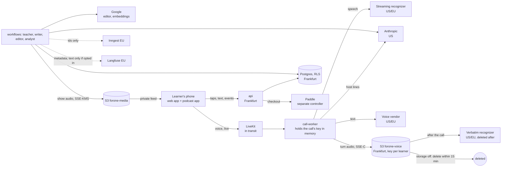

# Data protection impact assessment

> **Draft for counsel. Not legal advice.** First draft of the DPIA that ADR-20 and ADR-24.9 require before the paid beta, written 2026-11-12 from 07 §3.1 (threat model) and §4.9 (register), 04 §4.12 and §4.14, and PRD-v3 Parts 1.3 and 11.4. **Counsel must confirm:** the lawful bases (§4.1, pack A-5), the biometric reading (A-3), the transfer basis (A-2), every risk rating in §6, and the conclusion in §8 that no prior consultation with a supervisory authority is needed. Counsel or the DPO (if one is appointed) signs §8.

| | |
|---|---|
| Controller | `[Company legal name]`, `[Address]` |
| Processing | For one: a personal AI podcast and live voice calls for adult language learners, with a long-term learner model |
| Assessment owner | Muath (owner); drafted by the documentation pass |
| Version | 0.1, 2026-11-12. To be completed with counsel by 2027-02-15 (register A8) |
| Regimes | EU GDPR Art. 35; UK GDPR Art. 35; Saudi PDPL (impact assessment for sensitive data and large-scale processing); the generic baseline relies on this document (07 §4.9) |
| Review | Before the beta (2027-03-17); at the gate review (2027-04-20); on any trigger in §9 |

---

## 1. Summary

For one processes adult learners' voices, the things they say about their lives, and a continuous model of their language ability, using US and EU AI vendors, for a paid service open to learners in any country. That combination meets several of the criteria that make a DPIA mandatory. The design already carries strong controls: voice encrypted under a key per learner and deleted within 15 minutes unless the learner chooses to keep it; facts stored only from the learner's own quoted words; sensitive facts kept only after a one-tap confirmation; row-level isolation; every staff look at content logged and shown to the learner; deletion windows checked by an independent job; a fixed crisis protocol. **The residual risk is assessed as medium-low overall, with four risks still medium** (R3 special-category content in transcripts, R6 crisis response, R8 transfers, R18 Milestone 0 data), each with an open action in §7. If counsel agrees with the ratings, no prior consultation is needed.

## 2. Why a DPIA is needed

| Criterion (EDPB guidelines on DPIA; GDPR Art. 35(3)) | Applies? | Why |
|---|---|---|
| Evaluation or scoring, including profiling | Yes | The learner model estimates listening, reading, speaking and writing ability, scores pronunciation internally, and profiles interests and errors to plan every episode |
| Systematic monitoring | Partly | Every call, chat and in-app action is logged to the learner's event log for the life of the account |
| Sensitive data or data of a highly personal nature | Yes | Voice; life facts; special-category content learners volunteer in conversation; crisis disclosures |
| Large scale | Not yet | About 50 learners a week from 2027-03-17; the design target is 10,000. Re-assess at 1,000 |
| Innovative technology | Yes | Generative AI hosts in live voice conversation; AI-produced personal audio |
| Data transfers outside the EU | Yes | Model, voice and recognition vendors in the US |
| Vulnerable people | Possibly | Adults only, but a learner may be in distress (the crisis protocol exists for that) |

## 3. Systematic description of the processing

### 3.1 Nature

A learner hears a short personal episode each day (1, 2 or 3 new episodes by plan), calls an AI host for 5 to 7 minutes, may read an article and chat. AI roles plan, write, voice and analyse; code decides what is stored. The learner model is nine stores computed from an append-only event log (PRD Part 7). The learner can open everything in a notebook, edit or delete any fact, and export or delete all of it.

### 3.2 Scope

| Data | Subjects | Volume (beta) | Retention |
|---|---|---|---|
| Identity: name used by hosts, email or Apple/Google id, birth date, residence country, languages, time zone | Learners | 50 a week from 2027-03-17; about 250 by 2027-04-20 | Life of account |
| Voice: call turns, full call recording, voice notes, "say it once", shadowing, then-and-now recordings, the name clip | Learners | About 7 minutes of learner speech per session | 15 minutes unless the learner keeps recordings; then until deleted |
| Transcripts and chat, including whatever the learner chooses to say | Learners; people they mention (first names or roles) | About 300 events per session | Life of account |
| Life facts and quotes; sensitive facts after confirmation | Learners; people they mention | At most two facts used per episode | Life of account; sensitive facts per ADR-24.10 |
| Derived model: word bank, structures, errors, skills, interests, goals, taste | Learners | | Life of account |
| Prompts and completions (`model_io`) | Learners | Every model call | 90 days |
| Billing state (no card data) | Learners | | Life of account; Paddle keeps its own |
| Security and audit records | Learners, staff | | 24 months |
| Crisis log (no content: date, residence country, resource shown, whether the call ended, `host_confirmed`, `learner_declined`; no reviewer field, ADR-24.B20) | Learners | Rare | Life of account; de-identified on deletion and kept 3 years, then deleted (ADR-24.B15) |
| Pseudonymized, de-identified research transcripts (opt-in; writes nothing until P1) | Learners who opt in | | Until revoked or deleted |
| Staff accounts and agreements | Staff, reviewers, taggers | Under 10 | While active |

Full retention schedule: [05-ropa.md](05-ropa.md) §4.

### 3.3 Context

Learners are adults from any country who already understand some of the target language. They choose to join from a waitlist, see a sample first, and pay after a free week. They expect the show to remember them; that expectation is the product. They do not expect their words to be read by people, used for anything but their show, or kept after they leave; the trust contract (PRD 1.3) promises exactly that. The hosts sustain a relationship across episodes, so a learner may disclose more than they would to a form. Some learners will be in difficult moments; the crisis protocol (07 §4.8) exists for them.

### 3.4 Purposes

1. Make and deliver the learner's show (episodes, calls, articles, chat) and plan it from their own words.
2. Show the learner honest evidence of their progress (the claim gate, LAW-12).
3. Keep the learner safe in a crisis and report how often the protocol is used (SB 243 duties applied to all, ADR-24.9).
4. Bill the subscription (through Paddle).
5. Secure the service, prevent abuse, and prove the privacy promises are kept.
6. With opt-in consent only: check and improve the teacher with pseudonymized transcripts.

### 3.5 Data flow

## 4. Necessity and proportionality

### 4.1 Lawful basis

Working positions, for counsel (pack A-5): contract for making the show, including transient voice processing and transcripts; consent for keeping recordings and for research use; explicit consent for sensitive facts (one-tap card, ADR-24.10); legitimate interests for security, audit and the trial limit; the crisis log's content and retention are ruled (ADR-24.B15) and its basis is asked of counsel (pack B-4). Transfers to US vendors rest on SCCs with a transfer impact assessment, and the Data Privacy Framework where a vendor is certified, never on consent (ADR-24.B13). The open question with the most weight: special-category content inside transcripts kept for the life of the account.

### 4.2 Minimization

- **Told, not inferred** (TC-6): a life fact is stored only if its quote appears word for word in the verbatim transcript (FR-620); nothing is looked up outside the app; sensitive classes are never inferred.
- At most two life facts per episode; unconfirmed facts are never spoken (FR-312, FR-621).
- Voice is not kept by default; recordings are opt-in.
- Each AI role gets a compiled brief, never the whole learner file (FR-602, FR-640).
- Tracing holds metadata only unless the learner opted in (ADR-09); event payloads in Inngest carry ids only (07 §4.9).
- No analytics vendor, no third-party scripts, no ads (06).
- Payment data stays with Paddle; we keep ids, amounts and an invoice link, never raw webhook bodies (07 §4.14 rule 10).

**Where we keep more than strictly needed, and why.** Transcripts are kept for the life of the account, not just the session, because the learner model is rebuilt from the log when the analyst improves (FR-601, FR-630) and because the learner's own past sentences are the evidence for every progress claim. Prompts and completions are kept 90 days in the home region for debugging. Counsel may ask for shorter windows (pack B-5f).

### 4.3 Accuracy

The confidence ladder (FR-621), learner edits as ground truth at once, a wrong memory treated as a bug and counted (TC-7, GATE-13), and the claim gate's five rules for any statement about progress (FR-840).

### 4.4 Transparency and rights

The privacy notice ([01](01-privacy-notice.md)) in the learner's own language, linked at A2 with the notice line before any voice is processed (ADR-24.B14) and acknowledged at A8; plain consent strings ([03](03-consent-texts.md)); the notebook shows every fact with its source; Controls give export within 72 hours in the beta and within 1 hour once automated (ADR-24.B7), correction at once, deletion with a typed "delete" and no grace period (ADR-24.B1); the export carries the consent history, the staff access log, the privacy job runs and the processor list (07 §4.5).

### 4.5 Processors and transfers

Every vendor is in the register with what it sees, where and for how long; no vendor is called from code until its DPA is recorded (07 §4.9, handbook 09 §9). Training is switched off everywhere it can be; zero data retention is requested from Anthropic (ADR-24.17). The home region is the EU; US transfers rely on the basis counsel confirms (pack A-2).

## 5. Consultation

| Who | How | When | Outcome |
|---|---|---|---|
| Learners | The 15 Milestone 0 pilot learners accepted the pilot consent; their questions and drop-outs inform the copy | 2026-10-24 to 11-18 | `[Muath: add any privacy questions pilot learners asked]` |
| Counsel | This document and the question pack | Answers 2026-11-17 and 2027-02-15 | Pending |
| DPO | `[If counsel says one is required, pack A-4]` | | |
| Processors | DPAs and retention settings per vendor; zero retention requested from Anthropic | Before 2027-03-17 | Pending (07 §7) |
| Security | Tabletop of the incident runbook in the last build week; a penetration test before public launch (ADR-24.13) | Before 2027-03-12; 2027-02 | Pending |

## 6. Risks to the people involved

Likelihood: remote, possible, probable. Severity: minimal, significant, severe. "Inherent" is before the measures; "residual" after. References are to architecture 07 unless marked.

| # | Risk to the person | Inherent | Measures | Residual |
|---|---|---|---|---|
| R1 | **Recordings of their voice are exposed** in a breach or by a mistake | Possible, severe | Learner-voice kinds are SSE-C under a per-learner key that only three task roles can unwrap, with a purpose logged (D1, D2, §4.1); storage off by default with 15-minute deletion verified hourly (D5); no public buckets; key destruction on deletion makes missed copies unreadable | Remote, severe: **low** |
| R2 | **Their voice is used to identify them, cloned, or kept by a vendor** longer than said | Possible, severe | No speaker identification or cloning (pack A-3); vendor retention set to the minimum and confirmed in writing, training switched off (§4.9); the verbatim recognizer, which sees the most voice, negotiated hardest; monthly check of vendor settings (§5) | Possible, significant: **medium-low**, until each vendor's written retention is on file |
| R3 | **Private things they said (health, beliefs, sexuality) are kept and could be exposed or misused** | Probable, severe | Sensitive classes are never inferred; a sensitive fact is kept only after a one-tap card and never brought up first; never in a brief for the teacher, writer or host (04 §4.7.3); dropped from the research set (04 §4.12.4); RLS; the learner can delete any fact. **Gap:** the transcript itself keeps everything said, for the life of the account | Possible, severe: **medium**. Action 1 |
| R4 | **The show "knows" something wrong or invented about them** and says it | Possible, significant | Quote check, confidence ladder, edits as ground truth, wrong memory counted as a bug (FR-620 to FR-626) | Remote, significant: **low** |
| R5 | **The AI relationship manipulates them** (guilt, dependency, engagement tricks) | Possible, significant | The twelve laws and trust contract; the output guard blocks guilt lines, humanity claims and progress claims (§4.10); a finite daily portion, no autoplay; exactly three message kinds; honest AI disclosure | Remote, significant: **low** |
| R6 | **A learner in crisis is not helped, or is harmed by the response**; a false alarm stops the show | Possible, severe | Five triggers including the host and the after-session analyst; a two-stage keyword trigger with a 2-second cap; fixed counsel-reviewed clips; resources for the learner's country with an international fallback; the turn is quarantined from memory and claims (§4.8, [06](06-crisis-protocol.md)). Detection is imperfect and per-country lines must be verified | Possible, severe: **medium**. Action 2 |
| R7 | **A minor uses the product** and their data is processed | Possible, significant | 18+ checkbox at A1, birth date at A8, refusal deletes everything (D8). Order A processes about 8 minutes before the birth date | Possible, significant: **medium-low**. Pack A-9 |
| R8 | **Data transferred to US vendors** is accessed by authorities or held under weaker protection | Possible, significant | EU home region; minimum data per vendor; metadata-only tracing; SCCs with a transfer impact assessment, DPF where certified, never consent (ADR-24.B13); zero retention requested from Anthropic | Possible, significant: **medium**. Action 3 |
| R9 | **Staff read their content** without good reason | Possible, significant | Named roles; content reads logged in `audit_log` and listed in the learner's export; pgaudit on human SQL; break-glass with a reason and MFA; no notebook page for engineers (§4.12, §4.13; handbook 09 §3). The owner can read anything, disclosed | Remote, significant: **low** |
| R10 | **A reviewer or tagger leaks or recognizes them** | Remote, significant | Names tokenized; one item per request, no bulk routes; signed confidentiality agreement before first login ([08](08-reviewer-confidentiality.md)); reviewers never see transcripts, notebook or identity | Remote, significant: **low** |
| R11 | **Their words leak into logs** (error trackers, cloud logs) | Possible, significant | Vendor error bodies never logged; scrubber with a PII corpus test; no learner ids in Sentry (§4.12; 09) | Remote, significant: **low** |
| R12 | **Another learner sees their data**, or a prompt injection extracts it | Remote, severe | RLS on every learner table with a CI walk; hosts have no tools; the shared-store invariant (§4.2, §4.10) | Remote, severe: **low** |
| R13 | **Deletion promises are broken** (audio not deleted, account not purged) | Possible, significant | Every deletion job writes evidence; an independent hourly checker re-verifies from the data; manual snapshots forbidden; backups expire at 30 days (D5, §4.4) | Remote, significant: **low** |
| R14 | **Their private feed or episodes spread**, including via podcast apps' servers | Possible, significant | 32-byte unguessable token, excluded from directories, one-tap reset, many-IP warning (06, §4.11); disclosed in the notice. Third-party podcast apps may store episodes under their own terms | Possible, significant: **medium-low**. Disclosure only |
| R15 | **They are processed before they understand what happens** (order A) | Probable, minimal | Age attested at A1; the notice line and link at A2 before any voice (ADR-24.B14); all pre-account voice deleted within 15 minutes, abandoned pre-accounts deleted after 24 hours | Possible, minimal: **low**. Pack A-6 |
| R16 | **Consent is not free** (bundled, pre-ticked, nudged) | Possible, significant | Every consent separate and unticked, off by default; voice storage refusable with the product still working; no dark patterns (FR-1231) | Remote, significant: **low** |
| R17 | **The research set re-identifies them** | Remote, significant | Opt-in only; names, entities and dates replaced; turns quoting sensitive facts dropped; read one row at a time by a named tagger; deleted on revoke or deletion (04 §4.12.4); writes nothing until P1 | Remote, significant: **low** |
| R18 | **Pilot learners' data is used beyond what they agreed** (vendor tests, fixtures, a public repository) | Probable, significant | Addendum with a separate yes for each use; non-signers excluded; no learner data in a public repository ([07](07-milestone-0-consent-addendum.md)) | Possible, significant: **medium** until the addendum is signed and the vendor-test question is resolved. Action 4 |
| R19 | **Identity data outlives deletion** through payment records | Possible, minimal | No raw webhook bodies; the processor's customer deleted through the adapter; Paddle keeps tax records as seller under its own notice (§4.14) | Remote, minimal: **low** |
| R20 | **Inaccurate claims about their progress** mislead them about what they paid for | Possible, significant | The claim gate in code; only gated claims reach the proof; a monthly human audit with a 5% false-claim ceiling (FR-840, NFR-502) | Remote, significant: **low** |

## 7. Measures still to take (actions)

| # | Action | Owner | By | Closes |
|---|---|---|---|---|
| 1 | Decide with counsel how special-category content in transcripts is consented to or limited (explicit consent at A8, or a transcript retention limit) | Muath, counsel | 2026-11-17 | R3 |
| 2 | Counsel approves the crisis wording; every country line in `resources.yaml` verified; Milestone 0 transcripts run through both keyword lists to measure false positives | Muath, counsel, engineer | 2027-02-15 | R6 |
| 3 | DPAs signed or accepted and retention confirmed in writing for every vendor; SCCs and a transfer impact assessment (or DPF certification) recorded per vendor; zero retention requested from Anthropic (register A7) | Muath | 2027-02-15 (zero retention request: 2026-12-15, A7) | R2, R8 |
| 4 | Milestone 0 addendum sent and signed; counsel's answer on the vendor tests; fixtures out of any public repository | Muath | Part 1 before any clip leaves; Part 2 2026-12-15 | R18 |
| 5 | Build-week deliverables in 07 §7: keys and audit (in the order of `backlog/00-release-plan.md`): keys and audit, guard and research pseudonyms, consent flow and age gate, output guard and crisis, `privacy/verify` and the incident tabletop | Engineers | 2027-03-12 (end of the build) | R1, R9 to R13 |
| 6 | Decide whether the beta accepts US residents of states with voiceprint laws (pack A-3) | Muath, counsel | 2026-11-17 | R2 |

## 8. Conclusion and sign-off

With the actions in §7 done, the residual risk is medium-low and no risk remains high, so prior consultation with a supervisory authority under Art. 36 is not needed. `[Counsel to confirm.]`

| Role | Name | Decision | Date |
|---|---|---|---|
| Owner | Muath | `[approve / approve with changes]` | |
| Counsel | `[name]` | `[advice]` | |
| DPO | `[if appointed]` | `[advice]` | |

## 9. When this DPIA is reviewed

At the gate review on 2027-04-20 and whenever any of these happens: a new processor or a changed vendor role; a new target or native language opens; voice is used for anything new (a cloned voice, FR-1045; speaker recognition; a phone dial-in, FR-346); the research set starts writing (P1); the learner count passes 1,000; native apps replace the web app (ADR-24.1); a regime is added; an S1 or S2 incident; counsel changes any working position.
