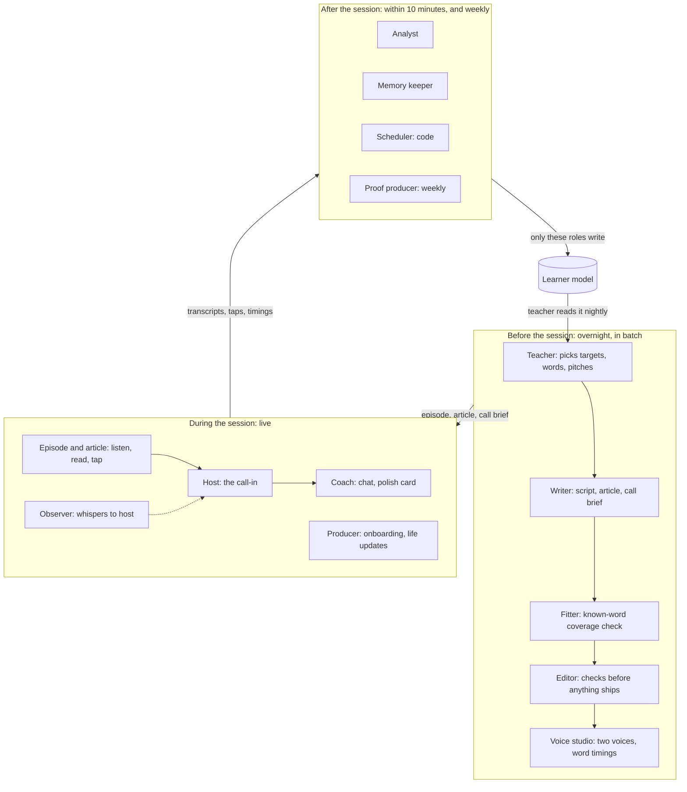
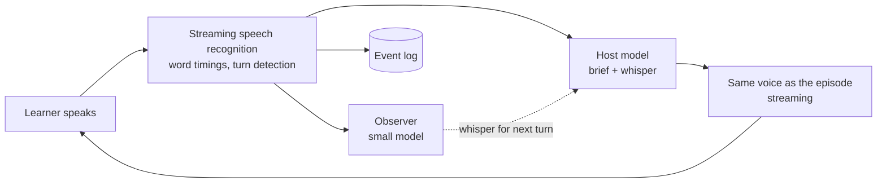

# For one: the AI agents and architecture

Perspective: AI agents and system architecture · written 2026-10-09 · one of eleven lenses on the For one concept

Published doc (with the drawn architecture diagram): https://claude.ai/code/artifact/44b69d3c-febd-406d-9260-fd85ba07b745

## The answer in one paragraph

Build one teacher with many faces, not a swarm of bots. For one needs thirteen AI roles, ten of them in the first beta, and only one of them (the call host) has to be fast. Everything that needs deep thinking happens before or after the session, when it can be slow, cheap and checked. All roles read one structured learner model, and only the after-session roles may write to it. The live call should be a fast host that follows a written brief, with a second small model listening alongside and whispering corrections to it. Built this way, one full daily session costs about $0.45 to $0.60 in AI at today's list prices, which is $9 to $12 a month for a daily learner. That fits a $15 to $20 price only with the cost levers below.

## Decisions only Muath can make

| # | Decision | My default | Why it matters |
|---|---|---|---|
| 1 | How much AI cost per session you accept | About $0.60: the recommended stack, where the host sounds the same on the call as on the podcast | The lean stack is about $0.45 but the call voice differs from the episode. Premium is about $1.90 and needs a price near $40 a month. At 20 sessions a month, $0.60 is $12 of AI per learner. |
| 2 | May learners opt in to letting their anonymized transcripts be used to check and improve the teacher? | Yes, opt-in, off by default, explained in plain words | Without it, quality checks rely on synthetic learners and paid annotators, and the analyst improves slower. It touches the trust contract, so it is your call. |
| 3 | Launch language pair (already pending from the rethink) | One pair | Voice and speech-recognition quality differ a lot by language, especially for Arabic dialects. The vendor choice below depends on it. |

Everything else in this document is a default I picked; change any of it.

## What changes from the first rethink

The rethink sketched nine roles in one table. This goes four steps further:

1. **The call gets two models, not one.** A fast host speaks; a small observer reads each learner turn and tells the host what to recast, which word to draw out, and when to ask for the retell. This is how recasts become deliberate instead of random, without slowing the host down.
2. **The call should use the same voice as the episode.** The host who argued on the podcast must sound identical when the learner calls in. That favors a pipeline of speech recognition, a text model and the episode's own voice engine over an all-in-one speech-to-speech model with a fixed voice list.
3. **Difficulty is measured by code, then repaired.** Models cannot reliably follow "use only words this learner knows". A fitter step counts known-word coverage with a word list per learner and sends unknown words back for rewriting until the script hits about 95% (audio) and 98% (text).
4. **The learner model is rebuilt from the record.** Transcripts and taps are kept as an append-only log, and the learner model is computed from them. When the analyst gets better, you rerun it over history and every learner's model improves at once.

## At a glance

## The agent roster

Thirteen roles in four groups. "Agent" here means a role with fixed inputs, fixed outputs and one job. Most are pipeline steps; only the host and the coach hold a conversation.

### Before the session (slow, cheap, checked)

| Role | Job | Runs | Model class | At launch? |
|---|---|---|---|---|
| **Teacher** (the brain) | Reads the whole learner model and decides tomorrow: 1 to 2 targets, words due for review, the week's balance of listening, speaking, focus and fluency, energy level, and the pitches | Nightly, and after each session | Strongest reasoning model, batch | Yes |
| **Scout** | Fetches results and news for stored interests | Nightly, shared per topic across learners | Small model plus web search | Later |
| **Writer** | Episode script, article, call brief, chat opener | When a pitch is picked, or ahead for the likely pick | Strong creative model | Yes |
| **Fitter** | Measures known-word coverage and new-word count, sends offending sentences back for a rewrite, loops until it passes | After the writer, every piece | Code plus a small model | Yes |
| **Editor** | Pre-ship gate: target-language correctness, no false memories, no unsupported real-world facts, no law broken, and "would this person pick this over a real podcast?" | Before anything ships | Code plus a mid model from a different vendor than the writer | Yes (basic) |
| **Voice studio** | Two-voice audio, word timestamps, name pronunciations, then a re-listen check | After the editor | Text-to-speech plus speech recognition | Yes |

### During the session (live)

| Role | Job | Runs | Model class | At launch? |
|---|---|---|---|---|
| **Host** | The call-in: argues, pushes back, recasts, asks for the retell, follows the brief | Live, under 1.5 s per reply | Fast mid model in a voice pipeline | Yes |
| **Observer** | Reads each learner turn, spots errors and missed targets, whispers to the host ("recast went", "draw out *despite*", "time for the retell") | Live, beside the host, never speaks | Small fast model | Phase 2 |
| **Coach** | Text chat after the call, the polish card, any "why is it said like that?" | Right after the call | Strong text model | Yes (polish card first) |
| **Producer** | Onboarding conversation, life updates, "what do you know about me?", fact corrections | Onboarding and on request | Conversational model with voice | Yes |

### After the session (writes the memory)

| Role | Job | Runs | Model class | At launch? |
|---|---|---|---|---|
| **Analyst** | Tags errors in the fixed taxonomy, measures fluency from timestamps, logs words used and understood, moves targets through their lifecycle | Within 10 min of session end | Small model with a fixed schema, checked by code | Yes |
| **Memory keeper** | Extracts life facts with a confidence and the exact quote they came from, merges duplicates, decays old ones, keeps per-character memory | Within 10 min of session end | Small model plus rules | Yes |

### Weekly

| Role | Job | Runs | Model class | At launch? |
|---|---|---|---|---|
| **Proof producer** | Computes real deltas in code, then scripts the weekly proof episode and picks the voice clips | Weekly | Strong text model plus voice studio | Phase 2 |

Three services are deliberately not AI:

- **Scheduler**: a spaced-review scheduler (FSRS-style) per word and per structure. It decides what is due; the teacher decides how to use it.
- **Lexicon service**: a lemmatizer and known-word list per learner, used by the fitter, the analyst and tap-to-define.
- **Gloss cache**: tap-to-define meanings stored per word, sense and native language, shared by all learners. A meaning is not personal, so it is generated once and reused forever.

## How they share the learner model

One store, many read-only views, few writers.

| Part of the model | What it holds | Written by | Read by |
|---|---|---|---|
| Event log | Every transcript, tap, replay, skip and timing, append-only | The app | Analyst, memory keeper (to rebuild everything) |
| Lexicon | Per word: seen count, understood, produced correctly, review schedule | Analyst, scheduler | Fitter, teacher, writer |
| Structures and errors | Per target: lifecycle state, error counts by taxonomy category, last evidence quote | Analyst | Teacher, observer, coach |
| Life file | Facts with confidence, source quote, date, salience; dated follow-ups | Memory keeper; the learner's own corrections | Teacher, writer, producer, host (high-confidence facts only) |
| Show history and tastes | Topics, formats, what made them talk most, abandonment | Analyst | Teacher, writer |
| Cast memory | Per host: positions taken, running jokes, relationship history | Memory keeper | Writer, host, coach |

Three rules keep it honest:

1. **Live roles never write.** The host and the coach only produce transcripts. The after-session pass decides what is true. This stops a host from "remembering" something it misheard.
2. **Every fact carries its proof.** Each life fact stores the learner's exact words and a confidence. Only high-confidence facts reach a host's mouth, which makes the trust contract's "never state an uncertain memory" enforceable.
3. **Each role gets a compiled view, not the whole file.** The host gets a one-page brief. The writer gets the plan and the facts it may use. The teacher gets everything. Small views are cheaper, faster and leak less.

## What runs when

| When | What runs | Latency it must hit |
|---|---|---|
| Live, during the call | Host, observer, speech recognition, voice | Under 1.5 s per host reply |
| Live, on tap | Gloss lookup (precomputed) | Under 300 ms |
| Just after the call | Coach's first message, polish card | Under 30 s |
| Within 10 minutes | Analyst, memory keeper, scheduler update | 10 min |
| Overnight (batch, half price) | Scout, teacher, writer and fitter for the likely pick, editor | By the learner's chosen time |
| On a pitch the learner picks that was not pre-made | Writer, fitter, editor, voice for the opening first | Playable under 30 s |
| Weekly | Proof producer, avoidance check, 4-weekly speaking sample | Before the learner's proof day |

## The live call, in detail

The call is the hardest engineering in the product and the place where learning is won or lost.

How a turn works:

1. The learner speaks. Streaming speech recognition turns it into text, with word timings, and detects when they have finished (turn detection matters more than raw speed for learners, who pause mid-sentence).
2. The host model gets the turn plus its brief (position, pushback material, targets, three words to draw out, the recast list) and any whisper the observer left after the previous turn. It replies in character.
3. The reply streams sentence by sentence into the same voice the learner heard in the episode.
4. In parallel, the observer reads the learner's turn and decides whether the next host turn should recast an error, draw out a target word, or move to the retell. It writes a short whisper the host reads on its next turn. It never adds delay, because the host does not wait for it. On Claude models the whisper can go in as a mid-conversation system message, which keeps the prompt cache intact.

Why a pipeline and not an all-in-one speech-to-speech model:

| | Pipeline (recognition, text model, voice) | All-in-one speech-to-speech |
|---|---|---|
| Host sounds like the episode | Yes, same voice engine | Only if the vendor's voice list matches |
| Exact transcript of the learner's errors | Yes, from a recognizer you choose and test | Partial; the transcript is a side output |
| Control per turn (whispers, brief, nudge budget) | Full | Limited to the session prompt and tool calls |
| Naturalness of turn-taking and emotion | Good, needs tuning | Best |
| Cost of a 6-minute call (estimate) | $0.09 to $0.20 | $0.18 (OpenAI mini) to about $0.50 (OpenAI full, Gemini Live); both re-bill the conversation history on every turn |
| Word timings for fluency (pauses, speed) | Yes, from recognizers such as Deepgram, AssemblyAI or Soniox | Not in Gemini Live's transcripts |
| Build effort | Higher; use an open-source voice framework | Lower |

My default: the pipeline, built on LiveKit Agents (open source, Apache 2.0; its audio turn detector covers 14 languages including Arabic and Japanese, while Pipecat's Smart Turn is designed for English), with an all-in-one model kept as the benchmark to beat on naturalness. For Milestone 0, use an off-the-shelf all-in-one voice model; it is fine for testing whether people want to call.

One risk to test first: speech recognizers are trained to produce clean text and may silently correct a learner's grammar ("I go yesterday" heard as "I went yesterday"). If that happens, the analyst never sees the error. Before choosing a recognizer, run 30 recorded learner clips through each candidate and count how many real errors survive.

## Models, voices and frameworks

Prices are list prices as of 2026-10-09 from the vendors' own pages (see Sources). Use the class, not the brand: every role can swap vendors, and the editor should deliberately use a different vendor from the writer, so the two do not share blind spots.

| Role | Model class | Current example and list price |
|---|---|---|
| Teacher | Strongest reasoning, run in batch | Claude Opus 5.5, $2 in / $10 out per 1M tokens in batch ($4 / $20 standard) |
| Writer, coach | Strong creative and text | Claude Sonnet 5.5, $2 / $10 per 1M tokens ($1 / $5 in batch; cache reads $0.10) |
| Editor | Mid model from a second vendor | Gemini 3.8 Flash, $0.75 / $3.75 per 1M tokens, doubling on 2027-01-01 |
| Fitter, glosses, analyst first pass, memory keeper, observer | Small and fast, fixed output schema | Claude Haiku 5.5, $0.10 / $0.50 per 1M tokens |
| Host (text brain of the call) | Fast mid model, thinking off, cached brief | Claude Sonnet 5.5 (about $0.06 per 6-minute call with caching); try Haiku 5.5 if quality holds in the target language |
| Episode voice | Two-speaker, expressive, word timestamps | Gemini 3.8 Flash TTS: $9 per 1M audio tokens ($4.50 batch), 25 tokens a second, two speakers per call, lists Egyptian Arabic, no timestamps (add alignment). Inworld TTS-2: $25 per 1M characters. Cartesia Sonic 3.6: about $37 to $50 per 1M characters, word timestamps. ElevenLabs v4: $0.08 per 1K characters list, dialogue endpoint with timestamps |
| Call voice | Streaming, low latency, same voice as the episode | Inworld TTS-2 Flash $15 per 1M characters; ElevenLabs Flash v2.5 $40 per 1M (about 75 ms); Cartesia as above |
| Speech recognition | Streaming, verbatim, word timings | Soniox stt-rt-v5 $0.002 a minute (60+ languages); Deepgram Nova-3 multilingual $0.0058 a minute (promotional); AssemblyAI Universal-3.6 Pro Realtime $0.0075 a minute |
| Timestamps for voices without them | Forced alignment | ElevenLabs forced alignment, about $0.026 per 7-minute episode; WhisperX (open source) |
| All-in-one voice, as benchmark | Speech-to-speech | gpt-realtime-2.1-mini (about $0.18 per 6-minute call), gpt-realtime-2.1 (about $0.49), gemini-3.8-live (about $0.52) |

Vendors move fast: in the last few weeks ElevenLabs launched v4 on a promotion that ends Oct 12, Google set its older speech models to shut down from Nov 17 and doubles Gemini 3.8 prices on Jan 1, 2027, and OpenAI deprecated its text-to-speech models for Jan 6, 2027. Put every vendor behind a thin adapter so a swap is a configuration change.

The plumbing:

| Layer | Default | Why |
|---|---|---|
| Orchestration of the before/after pipelines | A durable workflow engine (Temporal or Inngest) calling model APIs directly | Each role is a step with retries and a timeout; no agent framework needed. Free-roaming agent frameworks add cost and unpredictability here. |
| Live call | LiveKit Agents, with Pipecat as the alternative | Open source; they handle audio transport, turn detection and interruptions. |
| Learner model | Postgres, with a vector index only for searching past conversations | Most of the model is structured counts and states, which a database does better than embeddings. |
| Audio and transcripts | Object storage, encrypted, per-learner keys | Makes "delete my data" a real, fast operation. |
| Prompts, taxonomies, voices | Per-language packages (already in PRD Part 13) | Adding a language is configuration. |
| Tracing and cost | An LLM tracing tool (for example Langfuse) logging every call with its cost and the learner-model version it read | Needed for the cost telemetry the PRD already requires, and for debugging a bad episode. |

## How we know the lessons are right

Generated content used once can never be reviewed by a human before it ships. So quality comes from four loops, from fastest to slowest.

| Loop | Checks | Who or what | When it fails |
|---|---|---|---|
| 1. Pre-ship gate (every piece) | Coverage 95% audio and 98% text; new words within budget; targets present; target-language grammar and naturalness; no uncertain memory stated; real-world claims match the scout's sources; no law broken; pitch test | Fitter (code), editor (model from another vendor) | Repair and recheck once, then ship the safe fallback episode |
| 2. Audio check (every episode) | Run the finished audio back through speech recognition and compare it to the script; flag skipped or garbled words and mispronounced names | Voice studio | Re-synthesize that line |
| 3. Offline test suite (every prompt or model change) | 30 to 50 synthetic learners at different stages, with planted error patterns; a simulated caller phones the host; measures recast rate, learner talk share, latency, nudge budget, analyst precision on a hand-tagged set | Automated, run before any change ships | Change does not ship |
| 4. Human and outcome review (weekly) | A native speaker reviews a sample of episodes per language; the 4-weekly speaking sample per learner; target retirement rates; taps per 100 words as a difficulty thermometer | Paid native reviewer, dashboards | Fix the prompt, taxonomy or model, then rerun the analyst over history |

The two numbers to watch most: taps per 100 words (too many means the fitter is too loose) and target retirement within three weeks (if it stays low, the correction design is not working).

## Cost per learner per day

One full session (a 7-minute episode, article, 6-minute call, chat and polish card) costs about **$0.43 lean, $0.62 recommended and $1.89 premium** at list prices on 2026-10-09. These are estimates from published prices, not measurements.

| Piece | Lean | Recommended | Premium |
|---|---|---|---|
| Teacher (plan) | $0.04 | $0.08 | $0.16 |
| Writer (script, article, brief, opener, incl. unused pre-made picks) | $0.08 | $0.10 | $0.31 |
| Fitter and gloss cache | $0.01 | $0.01 | $0.01 |
| Editor gate | $0.02 | $0.02 | $0.02 |
| Episode voice and timestamps | $0.07 | $0.16 | $0.52 |
| Live call, 6 minutes | $0.09 | $0.14 | $0.49 |
| Observer | under $0.01 | under $0.01 | under $0.01 |
| Coach (chat and polish card) | $0.04 | $0.04 | $0.24 |
| Analyst and memory keeper | $0.04 | $0.04 | $0.04 |
| Scout, weekly proof, hosting | $0.03 | $0.03 | $0.10 |
| **Per session** | **$0.43** | **$0.62** | **$1.89** |
| Per learner per month at 20 sessions | $9 | $12 | $38 |
| Worst case, 2 sessions a day for 30 days | $26 | $37 | $113 |

What each stack is:

- **Lean:** Claude Sonnet 5.5 in batch for teacher and writer; Gemini 3.8 Flash TTS in batch for the episode plus forced alignment; a call on Soniox, a mid model and Inworld TTS-2 Flash. The call voice is not the episode voice.
- **Recommended:** Claude Opus 5.5 in batch for the teacher; Sonnet 5.5 for writer, host and coach; one voice vendor for both the episode and the call so the host sounds the same (priced here at Inworld's rates; Inworld's timestamp support is not yet verified); Deepgram for recognition.
- **Premium:** Opus 5.5 everywhere, ElevenLabs v4 at list price, and gpt-realtime-2.1 for the call.

Assumptions: a 6,500-character episode (about 7 minutes in Spanish or French; Japanese and Arabic use fewer characters), a 6-minute call where the learner speaks 40% of the time over 25 turns, 5 chat messages, and 20 to 40% of pre-made episodes not picked.

What this means:

1. **Voice and the call are about half the bill.** Model text is the other half, and the teacher plus writer are most of that.
2. **The 2-sessions-a-day cap is the cost risk.** A heavy user costs $26 to $37 a month. Make the second session of a day lighter (a call or a retell on the same episode, no new episode).
3. **Levers that bring recommended to about $0.40:** 5-minute episodes instead of 7; voicing only the first minute of the pre-made pick and streaming the rest when chosen; Haiku 5.5 as host if native reviewers cannot tell; one weekly deep plan with light daily updates instead of a full plan every day; batch for everything nobody is waiting on.
4. **Prices that will move:** Gemini 3.8 Flash and its speech model double on 2027-01-01, which would add about $0.05 to the lean stack. Model prices have mostly fallen over time, but do not plan on it.

## What to build first

Order by risk, and make every manual step in Milestone 0 a prompt that later becomes an agent.

1. **Milestone 0, by hand (two weeks, no product code).** You play the teacher, analyst and memory keeper with written prompts in a chat model; the writer is a prompt; audio comes from a voice tool; the call runs on an off-the-shelf voice model with a written brief. Save every transcript and your error tags: they become the first test set.
2. **Phase 1, the core loop (the private beta).** Learner model and event log; scheduler and lexicon service; teacher; writer; fitter; basic editor; voice studio with word timestamps; host on a voice pipeline; analyst; memory keeper; producer for onboarding; coach as the polish card only; cost tracing from the first user. Leave out the observer, scout, characters and weekly proof.
3. **Phase 2, the teacher shows itself.** Observer whispering in the call; coach chat; weekly proof producer; scout; the offline test suite running on every change.
4. **Phase 3, beyond the episode.** Real-life rehearsal (a scene agent built from the life file), bring-your-own-input, character creator, pronunciation feedback.

Not worth building yet: a general "agent that decides which agents to run", long-term memory by embeddings alone, fine-tuned models (prompting plus the gates is enough until there is real data), and any multi-language launch.

## Trade-offs I weighed

| Choice | I picked | What it costs | When to switch |
|---|---|---|---|
| One big agent vs. many roles | Many narrow roles behind one show | More pieces to wire | Never for the live call; possibly merge writer and editor if models get much better |
| Pipeline vs. speech-to-speech call | Pipeline | More engineering, slightly less natural turn-taking | If an all-in-one model offers custom voices, verbatim transcripts and per-turn injection at a similar price |
| Pre-make the likely pick vs. make on demand | Pre-make the script; voice only the first minute ahead, stream the rest on play | A short wait risk if voicing is slow | Pre-voice everything once acceptance of the predicted pick is above about 70% |
| Strongest model everywhere vs. routing | Routing by role | Prompt work per model | Never; routing is most of the cost control |
| One vendor vs. several | Two text vendors (writer and editor differ), one voice vendor per language | Two contracts | If one vendor is clearly better on a language |
| Every language at launch vs. one | One pair | Smaller market at first | When one pair passes the beta gates |

## Sources

Prices and capabilities were checked on 2026-10-09 on these vendor pages.

- Anthropic pricing: https://platform.claude.com/docs/en/about-claude/pricing
- OpenAI pricing: https://developers.openai.com/api/docs/pricing
- OpenAI realtime costs: https://developers.openai.com/api/docs/guides/realtime-costs
- OpenAI gpt-live-1: https://developers.openai.com/api/docs/models/gpt-live-1
- OpenAI deprecations: https://developers.openai.com/api/docs/deprecations
- Gemini API pricing: https://ai.google.dev/gemini-api/docs/pricing
- Gemini Live billing: https://ai.google.dev/gemini-api/docs/live-api/best-practices
- Gemini speech generation: https://ai.google.dev/gemini-api/docs/speech-generation
- Gemini deprecations: https://ai.google.dev/gemini-api/docs/deprecations
- ElevenLabs API pricing: https://elevenlabs.io/pricing/api
- ElevenLabs text to dialogue: https://elevenlabs.io/docs/capabilities/text-to-dialogue
- ElevenLabs forced alignment: https://elevenlabs.io/docs/capabilities/forced-alignment
- Cartesia pricing: https://cartesia.ai/pricing
- Inworld pricing: https://inworld.ai/pricing
- Deepgram pricing: https://deepgram.com/pricing
- Deepgram code-switching: https://developers.deepgram.com/docs/multilingual-code-switching
- AssemblyAI pricing: https://www.assemblyai.com/pricing
- Soniox pricing: https://soniox.com/pricing
- LiveKit Agents: https://docs.livekit.io/agents/
- LiveKit turn detector: https://docs.livekit.io/agents/build/turns/turn-detector/
- LiveKit pricing: https://livekit.com/pricing
- Pipecat: https://github.com/pipecat-ai/pipecat
- Pipecat Smart Turn: https://docs.pipecat.ai/server/utilities/smart-turn/smart-turn-overview
- Azure pronunciation assessment: https://learn.microsoft.com/en-us/azure/ai-services/speech-service/how-to-pronunciation-assessment
- WhisperX: https://github.com/m-bain/whisperX

Not verified on an official page: Inworld's word timestamps and multi-speaker support, Azure speech prices, and how OpenAI bills learner transcription inside a realtime session.
