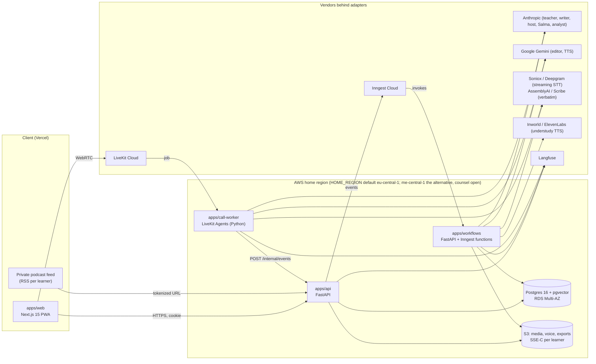
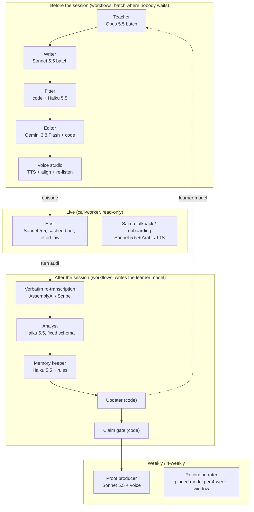
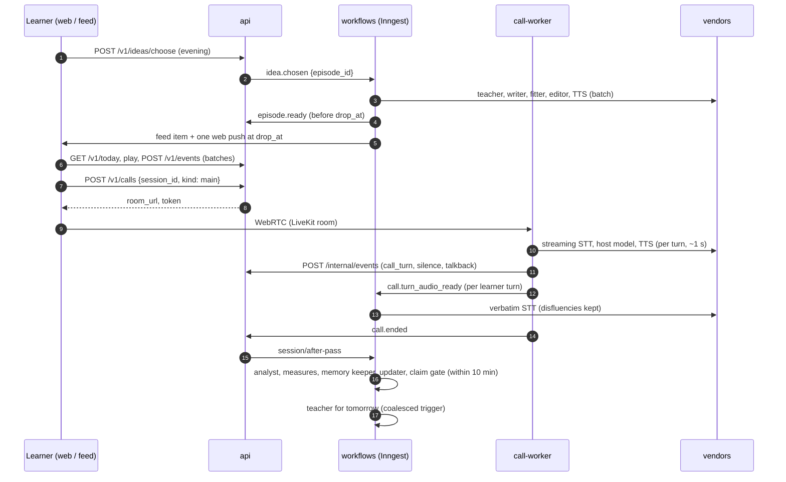

# For one: technical design, 00. Overview and module map

*Technical design document (TDD), version 1.1, 2026-11-07 (v1.0 2026-11-06; aligned with the architecture decision records ADR-01 to ADR-22 and the naming rulings in `architecture/10-decision-records.md` §4). The level below the nine architecture documents in `/architecture/`: what an engineer opens to start coding. Where this document and an architecture document disagree, the disagreement is listed in [10-open-questions.md](10-open-questions.md), and the architecture file is left as it is.*

## 0. How to read this set

| File | Answers | Read before building |
|---|---|---|
| 00 (this) | what the system is, its modules, its rules, how a day flows | anything |
| [01-data-model](01-data-model.md) | every table, column, index, retention rule, encryption class; the ERD | week 1 |
| [02-api-contracts](02-api-contracts.md) | every REST and WebSocket/SSE endpoint, schemas, errors, auth | week 1 (contracts), week 3 (client) |
| [03-generation-pipeline](03-generation-pipeline.md) | the episode factory: steps, prompts, coverage check, caching, cost per step | week 2 |
| [04-live-call](04-live-call.md) | LiveKit room lifecycle, call worker state machines, recasts, verbatim re-transcription, 1 s budget | week 4 |
| [05-learner-model](05-learner-model.md) | facts with sources, mistake tracking, replanning | week 1 (schema), week 5 (pass) |
| [06-after-session-and-proof](06-after-session-and-proof.md) | the after-session pass, claims, the weekly proof (evidence, not tests) | week 5 |
| [07-client](07-client.md) | routes, state, offline/PWA, audio | week 3 |
| [08-security-privacy](08-security-privacy.md) | keys, consent, deletion, isolation, crisis protocol | week 1 and week 5 |
| [09-observability](09-observability.md) | tracing, evals, alarms, cost controls | week 1 (tracing) onward |
| [10-open-questions](10-open-questions.md) | contradictions found, decisions still owed | now |

Conventions. `[DECISION]` marks a choice this TDD makes that the architecture left open or that this TDD changes; `[ASSUMPTION]` marks a number nobody has measured; `[P0]`, `[P1]`, `[LATER]` are PRD-v2's priority tags (P0 works on the first beta day, P1 before the gate review, LATER is out of the beta). Dates follow the pilot kit: build 2026-11-18 to 2026-12-22, paid beta from 2026-12-23. The architecture documents still carry the older 2026-11-02 to 2026-12-06 build weeks; the week numbers (1 to 5) are the same, only the calendar moved.

## 1. What the system is, in one paragraph

For one makes one private podcast per learner. Every evening the learner picks tomorrow's idea from three; overnight a pipeline of model calls (teacher, writer, fitter, editor, voice studio) writes, checks and voices a 5 to 7 minute episode in which about 95% of the running words are ones the learner already knows; it drops at the learner's chosen time, in the app and in a private podcast feed. After listening, the learner calls the host for a 5 to 7 minute live conversation on a LiveKit room served by a Python call worker that streams speech-to-text, a fast host model and text-to-speech; the host corrects only by recasting inside the conversation. Afterwards an after-session pass re-transcribes the call verbatim, extracts evidence of what the learner understood, produced and got wrong, and updates a learner model from which the next day's episode is planned. Once a week a proof episode tells the learner, in their own language, what they can now do, backed only by claims that passed a code-level gate. There are no points, streaks, levels, scores or pop-ups anywhere.

## 2. The module map



### 2.1 Services (deployables)

| Service | Runtime | Scales by | Owns |
|---|---|---|---|
| `web` | Next.js 15 on Vercel, TypeScript | Vercel | screens, service worker, player, call screen, feed artwork |
| `api` | FastAPI, Python 3.12, ECS Fargate behind ALB + WAF | CPU, 2 to 6 tasks | auth, every `/v1` route, event ingestion, feed XML, media signing, admin |
| `workflows` | FastAPI serving Inngest functions, ECS Fargate | Inngest concurrency | every durable job: episode production, after-session pass, verbatim turns, retention, exports, deletion |
| `call-worker` | LiveKit Agents worker, Python, ECS Fargate | rooms (1 task per 6 to 8 concurrent calls [ASSUMPTION]) | the live call: STT, host model, TTS, governor, recorder |

One Docker image `forone-python`, three entrypoints selected by `FORONE_SERVICE`. The image bakes in ffmpeg, the spaCy English model, LiveKit turn-detector weights and Silero VAD.

### 2.2 Packages (Python, `uv` workspace)

| Package | Import | Contents | Design file |
|---|---|---|---|
| `core` | `forone.core` | settings, SQLAlchemy 2 + Alembic, Pydantic event schemas, `events.append`, keys (DEK, per-call HKDF), media, outbox, messaging (the only module that can send), ratelimit, audit, guard | 01, 02, 08 |
| `adapters` | `forone.adapters` | one interface per capability, one module per vendor, `vendors.yaml` loader, tracing middleware, `prices.yaml` | 03, 04, 09 |
| `pipeline` | `forone.pipeline` | teacher, writer, fitter, editor, variety, voice studio, glosses, publish | 03 |
| `learner` | `forone.learner` | event log, nine stores, scheduler (FSRS), facts validator, compiled briefs | 05 |
| `assess` | `forone.assess` | verbatim merge, analyst, edit classifier, measures, updater, memory keeper, claim gate, proof producer, rater, `salma_explain` | 06 |
| `languages/<target>` | `forone.languages` | one directory per **target** language (`en` first): episode and call voices, recognizers and thresholds, lexicon, structure inventory and rules, calibration set, law and correction phrases, crisis keywords, host prompts, format patterns, ban list, `gate.yaml` | 03, 05, 08 |
| `native/<lang>` | `forone.native` | one directory per **native** language (`ar` first, `en` the universal fallback): interface strings and `dir`, consent texts and privacy notice, gloss target, Salma's voice and persona lines, crisis clips and resources card by country, talkback language hint | 02, 07, 08 |
| `call` | `forone_call` (inside `apps/call-worker`) | governor, turn controller, recorder, talkback, Salma onboarding | 04 |

**Language package rule (ADR-02, ADR-03).** Since the 2026-10-23 decision removed the launch country, nothing in code may assume Arabic or Saudi Arabia. Packages have two axes, never pairs: `packages/languages/<target>/` and `packages/native/<lang>/`. Every brief compiler, prompt loader and TTS request reads the pair from the learner row (`learners.native_language`, `target_language`, `residence_country`); `learners.tz` has no default and comes from the client. Opening a target language is a directory plus the five-check gate run by `forone.langgate` (evidence in `langgate/<target>/<date>/`, the pass recorded in `gate.yaml`), not a code change. The pilot's packages are `languages/en` and `native/ar`.

### 2.3 Roles (model calls), where they run



Three rules bind every role. **Live roles never write** to the learner model; only the after-session pass does. **Models propose, code decides**: every model output is a candidate in a fixed JSON schema that code validates and applies. **Nothing in assessment runs in the live path.**

## 3. The day as a sequence



## 4. The laws as engineering constraints

The twelve laws and eight trust promises (PRD-v2 1.2, 1.3; concept v2) are not UX copy. Each has a mechanism that fails a build, a request or a test when broken. The table lists the ones with code consequences; the full mapping is in `architecture/_digest-constraints.md` §1.

| Law or promise | Mechanism in code |
|---|---|
| No game furniture | no component for percent, chart, streak or level exists in `web`; the editor's law scan (check 10) rejects generated text that mentions scores, streaks, levels or homework; notebook shows only monotonic plain counts |
| Teaching is invisible (2026-10-23, ADR-06) | the host prompt forbids grading and grammar explanation; the governor rejects a reply whose `@moves` header declares a disallowed move; the correction guard (`guard.check_output` item 6, `guard/correction_words.yaml` per language) counts explicit corrections with a ceiling of 0 per 100 turns; the editor's check 10 rejects anything that reads as a correction or a lesson; there are no after-call notes, no polish card and no margin note; Salma explains only when asked (`salma_explain`) |
| Finite portion, allowance (ADR-04, ADR-05) | `episodes` has `unique (learner_id, local_date, kind, slot)`; `plan.episodes_per_day` from `plans.yaml` is checked in `api` (`episodes_today < plan.episodes_per_day`); episodes 2 and 3 are `daily_extra`, made on demand through `POST /v1/episodes/next` only after the current episode is heard; no autoplay, no feed for unplayed extras |
| Three message kinds only | `forone.core.messaging` is the only module allowed to import the email or push client (Ruff `banned-api` rule); its enum has exactly three members plus transactional; a unit test asserts the count |
| No claim without proof | `claims.text_ar` is the only sentence any surface may speak about progress; it is written by `forone.assess.claims.gate()`, never by a model |
| Told, not inferred | `life_facts.quote_event_id` is `not null`; the validator refuses a fact whose quote is not a substring of a verbatim or chat event; no enrichment adapters exist |
| Data is theirs | `learner/export` within 1 h; `learner/delete` ends access at once, purges live data in 24 h, backups in 30 days; per-learner DEK destruction crypto-shreds all audio |
| A wrong memory is a bug | `wrong_memory_flag` event fixes the fact synchronously and feeds the "under 1 in 100 callbacks" metric |

## 5. Cross-cutting technical rules

1. **Event log is the source of truth.** Every learner action and every model output is an append-only `events` row. The nine stores are derived and rebuildable from the log by replaying the after-session pass.
2. **Row-level security everywhere.** Every table with `learner_id` has an RLS policy on `current_setting('forone.learner_id')`, set with `SET LOCAL` per transaction. CI walks `information_schema` for tables without a policy.
3. **Inngest sees pointers, never content.** Event payloads carry ids and short enums; a CI test fails any event model with a field named `name`, `email`, `text`, `topic`, `quote`, `transcript` or `audio`, or any string without `max_length <= 200`.
4. **Every vendor behind an adapter.** Swapping a vendor is a `vendors.yaml` or `vendor_config` row; two voice vendors are wired from day one; the writer and the editor are never the same vendor.
5. **Every model call is traced** with role, vendor, model, prompt version, learner-model version, units and cost (`vendor_calls` + Langfuse). Cost per session is a query, not an estimate.
6. **Paid side effects are idempotent.** Each pipeline step keys its vendor call by `{episode_id}:{step}:{attempt}:{job_key}` and reuses a stored result on retry.
7. **Latency budgets are tests.** The 50-call bench and the 30-clip recognizer test run in CI against staging; the host-reply p50 gate is 1.5 s (design target about 1 s).
8. **Nothing per-country.** Time zones, scripts, voices, consent copy and crisis resources come from the language package and the learner row.

## 6. Repository layout

```
forone/
  apps/web/            Next.js 15, TypeScript, pnpm
  apps/api/            FastAPI: routers/, auth/, feed/, media/, admin/, internal/
  apps/workflows/      Inngest functions: functions/<id>.py, one file per function id
  apps/call-worker/    forone_call/: agent.py, governor.py, turns.py, recorder.py, talkback.py, salma.py
  packages/core|adapters|pipeline|learner|assess
  packages/languages/en/     voices/, recognizers/, lexicon/, inventory/, calibration/, guard/, crisis/keywords.yaml, prompts/, formats/, ban_list, gate.yaml
  packages/native/ar/        ui_strings/, consent/, notice, salma/, crisis/resources.yaml (by ISO country), talkback.yaml
  tools/vendor-lab, call-bench, cost-model, m0_import.py
  infra/terraform/     one module per env; docker-compose.yml for dev
  .github/workflows/   ci.yml, deploy-staging.yml, deploy-prod.yml
```

Tooling: `uv`, Ruff, Pyright strict, pytest; `pnpm`, TypeScript strict, Vitest, Playwright. Migrations: Alembic, one revision per PR, `alembic upgrade head` as a one-off ECS task before each deploy. Environments: `dev` (docker-compose: postgres+pgvector, minio, inngest dev server, livekit-server --dev, mailpit), `staging`, `prod`.

## 7. Build order (five weeks, 2026-11-18 to 2026-12-22)

| Week | Lands | TDD files |
|---|---|---|
| 1 | schema and migrations; event ingestion; RLS and roles; adapters with tracing; lexicon and FSRS scheduler; language package skeleton; vendor tests (30 clips, 50 calls) | 01, 02, 05, 09 |
| 2 | teacher, writer, fitter, editor, voice studio end to end on test learners; gloss cache; episode state machine; publish | 03 |
| 3 | onboarding A1 to A10 with Salma; Today; player; word sheet; feed; push; payments; account | 02, 07 |
| 4 | call worker: governor, turn-taking, talkback, hold-to-talk, recorder, verbatim path; voice-note fallback; chat | 04 |
| 5 | after-session pass; memory keeper; claim gate; notebook; Controls; simple weekly proof; first then-and-now; deletion and export jobs; crisis protocol; end-to-end run with Milestone 0 learners | 05, 06, 08 |

Exit on 2026-12-22: every P0 works; measured cost per session from `vendor_calls`; a costed path to $0.35 or less. Beta 2026-12-23 to 2027-01-26 (gate review 2027-01-26); freezes 2026-12-21 12:00 to 12-24 12:00 UTC and 2026-12-31 to 2027-01-02 (ADR-07).
