# 01. Data model

*Postgres 16 with pgvector on RDS Multi-AZ. One database, one schema `forone`, monthly partitions on the two high-volume tables (`events`, `vendor_calls`). SQLAlchemy 2 models in `forone.core.models`, migrations in Alembic. Every table below exists on 2026-12-22 unless tagged [P1].*

## 1. Principles

1. **Append-only log, derived stores.** `events` is written once and never updated. Everything in §4 (the learner model) is derived from it and can be dropped and rebuilt.
2. **Every estimate is a range.** Probabilities are stored as Beta parameters `(a, b)`; scales as `(mean, sd, n)`. No bare points.
3. **Row-level security on every learner table.** Policy `using (learner_id = current_setting('forone.learner_id', true)::uuid)`; `forone_workflows` and `forone_readonly` bypass with pgaudit on; `forone_purge` only inside `learner/delete`.
4. **Audio is never in Postgres.** S3 objects, each with a `media_objects` row, encrypted SSE-C under the learner's data key (DEK); the key row's deletion deletes all audio.
5. **Versions on everything a model touched.** `model_versions jsonb`, `prompt_version`, `learner_model_version` and `cost_usd` on events, episodes, claims and `vendor_calls`.
6. **Idempotency keys are natural keys.** `events (learner_id, event_id)`, `episodes (learner_id, local_date, kind, slot)`, `structure_observations.id = uuid5(...)`, `pipeline_steps.custom_id`.

## 2. Entity-relationship diagram

```mermaid
erDiagram
  learners ||--o| learner_keys : "DEK"
  learners ||--o| learner_schedule : ""
  learners ||--o| consents : ""
  learners ||--o| subscriptions : ""
  learners ||--o{ accounts : "apple|google|email"
  learners ||--o{ auth_sessions : ""
  learners ||--o{ feed_tokens : ""
  learners ||--o{ push_subscriptions : ""
  learners ||--o{ episodes : ""
  learners ||--o{ sessions : ""
  learners ||--o{ events : "append-only"
  learners ||--o{ media_objects : ""
  learners ||--o{ calls : ""
  learners ||--o{ chat_threads : ""
  learners ||--o{ claims : ""
  learners ||--o{ learner_model_versions : ""
  episodes ||--o{ episode_artifacts : "manifest, word_index, why"
  episodes ||--o| sessions : ""
  episodes ||--o{ pipeline_runs : ""
  pipeline_runs ||--o{ pipeline_steps : ""
  sessions ||--o{ doors : "8 doors"
  sessions ||--o{ calls : ""
  sessions ||--o| session_summaries : ""
  calls ||--o{ media_objects : "turn audio"
  episodes ||--o{ feed_items : ""
  claims ||--o{ claim_evidence : ""
  learners ||--o{ word_bank : "store 1"
  learners ||--o{ structure_map : "store 2"
  learners ||--o{ structure_observations : ""
  learners ||--o{ error_profile : "store 3"
  learners ||--o| skills : "store 4"
  learners ||--o{ interests : "store 5"
  learners ||--o{ life_facts : "store 6"
  life_facts ||--o| follow_ups : ""
  learners ||--o{ goals : "store 7"
  learners ||--o| taste : "store 8"
  learners ||--o{ show_canon : "store 9"
  learners ||--o{ recordings : "then-and-now"
  recordings ||--o{ recording_ratings : ""
  learners ||--o{ proofs : "weekly"
  learners ||--o{ vendor_calls : "cost"
  structures ||--o{ structure_map : "inventory"
  lexicon ||--o{ word_bank : "lemma"
```



## 3. Tables by domain

Column lists are complete. Types are Postgres. `pk` marks the primary key, `fk` a foreign key, `idx` an index; `RLS` means the learner policy applies. `ret` is retention.

### 3.1 Identity, account and lifecycle

**learners** (RLS; ret: life of account, purged 24 h after deletion request)

| column | type | notes |
|---|---|---|
| id | uuid pk | |
| status | text | `pre_account, trial, paid, trial_ended, deleting, deleted` |
| display_name | text | |
| email | citext unique | |
| birth_date | date | null until A9; under-18 refused at write |
| age_attested_at | timestamptz | A1 checkbox |
| tz | text not null | IANA, from the client; **no default** [DECISION] |
| native_lang, target_lang | text not null | BCP-47; the language package key is `{native}-{target}` [DECISION] |
| invite_id | uuid fk invites | |
| trial_started_at, trial_ends_at | timestamptz | trial = 7 days |
| deletion_requested_at | timestamptz | |
| langfuse_pseudonym | text not null | 16 random bytes hex; never the id |
| lm_version | int not null default 0 | cached `max(learner_model_versions.version)` |
| created_at | timestamptz | |

**accounts** `{id pk, learner_id fk, provider (apple|google|email), provider_subject text, email citext, created_at; unique (provider, provider_subject)}`.
**otp_codes** `{email citext, code_hash text, expires_at, attempts smallint; pk (email, code_hash)}`; ret 10 min.
**auth_sessions** `{id bytea pk (32 random bytes), learner_id fk, scope (full|pre_account|feed_link), episode_id uuid, created_at, last_seen_at, expires_at, ua_hint text}`; ret 90 days rolling.
**learner_keys** `{learner_id pk fk, dek_wrapped bytea, kms_key_id text, created_at, destroyed_at}`; the envelope-encrypted DEK; see [08](08-security-privacy.md).
**learner_schedule** `{learner_id pk fk, drop_time_local time, backup_time_local time, anchor_text text, rhythm_days smallint 3..6, spare_days smallint default 2, proof_weekday smallint, onboarded_weekday smallint, version int, updated_at}`.
**consents** `{learner_id pk fk, privacy_notice_version text, voice_storage bool default false, voice_storage_version text, data_use bool default false, data_use_version text, gap_note bool default false, gap_days smallint, drop_notification bool default true, captions bool default true, notes_mode text default 'always', updated_at}`; a cache of the latest `consent_change` event per kind, reconciled daily.
**subscriptions** `{learner_id pk fk, plan text (one|two|three), episodes_per_day smallint generated (1|2|3), state (trialing|active|past_due|canceled|expired), founding_seq int, current_period_end timestamptz, processor text, customer_ref text, updated_at}` [DECISION: plan enum carries the 2026-10-23 tiers].
**payment_events** `{id pk, learner_id fk, processor, event_type, amount_minor int, currency, raw jsonb, received_at}`; ret 7 years (tax).
**waitlist**, **invites**, **sample_requests**: as `architecture/01 §4.2`, unchanged.

### 3.2 Episodes, sessions and media

**episodes** (RLS; ret life of account)

| column | type | notes |
|---|---|---|
| id | uuid pk | |
| learner_id | uuid fk | null only for `kind = sample` |
| sample_request_id | uuid fk | samples only |
| kind | text | `pilot, daily, swap, return, sample, proof, finale, rehearsal, fallback` |
| slot | smallint not null default 1 | 1..3, the position within the day's allowance [DECISION] |
| state | text | `requested, planning, writing, fitting, editing, voicing, checking, glossing, ready, published, closed, prewritten, failed, superseded` (one enum merging 01 and 02; `streaming` is a flag) |
| streaming | bool default false | on-demand kinds while segment 1 is published and later ones render |
| local_date | date not null | the learner's day |
| idea_id, plan_id | uuid | |
| brief_ref, package_ref | text | S3 keys |
| pricing | text | `batch, on_demand` |
| replan_version | int default 0 | bumped by `working_on.changed` |
| casting_version | int default 1 | voice swap during voicing |
| deadline_at, drop_at, ready_at, published_at, closed_at | timestamptz | |
| fallback_of, superseded_by | uuid | |
| fallback_reason | text | |
| model_versions, prompt_versions | jsonb | |
| cost_usd | numeric(8,4) | rolled up from `vendor_calls` |
| inngest_run_id | text | |
| unique | (learner_id, local_date, kind, slot) | production idempotency key |
| idx | (learner_id, state), (drop_at) where state < published | |

**episode_artifacts** `{id pk, episode_id fk, kind (manifest|script|article|call_brief|recap|feed_tag|word_index|why|shadow_lines|timings), version int, s3_key text, sha256, bytes, created_at; unique (episode_id, kind, version)}`.
**pipeline_runs** `{id pk, episode_id fk, inngest_run_id, pricing_mode, open_batch_id text, started_at, finished_at, outcome, cost_usd}`.
**pipeline_steps** `{id pk, run_id fk, step text, attempt smallint, custom_id text unique, vendor, model, input_ref, output_ref, stop_reason, latency_ms, cost_usd, status (ok|retry|failed|reused), started_at, finished_at}`; the idempotency ledger for paid calls.
**ideas** `{id pk, learner_id fk, plan_id, local_date, rank smallint, title text, format text, is_wildcard bool, from_life bool, arc_id uuid, why jsonb, chosen bool, created_at}`; three per plan.
**arcs** `{id pk, learner_id fk, season_id fk, kind (life|fiction), title, state (open|closed), opened_at, closed_at, fact_id fk}`; at most 2 open.
**seasons** `{id pk, learner_id fk, number int, started_on date, goal_id fk, title, finale_episode_id fk; unique (learner_id, number)}`.
**series_bible** `{learner_id pk fk, hosts jsonb, side_characters jsonb (3..5), places jsonb, running_jokes jsonb, version int, updated_at}`.
**voice_casting** `{learner_id pk fk, karim_voice_id, mona_voice_id, accent (british|american), vendor, name_respelling text, name_candidate_index smallint, version int}`.
**sessions** `{id pk, learner_id fk, episode_id fk, state (ready|open|done|closed), opened_at, done_at, closed_at, active_day_marked bool, swap_used bool, created_at}`; partial unique index `one_open_session on (learner_id) where state in ('ready','open','done')`.
**doors** `{session_id fk, door (listen|shadow|read|call|notes|chat|round_two|small_door), state (not_started|in_progress|done|skipped), position jsonb, updated_at; pk (session_id, door)}`.
**feed_items** `{id pk, learner_id fk, episode_id fk, guid text unique, title, description_ar, enclosure_media_object_id fk, duration_s, published_at}`.
**feed_tokens** `{token text pk (32 bytes base64url), learner_id fk, created_at, revoked_at}`.
**feed_fetches** `{token fk, fetched_at, ua_hint text}`; ret 30 days; counts only.
**push_subscriptions** `{id pk, learner_id fk, endpoint text unique, p256dh, auth, ua_hint, created_at, failed_n smallint}`.
**media_objects** as `architecture/01 §4.2`, with `encryption (sse-c-learner|sse-kms-service)`, `key_derivation`, `ephemeral`, `kept_explicitly`, `expires_at`, `deleted_at`; idx `(ephemeral, expires_at) where deleted_at is null`. Kinds that count as learner voice: `call_turn, call_full, recording_retell, recording_opinion, recording_repeat, voice_note, say_it_once, shadow, clip`.

### 3.3 Calls and chat

**calls** `{id pk, learner_id fk, session_id fk, kind (onboarding|first|main|round_two|small_door|then_and_now), mode (live|voice_notes|typed), room_name, brief_ref, bundle_version int, worker_region, started_at, ended_at, end_reason (natural_close|learner_ended|timeout_8m|pipeline_error|fallback|crisis|abandoned|driving|drained), vendors jsonb, metrics jsonb (CallMetrics, see 04), created_at}`.
**chat_threads** `{id pk, learner_id fk, host (karim|mona), session_id fk, opened_at, closed_at, message_count smallint}`; messages are `chat_message` events.

### 3.4 The event log

```sql
create table events (
  seq bigint generated always as identity,
  event_id uuid not null,                       -- UUIDv7 from the producer
  learner_id uuid not null references learners(id),
  session_id uuid, episode_id uuid, call_id uuid,
  door text not null, type text not null,
  occurred_at timestamptz not null, recorded_at timestamptz not null default now(),
  source text not null check (source in ('web','worker','wf','api','import')),
  payload jsonb not null check (jsonb_typeof(payload) = 'object'),
  model_versions jsonb, prompt_version text, learner_model_version int,
  cost_usd numeric(8,5), vendor_call_id uuid, inngest_run_id text,
  primary key (learner_id, event_id, occurred_at)
) partition by range (occurred_at);
create index events_learner_time on events (learner_id, occurred_at, seq);
create index events_learner_type on events (learner_id, type, occurred_at);
create index events_session on events (session_id, occurred_at) where session_id is not null;
create index events_call on events (call_id, (payload->>'turn_index')) where call_id is not null;
revoke update, delete, truncate on events from forone_app, forone_workflows;
-- trigger events_immutable() raises unless forone.purge_mode = 'on' (set only inside learner/delete)
```

Event types (52) are registered in `forone.core.events.REGISTRY` with a Pydantic payload each; an unknown type is a 422. The full taxonomy, producers and consumers are in `architecture/04 §4.1.1`; the ones every engineer meets: `play, pause, seek, speed, replay_line, huh, tap, keep, mark, call_turn, call_turn_verbatim, talkback, hold_floor, silence, chat_message, idea_shown, idea_chosen, swap, small_door, fact_card_edit, notebook_edit, working_on_edit, claim_shown, consent_change, worth_it_answer, wrong_memory_flag, onboarding_answer, word_check_answer, recording, lm_write`.

Ordering: per learner by `(occurred_at, seq)`; client clock skew over 300 s is corrected to `recorded_at` unless the batch is a tagged offline replay. Retention: life of the account; partitions created three months ahead by `retention/daily`. Volume at 10,000 learners: about 60M rows a month [ASSUMPTION].

### 3.5 The learner model (nine stores)

All RLS, all with `lm_version int` and `updated_at`, all rebuildable. Full DDL in `architecture/04 §4.3`; this is the column contract.

| store | table | key | columns of note |
|---|---|---|---|
| 1 word bank | `word_bank` | (learner_id, unit_id) | `unit_kind (lemma|chunk)`, `sense_key`, `ear_a/ear_b`, `eye_a/eye_b`, `prod_a/prod_b` (Beta), `prior_p`, `status (unseen|planned|heard|read|attempting|owned)`, counters `heard_n, read_n, tapped_n, huh_n, produced_prompted_n, produced_unprompted_n`, `produced_sessions uuid[]`, `kept`, `own_sentences jsonb (≤3)`, `fsrs jsonb`; idx on `(learner_id, (fsrs->>'due'))` |
| 2 structure map | `structure_map` + `structure_observations` | (learner_id, structure_id) | `state (not_seen|heard|attempting|taking|stable)`, `target_lifecycle (none|active|taking|stable|recheck|dropped_by_learner)`, `avoidance`, `heard_n`, `consecutive_targeted`, `recheck_due_at`, `examples jsonb`, `fsrs`; observations carry `obligatory, correct, prompted, blurred_meaning, confidence, clean, quote, corrected, surface, classifier_version`; view `structure_acc_14d` |
| 3 error profile | `error_profile` | (learner_id, structure_id) | `count_total, count_clean, blurred_n, sessions uuid[]`, `status (observed|pattern|targeting|dropped_by_learner|resolved)`, `examples` (2 or 3 verbatim) |
| 4 skills | `skills` + `skill_snapshots` | learner_id | `listening, reading, speaking, writing jsonb {mean, sd, n_obs, calibrated}` on an internal 10..90 scale; `fluency, complexity, comprehension jsonb`; `pause_profile {eot_silence_ms}`; `reading_speed_wpm`; `transcript_default` |
| 5 interests | `interests` | (learner_id, topic_key) | `salience real`, `depth (curious|fan|expert)`, `source (told|behavior|intake|waitlist)`, `dormant`, `hard_dislike`, `no_go`, `quote, quote_event_id` |
| 6 life | `life_facts` + `follow_ups` + `fact_shelf_life` | fact_id | `fact_type fk shelf_life`, `text`, `quote not null`, `quote_event_id not null`, `confidence (heard_once|usable|ground_truth)`, `confirmed_by`, `sensitivity`, `sensitive_usable_until`, `status (active|dormant|superseded|deleted)`, `valid_from, expires_at`, `dont_bring_up`, `supersedes_fact_id`, `dated_event_on`, `times_used`; one follow-up per fact |
| 7 goals | `goals` | goal_id | `kind (can_do|season_goal|why_target)`, `text, text_native`, `quote`, `season_id`, `status`, `evidence jsonb`, `set_by` |
| 8 taste | `taste` | learner_id | `format_completion, host_completion, words_per_min jsonb`, `length_pref_min`, `time_of_day_hist`, `swap_n`, `skip_patterns` |
| 9 show canon | `show_canon` | canon_id | `kind (position_learner|position_host|thing_said|joke_used|callback_made|retold)`, `who`, `text, quote, event_id, episode_id, topic_key, at`; plus `canon_embeddings (canon_id pk, embedding vector(1024))` for callback search, the only pgvector use |

Plus `notebook_counts {learner_id pk, words_owned, hours_heard_s, hours_spoken_s}` (monotonic), `out_in_world`, `working_on_items`, `learner_model_versions {learner_id, version, cause, session_id, high_water_seq, code_versions jsonb, stores_touched text[]}` and `briefs {id, learner_id, role, learner_model_version, compiled_at, s3_key, token_count}` (the compiled-brief cache).

### 3.6 Language package tables (loaded at deploy, per pair, not RLS)

`lexicon {pair, lemma, pos, rank int, zipf real, senses jsonb; pk (pair, lemma, pos)}`; `chunks {pair, chunk_id, surface_forms text[], rank}`; `structures {structure_id pk, pair, category (12), label, label_native, cefr, egp_ref, obligatory_context_rules jsonb}`; `gloss_cache {pair, lemma, sense_key, gloss_native, example, audio_media_object_id; pk (pair, lemma, sense_key)}` (the one shared, cross-learner store besides research transcripts); `fact_shelf_life`; `word_check_items {pair, item_id, lemma_or_pseudo, band smallint, is_pseudo bool}`; `ban_list {pair, phrase}`; `formats {format_id, pattern, min_s, max_s}`.

### 3.7 Assessment, claims and proof

Owned by `forone.assess`; DDL in `architecture/05 §4.16`. Tables: `session_summaries` (one per session: `evidence_quality (full|partial|text_only)`, speech ms, talk share, uptake, `errors_per_100`, `targets jsonb`, `anxiety_mode`), `comparable_segments` (fluency and complexity measures per retell/round-two/recording segment with `measurable`, `clean_share`, `assessment_version`), `claims` (`kind` of 10, `direction (better|worse|event)`, `subject jsonb`, before/after values and points, `sem_used`, `threshold_used`, `text_native not null`, `status (candidate|passed|failed|shown|retracted)`, `failed_rule`, `notice_pending`), `claim_evidence (claim_id, ord, event_id, segment_id, quote, media_object_id, t_start_ms, t_end_ms, clean, label)`, `metric_calibration (metric, task_type, n_pairs, sem, assessment_version)`, `test_retest_pairs`, `recordings (learner_id, season_number, kind (then|now), form, tasks, kept, skipped)`, `recording_ratings`, `rater_versions`, `calibration_samples`, `calibration_runs`, `skill_calibration`, `notes` (kept, flag-gated, see 10-open-questions #1), `proofs (learner_id, week_start, mode, plan, episode_id, headline_claim_id, more_claim_ids, worse_claim_ids, worth_it_answer)`, `external_tests` [P1], `working_on_items`.

### 3.8 Platform, cost and operations

`vendor_calls` (partitioned monthly; `role, capability, vendor, model, pricing_mode, prompt_version, learner_model_version, units jsonb, cost_usd numeric(10,6), price_book_ids int[], latency_ms, outcome, fallback_from_vendor`), `price_book` (rows loaded from `prices.yaml`), `learner_costs_daily`, `model_io` (prompt and completion text per span, partitioned, dropped after 90 days), `vendor_config`, `vendor_health`, `outbox`, `feature_flags`, `audit_log (actor, action, target, learner_id, at, detail jsonb)`, `crisis_log`, `privacy_audit_runs`, `deletion_ledger`, `research_transcripts (pseudonym, surface, text, created_at)`, `staff_accounts`, `rate_limits`.

## 4. Encryption classes

| Class | Where | Mechanism |
|---|---|---|
| Learner voice | S3 `forone-voice` | SSE-C under the learner DEK, or a per-call key `HKDF(DEK, 'call:'||call_id)`; DEK wrapped by the environment's KMS CMK and stored in `learner_keys`; deleting the row makes every object unreadable |
| Episode audio and text artifacts | S3 `forone-media` | SSE-KMS service key (episodes are not learner speech, but they are personal: deleted by `learner/delete` through `media_objects`) |
| Exports | S3 `forone-exports` | zip with a one-time passphrase shown once; link valid 7 days |
| Postgres | RDS | encryption at rest (KMS), TLS in transit; column-level encryption is not used, isolation is RLS |
| Secrets | AWS Secrets Manager | vendor keys, VAPID keys, LiveKit API secret; never in env files |

## 5. Retention summary

| Data | Kept | Deleted by |
|---|---|---|
| events, stores, transcripts | life of account | `learner/delete` (24 h live; 30-day backups) |
| voice with `voice_storage = false` | until verbatim succeeds, at most 15 min after call end | `call/verbatim-turn`, `audio/expire` |
| voice with `voice_storage = true` | life of account or learner delete | `learner/purge-audio` within 24 h of revoke |
| `model_io` | 90 days | `retention/daily` |
| `vendor_calls` raw | 13 months; roll-ups forever | `retention/daily` |
| `pre_account` learners | 24 h | `pre_account_sweep` |
| samples | 30 days | `retention/daily` |
| failed claim candidates | 90 days | `retention/daily` |
| trial ended, unpaid | 90 days then one email and delete | `retention/daily` |
| payment events | 7 years | never automatically |

## 6. Roles

`forone_app` (api, RLS enforced), `forone_workflows` (bypass RLS, pgaudit, sets `forone.learner_id` anyway so a cross-learner query is a caught bug), `forone_purge` (learner/delete only), `forone_cost` (cross-learner read on `vendor_calls`), `forone_readonly` (admin pages). Migrations run as the owner in a one-off task.
