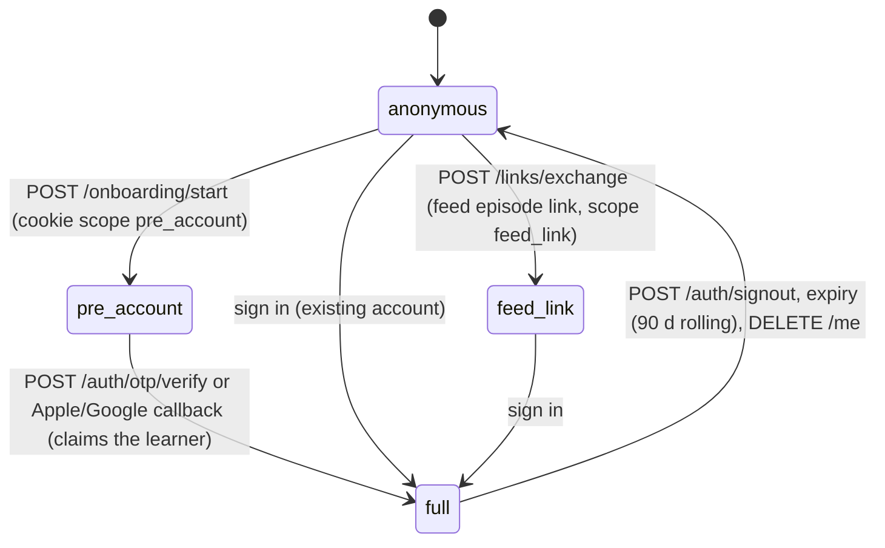

# 02. API contracts

*Base URL `https://api.forone.app/v1`. JSON over HTTPS; audio by multipart upload and `Range` download; one Server-Sent Events stream per client; the live call runs over LiveKit WebRTC with two JSON data-channel topics. OpenAPI is generated from the FastAPI routers and checked into `apps/api/openapi.json` on every PR; the TypeScript client in `apps/web/src/api/` is generated from it (`openapi-typescript`).*

## 1. Authentication and sessions



- Cookie `forone_s`: HttpOnly, Secure, `SameSite=Lax`, `Domain=.forone.app`, 90-day rolling; value is the opaque 32-byte id of an `auth_sessions` row. `learner_id` always comes from the session, never from a body.
- Scopes: `pre_account` may call onboarding, events and the Salma call only; `feed_link` may read one episode and start its call; `full` everything.
- Internal routes (`/internal/*`) accept a short-lived JWT signed with the service key, issued to `call-worker` per job and to `workflows` per run; they bypass the cookie but still set `forone.learner_id` for RLS.
- Admin routes (`/admin/*`) use staff SSO (Google Workspace OIDC) plus a WebAuthn second factor; every call writes `audit_log`.
- Rate limits (per learner, per device hash, per IP prefix) are in `forone.core.ratelimit`; a refusal is `429 rate_limited` with `Retry-After`.

## 2. Conventions

- Errors: `{ "error": { "code": "swap_used", "message_native": "...", "message_en": "..." } }`. The client shows `message_native` only. HTTP status follows the code (400 validation, 401 no session, 403 scope or `under_18`, 404, 409 state, 410 deleted, 422 unknown event type, 429, 503 vendor outage).
- Every response that touched the learner model carries `X-Forone-LM-Version: <int>`; the client invalidates cached documents with an older version.
- Idempotency: `POST` routes that create something accept `Idempotency-Key` (UUID); the server stores the first response for 24 h.
- Timestamps are RFC 3339 with offset; the learner's local day is computed server-side from `learners.tz`.
- Pagination: `?before=<cursor>&limit=` with an opaque cursor; never page numbers.

## 3. Endpoints

### 3.1 Public (no learner)

| Method, path | Purpose | Request → Response |
|---|---|---|
| `POST /sample` | 90 s sample episode | `{name, topic, job?, contact?}` (rate limit: one per device and per contact per 24 h) → `202 {sample_id, share_token}`; progress on `GET /sample/{id}` `{state, first_segment_url?}` |
| `GET /s/{share_token}.mp3` | shareable audio, 30 days | Range |
| `POST /waitlist` | | `{name, contact_kind, contact, why_target?, self_rating?, city?}` → 202 |
| `GET /invites/{code}` | invite landing | → `{valid, name, expires_at}` |
| `POST /telemetry` | anonymous web vitals | `{metrics[]}` → 204 |

### 3.2 Onboarding (A1 to A10; scope `pre_account`)

| Method, path | Purpose | Request → Response |
|---|---|---|
| `POST /onboarding/start` | A2 Talk or Type; creates the `pre_account` learner | `{invite_code?, tz, native_lang, target_lang, mode: "talk"|"type"}` → `{learner_id, call: {call_id, room_url, token}}` |
| `GET /onboarding` | A4, A5, A10 data | → `OnboardingDoc {word_check: {items: [{item_id, text, band}]}, casting: {hosts: {karim: {voices: [{voice_id, hello_clip_url}]}, mona: {...}}, accents[]}, name: {candidates: [{index, clip_url}], chosen, verified}, pilot: {episode_id, state, first_segment_url?}, ideas: Idea[]}` |
| `PUT /onboarding/casting` | A5 | `{karim_voice_id, mona_voice_id, accent}` → 204 |
| `PUT /onboarding/name` | A5 "say it differently" | `{candidate_index}` → 204 |
| `PUT /me` | A9 account facts | `{birth_date, drop_time_local, backup_time_local?, anchor_text, display_name?, rhythm_days?}` → 204, or `403 under_18` (deletes the pre-account learner) |

### 3.3 Auth

| Method, path | Request → Response |
|---|---|
| `POST /auth/otp/request` | `{email}` → 202 always |
| `POST /auth/otp/verify` | `{email, code}` → `{learner_id, status}`; sets cookie; claims the pre-account learner |
| `GET /auth/apple/start`, `POST /auth/apple/callback`, `GET /auth/google/start`, `GET /auth/google/callback` | OIDC; `state` carries the pre-account session id |
| `POST /auth/signout` | 204 |
| `POST /handoff/mint`, `POST /handoff/exchange` | PWA install handoff: `{}` → `{h}`; `{h}` → sets cookie; single use, 10 min |
| `POST /links/exchange` | feed link `{k, episode_id}` → sets a `feed_link` cookie |

### 3.4 The day

| Method, path | Purpose | Request → Response |
|---|---|---|
| `GET /today` | the home document | → `TodayDoc` (§4.1); `ETag`; `?ack=crisis` acknowledges the once-only resources card |
| `GET /stream` | SSE | events `episode.manifest`, `notes.ready`, `chat.message`, `talkback.answer`, `proof.ready`, `lm.version`; heartbeat every 25 s; `Last-Event-ID` resumes |
| `GET /ideas` | tonight's three | → `{plan_id, ideas: Idea[], cutoff_at}` |
| `POST /ideas/choose` | pick, remix or tell Salma | `{idea_id|null, source: "pick"|"tell_salma"|"remix", remix?: {topic?, format?, cast?}, salma_text?}` → `{picked: Idea, episode_id}`; `409 allowance_used` when today's slots for the plan are spent; `409 cutoff_passed` after the cutoff unless the cutoff episode is still `< writing` |
| `GET /episodes/{id}` | episode page | → `EpisodeDoc {episode_id, kind, slot, title, cast, length_s, state, manifest_url, word_index_url, article: {html, read_aloud_url}, call: {state, call_id?}, chat_thread_id, why_url, cover}` |
| `GET /episodes/{id}/media/{asset}` | `full.mp3`, `seg-{n}.mp3`, `read_aloud.mp3`, `recap.mp3`, `manifest.json`, `word_index.json` | Range; signed, 1 h |
| `GET /episodes/{id}/why` | "why this episode" | → `{reasons: [{text_native, kind}]}` (2 to 4) |
| `GET /media/{media_object_id}` | clips, kept recordings, proof | Range; refuses `deleted_at` or ephemeral past expiry |
| `POST /sessions/{id}/swap` | one swap a day | `{}` → `202 {episode_id}` then `episode.manifest` on the stream; `409 swap_used`, `409 session_started` |
| `POST /sessions/{id}/doors/{door}` | explicit resume point | `{state, position}` → 204 |
| `POST /sessions/{id}/small-door` | 90 s recap + voice note | multipart `{media (≤60 s), duration_ms, recap_played_ms}` → `202 {media_object_id}`; host reply via `chat.message` |
| `POST /events` | event batches | `{events: EventIn[]}` (≤50, ≤64 KB) → `{accepted, duplicates, rejected: [{event_id, reason}]}`; header `X-Forone-Replay: 1` for offline replays |
| `GET /shelf` | archive | → `ShelfDoc {seasons: [{number, title_native, episodes: EpisodeCard[]}]}` |

### 3.5 Calls

| Method, path | Purpose | Request → Response |
|---|---|---|
| `POST /calls` | start a call | `{session_id, kind: "first"|"main"|"round_two"}` → `{call_id, room_url, token, planning_words: string[3], brief_summary: {host, question}}`; `409 call_done` (one main call per episode), `403 round_two_off` (flag) |
| `POST /calls/{id}/voicenotes` | voice-note fallback | multipart `{media (≤90 s), duration_ms}` → `202 {media_object_id}`; reply as `chat.message` on the stream |
| `POST /calls/{id}/talkback` | typed talkback fallback | `{text_native}` → `{text_native, word_target, mode}` |
| `GET /calls/{id}` | archive view | → `{kind, started_at, ended_at, end_reason, turns: [{turn_index, speaker, text, t_start_ms, t_end_ms, recast?}], full_recording_media_object_id?}` (text is verbatim where done, streaming otherwise) |
| `POST /recordings` | then-and-now parts, say it once, shadow | multipart `{media, task: "retell"|"opinion"|"repeat"|"say_it_once"|"shadow", recording_id?, part_index?, reference_text?, kept_explicitly?}` → `202 {media_object_id}` |
| `GET /recordings/{id}` | the recording task | → `RecordingDoc {recording_id, season, parts: [{task, prompt_native, reference_audio_url?, reference_text?, max_s}], offered_reason}` |

Internal, for the worker: `GET /internal/calls/{id}/brief` → `CallBundle` (04 §3); `POST /internal/events` (same body as `/events`, with `learner_id` in the JWT); `POST /internal/calls/{id}/end` `{end_reason, metrics}`; `POST /internal/media` presigned-PUT minting `{kind, call_id, turn_index, ephemeral}` → `{media_object_id, put_url, headers}`.

### 3.6 Chat, notes, proof

| Method, path | Request → Response |
|---|---|
| `GET /chat/{host}?before=` | → `ChatDoc {thread_id, messages: [{index, speaker, text, at, in_reply_to?}], closed, ideas?: Idea[]}` |
| `POST /chat/{host}/messages` | `{text, event_id}` → `{message_index}`; `409 chat_closed` after the host's fifth message |
| `GET /sessions/{id}/notes` | → `NotesDoc` (flag `notes.enabled`; `404 notes_off` otherwise) |
| `GET /proof/{proof_id}` | → `ProofDoc {proof_id, episode_id, week_start, mode: "good"|"flat"|"slow"|"worse", audio_url, claims: [{claim_id, text_native, how_we_know: Evidence[]}], working_on: WorkingOnItem[], worth_it_asked}` |

### 3.7 Notebook and controls

| Method, path | Request → Response |
|---|---|
| `GET /notebook/{section}` | sections `working_on, about_you, words_owned, tape, out_in_world, kept, hours, why`; each returns its view (01 §3.5) |
| `PUT /notebook/facts/{id}` | `{action: "edit"|"confirm"|"dont_bring_up", text?}` → `{fact}` + `X-Forone-LM-Version` |
| `DELETE /notebook/facts/{id}` | → 204 (status `deleted`, history kept) |
| `POST /notebook/working-on` | `{text, voice_media_object_id?}` → `{item}`; triggers `working_on.changed` (same-day re-plan) |
| `DELETE /notebook/working-on/{id}` | veto → 204; same trigger |
| `POST /notebook/out-in-world` | `{text, on_date}` → `{item}` |
| `POST /notebook/wrong-memory` | `{fact_id?, canon_id?, said_by, learner_correction?}` → 204; synchronous fact fix |
| `GET /controls`, `PUT /controls` | `{drop_time_local?, backup_time_local?, drop_notification?, captions?, transcript_default?, default_speed?, voice_storage?, data_use?, gap_note?, gap_days?, text_size?}` → `ControlsDoc`; each change appends `consent_change` |
| `GET /feed/url`, `POST /feed/reset` | → `{url}` (new token, old revoked) |
| `POST /push/subscribe`, `DELETE /push/subscribe` | `{subscription, ua_hint}` → 204 |
| `POST /me/export`, `GET /me/exports` | → `202 {export_id, passphrase}` (shown once); list `[{export_id, state, ready_at, url_expires_at}]` |
| `DELETE /me` | → 202; every later call `410 deleted` |
| `POST /billing/checkout`, `GET /billing`, `POST /billing/portal` | `{plan: "one"|"two"|"three"}` → `{checkout_url}`; `GET` → `{plan, state, episodes_per_day, current_period_end, founding}` |

### 3.8 Admin (staff)

`GET /admin/learners/{id}/summary` (ids and counts only), `POST /admin/invites`, `GET/PUT /admin/vendors` (one-click vendor switch, writes `vendor_config` and `voice.vendor_failover`), `GET/PUT /admin/flags`, `GET /admin/review/queue` (human review: 10 random episodes per learner per month), `GET /admin/privacy/runs`, `POST /admin/rebuild/{learner_id}`.

## 4. Schemas

### 4.1 TodayDoc

```ts
type TodayDoc = {
  lm_version: number;
  learner: { display_name: string; status: "pre_account"|"trial"|"paid"|"trial_ended"; trial_day: number|null; tz: string;
             plan: { episodes_per_day: 1|2|3; used_today: number } };
  show: { color: string; hosts: { karim: {display_name}; mona: {display_name} }; season: { number; title_native: string|null; day: number } };
  host_line: { who: "karim"|"mona"; text: string; canon_id: string } | null;      // always a confirmed memory
  hero: { state: "ready"|"in_progress"|"notes_waiting"|"done"|"none"; episode: EpisodeCard|null;
          doors: Record<"listen"|"read"|"call"|"chat"|"small_door"|"round_two"|"shadow", DoorState|null>;
          swap_available: boolean; streaming: boolean };
  next_slot: { available: boolean; ideas_due: boolean } ;                          // plans with 2 or 3 a day [DECISION]
  proof: { proof_id; title; length_s; cover } | null;
  tomorrow: { drop_at: string; teaser: string|null; picked: boolean } | null;
  recording_offer: { recording_id; text_native } | null;
  round_two_offer: { host } | null;
  payment: { ask_now: boolean; plans: Plan[] } | null;                             // trial day 7, once
  crisis_resources: { show_once: boolean; resources_ref: string } | null;
};
type DoorState = { state: "not_started"|"in_progress"|"done"|"skipped"; position: {ms?; depth?; cursor?} | null };
type EpisodeCard = { episode_id; kind; slot; title; length_s; cast: string[]; includes: ("call"|"article"|"chat")[]; cover; manifest_version };
type Idea = { idea_id; rank: 1|2|3; title; format; is_wildcard; from_life; arc_id?: string };
```

### 4.2 EventIn

```ts
type EventIn = { event_id: string /* UUIDv7 */; session_id?; episode_id?; call_id?; door: Door; type: EventType;
                 occurred_at: string; payload: Record<string, unknown> };
```
Validation: `type` in the registry; `payload` against that type's Pydantic model (extra fields kept, never read); `occurred_at` within 7 days and not in the future; `event_id` time prefix consistent with `occurred_at` ± 5 min.

### 4.3 AudioManifest (per episode, `manifest.json`)

```ts
type AudioManifest = { version: number; episode_id; duration_ms; full_url; segments: {index; url; start_ms; duration_ms}[];
  lines: { line_id; speaker; start_ms; end_ms; text; words: {w; s; e}[]; scene: number }[];
  timing_quality: "word"|"sentence"; relisten: "ok"|"skipped"; speeds: [0.75, 0.85, 1.0];
  cold_open_end_ms: number; recap_url; feed_tag_url; article_read_aloud_url?; shadow_lines?: {line_id; url}[] };
```

### 4.4 WordIndex (`word_index.json`)

```ts
type WordIndex = { version; units: Record<string /* unit_id */, { lemma; sense_key; gloss_native; example; audio_url?; line_ids: string[]; is_new: boolean; is_target: boolean }>; missing: string[] };
```
The word sheet opens from this file in under 300 ms with no network call; `missing[]` falls back to `GET /gloss?lemma=&sense=` live.

## 5. Real-time channels

**SSE `GET /stream`.** One connection per tab; the service worker does not hold it. Message `{id, event, data}`; `data` carries ids only (`{episode_id}`, `{session_id, count}`, `{thread_id, message_index}`, `{call_id, text_native, word_target, mode}`, `{proof_id}`, `{lm_version}`); the client refetches the document. Reconnect with `Last-Event-ID`; the server replays from a 10-minute ring buffer per learner.

**LiveKit data channels** (reliable, JSON, `{v: 1, t: client_ms, type, ...}`):

| Topic | Direction | Types |
|---|---|---|
| `forone.ctrl` | client → worker | `hold.down`, `hold.up`, `talkback.down`, `talkback.up`, `end_call`, `text.turn {text}`, `fact_card.edit {card_id, value}`, `fact_card.remove {card_id}`, `client.hidden`, `client.visible`, `planning.ready`, `replay.host_line {host_line_id}` |
| `forone.ui` | worker → client | `state {phase, turn, t_s}`, `caption {host_line_id, words?, text?, recast_span?, final}`, `talkback {text_native, word_target, mode}`, `retell_ring {seconds}`, `fact_card {card_id, field, value, quote}`, `crisis {resources_ref}`, `fallback_required {reason}`, `ended {end_reason}` |

Audio: the learner publishes one Opus track (48 kHz, 20 ms frames, DTX off); the worker publishes one track that carries the host, Salma and backchannel clips mixed. Token: LiveKit JWT from `POST /calls`, room `call-{call_id}`, identity `learner`, grants `canPublish, canSubscribe, canPublishData`, TTL 15 min, room `emptyTimeout` 60 s, `maxParticipants` 2.

## 6. Inngest events (service to service)

The catalogue is `forone.core.events` (architecture 01 §4.3); the contract every function relies on: payloads carry ids, dates, enums and short codes only. Senders and consumers:

| Event | Sender | Consumer |
|---|---|---|
| `day.became_active`, `idea.chosen`, `learner.swap_requested`, `learner.return_detected`, `onboarding.intake_completed`, `sample.requested`, `working_on.changed`, `learner.schedule_changed` | api | `day/next`, `episode/produce` |
| `learner.cutoff_reached`, `episode.ready`, `episode.streaming_started`, `episode.failed`, `ideas.ready`, `drop.published`, `pipeline.human_page` | workflows | `day/next`, api (stream), ops |
| `call.turn_audio_ready`, `call.ended`, `voicenote.received`, `recording.turn_audio_ready`, `pronunciation.requested`, `crisis.activated` | call-worker via api | `call/verbatim-turn`, `session/after-pass`, `call/voice-note-reply`, `crisis/activate` |
| `verbatim.turn_completed`, `notes.ready`, `session.after_pass.completed`, `proof.requested`, `season.boundary` | workflows | `session/after-pass`, api (stream), `proof/make` |
| `media.object_created`, `learner.consent_changed`, `gap.armed`, `learner.deletion_requested`, `learner.export_requested` | api | `audio/expire`, `learner/purge-audio`, `gap/note`, `learner/delete`, `learner/export` |
| `vendor.degraded`, `voice.vendor_failover` | workflows, admin | adapters, pipeline |

## 7. Versioning

The path carries `/v1`; additive changes (new optional fields, new event types) do not bump it. A breaking change ships as `/v2` beside `/v1` for one release of the PWA (the service worker updates within 24 h). Event payload schemas are versioned by the Pydantic model's `schema_version` field; readers must accept all versions in the registry.
