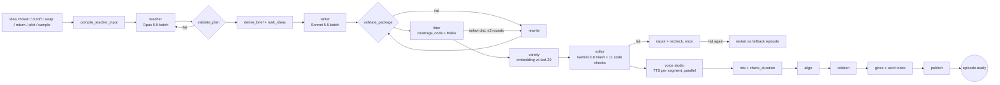
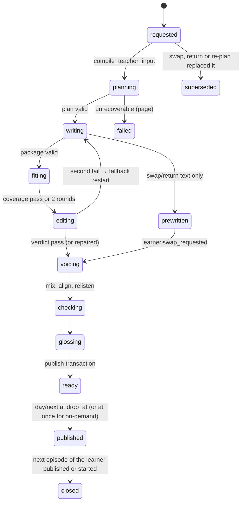

# 03. Generation pipeline design

*One Inngest function, `episode/produce`, turns a chosen idea into a published episode: script, article, call brief, recap, audio, word-level timings and a gloss index. Code in `forone.pipeline`; prompts in `forone/pipeline/prompts/<role>/<version>.md`; every model call goes through `forone.adapters` and is traced.*

## 1. The pipeline at a glance



Steps are Inngest `step.run` calls with the timeouts and retries of `architecture/02 §4.2`. Paid steps look up `pipeline_steps` by `custom_id = {episode_id}:{step}:{attempt}:{job_key}` before calling a vendor and reuse a stored result on retry.

## 2. Episode state machine



`streaming = true` on `swap`, `return`, `pilot`, `sample` while `voicing`: segment 1 is published (and `episode.streaming_started` sent) once scene 1 passes code checks 1, 4, 10 and model checks 3, 5, 10; later segments append to the manifest.

## 3. Deadlines and pricing modes

For a daily episode with `drop_at` D: `t_teacher_cut = D − 4 h`, `t_writer_cut = D − 2 h 30`, `t_voice_cut = D − 2 h` (batch TTS only, P1), `t_switch = D − 90 min` (the PRD's switch to on-demand). Batch pricing is used only when `now < t_teacher_cut − 30 min`. Batch requests pool per 30-minute window across learners, `custom_id` per step; `batch/watch` polls every 5 min and emits `batch.ended`. At any cut line the pending batch is cancelled and the step re-runs at standard pricing. Deadlines are re-read from `episodes.drop_at` before every decision, because a schedule change updates the row.

Spend modes from the cost domain: `conserve` moves the teacher to Sonnet 5.5 batch, `max_rewrite_rounds` to 1, and skips `prewrite_rank2`; `halt` refuses new swap, pilot and sample runs (the API answers with Salma's allowance line) but finishes queued dailies and always runs returns.

## 4. Step 1: the teacher

**Input** (`TeacherInput`, compiled by code from the learner model, under 12k tokens): the plan history (last 14 days: targets, formats, dials, outcomes), the due list from the scheduler (words and structures with `p_recall < 0.85` by drop time), `structure_acc_14d`, the error profile with status `pattern|targeting`, `working_on_items` (vetoes honored), usable life facts (confidence ≥ `usable`, not `dont_bring_up`, inside shelf life, at most 8 offered), interests by salience, open arcs and season state, taste, follow-ups due, passed claims since the last plan, the chosen idea (or null at cutoff), `evidence_lag` flag.

**Prompt** `teacher/v1.md` (system block cached; variables in braces):

```
You plan tomorrow's episode of a private podcast for one adult learning {target_lang} from {native_lang}.
You decide pedagogy; the learner decided topic, format and cast. Return JSON matching EpisodePlan. Rules you may not break:
- exactly 1 grammar target from the inventory ids below; it may not be a target in more than {max_consecutive=4} consecutive sessions
- 2 to 4 target words from the due list; 3 to 6 new words, at least 80% from the top 3,000 lemmas, none from the ban list
- at most 2 life facts, only from USABLE FACTS, cited by fact_id; never a fact whose sensitivity is set unless raised this ISO week
- dials move at most one step from the last plan; first three episodes and return episodes are one step easier
- 2 to 4 "why this episode" reasons in plain {native_lang}, each tied to evidence you were given
- never mention scores, levels, streaks, tests or homework anywhere
LEARNER MODEL (version {lm_version}): {due_list} {structure_acc_14d} {error_profile} {working_on} {facts} {interests} {arcs} {season} {taste} {claims_passed} {last_14_days}
IDEA: {idea | "none: pick the top-ranked of your own three"}
```

**Output** `EpisodePlan` (Pydantic, strict): `{targets: {grammar: structure_id, words: lemma[2..4]}, new_words: lemma[3..6], facts_used: fact_id[0..2], dials: {audio_coverage, text_coverage, speech_rate, length_min, step}, format, cast, arc_move, callback: {canon_id}|null, recall_gaps: [{line, expected}] 2..4, ideas_for_tomorrow: Idea[3] (exactly one wildcard, at most one arc idea), why: [{text_native, evidence_ref}] 2..4, host_position, pushback[]}`. `validate_plan` (code) checks every rule above against the input; a violation is re-prompted once with the violations listed; a second failure uses the rule-based brief (`forone.pipeline.teacher.rulebased`), which fills the same schema from the scheduler alone.

Request: `claude-opus-5-5`, batch, `max_tokens 24000`, structured output by JSON schema, temperature 0.4. Cost about $0.077 (batch) per episode.

## 5. Step 2: the writer

**Brief** (`WriterBrief`, derived by code from the plan): idea, format pattern from the library, cast and bible excerpts (host voices, 3 to 5 side characters, running jokes), targets with "necessity moves" (situations that force the structure), new words with the senses to use, the two facts with their quotes, callback text, arc state, length in minutes, coverage targets, the ban list, `never_mention`, name respelling.

**Prompt** `writer/v1.md`:

```
You write today's episode of "{show_title}", a {length_min}-minute {format} for one listener, {learner_name}, who learns {target_lang}.
Write for the ear: 2 to 4 scenes, a cold open under 30 s, natural speech, the hosts as the bible describes them.
HARD RULES (code checks each; a miss comes back as a rewrite): use the grammar target {grammar.label} in at least {grammar.min_uses} natural places;
use each target word {words}; introduce exactly these new words {new_words}, each at least twice, meaning clear from context;
every proper noun in NAMES only; the learner is never spoken to as a student; nobody mentions learning, levels, progress or homework;
no phrase from BAN LIST; the episode stands alone; the plot may continue ARC but owes nothing; end with the throw: {host} asks the listener {question} and says "call me".
FACTS you may use once each, lightly: {facts with quotes}. CALLBACK (once): {callback}. NEVER MENTION: {never_mention}.
Then write: the article ({article_words} words, same topic, different angle), the call brief, a 90-second recap, Salma's 5-second feed tag in {native_lang}, 3 shadow lines.
Return JSON matching EpisodePackage.
```

**Output** `EpisodePackage`: `{scenes: [{scene, lines: [{line_id, speaker, text, sfx?}]}], article: {title, paragraphs[]}, call_brief: CallBrief, recap, feed_tag_native, shadow_lines[3], names[], planted_phrases[], realized: {grammar_uses: line_id[], word_uses: {lemma: line_id[]}}}`. `validate_package` (code): structure, speakers in cast, names ⊆ allowed entities, target and new-word counts, scene count, approximate length by word count (150 wpm × rate), no ban-list phrase. One free rewrite round on violation; a second fail restarts as `fallback`.

Request: `claude-sonnet-5-5`, batch, `max_tokens 24000`, `effort: medium`. Rewrites and repairs: `writer.rewrite` at standard pricing with the same cached prefix, input = failing sentence ids with reasons, output = `SentencePatch[]` applied by code ("rewrite only these sentences, keep every other line byte-for-byte"). Cost about $0.055 including 1.3 rewrites on average.

## 6. Step 3: the fitter (the coverage check)

The fitter is code with one small model call. It answers: of the running words the learner will hear, what share do they already understand?

```python
def coverage(text, surface, learner, lexicon, dials) -> FitResult:
    tokens = lexicon.lemmatize(text)                  # spaCy + package rules; {surface, lemma, pos, is_name, is_number, sent_id}
    chunks = lexicon.chunks(tokens)                   # multiword units from the package chunk list
    scored = [u for u in units(tokens, chunks) if not u.is_name and not u.is_number]
    p = {u: learner.p_understood(u, surface) for u in scored}   # Beta mean from word_bank (ear or eye), else the frequency prior
    cov = mean(p[u] for u in scored)                  # running units, not types
    failing = [s for s in sentences if any(p[u] < 0.5 for u in s.units)]
    target = dials.audio_coverage if surface == "ear" else dials.text_coverage
    return FitResult(coverage=cov, target=target, passing=cov >= target, failing_sent_ids=failing,
                     unknown_units=[(u, p[u], u.sent_id) for u in scored if p[u] < 0.5])
```

- Prior for an unseen lemma: `p_known(rank) = sigmoid((N_est − rank) / 900)` where `N_est` is the learner's estimated vocabulary size from the word check (36 real items in 6 bands plus 12 pseudowords; the band where hits fall below 50%, corrected for false alarms) [ASSUMPTION; recalibrated after Milestone 0].
- Dials: audio default 95% (easier 96, harder 94, floor 93); text default 98% (99, 97, floor 96).
- Planned new words are exempt from the failing rule but counted in coverage; an unplanned lemma with `p < 0.5` fails its sentence.
- Up to 2 rewrite rounds; after that the editor's check 1 decides.
- The Haiku call (`fitter.sense_tag`, about 2 to 4 s) assigns a sense key to each content lemma so glosses and `word_bank.sense_key` are right; it never changes text.
- Reconciliation test against the Milestone 0 hand checker: every script the checker passed at N = 3000 with ≥ 97.5% passes the fitter at the 96 dial; the fitter is never above the checker and never more than 1.5 points below.

Latency: lemmatizing 1,500 words under 200 ms. Cost about $0.003.

## 7. Step 4: variety and the editor's gate

**Variety** (code): embed the script (`voyage-3-lite` or the configured embedder), cosine against the learner's last 20 scripts; over 0.85 is a sameness fail passed to the editor as evidence. Format rotation: no format 3 times in a row over the last 10.

**Editor** (`editor/v1.md`, Gemini 3.8 Flash, a different vendor from the writer by rule): receives the package, the plan and the code-check results, returns `Verdict {pass: bool, checks: {1..11: {pass, note}}, repair_instructions[], flags[]}`. The eleven checks: 1 level fit (coverage and new-word budget, from the fitter), 2 targets present and natural, 3 facts used correctly and only the allowed ones, 4 names and entities allowed, 5 nothing false about the learner, 6 arc continuity, 7 bible consistency (voices, jokes), 8 sameness and format rotation, 9 stands alone, 10 law scan (no scores, levels, streaks, tests, homework, guilt), 11 content safety and the crisis keyword list. Checks 1, 4, 8, 10 and 11 are also code; the model judges the rest. On fail: one `repair` (writer, standard) with the instructions, one `recheck`; a second fail restarts as a `fallback` episode (facts, arc and callback dropped; checks 6 to 9 logged but non-blocking). Three fallbacks for one learner in 7 days page a human. Cost about $0.015.

## 8. Step 5: the voice studio

Render jobs per segment (scene, article read-aloud, recap, feed tag, shadow lines, name respellings), fan-out in parallel, each `step.run` with 90 s timeout, 2 retries on the primary voice then the understudy (`voice.vendor_failover` event). Vendors behind `TTS` adapter: Gemini 3.8 Flash TTS primary (winner of the blind test; Inworld TTS-2 and ElevenLabs v4 candidates), rate 0.85 to 1.00 in 0.05 steps, voice ids from `voice_casting`. Then `mix` (ffmpeg: loudness −16 LUFS, scene seams, sound design beds from the shared package), `check_duration` (4:00 to 8:00 hard bounds, ±20% of the dial; one last-scene rewrite if outside), `align` (forced alignment to word timings; falls back to sentence timings with `timing_quality = sentence`), `relisten` (ASR of the rendered audio against the script; a line whose WER > 15% is re-synthesized up to twice, then a synonym rewrite or a transcript mark). Output: `full.mp3`, `seg-{n}.mp3`, `manifest.json`. Cost about $0.22 (Gemini), the largest line.

## 9. Glosses, the word index and caching

| Cache | Key | Store | Hit rate expected |
|---|---|---|---|
| Gloss cache | `(pair, lemma, sense_key)` | `gloss_cache` table + S3 audio | > 90% after week 2; the only cross-learner content store |
| Prompt cache | static system blocks per role (teacher rules, writer rules, editor rules, host bible) | Anthropic prompt caching, breakpoint 1; Gemini context cache for the editor | every call after the first per hour |
| Compiled briefs | `(learner_id, role, lm_version)` | `briefs` + S3 | one compile per learner-model version |
| Pre-written swap | `(learner_id, local_date, rank 2)` | `episodes.state = prewritten` | swap-prone learners only (taste.swap_n ≥ 2) |
| Backchannel and opening clips | `(host, voice_id, clip_id)` | S3, rendered once per casting | always |
| Name respellings | `(learner_id, candidate_index)` | S3 | once at onboarding |
| Pipeline step results | `custom_id` | `pipeline_steps` | every retry |

`gloss` fills `word_index.json` from the cache; misses call `gloss.lookup` (Haiku, batched 20 lemmas per call), write the cache and render the gloss audio. Missing entries ship in `word_index.missing[]` and the sheet looks them up live.

## 10. Publish

One transaction after all uploads: `episode_artifacts` rows, `episodes.state = ready`, `ready_at`, `why` artifact, `structure_map.heard_n += realized counts`, `word_bank.status = planned → heard` is left to playback events. Then `episode.ready {episode_id, artifact_ids}`. `day/next` publishes at `drop_at`: `feed_items` row, one web push (title and length only), `drop.published`. Orphan sweep deletes uploads of a run that never published.

## 11. On-demand paths

| Kind | Difference | First sound |
|---|---|---|
| swap | no teacher; brief from the stored plan's rank-2 idea; scene 1 voiced first; pre-written text if it exists | < 30 s |
| return | plan and text made at day 5 by `return/plan`; re-filter facts and claims; re-write only if stale | < 30 s |
| pilot | rule-based brief from intake facts; short call brief; name respellings in parallel | < 45 s after intake |
| sample | no learner; moderation on the answers; cost ceiling $0.05; Salma's close appended; 90 s | < 30 s |

## 12. Cost per step (beta stack, Gemini voice, list prices 2026-10)

| Step | Model and mode | Cost per daily episode |
|---|---|---|
| Teacher | Opus 5.5 batch, ~7k in, 6k cached, 1k write, 6k out | $0.077 |
| Writer + rewrites | Sonnet 5.5 batch + 1.3 standard rewrites | $0.055 |
| Fitter, glosses, editor, embedding | Haiku 5.5, Gemini 3.8 Flash, embedder | $0.018 |
| Voice studio | Gemini TTS 15k tokens + align + re-listen + mix | $0.217 |
| Pipeline total per episode | | **$0.367** |
| Call, verbatim, notes/chat, after-pass, proof share, swap allowance | see 04, 06, 09 | $0.271 |
| **Per session** | | **$0.638** against a $0.60 budget |

Levers in order: batch TTS where offered (−$0.07, P1); episodes at 5 to 6 min (−$0.03); Sonnet teacher in `conserve` (−$0.05); cheaper voice that passes the blind test. Gemini prices double on 2027-01-01, which moves the Gemini-voice total to about $0.82; the understudy choice must be made with that date in view.

## 13. Testing

Fixtures: `fixtures/teacher_input/*.json` built from the Milestone 0 learner files; the offline suite runs 30 to 50 synthetic learners through the whole function with vendor stubs (recorded responses) and asserts: every plan valid, coverage within 1 point of the hand checker, editor pass rate ≥ 90% first time, duration inside bounds, cost per episode within 10% of the model. A canary episode for the synthetic learner renders on every deploy.
