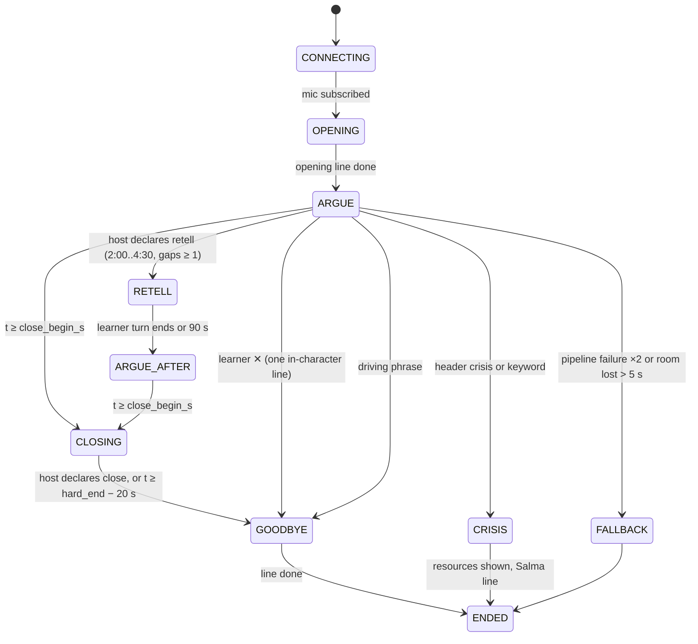
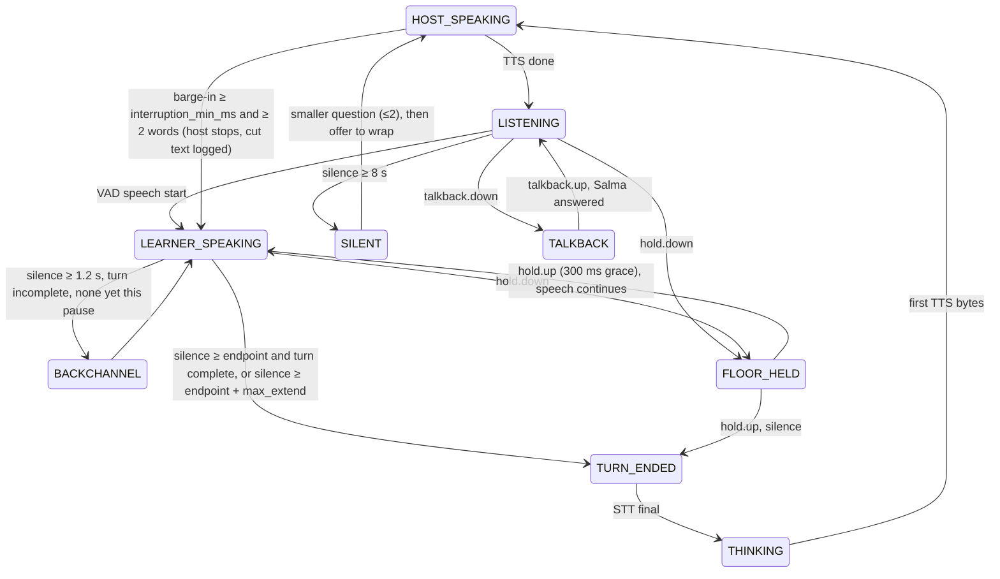

# 04. Live call design

*The call is a LiveKit Cloud room with two participants: the learner's browser and a Python LiveKit Agents job in `apps/call-worker`. The worker runs streaming speech-to-text, a fast host model with a cached brief, and streaming text-to-speech in the episode's host voice. It reads the learner model and never writes it. Every learner turn is recorded and re-transcribed verbatim afterwards, because streaming recognizers silently fix learner errors.*

## 1. Room lifecycle

```mermaid
sequenceDiagram
  autonumber
  participant W as web (call screen)
  participant API as api
  participant LK as LiveKit Cloud
  participant CW as call-worker job
  participant V as STT / host LLM / TTS
  W->>API: POST /v1/calls {session_id, kind}
  API->>API: compile CallBundle (brief, budgets, voice, DEK), insert calls row
  API->>LK: create room call-{id} (metadata: call_id only), mint learner token
  API-->>W: {call_id, room_url, token, planning_words[3]}
  W->>W: planning card 30 s (3 words), mic permission, wake lock
  W->>LK: join, publish mic track
  LK->>CW: job request (dispatch rule: room prefix call-)
  CW->>API: GET /internal/calls/{id}/brief (JWT)
  CW->>LK: join, publish host track, subscribe mic
  CW->>V: open STT websocket, pre-open TTS websocket, warm LLM cache (layer A+B)
  CW->>W: ui.state {phase: OPENING}; opening clip plays (pre-rendered)
  loop each turn (~1 s budget)
    W->>CW: audio frames
    CW->>V: streaming STT partials/final
    CW->>V: host LLM (operator note + history)
    CW->>CW: parse @moves header, governor.check
    CW->>V: TTS sentence by sentence
    CW->>W: host audio + ui.caption
    CW->>API: POST /internal/events (call_turn x2, silence, hold_floor)
    CW->>API: presigned PUT turn audio; media.object_created; call.turn_audio_ready
  end
  CW->>W: ui.ended {end_reason}
  CW->>API: POST /internal/calls/{id}/end {end_reason, metrics}; call.ended
  CW->>LK: leave; room closes (emptyTimeout 60 s)
```

Connect budget: `POST /calls` 100 ms, room join 0.5 to 1.5 s, job accept under 500 ms on a warm task, brief fetch under 100 ms, opening clip at track subscription. Under 3 s at p95 with at least one warm worker task per environment (`min_tasks = 1`, scaled on `rooms_active / 6`).

Room settings: `emptyTimeout 60`, `maxParticipants 2`, no egress, no recording by LiveKit (the worker records), metadata carries the `call_id` only. Tokens TTL 15 min. A room whose job dies is not resumable: the client gets `fallback_required` or a disconnect and `POST /calls` again creates a new call with `resumed_after_drop: true` and the "gap" opening clip.

## 2. The call bundle

Compiled by `forone.core.briefs.compile_call_bundle(call_id)` at `POST /calls` so a notebook veto an hour earlier is honored. Shape (TypeScript in `architecture/03 §4.2`, unchanged): `call`, `host_brief` (one page, under 900 tokens: learner name and respelling, episode in 3 lines, the question, planted phrases, host position and pushback, grammar target with necessity moves and a recast list of expected error → form, 2 to 4 target words with moves, 2 to 4 recall gaps, retell prompt, one confirmed callback, `never_mention`, budgets, style, day type), `salma_brief` (produced lemmas with counts, active targets, native-language share), `turn_taking` numbers, `anxiety` flags, `voice` (host voice, understudy, Salma voice, pre-rendered backchannel and opening clips), `vendors`, `consent.voice_storage`, `crypto.dek` (memory only), `language.repair_phrases`, `limits {close_begin_s, hard_end_s}`, versions.

## 3. Call kinds and budgets

| kind | persona | close / hard end | clarify | recast per turn | nudge | recall gaps | retell | praise |
|---|---|---|---|---|---|---|---|---|
| `first` (onboarding A7) | host | 60 s / 90 s | 1, only if meaning lost | 0 | 0 | 0 | 0 | 1 at end |
| `main` | host | 390 s / 480 s | 3 | 1 | 1 | 2 to 4 | 1 (window 2:00 to 4:30, after ≥1 gap) | 1 |
| `round_two` [P1] | same host | 120 s / 180 s | 2 | 1 | 0 | 0 to 1 | 1 first | 1 |
| `onboarding` (A3) | Salma, native language | about 3 min, ≤ 8 Salma turns | own contract | | | | | |

Anxiety mode (prior from last call abandoned, or median learner turn < 4 words in the first 2 min, or two 8 s silences): `nudge = 0`, `recall_gaps_max = 1`, simpler questions, more backchannel; recasts kept.

## 4. State machines

**Phase machine** (governor):



**Turn machine** (turn controller):



Turn-taking numbers: `endpoint_ms` starts at the learner's pause profile (default 1,500 ms, adapted 1,000 to 2,500 from the median of the last 30 end-of-turn silences + 300); `max_extend_ms` 1,000 (2,500 in retell); the LiveKit multilingual turn detector supplies "turn complete" probability so an incomplete clause waits up to the extension; backchannel on pauses over 1.2 s, one per pause, a pre-rendered clip in the host voice; `interruption_min_ms` 600.

## 5. The host turn, token by token

```mermaid
sequenceDiagram
  participant TC as turn controller
  participant G as governor
  participant LLM as host model
  participant TTS as call TTS
  participant C as client
  TC->>G: learner final text, t_s, held_floor, repair_request?
  G->>G: allowances(t, retell window, meaning_lost)
  G->>LLM: messages + operator note {"t":"2:14","mode":"normal","allowed":[...],"not_allowed":[...]}
  LLM-->>G: "@moves {...}\n" (first ~40 tokens, 100-200 ms)
  G->>G: check(moves, allowances)
  alt violation
    G->>LLM: system "Do not use: nudge. Reply again." (once, ~600 ms)
  end
  LLM-->>TTS: text streamed, flushed per sentence (first . ? ! or 12 words)
  TTS-->>C: audio frames via LiveKit
  G->>C: ui.caption {recast_span}
  G->>G: commit(moves); emit call_turn{speaker: host}
```

Request: `claude-sonnet-5-5`, `max_tokens 120`, `effort: low`, streaming, cache breakpoints on the static host block (about 1,800 tokens, shared by every learner of one host and accent), the per-call brief (about 700 tokens) and the last learner turn. Operator notes are `system` entries inside `messages` so the cached prefix stays intact. The `@moves` header: `{"recast":{"heard":"I go","form":"went"}|null,"clarify":bool,"nudge":bool,"recall_gap":"rg2"|null,"retell":bool,"praise":bool,"close":bool,"goodbye":bool,"crisis":bool,"ai_disclosure":bool}`. A missing header is treated as `{}` and logged `header_missing`; a second violation is spoken anyway and logged `move_violation`; the call never stalls on the governor.

Fallback order on error or first token later than 1.2 s: retry once (1.5 s timeout) → `claude-haiku-5-5` same prompt → `google/gemini-3.8-flash` with the prompt rendered plain. The fallback used is on the `call_turn` event and `calls.vendors`.

## 6. Recast logic

A recast is the only correction the learner ever receives, and it is invisible as correction: the host repeats the learner's meaning with the right form, stressed, inside a reply that has its own point, then carries on.

1. **Eligibility.** The governor allows at most one recast per learner turn and none in `first` calls.
2. **What may be recast.** The brief's `recast_list` (expected errors on the session's grammar target, each with its form) and any error that blurred meaning. Errors off-target that did not blur meaning are left alone; the after-session pass will see them in the verbatim transcript and the teacher may target them later.
3. **How the model chooses.** The host prompt says: recast one error at most per reply, only on the target or on an error that blurred meaning, the corrected word stressed. The header's `recast.heard` must be a substring of the learner's streaming text (code check); otherwise the recast is logged `recast_unmatched` and dropped from the caption but the speech is kept.
4. **The caption.** `ui.caption.recast_span` marks the corrected form so the client can render it slightly brighter for one second, never with a label, never as "correction".
5. **Measurement, not display.** `call_turn{speaker: host}.recast` and the next learner turn's `uptake` (did the learner repeat the form?) feed `AfterPassResult.uptake.recast_uptake`; the teacher reads recast uptake per structure and raises the structure's input frequency and recast frequency when a form survives two recordings (decision 3's safety valve).
6. **Never.** "You said X, it should be Y", grammar names, "good job on the past tense", a recast with no content of its own. The editor-style law scan runs offline on sampled host turns in the offline suite and fails the build if a scripted test call produces any of these.

## 7. Talkback (word button)

`talkback.down` opens a recognizer stream with `talkback_stt.languages = [native_language, target_language]` (Soniox for the pilot's `ar` + `en`) for the held window; on `talkback.up` the final text goes to the talkback resolver (`claude-haiku-5-5`, 300 ms budget, with `salma_brief`): if the learner never produced the lemma, Salma gives the word; if they have, a hint first ("you used it Tuesday, about your manager"); `ui.talkback {text_native, word_target, mode}` plays in Salma's voice at a lower level while the host waits. Budget under 2 s. Event `talkback {asked_native, lemma_asked, gave, hint_kind, latency_ms}`.

## 8. Verbatim re-transcription

Why: streaming recognizers (and all "clean" transcripts) drop fillers, repairs and repeated words and often regularize grammar ("we was" → "we were"). The error profile would be fiction. So:

1. The recorder keeps each learner turn's PCM (48 kHz mono → 16 kHz) in memory, encodes Ogg Opus at 24 kHz at end of turn, uploads with SSE-C (`sse_c_learner`) under the per-call key to `forone-voice/learners/{lid}/calls/{call_id}/turn-{turn_index}.ogg` (or `ephemeral/learners/{lid}/calls/...` when voice storage is off, so an S3 lifecycle rule on the bucket-level `ephemeral/` prefix is the backstop), writes `media_objects {kind: call_turn, ephemeral: !voice_storage, expires_at: call_end + 15 min}`, and emits `call.turn_audio_ready {learner_id, call_id, turn_index, media_object_id, is_last}`.
2. `call/verbatim-turn` (Inngest, concurrency 20, priority to `is_last`): `VerbatimRecognizer.transcribe(audio, language=target, disfluencies=True, word_timings=True)` on AssemblyAI (secondary ElevenLabs Scribe), appends `call_turn_verbatim {turn_index, text, words[{t,s,e,c}], vendor, disfluencies_kept, low_confidence_reason}`, emits `verbatim.turn_completed`, and **deletes the turn audio at once when voice storage is off**.
3. The view `call_turns_v` joins streaming and verbatim text per turn; the analyst reads verbatim only; a turn without verbatim is `low_confidence` and yields no claims.
4. Hume is not used (voice APIs shut down 2026-11-13). Vendor choice is settled by the 30-clip test: WER on learner speech, disfluency retention, and a "grammar fixing" count (how many learner errors the recognizer silently corrected; the gate is zero on the 30 clips).

With voice storage on, the worker also mixes both sides into `call_full` at call end (archive playback). The DEK lives in worker memory only, zeroed at job end.

## 9. Latency budget (host reply, from end-of-turn decision)

| Stage | p50 | p95 | Held by |
|---|---|---|---|
| STT final after end of turn | 150 ms | 400 ms | partials already in hand |
| operator note + request build | 10 ms | 20 ms | no I/O |
| host first token | 350 ms | 700 ms | cached prefix, effort low, no tools |
| `@moves` header parsed | 120 ms | 250 ms | ~40 tokens |
| TTS first byte, sentence 1 | 200 ms | 400 ms | websocket pre-opened; flush on first sentence end or 12 words |
| LiveKit + network | 120 ms | 250 ms | edge; 20 ms Opus frames |
| **Total** | **~950 ms** | **~2.0 s** | PRD gates: median 1.5 s, p95 2.5 s |

The learner's own silence window (the endpoint) is reported separately as `silence_to_sound`. `tools/call-bench` runs 50 scripted calls against staging in CI and fails the deploy when p50 > 1.5 s or p95 > 2.5 s.

## 10. Failure modes

| Failure | Detection | Behavior |
|---|---|---|
| STT stream drops | no partials 3 s while VAD active | reconnect once; then secondary recognizer; logged |
| Host model timeout | first token > 1.2 s | fallback chain §5; the learner hears a backchannel clip meanwhile |
| TTS failure | no bytes 1.5 s | understudy voice for the rest of the call; on-air line not needed mid-call; `voice.vendor_failover` |
| Two pipeline failures in a row, or room lost > 5 s | worker | `ui.fallback_required`; the client switches to voice notes (`POST /calls/{id}/voicenotes`, host replies as audio via `call/voice-note-reply`); no session lost |
| Screen lock on iOS Safari | `client.hidden` + audio stall | wake lock requested at start; on stall the client shows "earphones, screen on" once; the worker pauses the clock up to 20 s |
| Driving phrase | code match on learner final | host says the parked line, `end_reason = driving` |
| Crisis | header `crisis` or package keyword list on learner final | host stops; Salma's pre-rendered resources line in the native language; `ui.crisis`; `crisis.activated` with ids only; the call ends |
| Learner silent 8 s twice | turn controller | smaller question, then an offer to wrap; anxiety mode |
| Worker drain on deploy | `drained` | new calls refused inside call windows; running calls finish (hard end 8 min) |

## 11. Events this component emits

`call_started`, `call_turn` (learner: streaming text and words; host: text, moves, allowances, violations, latencies, model, fallback), `silence`, `hold_floor`, `talkback`, `replay_line{door: call}`, `crisis_flag`, `call_ended {end_reason, metrics}`; Inngest: `call.turn_audio_ready`, `call.ended`, `voicenote.received`, `pronunciation.requested`, `crisis.activated`, `onboarding.intake_completed`. `CallMetrics` (written to `calls.metrics` at end): connect and first-sound ms, turns, speech ms per side, talk share, reply latency p50/p95, silence-to-sound p50, talkback count, holds, 8 s silences, cut-offs, barge-ins, anxiety mode, move counts and violations, endpoint initial/final, vendors and fallbacks, cost.

## 12. Cost per main call

STT 7 min × 2 streams about $0.015; host Sonnet with cache about $0.05; call TTS about $0.03 (Gemini); talkback and Salma about $0.006; LiveKit 14 participant-minutes about $0.014; worker compute about $0.004: **about $0.12**. Verbatim re-transcription 7 min about $0.028 plus pronunciation $0.008.
