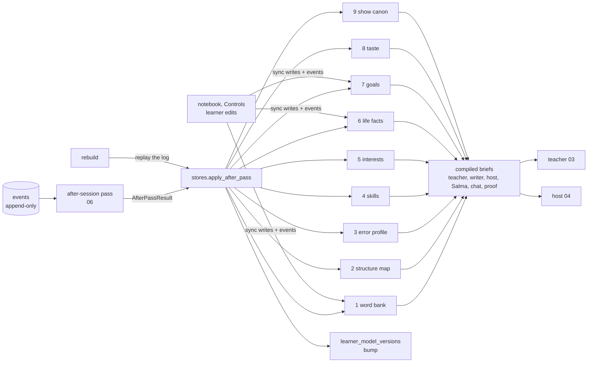
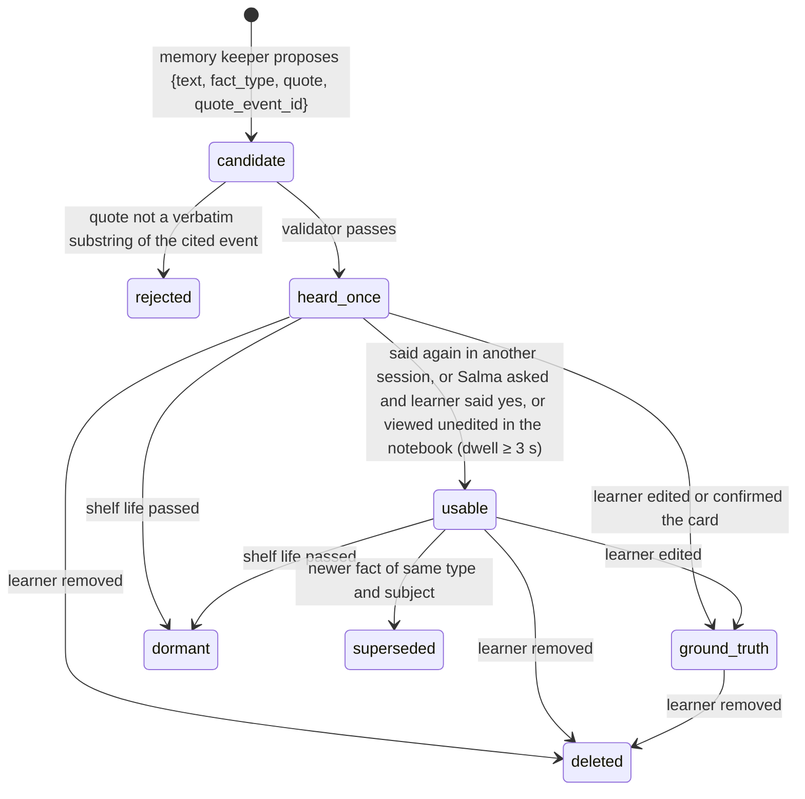

# 05. Learner model and notebook

*`forone.learner`: the append-only event log, the nine derived stores, the review scheduler, the fact validator and the compiled briefs. It is the memory of the teacher and the content of the learner's notebook. Live roles read it; only the after-session pass and the learner write it.*

## 1. Shape

Rules: `events` is the only source of truth; every store row carries `lm_version`; every estimate is a range; every write goes through `versions.bump()` inside the same transaction (row lock on `learners`), which also appends an `lm_write` event so the log alone can be replayed.

## 2. Facts with sources

A life fact exists only if the learner said it and the system can show where.

Validator (`forone.learner.facts.validate`): (1) `quote` must appear word for word (after Unicode and whitespace normalization) in the payload of `quote_event_id`, which must be a `call_turn_verbatim`, `chat_message{speaker: learner}` or `onboarding_answer` event of this learner; (2) `fact_type` must be in `fact_shelf_life`; (3) a sensitive class (health, money, relationships, religion, politics) is stored only if `confirmed_in_session = true` (the learner's yes is itself in the verbatim transcript) and is usable only until the end of that ISO week; (4) a dated event creates exactly one `follow_ups` row (`due_on = dated_event_on + 1`); (5) a fact of the same type and subject supersedes the older one, keeping history.

Use rules: only `usable` or `ground_truth` facts reach a brief; `heard_once` facts are never spoken (Salma may say "I think you mentioned..." only in the notebook); expired facts are never spoken; `dont_bring_up` removes a fact from every brief at compile time; at most 2 facts per episode, 1 callback per call; `times_used` and `last_used_episode_id` stop the same fact from recurring within 5 episodes.

Wrong memory: `POST /notebook/wrong-memory` or a `wrong_memory_flag` event fixes the fact synchronously (status `deleted` or text replaced as `ground_truth`), bumps the version, invalidates compiled briefs, and retracts any `passed` claim whose evidence cites the fact. Metric: flags per 100 callbacks, target under 1.

## 3. Words: probabilities and the scheduler

Each unit (lemma or chunk) has three Beta distributions: ear (understood when heard), eye (understood when read), prod (produced correctly). Prior `prior_p` from frequency rank and the word-check estimate. Updates (`forone.learner.scheduler.observe`):

| Signal | Update |
|---|---|
| heard in a shipped episode, no tap or huh on its line | ear `a += 0.3` (weak positive) |
| read in the article, no tap | eye `a += 0.3` |
| `tap` on the word | ear or eye `b += 1` (strong negative), `tapped_n++`, recall candidate when tapped twice |
| `huh` on its line | each unit in the line `b += 0.5` |
| `keep` | `kept = true` |
| produced correctly, prompted (recall gap, talkback) | prod `a += 0.7` |
| produced correctly, unprompted (analyst `word_evidence`) | prod `a += 1`, `produced_sessions ∪= session`, `own_sentences` (≤3) |
| produced wrongly or substituted | prod `b += 1` |

`status` moves `unseen → planned → heard/read → attempting → owned`; **owned** = correct unprompted use in ≥ 2 distinct sessions at least 20 h apart (the claim gate's rule). FSRS (v4.5 weights, `fsrs jsonb`) schedules reuse: a unit is **due** when predicted recall by the next drop time is below 0.85; grammar structures are due every 1 to 3 days early on. The scheduler drives which items the teacher gets, never which text (law 10: text once, language comes back).

`p_understood(unit, surface)` = Beta mean, or the prior for an unseen unit; this is what the fitter's coverage check (03 §6) calls.

## 4. Structures and mistake tracking

Structures come from the language package inventory (`structures`, 12 categories, English Grammar Profile ids for `ar-en`, licensing open). The analyst proposes `structure_observations {structure_id, obligatory, correct, prompted, quote, corrected, confidence, blurred_meaning}` per obligatory context in the verbatim transcript; code writes them with deterministic ids and recomputes:

- `structure_map.state`: `not_seen → heard (input count > 0) → attempting (any obligatory context) → taking (≥ 50% correct over the 14-day window, ≥ 3 contexts) → stable (≥ 80% over 14+ days, ≥ 5 contexts, ≥ 2 sessions)`; `stable_confirmed_at` when the next 4-weekly recording holds; re-checks at 2, 4, 8 weeks (`recheck_due_at`).
- `error_profile`: one row per structure with errors; `status = pattern` when `count_clean ≥ 3` across `≥ 2` sessions (error vs slip rule); `targeting` when the teacher picks it; `dropped_by_learner` on a veto unless `blurred_n > 0`; `resolved` at `stable_confirmed_at`.
- `clean` on an observation = recognizer confidence over the span ≥ the package threshold (0.70 placeholder) or source is chat; only clean observations count toward claims.
- `avoidance`: a structure whose obligatory contexts the learner steers around (necessity moves offered ≥ 3 times, contexts 0) is flagged for the teacher.

The 14-day accuracy is a view (`structure_acc_14d`), never a stored counter.

## 5. Replanning

Three things make the teacher run again, coalesced per learner (one run per 10 minutes at most):

| Trigger | When | What changes |
|---|---|---|
| `session.after_pass.completed` | within 10 min of a call or chat close | tomorrow's plan (or tonight's not-yet-written episode) sees today's evidence; `wait_after_pass` in `episode/produce` waits up to 15 min for it |
| `working_on.changed` | learner vetoes or adds an item in the notebook | same-day re-plan: `episodes.replan_version++`; a run before `voicing` cancels its batch and re-runs the teacher at standard pricing with the veto honored |
| nightly / cutoff | `learner.cutoff_reached` at drop − 6 h with no pick | teacher runs on the top-ranked of its own three ideas |
| `learner.return_detected` after ≥ 5 days | app open | `return/plan` had prepared a plan at day 5; facts and claims are re-filtered |
| `season.boundary` | day 28 | finale plan and next season opening [P1] |

The "working on" list is at most 3 items (`working_on_items`, source teacher or learner); a learner veto is final for that structure unless it blurs meaning; an addition is honored in the next plan or the teacher explains (via "why this episode") why it waits.

## 6. Compiled briefs

| Brief | For | Size | Contents | Cache key |
|---|---|---|---|---|
| teacher | 03 | ≤ 12k tokens | everything summarized: due list, acc_14d, error profile, working on, usable facts, interests, arcs, season, taste, claims, last 14 days | (learner, lm_version) |
| writer | 03 | ≤ 3k | brief + ≤ 2 facts with quotes, bible excerpt, targets, words, coverage and length, ban list | (episode) |
| host | 04 | ≤ 900 | position, pushback, necessity moves, 2 to 4 recall gaps, 3 words, one callback, budgets, pause profile, anxiety flag, name and respelling, never_mention | (call) |
| Salma talkback | 04 | ≤ 1k | produced-word history, active targets, native share | (call) |
| chat host | 06 | ≤ 1k | call summary, targets, opener | (session) |
| proof producer | 06 | varies | passed claims with evidence only | (proof) |

Compile is a few indexed reads per store; results are cached in `briefs` by `lm_version` and invalidated on any bump, veto or fact edit.

## 7. The notebook (what the learner sees)

| Section | Reads | Writes (sync, each appends an event) |
|---|---|---|
| What I'm working on | `working_on_items` (≤ 3) with one own-sentence example | veto, add (voice or text), unhide → `working_on_edit` → `working_on.changed` |
| About you | `life_facts` (not deleted; `heard_once` shown as "I think..."), `interests`, `goals` | edit, remove, confirm, "don't bring this up" → `fact_card_edit`; viewing ≥ 3 s → `fact_card_viewed` (ladder promotion) |
| Words you own | `word_bank where status = owned` with `own_sentences[0]` and its audio clip | none |
| The tape [P1] | `recording` events, kept recordings | keep this one |
| Out in the world | `out_in_world` | add → `notebook_edit` |
| Kept words and marked moments | `word_bank.kept`, `mark` events | none |
| Hours | `notebook_counts` (hours heard, minutes spoken, words owned; monotonic) | none |
| Why this episode | `episode_artifacts(kind = why)` | none |

Never shown: percentages, levels, scores, charts, comparisons, a list of mistakes. "Where do I stand?" is answered by Salma in words with a range, only for skills with `calibrated = true`.

## 8. Rebuilds

On a version change of the analyst, classifier, measures or memory keeper, `assessment/rebuild {learner_id}` deletes the learner's store rows (facts with `ground_truth` and learner edits are kept and re-applied last), replays the after-session pass over the log in `(occurred_at, seq)` order with vendor stubs where the model output was stored in `model_io`, re-applies, and bumps the version with `cause = rebuild`. Shown claims are never silently retracted: a retraction sets `notice_pending` and the next proof says so in one line. `notebook_counts` never decrease; a lower recomputation is logged.

## 9. Onboarding cold start

A1 to A10 seed the model: waitlist answers → `interests(source = waitlist)`; A3 Salma intake → `onboarding_answer` events → `life_facts (confirmed_by = intake_card, ground_truth)` for the cards the learner left standing, `goals (kind = why_target)`; A4 word check (48 items, 75 s cap) → `word_check_answer` → `N_est` and the `prior_p` curve; A7 first call → first speaking estimate (`skills.speaking` with `sd = 12`). The first three episodes run one step easier.
