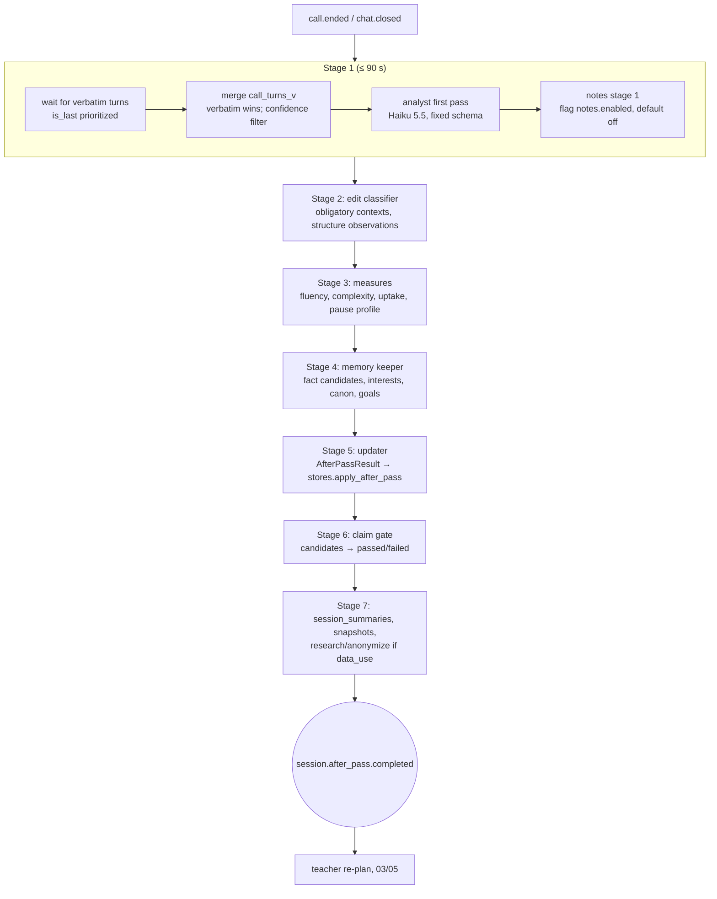

# 06. After-session pass and the weekly proof

*`forone.assess`. Everything that judges the learner runs here, off the live path, within 10 minutes of a session, and writes the learner model through one contract. Once a week it produces a proof episode built only from claims that passed a code-level gate. Evidence, not tests: nothing here is ever shown as a score.*

## 1. The pass

Inngest `session/after-pass`, triggered by `call.ended`, `chat.closed`, `voicenote.received`, `recording.completed`; concurrency 1 per learner; stage 1 timeout 60 s; the whole pass inside 10 minutes.



Inputs are the session's events (`call_turns_v`, `chat_message`, `talkback`, `huh`, `tap`, door states); the output is one `AfterPassResult` (05 §1 and `architecture/04 §4.3.0`) applied in one transaction.

## 2. The analyst (model, fixed schema)

Prompt `analyst/v1.md`, `claude-haiku-5-5`, structured output, temperature 0: given the verbatim learner turns with word confidences, the session's targets and the structure inventory for the pair, return per turn: `word_evidence[] {unit_id, surface: prod, kind: correct_unprompted|correct_prompted|wrong|substituted, span, prompted}`, `structure_candidates[] {structure_id, span, obligatory, correct, prompted, corrected, blurred_meaning}`, `uptake {content_uptake_0_2, recast_uptake[], self_corrections}`, `reached_for[] {paraphrase, lemma_given}`, `can_do_moments[] {can_do_id, quote}`, `fact_candidates[]`, `interest_signals[]`, `goal_signals[]`, `canon[]`, `anxiety_signals`. Rules in the prompt: quote only text that appears verbatim; mark a span `prompted` if the host's previous turn supplied the form; never infer health, money, relationships, religion or politics; return an empty list rather than a guess. Code validates every quote as a substring of the cited event and drops the rest (`analyst_dropped` metric).

## 3. The edit classifier and measures (code)

- **Edit classifier**: aligns each learner clause with the analyst's `corrected` form, maps the edit to a structure id through `structure_rules.yaml` (per pair), and decides `obligatory` from the rules' context patterns. Chat observations are `clean = true`; speech observations are clean when every word in the span has confidence ≥ `asr.confidence_threshold`.
- **Measures** (per comparable segment: retell, round two, recording tasks; minimum 40 words or 30 s): speech rate (wpm), articulation rate, mean length of run between pauses ≥ 250 ms (`mlr`), mid-clause pause rate, first long pause (≥ 2 s), fillers and repairs per 100 words, mean length of clause, subordination ratio, MTLD, share beyond the top 2,000 lemmas, errors per 100 words. Written to `comparable_segments` with `measurable`, `clean_share`, `assessment_version`.
- **Pause profile**: `eot_silence_ms = clamp(1000, 2500, median(last 30 end-of-turn silences) + 300)`.
- **Skills** update: Gaussian conjugate with `sd_obs = 8` until test-retest standard errors exist.

## 4. The memory keeper

`claude-haiku-5-5` plus rules: normalizes topics (`football:al_hilal`), decides `fact_type`, `sensitivity`, `dated_event_on`, `supersedes_hint`; the validator (05 §2) has the last word. Interests decay: `salience *= 0.97` per inactive day, dormant below 0.15; `talked_long` adds 0.2, `chose` 0.1, `skipped` −0.1, `dislike` sets `hard_dislike`, "never bring up" sets `no_go`.

## 5. Claims and the gate

A claim is a sentence about the learner's progress. It exists only as a `claims` row written by `gate()`, and its `text_native` is rendered by code from a per-kind template. No model writes a claim.

```mermaid
flowchart TD
  C[candidate] --> R4{clean evidence?<br/>verbatim done, confidence ≥ threshold,<br/>no dial-in or voice-note source}
  R4 -- no --> F1[failed: clean_evidence]
  R4 --> R5{openable?<br/>quote in the log, audio range or text fallback}
  R5 -- no --> F2[failed: openable]
  R5 --> K{kind}
  K -- did_it, first_ever, word_owned --> P[passed]
  K -- metric kinds --> R1{like for like?<br/>same task type, same assessment version,<br/>then-and-now: different stimulus form}
  R1 -- no --> F3[failed: like_for_like]
  R1 --> R2{beyond noise?<br/>metric_calibration n_pairs ≥ 12,<br/>|after − before| ≥ 2 × sem}
  R2 -- no SE --> F4[failed: no_standard_error]
  R2 -- no --> F5[failed: beyond_noise]
  R2 --> R3{repeated?<br/>two recent points, same direction, each beyond threshold}
  R3 -- no --> F6[failed: repeated]
  R3 --> P
  P --> S[shown when any surface emits claim_shown]
  S --> X[retracted only by rebuild or memory/correct → notice_pending]
```

| kind | statement | min history | tag |
|---|---|---|---|
| `did_it` | "You disagreed with Karim and gave a reason" | none | P0 |
| `first_ever` | "First time you used *should have* on your own" | ≥ 1 prior session of exposure, no earlier correct unprompted use | P0 |
| `word_owned` | "*Negotiate* is yours: Tuesday you said ..., today ..." | the owned rule (2 sessions, 20 h apart) | P0 |
| `mistake_gone` | "*I go yesterday* has not come back since ..." | structure confirmed stable; pattern had ≥ 3 observations | P1 |
| `fluency_change`, `complexity_change`, `accuracy_change` | metric before/after with the attempted count beside it | calibration row with ≥ 12 pairs; ≥ 2 comparable segments each side; accuracy ≥ 5 contexts each window | P1 |
| `accuracy_fell_while_trying` | "More mistakes because you tried the past perfect eleven times" | a worse accuracy change with attempts ≥ 2× | P1 |
| `talkback_falling` | "Four asks this week; in week 1, fifteen" | ≥ 3 weeks of calls | P1 |
| `then_and_now` | the finale's two measured differences | two recordings, different forms | P1 |

Declines pass the same gate and are stored `direction = worse` with a reason (`trying`, `harder_task`, `long_gap`, `unknown`). Until standard errors exist (`metric_calibration` from test-retest pairs 2 to 7 days apart, `sem = sd(x2 − x1)/√2`), only the three event kinds can pass; the P1 metric kinds are also behind feature flags that double as the audit's kill switch. Every claim row keeps `sem_used`, `threshold_used`, `assessment_version`, and `claim_evidence` rows (event ids, quotes, media byte ranges, labels) so "how we know" is a render of the row.

## 6. The weekly proof

`proof/fanout` (hourly cron) finds learners whose proof time falls in the past hour (proof weekday at drop time; onboarding weekday + 7 until known) and sends `proof.requested`; `proof/make` (concurrency 1 per learner):

```mermaid
sequenceDiagram
  participant PM as proof/make
  participant CG as claims
  participant PP as proof producer (Sonnet 5.5)
  participant VS as voice studio
  participant API as api / feed
  PM->>CG: passed, unshown claims this week (+ notice_pending retractions)
  PM->>PM: choose mode: good (≥1 headline) / flat (none, sessions ≥ 3) / slow (sessions ≤ 2) / worse (a worse claim and nothing better)
  PM->>PP: ProofBrief {mode, headline_claim, more_claims ≤ 3, worse_claims, working_on ≤ 3, next_focus, retraction_notice?, worth_it_question}
  PP-->>PM: ProofScript (Salma, native language, ~2 min; slow week ~45 s) — each claim sentence is claims.text_native verbatim
  PM->>PM: code check: every progress sentence equals a passed claim's text; no numbers other than those in claims; law scan
  PM->>VS: render (Salma voice) → episodes row kind=proof, artifacts
  PM->>API: publish above Today and to the feed; claim_shown per claim; proof.ready on the stream
```

Templates per mode (`proof/v1/{good,flat,slow,worse}.md`): a flat week says "nothing I can prove this week, and that is normal; here is what we are working on"; a slow week is short and warm, with no "you missed"; a worse week names the supported reason or says "I cannot say why yet". The proof ends with the worth-it question (yes / mostly / no, optional why) → `worth_it_answer`. The simple P0 proof carries: first-ever events, words owned, next focus, the working-on list, the question. The full P1 proof adds gated fluency and accuracy claims.

## 7. The then-and-now recording and the finale [P1 comparison]

Offered after session 2 (and once more in sessions 3 to 5) as the first "then": about 3 minutes, three tasks (60 to 90 s retell of a fixed-form prompt, 60 to 90 s opinion, 8 repeat sentences), skippable, nothing scored on screen. Stored in `recordings (season_number, kind then|now, form, tasks)`; audio under the voice-storage rules unless the learner keeps that one. The rater (a pinned model per 4-week window, `rater_versions`, plus code measures) writes `recording_ratings {band, band_low, band_high, measures, repeat_scores, content_points}`. The "now" at day 28 produces `then_and_now` candidates through the same gate (different stimulus forms; same assessment version). The finale (season boundary, flag `finale`) speaks at most two measured differences. Calibration before any band is spoken: 150 to 200 double-tagged samples, QWK about 0.7, tag precision ≥ 0.8 (`calibration_runs`, `skill_calibration`).

## 8. Notes and chat (status after the 2026-10-23 decision)

The architecture designed Salma's notes (three cards: new for you, polish, reached for) and a chat margin note. Decision 3 (teaching is invisible) dropped the after-call correction notes, the polish card and the margin note from the first version. This TDD keeps the `notes` and `margin_notes` tables and the stage-1 code path behind `notes.enabled = off` and `chat.margin_note = off` [DECISION], so the evidence they need (verbatim, analyst) still runs for the teacher, and the feature can be switched on if Muath reverses the line (see [10-open-questions.md](10-open-questions.md) #1). The chat host (3 to 5 messages, Sonnet 5.5, closes at message 5, offers tomorrow's ideas) stays, with the margin note removed.

## 9. Rebuild and versioning

`assessment_version = {analyst}.{classifier}.{measures}` is on every observation, segment, claim and summary. A bump triggers `assessment/rebuild` per learner (05 §8), re-runs calibration, and never retracts a shown claim silently. The rater is pinned per 4-week window so two recordings in one window are rated by the same model.

## 10. Budgets and cost

Within 10 minutes of session end (p95); stage 1 within 90 s. Analyst about $0.0035, memory keeper $0.0005, classifier and measures (code) nil, chat about $0.021, proof about $0.06 per week (a quarter per session): about **$0.03 per session** plus verbatim re-transcription ($0.028, counted in 04).
