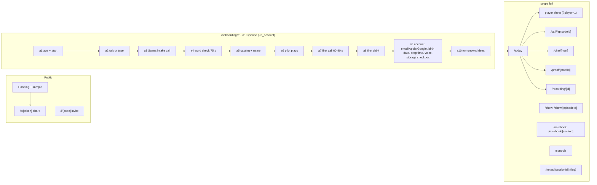

# 07. Client design

*`apps/web`: Next.js 15 (App Router), TypeScript strict, installable PWA on Vercel. Three tabs (Today, Show, Notebook) plus Controls; right-to-left and left-to-right from the language package; dark mode by `prefers-color-scheme` with an override. The visual reference is the prototype at `design/prototype/for-one-prototype.html` (night studio, voice orbs, generated contour art), not a card grid. No images of people, no mascot, no chart component exists.*

## 1. Routes

Every sheet (player, word sheet, notes) is a route or search param so the back gesture closes it. Route → document → events mapping is in `architecture/06 §4.2`; the API in [02](02-api-contracts.md).

## 2. State

| Concern | Where | Rule |
|---|---|---|
| Server documents (`TodayDoc`, `EpisodeDoc`, `ChatDoc`, `NotebookDoc`, `ControlsDoc`, `ShelfDoc`, `RecordingDoc`, `ProofDoc`) | TanStack Query, key `[doc, id, lm_version]`, `staleTime 30 s`, persisted to IndexedDB for offline reads | any response's `X-Forone-LM-Version` newer than the cached one invalidates learner-model documents |
| Player | `PlayerStore` (Zustand), one instance across routes | position written to `doors` every 15 s and on pause; Media Session metadata from the episode card |
| Call | `CallStore` (Zustand) | phase and turn from `forone.ui`; caption buffer; nothing persisted |
| Event queue | IndexedDB `forone-queue` | every event appended locally first, flushed in batches of ≤ 50 every 5 s or on `visibilitychange`; replayed with `X-Forone-Replay: 1` for up to 24 h; ids are UUIDv7 minted on the device so replays dedupe |
| Episode memory | IndexedDB `forone-memory` + Cache Storage | today's and yesterday's audio, manifest, word index; evicted when a new episode is published |
| Per-viewer conveniences | `localStorage` (try/catch) | theme override, last tab, "earphones suggested" flag |
| Navigation | URL | sheets are routes |

The client holds no copy of the learner model; facts, counts and claims come from documents and die with the query cache.

## 3. The player

- `<audio>` on `full.mp3` with `Range`; segments are for streaming on-demand episodes (`MediaSource` when supported, otherwise the player follows `manifest.segments` and swaps `src` at seams).
- Word-synced transcript from `manifest.lines[].words` (`timing_quality = sentence` degrades to line highlight); folded by default for intermediate learners (`skills.transcript_default`), opened by a tap or by "Huh?".
- **Huh?** replays the last sentence at 0.85× and shows it; emits `huh {line_id, sentence_text, unit_ids}`.
- Speeds 0.75 / 0.85 / 1.0; previous-track on the lock screen replays the sentence (`replay_line {source: media_session}`).
- Cold open: the first 30 s have no transcript and record nothing.
- Media Session API: title, host names, cover PNG rasterized from the SVG cover; actions play, pause, seek, previous (replay). Screen Wake Lock on the call screen only.
- `play`/`pause`/`seek`/`speed` events with `position_ms`; an episode counts as an active day at 50% played.

## 4. The word sheet

Opens from any tap on a transcript or article word in under 300 ms with no network: `word_index.json` is loaded with the episode. Shows gloss in the native language, the example sentence, a play button for the gloss audio, "keep". Emits `tap {unit_id, lemma, sense_key}` and `keep`. A unit in `missing[]` calls `GET /gloss` live.

## 5. The call screen

```mermaid
stateDiagram-v2
  [*] --> planning : POST /calls ok; 3 words for 30 s
  planning --> connecting : learner taps "call"
  connecting --> live : forone.ui state OPENING
  live --> live : captions, hold pad, word button, ✕
  live --> fallback : fallback_required
  fallback --> live_notes : voice-note mode (record ≤ 90 s, send, host audio reply)
  live --> ended : ui.ended
  live --> crisis : ui.crisis (resources card, call ends)
  live_notes --> ended
  ended --> [*] : back to Today (chat opens within 30 s)
```

Controls: a hold pad (hold to keep the floor; `hold.down/up`), a word button (talkback; `talkback.down/up`), captions (default on; the recast span rendered one shade brighter for one second, never labelled), ✕. Audio: the mic track at 48 kHz, echo cancellation and noise suppression on, auto gain off; the host track played through the same `<audio>` element as the player so iOS keeps the audio session; the client buffers the last host line for previous-track replay. iOS Safari: a wake lock, and the "earphones, keep the screen on" note once; if the screen locks the worker pauses up to 20 s. Round two (flag) is offered on Today the next day.

## 6. Offline and PWA

- Service worker (Workbox): app shell precached; `GET /today` and documents network-first with cache fallback; episode media cache-first once downloaded; the event queue flushes with Background Sync where available.
- `manifest.webmanifest` with the show colour per learner; install handoff (`POST /handoff/mint` → `exchange`) carries the session into the installed app.
- Offline: today's episode plays, the transcript and word sheet work, events queue, the call is unavailable (a plain line, no error state), Today shows the last document with an "offline" word in the corner.
- Push: `PushManager` subscription stored by `POST /push/subscribe`; the one drop notification carries title and length only; tapping opens `/today`.
- Private feed: `GET /feed/url` shows the tokenized RSS URL and a one-tap "open in podcast app" (Apple Podcasts, Overcast, Pocket Casts deep links); a feed episode link carries `k` for `POST /links/exchange` so the call can start from the podcast app with one tap.

## 7. Onboarding specifics

A3 runs the Salma call on the same call screen in `onboarding` kind, with live fact cards (`fact_card` from the worker; edit or remove inline); A4 is a 48-item yes/no grid, 75 s cap; A5 plays three "hello" clips per host and three name candidates; A6 streams the pilot with `episode.manifest` updates; A9 creates the account **after** the first call (email code, Apple, Google), asks birth date (under 18 ends the flow and deletes the pre-account learner), drop time and anchor, the voice-storage checkbox with its one plain sentence; A10 shows tomorrow's three ideas. First-open-to-Salma under 60 s; first spoken sentence under 5 min.

## 8. Today

One hero (today's episode and its doors as four words with ticks), the host line (always a confirmed memory), the proof above the hero on proof day, the recording offer, the round-two offer (flag), tomorrow's teaser once done, the three ideas when due, the once-only crisis resources card, the day-7 payment card (Salma's one sentence and the three plans with "Recommended" on the middle; never a wall). Plans with 2 or 3 episodes a day show a plain "another one today?" line when a slot remains (`next_slot.available`); never a count of unplayed episodes.

## 9. Accessibility, text direction, performance

RTL when the native language is RTL (`dir` from the package; logical CSS properties only); Arabic and Latin typography from the package font stack (Readex Pro for Arabic in the prototype); text size control in Controls; every control reachable by keyboard and labelled; captions and transcripts are the accessible alternative to audio. Budgets: LCP under 2.5 s on a mid-range Android over 4G; the word sheet under 300 ms; JS under 250 KB gzipped on the Today route; images none, covers are SVG.

## 10. Analytics without surveillance

Only the event log. No third-party analytics, no session replay, no fingerprinting. `POST /telemetry` carries anonymous web vitals from the public pages. Sentry for errors with the learner pseudonym only and PII scrubbing on.
