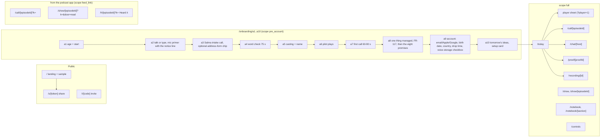

# 07. Client design

*`apps/web`: Next.js 15 (App Router), TypeScript strict, installable PWA on Vercel through Serwist. Three tabs (Today, Show, Notebook) plus Controls; right-to-left and left-to-right from the language package; dark by default, light as a Controls choice (ADR-24.22). The visual reference is the prototype at `design/prototype/for-one-prototype.html` (night studio, voice orbs, generated contour art), not a card grid. No images of people, no mascot, no chart component exists. Where this file and `architecture/06-client-and-delivery.md` differ, 06 wins and this file is corrected.*

## 1. Routes

Every sheet (player, word sheet, plan picker, gap note) is a route or search param so the back gesture closes it. Route → document → events mapping is in `architecture/06 §4.2`; the API in [02](02-api-contracts.md).

## 2. State

| Concern | Where | Rule |
|---|---|---|
| Server documents (`TodayDoc`, `EpisodeDoc`, `ChatDoc`, `NotebookDoc`, `ControlsDoc`, `ShelfDoc`, `RecordingDoc`, `ProofDoc`, `UiBundle`) | TanStack Query, key `[learner_key, doc, id, lm_version]`, `staleTime 30 s`, persisted to IndexedDB per `learner_key` for offline reads | any response's `X-Forone-LM-Version` newer than the cached one invalidates learner-model documents; the persisted cache is deleted on sign-out or a change of learner |
| Player | `PlayerStore` (Zustand), one instance across routes | position written to `EpisodeMemory` every 5 s and on pause, and mirrored to `doors` on pause and `visibilitychange`; Media Session metadata from the episode card |
| Call | `CallStore` (Zustand) | phase and turn from `forone.ui`; caption buffer; nothing persisted |
| Event queue | IndexedDB `forone-queue:{learner_key}` | every event appended locally first, flushed in batches of ≤ 50 every 2 s or on `visibilitychange`; replayed with `X-Forone-Replay: 1` for up to 24 h; ids are UUIDv7 minted on the device so replays dedupe; each batch stores its `learner_id` and is dropped, never replayed, under another learner's session; a 401 or 403 holds the batch |
| Episode memory | IndexedDB `forone-memory:{learner_key}` + Cache Storage `forone-media-v1:{learner_key}` | the last three episodes (`web.sw.cache_episodes_n = 3`): `episode.m4a`, `timings.json`, `glosses.json`, `package.json`, article and recap audio, the cover; one when storage is short |
| Per-viewer conveniences | `localStorage` (try/catch) | the last known theme for first paint (the setting itself is `PUT /controls {theme}`), last tab, "earphones suggested" flag |
| Navigation | URL | sheets are routes |

`learner_key` is a short hash of the learner id from `TodayDoc`, never the id itself. Sign-out, a `410`, or a different learner in the same browser (a shared phone, a feed link for someone else) deletes the previous learner's caches and databases (06 §4.6 rule 7). The client holds no copy of the learner model; facts, counts and claims come from documents and die with the query cache.

## 3. The player

- One `<audio>` element on the stitched app file `episode.m4a` (AAC, written with `-movflags +faststart`). When the file is in Cache Storage it plays from a Blob URL read out of the cache (`URL.createObjectURL(await (await caches.match(url)).blob())`), never through the service worker's fetch handler. Otherwise it plays the 10-minute presigned S3 URL (`sse_kms_env`, ADR-12) with `Range`, `crossOrigin = "anonymous"`. No MediaSource: on-demand episodes that are still rendering (swap, return, pilot, `daily_extra`) play their scene files on two elements and hand off at the seams, then switch to the stitched file when the republished manifest arrives.
- Media URLs: `EpisodeDoc.media` carries each asset as `{asset, url, expires_at}`, presigned when the document is read; an expired one is refreshed with `GET /v1/episodes/{id}/media/{asset}` → `200 {url, expires_at}` (JSON, never a 302; 06 §3.3). The request to `api` sends the cookie (`credentials: "include"`); the request to S3 sends none (`credentials: "omit"`). Learner-voice clips (marks, proof evidence, kept recordings) stay behind `GET /v1/media/{media_object_id}` with `crossOrigin = "use-credentials"`.
- Word-synced transcript from `timings.json` (`lines[].sentences[].words`); `timing_quality = sentence` degrades the highlight to the sentence and plays the sentence for 🔊; folded or open from `player_defaults.transcript_open` (open for the pilot), opened by a tap or by Huh?.
- **Huh?** replays the previous sentence at 0.85× and shows it with up to four glosses; emits `huh {line_id, sentence_text, unit_ids}`.
- Speeds 0.75 / 0.85 / 1.0 and nothing else; previous-track on the lock screen replays the sentence (`replay_line {source: media_session}`); next-track marks the moment, with a 1 s toast and the soft click, the client's one UI sound (ADR-24.22).
- Cold open: the first 30 s have no transcript and record nothing.
- Media Session: title, host names, the cover PNG from the same-origin `/covers/{episodeId}.png`; actions play, pause, seek (snapping to seams), previous (replay), next (mark). In the `thrown` state the play action does nothing (PRD 4 rule 2). No next-episode control anywhere in the player.
- `play`/`pause`/`seek`/`speed` events with `position_ms`; half an episode played makes the day active.

## 4. The word sheet

Opens from any tap on a transcript or article word in under 300 ms with no network: `glosses.json` (the `WordIndex`) is loaded with the episode. Shows the gloss in the native language, the example sentence, 🔊 (the episode audio at the word's `[s, e]` on a second element sharing the Blob URL), "keep". Emits `tap {unit_id, lemma, sense_key}` and `keep`. A unit in `missing[]` calls `GET /gloss` live.

## 5. The call screen

```mermaid
stateDiagram-v2
  [*] --> planning : POST /calls ok; 3 words for 30 s
  planning --> connecting : learner taps "call"
  connecting --> live : forone.ui state OPENING
  live --> live : captions, hold pad, word button, ✕
  live --> fallback : fallback_required
  fallback --> live_notes : voice-note mode (record ≤ 90 s, send, host audio reply)
  live --> crisis : ui.crisis (clips, resources card, continue or stop)
  crisis --> live : crisis.continue
  crisis --> ended : crisis.stop or 60 s
  live --> ended : ui.ended
  live_notes --> ended
  ended --> [*] : back to Today (chat opens within 30 s)
```

Controls: a hold pad (hold to keep the floor; `hold.down/up`), the word button (talkback; `talkback.down/up`: the learner asks in their own language and the host says the word back in the target language; Salma never speaks in a call except the native-language crisis clip, ADR-24.B22, B29), captions (default on; the host's line as said, with no emphasis on any word: a highlighted recast would be a correction surface, ADR-06), ✕. Audio: the mic track at 48 kHz, echo cancellation and noise suppression on, auto gain off; when the call screen mounts it pauses the player and takes the Media Session handlers, and gives them back on unmount (06 §4.4.7). **iOS audio session:** every capture (the call, the small door, shadow, say it once, the recording screen, voice notes) calls `track.stop()` on every track when it ends and on unmount, and where `navigator.audioSession` exists the type is `play-and-record` while capturing and `playback` after, so the episode does not come out of the earpiece at low volume after a call (06 §4.4.9). Screen Wake Lock on the call screen, plus the silent video loop where `wakeLock` is missing or in iOS standalone before 18.4; the "earphones, keep the screen on" note once; if the screen locks the worker pauses up to 20 s. Round two (flag) is offered on Today the next day.

## 6. Offline and PWA

- **Service worker (Serwist, `@serwist/next`).** The app shell is precached. `GET /v1/today`, `/v1/shelf` and `/v1/package/ui` are NetworkFirst with a 3 s timeout and the cache as the fallback (never stale-while-revalidate, which renders one refetch late after every stream nudge). Show audio is not a runtime route: `warm()` in `lib/media/` writes it into `forone-media-v1:{learner_key}` under the stable `/v1/episodes/{id}/media/{asset}` key, storing only full 200 responses. The event queue flushes with Background Sync where available. A new service worker activates only when every open tab reports idle (a paused episode counts as busy, so Now Playing is never killed by a reload) and no call or recording runs.
- **The warm.** Four triggers: the drop push (below); `today.changed {episode_ready|extra_ready|session_closed}` while the page is open; after a play that streamed; and as soon as Today shows the hero `ready` with a cold cache, with a `preconnect` to the media host.
- **Push.** The permission is asked only from a tap. On Android the button is on A10's setup card; on iOS web push works only in the installed app, so the button appears on the first standalone launch (`app_open {entry: install_handoff}`) and in Controls. On every open the page compares `pushManager.getSubscription()` with the server and re-posts or re-subscribes (`pushsubscriptionchange` is unreliable in Safari). The service worker shows the notification **first** and warms the cache **after** it in the same `waitUntil` (WebKit revokes subscriptions whose pushes show nothing); the drop payload is `{kind: drop, title, url, episode_id, manifest_version, learner_key}`, title and length only; tapping opens `/today?entry=push` and never starts audio.
- **Install handoff.** `manifest.webmanifest` is served per learner with the show colour and `start_url=/today?h=` (`POST /handoff/mint` → `exchange`), which carries the session into the installed app.
- **Offline.** Today's episode plays, the transcript and word sheet work, events queue, the call is unavailable (a plain line, no error state), Today shows the last document with an "offline" word in the corner.
- **Private feed.** `GET /feed/url` shows the tokenized RSS URL and a one-tap "open in podcast app" (Apple Podcasts, Pocket Casts, Podcast Addict, with Overcast's deep link where installed). Each feed item carries three links: the call (`/call/{id}?k=`), the article (`/show/{id}?k=&door=read`) and **"Heard it"** (`/h/{id}?k=` → `POST /links/heard`, which writes `feed_heard {episode_id}` so a learner who only listens in the podcast app still makes the day active; a statement, never inferred from a download). `POST /links/exchange` turns a call or article `k` into a **limited `feed_link` session**: that episode's call, article, its host's chat thread and Today; no Salma thread, no notebook, no Controls, billing, export or deletion, enforced by `api`. Each `k` works once; a second use asks for sign-in. In-app browsers (SFSafariViewController) are rows in the week-3 device matrix, and `feed_to_call_ms` is logged with `ua_family`.

## 7. Onboarding specifics

A2's mic primer carries the notice line ("Salma is an AI. Your voice is used only to run this talk and build your show; nothing is kept unless you make an account. Privacy notice.", ADR-24.B14). A3 runs the Salma call (persona and voice from the native package) on the same call screen in `onboarding` kind, with live fact cards (`fact_card` from the worker; edit or remove inline) and an optional address-form chip (masculine, feminine or neutral wording; neutral by default; never inferred; `PUT /controls {address_form}`, ADR-24.B26); A4 is a 48-item yes/no grid, 75 s cap; A5 plays three "hello" clips per host and three name candidates; A6 streams the pilot with `episode.manifest` updates; A8 is FR-117's one thing managed (the host names one real thing the learner did in the first call's goodbye, then one line on screen) followed by the eight promises; A9 creates the account **after** the first call (email code, Apple, Google), asks birth date (under 18 ends the flow and deletes the pre-account learner), the country of residence with a picker (never from IP), drop time and anchor, the voice-storage checkbox with its one plain sentence. Sign in with Apple uses `form_post`: the pre-account session is found through the signed `state` in `auth_states`, not a cookie (06 §4.9 rule 4). A10 shows tomorrow's three ideas and the setup card. First-open-to-Salma under 60 s; first spoken sentence under 5 min.

## 8. Today

One hero (today's episode and its doors as four words with ticks), the host line (always a confirmed memory), the proof above the hero on proof day, the recording offer, the round-two offer (flag), tomorrow's teaser once done, the three ideas when due, the once-only crisis resources card, the day-7 payment card (Salma's one sentence and the three plans with "Recommended" on the middle; never a wall). On `two_a_day` and `three_a_day`, one "Next one" button appears when `TodayDoc.allowance.next_available` is true: the plan has room and the listen door is done or skipped, or a later door has started (FR-206). It calls `POST /v1/episodes/next` with an `Idempotency-Key` (UUIDv7 minted on the tap; the button disables on the first tap; `api` locks the session row and returns the first answer for a repeated key), and the swap uses the same rule. The extra streams and never autoplays; the Show tab lists the day's episodes; never a count of unplayed episodes. A "New for you" card appears only from passed `did_it` and `first_ever` claims.

## 9. Accessibility, text direction, performance

RTL when `packages/native/<native_language>/` says so (`dir` from the native package; logical CSS properties only); digits follow the locale (ADR-24.22). Typography is the design system's (design/01): Readex Pro for body text in every script, Anybody for display, Martian Mono for labels, self-hosted through `next/font`; sizes and line-heights from design/01's type table; `html { font: -apple-system-body }` so iOS Dynamic Type reaches the root size, rem everywhere; text size control in Controls. Controls also sets the theme (dark by default), the interface language and the address form (`PUT /controls`). Every control reachable by keyboard and labelled; captions and transcripts are the accessible alternative to audio. CSP as 06 §4.14 (nonce'd scripts, no third-party script, `media-src` and `connect-src` limited to `api`, the media host and LiveKit; no `dangerouslySetInnerHTML`). Account deletion is a typed "delete" with no grace period (`DELETE /me` → 202, then 410; ADR-24.B1). Budgets: dropped episode start under 2 s (p95 on 4G, measured by region, warm and cold apart); LCP under 2.5 s on a mid-range Android over 4G; the word sheet under 300 ms; JS under 250 KB gzipped on the Today route; images none, covers are SVG.

## 10. Analytics without surveillance

Only the event log. No third-party analytics, no session replay, no fingerprinting. `POST /telemetry` carries anonymous web vitals from the public pages. Sentry for errors with the learner pseudonym only and PII scrubbing on.

## 11. Revision log

- 2026-11-12: aligned to `architecture/06` after its skeptic review: the recast highlight in captions removed (ADR-06); `episode.m4a` played from a Blob URL or a presigned URL, no MediaSource; media URLs as JSON; Serwist with NetworkFirst documents; position every 5 s and flush every 2 s; three cached episodes; learner-namespaced caches and queues; fonts per design/01; `allowance.next_available` per FR-206; idempotency keys; the narrowed feed-link scope and "Heard it"; the notification before the warm; the iOS audio session; dark by default; A8 per FR-117; the crisis continue path.
