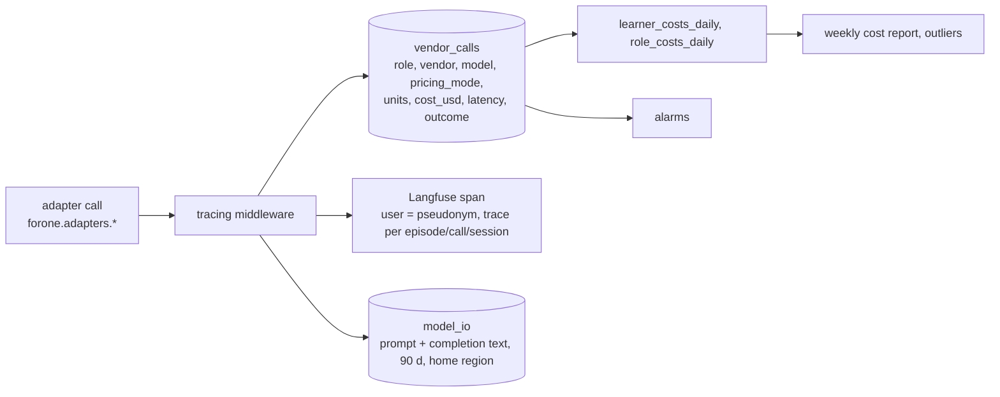

# 09. Observability, evals and cost controls

*Every model call is traced with cost; every PRD budget is an alarm; the offline suite gates deploys; the spend guard can slow or halt production. None of it is ever shown to the learner.*

## 1. Tracing

Conventions: trace ids `episode:{id}`, `call:{id}`, `session:{id}`; span names `{role}.{step}`; every span carries `prompt_version`, `learner_model_version`, `pricing_mode`, `price_book_ids`; `units` is the vendor's reported usage (`estimated = true` when counted locally). Logs are structured JSON (`structlog`) with `learner_pseudonym`, never names or text; Sentry with PII scrubbing. OpenTelemetry traces from `api`, `workflows` and `call-worker` to a collector; metrics to CloudWatch.

## 2. Measures from the log

`forone.measures` computes every PRD 16.1 and 16.2 number from `events` and `vendor_calls`, nightly and on demand: active days, unprompted return, "worth it" answers, call completion and abandonment, host talk share, median learner turn length, Huh? rate, taps per 100 words, talkback per call, recast uptake, move violations, explicit corrections per 100 turns (ceiling 0), wrong-memory flags per 100 callbacks, plan mix and blended margin by plan, time to first sound, cost per session by role and vendor, escalation rate (batch → standard), fallback rate, verbatim coverage (turns with verbatim done / turns), claim pass rate by rule. The team dashboard (admin) renders them; the learner never sees any.

## 3. Alarms (Part 15 budgets and the stop line)

| Rule | Threshold | Page |
|---|---|---|
| host reply latency | p50 > 1.5 s or p95 > 2.5 s over 20 calls | yes |
| call connect | p95 > 3 s | yes |
| episode not ready at drop | one learner: P2 with dedupe; 3 or more learners or 5%: `drops_late_systemic` P1 | yes |
| pilot first sound | p95 > 45 s | day |
| swap or return first sound | p95 > 30 s | day |
| after-pass completion | p95 > 10 min | day |
| ephemeral audio past expiry | any row | yes |
| revoke not purged in 24 h | any | yes |
| deletion not complete in 24 h | any | yes |
| cost per session (7-day mean) | > $0.75 warn (`cost_runaway`, P1); > $1.00 stop line (`cost_stop_line`, P3 plus the ticket) | yes / ticket |
| daily spend | > 1.5 × the 7-day mean | yes |
| batch escalation rate | > 20% | day |
| editor fail rate | > 15% first pass | day |
| fallback episodes | 3 for one learner in 7 days | yes |
| move violations | > 5% of host turns | day |
| verbatim failures | > 2% of turns | day |
| vendor health | ≥ 5 failures and < 50% success in 10 min | auto-switch recognizers and editor; page for voices |
| recast uptake | < 20% for a structure over 2 weeks | report to teacher review |

## 4. Cost controls

- `prices.yaml` is the pull-request surface for every unit price with `valid_from`; the middleware prices each call at write time and stores the row ids used.
- Spend modes (`tracing.spend_mode()`): `normal`; `conserve` (teacher on Sonnet batch, one rewrite round, batch TTS where offered, no pre-write) when the 7-day mean passes $0.75 or the month's forecast passes budget; `halt` (no new swaps, pilots or samples; dailies and returns proceed) at the $1.00 stop line or a vendor billing anomaly. Flips write `audit_log` and page.
- `cost/rollup` fills `session_costs` (with `plan`); `cost/reconcile-spend` runs hourly against vendor dashboards; the weekly report carries "Margin by plan" (net price, measured episodes used, cost per learner-month, break-even at full use: $0.57 / $0.42 / $0.42).
- Per-learner outliers (cost > 3× median for 3 days) go to the weekly report with the role breakdown.
- Vendor risk calendar: Gemini price doubling 2027-01-01; ElevenLabs promo ended 2026-10-12; OpenAI TTS deprecation 2027-01-06; Hume voice shutdown 2026-11-13 (not used). The cost model (`tools/cost-model/assumptions.yaml`) is re-run on every price change in CI and the delta posted on the PR.
- Quotas at 100 and 10,000 learners are in `architecture/08 §4.9`; the beta needs no committed contracts.

## 5. Evaluation

**Offline suite** (`eval/suites.yaml`, `eval/thresholds.yaml`), run in CI on prompt or model changes and nightly against recorded vendor responses: 30 to 50 synthetic learners through `episode/produce` (plan validity 100%, coverage within 1 point of the hand checker, editor first-pass ≥ 90%, duration in bounds, law scan 0 hits, cost within 10% of model); 50 scripted calls through the worker with a simulated learner (move-contract violations < 5%, recasts only on target or blurred meaning, no grading or grammar talk, p50 latency gate); the analyst against the calibration set (QWK ≥ 0.7 on bands, tag precision ≥ 0.8); the fact validator against adversarial transcripts (0 unquoted facts stored); the claim gate against synthetic histories (no claim passes without clean, openable, like-for-like, beyond-noise, repeated evidence). `max_regression` thresholds compare with the baseline run; a failure blocks the deploy.

**Online**: canary episode and canary call on the synthetic learner after every deploy; human review of 10 random episodes per learner per month; blind listening tests (5 native target-language listeners and 5 native-language listeners per voice vendor); the external test (20 to 30 learners, week 0 and week 8) [P1].

**Model pinning**: every role's model id and prompt version in `vendors.yaml` (roles that depend on the target language are keyed by it) and `prompt_versions`; the rater pinned until 2027-02-16, next window from 2027-02-17; a model change triggers calibration re-run and, for the analyst or classifier, `assessment/rebuild`.

## 6. Feature flags and kill switches

`feature_flags {key, state (off|allowlist|percent|on), percent, allowlist, default, description, changed_by}`. Beta flags: `round_two`, `shadowing`, `dial_in`, `finale`, `tape` (P1 rollouts); `claims.kind.*` (kill switches; metric kinds off until calibration); `chat.enabled`, `talkback.enabled`, `drop.push`, `pipeline.editor_model`, `host.model=haiku`, `tts.batch`; `observer_slot` (LATER). A flag never changes a law; a kill switch's default is its safe state; every flip is audited; a flag `on` for 60 days is a cleanup ticket.

## 7. Operations

Jobs run around the clock on learner-local time (ADR-16): `measures/hourly` for local days that closed in the last hour, `privacy/verify` hourly over the last 25 hours, `retention/daily` per learner-local midnight, the digest at 06:00 UTC, the weekly report Mondays 06:00 UTC. `tools/release` refuses a deploy when more than 2% of learners have a drop in the next 45 minutes. Deploys: staging on every push to `main` (migrate → api and workflows rolling → call-worker drain-replace → smoke test with one sample and one scripted call); prod on tag with manual approval, refused inside call windows (local drop time + 0 to 3 h for active learners), canary afterwards. Runbooks (`ops/runbooks/`): episode not ready, vendor outage and switch, call latency regression, cost spike, deletion stuck, crisis review, rebuild. On-call: two people, Sunday to Thursday 10:00 to 16:00 in the team's zone with paging for the "yes" rows above. Backups: RDS 30 days, S3 versioning off (deletion must be real), Terraform state in S3 with locking.

## 8. What the first week must have

Tracing middleware with `vendor_calls` and Langfuse; `prices.yaml`; the event ingestion counters; the two vendor benches (`tools/vendor-lab` for the 30 clips, `tools/call-bench` for 50 calls) runnable against staging; the alarm rules checked into `ops/alerts.yaml`; the canary learner.
